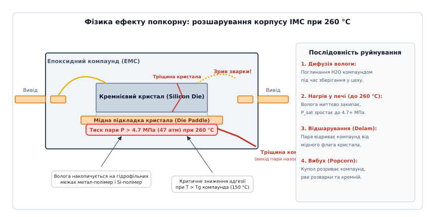
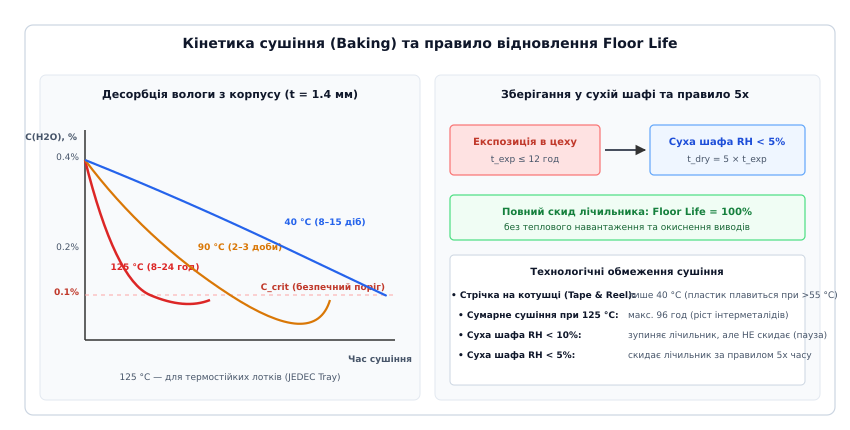

# Зберігання, ESD і пакування до відвантаження: вологочутливість MSL, сушіння та захисна тара

<preknowlist>
- [Пакування оплавленням (Reflow soldering)](root:hw-pcb/reflow-soldering) — температурні зони термопрофілю, пікова температура пайки 260 °C для безсвинцевих сплавів та швидкість нагріву.
- [Пакування й транспортування компонентів](root:hw-pcb/esd-packaging) — класи матеріалів, екранувальні та розсіювальні пакети, котушки й тубуси.
- [Антистатичне робоче місце](root:hw-pcb/antistatic-workplace) — заземлення персоналу, браслети, ESD-покриття столів та вирівнювання потенціалів за стандартом ANSI/ESD S20.20.
- [Прискорені кліматичні випробування](root:hw-pcb/pryskoreni-vyprobuvannia) — вплив підвищеної вологості, температури та термоциклування на надійність електронних компонентів.
- [Клітка Фарадея та екранування](root:ph-electromagnetism/faraday-cage) — розподіл заряду по провідній оболонці та захист вмісту від зовнішніх електростатичних полів.
- [Трибоелектричний ефект](root:ph-electromagnetism/triboelectricity) — генерація статичного заряду під час тертя та розділення діелектричних поверхонь.
</preknowlist>

Партія з трьохсот плат промислового контролера проходить через конвеєрну конвекційну піч оплавлення припою з піковою безсвинцевою температурою 260 °C. Після виходу з зони охолодження оптична інспекція фіксує катастрофічну картину: 22% мікросхем у корпусах QFN-64 та BGA-256 мають видимі тріщини пластикового корпусу, а по периметру деяких чіпів помітні застиглі кульки видавленого припою. Під час рентгенівського та акустичного мікроскопічного контролю (C-SAM) у зовні цілих мікросхем виявляються масивні внутрішні порожнини: полімерний компаунд повністю відшарувався від мідної підкладки кристала, а третина золотих розварювальних дротиків обірвана біля шийки контактних площадок кремнієвого кристала.

Ця технологічна катастрофа трапилася не через збій нагрівачів печі й не через дефект кремнію. Причина криється у фізиці поводження з негерметичними пластиковими корпусами: герметичні вологозахисні пакети з котушками мікросхем відкрили в цеху ще в понеділок вранці, але через затримку на лінії монтажу компоненти пролежали на відкритих стелажах чотири доби при цеховій температурі 28 °C та відносній вологості повітря 65%. За цей час полімерний компаунд мікросхем із рівнем вологочутливості MSL 4 (який дозволяє не більше 72 годин перебування на відкритому повітрі) наситився молекулами атмосферної води. Під час швидкого нагріву в печі зі швидкістю 2.5 °C/с рідка вода, замкнена в мікропорах пластику, миттєво перетворилася на перегріту пару з тиском понад 4.7 МПа (47 атмосфер), розірвавши корпус мікросхеми зсередини.

---

### Фізика ефекту попкорну: дифузія вологи та термодинаміка вибухового пароутворення

Більшість сучасних напівпровідникових компонентів виготовляють у негерметичних пластикових корпусах на основі епоксидних формувальних компаундів (*Epoxy Molding Compound, EMC*). На відміну від металокерамічних або суцільноскляних військових корпусів, полімерна матриця компаунда має мікропористу структуру з вільним об'ємом між ланцюгами зшитого полімеру. Молекули водяної пари з навколишнього повітря безперервно проникають крізь товщу пластику шляхом молекулярної дифузії, що описується другим законом Фіка для нестаціонарного одновимірного масопереносу:

```text
dC/dt = D(T) * (d²C/dx²)    [рівняння дифузії Фіка вздовж осі товщини x]

де коефіцієнт дифузії експоненційно залежить від абсолютної температури:
D(T) = D0 * exp(-E_a / (k_B * T))    [закон Арреніуса]
```

У цій залежності енергія активації дифузії вологи E_a для типових епоксидних компаундів становить 0.35–0.45 еВ при сорбції (поглинанні) та 0.75–0.90 еВ при десорбції (сушінні). При кімнатній температурі (20–30 °C) коефіцієнт дифузії вологи D(T) лежить у межах від 10⁻¹² до 10⁻¹³ м²/с.

Рівноважна гранична концентрація вологи на поверхні матеріалу C_sat визначається законом Генрі й прямо пропорційна парціальному тиску водяної пари в цеховому повітрі:

```text
C_sat = S(T) * P_H2O = S(T) * (RH / 100) * P_sat(T)

де:
S(T)     — коефіцієнт розчинності вологи в полімері (г / (см³ · кПа));
RH       — відносна вологість навколишнього повітря у відсотках;
P_sat(T) — тиск насиченої пари води при поточній температурі цеху.
```

За кілька днів або тижнів відкритий корпус мікросхеми товщиною 1.0–2.5 мм повністю насичується вологою, накопичуючи від 0.2% до 0.6% води від власної маси. Найбільша концентрація молекул H₂O зосереджується не в середині однорідного компаунда, а на внутрішніх міжфазних межах поділу матеріалів із різними фізико-хімічними властивостями та відмінними коефіцієнтами теплового розширення (*CTE*):
- на гідрофільній межі між мідною основою кристала (*die paddle / flag*) та епоксидним компаундом;
- на пасивованій оксидом або нітридом кремнію верхній активній поверхні кристала;
- вздовж поверхонь мідних ніжок рамки виводів (*leadframe*);
- усередині пористого шару епоксидного срібловмісного клею (*die attach*), що фіксує кристал на підкладці;
- на межі між органічною підкладкою з бісмалеїмід-триазину (BT-resin) та кулями припою у BGA-корпусах.


*Анатомія руйнування корпусу ІМС під час пайки при 260 °C: накопичена на внутрішніх межах волога миттєво перетворюється на пару під тиском понад 4.7 МПа, викликаючи пластичну деформацію компаунда, відрив кристала від мідної підкладки, механічний зрив розварювальних дротиків та наскрізне розтріскування корпусу («ефект попкорну»).*

Коли така вологонасичена плата потрапляє в зону нагріву печі оплавлення припою, температура виробу стрімко зростає від 150 °C до 260 °C зі швидкістю 1.5–3.0 °C/с. При цьому одночасно розгортаються три критичні фізичні явища:

1. **Миттєвий фазовий перехід води в перегріту пару:** За час проходження піку пайки (60–90 секунд) волога фізично не встигає повільно дифундувати назовні крізь полімер (постійна часу виходу τ ∝ L² / D становить десятки годин). Рідка вода, замкнена в мікрокапілярах та інтерфейсних щілинах, закипає. При температурі безсвинцевого піку T = 260 °C тиск насиченої водяної пари P_sat згідно з термодинамічними таблицями досягає катастрофічного значення:
```text
T = 100 °C  →  P_sat = 0.101 МПа  (1.0 атм)
T = 150 °C  →  P_sat = 0.476 МПа  (4.7 атм)
T = 215 °C  →  P_sat = 2.100 МПа  (20.7 атм, свинцева пайка Sn63Pb37)
T = 245 °C  →  P_sat = 3.650 МПа  (36.0 атм)
T = 260 °C  →  P_sat = 4.690 МПа  (46.3 атм, безсвинцева пайка SAC305)
```
Перехід електронної промисловості від евтектичного свинцевого припою Sn63Pb37 (температура плавлення 183 °C, пік пайки 215–220 °C) до безсвинцевих сплавів типу SAC305 (плавлення 217 °C, пік пайки 245–260 °C) збільшив внутрішній тиск пари у 2.23 раза — з 2.1 МПа до 4.7 МПа.

2. **Термомеханічна деградація компаунда вище температури склування (T_g):** Епоксидні компаунди мають температуру склування T_g у межах 130–165 °C. При нагріванні вище T_g полімер переходить із твердого склоподібного стану у високоеластичний каучукоподібний стан. Модуль пружності Юнга E стрибкоподібно падає в 10–25 разів (із 20–25 ГПа до 0.8–1.5 ГПа), а коефіцієнт лінійного теплового розширення зростає у 3–4 рази. Одночасно міцність адгезійного зчеплення епоксиду з металевим флагштоком падає на 85–95%.

3. **Формування купола розшарування (Blistering) та механічний обрив зв'язків:** Внутрішній тиск 4.7 МПа перевищує залишкову адгезійну міцність інтерфейсу. Пара утворює лінзоподібну порожнину під кристалом, відриваючи полімер від металу. Відбувається прогин тонкого дна корпусу. Ця деформація створює напруження зсуву від 50 до 120 МПа на тонких золотих або мідних розварювальних дротиках (діаметром 18–25 мкм). Дротики рвуться біля шийки контактної плями або зрізають самі контактні площадки з поверхні кристала. Якщо тиск пари перевищує межу міцності на розрив самого розм'якшеного компаунда, відбувається вибухове наскрізне розтріскування зі скиданням пари назовні — класичний ефект попкорну.

Крім того, вигинання дна в BGA-корпусах викликає геометричне деформування матриці куль припою. Кути чіпа підіймаються вгору або вигинаються дугою (*warpage*), утворюючи специфічний дефект пайки — **Head-in-Pillow (HiP)**, коли куля припою на корпусі торкається паяльної пасти на платі, але через оксидну плівку та кутовий перекіс не зливається з нею в єдиний монолітний меніск.

---

### Акустична мікроскопія C-SAM: діагностика прихованого розшарування

Найбільша небезпека ефекту попкорну полягає в тому, що у 80% випадків мікросхема не тріскається наскрізь. Тріщина залишається локалізованою всередині або проявляється лише мікроскопічним відшаруванням (*delamination*) кристала від мідного теплорозподільника. Зовні чіп виглядає ідеально, а після охолодження контакти дротиків можуть тимчасово зімкнутися під дією пружної усадки пластику.

Однак такий прихований дефект неминуче вбиває прилад у процесі експлуатації:
- тепловий опір перехід-корпус R_θJC зростає у 3–8 разів через наявність газового прошарку під кристалом, викликаючи локальний перегрів кремнію та деградацію напівпровідникових структур;
- у зазор між кристалом і підкладкою проникають залишки флюсу та конденсат, викликаючи корозію алюмінієвої металізації кристала;
- при зміні температури під час увімкнення та вимкнення приладу циклічні деформації повторно рвуть зварні контакти.

Для виявлення внутрішніх розшарувань використовують ультразвукову сканувальну акустичну мікроскопію (**C-Mode Scanning Acoustic Microscopy, C-SAM**). Метод базується на відбитті високочастотних ультразвукових хвиль (15–230 МГц) від меж поділу матеріалів із різним питомим акустичним імпедансом Z = ρ · c (де ρ — густина середовища, c — швидкість поздовжнього звуку в матеріалі).

Коефіцієнт відбиття амплітуди звукової хвилі R на межі середовищ 1 і 2 визначається формулою:

```text
R = (Z2 - Z1) / (Z2 + Z1)

де акустичні імпеданси становлять:
Z(Епоксидний компаунд) ≈ 3.2 * 10⁶  кг / (м² · с)
Z(Мідь, Leadframe)     ≈ 44.0 * 10⁶ кг / (м² · с)
Z(Кремній, Die)        ≈ 19.7 * 10⁶ кг / (м² · с)
Z(Повітря / Пара)      ≈ 400        кг / (м² · с)
```

На нормальній, монолітній межі «компаунд → мідь» коефіцієнт відбиття становить:
```text
R = (44.0 - 3.2) / (44.0 + 3.2) = +0.86    [відбиття без зміни фази]
```
Але якщо між компаундом і міддю виникло розшарування (газовий прошарок товщиною навіть у кілька нанометрів), ультразвукова хвиля падає на межу «компаунд → повітря»:
```text
R = (0.0004 - 3.2) / (0.0004 + 3.2) ≈ -1.00    [повне відбиття з інверсією фази на 180°]
```

Акустичний мікроскоп миттєво фіксує 100% інверсію фази відбитого ехо-сигналу. На акустичній томограмі монолітна зона відображається світло-сірим або зеленим кольором, а ділянка розшарування спалахує яскраво-червоним або білим кольором, однозначно виявляючи прихований брак після пайки.

---

### Класифікація вологочутливості: стандарт IPC/JEDEC J-STD-020

Для стандартизації стійкості корпусів до вологи асоціації IPC та JEDEC розробили базовий стандарт **J-STD-020** (*Moisture/Reflow Sensitivity Classification for Nonhermetic Solid State Surface Mount Devices*). Цей документ встановлює класифікацію на рівні **MSL 1 – MSL 6** та визначає допустимий час перебування компонентів на відкритому повітрі виробничого цеху — так званий строк цехового життя (**Floor Life**).

| Рівень MSL | Допустимий строк у цеху (Floor Life) | Умови навколишнього середовища цеху | Режим прискореного зволоження для тесту J-STD-020 |
|:---|:---|:---|:---|
| **MSL 1** | Необмежено (*Unlimited*) | ≤ 30 °C / 85% RH | 85 °C / 85% RH, 168 годин |
| **MSL 2** | 1 рік | ≤ 30 °C / 60% RH | 85 °C / 60% RH, 168 годин |
| **MSL 2a** | 4 тижні (28 діб) | ≤ 30 °C / 60% RH | 30 °C / 60% RH (696 год) або 85 °C / 60% RH (120 год) |
| **MSL 3** | 168 годин (7 діб) | ≤ 30 °C / 60% RH | 30 °C / 60% RH (192 год) або 85 °C / 60% RH (40 год) |
| **MSL 4** | 72 години (3 доби) | ≤ 30 °C / 60% RH | 30 °C / 60% RH (96 год) або 85 °C / 60% RH (20 год) |
| **MSL 5** | 48 годин (2 доби) | ≤ 30 °C / 60% RH | 30 °C / 60% RH (72 год) або 85 °C / 60% RH (15 год) |
| **MSL 5a** | 24 години (1 доба) | ≤ 30 °C / 60% RH | 30 °C / 60% RH (48 год) або 85 °C / 60% RH (10 год) |
| **MSL 6** | Обов'язкове сушіння перед пайкою | ≤ 30 °C / 60% RH | Витримка час за етикеткою (TOL) + оплавлення |

Категорія MSL визначається виробником компонента під час кваліфікаційних випробувань: тестову вибірку мікросхем спочатку повністю зневоднюють при 125 °C протягом 24 годин, потім витримують у кліматичній камері за відповідним режимом сорбції, тричі пропускають крізь піч оплавлення з піковою температурою 260 °C (симуляція первинного монтажу, перевороту плати для другої сторони та ремонтного перепаювання) і піддають скануванню C-SAM разом із перевіркою електричних параметрів.

#### Вплив геометрії та типу корпусу на рівень MSL
Рівень MSL суттєво залежить від внутрішньої конструкції мікросхеми:
- **SOIC, TSSOP, SOT-23 (малі корпуси):** Мають невелику площу підкладки кристала та коротку довжину шляху дифузії; зазвичай кваліфікуються як **MSL 1** або **MSL 2**.
- **QFP, TQFP, LQFP (середні та великі плоскі корпуси):** Велика площа мідної підкладки (понад 5 × 5 мм) створює значну силу відриву при тиску пари; типовий рівень — **MSL 3**.
- **QFN / DFN з відкритим нижнім тепловим падом (Exposed Pad):** Дуже тонкий шар компаунда під падом та масивна мідна пластина створюють високі термічні напруження; типовий рівень — **MSL 3** або **MSL 4**.
- **BGA, CSP, Flip-Chip, SiP (матричні корпуси):** Використовують багатошарові органічні підкладки з високою гігроскопічністю, чутливі до розшарування шарів та виникнення кратерів під кулями (*pad cratering*); класифікуються як **MSL 3, MSL 4 або MSL 5**.
- **WLCSP (Wafer-Level Chip Scale Package):** Не мають пластикового формувального компаунда (голий кремній із захисним шаром полііміду); зазвичай відповідають **MSL 1**.

---

### Дерайтинг Floor Life: вплив цехової температури та вологості

Базові значення Floor Life у стандарті J-STD-020 розраховані на строго фіксовані умови: **температура ≤ 30 °C, відносна вологість ≤ 60% RH**. Проте реальні кліматичні умови у виробничих приміщеннях можуть суттєво відхилятися від стандарту.

Стандарт J-STD-033 містить детальну матрицю перерахунку допустимого часу перебування компонентів (дерайтинг Floor Life) залежно від комбінації поточної температури та вологості цеху.

```text
Вплив вологості цеху на Floor Life компонентів MSL 3 (номінал 168 годин):
- Умови 30 °C / 60% RH (стандарт):  Floor Life = 168 годин (7 діб)
- Умови 30 °C / 70% RH (підвищена): Floor Life = 96 годин  (4 доби)
- Умови 30 °C / 85% RH (вологий цех): Floor Life = 24 години (1 доба!)
- Умови 25 °C / 40% RH (кондиціонер): Floor Life = 336 годин (14 діб)
- Умови 20 °C / 30% RH (сухий цех):   Floor Life = 672 години (28 діб)
```

Ця нелінійна залежність пояснюється тим, що швидкість накопичення критичної маси води в полімері прямо пропорційна парціальному тиску водяної пари. У спекотний літній день при 30 °C і 85% RH парціальний тиск водяної пари становить 3.61 кПа, тоді як при стандартних 30 °C / 60% RH він дорівнює 2.55 кПа, а в кондиційованому приміщенні при 22 °C / 40% RH — лише 1.06 кПа.

Якщо на виробництві відсутній прецизійний клімат-контроль і вологість перевищує 60%, інженер зобов'язаний програмно перераховувати швидкість вичерпання ліміту Floor Life з підвищувальним коефіцієнтом.

---

### Вологозахисне пакування (MBB), осушувачі та індикаторні картки

Поводження з вологочутливими деталями на всіх етапах — від пакування виробником до встановлення на плату — регламентує стандарт **IPC/JEDEC J-STD-033** (*Handling, Packing, Shipping and Use of Moisture/Reflow Sensitive Surface Mount Devices*).

Усі компоненти з рівнем від MSL 2 до MSL 5a упаковують у спеціальну систему сухого захисту (**Dry Pack**), що складається з чотирьох взаємопов'язаних елементів:

```text
+-------------------------------------------------------------------------+
|                  Вологозахисний пакет (MBB Bag)                         |
|  [Зовнішній поліестер] + [Алюмінієва фольга] + [ESD-поліетилен]         |
|                                                                         |
|   +-------------------+    +--------------------+    +--------------+   |
|   |  Котушка/лоток    |    |  Пакети осушувача  |    |  Індикаторна |   |
|   |  із компонентами  |    |  (Desiccant Units) |    |  картка HIC  |   |
|   +-------------------+    +--------------------+    +--------------+   |
|                                                                         |
|  Герметичний вакуумний термошов (ширина >= 6 мм)                        |
+-------------------------------------------------------------------------+
|  Зовнішнє маркування: Етикетка вологочутливості MSL + Символ ESD        |
+-------------------------------------------------------------------------+
```

#### 1. Вологозахисні пакети (Moisture Barrier Bags, MBB)
Звичайні антистатичні рожеві або прозорі пакети не захищають від вологи: швидкість проникнення водяної пари (*Water Vapor Transmission Rate, WVTR*) крізь тонкий поліетилен становить 5–15 г/(м² · доба).

Справжній пакет MBB виготовляють із багатошарового ламінату товщиною 100–150 мкм:
- **Зовнішній шар:** Орієнтований нейлон (Polyamide) або поліетилентерефталат (PET), що забезпечує високу механічну міцність на прокол гострими ніжками мікросхем чи кутами лотків.
- **Середній бар'єрний шар:** Суцільна алюмінієва фольга товщиною 7–9 мкм або вакуумне напилення алюмінію високої щільності. Цей шар знижує проникність пари до значення WVTR < 0.002 г/(м² · доба) (у 5000 разів щільніше за звичайну плівку).
- **Внутрішній герметизуючий шар:** Антистатичний антифрикційний поліетилен низької щільності (LDPE) з питомим поверхневим опором 10⁵ – 10¹¹ Ом/кв, що дозволяє зварювати пакет термоножем при 170–200 °C.

#### 2. Осушувачі (Desiccants)
Всередину пакета обов'язково закладають гранульований вологопоглинач — силікагель (*Silica Gel*) або активовану бентонітову глину (*Montmorillonite Clay*). Кількість осушувача вимірюють у стандартизованих одиницях — **Units** за стандартом EIA-583 / MIL-D-3464. Одна одиниця осушувача (1 Unit ≈ 28–33 грами глини) здатна поглинути щонайменше 3.0 грами вологи при відносній вологості 20% (при 25 °C) та не менше 6.0 грамів при 40% RH.

Розрахунок кількості одиниць осушувача U для пакета виконують за формулою стандарту J-STD-033:

```text
U = 0.011 * A * WVTR * M / D_cap

де:
A     — загальна площа поверхні пакета в квадратних дюймах (2 * довжина * ширина);
WVTR  — проникність пакетного матеріалу (г / 100 дюймів² за добу, зазвичай 0.0006);
M     — бажаний гарантійний термін зберігання в місяцях (стандартно 12 або 24 місяці);
D_cap — вологоємність однієї одиниці осушувача (стандартно 0.16 г/Unit при 10% RH).
```

#### 3. Індикаторні картки вологи (Humidity Indicator Cards, HIC)
Щоб оператор під час відкриття пакета міг перевірити, чи не було порушено герметичність шва в дорозі, всередину вкладають хімічну картку HIC з чутливими плямами (зазвичай на 5%, 10% та 60% RH).

Плями просочені хлоридом кобальту (CoCl₂) або екологічними мідно-органічними солями. При насиченні вологою сіль гідратується, змінюючи колір із синього на рожевий (або з коричневого на блакитний для безкобальтових карток):
- Якщо пляма **5%** рожева, а **10%** синя (для MSL 2–3) — усередині сухо, деталі готові до монтажу.
- Якщо пляма **10%** змінила колір на рожевий (для компонентів MSL 2a–5a) або пляма **5%** рожева (для MSL 2) — пакет увібрав вологу; компоненти **заборонено паяти**, їх необхідно негайно відправити на сушіння (*Baking*).
- Якщо пляма **60%** стала рожевою — пакет розгерметизовано, осушувач повністю вичерпано.

---

### Сушіння компонентів (Baking): режими, термошафи та технологічні обмеження

Якщо мікросхеми пробули на відкритому повітрі довше за допустимий Floor Life або індикаторна картка HIC показала перевищення вологи під час відкриття пакета, компоненти необхідно висушити перед встановленням у піч. Сушіння (*Baking*) — це процес термічної десорбції вологи, зворотний до дифузії.

Швидкість виходу вологи експоненційно зростає з підвищенням температури. Стандарт J-STD-033 регламентує три основні температурні режими сушіння залежно від товщини корпусу та типу тари:

| Товщина корпусу | Рівень MSL | Високотемп. сушіння при 125 °C (JEDEC Trays) | Середньотемп. сушіння при 90 °C (≤ 5% RH) | Низькотемп. сушіння при 40 °C (Tape & Reel, ≤ 5% RH) |
|:---|:---|:---|:---|:---|
| **≤ 1.4 мм** | MSL 2 | 5 годин | 17 годин | 3 доби (72 год) |
| **≤ 1.4 мм** | MSL 3 | 9 годин | 27 годин | 8 діб (192 год) |
| **≤ 1.4 мм** | MSL 4 | 11 годин | 34 години | 10 діб (240 год) |
| **≤ 1.4 мм** | MSL 5 | 15 годин | 41 година | 13 діб (312 год) |
| **≤ 2.0 мм** | MSL 3 | 18 годин | 54 години | 15 діб (360 год) |
| **≤ 4.5 мм** | MSL 3 | 48 годин | 144 години | 45 діб |


*Кінетика десорбції вологи з корпусу ІМС при різних температурах сушіння (125 °C, 90 °C, 40 °C) та діаграма відновлення Floor Life за правилом 5x у сухій шафі з вологістю RH < 5% без термічного стресу виводів.*

#### 1. Високотемпературне сушіння при 125 °C (найшвидше)
- **Час витримки:** від 5 до 48 годин.
- **Матеріальні обмеження:** Вимагає спеціальних високотемпературних лотків (**JEDEC High-Temp Trays** із рідкокристалічного полімеру LCP або поліефірсульфону PES), маркованих написом `MAX TEMP 150°C`.
- **Головний ризик:** Окиснення луджених виводів та потовщення шару крихких інтерметалідів (*Intermetallic Compounds, IMC*) між мідною основою та олов'яним покриттям (Cu₆Sn₅ та Cu₃Sn). При тривалому нагріванні шар чистого олова повністю перетворюється на інтерметаліди, а на межі розділу виникають пори Кіркендалла (*Kirkendall voids*). Стандарт J-STD-033 категорично обмежує **сумарний час сушіння при 125 °C лімітом 96 годин** за всю історію життя компонента. Перевищення цього ліміту призводить до незмочування припоєм під час пайки (*dewetting / non-wetting*).

#### 2. Середньотемпературне сушіння при 90 °C (універсальне)
- **Час витримки:** у 2.5–3 рази довший, ніж при 125 °C.
- **Застосування:** Використовується для середньотемпературних лотків, маркованих як `MAX TEMP 100°C`. Вологість у камері повинна підтримуватися на рівні ≤ 5% RH.

#### 3. Низькотемпературне сушіння при 40 °C (для котушок Tape & Reel)
- **Час витримки:** від 3 до 15 діб при відносній вологості ≤ 5% RH.
- **Чому так довго:** Термоформовані пластикові кишеньки стрічки (*Carrier Tape*) виготовляють із полістиролу або полікарбонату, а прозору захисну стрічку (*Cover Tape*) фіксують термоклеєм. При температурі понад 55–60 °C стрічка деформується, плавиться і заклинює в живильнику автомата монтажу (*feeder*). Тому сушіння цілих котушок без перепакування проводять виключно при 40 °C у спеціальних шафах сухого зберігання з ультранизькою вологістю.

---

### Розрахунок Floor Life та алгоритм зупинки/скидання лічильника

На реальному виробництві виникає щоденна задача: котушку MSL 3 (ліміт 168 годин) відкрили на лінії, відпрацювали 12 годин і повернули на склад. Чи треба її сушити при 125 °C, чи можна просто сховати в суху шафу?

Стандарт J-STD-033 визначає точні правила перерахунку експозиції та керування лічильником часу:

```text
Випадки керування відкритими компонентами:
1. Експозиція t_exp <= 12 годин (для MSL 2, 2a, 3) або <= 8 годин (для MSL 4, 5, 5a):
   --> Поміщення в суху шафу з RH <= 5%:
       Потрібний час відновлення: t_dry = 5 * t_exp.
       Після витримки t_dry лічильник Floor Life ПОВНІСТЮ СКИДАЄТЬСЯ до 100%.

2. Поміщення в суху шафу з RH <= 10%:
   --> Лічильник Floor Life СТАВИТЬСЯ НА ПАУЗУ, але час не відновлюється.
       При повторному винесенні в цех відлік продовжується з точки зупинки.

3. Експозиція перевищила ліміт Floor Life або вичерпано доступний час:
   --> Потрібне повне термічне сушіння (Baking при 125 °C або 40 °C).
```

Для автоматизації обліку вологозахисту нижче наведено інженерну реалізацію на мовах C99 та C++20. Повний проект консольного трекера з журналюванням переміщень доступний у практичній вставці ⚙️ [Калькулятор Floor Life та відновлення сушінням](root:hw-pcb/moisture-sensitivity-levels/proj-msl-floor-life-tracker.md).

:::tabs
@tab C99
:::code moisture-sensitivity-levels-d/c/main.c
@tab C++20
:::code moisture-sensitivity-levels-d/cpp/main.cpp
:::

---

### Антистатичний захист за стандартом ANSI/ESD S20.20 під час зберігання

Захист від вологи нерозривно пов'язаний з електростатичним захистом (**ESD**). Пакування вологочутливих компонентів одночасно є першою лінією оборони від електростатичного розряду за стандартами **ANSI/ESD S20.20** та **IEC 61340-5-1**.

Спроба висушити або запакувати мікросхеми без дотримання норм ESD призводить до електричного пробою затворів польових транзисторів (*MOSFET*) на кремнієвому кристалі за напруги всього 50–100 В, яку людина навіть не відчуває як удар (поріг відчуття людиною іскри становить близько 3000 В).

#### Класифікація матеріалів за питомим поверхневим опором (R_s)
Усі матеріали виробничої тари ділять на три класи:

1. **Провідні матеріали (Conductive):** R_s < 10⁵ Ом/кв. Заряд стікає майже миттєво (менше 1 мс). Використовуються для заземлювальних шин, чорних струмопровідних коробок і лотків.
2. **Розсіювальні матеріали (Dissipative):** 10⁵ Ом/кв ≤ R_s < 10¹¹ Ом/кв. Заряд стікає плавно й контрольовано (за 0.05–0.5 с), без утворення небезпечної іскри високої енергії. Це ідеальний матеріал для внутрішнього шару пакетів MBB, кишеньок стрічок (*Carrier Tape*) та килимків робочих столів на [антистатичному робочому місці](root:hw-pcb/antistatic-workplace).
3. **Діелектрики / Ізолятори (Insulative):** R_s ≥ 10¹¹ Ом/кв. Накопичують заряд кіловольтних потенціалів внаслідок [трибоелектричного ефекту](root:ph-electromagnetism/triboelectricity). Стандарт ANSI/ESD S20.20 **категорично забороняє** наявність будь-яких діелектриків (звичайного скотчу, паперу, поліетиленових кульків, пластикових канцелярських папок) на відстані ближче 30 см від чутливих виробів.

```text
+--------------------+--------------------------------+--------------------------+
|  Клас матеріалу    |  Поверхневий опір (Rs, Ом/кв)  |  Призначення в тарі      |
+--------------------+--------------------------------+--------------------------+
|  Провідний         |  < 10^5                        |  Чорні лотки, заземлення |
|  Розсіювальний     |  10^5 ... 10^11                |  Внутрішній шар MBB, T&R |
|  Діелектричний     |  >= 10^11                      |  ЗАБОРОНЕНО у зоні EPA   |
+--------------------+--------------------------------+--------------------------+
```

#### Екранування електростатичного поля (Faraday Cage)
Сріблястий пакет MBB завдяки металевому шару створює [клітку Фарадея](root:ph-electromagnetism/faraday-cage). При випробуванні на проникнення енергії розряду за стандартом ANSI/ESD STM11.31 енергія, що проникає всередину герметично закритого пакета при розряді 1000 В зовні, не повинна перевищувати **10 нДж** (*наноджоулів*).

Головне виробниче правило: пакет виконує функцію екрана лише тоді, коли він **повністю закритий та герметично заварений**. Щойно верх зрізано, екран порушується, і торкатися компонентів дозволено лише оператору в заземленому антистатичному браслеті над ESD-столом.

---

### Маркування та наскрізний виробничий маршрут

Для запобігання помилкам персоналу кожне індивідуальне та групове пакування маркують обов'язковою етикеткою вологозахисту (**Moisture-Sensitive Caution Label**) за стандартом J-STD-033:

```text
+-------------------------------------------------------------------------+
|                              CAUTION                                    |
|                    THIS BAG CONTAINS MOISTURE-SENSITIVE                 |
|                            DEVICES                                      |
|                                                                         |
|  1. Shelf life in sealed bag: 24 months at < 40 °C and < 90% RH.         |
|                                                                         |
|  2. Peak package body temperature: 260 °C                               |
|                                                                         |
|  3. After bag is opened, devices that will be subjected to reflow       |
|     solder or other high temp. process must be:                         |
|     a) Mounted within: 168 hours of factory conditions <= 30 °C/60% RH  |
|        [ LEVEL 3 ]                                                      |
|     b) Stored at < 10% RH                                               |
|                                                                         |
|  4. Devices require bake, before mounting, if:                          |
|     a) Humidity Indicator Card reads > 10% for level 2a-5a or > 5%      |
|        for level 2 devices when read at 23 ± 5 °C                       |
|     b) 3a or 3b are not met                                             |
|                                                                         |
|  5. If baking is required, refer to IPC/JEDEC J-STD-033 for details.    |
|                                                                         |
|  Bag Seal Date: 2026-08-20                     MSL Level: 3             |
+-------------------------------------------------------------------------+
```

Повний виробничий цикл обробки вологочутливих та ESD-чутливих компонентів від надходження на склад до пайки на друковану плату складається з таких обов'язкових кроків:

1. **Вхідний контроль на складі:** Перевірка цілісності вакуумних пакетів MBB, відсутності механічних проколів, наявності дати запаювання (*Bag Seal Date*) та символів ESD. Пошкоджені або розгерметизовані пакети негайно бракують для проведення поглибленого сушіння.
2. **Розпакування в зоні EPA (ESD Protected Area):** Пакет відкривають строго на антистатичному столі під браслетом. Оператор негайно виймає картку HIC та зчитує індикаторні плями протягом перших 30 секунд (поки картка не зволожилася повітрям кімнати).
3. **Старт таймера Floor Life:** У заводській системі управління виробництвом (MES) фіксують точний час відкриття та активують зворотний відлік Floor Life для конкретної котушки/лотка.
4. **Встановлення на лінію монтажу:** Деталі заряджають у живильники SMT-автомата та монтують на плати.
5. **Контроль залишку часу перед пайкою:** Перед завантаженням зібраних плат у піч [оплавлення припою](root:hw-pcb/reflow-soldering) система перевіряє, чи не вичерпано ліміт Floor Life для найкритичнішого з встановлених чіпів.
6. **Повернення залишків:** Невикористані компоненти на котушках негайно повертають у суху шафу з вологістю RH < 5% або повторно вакуумують у свіжий пакет MBB із новою порцією активованого осушувача та свіжою карткою HIC.

Дотримання цієї технологічної дисципліни повністю виключає прихований брак пайки, ліквідує розриви корпусів від «ефекту попкорну» та гарантує багаторічну безвідмовну роботу електроніки в польових умовах.
