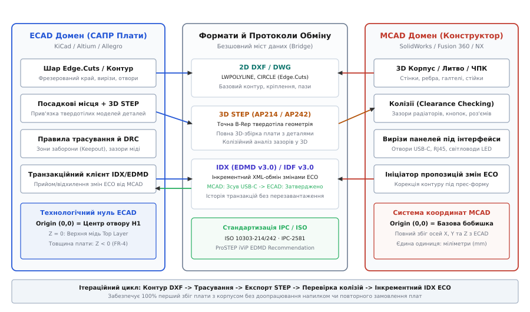
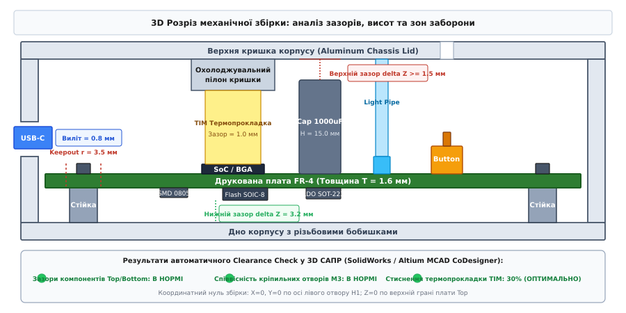

# Обмін між механікою й САПР плати: STEP, DXF, контур

<preknowlist>
- [Друкована плата (PCB layout)](root:hw-pcb/pcb-layout) — призначення шарів, базові правила трасування та перехідні отвори.
- [Посадкові місця (Footprint design)](root:hw-pcb/footprint-design) — створення посадкових місць за IPC-7351 та прив'язка 3D моделей.
- [Кабелі й конектори](root:hw-pcb/cables-connectors) — конструкція контактів, типи корпусів та механічні зусилля фіксації.
- [Зазори на платі: creepage та clearance](root:hw-pcb/creepage-clearance) — електричні повітряні зазори та шляхи витоку струму.
- [Механічний конверт](root:hw-pcb/mekhanichnyi-konvert) — базові обмеження об'єму, висот компонентів та зон заборони.
</preknowlist>

Коли партія з п'ятдесяти промислових контролерів збирається на виробничій ділянці, електронні плати можуть бездоганно проходити автоматизоване оптичне та електричне тестування, проте під час монтажу у фрезерований алюмінієвий корпус виявляється, що кріпильні гвинти M3 зміщені на 0.45 мм відносно різьбових бобишок через некоректну апроксимацію сплайнів у файлі DXF, металевий екран роз'єму USB-C впирається в край вирізу лицьової панелі через відсутність компенсації вильоту в 3D моделі STEP, а гострий кут друкованої плати 90° розтріскується при затягуванні кріплення, впершись у технологічну галтель фрезерування радіусом 1.5 мм. Усі ці проблеми є прямим наслідком порушення цифрового інтерфейсу взаємодії між електронною САПР (ECAD) та механічною САПР (MCAD). Безперервний, двосторонній та суворо стандартизований обмін геометричними даними є єдиним способом гарантувати повну збираність виробу з першої ітерації без ручного доопрацювання напилком та без витрат на повторне виготовлення корпусів і текстоліту.

---

### Інтерфейс взаємодії ECAD-MCAD та архітектура спільного проектування

Проектування сучасного електронного пристрою — це постійний компроміс між електричними вимогами цілісності сигналів, тепловідведення, електромагнітної сумісності та фізичними обмеженнями простору, міцності й ергономіки. У сучасній інженерній практиці розробка ведеться за моделлю паралельного проектування (англ. *ECAD / MCAD Co-design*), де геометрія корпусу та топологія плати еволюціонують синхронно.


*Двосторонній робочий процес узгодження між ECAD та MCAD: ітераційний цикл обміну даними від передачі 2D контуру DXF до синхронізації 3D збірки STEP та транзакційного протоколу змін IDX (EDMD).*

Головна технічна складність взаємодії двох інженерних доменів полягає в принциповій відмінності внутрішніх структур даних:
- **Електронна САПР (KiCad, Altium Designer, Cadence Allegro, Siemens Xpedition):** Оперує дискретними двовимірними шарами міді, діелектричними проміжками, сітками трасування, електричними ланцюгами (Netlist) та двовимірними контурами посадкових місць (Footprints). Тривимірні моделі компонентів для ECAD є вторинними візуалізаційними або габаритними оболонками.
- **Механічна САПР (SolidWorks, Autodesk Fusion 360, PTC Creo, Siemens NX, FreeCAD):** Оперує аналітичною твердотілою геометрією граничного представлення (англ. *Boundary Representation*, B-Rep), параметричними поверхнями NURBS, кінематичними зв'язками, розрахунками масо-інерційних характеристик, методом скінченних елементів (FEA) та тепловим моделюванням (CFD).

Щоб забезпечити однозначність передачі даних, розроблено стек форматів обміну, кожен із яких вирішує конкретну інженерну задачу на певному етапі розробки:

1. **2D контурні формати (DXF / DWG):** Передають пласку геометрію: периметр плати, пази, отвори, базові лінії роз'ємів.
2. **3D твердотілі формати прямого обміну (STEP AP214 / AP242):** Передають точну тривимірну збірку плати з усіма компонентами, контактами та радіаторами для повного колізійного аналізу.
3. **Інкрементні транзакційні протоколи (IDX / IDF):** Передають журнал змін окремих об'єктів (зсув роз'єму, зміна контуру) у форматі XML без пересилання важких твердотілих файлів.

---

### Двовимірний обмін: DXF, шари контуру та правила фрезерування

Формат AutoCAD DXF (Drawing Exchange Format) є класичним промисловим стандартом передачі двовимірних векторних креслеників. Конструктор механіки проектує внутрішню порожнину корпусу, створює ескіз плати та експортує його у форматі DXF для передачі схемотехніку.

#### Специфікація шару контуру в електронних САПР

В електронній САПР контур друкованої плати (Board Outline) розміщується на спеціальному системному механічному шарі. Лінії цього шару інтерпретуються CAM-системами фабрик як фізична траєкторія руху кінцевої фрези:
- У **KiCad:** Системний шар `Edge.Cuts`. Будь-який замкнений контур на цьому шарі автоматично стає межею діелектрика плати.
- В **Altium Designer:** Механічний шар `Mechanical 1` (або виділений шар `Board Shape` / `Keep-Out Layer`). Контур формується командою визначення форми плати за виділеними об'єктами (`Design -> Board Shape -> Define from Selected Objects`).
- У **Cadence Allegro:** Шар `Board Geometry / Design_Outline`.

```
+-----------------------------------------------------------------------------+
|                     ПРАВИЛА ОФОРМЛЕННЯ ШАРУ EDGE.CUTS (DXF)                 |
|                                                                             |
|  1. Ширина лінії: СТРОГО 0.0 мм (або номінальна тонка лінія 0.05–0.1 мм).   |
|  2. Тип ліній: Тільки прямі відрізки (LINE) та дуги кіл (ARC / CIRCLE).     |
|     Жодних апроксимованих сплайнів Безьє (SPLINE) та еліпсів (ELLIPSE)!     |
|  3. Топологія: 100% замкненість периметра (відхилення вершин <= 0.01 мм).   |
|  4. Внутрішні вирізи: Окремі замкнені контури всередині головного периметра. |
|  5. Отвори кріплення: Кругові примітиви CIRCLE з точним діаметром свердла.  |
+-----------------------------------------------------------------------------+
```

#### Проблема апроксимації сплайнів (Spline Tessellation)

Сучасні MCAD дозволяють вільно креслити складні плавні обводи за допомогою неоднорідних раціональних B-сплайнів (NURBS). Проте більшість електронних САПР та верстатів із ЧПК для обробки друкованих плат не підтримують сплайни безпосередньо в GERBER/G-code і вимагають розбиття кривої на дуги та відрізки.

Якщо під час експорту з SolidWorks або Fusion 360 обрано низьку точність теселяції (англ. *Chordal Tolerance*), сплайн замінюється ламаною лінією з довгих прямих відрізків. Це призводить до двох дефектів:
1. **Геометрична похибка форми:** Плата на опуклих ділянках стає більшою на 0.2–0.5 мм і не входить у паз корпусу.
2. **Мікророзриви в точках стику:** Якщо між сусідніми сегментами залишається розрив понад `0.025` мм, ECAD не може зшити полілінію, блокуючи створення 3D моделі плати та експорт Gerber-файлів.

Правильний експорт із MCAD вимагає конвертації всіх криволінійних ділянок у бі-дуги (англ. *Bi-arcs approximation*) — послідовність спряжених дуг кіл із контрольованим радіусом кривизни.

#### Радіус фрези та технологічні розвантаження («собача кістка»)

Друковані плати вирізаються з групових панелей на високошвидкісних свердлильно-фрезерувальних верстатах ЧПК. Різальний інструмент — кінцева циліндрична твердосплавна фреза (англ. *End Mill Router*).

Через радіус інструмента `R_tool = d_tool / 2` виникає фізичне обмеження: **внутрішній кут контуру плати не може бути гострішим за радіус фрези**. На фабриках стандартно застосовуються фрези діаметром `2.0` мм (`R = 1.0` мм) та `2.4` мм (`R = 1.2` мм). Тонкі фрези діаметром `1.0` мм або `0.8` мм доступні за окрему націнку і збільшують час механічної обробки.

Якщо корпус має прямокутний виступ (наприклад, направляючий паз або перегородку відсіку), прямий кут плати 90° під час фрезерування отримає внутрішнє скруглення `R = 1.0` мм і плата не сяде на дно паза.

Для компенсації застосовують геометричні підрізання:
- **Dog-bone Relief («собача кістка»):** Фреза в кутку виходить по діагоналі за межі номінального контуру на радіус інструмента, утворюючи круглу кишеню. Прямокутний кут корпусу повністю заходить у виїмку без контакту з галтеллю.
- **T-bone Relief:** Фреза виходить за контур уздовж однієї з довгих сторін кута. Це зберігає естетичний вигляд короткої кромки, якщо вона виходить на фасад приладу.

---

### Тривимірний твердотілий обмін: STEP AP214 / AP242 та компонентні моделі

Двовимірний кресленик DXF передає виключно пласку межу текстоліту, але не дає жодної інформації про просторове розташування компонентів, виліт роз'ємів за панель, висоти електролітичних конденсаторів та форму радіаторів охолодження. Для повноцінного 3D моделювання використовується стандарт ISO 10303 (STEP — Standard for the Exchange of Product model data).

#### Різниця між версіями STEP AP214 та AP242

У проектуванні радіоелектронної апаратури застосовуються дві основні прикладні конфігурації (Application Protocols, AP) стандарту STEP:

1. **STEP AP214 (Automotive and Electro-mechanical Design):** Традиційний стандарт твердотілого моделювання. Містить повну аналітичну B-Rep геометрію тіл, кольори поверхонь та структуру складальних одиниць (Assembly Tree). Підтримується 100% сучасних САПР плати (KiCad, Altium, Eagle) і є найбільш стабільним форматом для експорту повної збірки плати.
2. **STEP AP242 (Managed Model Based 3D Engineering):** Новітній стандарт, що об'єднав аерокосмічний протокол AP203 та автомобільний AP214. Головна перевага AP242 — підтримка семантичної інформації PMI (Product and Manufacturing Information): у тривимірну модель вбудовуються геометричні допуски (GD&T), чистота поверхні, технологічні вимоги до паяння та електричні параметри контактів без необхідності створення окремих паперових креслеників.

> ⚠️ **Чому полігональні сітки (STL, OBJ, 3MF, VRML) непридатні для MCAD:**
> Полігональні сітки представляють тверде тіло як набір тисяч пласких трикутників (Faceted Mesh). Механічні САПР не можуть знайти аналітичну вісь циліндра в STL-файлі отвору або розрахувати точну площину прилягання теплопровідної прокладки. STL придатний лише для візуалізації та 3D-друку. Для інженерного обміну та точного вимірювання зазорів використовуються виключно твердотілі моделі B-Rep у форматі STEP.

#### Методика інтеграції 3D моделей у бібліотеку посадкових місць

Для забезпечення бездоганного експорту збірки плати кожне посадкове місце (Footprint) в бібліотеці ECAD повинно мати прив'язану твердотілу STEP-модель виробника компонента (Molex, TE Connectivity, Wago, STMicroelectronics).

Правила оформлення 3D моделі компонента:
- **Орієнтація за стандартом IPC-7351:** Вивід 1 (Pin 1) компонента повинен розташовуватися у верхньому лівому кутку або знизу ліворуч; вісь `Z` спрямована строго вгору від поверхні плати.
- **Точка відліку (Origin):** Початок координат 3D моделі повинен точно збігатися з геометричним центром симетрії посадкового місця або з віссю виводу 1 (для роз'ємів наскрізного монтажу THT).
- **Висота від поверхні (`Z = 0`):** Нижня площина виводів або опорних виступів пластикового корпусу деталі повинна лежати точно на площині `Z = 0.0`. Якщо модель "занурюється" в плату на 0.3 мм, колізійний чекер у MCAD покаже хибне перетинання твердих тіл.

---

### Інкрементний обмін та спільне проектування: IDF проти IDX

Пересилання повного файлу STEP після кожної зміни положення світлодіода чи кнопки створює колосальне навантаження на систему: файл збірки плати з сотнями деталізованих роз'ємів може займати 100–500 МБ, а його імпорт у SolidWorks триває 5–15 хвилин. Для швидкої синхронізації змін розроблено протоколи інкрементного обміну.

```
+-----------------------------------------------------------------------------+
|                  ПОРІВНЯННЯ ПРОТОКОЛІВ ОБМІНУ ДАНИМИ ECAD-MCAD              |
+----------------------+--------------------+---------------------------------+
| Параметр             | IDF v2.0 / v3.0    | IDX v3.0 / v4.0 (EDMD)          |
+----------------------+--------------------+---------------------------------+
| Тип файлу            | Текстовий (.emn/.emp)| Структурований XML (.idx)     |
| Спосіб передачі      | Повний стан збірки | Тільки інкрементні транзакції   |
| Геометрія деталей    | Екструдовані блоки | Повні B-Rep моделі або габарити |
| Зворотний зв'язок    | Відсутній (ручний) | Погодження/відхилення (ECO)     |
| Зони заборони        | Базові 2D Keepout  | 3D паралелепіпеди та циліндри   |
| Підтримка в САПР     | Застарілий стандарт| Altium CoDesigner, KiCad-IDF    |
+----------------------+--------------------+---------------------------------+
```

#### Протокол IDF (Intermediate Data Format)

Формат IDF базується на двох файлах:
- `.emn` (Electrical Mechanical Neutral): Описує контур плати, її товщину, отвори кріплення, перехідні отвори та зони заборони розміщення компонентів і трасування.
- `.emp` (Electrical Mechanical Placement): Містить словник габаритів деталей. Деталі задаються як спрощені прямокутні призми або циліндри з визначеною висотою `Z`.

IDF є дуже швидким і легким форматом, але його головний недолік — геометричний примітивізм. Кутовий роз'єм USB-C у форматі IDF виглядає як суцільний куб, що не дозволяє перевірити, чи заходить металевий кожух роз'єму у виріз передньої панелі корпусу.

#### Протокол IDX (Incremental Data Exchange / ProSTEP iViP EDMD)

IDX — сучасний міжнародний стандарт (розроблений консорціумом ProSTEP iViP та асоціацією IPC-2581), призначений для інтерактивної командної роботи в реальному часі.

Робочий процес за протоколом IDX:
1. Конструктор у SolidWorks відкриває модель приладу, бачить плату та вирішує змістити тактову кнопку `SW1` на 3.5 мм ліворуч, щоб вона збіглася з отвором у новій силіконовій клавіатурі.
2. Конструктор пересуває 3D модель кнопки в MCAD і натискає кнопку **«Send Changes»**. САПР генерує невеликий XML-файл `.idx` розміром кілька кілобайт із записом транзакції: зміщення компонента `SW1` на вектор `(-3.5, 0.0, 0.0)`.
3. Трасувальник в Altium Designer або KiCad отримує сповіщення у панелі колаборації. На екрані плати з'являється анімований вектор переміщення: старе положення (підсвічене червоним) та нове (зеленим).
4. Трасувальник аналізує топологію доріжок: якщо зсув кнопки розриває шину диференційної пари, він може натиснути **«Reject»** і написати коментар: *«Зсув неможливий через щільне трасування DDR4; пропоную змістити на 1.5 мм»*. Якщо конфліктів немає, він натискає **«Accept»**, і САПР плати автоматично переміщує посадкові місця й оновлює підключені провідники.

Для практичної автоматизації перевірки таких переходів використовується окремий програмний інструмент — [Валідатор збігу 2D контуру DXF та 3D моделі STEP](root:hw-pcb/obmin-mizh-mekhanikoiu-i-sapr-platy/proj-ecad-mcad-bridge.md), який реалізує алгоритмічне зіставлення геометрії на рівні конвеєра CI/CD.

---

### Тривимірний колізійний аналіз (Clearance Checking) та бюджет висот

Після формування повної твердотілої моделі збірки конструктор механіки запускає процедуру автоматичного колізійного аналізу (Clearance & Interference Detection).


*Тривимірний розріз механічної збірки: аналіз висотного зазору до кришки (Headroom clearance), стиснення теплопровідної прокладки процесора SoC (TIM), вильоту роз'єму USB-C та зон заборони кріпильних гвинтів M3.*

Усі просторові перевірки поділяються на чотири категорії:

1. **Жорсткі колізії (Hard Interference):** Фізичний перетин твердих тіл (об'єм перетину `V_inter > 0`). Наприклад, корпус електролітичного конденсатора на 0.8 мм заходить усередину металевої кришки корпусу або вивід роз'єму впирається в кріпильну стійку. Такі колізії є абсолютним браком і вимагають негайного коригування.
2. **Порушення технологічних зазорів (Clearance Violation):** Тіла не торкаються одне одного, але відстань між ними `d` менша за гарантований монтажний зазор безпеки `d_min`:
   - Зазор від верхівки найвищої деталі до кришки корпусу: `d_headroom ≥ 1.0–1.5` мм (для компенсації прогину кришки при натисканні та вібрації).
   - Зазор від краю плати до внутрішньої стінки литого корпусу: `d_wall ≥ 0.5–1.0` мм.
   - Зазор між компонентами на нижній стороні Bottom та дном корпусу: `d_bottom ≥ 1.5–2.0` мм.
3. **Контроль стиснення теплопровідних матеріалів (TIM Compression):** Для передачі тепла від потужного кристала SoC чи силових MOSFET на алюмінієвий корпус використовується силіконова термопрокладка (Thermal Interface Material, TIM). Номінальна товщина прокладки підбирається так, щоб при повному затягуванні корпусних гвинтів ступінь її стиснення становив рівно `25–35%`:
   - Менше 20%: прокладка не компенсує мікронерівності поверхонь, різко зростає тепловий опір `R_th`.
   - Понад 50%: надмірний механічний тиск призводить до деформації субстрату BGA-чипа та відриву паяних кульок при термоциклуванні.
4. **Вильоти та співвісність інтерфейсних елементів:**
   - Роз'єми USB-C / RJ45: лицьовий зріз роз'єму повинен виступати за площину передньої панелі на `0.5–1.0` мм, щоб забезпечити надійну фіксацію кабельного штекера з урахуванням товщини стінки корпусу.
   - Світловоди LED (Light Pipes): зазор між випромінювальною поверхнею SMD-світлодіода на платі та торцем прозорого пластикового світловода повинен становити `0.2–0.5` мм для запобігання роздавлюванню світлодіода.
   - Тактові кнопки: шток кнопки повинен мати гарантований зазор `0.3–0.5` мм до товкача на корпусі в ненатиснутому стані для усунення самовільного спрацьовування при температурному розширенні.

---

### Розмірні ланцюги допусків та температурний дрейф конструкції

Під час проектування механічного інтерфейсу плати не можна орієнтуватися виключно на номінальні розміри 3D моделі. У реальному виробництві кожен технологічний процес має власну похибку, яка підсумовується в розмірний ланцюг.

#### Метод середньоквадратичного накопичення допусків (Root Sum Squared, RSS)

Для розрахунку необхідного діаметра кріпильних отворів та монтажних зазорів використовується статистичний метод середньоквадратичного підсумовування (RSS), який враховує нормальний розподіл виробничих похибок Гауса:

```
T_total = √(T_drill² + T_route² + T_chassis² + T_smt² + T_pin²)
```

Типові виробничі допуски для електронного блоку:
- Похибка позиціонування свердлильного шпинделя ЧПК: `T_drill = ±0.05` мм.
- Похибка фрезерування зовнішнього контуру плати: `T_route = ±0.10` мм.
- Похибка виготовлення різьбових бобишок корпусу (ЧПК фрезерування або литво під тиском): `T_chassis = ±0.08` мм.
- Похибка встановлення роз'єму автоматом SMT (Pick-and-Place): `T_smt = ±0.04` мм.
- Механічний люфт контактів у корпусі роз'єму: `T_pin = ±0.05` мм.

Розрахунок сумарного середньоквадратичного допуску:
```
T_total = √(0.05² + 0.10² + 0.08² + 0.04² + 0.05²)      [підстановка допусків drill, route, chassis, smt, pin]
        = √(0.0025 + 0.0100 + 0.0064 + 0.0016 + 0.0025) [піднесення до квадратів складових]
        = √(0.0230) ≈ ±0.152 мм                         [добування квадратного кореня]
```

Якщо для кріплення плати використовується гвинт M3 з номінальним діаметром стрижня `d_screw = 3.0` мм, мінімальний отвір у платі для гарантованого проходження гвинта без перекосу повинен становити:
```
D_hole_min = d_screw + 2 · T_total       [сума номіналу стрижня та подвійного допуску RSS]
           = 3.0 + 2 · 0.152 = 3.304 мм   [підстановка розрахункового значення T_total]
```

#### Температурне розширення (CTE Mismatch) та овальні пази

Електронні пристрої промислового та автомобільного призначення експлуатуються в широкому діапазоні температур від `-40°C` до `+85°C` (`ΔT = 125°C`). Різниця коефіцієнтів теплового розширення матеріалів плати та корпусу створює значний просторовий зсув кріплень:
- Коефіцієнт лінійного теплового розширення склотекстоліту FR-4: `α_fr4 ≈ 14–17 ppm/°C` (`14–17 × 10⁻⁶ 1/K`).
- Коефіцієнт теплового розширення алюмінієвого корпусу (сплав 6061 / Д16Т): `α_al ≈ 23 ppm/°C` (`23 × 10⁻⁶ 1/K`).

Для плати довжиною `L = 180` мм відносне зміщення між крайніми кріпильними гвинтами розраховується так:
```
ΔL_rel = L · (α_al - α_fr4) · ΔT                 [формула відносного теплового подовження]
       = 180 мм · (23 - 15) × 10⁻⁶ 1/°C · 125°C  [підстановка довжини та перепаду температур]
       = 180 · 8 × 10⁻⁶ · 125 ≈ 0.180 мм         [підсумок розрахунку зміщення]
```

Якщо всі чотири кріпильні отвори виконані круглими з мінімальним зазором, при нагріванні плата зазнає стискального зусилля, що призводить до її вигинання (Bowing) на 0.5–1.2 мм у центрі. Такий вигин роздавлює BGA-чипи та порушує контакт із теплопровідними прокладками.

Правило надійного проектування: **Один отвір (базовий H1) робиться круглим `3.2` мм і фіксує початок координат, а протилежні отвори виконуються овальними пазами (Slotted Holes) довжиною `3.2 × 3.8` мм**, орієнтованими вздовж лінії теплового розширення.

---

### Специфіка проектування інтерфейсів HMI: кнопки, світловоди, дисплеї

Узгодження елементів людино-машинного інтерфейсу (HMI) вимагає суворого просторового розрахунку:

1. **Світловоди LED (Light Pipes):**
   - Торець прозорого полікарбонатного світловода повинен бути розташований на відстані `0.3–0.5` мм від випромінювального кристала SMD-світлодіода (типорозмір 0603 або 0805).
   - Щоб світло від зеленого світлодіода статусу живлення не засвічувало сусідній червоний світлодіод аварії (Optical Crosstalk), конструктор корпусу проектує внутрішні світлоізолюючі колодязі (Light Baffles), а трасувальник розміщує світлодіоди з мінімальним кроком `≥ 5.0` мм.
2. **Тактові кнопки та енкодери:**
   - Для запобігання передачі ударного навантаження від пальця оператора на паяні контакти SMD-кнопки, товкач на панелі корпусу повинен мати механічний упор (Hard Stop) у корпусі, який обмежує хід на рівні `110–120%` від номінального ходу контакту кнопки.
3. **Дисплейні модулі (TFT / OLED):**
   - Гнучкий шлейф дисплея FPC (Flexible Printed Circuit) вимагає розрахунку радіуса статичного згину `R_bend ≥ 6 · T_fpc` (зазвичай `R ≥ 1.0` мм при товщині шлейфу `0.15` мм). Порушення цього радіуса призводить до зламу мідних доріжок під час вібраційних випробувань.

---

### Гнучко-жорсткі плати (Rigid-Flex PCB) у 3D просторі MCAD

У компактних портативних виробах, безпілотних авіаційних комплексах та медичних зондах широко застосовуються гнучко-жорсткі друковані плати (Rigid-Flex PCB). Така конструкція об'єднує жорсткі секції зі склотекстоліту FR-4 та інтегровані гнучкі поліімідні шлейфи в єдине неподільне технологічне ціле.

Головна особливість 3D обміну для Rigid-Flex полягає в тому, що плата більше не є пласким твердим тілом:
- **Кінематика згину в MCAD:** Механічна САПР моделює процес згинання гнучкого шлейфу по лінії нейтральної осі (Neutral Bend Axis). При товщині гнучкого поліімідного ядра `T_flex = 0.12` мм мінімальний радіус статичного згину становить `R_static ≥ 6 · T_flex = 0.72` мм, а для динамічного згину (в рухомих шарнірах) — `R_dynamic ≥ 20 · T_flex = 2.4` мм.
- **Зони переходу (Transition Zones):** Межа між жорсткою та гнучкою секціями є концентратором механічних напружень. В ECAD встановлюється зона заборони: жоден перехідний отвір (Via) чи паяне посадкове місце не повинні розташовуватися ближче ніж на `2.5` мм від лінії закінчення жорсткого шару (Coverlay Opening).
- **Підсилювачі (Stiffeners):** Для монтажу роз'ємів на кінцях гнучких виносів у 3D моделі STEP обов'язково відображаються додаткові ребра жорсткості (пластини зі склотекстоліту FR-4 товщиною `0.5–1.0` мм або алюмінію), що запобігають відриву контактних майданчиків під час вставляння штекера в гніздо.

---

### Електромагнітне екранування та контакт із корпусом (EMC Gasketing)

Коли друкована плата монтується в металевий або пластиковий металізований корпус для забезпечення захисту від електромагнітних завад (ЕМС), критично важливим є розрахунок контакту земляного контуру (Chassis Ground) з корпусом:

1. **Пружинні контакти (SMD Spring Contacts / Finger Stock):** Встановлюються по периметру плати на контактні майданчики без паяльної маски. У 3D збірці STEP висота пружини в недеформованому стані повинна мати перекриття `0.6–1.0` мм із внутрішньою кришкою корпусу, забезпечуючи гарантоване притискне зусилля при закритті приладу.
2. **Струмопровідні еластомери (Conductive Gaskets):** Спеціальні ущільнювальні шнури з силікону, наповненого частинками срібла або нікель-графіту. Вони встановлюються у фрезерований паз корпусу глибиною `H_groove = 0.75 · D_gasket` (стиснення 25%), забезпечуючи як електромагнітний екран, так і герметичність за стандартом IP67.
3. **Крок кріпильних гвинтів по периметру екранованого відсіку:** Щоб запобігти випромінюванню високочастотних гармонік тактових генераторів крізь щілини між платою та корпусом, відстань між сусідніми гвинтами кріплення `S` повинна задовольняти правилу двадцятої частини довжини хвилі:
```
S <= c / (20 · f_max · √ε_r)
```
Для тактової частоти `f_max = 3.0` ГГц максимальний крок кріплення становить `S ≤ 300 000 / (20 · 3000) = 5.0` мм.

---

### Автоматизація експорту та CI/CD конвеєри апаратного забезпечення

Сучасна парадигма розробки апаратного забезпечення (Git-based Hardware CI/CD) вимагає повної відмови від ручного експорту геометрії через графічний інтерфейс користувача. Будь-який ручний клік мишкою несе ризик випадкового вимкнення шару або зміни одиниць вимірювання.

Автоматизований серверний конвеєр збірки (наприклад, у середовищі GitLab CI або GitHub Actions) виконує генерацію моделей за допомогою консольного інтерфейсу (Headless CLI):
- **Експорт STEP у KiCad CLI:**
```bash
kicad-cli pcb export step --subst-models --no-dnp --drill-origin -o build/board.step main_board.kicad_pcb
```
Прапорець `--subst-models` гарантує заміну бібліотечних посадкових місць на точні STEP-моделі деталей; `--no-dnp` виключає немонтовані компоненти (Do Not Populate); `--drill-origin` прив'язує систему координат до технологічного нуля плати.

- **Експорт 2D контуру DXF у KiCad CLI:**
```bash
kicad-cli pcb export dxf --layers "Edge.Cuts,User.Drawings" --no-plot-pads --drill-origin -o build/outline.dxf main_board.kicad_pcb
```

Згенеровані артефакти автоматично передаються в серверний скрипт валідації геометрії, який порівнює габаритний Bounding Box нової ревізії з номінальною порожниною корпусу та блокує злиття гілки (Merge Request), якщо зміщення роз'єму перевищує встановлений технологічний допуск `0.05` мм.

---

### Розрахунок матричних перетворень та перевірки зазорів у коді

Для автоматизації обробки геометричних моделей нижче наведено програмний модуль мовами C99 та C++20, який виконує:
1. Афінне перетворення координат 3D точки за допомогою однорідної матриці 4×4 (перевід точки з локальної системи плати в глобальну систему координат корпусу).
2. Розрахунок мінімальної тривимірної відстані між вершинами компонента та плоскою гранню внутрішньої кришки корпусу з перевіркою гарантованого зазору `Clearance`.

:::tabs
```c
#include <stdio.h>
#include <stdbool.h>
#include <math.h>

typedef struct {
    double x, y, z;
} Vec3;

typedef struct {
    double m[4][4];
} Mat4;

typedef struct {
    Vec3 normal;   // Одиничний вектор нормалі до площини кришки (A, B, C)
    double d;      // Параметр рівняння площини: A*x + B*y + C*z + d = 0
} Plane;

typedef struct {
    Vec3 min_pt;   // Мінімальний кут обмежувального паралелепіпеда (Bounding Box)
    Vec3 max_pt;   // Максимальний кут обмежувального паралелепіпеда
} BoundingBox3D;

static Vec3 mat4_transform_point(const Mat4 *mat, Vec3 pt) {
    Vec3 res;
    res.x = mat->m[0][0] * pt.x + mat->m[0][1] * pt.y + mat->m[0][2] * pt.z + mat->m[0][3];
    res.y = mat->m[1][0] * pt.x + mat->m[1][1] * pt.y + mat->m[1][2] * pt.z + mat->m[1][3];
    res.z = mat->m[2][0] * pt.x + mat->m[2][1] * pt.y + mat->m[2][2] * pt.z + mat->m[2][3];
    return res;
}

static double point_to_plane_distance(const Plane *plane, Vec3 pt) {
    double numerator = plane->normal.x * pt.x + plane->normal.y * pt.y + plane->normal.z * pt.z + plane->d;
    double denominator = sqrt(plane->normal.x * plane->normal.x +
                              plane->normal.y * plane->normal.y +
                              plane->normal.z * plane->normal.z);
    return (denominator > 1e-9) ? (numerator / denominator) : 0.0;
}

static bool check_component_clearance(const BoundingBox3D *comp_bbox, const Mat4 *board_transform,
                                     const Plane *chassis_lid, double min_allowed_clearance,
                                     double *out_actual_clearance) {
    // 8 вершин обмежувального паралелепіпеда деталі в локальній системі координат плати
    Vec3 local_vertices[8] = {
        {comp_bbox->min_pt.x, comp_bbox->min_pt.y, comp_bbox->min_pt.z},
        {comp_bbox->max_pt.x, comp_bbox->min_pt.y, comp_bbox->min_pt.z},
        {comp_bbox->min_pt.x, comp_bbox->max_pt.y, comp_bbox->min_pt.z},
        {comp_bbox->max_pt.x, comp_bbox->max_pt.y, comp_bbox->min_pt.z},
        {comp_bbox->min_pt.x, comp_bbox->min_pt.y, comp_bbox->max_pt.z},
        {comp_bbox->max_pt.x, comp_bbox->min_pt.y, comp_bbox->max_pt.z},
        {comp_bbox->min_pt.x, comp_bbox->max_pt.y, comp_bbox->max_pt.z},
        {comp_bbox->max_pt.x, comp_bbox->max_pt.y, comp_bbox->max_pt.z}
    };

    double min_dist = 1e9;

    for (int i = 0; i < 8; ++i) {
        Vec3 world_pt = mat4_transform_point(board_transform, local_vertices[i]);
        double dist = point_to_plane_distance(chassis_lid, world_pt);
        if (dist < min_dist) {
            min_dist = dist;
        }
    }

    *out_actual_clearance = min_dist;
    return (min_dist >= min_allowed_clearance);
}

int main(void) {
    // Матриця розміщення плати в корпусі: встановлена на стійках H = 5.0 мм
    Mat4 board_to_chassis = {{
        {1.0, 0.0, 0.0, 0.0},
        {0.0, 1.0, 0.0, 0.0},
        {0.0, 0.0, 1.0, 5.0}, // Зсув по осі Z на 5.0 мм вгору від дна корпусу
        {0.0, 0.0, 0.0, 1.0}
    }};

    // Верхня кришка корпусу розташована на висоті Z = 22.0 мм: 0*x + 0*y + (-1)*z + 22.0 = 0
    Plane chassis_lid = {
        .normal = {0.0, 0.0, -1.0},
        .d = 22.0
    };

    // Габарити електролітичного конденсатора: основа 10x10 мм, висота H = 15.5 мм
    BoundingBox3D cap_bbox = {
        .min_pt = {40.0, 20.0, 0.0},
        .max_pt = {50.0, 30.0, 15.5}
    };

    double min_req_clearance = 1.0; // Мінімальний зазор безпеки 1.0 мм
    double actual_clearance = 0.0;

    bool passed = check_component_clearance(&cap_bbox, &board_to_chassis, &chassis_lid,
                                           min_req_clearance, &actual_clearance);

    printf("=================================================================\n");
    printf("   АНАЛІЗ ПРОСТОРОВОГО ЗАЗОРУ КОМПОНЕНТА (CLEARANCE CHECK)      \n");
    printf("=================================================================\n");
    printf("Висота стійок плати:                  %6.2f мм\n", board_to_chassis.m[2][3]);
    printf("Висота деталі над платою:             %6.2f мм\n", cap_bbox.max_pt.z);
    printf("Абсолютна координата верхівки Z:      %6.2f мм\n", board_to_chassis.m[2][3] + cap_bbox.max_pt.z);
    printf("Положення кришки корпусу Z:           %6.2f мм\n", chassis_lid.d);
    printf("-----------------------------------------------------------------\n");
    printf("Фактичний зазор до кришки:            %6.2f мм\n", actual_clearance);
    printf("Мінімально допустимий зазор:          %6.2f мм\n", min_req_clearance);
    printf("Статус перевірки:                     %s\n", passed ? "[PASS] В НОРМІ" : "[FAIL] КОЛІЗІЯ!");
    printf("=================================================================\n");

    return passed ? 0 : 1;
}
```
```cpp
#include <iostream>
#include <vector>
#include <array>
#include <cmath>
#include <algorithm>
#include <format>
#include <string_view>

namespace ecad_mcad {

struct Vec3 {
    double x{0.0};
    double y{0.0};
    double z{0.0};
};

struct Mat4 {
    std::array<std::array<double, 4>, 4> m{};

    [[nodiscard]] constexpr Vec3 transform_point(const Vec3& pt) const noexcept {
        return Vec3{
            .x = m[0][0] * pt.x + m[0][1] * pt.y + m[0][2] * pt.z + m[0][3],
            .y = m[1][0] * pt.x + m[1][1] * pt.y + m[1][2] * pt.z + m[1][3],
            .z = m[2][0] * pt.x + m[2][1] * pt.y + m[2][2] * pt.z + m[2][3]
        };
    }
};

struct Plane {
    Vec3 normal{0.0, 0.0, 1.0};
    double d{0.0}; // A*x + B*y + C*z + d = 0

    [[nodiscard]] double distance_to(const Vec3& pt) const noexcept {
        const double num = normal.x * pt.x + normal.y * pt.y + normal.z * pt.z + d;
        const double den = std::sqrt(normal.x * normal.x + normal.y * normal.y + normal.z * normal.z);
        return (den > 1e-9) ? (num / den) : 0.0;
    }
};

struct BoundingBox3D {
    Vec3 min_pt;
    Vec3 max_pt;

    [[nodiscard]] std::array<Vec3, 8> get_corners() const noexcept {
        return {
            Vec3{min_pt.x, min_pt.y, min_pt.z},
            Vec3{max_pt.x, min_pt.y, min_pt.z},
            Vec3{min_pt.x, max_pt.y, min_pt.z},
            Vec3{max_pt.x, max_pt.y, min_pt.z},
            Vec3{min_pt.x, min_pt.y, max_pt.z},
            Vec3{max_pt.x, min_pt.y, max_pt.z},
            Vec3{min_pt.x, max_pt.y, max_pt.z},
            Vec3{max_pt.x, max_pt.y, max_pt.z}
        };
    }
};

class ClearanceAnalyzer {
public:
    explicit ClearanceAnalyzer(Mat4 board_to_chassis, Plane chassis_lid)
        : transform_(board_to_chassis), lid_(chassis_lid) {}

    [[nodiscard]] std::pair<bool, double> evaluate_component_clearance(
        const BoundingBox3D& comp_bbox, double min_allowed_clearance) const noexcept {
        
        double min_dist = 1e9;
        const auto corners = comp_bbox.get_corners();

        for (const auto& local_pt : corners) {
            const Vec3 world_pt = transform_.transform_point(local_pt);
            const double dist = lid_.distance_to(world_pt);
            min_dist = std::min(min_dist, dist);
        }

        const bool is_safe = (min_dist >= min_allowed_clearance);
        return {is_safe, min_dist};
    }

private:
    Mat4 transform_;
    Plane lid_;
};

} // namespace ecad_mcad

int main() {
    using namespace ecad_mcad;

    Mat4 board_placement{};
    board_placement.m = {{
        {1.0, 0.0, 0.0, 0.0},
        {0.0, 1.0, 0.0, 0.0},
        {0.0, 0.0, 1.0, 5.0}, // Стійки H = 5.0 мм
        {0.0, 0.0, 0.0, 1.0}
    }};

    Plane chassis_lid{
        .normal = {0.0, 0.0, -1.0},
        .d = 22.0 // Висота внутрішньої площини кришки Z = 22.0 мм
    };

    BoundingBox3D capacitor_bbox{
        .min_pt = {40.0, 20.0, 0.0},
        .max_pt = {50.0, 30.0, 15.5} // Конденсатор H = 15.5 мм
    };

    ClearanceAnalyzer analyzer(board_placement, chassis_lid);
    constexpr double kMinRequiredClearance = 1.0; // мм

    const auto [passed, actual_clearance] =
        analyzer.evaluate_component_clearance(capacitor_bbox, kMinRequiredClearance);

    std::cout << "=================================================================\n";
    std::cout << "   АНАЛІЗ ПРОСТОРОВОГО ЗАЗОРУ (C++20 CLEARANCE ANALYZER)        \n";
    std::cout << "=================================================================\n";
    std::cout << std::format("Висота стійок плати:                  {:6.2f} мм\n", board_placement.m[2][3]);
    std::cout << std::format("Висота деталі над платою:             {:6.2f} мм\n", capacitor_bbox.max_pt.z);
    std::cout << std::format("Абсолютна координата верхівки Z:      {:6.2f} мм\n", board_placement.m[2][3] + capacitor_bbox.max_pt.z);
    std::cout << std::format("Положення кришки корпусу Z:           {:6.2f} мм\n", chassis_lid.d);
    std::cout << "-----------------------------------------------------------------\n";
    std::cout << std::format("Фактичний зазор до кришки:            {:6.2f} мм\n", actual_clearance);
    std::cout << std::format("Мінімально допустимий зазор:          {:6.2f} мм\n", kMinRequiredClearance);
    std::cout << std::format("Статус перевірки:                     {}\n",
                             passed ? "[PASS] В НОРМІ" : "[FAIL] КОЛІЗІЯ!");
    std::cout << "=================================================================\n";

    return passed ? 0 : 1;
}
```
:::

---

### Інженерний контрольний список валідації ECAD-MCAD

Перед запуском виробництва друкованої плати та фінальним виготовленням прес-форм чи фрезеруванням корпусів інженерна група зобов'язана перевірити повний чек-лист узгодження:

1. **Єдність бази відліку (Coordinate Datum):** Технологічний нуль `(0, 0, 0)` в обох САПР прив'язаний до одного й того самого базового отвору `H1`, а напрямок осей `X`, `Y` та `Z` повністю збігається.
2. **Топологія контуру (Edge.Cuts Closure):** Периметр плати на шарі контуру є неподільною замкненою полілінією без накладених дуг, самоперетинів та мікророзривів.
3. **Радіуси фрезерування (Internal Corner Fillets):** Усі внутрішні кути контуру плати мають радіус скруглення `R ≥ 1.0` мм або технологічні кишені розвантаження («собача кістка»).
4. **Співвісність кріплення (Mounting Hole Alignment):** Центри всіх отворів плати та бобишок корпусу збігаються з похибкою `ΔR ≤ 0.05` мм; радіуси зон заборони `Keepout` враховують розмір головок гвинтів та шайб.
5. **Висоти та зазори (3D Clearances):** Відстань від компонентів до стінок і кришки становить `≥ 1.0` мм; термопрокладки стискаються на `25–35%`; вильоти роз'ємів за межі лицьової панелі забезпечують надійне зчленування штекерів.
6. **Тепловий дрейф розмірів (Thermal Compensation):** При довжині плати понад 150 мм діаметри віддалених кріпильних отворів збільшено або виконано у вигляді поздовжніх пазів для компенсації різниці CTE між FR-4 та алюмінієм.
7. **Гнучко-жорсткі переходи (Rigid-Flex Constraints):** Зони згину поліімідних шлейфів мають радіус не менше шести товщин шлейфу, а компоненти відсунуті від лінії переходу щонайменше на 2.5 мм.
8. **Електромагнітне екранування (EMC Continuity):** Крок кріплення по периметру екранованого корпусу не перевищує двадцятої частини довжини хвилі максимальної робочої частоти, а пружинні контакти мають номінальне стиснення 30%.
9. **Автоматизований контроль у CI/CD (Pipeline Validation):** Усі STEP та DXF моделі експортуються автоматично через headless CLI і проходять верифікацію на відсутність геометричних колізій перед фінальним релізом Gerber-пакета.
