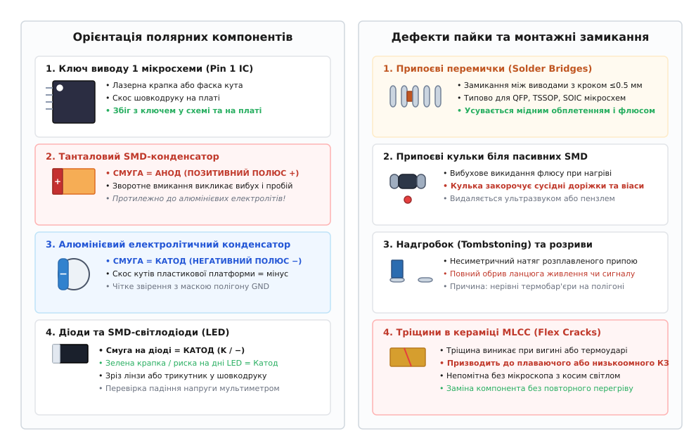
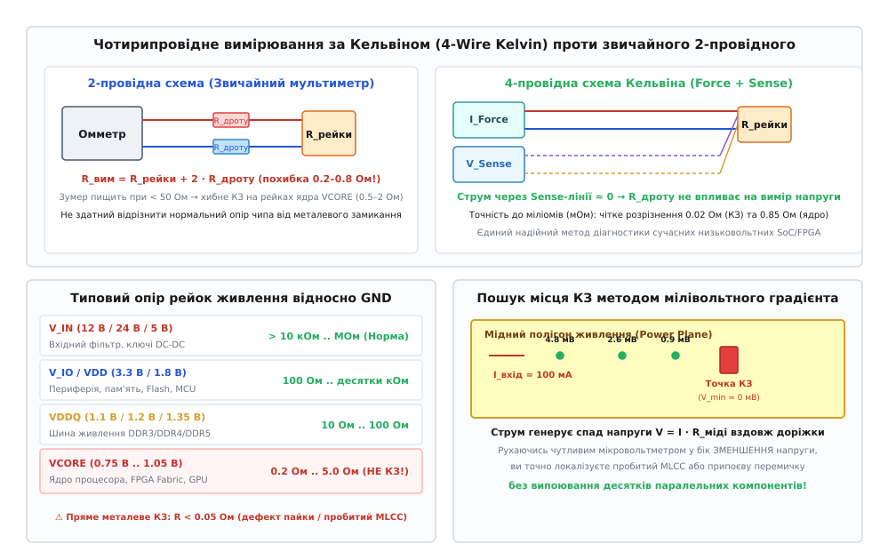

# Огляд плати до подачі живлення: мікроскоп, дзвінок рейок на КЗ

<preknowlist>
- [Шарування плати (PCB stackup)](root:hw-pcb/pcb-stackup) — структура шарів, паяльна маска, мідні шари живлення та землі.
- [Паяння оплавленням (Reflow soldering)](root:hw-pcb/reflow-soldering) — формування паяних менісків, поверхневий натяг припою та паяльна паста.
- [Монтаж і контроль BGA (BGA assembly)](root:hw-pcb/bga-assembly) — посадка безвивідних корпусів, дефекти спаювання та приховані кулі припою.
- [Розводка розв'язки (Decoupling routing)](root:hw-pcb/rozvodka-rozviazky) — розміщення блокувальних MLCC-конденсаторів біля виводів живлення.
- [Імпеданс шини живлення (PDN)](root:hw-pcb/pdn-impedance) — низькоомний імпеданс рейок ядра та поведінка конденсаторних батарей.
</preknowlist>

Партія щойно змонтованих дослідних зразків нової друкованої плати лягає на робочий стіл інженера прямо з монтажної лінії SMT (*Surface Mount Technology*). Перше природне бажання — негайно вставити роз'єм живлення, клацнути тумблером лабораторного блока і побачити блимання світлодіодів. Проте статистика апаратного налагодження невблаганна: понад дев'яносто відсотків катастрофічних відмов дослідних плат із вигоранням мікроконтролерів, пробоєм силових каскадів і руйнуванням внутрішніх шарів текстоліту стаються саме в перші сто мілісекунд після першого ввімкнення.

Причиною таких аварій є не помилки у вбудованому коді чи збої тактування, а грубі дефекти монтажу: переполюсований танталовий конденсатор, мікроскопічна припоєва перемичка між виводами процесора з кроком 0.4 мм, зсув мікросхеми на 90 градусів або прихований дефект шарів самої друкованої плати. Виправлення наслідків коштує тижнів затримки проекту та тисяч доларів на повторне виготовлення компонентів. Єдиний надійний бар'єр проти руйнування виробу — вичерпна передстартова інспекція повністю знеструмленої плати.

---

### Регламент передстартового контролю: п'ять послідовних бар'єрів

Процедура передстартової інспекції нової друкованої плати будується як сувора ієрархія з п'яти послідовних етапів. Перехід до кожного наступного кроку дозволяється лише після стовідсоткового успішного проходження попереднього:

```text
[1. Макроогляд] ──► [2. Оптична мікроскопія] ──► [3. Контроль полярностей] ──► [4. Дзвінок рейок на КЗ] ──► [5. Локалізація аномалій]
```

1. **Макроскопічний огляд загального стану:** Перевірка геометрії плати, відсутності механічних розшарувань склотекстоліту FR-4 (*Delamination*), чистоти поверхні від металевої стружки після фрезерування контуру та наявності всіх роз'ємів за складальним кресленням.
2. **Оптична мікроскопія контактних з'єднань:** Ретельний огляд паяних менісків компонентів із дрібним кроком виводів (QFP, TSSOP, DFN, QFN), пошук припоєвих кульок, мікротріщин та ненадійних спаїв.
3. **Верифікація орієнтації полярних елементів:** Повний аудит ключів Pin 1 інтегральних схем, маркування анодів танталових конденсаторів, катодів діодів, орієнтації силових польових транзисторів і світлодіодів.
4. **Дзвінок шин живлення на коротке замикання (КЗ):** Вимірювання статичного опору кожної окремої рейки живлення відносно загальної землі GND та між сусідніми рейками в обох полярностях вимірювальних щупів.
5. **Чотирипровідна локалізація аномалій за Кельвіном:** Пошук точного фізичного місця низькоомних замикань на мідних полігонах методом мілівольтного градієнта без випаювання компонентів.

---

### Оптичний мікроскопічний контроль: орієнтація полярних компонентів

Людський зір без оптичного збільшення не здатний надійно розрізнити деталі сучасного поверхневого монтажу. Стандартний крок ніжок мікросхем у корпусах LQFP становить 0.5 мм або 0.4 мм, а ширина зазору між сусідніми виводами не перевищує 0.2 мм. Для повноцінного контролю робоче місце інженера має бути оснащене бінокулярним стереомікроскопом зі змінним збільшенням від 10x до 40x або цифровим HDMI-мікроскопом високої роздільної здатності з регульованим кільцевим освітленням.

#### Ключ першого виводу мікросхем (Pin 1 IC)

Усі інтегральні схеми монтуються у суворо визначеній орієнтації. Зсув мікросхеми на 90°, 180° або 270° відносно посадкового місця призводить до того, що шина живлення +3.3 В або +5 В потрапляє на чутливі лінії інтерфейсів SPI, I2C або виходи логічних вентилів, миттєво руйнуючи кремнієвий кристал.

Інспекція орієнтації мікросхем вимагає контролю таких ознак:

- **Лазерне поглиблення або крапка (Dot marker):** Кругле поглиблення на верхній поверхні пластикового або керамічного корпусу, розташоване безпосередньо біля виводу 1.
- **Скошена грань (Chamfer / Bevel edge):** Зріз однієї з бічних граней корпусу мікросхеми вздовж сторони, де розташовані виводи з 1 по N/4.
- **Напівкруглий паз (Notch):** Традиційний ключ на торці корпусів SOIC, SSOP та DIP, що вказує напрямок на вивід 1 зліва від паза.
- **Шовкодрук на друкованій платі:** Крапка, трикутник або подовжений контактний майданчик першого виводу на топологічному шарі плати. Обов'язково перевіряється збіг мітки на корпусі мікросхеми з міткою на платі згідно зі складальним кресленням.

#### Танталові проти алюмінієвих конденсаторів: головна пастка полярності

Найпоширенішою і найнебезпечнішою помилкою інженерів є плутанина маркування полярності між танталовими твердотільними конденсаторами та алюмінієвими електролітичними конденсаторами SMD.

```text
Танталовий SMD (A, B, C, D кейс):   [ СМУГА = АНОД (ПОЗИТИВНИЙ ПОЛЮС +) ]
Алюмінієвий електроліт SMD:          [ СМУГА = КАТОД (НЕГАТИВНИЙ ПОЛЮС −) ]
```

У танталових конденсаторах оксидний діелектричний шар пентаоксиду танталу `Ta2O5` формується електрохімічним шляхом на поверхні пористого танталового анода. Смуга кольорового маркування (біла, жовта або темна) на корпусі танталового конденсатора **завжди позначає позитивний анод (+)**.

Якщо танталовий конденсатор впаяно зворотною полярністю (плюсом до землі, мінусом до шини живлення), при першому поданні напруги діелектричний шар `Ta2O5` миттєво руйнується внаслідок електрохімічного відновлення. Через місце пробою починає протікати лавиноподібний струм короткого замикання, внутрішній діоксид марганцю `MnO2` (катод) виділяє вільний кисень, ініціюючи екзотермічну реакцію горіння металевого танталу. Конденсатор вибухає зі стовпом відкритого полум'я, розбризкуючи розплавлений метал і пропалюючи сусідні шари текстоліту.

На противагу танталу, в алюмінієвих електролітичних конденсаторах для поверхневого монтажу (вертикальні циліндричні корпуси) кольоровий сектор на верхньому торці **позначає негативний катод (−)**. Також основа пластикової платформи алюмінієвого конденсатора має зрізані кути з боку позитивного анода (+), тоді як прямі кути відповідають катоду (−).

#### Орієнтація напівпровідникових діодів та світлодіодів

- **Дискретні діоди (SOD-123, SMA, SMB, SMC, MELF):** Смуга на корпусі завжди позначає **катод (K / −)**. У звичайному випрямлячі струм тече від анода до катода (назустріч смузі), тому смуга підключається до споживача або позитивної шини фільтра. У захисних супресорах TVS односпрямованого типу смуга катода підключається до шини, що захищається, а анод — до землі GND.
- **SMD-світлодіоди (LED 0603, 0805, 1206):** Маркування світлодіодів не є абсолютно уніфікованим між виробниками, тому вимагає підвищеної уваги. Найчастіше на нижньому боці корпусу світлодіода наноситься зелена мітка у формі літери "T" або стрілки, де вістря або поперечина вказує на **катод (−)**. На верхній прозорій лінзі катод часто позначається скошеним кутом або зеленими крапками на торцях. Перед монтажем та ввімкненням орієнтація LED обов'язково перевіряється мультиметром у режимі діодного тесту (щупи приладу викликають слабке світіння кристала при прямому ввімкненні).

#### Транзистори та силові ключі MOSFET

Силові польові транзистори в компактних корпусах SOT-23, DFN-8 (5x6 мм), PowerPAK SO-8 та D2PAK вимагають окремого контролю цоколівки. Багато транзисторів випускаються у дзеркальних версіях (наприклад, N-канальні та P-канальні пари в однаковому корпусі або різні варіанти розводки виводів Gate/Drain/Source). Помилкове встановлення транзистора з іншою цоколівкою перетворює вбудований зворотний діод (*Body Diode*) на пряме коротке замикання між шиною живлення та землею.


*Ключові об'єкти мікроскопічного контролю: орієнтація виводу 1 мікросхем, фундаментальна різниця полярності танталових (+) та алюмінієвих (-) конденсаторів, маркування діодів, а також типові дефекти пайки (припоєві перемички, кульки, надгробки та тріщини MLCC).*

---

### Дефекти пайки та топологічні пастки монтажу

Під час паяння оплавленням паяльної пасти в конвекційній печі (*Reflow Soldering*) або ручного допаювання компонентів на платі виникають специфічні фізичні дефекти, здатні спричинити приховані короткі замикання.

#### Припоєві перемички (Solder Bridges)

Припоєва перемичка — це неконтрольоване затікання розплавленого припою між двома сусідніми контактними майданчиками з утворенням металевого містка. Найчастіше перемички виникають між ніжками мікросхем у корпусах QFP, TSSOP та роз'ємах із дрібним кроком (≤0.5 мм).

Основними причинами утворення перемичок є:

- **Надлишок паяльної пасти:** Неправильний розрахунок товщини трафарету або апертур трафаретного друку.
- **Зсув трафарету під час нанесення:** Розмивання контурів пасти перед встановленням компонентів.
- **Недостатня активність флюсу:** Окиснення припою призводить до порушення поверхневого натягу розплаву, через що припій не втягується на контактний майданчик, а злипається з сусіднім виводом.

Перемички усуваються нанесенням рідкого безвідмивного флюсу на виводи та проведенням очищеним мідним обплетенням (*Solder Wick*) або чистим плоским жалом паяльника типу «хвиля» (*Mini-Wave / Hoof tip*).

#### Припоєві кульки (Solder Beads / Balls)

Припоєві кульки діаметром від 0.05 до 0.3 мм — поширений дефект паяння чіп-компонентів резисторів та конденсаторів (0402, 0603, 0805). Якщо профіль нагріву печі має занадто крутий температурний градієнт у зоні попереднього прогріву (*Ramp-to-Soak*), розчинник у паяльній пасті закипає вибухоподібно. Мікроскопічні краплі рідкого припою викидаються з-під корпусу компонента і застигають на поверхні паяльної маски.

Небезпека припоєвих кульок полягає в тому, що вони слабо тримаються на масці. Під час вібрації або транспортування кулька відривається і закорочує відкриті перехідні отвори (*Vias*) або контактні площадки сусідніх компонентів. Плату після пайки необхідно ретельно очищати антистатичним пензлем в ізопропіловому спирті або в ультразвуковій ванні з наступним оглядом під мікроскопом.

#### Ефект «надгробка» (Tombstoning) та зміщення компонентів

Дефект надгробка (від англ. *Tombstoning* або «манхеттенський ефект») полягає в тому, що двовивідний пасивний SMD-компонент під час оплавлення піднімається вертикально, втрачаючи контакт з однією з контактних площадок. Це явище виникає через нерівномірність сил поверхневого натягу припою на протилежних торцях компонента: якщо одна площадка прогрівається швидше за іншу (наприклад, одна ніжка підключена до масивного мідного шару землі без термобар'єрів, а інша — до тонкої доріжки), припій на гарячій площадці розплавляється першим і ставить деталь вертикально. Цей дефект створює повний обрив ланцюга.

#### Внутрішнє розтріскування керамічних конденсаторів MLCC

Багатошарові керамічні конденсатори MLCC (*Multi-Layer Ceramic Capacitors*) вкрай чутливі до механічних деформацій і термічного удару. Кераміка на основі титанату барію `BaTiO3` є надзвичайно крихким діелектриком.

Тріщини в конденсаторах виникають у трьох випадках:

1. **Термічний шок під час ручного паяння:** Дотик гарячого жала паяльника (350 °C) безпосередньо до керамічного тіла холодного конденсатора створює колосальний температурний градієнт.
2. **Вигин друкованої плати (*Board Flexure*):** Монтаж плати у жорсткий корпус, затягування кріпильних гвинтів або виламування плати з групової панелі по лініях скрайбування викликає напруження зсуву, що передається на контактні площадки конденсатора.
3. **Механічний удар:** Падіння плати на тверду поверхню.

Утворена всередині конденсатора мікротріщина перетинає сотні чергованих металевих електродів товщиною в кілька мікрометрів. Спочатку конденсатор може демонструвати нормальну ємність, проте під дією вологості повітря та прикладеної напруги вздовж тріщини починається електрохімічна міграція металу, що призводить до раптового низькоомного або плаваючого короткого замикання через години чи тижні після ввімкнення. Під мікроскопом тріщини виявляються за допомогою бічного косого освітлення як тонкі темні лінії на бічній грані керамічного блоку.

#### Дефекти корпусів QFN та BGA: приховані перемички під кристалом

У безвивідних мікросхемах QFN (*Quad Flat No-leads*) та DFN центральний металевий майданчик (*Exposed Pad / EPAD*) слугує для відведення тепла та електричного з'єднання з підкладкою мікросхеми (зазвичай GND). Якщо під час нанесення пасти на трафареті не було зроблено розбивки апертури EPAD на дрібні віконця (*Window Pane pattern*), надлишок припою під тиском компонента вичавлюється назовні. Розплавлений припій розтікається під дном мікросхеми й утворює невидимі зовні перемички між центральним земляним падом і сусідніми ніжками живлення або сигналів.

Для BGA-мікросхем поширеним є дефект «голова на подушці» (*Head-in-Pillow, HiP*), коли кулька BGA та паяльна паста на контактному майданчику оплавляються окремо через короблення (*Warpage*) текстоліту при нагріві, утворюючи контакт без металургійного сплавлення, а також затікання припою між сусідніми кульками масиву. Такі дефекти діагностуються рентгенівським контролем або вимірюванням опору сигнальних кіл на землю.

---

### Оптичний інструментарій та методики освітлення

Якість виявлення монтажних дефектів безпосередньо залежить від геометрії та спектрального складу освітлення робочого поля мікроскопа:

- **Кільцеве безтіньове освітлення (*Ring Light*):** Світлодіодне кільце навколо об'єктива рівномірно заливає плату прямим світлом. Ідеально підходить для загального огляду, читання маркування мікросхем і перевірки чистоти поверхні. Проте пряме вертикальне світло створює сильні дзеркальні відблиски від блискучих паяних менісків, маскуючи тонкі тріщини та волосяні припоєві перемички.
- **Косе бічне освітлення темного поля (*Oblique / Darkfield Lighting*):** Світловий промінь спрямовується під кутом 15°–30° до площини плати. У такому режимі пласка паяльна маска залишається темною, а будь-які мікронерівності, подряпини, припоєві кульки та мікротріщини кераміки яскраво спалахують за рахунок розсіювання світла на їхніх гранях.
- **Ультрафіолетова люмінесцентна інспекція (УФ 365 нм):** Багато сучасних паяльних флюсів та конформних захисних лаків містять люмінесцентні добавки. Під дією довгохвильового ультрафіолету залишки флюсу в зазорах між ніжками BGA та QFP яскраво світяться жовто-зеленим або синім кольором, вказуючи на зони незавершеного відмивання.
- **Рентгенівський контроль (AXI / X-Ray Inspection):** Для корпусів із прихованими під дном виводами (BGA, WLCSP, QFN з центральним тепловим падом) оптична мікроскопія безсила. Рентгенівська установка просвічує корпус наскрізь, візуалізуючи внутрішню структуру кульок припою BGA, форму паяних галтелей, порожнечі (*Voids*) у припої за стандартом IPC-A-610 Class 3 (де площа порожнеч не повинна перевищувати 25% від площі кулі) та приховані перемички між сусідніми кульками масиву.

---

### Гігієна робочого місця: антистатичний захист та видалення флюсу

Усі процедури огляду та вимірювань повинні виконуватися в суворій відповідності до стандартів захисту від електростатичного розряду (*Electrostatic Discharge, ESD*):

- **Антистатичне покриття робочого столу:** Плата має лежати на провідному килимку з опором розсіювання від 1 МОм до 1 ГОм, підключеному до точки захисного заземлення будівлі через безпечний резистор 1 МОм.
- **Індивідуальний антистатичний браслет:** Оператор зобов'язаний постійно носити провідний браслет на зап'ясті. Електростатичний потенціал людського тіла в сухому приміщенні легко досягає 2–5 кВ. Дотик пальцем до відкритого затвора силового польового транзистора або входу КМОН-мікросхеми без заземлення спричиняє миттєвий діелектричний пробій підзатворного оксиду `SiO2` товщиною в кілька нанометрів, утворюючи прихований витік або повне КЗ ще до першого ввімкнення.
- **Іонна чистота поверхні:** Залишки некорозійного флюсу (*No-Clean*) за кімнатної температури та нормальної вологості є діелектриком. Проте при наявності солей або підвищенні вологості повітря понад 60% гігроскопічні компоненти флюсу перетворюються на рідкий електроліт. Це створює паразитні струми витоку між сусідніми високоомними виводами мікроконтролера (наприклад, лініями тактового генератора кварцового резонатора або виводом скидання `NRST`), що призводить до відмови запуску генерації. Перед вимірюванням опорів плату необхідно промити ізопропіловим спиртом високої чистоти (99.9%) та висушити стисненим очищеним повітрям.

---

### Контроль конфігураційних перемичок, роз'ємів та ізоляційних бар'єрів

Окрім поверхневих компонентів, критичної перевірки вимагають комутаційні вузли плати:

1. **Конфігураційні перемички (Jumpers / Solder Jumpers):** Перевірка положення вибору напруг живлення (наприклад, 3.3 В проти 5.0 В для логіки) та ліній завантаження мікроконтролера (*Boot Strapping*: BOOT0/BOOT1, вибір інтерфейсу завантаження SPI Flash / UART / USB). Неправильно встановлений джампер може закоротити вихід LDO-стабілізатора на вхідну шину живлення.
2. **Полярність вхідних силових роз'ємів:** Роз'єми постійного струму типу DC-Jack (перевірка центрального контакту: *Center-Positive* проти *Center-Negative*), гвинтові клемники, клемники Molex, роз'єми XT30/XT60. Помилка у підключенні кабелю на цьому етапі здатна спалити захисні діоди TVS або вхідні ключі захисту від переполюсування.
3. **Резистори конфігурації USB Type-C:** Якщо плата живиться через порт USB-C у ролі споживача (*Sink / UFP*), на лініях CC1 та CC2 обов'язково мають бути встановлені підтягувальні до землі резистори номіналом 5.1 кОм (з точністю 1%). Відсутність резисторів або їхнє замикання призводить до того, що зарядний пристрій або порт комп'ютера не видасть напругу 5 В на лінію VBUS.
4. **Ізоляційні бар'єри високовольтних кіл:** На платах із вбудованими імпульсними джерелами живлення від мережі 230 В перевіряється повітряний зазор (*Clearance*) та зазор по поверхні ізоляції (*Creepage*) між первинною високовольтною та вторинною низьковольтною зонами (не менше 4.0–6.0 мм за стандартом IEC 62368-1), а також правильність встановлення оптопар і Y-конденсаторів.

---

### Вимірювання опору рейок живлення на коротке замикання

Після завершення візуального огляду настає етап інструментального контролю електричних кіл живлення. Коротке замикання між шиною живлення та спільним провідником землі GND або між двома незалежними шинами живлення — найнебезпечніший апаратний дефект.

#### Ієрархія та номенклатура шин живлення

Сучасна цифрова або комбінована друкована плата містить цілу мережу вторинних джерел живлення (*Power Tree*):

```text
V_IN (+12 В / +24 В)
   ├──► Buck DC-DC ──► V_SYS (+5.0 В)  ──► Периферія, драйвери, реле
   ├──► Buck DC-DC ──► V_IO (+3.3 В)   ──► MCU I/O, Flash, Ethernet PHY
   ├──► Buck DC-DC ──► VDDQ (+1.2 В)   ──► Шина пам'яті DDR4
   ├──► Buck DC-DC ──► VCORE (+0.9 В)  ──► Ядро FPGA / SoC / CPU (до 30-50 А)
   └──► LDO ─────────► VDDA (+3.3 В)   ──► Аналогові АЦП/ЦАП, PLL
```

Кожна з цих рейок має принципово різну фізичну природу навантаження і, відповідно, різний допустимий опір у холодному стані.

#### Пастка зумера мультиметра ("дзвоника")

Найпоширенішою помилкою початківців є перевірка плати на коротке замикання за допомогою дешевого мультиметра в режимі звукової прозвонки (зумера).

Поріг спрацьовування зумера в більшості мультиметрів становить від 30 до 50 Ом. Якщо опір ланцюга менший за цей поріг, прилад безперервно пищить.

Але для сучасних мікропроцесорів, FPGA та графічних процесорів із номінальною напругою ядра `VCORE = 0.75 .. 1.0 В` та робочим струмом 10–50 А статичний опір знеструмленого кристала через відкриті канали мільярдів польових транзисторів становить **від 0.2 Ом до 2.0 Ом у абсолютно справному стані!**

Коли інженер торкається щупами мультиметра в режимі "дзвоника" до шини 0.9 В VCORE справної плати, прилад починає несамовито пищати. Недосвідчений фахівець робить хибний висновок про наявність КЗ на платі та починає марно випаювати дорогий процесор або дроселі перетворювача.

Водночас на високовольтній шині `V_IN = 12 В` опір у 5 Ом мультиметр сприйме як "незамкнений" (зумер мовчатиме, якщо поріг 40 Ом), тоді як при поданні напруги 12 В через цей резистивний місток потече струм:

```text
I = U / R = 12 В / 5 Ом = 2.4 А        [струм витоку через дефект]
P = U · I = 12 В · 2.4 А = 28.8 Вт      [розсіювана потужність на платі]
```

Виділення потужності майже 30 Вт на площі одного квадратного міліметра миттєво спричиняє вибухове займання текстоліту!

**Висновок:** Режим "піщалки" мультиметра непридатний для верифікації складних плат. Опір рейок живлення необхідно вимірювати виключно в режимі цифрового омметра з точною фіксацією числового значення опору.

```text
+--------------------------------------------------------------------------------+
|          ТИПОВІ ДІАПАЗОНИ СТАТИЧНОГО ОПОРУ ХОЛОДНИХ РЕЙОК ЖИВЛЕННЯ             |
+-------------------+-------------------+--------------------+-------------------+
| Шина живлення     | Номінальна напруга| Нормальний опір    | Критичний дефект  |
+-------------------+-------------------+--------------------+-------------------+
| V_IN              | +12 В / +24 В     | > 10 кОм .. МОм    | < 500 Ом          |
| V_SYS             | +5.0 В            | 1 кОм .. 100 кОм   | < 50 Ом           |
| V_IO / VDD        | +3.3 В / +1.8 В   | 100 Ом .. 10 кОм   | < 10 Ом           |
| VDDQ (DDR)        | +1.2 В / +1.35 В  | 10 Ом .. 100 Ом    | < 1.0 Ом          |
| VCORE (SoC/FPGA)  | +0.75 В .. +1.0 В | 0.2 Ом .. 5.0 Ом   | < 0.05 Ом (КЗ!)   |
| VDDA (Analog)     | +3.3 В            | 500 Ом .. 50 кОм   | < 50 Ом           |
+-------------------+-------------------+--------------------+-------------------+
```

#### Вплив заряду блокувальних конденсаторів та протокол вимірювання

Кожна шина живлення шунтується десятками паралельних керамічних конденсаторів MLCC сумарною ємністю від 100 мкФ до 2000 мкФ.

Під час прикладання щупів омметра внутрішнє джерело струму приладу починає заряджати розряджені конденсатори. У перші частки секунди вимірювач фіксує нульовий опір, який поступово зростає в часі:

```text
t = 0.0 с  ──► R_app = 0.00 Ом  (початок заряду конденсаторів)
t = 0.5 с  ──► R_app = 120 Ом
t = 1.5 с  ──► R_app = 4.7 кОм
t = 3.0 с  ──► R_app = 48.2 кОм (стабілізація справжнього опору витоку)
```

Правильний протокол вимірювання вимагає утримувати щупи на тестовій точці не менше 3–5 секунд до повної стабілізації останнього розряду індикатора.

Вимірювання обов'язково проводиться двічі:
1. **Пряма полярність:** Червоний щуп (+) на шину живлення, чорний щуп (−) на GND.
2. **Зворотна полярність:** Червоний щуп (+) на GND, чорний щуп (−) на шину живлення.

У зворотній полярності позитивний потенціал на землі відкриває внутрішні захисні діоди ESD мікросхем і паразитні зворотні діоди MOSFET (*Body Diodes*). Омметр покаже падіння напруги або опір близько 300–700 Ом. Якщо в обох полярностях фіксується однаковий опір менше 0.05 Ом — на платі присутнє справжнє металеве коротке замикання.

---

### Чотирипровідна схема вимірювання за Кельвіном та пошук місця КЗ

Для точного вимірювання опорів менше одного ома стандартний 2-провідний мультиметр стає непридатним через паразитний опір вимірювальних дротів і перехідний опір контактів щупів (`R_lead ≈ 0.2 .. 0.8 Ом`).

#### Фізика схеми Кельвіна (4-Wire Kelvin Connection)

Чотирипровідний метод повністю розділяє ланцюг подачі струму та ланцюг вимірювання спаду напруги:

```text
[ Джерело струму I_Force ] ──(Force +)──────────────────┐
                                                         ├──► [ R_DUT: Досліджувана шина ]
[ Вольтметр V_Sense (R_вх > 10 ГОм) ] ──(Sense +)───────┤
                                                         │
[ Вольтметр V_Sense ] ──────────────────(Sense −)───────┤
                                                         ├──► [ Спільна земля GND ]
[ Джерело струму I_Force ] ──(Force −)──────────────────┘
```

1. Через окрему пару дротів `Force (+/-)` від стабілізованого генератора в досліджуване коло подається калібрований струм `I_force` (наприклад, 100 мА). На опорі дротів виникає спад напруги, але генератор автоматично підтримує точний струм.
2. Друга пара дротів `Sense (+/-)` підключається безпосередньо до контактних площадок досліджуваного компонента. Оскільки вхідний опір вимірювального вольтметра надзвичайно великий (`R_in > 10 ГОм`), струм через лінію Sense практично дорівнює нулю (`I_sense ≈ 0`).
3. Спад напруги на вимірювальних дротах Sense дорівнює нулю (`ΔV_lead = I_sense · R_lead = 0`), тому вольтметр фіксує чистий спад напруги на навантаженні:

```text
R_DUT = V_Sense / I_Force              [точний опір за законом Ома без похибки дротів]
```

Цей метод дозволяє вимірювати опір із роздільною здатністю до 0.1 міліома (0.0001 Ом), гарантовано відрізняючи нормальний опір ядра процесора (0.85 Ом) від припоєвого короткого замикання (0.02 Ом).


*Принцип 4-провідного вимірювання за Кельвіном: повне усунення похибки вимірювальних щупів, таблиця допустимих опорів шин живлення та методика локалізації місця КЗ вздовж мідного полігона за спаданням мілівольтового потенціалу.*

#### Пошук місця КЗ методом мілівольтного градієнта

Якщо на шині зафіксовано металеве КЗ, паралельно цій шині на платі можуть стояти 50 керамічних конденсаторів. Щоб знайти один дефектний конденсатор без випаювання решти, застосовують метод градієнта потенціалу:

1. До закороченої шини живлення та землі підключають лабораторне джерело живлення в режимі стабілізації струму CC (*Constant Current*), виставивши обмеження струму 100–200 мА і напругу не вище 0.5 В.
2. Струм тече від точки входу живлення через мідні доріжки та полігони до точки замикання і стікає в землю.
3. Мідна доріжка має питомий опір близько 0.5 мОм на квадрат. Протікання струму 200 мА створює вздовж доріжки вимірюваний спад напруги в кілька мілівольтів.
4. Один щуп чутливого цифрового мілівольтметра фіксують на загальному контакті GND, а другим голчастим щупом послідовно торкаються виводів живлення кожного конденсатора вздовж шини.
5. У міру наближення до фізичного місця замикання напруга монотонно падає: 4.8 мВ → 2.6 мВ → 0.9 мВ.
6. Конденсатор або вивід мікросхеми, на якому зафіксовано **абсолютний мінімум напруги `V_min`**, і є фізичним місцем короткого замикання.

---

### Програмна модель верифікації шин живлення

Для автоматизації обліку рейок живлення та розрахунку очікуваних меж опору розроблено програмний алгоритм, наведений нижче двома мовами програмування.

:::tabs
:::code ohliad-platy-do-podachi-zhyvlennia-d/c/main.c
:::code ohliad-platy-do-podachi-zhyvlennia-d/cpp/main.cpp
:::

Повний набір інструментів та розширений розрахунковий комплекс винесено в окрему практичну вставку: [автоматизований чекліст та калькулятор мінімального безпечного опору рейок](root:hw-pcb/ohliad-platy-do-podachi-zhyvlennia/proj-pre-power-checklist.md).

Після того як усі пункти мікроскопічного огляду підтверджено, орієнтацію всіх напівпровідникових та полярних компонентів верифіковано, а виміряні опори всіх шин живлення вклалися в розрахункові норми без ознак короткого замикання, плата готова до наступного критичного етапу введення в експлуатацію: [перше вмикання нової плати: обмеження струму, димовий тест](root:hw-pcb/pershe-vmykannia-novoi-platy).
