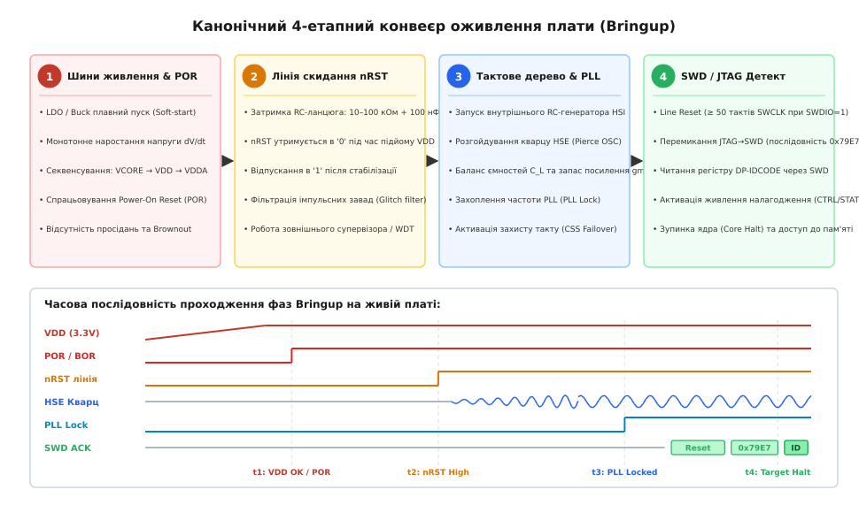
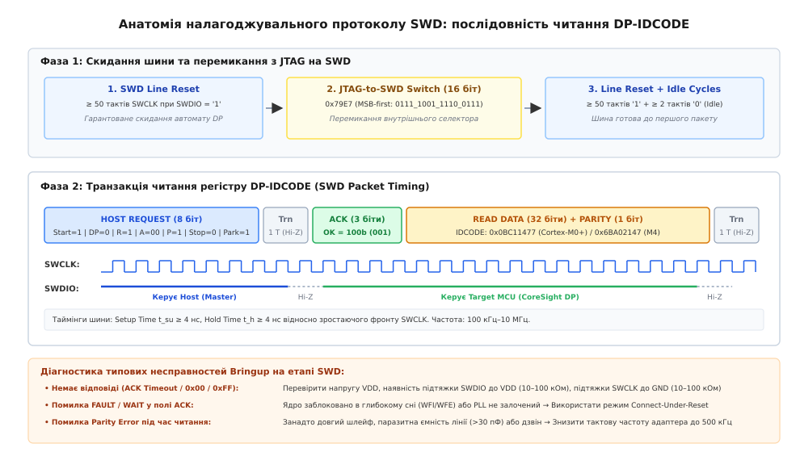

# Оживлення нової плати: рейки → скидання → такт → відлагоджувач

<preknowlist>
- [Огляд плати до подачі живлення](root:hw-pcb/ohliad-platy-do-podachi-zhyvlennia) — візуальний контроль монтажу під мікроскопом, виявлення перемичок припою та дзвінок шин на землю.
- [Перше вмикання нової плати: обмеження струму, димовий тест](root:hw-pcb/pershe-vmykannia-novoi-platy) — робота з лабораторним блоком у режимі обмеження струму (CC), контроль споживання та тепловізійна інспекція.
- [Розведення розв'язувальних конденсаторів](root:hw-pcb/rozvodka-rozviazky) — мінімізація індуктивності контуру розв'язки та високочастотна фільтрація кіл живлення.
- [Кварцовий резонатор, опорні кола й аналогові входи](root:hw-pcb/kvarts-opora-i-analohovi-vkhody) — розрахунок навантажувальної ємності, захисні кільця та топологія генератора Пірса.
- [Налагоджувальний роз'єм, тестові точки й навмисні розриви кіл](root:hw-pcb/debah-roziem-testovi-tochky-i-navmysni-avariini) — розпіновка роз'ємів SWD/JTAG, точки контролю напруг та перемички ізоляції доменів.
</preknowlist>

Коли свіжозмонтована друкована плата вперше лягає на лабораторний стіл, мікроконтролер на ній є абсолютно німим шматком кремнію. Інженер підключає апаратний відлагоджувач, запускає сесію прошивання і бачить фатальне повідомлення: `Cannot connect to target` або `No target detected`. Спроба хаотично пересмикувати кабелі чи гріти феном чип не дає результату, оскільки успішне виявлення ядра на налагоджувальних лініях SWD (Serial Wire Debug) або JTAG є фінальним наслідком суворої чотириланкової фізичної послідовності. Якщо порушено хоча б одну з попередніх ланок — напруга живлення, лінія скидання або тактовий генератор — відлагоджувальний порт фізично не здатний відповісти.

Процес перетворення пасивного текстоліту на функціональний цифровий пристрій називається оживленням плати (англ. *Board Bringup*, від дієслова *bring up* — вирощувати, піднімати на ноги). Цей процес вимагає суворого детермінованого конвеєра діагностики: спершу верифікується якість та монотонність кожної шини живлення разом із роботою внутрішніх схем скидання при вмиканні (Power-On Reset), далі перевіряється стан і фільтрація зовнішньої лінії скидання `nRST`, після чого аналізується генерація тактових опор і захоплення частоти фазового автопідстроювання (PLL), і лише наприкінці здійснюється діагностичний протокольний контакт через відлагоджувач.


*Канонічний 4-етапний конвеєр оживлення плати: послідовність проходження живлення, лінії скидання, тактування та налагоджувального інтерфейсу SWD.*

---

## 1. Фізична анатомія першого запуску: каузальний ланцюг завантаження кремнію

Кремнієвий кристал сучасного 32-розрядного мікроконтролера складається з кількох ізольованих напівпровідникових областей (доменів): аналогового домену живлення (`VDDA`), цифрового домену введення-виведення (`VDD`), ядра з низьковольтною логікою (`VCORE`, зазвичай 1.2 В або 0.9–1.8 В від вбудованого LDO чи DC-DC) та спеціалізованого домену відладки (Debug Domain). При поданні зовнішньої напруги внутрішня цифрова логіка не здатна стартувати миттєво. Всі тригери, регістри стану та матриця статичної пам'яті SRAM перебувають у хаотичному метастабільному стані. Якщо дозволити процесорному ядру виконувати інструкції за нестабільної або заниженої напруги, логічні вентилі перемикатимуться з неприпустимими затримками розповсюдження сигналу, що спричинить збій лічильника команд (`PC`), непередбачуваний запис у службові регістри або апаратне блокування шини пам'яті (Bus Fault / HardFault).

Під час проектування напівпровідникових кристалів за нормами 90 нм, 40 нм або 28 нм товщина підзатворного діелектрика польових транзисторів становить одиниці нанометрів (від 1.2 до 3.0 нм). Будь-який викид напруги вище абсолютної максимальної межі (Absolute Maximum Ratings, наприклад, 4.0 В для 3.3-вольтового домену) викликає тунельний пробій Фаулера-Нордгейма або лавинний пробій діелектрика затвора, що призводить до незворотної деградації транзистора. З іншого боку, якщо напруга живлення підіймається занадто повільно, диференційні підсилювачі внутрішніх джерел опорної напруги (Bandgap Reference) тривалий час працюють у нелінійній підпороговій зоні, видаючи непередбачуваний потенціал на внутрішні схеми зміщення компараторів.

Щоб унеможливити виконання інструкцій у небезпечній зоні напруг, кожен мікроконтролер містить апаратний автомат живлення і скидання:

```
Подача V_IN
   │
   ▼
[ Етап 1: Шини живлення ] ──► LDO/Buck плавний пуск → VDD перетинає поріг V_POR+ (1.7–2.0 В)
   │
   ▼
[ Етап 2: Лінія скидання ] ──► Зарядка C_NRST через R_PU → nRST стає High через t_RST (1–50 мс)
   │
   ▼
[ Етап 3: Тактове дерево ] ──► Старт RC-генератора (HSI) → Збудження кварцу (HSE) → PLL Lock
   │
   ▼
[ Етап 4: SWD / JTAG ]    ──► Line Reset (≥50 тактів) → 0x79E7 → Читання DP-IDCODE → Зупинка ядра
```

Кожна наступна стадія жорстко спирається на успішне завершення попередньої. Якщо напруга живлення `VDD` піднялася, але містить надмірні високочастотні пульсації чи не перетнула верхній поріг внутрішнього супервізора `V_POR+`, внутрішня лінія скидання ядра ніколи не звільниться. Якщо напруга `VDD` у нормі, але лінія `nRST` закорочена на землю через дефект пайки кнопки скидання або пробитий захисний конденсатор, ядро залишатиметься в стані постійного апаратного заморожування. Якщо лінії живлення й скидання функціонують, але тактовий генератор не зміг розгойдати кварцовий резонатор через перевантаження паразитною ємністю, або якщо ядро застрягло в режимі глибокого сну через випадкове сміття у флеш-пам'яті, шина налагодження вимагатиме особливого протокольного втручання.

### 1.1. Фізика тиристорного ефекту (Latch-Up) та підкладкових струмів

У монолітних інтегральних CMOS-мікросхемах кожен логічний інвертор формується p-канальним MOSFET у спеціальному n-кишені (n-well) та n-канальним MOSFET у загальній p-підкладці (p-substrate). Між цими областями неминуче виникають паразитні біполярні структури: вертикальний p-n-p транзистор (утворений p+ витоком p-MOSFET, n-кишенею та p-підкладкою) та горизонтальний n-p-n транзистор (утворений n+ витоком n-MOSFET, p-підкладкою та n-кишенею).

Ці два транзистори з'єднані перехресним позитивним зворотним зв'язком, утворюючи кремнієвий керований вентиль (SCR — Silicon Controlled Rectifier, або тиристор):

```
       VDD (3.3V)
           │
         [E_pnp]
           │
       ┌───┴───┐
       │ p-n-p │◄────────┐ (Колектор n-p-n зміщує базу p-n-p)
       └───┬───┘         │
           │ (Колектор)  │
           ├───►─────────┴───┐
           │                 │
           │              ┌───┴───┐
           │              │ n-p-n │
           │              └───┬───┘
           │ (База n-p-n)     │
           └──────────────────┤
                              │
                            [E_npn]
                              │
                             GND
```

У нормальному робочому стані обидва паразитні біполярні транзистори закриті, оскільки напруга емітер-база менша за поріг відкривання кремнієвого переходу (близько 0.65 В). Однак під час першого увімкнення плати можуть виникнути три критичні умови, що ініціюють тиристорне замикання:
1. **Перенапруга на цифрових входах (Input Overshoot):** Якщо вхідний сигнал від зовнішнього джерела з'являється раніше, ніж підніметься шина живлення `VDD`, захисний діод ESD відкривається і впорскує прямий струм у n-кишеню. Це відкриває p-n-p транзистор.
2. **Надмірна швидкість наростання напруги (`dV/dt > 50 В/мкс`):** Через бар'єрну ємність p-n переходів n-кишені протікає ємнісний струм зміщення `I = C_j · (dV/dt)`. Якщо цей струм створює на розподіленому опорі підкладки падіння напруги понад 0.65 В, запускається лавиноподібне самопідтримуване відмикання структури.
3. **Зсув потенціалу землі (Ground Shift):** Якщо імпульсний струм увімкнення підіймає локальний потенціал сигнальної землі цифрового блоку відносно аналогової підкладки, емітерний перехід n-p-n транзистора зміщується у прямому напрямку.

Коли тиристорна структура переходить у відкритий стан, імпеданс між шинами `VDD` та `GND` падає до часток ома. Струм обмежений лише внутрішнім опором джерела живлення та доріжок плати. Струм величиною 1–3 А миттєво викликає локальний перегрів кристала до температур понад 300°C, що супроводжується термічним пробоєм металізації, сплавленням кремнію та фізичним розтріскуванням пластикового корпусу мікросхеми.

Особливу небезпеку під час Bringup становить явище паразитного живлення через вхідні лінії (Phantom Powering). Якщо на плату ще не подано основне живлення 3.3 В, але до неї вже підключено активний програматор UART, SWD чи зовнішній датчик, напруга з сигнальної лінії проходить через внутрішній верхній захисний діод ESD прямо на знеструмлену шину `VDD`. Струм інжекції `I_inj` у такій конфігурації може перевищити гранично допустимий поріг `5 мА`, створюючи локальне падіння потенціалу на підкладці кристала і готуючи тиристорну структуру до миттєвого замикання в момент подачі основного живлення.

Крім того, захисні ESD-клямпи мікроконтролера містять структури типу Snapback NMOS, які мають напругу спрацьовування `V_t1 ≈ 6–8 В` та напругу утримання `V_hold ≈ 2.5–3.5 В`. Якщо під час підключення кабелів виникає короткочасний статичний розряд або індуктивний викид, що переводить клямп у стан низького опору, а напруга живлення `VDD` перевищує `V_hold`, клямп залишається заблокованим у відкритому стані під робочою напругою, безперервно споживаючи руйнівний струм до повного знеструмлення схеми.

### 1.2. Імпеданс мережі розподілу живлення (PDN) під час перехідних процесів

Коли на плату подається напруга, мережа розподілу живлення (Power Distribution Network, PDN) зазнає екстремального динамічного удару. Імпеданс мережі живлення `Z_PDN(f)` у частотній області визначається еквівалентним послідовним опором (ESR), еквівалентною послідовною індуктивністю (ESL) керамічних конденсаторів та паразитною індуктивністю перехідних отворів і доріжок:

```
Z_PDN(f) = sqrt( R_esr² + (2·π·f·L_esl - 1 / (2·π·f·C_decoupling))² )
```

На низьких частотах до 100 кГц імпеданс визначається вихідним каскадом стабілізатора напруги та ємністю електролітичних чи танталових конденсаторів. На середніх частотах від 100 кГц до 50 МГц імпеданс утримується дискретними керамічними конденсаторами MLCC типорозмірів 0402 та 0603 номіналом 100 нФ – 10 мкФ. На частотах понад 50 МГц головну роль відіграє власна розподілена ємність між полігонами живлення та землі друкованої плати.

Для забезпечення стабільної роботи цифрового ядра інженер розраховує цільовий імпеданс мережі живлення `Z_target`:

```
Z_target = (V_rail · Ripple_max) / I_transient
```

Якщо для шини живлення `V_rail = 3.3 В` допустимі пульсації становлять `Ripple_max = 3%` (тобто `ΔV = 0.099 В ≈ 100 мВ`), а перехідний струм ядра під час запуску `I_transient = 1.0 А`, цільовий імпеданс мережі не повинен перевищувати:

```
Z_target = 0.100 В / 1.0 А = 0.100 Ом = 100 мОм
```

Якщо під час компонування друкованої плати розв'язувальні конденсатори були розміщені далеко від виводів мікроконтролера, індуктивність доріжки `L_trace` (приблизно 1 нГн на кожен міліметр довжини) утворює з ємністю конденсатора паразитичний коливальний контур. Під час комутації пускових струмів цей контур породжує високочастотний дзвін (Ringing), амплітуда якого може перевищити напругу живлення у 1.5–2 рази, що призводить до негайного виходу з ладу вхідних кіл мікроконтролера ще до завершення першого такту генератора.

Паралельне включення конденсаторів різного номіналу (наприклад, 10 мкФ та 100 нФ) без урахування їхнього власного послідовного резонансу створює явище паралельного антирезонансу. На частоті антирезонансу `f_anti`, де ємнісний опір меншого конденсатора зрівнюється з індуктивним опором більшого, сумарний імпеданс мережі живлення різко підскакує в 10–50 разів:

```
f_anti ≈ 1 / (2 · π · sqrt( L_esl1 · C2 ))
```

Якщо робоча тактова частота ядра або частота комутації внутрішніх шин збігається з `f_anti`, на шині живлення виникають локальні періодичні просідання напруги амплітудою 300–800 мВ, що призводить до випадкових збоїв лічильника команд `PC` під час роботи відлагоджувача. Для демпфування антирезонансного піку використовують конденсатори з помірним ESR або додають демпфуючий RC-ланцюг (Snubber) номіналом 1 Ом + 10 мкФ.

Під час лабораторної верифікації імпеданс PDN вимірюють за допомогою векторного аналізатора кіл (VNA) двопортовим методом на низьких частотах (Two-Port Shunt-Through Measurement). Це дозволяє безпосередньо побачити частоту антирезонансного піку `f_anti` та переконатися, що імпеданс шини залишається нижчим за `Z_target` у всьому діапазоні робочих частот до 100 МГц.

Для мінімізації паразитної індуктивності контуру розв'язки інженер застосовує геометрію підключення з зустрічними струмами (Current Cancellation). Перехідні отвори живлення та заземлення розміщують впритул до контактних майданчиків конденсатора, що зменшує площу магнітного контуру до часток квадратного міліметра. Це знижує індуктивність підключення `L_via` з типових 1.2–1.8 нГн до менш ніж 0.3–0.4 нГн, розширюючи ефективну смугу придушення високочастотних шумів до 150–200 МГц.

### 1.3. Паразитні індуктивності та ємності корпусів (BGA/QFN) та шум одночасного перемикання (SSN)

У процесі проектування друкованої плати інженер часто розглядає корпус мікроконтролера як ідеальний контактний перехід між кристалом і доріжками. Проте фізична конструкція корпусу містить внутрішні металеві провідники (Bond Wires) або мікрокульки припою (BGA Solder Balls), які мають власну паразитну індуктивність `L_bond` (від 1 до 3 нГн для дротяного розварювання в корпусах LQFP/QFN та близько 0.2–0.5 нГн для Flip-Chip BGA) і паразитну міжелектродну ємність `C_pin ≈ 0.5–1.5 пФ`.

Під час першого запуску, коли ядро починає ініціалізувати внутрішні шини або коли на виводах мікроконтролера одночасно змінюється логічний стан (наприклад, 32 лінії паралельної шини даних переходять із логічного нуля в логічну одиницю), виникає явище **шуму одночасного перемикання (Simultaneous Switching Noise, SSN)** або **дзвону землі (Ground Bounce)**:

```
I_total = N_pins · C_load · (dV / dt)
```

Якщо `N_pins = 32`, ємність навантаження кожної лінії `C_load = 25 пФ`, напруга живлення 3.3 В, а час наростання вихідного буфера `t_rise = 1.0 нс` (`dV/dt = 3.3 · 10⁹ В/с`), сумарний імпульсний струм комутації сягає:

```
I_total = 32 · (25 · 10⁻¹² Ф) · (3.3 · 10⁹ В/с) = 2.64 А
```

Якщо зворотний струм протікає через спільний земляний вивід корпусу з індуктивністю `L_gnd = 1.5 нГн`, стрибок падіння напруги на виводі заземлення становить:

```
V_bounce = L_gnd · (dI_total / dt) = 1.5 · 10⁻⁹ Гн · (2.64 А / 1.0 · 10⁻⁹ с) = 3.96 В
```

Цей стрибок напруги `V_bounce = 3.96 В` миттєво підіймає потенціал внутрішньої цифрової землі мікроконтролера вище напруги живлення. Для внутрішніх схем компараторів скидання лінія `nRST` (яка ззовні підтягнута до 3.3 В) виглядає як напруга нижче внутрішньої землі, що викликає помилкове спрацьовування тригера скидання та нескінченний циклічний перезапуск ядра. Для придушення цього ефекту мікроконтролери розбивають живлення на велику кількість пар виводів `VDD/VSS`, розташованих по периметру корпусу, і вимагають встановлення індивідуального керамічного конденсатора 100 нФ безпосередньо біля кожної окремої пари контактів.

Додатково між сусідніми виводами корпусу виникає взаємна індуктивність зв'язку `M_mutual ≈ 0.3–0.8 нГн`. Коли активний вивід перемикає великий струм, на сусідньому статичному виводі (наприклад, лінії SWDIO чи виводі тактового генератора) наводиться паразитна ЕРС `e_ind = - M_mutual · (di/dt)`. При величині `di/dt = 2.64 · 10⁹ А/с` амплітуда перехресної наводки сягає `0.8–1.5 В`, що здатне перетворити логічну одиницю в нуль і спотворити обмін даними з відлагоджувачем.

---

## 2. Етап 1: Шини живлення, перехідні процеси та Power-On-Reset (POR) секвенсування

Помилка багатьох початківців під час Bringup полягає в перевірці живлення звичайним цифровим мультиметром. Мультиметр інтегрує вимірювану величину впродовж 100–300 мс і показує усереднене значення, маскуючи короткочасні просідання, коливальні дзвінки під час увімкнення та високочастотний шум імпульсних перетворювачів. Перше правило перевірки шин живлення: **контроль напруг здійснюється виключно цифровим осцилографом із відкритою смугою пропускання не менше 100 МГц у режимі однократного запуску (Single Trigger)**.

### 2.1. Пусковий струм та швидкість наростання напруги (dV/dt)

У момент подачі вхідної напруги на плату всі розв'язувальні та фільтрувальні конденсатори (`C_total`) є повністю розрядженими й поводяться як чисте коротке замикання. Пусковий струм (англ. *Inrush Current*) визначається швидкістю наростання вихідної напруги регулятора `dV/dt`:

```
I_inrush = C_total · (dV / dt)
```

Якщо плата містить сумарну ємність керамічних конденсаторів `C_total = 100 мкФ`, а лінійний LDO-регулятор підіймає напругу від 0 до 3.3 В за `10 мкс` без керованого плавного пуску (Soft-Start), миттєвий піковий струм сягає:

```
I_inrush = 100 · 10⁻⁶ Ф · (3.3 В / 10 · 10⁻⁶ с) = 33 А
```

Такий імпульс струму створює локальне падіння напруги на паразитному активному опорі доріжок і кабелів живлення, що призводить до спрацьовування струмового захисту лабораторного джерела живлення, перезавантаження попередніх каскадів або вигоряння тонких переходів кристала регулятора. Для запобігання пусковому удару стабілізатори живлення оснащуються ланцюгами плавного пуску, які обмежують швидкість наростання вихідної напруги до величини `0.1–1.0 В/мс`.

```
Розрахунок часу плавного пуску при C_total = 100 мкФ та цільовому обмеженні I_max = 500 мА:
t_rise = C_total · V_out / I_max
       = 100 · 10⁻⁶ Ф · 3.3 В / 0.5 А
       = 0.66 мс
```

Важливо також враховувати ефект падіння ємності керамічних конденсаторів під дією постійної напруги зміщення (DC Bias Effect). У діелектриках класу X5R та X7R реальна ємність при робочій напрузі 3.3 В на конденсаторі з номіналом 6.3 В падає на 30–50%. Це зменшує фактичний час наростання напруги, якщо генератор струму плавного пуску стабілізатора розраховувався на номінальну ємність без запасу.

Для лінійних регуляторів LDO важливим фактором є забезпечення запасу стійкості петлі регулювання. Більшість класичних LDO використовують нуль передавальної функції, утворений еквівалентним послідовним опором (ESR) вихідного конденсатора, для компенсації другого полюса підсилювача похибки. Якщо замість танталового конденсатора з `ESR = 0.5–1.5 Ом` встановити наднизькоомну кераміку MLCC з `ESR < 5 мОм`, нуль зміщується у високочастотну область вище 10 МГц, запас за фазою падає нижче 15°, і LDO переходить у режим автоколивань із частотою 200–800 кГц та розмахом пульсацій до 1.0 В.

### 2.2. Перехідні процеси імпульсних перетворювачів (Buck Converters)

Якщо первинне живлення 3.3 В формується імпульсним понижувальним перетворювачем (DC-DC Buck Converter), динаміка запуску суттєво ускладнюється. У момент увімкнення контролер перетворювача працює в режимі розривних струмів дроселя (DCM — Discontinuous Conduction Mode), поступово збільшуючи шпаруватість ШІМ-сигналу. Якщо індуктивність дроселя `L` обрана замалою або струм насичення сердечника `I_sat` нижчий за піковий пусковий струм, дросель входить у глибоке магнітне насичення. Його індуктивність падає в 5–10 разів, перетворюючи обмотку на низькоомний дріт, що викликає колосальний струмовий викид через верхній MOSFET-ключ.

Перенапруга на виході понижувального регулятора (Overshoot) під час завершення фази плавного пуску оцінюється за енергетичним балансом накопиченої в магнітному полі дроселя енергії:

```
E_inductor = 0.5 · L · I_peak²
ΔV_overshoot = sqrt( V_out² + (L / C_out) · I_peak² ) - V_out
```

Якщо `ΔV_overshoot` перевищує допустимий запас мікроконтролера (наприклад, стрибок до 3.8 В на шині 3.3 В), внутрішні цифрові вентилі зазнають перенапруги. Осцилографічна верифікація вимагає фіксації моменту переходу регулятора з режиму плавного пуску в режим стабілізації для гарантії відсутності викидів понад `+3%` від номіналу.

Петля зворотного зв'язку Buck-перетворювача описується передавальною функцією з двополюсним спадом LC-фільтра на частоті `f_lc = 1 / (2·π·sqrt(L·C))` та нулем від ESR вихідного конденсатора на частоті `f_esr = 1 / (2·π·ESR·C)`. Для запобігання автоколиванням фазовий запас стійкості петлі (Phase Margin) повинен становити не менше `45°–60°` на частоті одиничного підсилення.

Окремим джерелом апаратних проблем є високочастотний комутаційний шум (Switching Spikes) на частотах 100–300 МГц, породжений паразитними індуктивностями контуру перемикання (Hot Loop) та ємностями p-n переходів діодів або синхронних ключів. Якщо цей шум просочується на аналогову шину `VDDA`, він модулює напругу керування генератора VCO у складі помножувача частоти PLL, збільшуючи фазовий джитер системного такту та призводячи до спорадичних помилок обчислень ядра під час запуску.

### 2.3. Монотонність наростання живлення та ризики тригера Latch-Up

Вкрай критичним параметром живлення під час запуску є **монотонність підйому напруги**. На кривій наростання напруги `VDD(t)` не повинно бути жодних локальних сходинок, провалів або високочастотних коливальних викидів.

```
Монотонне наростання (Норма):
3.3V ───                  ┌───────────────
                         /
                        /
                       /
0.0V ─────────────────┘───────────────────
                      ▲
             Стабільний підйом dV/dt > 0

Немонотонне наростання з просіданням (Критична помилка):
3.3V ───                  ┌───────────────
                     /  /
                    /  / ◄── Провал нижче V_BOR- (Непередбачуваний перезапуск)
                   /
0.0V ─────────────────────────────────────
```

Якщо під час запуску `VDD` досягає значення 2.0 В, після чого через увімкнення потужного споживача (наприклад, підсвічування дисплея чи радіомодуля) просідає до 1.5 В і знову підіймається до 3.3 В, внутрішня схема Power-On Reset потрапляє в зону невизначеності. Частина логіки чипа встигає скинутися, тоді як регістри конфігурації PLL та флеш-пам'яті залишаються в попередньому заблокованому стані.

Ще небезпечнішим наслідком немонотонного або занадто повільного підйому живлення (`dV/dt < 0.05 В/мс`) є **ефект тиристорного замикання (Latch-Up)**. У CMOS-структурах мікроконтролера між шарами p-типу та n-типу підкладки формуються паразитні біполярні p-n-p-n транзисторні структури. Якщо через затягнутий підйом напруги потенціал вхідних кіл виявиться вищим за напругу живлення внутрішнього домену, паразитний тиристор відкривається, закорочуючи лінію `VDD` на землю `GND` із внутрішнім струмом у сотні міліампер, що призводить до незворотного термічного руйнування кристала мікроконтролера.

### 2.4. Поріг спрацьовування Power-On Reset (POR) та Brownout Reset (BOR)

Для контролю напруги живлення кристал мікросхеми містить два взаємодоповнюючі вузли:
1. **Power-On Reset (POR) / Power-Down Reset (PDR)** — швидкий апаратний компаратор без цифрового фільтра, який формує первинний сигнал скидання під час першого підключення до джерела. POR утримує внутрішню магістраль скидання в нулі, поки `VDD` не перетне верхній поріг `V_POR+` (зазвичай 1.7–1.9 В). При падінні напруги нижче `V_PDR-` (зазвичай 1.6–1.8 В) схема негайно глушить ядро.
2. **Brownout Reset (BOR)** — точний калібрований компаратор із програмованим користувачем порогом (наприклад, 2.1 В, 2.4 В, 2.7 В або 3.0 В) та вбудованим гістерезисом `V_hys ≈ 100 мВ`. BOR постійно контролює, щоб напруга не просіла нижче порогу надійної роботи флеш-пам'яті (Flash Read Margin).

```
Таблиця типових рівнів POR та BOR мікроконтролерів сімейства ARM Cortex-M:
┌─────────────────────┬──────────────┬──────────────┬──────────────┬──────────────┐
│ Параметр            │ Мін. (Min)   │ Тип. (Typ)   │ Макс. (Max)  │ Одиниця      │
├─────────────────────┼──────────────┼──────────────┼──────────────┼──────────────┤
│ Поріг V_POR+        │ 1.68         │ 1.72         │ 1.78         │ В            │
│ Поріг V_PDR-        │ 1.60         │ 1.65         │ 1.70         │ В            │
│ Гістерезис POR/PDR  │ 40           │ 70           │ 100          │ мВ           │
│ BOR Рівень 1 (V_BOR1)│ 2.05        │ 2.13         │ 2.22         │ В            │
│ BOR Рівень 2 (V_BOR2)│ 2.35        │ 2.44         │ 2.53         │ В            │
│ BOR Рівень 3 (V_BOR3)│ 2.65        │ 2.75         │ 2.84         │ В            │
│ Час реакції фільтра │ 0.5          │ 2.0          │ 5.0          │ мкс          │
└─────────────────────┴──────────────┴──────────────┴──────────────┴──────────────┘
```

> 🔧 **Навіщо це на практиці.** Якщо напруга живлення `VDD` на платі виставлена на рівні 3.0 В (наприклад, від літієвої батареї CR2032 або підсівшого акумулятора), а у заводських Option Bytes за замовчуванням активовано BOR рівня 3 (`V_BOR3 = 2.84 В` макс.), будь-яке короткочасне імпульсне просідання на 200 мВ через струм передавача спричинить миттєве скидання процесора. На етапі Bringup напруга стенду встановлюється строго на номінальні 3.30 В для виключення хибних спрацьовувань BOR.

Для точної верифікації причини скидання після першого запуску інженер зчитує системний регістр стану скидання (наприклад, `RCC_CSR` або `RSTSR`), який зберігає апаратні прапорці:
- `PORRSTF` (Power-On / Power-Down Reset Flag) — фіксація холодного старту;
- `BORRSTF` (Brownout Reset Flag) — фіксація просідання живлення під час роботи;
- `PINRSTF` (Pin Reset Flag) — апаратний сигнал із зовнішнього виводу `nRST`;
- `LPWRRSTF` (Low-Power Reset Flag) — скидання при некоректному вході в енергозберігаючий режим;
- `WWDGRSTF` / `IWDGRSTF` — спрацьовування віконного або незалежного сторожового таймера.

### 2.5. Секвенсування багатодоменного живлення (Power Sequencing)

Сучасні системні чипи (SoC), FPGA та складні мікроконтролери з вбудованими радіотрактами вимагають кількох ізольованих рейок живлення:
- **`VCORE`** — живлення логічного ядра (0.9 В / 1.1 В / 1.2 В);
- **`VDD` / `VIO`** — живлення цифрових портів введення-виведення (3.3 В або 1.8 В);
- **`VDDA` / `VREF+`** — прецизійне аналогове живлення для АЦП, ЦАП та ФАПЧ (PLL).

Специфікація виробників компонентів жорстко регламентує порядок та часові затримки ввімкнення цих напруг. Типове канонічне правило безпечного секвенсування:

```
Порядок увімкнення:   VCORE ──► VDD (IO) ──► VDDA (Analog)
Порядок вимкнення:    VDDA  ──► VDD (IO) ──► VCORE
```

Часова різниця між подачею напруг зазвичай обмежується діапазоном `t_seq = 0.1–10 мс`, а миттєва різниця потенціалів між цифровим і аналоговим доменами `|VDD - VDDA|` не повинна перевищувати `0.3 В`. Порушення цього порядку, коли аналогова напруга `VDDA` з'являється раніше за цифрове живлення підкладки `VDD`, викликає пряме зміщення захисних діодів ESD на внутрішніх мультиплексорах портів:

```
VDDA (3.3V) ──► [ ESD Diodes ] ──► Внутрішня неактивна шина VDD (0V)
                      │
                      ▼
            Струм I_esd > 50 мА (Перегрів і деградація входів АЦП)
```

Для реалізації апаратного секвенсування застосовують виходи `Power-Good` (PG) попередніх стабілізаторів, підключені до входів увімкнення `Enable` (EN) наступних перетворювачів, або спеціалізовані інтегральні контролери керування живленням (PMIC). При повному знеструмленні плати обов'язково застосовують схеми активного розряду (Active Discharge), які швидко розряджають конденсатори шини `VCORE` до нуля, запобігаючи накопиченню залишкового заряду, який міг би заблокувати наступний POR-цикл.

---

## 3. Етап 2: Лінія скидання NRST, супервізори та фільтрація завад

Після стабілізації рейок живлення наступним критичним вузлом перевірки є стан виводу скидання мікроконтролера, який зазвичай позначається як `NRST` (або `nRESET`, де префікс `n`/`N` вказує на активний низький рівень сигналу, англ. *Active-Low*).

### 3.1. Внутрішня схемотехніка виводу NRST: Open-Drain та тригер Шмітта

Вивід `NRST` у сучасних процесорах не є простим вхідним пін-буфером. Це двоспрямований вивід із конфігурацією **відкритий стік із тригером Шмітта (Open-Drain Bidirectional with Schmitt Trigger)**:

```
           VDD (3.3V)
               │
              [R_ext (10–100 кОм)]
               │
───────────────┴───────────────┬───────────────────────► Зовнішній вивід NRST
                               │
               ┌───────────────┼───────────────────┐
               │ Внутрішня     │                   │
               │ обв'язка MCU  [R_int (30–50 кОм)] │
               │               │                   │
               │               ▼                   │
               │        ┌──────────────┐           │
               │        │Транзистор N-M│           │
               │        │ (Open Drain) │           │
               │        └───┬──────────┘           │
               │            │ (Внутрішнє скидання: │
               │            │  WDT, BOR, Software) │
               │            ▼                      │
               │           GND                     │
               │                                   │
               │           Тригер Шмітта           │
               │        ┌─────────────────┐        │
               │        │  /───/          │────────┼──► До внутрішньої
               │        │ /───/           │        │    магістралі скидання
               │        └─────────────────┘        │
               └───────────────────────────────────┘
```

Така топологія забезпечує дві взаємопов'язані функції:
1. **Зовнішній вплив:** Будь-яке зовнішнє джерело (кнопка, супервізор живлення, відлагоджувач SWD) може підтягнути лінію `NRST` до землі, спричинивши апаратне скидання процесора.
2. **Внутрішній зворотний зв'язок:** Якщо всередині процесора спрацьовує сторожовий таймер (Watchdog), помилка живлення BOR або програмне скидання (`NVIC_SystemReset()`), внутрішній N-MOSFET відкривається і примусово притискає зовнішню лінію `NRST` до землі на 20–50 мкс. Це гарантує, що вся зовнішня периферія на платі (дисплеї, сенсори, радіотрансивери), підключена до спільної лінії скидання, скинеться синхронно з ядром.

Внутрішній розрядний польовий транзистор має типовий опір відкритого каналу `R_DS_on ≈ 30–60 Ом`. Якщо під час проектування плати на лінію `NRST` було помилково встановлено занадто сильний зовнішній підтягувальний резистор (наприклад, `R_ext = 330 Ом` замість 10–47 кОм), виникає резистивний дільник напруги:

```
V_NRST_low = VDD · (R_DS_on / (R_ext + R_DS_on))
           = 3.3 В · (50 Ом / (330 Ом + 50 Ом))
           = 0.434 В
```

Якщо поріг логічного нуля для зовнішньої мікросхеми супервізора або периферійного SPI-сенсора становить `V_IL_max = 0.3 · VDD = 0.99 В`, такий рівень ще сприймається як нуль, але запас завадостійкості зменшується в кілька разів, що призводить до неповної ініціалізації зовнішніх чипів при внутрішньому скиданні мікроконтролера.

### 3.2. Розрахунок зовнішнього RC-фільтра затримки скидання

Для забезпечення надійного входу в робочий режим лінія `NRST` повинна утримуватися на низькому рівні впродовж часу, достатнього для повного виходу внутрішніх регуляторів живлення на робочий режим після перетину порогу `V_POR+`. Типова рекомендована виробниками схема складається із зовнішнього підтягувального резистора `R_PU` (зазвичай 10 кОм чи 47 кОм) та фільтрувального керамічного конденсатора `C_NRST` (зазвичай 100 нФ).

```
Час заряду конденсатора в RC-колі від 0 В до порогової напруги спрацьовування тригера Шмітта V_IL:
V_NRST(t) = VDD · (1 - e^(-t / (R_total · C_NRST)))

Позначимо через V_IT+ поріг перемикання тригера Шмітта з логічного '0' у логічну '1' (зазвичай 0.7 · VDD).
Тоді час затримки зняття скидання t_delay становить:
t_delay = - R_total · C_NRST · ln(1 - V_IT+ / VDD)
        = - R_total · C_NRST · ln(1 - 0.7)
        ≈ 1.204 · R_total · C_NRST
```

При паралельному підключенні зовнішнього резистора `R_ext = 10 кОм` та внутрішнього `R_int = 40 кОм` результуючий опір підтяжки становить:

```
R_total = (R_ext · R_int) / (R_ext + R_int) = (10 · 40) / (10 + 40) = 8 кОм

Розрахунок затримки скидання при C_NRST = 100 нФ:
t_delay = 1.204 · 8000 Ом · 100 · 10⁻⁹ Ф ≈ 0.96 мс
```

Цієї мікросекундної затримки гарантовано вистачає для повної стабілізації кварцових опор і доменів внутрішнього LDO до того, як ядро прочитає векторний стіл із флеш-пам'яті.

При виборі типу конденсатора `C_NRST` рекомендується використовувати якісну кераміку з діелектриком NP0/C0G або стабільний X7R. Неякісні діелектрики типу Y5V мають величезний струм витоку (до кількох мікроампер при підвищеній температурі), який утворює паразитний резистивний дільник із резистором підтяжки, знижуючи рівень напруги на лінії `NRST` нижче порогу спрацьовування тригера Шмітта.

### 3.3. Імпульсні завади, дзвін землі та зовнішні супервізори

У реальних умовах експлуатації довгі друковані доріжки скидання можуть виступати в ролі антен, приймаючи імпульсні завади від силових ключів DC-DC або індуктивних навантажень. Якщо імпульс завади тривалістю кілька наносекунд просаджує потенціал лінії `NRST` нижче порогу `V_IL ≈ 0.3 · VDD`, процесор може піти на випадкове несанкціоноване перезавантаження.

Зворотний струм індуктивного викиду у шині заземлення породжує стрибок напруги `V_bounce`:

```
V_bounce = L_ground · (di / dt)
```

Якщо паразитна індуктивність земляної шини `L_ground = 5 нГн`, а швидкість комутації струму вихідного драйвера `di/dt = 100 мА / 1 нс = 10⁸ А/с`, стрибок потенціалу землі становить `V_bounce = 5 · 10⁻⁹ · 10⁸ = 0.5 В`. Такий потенціал здатний змістити логічний поріг входу скидання.

Для запобігання таким збоям сучасні мікроконтролери містять вбудований аналоговий фільтр імпульсних завад (Glitch Filter), який повністю ігнорує імпульси низького рівня тривалістю менше `t_glitch ≈ 50–100 нс`. Для промислових виробів поруч із мікроконтролером встановлюють спеціалізовану мікросхему супервізора (наприклад, STM6710, TPS3823 або MAX809), яка формує чистий апаратний сигнал скидання тривалістю не менше 140–200 мс після стабілізації живлення та містить вбудований апаратний Watchdog.

Під час лабораторного оживлення інженер підключає перший канал осцилографа (CH1) до шини живлення `VDD`, а другий канал (CH2) — безпосередньо до виводу `NRST`, запускаючи синхронізацію по фронту `VDD`. Осцилограма повинна чітко демонструвати експоненціальний підйом напруги на `NRST` із правильною часовою затримкою `t_delay` відносно моменту перетину рівня `V_POR+`. Режим цифрового накопичення осцилографа (Infinite Persistence) дозволяє зафіксувати будь-які спорадичні мікросекундні провали сигналу скидання під час увімкнення реле або потужних навантажень.

```
Діагностична таблиця перевірки лінії NRST на етапі Bringup:
┌──────────────────────────────┬───────────────────────────────┬────────────────────────────────────────┐
│ Симптом на осцилографі       │ Фізична причина несправності  │ Метод усунення                         │
├──────────────────────────────┼───────────────────────────────┼────────────────────────────────────────┤
│ Постійний рівень 0.0 В       │ Коротке замикання на GND,     │ Перевірити пайку кнопок скидання,      │
│                              │ затиснута кнопка, пробитий    │ зняти конденсатор C_NRST, перевірити   │
│                              │ фільтрувальний конденсатор    │ правильність полярності діодів ESD     │
├──────────────────────────────┼───────────────────────────────┼────────────────────────────────────────┤
│ Напруга 0.8–1.5 В (невизнач.)│ Відсутній резистор підтяжки   │ Встановити зовнішній резистор 10 кОм    │
│                              │ R_PU, витік через флюс        │ до 3.3 В, змити залишки флюсу          │
├──────────────────────────────┼───────────────────────────────┼────────────────────────────────────────┤
│ Періодичні імпульси скидання │ Циклічний перезапуск через    │ Перевірити напругу живлення осцилографом│
│ (частота 10–100 Гц)          │ Brownout Reset або Watchdog   │ в момент скидання; перевірити Option B │
├──────────────────────────────┼───────────────────────────────┼────────────────────────────────────────┤
│ Напруга 3.3 В, немає реакції │ Обрив доріжки NRST, відсутній │ Перевірити цілісність доріжки від      │
│ на кнопку / відлагоджувач    │ контакт у роз'ємі відладки    │ роз'єму до піна BGA / QFP пакета       │
└──────────────────────────────┴───────────────────────────────┴────────────────────────────────────────┘
```

---

## 4. Етап 3: Тактове дерево — збудження кварцу HSE/LSE, PLL лок і CSS

Після того, як лінія скидання переходить у високий логічний рівень, мікроконтролер переходить до завантаження тактового дерева. За замовчуванням після скидання ядро стартує від внутрішнього високочастотного RC-генератора (HSI — High-Speed Internal, зазвичай 8 МГц або 16 МГц). Цей генератор не потребує зовнішніх компонентів і гарантує виконання перших інструкцій навіть за повної відсутності зовнішнього кварцу. Проте для роботи інтерфейсів зі строгою прив'язкою до часу (USB, CAN/CAN-FD, Ethernet, точні таймери) необхідна активація зовнішнього кварцового резонатора (HSE — High-Speed External).

### 4.1. Схемотехніка триточкового генератора Пірса (Pierce Oscillator)

Вхідні виводи мікроконтролера `OSC_IN` та `OSC_OUT` підключені до внутрішнього інвертуючого підсилювача з крутизною передавальної характеристики `g_m` (транскондуктанс):

```
                       ┌─────────────────────────┐
                       │     Кварцовий резонатор │
                       │           [XTAL]        │
                       └───────────┬─────────────┘
                                   │
                     ┌─────────────┴─────────────┐
                     │                           │
                 OSC_IN                       OSC_OUT
                     │                           │
                     │      ┌─────────────┐      │
                     ├──────┤ Інвертуючий ├──────┼────[ R_ext (демпфер) ]───┐
                     │      │ підсилювач  │      │                          │
                     │      │    (-gm)    │      │                          │
                     │      └─────────────┘      │                          │
                    [C1]                        [C2]                        │
                     │                           │                          │
                    GND                         GND                        GND
```

Для виникнення та підтримки стійкої автогенерації на заданій частоті `w0 = 2·π·f0` система повинна задовольняти **критерій стійкості Баркгаузена**: сумарний фазовий зсув петлі зворотного зв'язку має дорівнювати `360°` (`180°` дає інвертуючий підсилювач і ще `180°` — π-подібний LC-фільтр, утворений індуктивністю кварцу та навантажувальними конденсаторами `C1, C2`), а коефіцієнт підсилення петлі у розімкненому стані `|A·β| ≥ 1`.

### 4.2. Еквівалентна електрична схема кварцу Баттерворта-ван Дейка (BVD)

Кварцовий п'єзоелектричний резонатор описується класичною моделлю Баттерворта-ван Дейка:
- **`L_m` (динамічна індуктивність):** еквівалент інерції коливальної маси кристала кварцу (одиниці або десятки генрі);
- **`C_m` (динамічна ємність):** еквівалент механічної пружності кристала (частки фемтофарада, наприклад, 2–10 фФ);
- **`R_m` (динамічний опір втрат, ESR):** еквівалент внутрішнього механічного тертя (15–60 Ом);
- **`C_0` (статична шунтуюча ємність):** паралельна ємність між електродами кварцової пластини та виводами корпусу (1–4 пФ).

Резонатор має дві характерні резонансні частоти:
1. Послідовний резонанс: `f_s = 1 / (2 · π · sqrt(L_m · C_m))`
2. Паралельний антирезонанс: `f_p = f_s · sqrt(1 + C_m / C_0)`

Генератор Пірса збуджує кристал у вузькій індуктивній зоні між `f_s` та `f_p`, де кварц поводиться як високодобротна індуктивність. Робоча частота з урахуванням навантажувальної ємності `C_L` визначається формулою:

```
f_L = f_s · sqrt( 1 + C_m / (2 · (C_0 + C_L)) )
```

Зростання амплітуди коливань генератора під час старту описується експоненціальною обвідною:

```
A(t) = A_0 · e^( ((|R_neg| - ESR) · t) / (2 · L_m) )
```

Оскільки динамічна індуктивність високочастотного кварцу 25 МГц становить `L_m ≈ 10–30 мГн`, час виходу на стаціонарну амплітуду `t_startup` триває від 0.5 до 2.0 мс. Навпаки, у низькочастотних годинникових кварців 32.768 кГц величина динамічної індуктивності сягає десятків кілогенрі (`L_m ≈ 10–50 кГн`), через що час розгойдування становить від 200 до 1000 мс.

Температурна нестабільність годинникового кварцу описується параболічною залежністю:

```
Δf / f = - B · (T - T_0)²
```

де коефіцієнт параболи `B ≈ 0.035 ppm/°C²`, а температура вершини параболи `T_0 ≈ 25°C`. При відхиленні температури плати до -20°C або +70°C похибка ходу годинника сягає -70 ppm (близько 6 секунд на добу), що вимагає програмної або апаратної цифрової калібрації регістрів RTC.

### 4.3. Розрахунок запасу підсилення (Gain Margin) та навантажувальної ємності

Найпоширенішою апаратною помилкою Bringup є встановлення кварцового резонатора без перевірки **запасу підсилення крутизни (Gain Margin)**. Від'ємний еквівалентний опір генератора `R_neg`, що компенсує втрати в кварці, визначається формулою:

```
R_neg = - g_m / (w₀² · C1 · C2)
```

Для гарантованого збудження автогенератора за будь-яких температурних коливань (від -40°C до +105°C) та виробничого розкиду параметрів крутизна підсилювача `g_m` повинна перевищувати критичне значення `g_m_crit` щонайменше у 5 разів:

```
g_m_crit = 4 · ESR · w₀² · (C_0 + C_L)²

Критерій запасу підсилення:
Gain_Margin = g_m / g_m_crit ≥ 5.0
```

Де:
- `ESR` (Equivalent Series Resistance) — еквівалентний послідовний опір кварцового резонатора (зазвичай 30–80 Ом);
- `C_0` — шунтуюча статична ємність електродів кварцу (зазвичай 1–3 пФ);
- `C_L` — номінальна навантажувальна ємність резонатора (з даташиту, наприклад, 8 пФ, 12 пФ чи 18 пФ).

Навантажувальна ємність `C_L`, яку бачить резонатор, формується послідовним з'єднанням зовнішніх дискретних конденсаторів `C1, C2` та паразитної ємності друкованої плати й виводів `C_stray`:

```
C_L = (C1 · C2) / (C1 + C2) + C_stray

Якщо обираємо симетричні конденсатори C1 = C2 = C_ext:
C_ext = 2 · (C_L - C_stray)
```

> ⚠️ **Поширена пастка розрахунку.** Типова паразитна ємність доріжок друкованої плати та вхідних буферів мікроконтролера становить `C_stray ≈ 3–5 пФ`. Якщо для кварцу з `C_L = 12 пФ` помилково встановити конденсатори `C1 = C2 = 12 пФ` замість розрахункових `C_ext = 2 · (12 - 4) = 16 пФ`, сумарна ємність виявиться заниженою (10 пФ), що змістить резонансну частоту кварцу вгору на 200–500 ppm, унеможливлюючи стабільну роботу інтерфейсу USB.

```
Покроковий числовий приклад розрахунку запасу підсилення для HSE 25 МГц:
Дано: f0 = 25 МГц, ESR = 40 Ом, C_0 = 2.0 пФ, C_L = 10 пФ, g_m(MCU) = 10 мА/В = 0.010 А/В.

1. Кутова частота:
   w0 = 2 · π · 25 · 10⁶ = 1.5708 · 10⁸ рад/с

2. Розрахунок критичного транскондуктансу g_m_crit:
   g_m_crit = 4 · 40 Ом · (1.5708 · 10⁸)² · (2.0 · 10⁻¹² + 10.0 · 10⁻¹²)²
            = 160 · (2.4674 · 10¹⁶) · (1.44 · 10⁻²²)
            = 3.948 · 10¹⁸ · 1.44 · 10⁻²²
            = 0.568 · 10⁻³ А/В = 0.568 мА/В

3. Розрахунок коефіцієнта Gain Margin:
   Gain_Margin = g_m / g_m_crit = 10.0 мА/В / 0.568 мА/В = 17.6 > 5.0 (Запас відмінний)
```

У лабораторних умовах емпірична перевірка запасу збудження здійснюється методом додавання послідовного резистора (Negative Resistance Measurement). Послідовно з кварцовим резонатором тимчасово впаюють змінний резистор `R_add` і збільшують його опір до моменту зриву генерації. Фактичний коефіцієнт запасу підсилення обчислюється як `Gain_Margin = (R_add_max + ESR) / ESR`. Якщо зрив генерації відбувається при `R_add_max < 3 · ESR`, генераторний каскад вважається ненадійним для серійного виробництва.

### 4.4. Особливості низькочастотного генератора годинника реального часу LSE (32.768 кГц)

На відміну від високочастотного генератора HSE, мікропотужний генератор годинника реального часу (LSE — Low-Speed External) працює з екстремально низьким споживанням струму (зазвичай менше 500 нА для збереження заряду літієвої батарейки CR2032 роками). Для досягнення такого мікроструму крутизна підсилювача `g_m` знижується до величини всього `1.5–5.0 мкА/В`.

Такий мікропотужний режим робить коло LSE надзвичайно вразливим до трьох специфічних апаратних дефектів:
1. **Поверхневі витоки струму через залишки флюсу (Surface Leakage):** Якщо після пайки під корпусом кварцу або конденсаторів залишилися мікроскопічні сліди активованого флюсу, еквівалентний паразитний опір витоку `R_leak` між пінами `OSC32_IN` та `OSC32_OUT` становить 10–50 МОм. Цього опору достатньо для повного шунтування слабкого підсилювача та зриву генерації.
2. **Паразитна ємність довгих доріжок:** Якщо доріжки від мікроконтролера до годинникового кварцу перевищують 5–7 мм, їхня ємність `C_stray` сягає 6–10 пФ. Оскільки типова навантажувальна ємність кварцу 32.768 кГц становить `C_L = 6.0 пФ` або `9.0 пФ`, генератор опиняється в стані глибокого ємнісного перевантаження і не здатний запуститися.
3. **Електромагнітні наведення від силових шин:** Будь-яка траса перемикання ШІМ чи цифрового сигналу SPI/UART, що проходить поруч із лініями LSE, наводить паразитні імпульси через ємнісний зв'язок `C_c`, що призводить до хибного прискорення або зупинки лічильника RTC.

Для надійної роботи генератора LSE на друкованій платі обов'язково формують **захисне заземлене кільце (Guard Ring)** навколо кварцу та конденсаторів, вимивають плату в ультразвуковій ванні з ізопропіловим спиртом високої чистоти та покривають зону генератора захисним гідрофобним лаком (Conformal Coating).

### 4.5. Рівень збудження кварцу (Drive Level) та механічна деградація

Ще одним прихованим дефектом є перевищення допустимого рівня потужності розгойдування кварцу (Drive Level, DL). Потужність, що розсіюється на кристалі, розраховується через діючий струм через резонатор `I_rms`:

```
DL = I_rms² · ESR
де I_rms ≈ 2 · π · f0 · C_L · V_rms
```

Якщо обчислена потужність перевищує паспортний ліміт резонатора (зазвичай `100–200 мкВт` для мініатюрних SMD-корпусів 2016 або 3225), кристал зазнає надмірних механічних деформацій. Це викликає швидке старіння кварцу, температурний дрейф частоти або навіть мікротріщини в п'єзоелементі. Для обмеження потужності між виводом `OSC_OUT` та кварцом встановлюють демпфуючий резистор `R_ext` номіналом 100–1000 Ом.

### 4.6. Апаратний контроль роботи ФАПЧ (PLL Lock) та захист такту (CSS)

Після виходу генератора HSE на стаціонарну амплітуду (час запуску `t_startup ≈ 1–5 мс`) програмне забезпечення активує помножувач частоти PLL. Робота схеми PLL базується на фазовому детекторі, який порівнює опорну частоту з частотою керованого напругою генератора (VCO). До моменту, поки фазова похибка не впаде нижче допустимого порогу, апаратний прапорець `PLLRDY` (PLL Ready / Lock) залишається скинутим у '0'.

Час захоплення фази (Lock Time, `t_lock`) аналогової петлі ФАПЧ становить зазвичай від `50 до 300 мкс`. Якщо в цей проміжок часу напруга живлення аналогового домену `VDDA` зазнає високочастотних просідань, струмова помпа (Charge Pump) та фільтр петлі (Loop Filter) не здатні детерміновано вийти на режим синхронізації, і прапорець `PLLRDY` ніколи не встановиться, блокуючи виконання коду ініціалізації.

Якщо мікроконтролер під час старту спробує перемкнути системну магістраль `SYSCLK` на джерело PLL до встановлення прапорця `PLLRDY`, тактова сітка зависає, зупиняючи виконання коду. Для захисту від таких аварійних зупинок кристали оснащуються системою **Clock Security System (CSS)**. Якщо під час роботи зовнішній кварц зриває генерацію (наприклад, через механічний удар, тріщину в кераміці чи потрапляння вологи), апаратний детектор CSS миттєво генерує немасковане переривання (NMI) і автоматично перемикає системний тактовий сигнал на внутрішній RC-генератор HSI, дозволяючи зберегти діагностичні логи в незалежну пам'ять.

---

## 5. Етап 4: SWD/JTAG детектування ядра — фізичний рівень, протокол і регістри

Коли напруги живлення стабільні, лінія скидання відпущена у високий рівень, а внутрішні тактові генератори функціонують, плата готова до фінального етапу — встановлення зв'язку з апаратним відлагоджувачем.

У мікроконтролерах на базі архітектури ARM Cortex-M доступ до налагодження реалізовано через підсистему **ARM CoreSight Architecture**. Основним інтерфейсом зв'язку є **SWD (Serial Wire Debug)** — синхронний двопровідний протокол, що замінює громіздкий 5-провідний інтерфейс JTAG (IEEE 1149.1), використовуючи лише дві лінії:
- **`SWCLK`** — тактовий сигнал, який завжди генерується виключно хостом (відлагоджувачем OpenOCD / J-Link / ST-Link);
- **`SWDIO`** — двоспрямована лінія даних із розділенням напрямку передачі за часом (Half-Duplex Time-Division Multiplexing).


*Анатомія налагоджувального протоколу SWD: послідовність скидання шини Line Reset, перемикання JTAG-to-SWD та читання 32-бітного регістра DP-IDCODE.*

### 5.1. Ієрархія CoreSight: Debug Port (DP) та Access Port (AP)

Налагоджувальний тракт розділено на два логічні рівні:
1. **Debug Port (DP)** — фізичний інтерфейсний контролер, який приймає байти з лінії SWD або JTAG. В архітектурі ARM застосовуються дві версії: SW-DP (версія 1) та DPv2 (підтримка роботи кількох мікросхем на одній шині SWD, Multidrop).
2. **Access Port (AP)** — внутрішній міст до системних ресурсів чипа. Найважливішим є **MEM-AP (Memory Access Port)** або **AHB-AP / AXI-AP**, який дозволяє відлагоджувачу безпосередньо читати та записувати комірки SRAM, Flash та регістри периферії через внутрішню системну шину без участі процесорного ядра.

```
Відлагоджувач (OpenOCD / J-Link)
       │
       │ SWCLK, SWDIO
       ▼
┌────────────────────────────────────────────────────────┐
│ Мікроконтролер (Target MCU)                            │
│                                                        │
│  ┌──────────────────────────────────────────────────┐  │
│  │ Debug Port (SW-DP) — Регістри DPIDR, CTRL/STAT   │  │
│  └──────────────────────────┬───────────────────────┘  │
│                             │ Внутрішня шина DP-to-AP  │
│                             ▼                          │
│  ┌──────────────────────────────────────────────────┐  │
│  │ Access Port (MEM-AP / AHB-AP) — CSW, TAR, DRW    │  │
│  └──────────────────────────┬───────────────────────┘  │
│                             │ Системна магістраль AHB  │
│                             ▼                          │
│     ┌───────────────────────┼────────────────────┐     │
│     │                       │                    │     │
│     ▼                       ▼                    ▼     │
│  [ Core Registers ]    [ SRAM Пам'ять ]    [ Flash / ROM ]
└────────────────────────────────────────────────────────┘
```

Для здійснення транзакцій читання і запису через `MEM-AP` відлагоджувач використовує три ключові внутрішні регістри:
- **`CSW` (Control/Status Word, адреса 0x00):** визначає розмір транзакції (8, 16 або 32 біти), режим автоінкременту адреси (`Auto-Increment`) та стан готовності системної шини.
- **`TAR` (Transfer Address Register, адреса 0x04):** містить 32-розрядну цільову фізичну адресу пам'яті SRAM, Flash або адресний простір регістрів периферії.
- **`DRW` (Data Read/Write Register, адреса 0x0C):** буфер даних; запис або читання цього регістра ініціює апаратну транзакцію на внутрішній системній шині AHB/AXI.

Послідовність читання масиву пам'яті через MEM-AP складається з таких кроків:
1. Запис у `CSW` бітів розміру `Size = 32-bit (0b010)` та бітів автоінкременту `AddrInc = Single (0b01)`;
2. Запис початкової базової адреси пам'яті (наприклад, `0x20000000` для SRAM) у регістр `TAR`;
3. Фіктивне читання регістра `DRW` для запуску конвеєра шини AHB;
4. Послідовне читання наступних слів із `DRW`, при кожному з яких апаратний контролер MEM-AP автоматично збільшує значення в `TAR` на 4 байти.

### 5.2. Протокольне рукостискання: Line Reset, JTAG-to-SWD та читання DP-IDCODE

При першому підключенні стан внутрішнього скінченного автомата Debug Port є невідомим (чип може перебувати в режимі JTAG або очікувати продовження перерваного пакету). Щоб детерміновано скинути стан інтерфейсу, хост виконує строгу **трифазну послідовність ініціалізації шини**:

1. **Первинне скидання лінії (SWD Line Reset):** Хост виставляє на лінії `SWDIO` постійний логічний '1' і генерує не менше ніж 50 тактів `SWCLK` (зазвичай 56–64 такти). Це гарантує повернення автомата інтерфейсу в початковий стан скидання незалежно від попереднього стану.
2. **Послідовність перемикання JTAG-to-SWD (16 біт):** Хост передає магічну 16-бітну послідовність `0x79E7` (MSB-first: `0b0111_1001_1110_0111`, або LSB-first `0xE79E`). Ця комбінація розпізнається апаратним декодером кристала для перемикання мультиплексора з контролера TAP JTAG на контролер SWD.
3. **Вторинне скидання лінії та пауза:** Хост повторно генерує не менше 50 тактів `SWCLK` при `SWDIO = 1`, після чого подає щонайменше 2–8 тактів холостого ходу (Idle Cycles) при `SWDIO = 0`.

Після цього шина переходить у стан очікування команд. Першою транзакцією, яку зобов'язаний виконати відлагоджувач, є **читання 32-розрядного регістра ідентифікатора Debug Port (DP-IDCODE / DPIDR, адреса 0x00)**.

```
Структура транзакції читання DP-IDCODE (46 тактів SWCLK):
1. Запит хоста (Host Request, 8 біт):
   • Start Bit   = 1
   • APnDP       = 0 (Вибір Debug Port)
   • RnW         = 1 (Операція читання)
   • Addr[2:3]   = 00 (Регістр DPIDR за зміщенням 0x00)
   • Parity      = 1 (Непарність бітів APnDP + RnW + Addr[2] + Addr[3])
   • Stop Bit    = 0
   • Park Bit    = 1

2. Зміна напрямку шини (Turnaround Trn, 1 такт):
   Хост відпускає лінію SWDIO в стан високого імпедансу (Hi-Z).

3. Відповідь таргета (Target ACK, 3 біти, передається LSB-first):
   • '100' (0b001 в порядку надходження) = ACK OK (Таргет готовий)
   • '010' (0b010)                      = ACK WAIT (Таргет зайнятий)
   • '001' (0b100)                      = ACK FAULT (Апаратна помилка шини)

4. Передача даних (Read Data, 32 біти LSB-first + 1 біт Parity):
   Таргет передає 32 біти значення регістра DPIDR та біт парності.

5. Зміна напрямку шини (Turnaround Trn, 1 такт):
   Таргет відпускає лінію SWDIO, хост відновлює керування.
```

Якщо таргет повертає відповідь `ACK WAIT` (наприклад, коли внутрішня системна шина зайнята операцією стирання Flash чи повільним доступом до зовнішньої SDRAM), хост зобов'язаний повторити запит після паузи в кілька тактів. Якщо ж повернуто `ACK FAULT`, це сигналізує про апаратну помилку шини (наприклад, звернення до знеструмленого домену пам'яті), що вимагає скидання прапорця помилки через запис біта `ABORT` у регістр `DP ABORT` (адреса 0x00 при RnW=0).

```
Типові значення регістра DPIDR для популярних мікроконтролерів:
┌───────────────────────────┬──────────────┬────────────────────────────────────────┐
│ Сімейство процесорів      │ Значення DPIDR│ Опис ревізії та архітектури           │
├───────────────────────────┼──────────────┼────────────────────────────────────────┤
│ Cortex-M0 / M0+           │ 0x0BC11477   │ ARM CoreSight SW-DP v1 (Rev 0)         │
│ Cortex-M3 (r1p1 / r2p0)   │ 0x1BA01477   │ ARM CoreSight SW-DP v1 (Rev 1)         │
│ Cortex-M4 / Cortex-M7    │ 0x2BA01477   │ ARM CoreSight SW-DP v1 (Rev 2)         │
│ Cortex-M33 / M55 (v8-M)   │ 0x0BE12477   │ ARM CoreSight DPv2 (Multidrop Support) │
│ STM32G0 / G4 / H7 (DPv2)  │ 0x6BA02147   │ ARM CoreSight DPv2 Architecture        │
│ RP2040 (Raspberry Pi)     │ 0x0BC12477   │ Dual-Core Cortex-M0+ DPv2              │
└───────────────────────────┴──────────────┴────────────────────────────────────────┘
```

Структура 32-бітного слова `DPIDR` розшифровується за бітовими полями:
- `REVISION [31:28]` — ревізія реалізації CoreSight DP;
- `PARTNO [27:20]` — тип інтерфейсного блоку (`0xBA` для SW-DP v1, `0xBE` для DPv2);
- `MIN [16]` — ознака мінімального DP (`0` = стандартний, `1` = спрощений);
- `VERSION [15:12]` — версія протоколу (`0x1` = DPv1, `0x2` = DPv2);
- `DESIGNER [11:1]` — ідентифікатор розробника JEDEC (`0x23B` для ARM Ltd, з бітом продовження `0x477`);
- `BIT0 [0]` — постійна логічна одиниця за специфікацією IEEE 1149.1.

### 5.3. Активація доменів живлення відладки (CTRL/STAT Handshake)

Простого читання DPIDR недостатньо для доступу до пам'яті та регістрів ядра. За замовчуванням внутрішній тактовий генератор та живлення підсистеми CoreSight вимкнені для економії енергії. Щоб «розбудити» відлагоджувальну підсистему, відлагоджувач повинен виконати запис у регістр керування **`DP CTRL/STAT` (адреса 0x04)**, встановивши два ключові біти запиту:
- **`CDBGPWRUPREQ` (біт 28)** — запит увімкнення живлення домену налагодження (Debug Power-Up Request);
- **`CSYSPWRUPREQ` (біт 30)** — запит увімкнення системного живлення та тактування шини (System Power-Up Request).

Мікроконтролер у відповідь встановлює біти підтвердження **`CDBGPWRUPACK` (біт 29)** та **`CSYSPWRUPACK` (біт 31)**. Лише після того, як обидва біти `ACK` стануть рівними '1', відлагоджувач отримує дозвіл на ініціалізацію мосту `MEM-AP`, зупинку ядра (`Core Halt` через регістр `DHCSR`) та завантаження виконуваного коду в SRAM/Flash.

Керування зупинкою ядра та обробкою винятків здійснюється через службові регістри ядра:
- **`DHCSR` (Debug Halting Control and Status Register, адреса 0xE000EDF0):** запис біта `C_DEBUGEN` (біт 0) активує режим налагодження ядра, а біт `C_HALT` (біт 1) негайно призупиняє виконання інструкцій конвеєра. Стан зупинки підтверджується бітом `S_HALT` (біт 17).
- **`DEMCR` (Debug Exception and Monitor Control Register, адреса 0xE000EDFC):** біт `VC_CORERESET` (біт 0) дозволяє перехоплювати скидання і зупиняти ядро до виконання найпершої інструкції за вектором Reset.

Нижче наведено низькорівневий драйвер ініціалізації та верифікації SWD-підключення з контролем бітів парності та таймінгів.

:::tabs
:::code ozhyvlennia-novoi-platy-d/c/main.c
:::code ozhyvlennia-novoi-platy-d/cpp/main.cpp
:::

---

## 6. Анатомія відмов Bringup та діагностичні методики

Коли процес підключення відлагоджувача завершується аварією, інженер має локалізувати апаратну проблему серед типових пасток проектування та монтажу друкованих плат.

### 6.1. Апаратні підтяжки SWDIO/SWCLK та ємнісне навантаження ліній

Вимоги до схемотехніки налагоджувальних ліній базуються на особливостях роботи CMOS-буферів:
- **Лінія `SWDIO`:** Вимагає обов'язкової **підтяжки до `VDD` (Pull-Up)** номіналом `10–100 кОм`. Якщо лінія залишиться плаваючою, під час фази Turnaround (коли хост і таргет одночасно відключають вихідні драйвери) лінія через наведення може просісти в нуль, що буде сприйнято таргетом як хибний Start Bit нового пакету.
- **Лінія `SWCLK`:** Вимагає обов'язкової **підтяжки до `GND` (Pull-Down)** номіналом `10–100 кОм`. Це унеможливлює паразитичне перемикання тактового входу при відключеному шлейфі програматора.

```
Схемотехнічний захист налагоджувального роз'єму від наведень та статики (ESD):
                  VDD (3.3V)
                      │
                     [R_PU (47 кОм)]
                      │
Роз'єм SWD (SWDIO) ───┴───────┬───────────► До піна SWDIO MCU
                              │
                    ┌─────────┴─────────┐
                    │ TVS ESD Збірка    │ (Паразитна ємність C_tvs < 1.0 пФ)
                    │ (Діодний масив)   │
                    └─────────┬─────────┘
                              │
                             GND
```

> ⚠️ **Критичний поріг паразитної ємності.** Загальна сумарна ємність лінії `C_line = C_PCB + C_TVS + C_Cable + C_MCU_in` не повинна перевищувати `25–30 пФ`. Якщо на лінію `SWDIO` або `SWCLK` помилково встановити звичайні фільтрувальні конденсатори ємністю 100 пФ чи 1 нФ (як роблять для фільтрації кнопок), прямокутні фронти тактового сигналу перетворяться на експоненціальні пилки, спотворюючи часові параметри `t_setup` та `t_hold`, що унеможливить роботу на частотах вище 100 кГц.

Критична довжина друкованої доріжки `l_crit`, вище якої лінію слід розглядати як довгу лінію з розподіленими параметрами, визначається часом наростання фронту `t_rise`:

```
l_crit = t_rise / (2 · t_pd)
де t_pd ≈ 6.5 пс/мм (затримка поширення сигналу в діелектрику FR-4)
```

При швидкості наростання вихідного драйвера відлагоджувача `t_rise = 1.5 нс` критична довжина становить `l_crit = 1500 / (2 · 6.5) ≈ 115 мм`. Будь-який шлейф довжиною понад 12 см вимагає встановлення послідовних демпфуючих резисторів `R_series = 22–33 Ом` безпосередньо біля вихідних пінів для гасіння відбитих хвиль.

При підключенні щупів логічного аналізатора обов'язково використовують короткі пружинні контакти заземлення замість довгих земляних дротів типу «крокодил» довжиною 15 см. Індуктивність довгого земляного дроту сягає `100–150 нГн`, що утворює з вхідною ємністю приладу резонансний контур і спотворює спостережувані рівні SWD-сигналів на екрані.

### 6.2. «Окирпічування» мікроконтролера низьким енергоспоживанням (Low-Power Brick)

Найтиповіша програмно-апаратна пастка під час Bringup полягає в завантаженні у флеш-пам'ять коду, який:
1. Негайно після старту переводить ядро в режим глибокого сну `Standby` / `Stop` або викликає інструкцію `WFI` (Wait For Interrupt) / `WFE` (Wait For Event). У цих режимах внутрішній генератор тактування підсистеми CoreSight повністю знеструмлюється, і відлагоджувач втрачає зв'язок із чипом.
2. Переналаштовує фізичні виводи `PA13/PA14` (піни за замовчуванням для SWDIO/SWCLK) у режим звичайних GPIO або виходів аналогового компаратора в першому ж рядку функції `main()`.
3. Залишає плаваючим вивід вибору конфігурації завантаження `BOOT0`. Якщо на виводі `BOOT0` відсутній резистор підтяжки до землі (Pull-Down 10 кОм), кристал через наведення випадково стартує в режимі системного Bootloader або виконує сміття з порожньої SRAM замість Flash.

Спроба підключитися звичайним відлагоджувачем завершується помилкою `Target not halted`. Для відновлення контролю над «окирпіченим» кристалом застосовується апаратний протокольний режим **Connect-Under-Reset (налагодження під апаратним скиданням)**.

```
Часова послідовність відновлення чіпа в режимі Connect-Under-Reset:
1. Відлагоджувач притискає зовнішню лінію nRST до 0V (Ядро заблоковано в скиданні)
   nRST: 0V ──────────────────────────────────────────────────────────

2. Відлагоджувач подає SWD Line Reset (50+ тактів) та послідовність 0x79E7
   SWDIO: ───[ 56 тактів '1' ]───[ 0x79E7 ]───[ 56 тактів '1' ]───────

3. Відлагоджувач записує в регістр DHCSR ядра біти C_DEBUGEN (0) та C_HALT (1)
   (Встановлення вимоги негайної зупинки ядра в момент відпускання скидання)

4. Відлагоджувач відпускає лінію nRST у високий рівень (3.3V)
   nRST: 0V ──────────────────────────┐
                                      └────────────► 3.3V

5. Ядро прокидається з вектора Reset, але апаратний контролер CoreSight зупиняє
   виконання ПЕРЕД вибіркою першої інструкції користувача.
   (Ядро зупинено в стані HALTED на нульовому лічильнику команд PC).

6. Відлагоджувач стирає Flash-пам'ять через команди MEM-AP (Mass Erase).
```

### 6.3. Конфігураційні файли OpenOCD для процедури Bringup

Для практичного проведення процедури оживлення плати з використанням утиліти OpenOCD застосовують спеціальний конфігураційний скрипт, який мінімізує початкову тактову частоту, примусово виставляє апаратний контроль лінії `nRST` та ігнорує збої опитування живлення ядра.

```tcl
# OpenOCD Bringup Recovery Configuration (bringup_recover.cfg)
# 1. Вибір апаратного адаптера (ST-Link v2/v3, J-Link або CMSIS-DAP)
source [find interface/stlink.cfg]

# 2. Вибір транспортного протоколу
transport select hla_swd

# 3. Вибір цільового мікроконтролера (наприклад, STM32F4 / G4 / L4)
source [find target/stm32f4x.cfg]

# 4. Зниження тактової частоти адаптера до безпечних 500 кГц (виключає вплив ємності)
adapter speed 500

# 5. Примусове апаратне скидання з підтяжкою nRST під час підключення
reset_config srst_only srst_nogate connect_assert_srst

# 6. Користувацька процедура екстреного очищення Flash (Mass Erase)
proc mass_erase_recovery {} {
    echo "=== Початок процедури відновлення кристала ==="
    init
    reset halt
    echo "=== Ядро успішно зупинено під скиданням ==="
    stm32f4x mass_erase 0
    echo "=== Флеш-пам'ять повністю очищена. Чип розблоковано ==="
    reset run
    shutdown
}
```

Для запуску відновлення інженер виконує в терміналі команду:

```bash
openocd -f bringup_recover.cfg -c "mass_erase_recovery"
```

Ця команда детерміновано скидає захист від зчитування (RDP), очищує пошкоджену прошивку та повертає мікроконтролер у стан заводської готовності до прошивання.

---

## 7. Практичний чекліст та апаратна верифікація Bringup

Для систематизації процесу оживлення плати інженер використовує послідовну матрицю діагностичних перевірок. Кожен крок виконується суворо за чергою; перехід до наступного рядка таблиці заборонено, поки поточний вимір не потрапить у діапазон допуску.

```
Зведена матриця перевірок та дій під час Bringup:
┌──────┬─────────────────────┬──────────────────────────┬──────────────────────┬────────────────────────────────────────┐
│ Крок │ Вузол контролю      │ Очікуване значення       │ Інструмент контролю  │ Дія при відхиленні від норми           │
├──────┼─────────────────────┼──────────────────────────┼──────────────────────┼────────────────────────────────────────┤
│ 1.1  │ Струм споживання    │ I_idle = 10–40 мА        │ Лабораторний БЖ      │ Відключити БЖ, шукати КЗ тепловізором, │
│      │ в режимі очікування │ (без нагріву чипів)      │ з міліамперметром    │ перевірити полярність танталових конд. │
├──────┼─────────────────────┼──────────────────────────┼──────────────────────┼────────────────────────────────────────┤
│ 1.2  │ Напруга шин VDD/VDDA│ 3.30 В ± 3% (3.20–3.40 В)│ Цифровий осцилограф  │ Перевірити дільники зворотного зв'язку │
│      │ Пульсації напруги   │ V_ripple < 30 мВ p-p     │ 100 МГц (AC coupling)│ LDO/DC-DC, додати кераміку X7R 10 мкФ  │
├──────┼─────────────────────┼──────────────────────────┼──────────────────────┼────────────────────────────────────────┤
│ 1.3  │ Монотонність dV/dt  │ dV/dt > 0.1 В/мс         │ Осцилограф (Single)  │ Збільшити ємність Soft-Start на DC-DC, │
│      │ Час наростання      │ t_rise = 0.5–5.0 мс      │ Режим запуску по VDD │ усунути паразитне навантаження шини    │
├──────┼─────────────────────┼──────────────────────────┼──────────────────────┼────────────────────────────────────────┤
│ 2.1  │ Потенціал лінії nRST│ V_nRST > 0.8 · VDD       │ Цифровий вольтметр / │ Перевірити резистор підтяжки R_ext,    │
│      │ у робочому стані    │ (3.0–3.3 В)              │ Осцилограф           │ перевірити монтаж кнопки скидання      │
├──────┼─────────────────────┼──────────────────────────┼──────────────────────┼────────────────────────────────────────┤
│ 2.2  │ Затримка скидання   │ t_delay = 1.0–50 мс      │ Осцилограф           │ Замінити конденсатор C_NRST, перевірити│
│      │ після підйому VDD   │ відносно V_POR+          │ Двоканальний запуск  │ роботу мікросхеми супервізора живлення │
├──────┼─────────────────────┼──────────────────────────┼──────────────────────┼────────────────────────────────────────┤
│ 3.1  │ Амплітуда кварцу HSE│ V_pp > 0.8 В синусоїда   │ Осцилограф з активним│ Перевірити розрахунок навантажувальних │
│      │ на виводі OSC_OUT   │ f = номінал ± 50 ppm     │ щупом (C_probe <1 пФ)│ ємностей C1/C2, перевірити Gain Margin │
├──────┼─────────────────────┼──────────────────────────┼──────────────────────┼────────────────────────────────────────┤
│ 4.1  │ Рівні ліній SWD     │ SWDIO: 3.3 В (Pull-Up)   │ Осцилограф           │ Встановити підтяжку 47 кОм на SWDIO,   │
│      │ у стані спокою      │ SWCLK: 0.0 В (Pull-Down) │                      │ встановити підтяжку 47 кОм на SWCLK    │
├──────┼─────────────────────┼──────────────────────────┼──────────────────────┼────────────────────────────────────────┤
│ 4.2  │ Відповідь на запит  │ ACK = 0b001 (OK)         │ Логічний аналізатор /│ Знизити тактову частоту до 100 кГц,    │
│      │ читання DP-IDCODE   │ IDCODE = валідний ID     │ Відлагоджувач        │ застосувати Connect-Under-Reset        │
└──────┴─────────────────────┴──────────────────────────┴──────────────────────┴────────────────────────────────────────┘
```

Послідовна інженерна ізоляція несправностей здійснюється за деревом рішень:
- Якщо струм споживання `I_idle < 1 мА`: перевірити пайку піна Enable стабілізатора живлення, захисний діод від переполюсовки або цілісність запобіжника.
- Якщо струм споживання `I_idle > 200 мА` і чип нагрівається: негайно вимкнути живлення, перевірити тепловізором наявність перемичок припою під BGA/QFN, перевірити правильність цоколівки діодів ESD.
- Якщо живлення `VDD` в нормі, але `nRST = 0 В`: перевірити кнопку скидання (чи не затиснута), зняти конденсатор `C_NRST`, перевірити вихід супервізора.
- Якщо `nRST = 3.3 В`, але кварц не генерує: перевірити правильність вибору навантажувальних конденсаторів `C1, C2` та відсутність залишків флюсу під резонатором.
- Якщо тактування присутнє, але відлагоджувач повертає помилку `Cannot connect`: підключити осцилограф до ліній `SWDIO/SWCLK`, перевірити наявність пачки імпульсів Line Reset, перевірити рівні на виводах `BOOT0/BOOT1` та активувати апаратний режим `Connect-Under-Reset`.

Для заводського серійного виробництва Bringup-верифікація масштабується у формат автоматизованого тестового стенду (ATE — Automated Test Equipment) з ложем пружинних контактів (Pogo-Pins). Такий стенд за лічені секунди подає калібровані напруги, вимірює струми витоку, тактує лінії SWD і зчитує унікальний ідентифікатор кристала (UID — Unique Device ID) для внесення плати до виробничої бази даних якості. Якщо на платі встановлено кілька BGA-мікросхем із високою щільністю виводів, застосовується методика граничного сканування (Boundary Scan, IEEE 1149.1), яка дозволяє перевірити цілісність усіх міжчипових з'єднань через вбудовані зсувні регістри вводу-виводу ще до завантаження робочого мікрокоду.

Для повної автоматизації процесу заводської верифікації та автоматизованого Bringup тестових стендів розроблено спеціалізовану машину станів діагностики, що працює на окремому сервісному мікроконтролері-тестері. Детальна програмна архітектура, логіка вимірювання напруг через АЦП, захоплення частоти таймером, програмна емуляція майстра SWD та генерація звітів у форматі JSON винесені у практичну вставку [Автоматизована машина станів верифікації Bringup на C99 та C++20](root:hw-pcb/ozhyvlennia-novoi-platy/proj-bringup-state-machine.md).

Дотримання канонічного чотирикрокового алгоритму «Рейки живлення → Лінія скидання → Тактове дерево → Відлагоджувальний зв'язок» перетворює процес оживлення прототипу зі стохастичного пошуку помилок на суворий інженерний процес із детермінованим часом локалізації будь-якої апаратної несправності.
