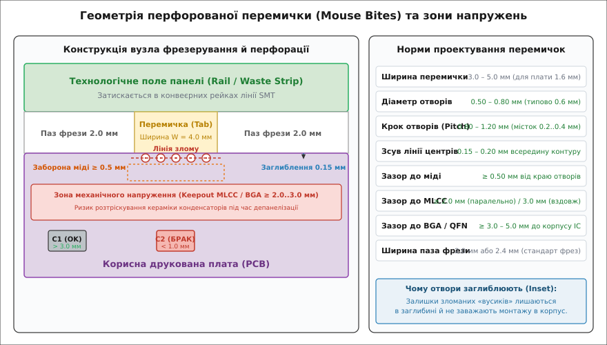
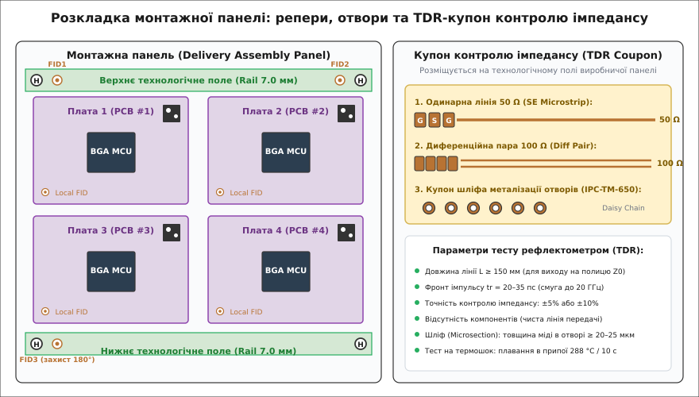

# Панель, фрезерування, маркування, тестові купони

<preknowlist>
- [Топологія друкованої плати](root:hw-pcb/pcb-layout) — геометрія шарів, провідників, контактних майданчиків та перехідних отворів.
- [Структура шарів друкованої плати](root:hw-pcb/pcb-stackup) — чергування мідної фольги, діелектричних препрегів та ламінатів.
- [Перехідні отвори й мідні полігони під струм](root:hw-pcb/perekhidnyi-otvir-i-polihon-pid-strum) — металізація отворів, струмонесуча здатність та пояски.
- [Захисні покриття друкованої плати](root:hw-pcb/zakhysne-pokryttia-platy) — паяльна маска, фінішні металеві покриття HASL, ENIG, OSP.
- [Вибір фабрики й читання чужого DFM-звіту](root:hw-pcb/vybir-fabryky-i-chytannia-chuzhoho-dfm-zvitu) — аналіз технологічних обмежень виробника та узгодження змін.
- [Мінімальна пайка](root:hw-pcb/basic-soldering) — формування паяльних галтелей, змочуваність та дефекти містків припою.
</preknowlist>

Коли розробник завершує трасування друкованої плати в САПР, він бачить перед собою закінчений автономний виріб: модуль датчика 20×15 мм, плату мікроконтролера 40×30 мм або круглу плату смарт-годинника. Проте якщо спробувати завантажити таку мініатюрну плату безпосередньо на сучасну автоматизовану лінію поверхневого монтажу (SMT), конвеєр зупиниться: пневматичні конвеєрні ремені автоматичного трафаретного принтера не здатні затиснути плату менше ніж 50×50 мм, рейкові тримачі установника компонентів перекриють крайові контактні майданчики, а легка одинарна платка здується потоком гарячого повітря в конвекційній печі оплавлення.

Щоб автоматизований монтаж був можливий і економічно виправданий, поодинокі плати об'єднують у групові технологічні монтажні панелі (англ. *delivery panels / assembly arrays / pallets*). На одній такій панелі розміщуються десятки або сотні однакових плат, обрамлених спільними технологічними рейками з оптичними реперами позиціонування, базовими механічними отворами та тестовими структурами. Проте створення панелі — це не просто геометричне розмноження контуру в CAD: помилка у виборі методу розділення (V-подібне скрайбування проти фрезерування з перемичками), невірний розрахунок зусилля злому або невдале розташування керамічних конденсаторів відносно лінії механічного напруження призводить до масової появи мікротріщин у компонентах, прихованих коротких замикань та відшарування міді під час фінальної депанелізації.

## Анатомія технологічної панелі: виробнича проти монтажної

У ланцюгу виробництва електроніки розрізняють два принципово різні типи панелей:

1. **Виробнича панель фабрики (Production / Working Panel):** Це великий лист фольгованого склотекстоліту стандартного формату (наприклад, 406×508 мм, 457×610 мм або 508×610 мм), на якому завод одночасно пресує шари, свердлить перехідні отвори, проводить хімічну металізацію та фотолітографію. На такій панелі фабрика розміщує або кілька клієнтських монтажних панелей одного проєкту, або (у разі збірного замовлення типу *PCB Pool*) плати десятків різних замовників.
2. **Монтажна панель замовника (Delivery Assembly Panel / Array):** Це готова мультиплікована заготовка, узгоджена з лінією монтажу (SMT Assembly Line). Її типові розміри становлять від 120×150 мм до 200×250 мм. Саме в такому вигляді плати постачаються замовнику, проходять автоматичне нанесення паяльної пасти, швидкісне встановлення SMD-компонентів, пайку оплавленням, автоматичну оптичну інспекцію (AOI) та внутрішньосхемне тестування (ICT). Лише на фінальній стадії зібрана панель розрізається на окремі функціональні модулі.

```
+-------------------------------------------------------------------------------+
|  Виробнича панель заводу (Production Panel 457 x 610 мм)                      |
|  +---------------------------+  +---------------------------+  [TDR Coupon]   |
|  | Монтажна панель #1        |  | Монтажна панель #2        |  [PTH Coupon]   |
|  | +-------+  +-------+ (FID)|  | +-------+  +-------+ (FID)|                 |
|  | | PCB 1 |  | PCB 2 |      |  | | PCB 1 |  | PCB 2 |      |  (Технологічні  |
|  | +-------+  +-------+      |  | +-------+  +-------+      |   поля фабрики) |
|  | +-------+  +-------+      |  | +-------+  +-------+      |                 |
|  | | PCB 3 |  | PCB 4 | (H)  |  | | PCB 3 |  | PCB 4 | (H)  |                 |
|  | +-------+  +-------+      |  | +-------+  +-------+      |                 |
|  +---------------------------+  +---------------------------+                 |
+-------------------------------------------------------------------------------+
```

### Технологічні поля (Tooling Rails) та базові отвори

По периметру монтажної панелі (зазвичай уздовж двох довших паралельних сторін) передбачають технологічні смуги відходів — **рейки панелі** (англ. *tooling rails / break-off borders / waste strips*). Їхня ширина становить від 5.0 до 10.0 мм (типово 7.0 мм).

Технологічні поля виконують чотири незамінні функції:
- **Зона затискання конвеєра:** Конвеєрні ланцюги та фіксувальні губки автоматів SMT утримують панель за крайні смуги шириною 3.0–5.0 мм. У межах цієї смуги не можна розміщувати компоненти або провідники (Conveyor Clamp Keepout).
- **Зона розгону та гальмування ракеля:** Під час трафаретного друку паяльної пасти металевий ракель принтера повинен починати рух за межами робочого поля плати, щоб сформувати стабільну гідродинамічну хвилю пасти до входу в зону отворів трафарету.
- **Розміщення базових технологічних отворів (Tooling Holes):** Неметалізовані отвори діаметром `3.0 мм` або `3.2 мм` (з жорстким допуском `+0.05 / -0.00 мм`), призначені для штифтової механічної фіксації панелі на опорних столах трафаретного принтера, монтажних установників, автоматів оптичної інспекції та тестових стендів «ліжко цвяхів» (ICT). Отвори розміщують у чотирьох кутах панелі. Для захисту від випадкового завантаження панелі, розвернутої оператором на 180°, кутові координати одного з отворів зміщують на 3–5 мм (асиметрична схема захисту від помилок — *poka-yoke*).
- **Розміщення глобальних оптичних реперів (Global Fiducials):** Оптичні мітки, за якими цифрові камери автоматів машинного зору виконують прецизійну прив'язку системи координат.

> 🔧 **Навіщо це.** Якщо спроєктувати панель без технологічних рейок («край у край»), компоненти, розташовані ближче ніж 4 мм до краю, будуть збиті або пошкоджені конвеєрними роликами автомата Pick & Place. До того ж ракель принтера не зможе рівномірно продавити паяльну пасту біля самого краю, що викличе масовий брак пайки крайніх контактних майданчиків.

### Короблення та прогин панелі (Warpage, Bow and Twist)

Під час нагрівання в печі оплавлення багатошарова друкована плата зазнає значних термічних напружень через різницю коефіцієнтів теплового розширення (КТР / CTE) міді (`17 ppm/°C`) та епоксидного склотекстоліту FR-4 (`14 ppm/°C` у площині XY і `50–70 ppm/°C` по осі Z).

Якщо розподіл міді на шарах нерівномірний (наприклад, верхній шар містить суцільний полігон живлення, а нижній — лише рідкі сигнальні доріжки), панель деформується. Стандарт IPC-6012 встановлює граничні норми короблення (циліндричного вигину *Bow* та діагонального скручування *Twist*):
- Для плат із компонентами наскрізного монтажу (THT): `≤ 1.50%` від довжини діагоналі;
- Для плат поверхневого монтажу (SMD): `≤ 0.75%`;
- Для плат із BGA-чіпами та мікросхемами з малим кроком (Pitch ≤ 0.8 мм): `≤ 0.50%`.

Для запобігання термічному викривленню технологічні поля монтажної панелі заповнюють сітчастими або суцільними мідними полігонами — **мідним балансуванням** (англ. *copper thieving / copper balancing*). Балансування вирівнює теплоємність та механічну пружність країв панелі з її центральною робочою зоною.

## Методи механічного розділення: V-Cut скрайбування проти контурного фрезерування

Розділення змонтованої панелі на окремі плати (депанелізація, англ. *depaneling*) є найбільш критичною механічною операцією в усьому виробничому циклі. Застосовують два базові технологічні методи: надрізання дисковими ножами (V-Scoring / V-Cut) та контурне фрезерування з утримувальними перемичками (Routing with Breakaway Tabs / Mouse Bites).

### 1. V-подібне скрайбування (V-Scoring / V-Cut)

Скрайбування — це процес нанесення неглибоких V-подібних канавок із верхнього та нижнього боків панелі за допомогою двох зустрічних обертових дискових ножів із карбіду вольфраму.

```
[Поперечний переріз плати в зоні V-подібного скрайбування]

          Верхній дисковий ніж (Кут 30° або 45°)
                     \       /
                      \  v  /
  ═════════════════════\   /═════════════════════ Top Layer
  ──────────────────────\ /──────────────────────
  Діелектрик FR-4        |  <-- Залишкова серцевина (Web Thickness T_web)
  ──────────────────────/ \──────────────────────
  ═════════════════════/   \═════════════════════ Bottom Layer
                      /  ^  \
                     /       \
          Нижній дисковий ніж
```

- **Геометрія канавки:** Кут розкриття V-подібного леза становить `30°` або `45°`. Глибина різу налаштовується так, щоб у центрі залишалася тонка нерозрізана серцевина діелектрика — **залишкова перемичка** (англ. *web thickness* `T_web`). За стандартом IPC-2222, товщина перемички становить приблизно третину товщини плати:
```
T_web = T_pcb / 3   [для плати 1.6 мм: T_web = 0.45...0.55 мм ± 0.08 мм]
```
- **Співвісність різів:** Верстати скрайбування мають допуск неспіввісності верхнього та нижнього лез не більше ніж `±0.05 мм`. Якщо леза зсунуті одне відносно одного, лінія злому піде під кутом, що викличе розшарування склотекстоліту по одній із граней.
- **Переривчасте скрайбування (Jumping V-Cut):** Технологія, за якої дисковий ніж автоматично піднімається та опускається за програмою ЧПК, прорізаючи тільки певні відрізки лінії. Вона дозволяє залишати суцільні краї для жорсткості панелі, проте вимагає зон входу та виходу ножа довжиною не менше 5–10 мм.

**Переваги V-Cut:**
1. *Нульова ширина паза між платами:* Сусідні плати стикуються впритул одна до одної (зазор 0.0 мм), що дає максимально можливий коефіцієнт використання площі склотекстоліту (`Eta > 85–90%`).
2. *Колосальна швидкість обробки:* Розділення прямолінійного різу довжиною 300 мм займає менше ніж одну секунду.

**Обмеження та ризики V-Cut:**
1. *Тільки суцільні прямі лінії від краю до краю:* V-Cut не може формувати вигнуті контури, скруглені кути або фігурні вирізи.
2. *Шорсткий торець зі сколами:* Після розлому грань плати має волокнисту шорсткість з оголеними склонитками, що вимагає додаткових зазорів при встановленні у пази корпусів.
3. *Високі механічні деформації під час ручного розламування:* Якщо оператор розламує плату руками, виникають неконтрольовані напруження кручення та згину з амплітудою до `1500–2500 µε`. Це спричиняє масове розтріскування керамічних конденсаторів (MLCC), розташованих поблизу лінії різу.

> ⚠️ **Правило зазорів при V-Cut:** Усі контактні майданчики, доріжки та мідні полігони повинні відступати від осі лінії V-Score не менше ніж на `0.50 мм` (20 mil). Керамічні конденсатори MLCC типорозмірів 0603 та 0805 слід розташовувати на відстані не менше `1.50–2.0 мм` паралельно лінії різу, або не менше `3.0 мм` при перпендикулярній орієнтації.

### 2. Контурне фрезерування з перфорованими перемичками (Mouse Bites)

Контурне фрезерування (англ. *CNC routing*) полягає у вирізанні паза навколо кожної плати кінцевою твердосплавною фрезою діаметром `2.0 мм` або `2.4 мм` на високих швидкостях шпинделя (30 000–60 000 об/хв). Оскільки фреза повністю прорізає склотекстоліт на всю товщину, плати утримуються в тілі панелі за допомогою локальних перемичок — **breakaway tabs**.

Щоб перемичку можна було легко і передбачувано зламати після завершення монтажу, її послаблюють рядом наскрізних свердлових отворів малого діаметра. Через характерний вигляд на рентгенівських знімках та в САПР цей вузол отримав назву **«мишачі укуси» (англ. *mouse bites / perforated tabs*)**.


*Геометрія вузла фрезерування, розташування перфорацій mouse bites зі заглибленням у контур плати та розрахункові зони заборони компонентів за IPC-9704.*

#### Геометричні параметри перемички
- **Ширина перемички (`W_tab`):** Становить від `3.0 мм` до `5.0 мм` (для плат товщиною 1.6 мм типово 4.0 мм). Вужча перемичка (< 2.5 мм) може зламатися в печі оплавлення під вагою плати, а ширша (> 6.0 мм) вимагає надмірного зусилля виламування, що руйнує сусідні компоненти.
- **Отвори перфорації:** Діаметр свердла `d_hole = 0.50–0.80 мм` (найчастіше `0.60 мм`). Кількість отворів — від 3 до 5 штук.
- **Крок перфорації (`Pitch`):** Оптимальна відстань між центрами отворів становить `0.80–1.20 мм`. Це залишає між сусідніми отворами місток суцільного матеріалу завтовшки `0.25–0.40 мм`.
- **Заглиблення лінії отворів (Inset):** Отвори перфорації зміщують на `0.15–0.20 мм` всередину контуру плати. Завдяки цьому гострі залишки зламаного склотекстоліту залишаються всередині утвореної заглибини і не виступають за зовнішній габарит виробу. Це повністю усуває потребу в ручній зачистці торців напилком перед монтажем у корпус.

Детальний алгоритм розрахунку оптимальної матричної упаковки 2D-прямокутників та інженерний аналіз міцності перемичок реалізовано у вставці [Калькулятор розкладки панелі та міцності перемичок](root:hw-pcb/panel-frezeruvannia-markuvannia-testovi-kupony/proj-panelization-calc.md).

| Параметр порівняння | V-Cut скрайбування | Фрезерування з перемичками (Mouse Bites) |
|---|---|---|
| **Форма контуру плат** | Тільки прямокутні плати, прямі лінії від краю до краю. | Довільна геометрична форма (скруглені кути, кола, L-подібні вирізи). |
| **Ширина технологічного зазору** | `0.0 мм` (плати прилягають впритул). | `2.0–2.4 мм` (ширина кінцевої фрези). |
| **Корисне використання площі (Eta)** | Дуже високе (`80–92%`). | Середнє (`65–80%` через відходи на пази фрези). |
| **Якість краю після розділення** | Рівний, але шорсткий край по всій довжині з оголеними нитками. | Ідеально гладкий фрезерований торець усюди, крім маленьких точок злому перемичок. |
| **Механічне напруження при розламі** | Високе по всій лінії різу (ризик для крайових MLCC). | Локалізоване суворо в точках перемичок (простір між перемичками вільний від напружень). |
| **Звисання рознімів за край плати** | Не допускається (ніж зріже або пошкодить корпус розніму). | Допускається (фрезерується вільна кишеня під нависаючу частину розніму). |

## Оптичні реперні мітки (Фідуціали): фізика машинного зору

Швидкісні автомати поверхневого монтажу (Pick & Place) переміщують монтажні голівки зі швидкостями понад 2–3 м/с і встановлюють компоненти з точністю позиціонування `±25–35 мкм`. Проте механічна подача панелі конвеєром має похибку до `±0.5–1.0 мм`, а температурна усадка склотекстоліту під час виготовлення сягає `0.05–0.10%`.

Щоб точно поєднати математичну систему координат CAD-проєкту з фізичним положенням контактних майданчиків на панелі, застосовують оптичні реперні мітки — **фідуціали** (англ. *fiducial marks*).

### Фізика оптичного розпізнавання

Цифрова камера машинного зору встановника (CCD або CMOS матриця з телецентричним об'єктивом) спрямовує на реперну мітку світлодіодне підсвічування (коаксіальне червоне або синє кільцеве світло).

Розпізнавання базується на різкому оптичному контрасті між трьома зонами:
1. **Центральний мідний диск (Target):** Металізована мідна поверхня з фінішним покриттям ENIG (золото) або хімічним оловом. Вона працює як ідеальне дзеркало і відбиває спрямоване світло прямо в об'єктив камери, створюючи яскраву білу пляму на матриці.
2. **Кільцевий зазор без маски (Mask Clearance):** Зона відкритого діелектрика FR-4 навколо диска. Текстура склотканини та епоксидної смоли дифузно розсіює світло вбік, формуючи рівномірне темне тло.
3. **Паяльна маска (Solder Mask):** Глянцева або матова плівка фотополімеру, яка також має низький коефіцієнт дзеркального відбиття порівняно з чистим золотом.

Алгоритм обробки зображень (субпіксельне виявлення контуру за методом Собеля або перетворення Хафа) знаходить центр ваги круглого диска з точністю до `0.005 мм` (5 мкм).

### Глобальні та локальні фідуціали


*Монтажна панель з асиметрично розміщеними оптичними реперами (Fiducials), базовими технологічними отворами та TDR-купоном контролю хвильового імпедансу.*

За призначенням реперні мітки поділяються на два класи:

1. **Глобальні репери (Global Fiducials):** Розміщуються на технологічних рейках монтажної панелі (або по кутах великої індивідуальної плати).
   - *Чому три репери, а не два?* Два репери дозволяють обчислити лише лінійне зміщення по осях `(ΔX, ΔY)` та кут загального повороту панелі `θ`. Проте вони не здатні виявити неортогональну деформацію (трапецієподібний перекіс, англ. *shear / skew*) та масштабну нелінійну усадку діелектрика окремо по осях X та Y (`Scale_X ≠ Scale_Y`). Три асиметрично розташовані репери утворюють трикутний базис, що дозволяє автомату обчислити повну матрицю **афінного перетворення координат**.
   - *Асиметричне розміщення:* Репери ставлять у трьох кутах панелі, залишаючи четвертий кут порожнім, або зміщують один репер відносно осі симетрії. Якщо оператор завантажить панель у конвеєр розвернутою на 180°, камера в третьому куті не знайде мітки, і автомат негайно зупиниться, запобігши фатальному монтажу компонентів «догори ногами».
2. **Локальні репери (Local Fiducials):** Розміщуються безпосередньо всередині робочої плати діагонально або по кутах навколо компонентів високої щільності виводів:
   - Мікросхеми BGA з кроком кульок `Pitch < 0.80 мм`;
   - Мікросхеми QFP, QFN з кроком виводів `Pitch < 0.50 мм`;
   - Пасивні компоненти надмалих типорозмірів `0201` та `01005`.
   Локальні репери компенсують мікродеформації плати в межах зони конкретного чипа (розміром 20×20 мм), гарантуючи точне центрування кожної ніжки на контактному майданчику.

### Геометричні стандарти за IPC-7351
- **Діаметр мідного диска:** `1.00 мм` (допускається від `0.80 мм` до `1.50 мм`). Форма — тільки суцільне коло (хрести та квадрати мають гіршу точність субпіксельного центрування).
- **Вікно паяльної маски:** Концентричне коло діаметром `2.00–3.00 мм` (зазор від міді до маски не менше `0.50 мм`).
- **Зона абсолютної заборони (Fiducial Keepout):** Усередині вікна паяльної маски суворо заборонено розміщувати будь-які мідні доріжки, полігони, перехідні отвори або написи шовкографії. Порушення однорідності фону збиває оптичні фільтри камери.

### Алгоритм афінного перетворення координат за трьома реперами

Машина встановлення компонентів трансформує теоретичні координати компонентів із CAD-файлу `(X_cad, Y_cad)` у реальні фізичні координати приводів `(X_real, Y_real)` за допомогою системи рівнянь афінного перетворення:

```
X_real = A · X_cad + B · Y_cad + X_offset
Y_real = C · X_cad + D · Y_cad + Y_offset
```

Нижче наведено програмну реалізацію обчислення коефіцієнтів афінного перетворення за трьома опорними реперами мовами C99 та C++20.

:::tabs
```c
#include <stdio.h>
#include <stdbool.h>
#include <math.h>

typedef struct {
    double x;
    double y;
} Point2D;

typedef struct {
    double a, b, x_off;
    double c, d, y_off;
} AffineTransform;

static bool compute_fiducial_affine_matrix(
    const Point2D cad[3],
    const Point2D real[3],
    AffineTransform* out_tf)
{
    // Знаменник визначника матриці координат трьох точок
    double det = cad[0].x * (cad[1].y - cad[2].y) +
                 cad[1].x * (cad[2].y - cad[0].y) +
                 cad[2].x * (cad[0].y - cad[1].y);

    if (fabs(det) < 1.0e-9) {
        return false; // Точки лежать на одній прямій (вироджений трикутник)
    }

    double inv_det = 1.0 / det;

    // Розрахунок коефіцієнтів для координати X
    out_tf->a = (real[0].x * (cad[1].y - cad[2].y) +
                 real[1].x * (cad[2].y - cad[0].y) +
                 real[2].x * (cad[0].y - cad[1].y)) * inv_det;

    out_tf->b = (real[0].x * (cad[2].x - cad[1].x) +
                 real[1].x * (cad[0].x - cad[2].x) +
                 real[2].x * (cad[1].x - cad[0].x)) * inv_det;

    out_tf->x_off = (real[0].x * (cad[1].x * cad[2].y - cad[2].x * cad[1].y) +
                     real[1].x * (cad[2].x * cad[0].y - cad[0].x * cad[2].y) +
                     real[2].x * (cad[0].x * cad[1].y - cad[1].x * cad[0].y)) * inv_det;

    // Розрахунок коефіцієнтів для координати Y
    out_tf->c = (real[0].y * (cad[1].y - cad[2].y) +
                 real[1].y * (cad[2].y - cad[0].y) +
                 real[2].y * (cad[0].y - cad[1].y)) * inv_det;

    out_tf->d = (real[0].y * (cad[2].x - cad[1].x) +
                 real[1].y * (cad[0].x - cad[2].x) +
                 real[2].y * (cad[1].x - cad[0].x)) * inv_det;

    out_tf->y_off = (real[0].y * (cad[1].x * cad[2].y - cad[2].x * cad[1].y) +
                     real[1].y * (cad[2].x * cad[0].y - cad[0].x * cad[2].y) +
                     real[2].y * (cad[0].x * cad[1].y - cad[1].x * cad[0].y)) * inv_det;

    return true;
}

static Point2D transform_component_coord(const AffineTransform* tf, Point2D cad_pt) {
    Point2D real_pt;
    real_pt.x = tf->a * cad_pt.x + tf->b * cad_pt.y + tf->x_off;
    real_pt.y = tf->c * cad_pt.x + tf->d * cad_pt.y + tf->y_off;
    return real_pt;
}
```
```cpp
#include <iostream>
#include <array>
#include <cmath>
#include <expected>
#include <string_view>

namespace pcb::vision {

struct Point2D {
    double x{0.0};
    double y{0.0};
};

struct AffineTransform {
    double a{1.0}, b{0.0}, x_offset{0.0};
    double c{0.0}, d{1.0}, y_offset{0.0};

    [[nodiscard]] constexpr Point2D Apply(Point2D cad_pt) const noexcept {
        return {
            a * cad_pt.x + b * cad_pt.y + x_offset,
            c * cad_pt.x + d * cad_pt.y + y_offset
        };
    }
};

class FiducialAlignment {
public:
    [[nodiscard]] static std::expected<AffineTransform, std::string_view> ComputeTransform(
        const std::array<Point2D, 3>& cad,
        const std::array<Point2D, 3>& real) noexcept
    {
        double det = cad[0].x * (cad[1].y - cad[2].y) +
                     cad[1].x * (cad[2].y - cad[0].y) +
                     cad[2].x * (cad[0].y - cad[1].y);

        if (std::abs(det) < 1.0e-9) {
            return std::unexpected("Вироджена конфігурація: реперні мітки лежать на одній прямій");
        }

        double inv_det = 1.0 / det;
        AffineTransform tf;

        tf.a = (real[0].x * (cad[1].y - cad[2].y) +
                real[1].x * (cad[2].y - cad[0].y) +
                real[2].x * (cad[0].y - cad[1].y)) * inv_det;

        tf.b = (real[0].x * (cad[2].x - cad[1].x) +
                real[1].x * (cad[0].x - cad[2].x) +
                real[2].x * (cad[1].x - cad[0].x)) * inv_det;

        tf.x_offset = (real[0].x * (cad[1].x * cad[2].y - cad[2].x * cad[1].y) +
                       real[1].x * (cad[2].x * cad[0].y - cad[0].x * cad[2].y) +
                       real[2].x * (cad[0].x * cad[1].y - cad[1].x * cad[0].y)) * inv_det;

        tf.c = (real[0].y * (cad[1].y - cad[2].y) +
                real[1].y * (cad[2].y - cad[0].y) +
                real[2].y * (cad[0].y - cad[1].y)) * inv_det;

        tf.d = (real[0].y * (cad[2].x - cad[1].x) +
                real[1].y * (cad[0].x - cad[2].x) +
                real[2].y * (cad[1].x - cad[0].x)) * inv_det;

        tf.y_offset = (real[0].y * (cad[1].x * cad[2].y - cad[2].x * cad[1].y) +
                       real[1].y * (cad[2].x * cad[0].y - cad[0].x * cad[2].y) +
                       real[2].y * (cad[0].x * cad[1].y - cad[1].x * cad[0].y)) * inv_det;

        return tf;
    }
};

} // namespace pcb::vision
```
:::

## Маркування, серіалізація та простежуваність

Сучасні стандарти управління якістю в електроніці (ISO 9001, IATF 16949 для автомобільної промисловості та IPC-1782 для простежуваності ланцюгів постачання) вимагають індивідуального обліку кожної виготовленої плати. На етапі монтажу система керування виробництвом (MES, *Manufacturing Execution System*) фіксує, з якої саме котушки компонентів встановлено чіп, який профіль температури мала піч оплавлення під час проходження конкретної плати та хто виконував вихідний контроль.

Для цього на кожну плату наносять машинозчитуване та людинозчитуване маркування.

### 1. Шовкографія (Silkscreen / Legend)

Шовкографія наносить позиційні позначення компонентів (`R1`, `C12`, `U3`), індикатори полярності діодів і танталових конденсаторів, позначення першого виводу мікросхем, назву виробу та ревізію апаратного забезпечення.

Застосовують два методи нанесення:
- **Класичний трафаретний друк (Screen Printing):** Епоксидна фарба продавлюється крізь сітчастий шовковий або поліестеровий трафарет. Мінімальна ширина штриха становить `0.15–0.20 мм` (6–8 mil), а мінімальна висота літер — `1.0–1.2 мм`. Похибка суміщення сягає `±0.12 мм`.
- **Прямий цифровий струменевий друк (Direct Legend Printing, DLP):** Спеціальна голівка наносить мікрокраплі ультрафіолетового фотополімерного чорнила з оптичним центруванням по фідуціалах. Метод дозволяє друкувати надтонкі лінії шириною `0.10 мм` (4 mil) та текст висотою від `0.60 мм` із точністю суміщення `±0.03 мм`.

> ⚠️ **DFM-правило шовкографії:** Усі лінії маркування повинні мати гарантований відступ не менше `0.10 мм` (4 mil) від межі вікон паяльної маски. Якщо фарба шовкографії наповзе на контактний майданчик SMD, діелектричний полімер заблокує змочування рідким припоєм, що спричинить дефект незмочування або ефект підняття чіпа «на диби» (англ. *tombstoning*).

### 2. Двовимірні матричні коди (2D DataMatrix ECC 200 та QR)

Для автоматизованої серіалізації використовують двовимірний матричний код **DataMatrix (стандарт ECC 200)**. На відміну від лінійних штрихкодів, DataMatrix має квадратну або прямокутну форму і займає площу всього від `2.5×2.5 мм` до `5.0×5.0 мм`.

```
[Структура матричного коду DataMatrix ECC 200 на платі]

     L-подібний суцільний кут (Finder Pattern)
     █ █ █ █ █ █ █ █ █ █
     █                 ▄  <-- Пунктирний протилежний кут (Clocking Track)
     █   █ ▄ █ █ ▄     █
     █   ▄ █ ▄ ▄ █     ▄
     █   █ █ ▄ █ ▄     █
     █   ▄ ▄ █ █ ▄     ▄
     █                 █
     █ █ █ █ █ █ █ █ █ █
     |<──── 3.0 мм ───>|
```

- **Корекція помилок Ріда-Соломона (ECC 200):** Код містить до 30% надлишкової інформації. Сканер камери AOI або ручний зчитувач успішно розпізнає серійний номер, навіть якщо до 25–30% площі коду подряпано, спалено або забруднено залишками паяльного флюсу.
- **Розмір комірки (Module Size / X-Dimension):** Мінімальний розмір одиничного пікселя (квадратика коду) повинен становити не менше `0.15–0.20 мм` (6–8 mil), щоб стандартна роздільна здатність камер машинного зору (1.3–5.0 Мп) впевнено детектувала межі пікселів.
- **Вимоги до контрасту:** Оптична різниця коефіцієнтів відбиття між темними та світлими елементами повинна перевищувати 60%.

### 3. Пряме лазерне маркування (Direct Laser Marking, DLM / LDM)

Найсучаснішим і найнадійнішим способом нанесення DataMatrix та серійних номерів є пряме лазерне гравіювання за допомогою волоконного або ультрафіолетового твердотільного лазера (CO₂ або Nd:YAG лазери).

- **Механізм лазерної абляції:** Лазерний промінь із діаметром плями 20–30 мкм миттєво випаровує верхній шар зеленої або чорної паяльної маски завтовшки 25 мкм, оголюючи світлу поверхню діелектрика FR-4 або мідний майданчик під маскою.
- **Переваги лазера:**
  1. *Абсолютна хімічна стійкість:* Лазерне маркування не змивається агресивними розчинниками під час відмивання залишків флюсу в ультразвукових ваннах (ізопропіловий спирт, терпени, деіонізована вода під тиском).
  2. *Термостійкість:* Маркування не вигорає і не темніє під час багаторазових циклів пайки в печі при 260 °C.
  3. *Нульова вартість витратних матеріалів:* Відсутня потреба у фарбах, трафаретах чи самоклейних наклейках.

### 4. Вікна паяльної маски під наклейки та штампи ВТК

Якщо серійний номер або MAC-адреса наноситься на поліімідну термостійку наклейку (Kapton label), у топології плати передбачають прямокутне вікно паяльної маски з відкритою міддю або чистим діелектриком. Це виключає наклеювання на випуклі доріжки та запобігає відклеюванню маркування при вібраціях.

## Тестові купони: руйнівний та неруйнівний контроль якості

Якість виготовлення друкованої плати неможливо повністю оцінити лише за зовнішнім виглядом або продзвонюванням кіл тестером. Контроль таких критичних параметрів, як товщина міді всередині циліндра перехідного отвору, наявність мікротріщин у діелектрику після термошоку та точний хвильовий імпеданс високошвидкісних ліній передачі, вимагає руйнівних лабораторних випробувань.

Щоб не знищувати дорогі готові плати замовника, на технологічних полях виробничої панелі (Production Panel) завод розміщує стандартизовані тестові зразки — **тестові купони** (англ. *PCB test coupons*). Після завершення виробництва купони відрізаються і надходять до лабораторії відділу технічного контролю (ВТК).

### 1. Купони контролю хвильового імпедансу (TDR Coupons)

Для плат із високошвидкісними цифровими шинами (DDR4/DDR5, PCIe Gen4/5, USB 3.2, Ethernet 10G) або НВЧ-трактами хвильовий імпеданс провідників повинен витримуватися з точністю `±5%` або `±10%` від номіналу (наприклад, `50.0 Ω` для одинарних ліній та `90.0 Ω` або `100.0 Ω` для диференційних пар).

#### Фізичний принцип рефлектометрії часової області (TDR)
Рефлектометр часової області (англ. *Time Domain Reflectometer*, TDR) надсилає в лінію передачі зондувальний імпульс напруги з ультракоротким часом наростання фронту `t_r = 20–35 пс` (що відповідає частотній смузі до 15–20 ГГц).

Коли хвиля поширюється вздовж лінії, будь-яка локальна зміна геометрії (звуження доріжки, зміна товщини препрегу чи варіація діелектричної проникності смоли `epsilon_r`) створює стрибок локального хвильового імпедансу `Z(x)`. Частина енергії сигналу відбивається назад до джерела з коефіцієнтом відбиття `Gamma`:

```
Gamma(x) = (Z(x) - Z_ref) / (Z(x) + Z_ref)
```

Рефлектометр вимірює амплітуду та часову затримку відбитого сигналу і будує графік розподілу хвильового імпедансу `Z` вздовж усієї довжини провідника.

```
[TDR-рефлектограма: перехід від розніму до стабільної полиці імпедансу]

   Імпеданс Z, Ом
       ▲
  65 Ω │      /---\  <-- Паразитний сплеск на контактних майданчиках зонда
       │     /     \
  50 Ω │====+-------+==============================+======  <-- Номінал 50.0 Ω (±5%)
       │                                            \
  35 Ω │                                             \___  <-- Розірваний кінець лінії
       └───────────────────────────────────────────────────► Час t, пс
            |< 30 мм >|<──────── Довжина L >= 150 мм ─────>|
              Зона              Стабільна полиця Z0
            перехідна         (Зона точного вимірювання)
```

#### Конструктивні вимоги до TDR-купонів (IPC-2141 та IPC-TM-650 2.5.5.7)
- **Точне дублювання топології:** Доріжки купона мають точно таку саму ширину, зазори, товщину фольги та опорні полігони, що й контрольовані сигнальні шини на робочій платі. Купон трасується на тих самих фізичних шарах стека (Top Microstrip, Inner Stripline).
- **Довжина лінії передачі (`L ≥ 150 мм`):** На вході коаксіального щупа виникає паразитний індуктивно-ємнісний сплеск через геометрію контактних майданчиків. Щоб сигнал вийшов на стабільну пласку ділянку («полицю» імпедансу), довжина провідника повинна становити не менше 150 мм (для швидких імпульсів допускається не менше 100 мм).
- **Контактний інтерфейс (GSG Pads):** На початку лінії розміщують контактні майданчики типу Земля-Сигнал-Земля (Ground-Signal-Ground, GSG) або GSGSG для диференційних пар із фіксованим кроком `1.0 мм` або `2.54 мм` під стандартні коаксіальні диференційні TDR-зонди.

### 2. Купони мікрошліфів отворів та металізації (Microsectioning Coupons)

Мікрошліф (англ. *microsectioning / cross-section analysis*) за стандартом **IPC-TM-650 (Method 2.1.1)** є головним арбітражним методом оцінки надійності структури шарів та якості металізації.

#### Процедура виготовлення мікрошліфа:
1. Тестовий купон, що містить ряд перехідних отворів різних діаметрів, з'єднаних послідовно в ланцюг («Daisy Chain»), вирізається з панелі прецизійною алмазною пилкою.
2. Зразок встановлюється у циліндричну форму та заливається рідкою епоксидною або акриловою смолою під вакуумом для усунення бульбашок повітря.
3. Після полімеризації блок шліфується на абразивних кругах із послідовним зменшенням зернистості (SiC папір від 240 до 1200 гріт) суворо до осьової площини симетрії отворів.
4. Фінальне полірування виконується на оксамитовому диску з алмазною суспензією фракції `1.0–0.05 мкм`.
5. Поверхня зрізу піддається мікротравленню слабким розчином аміаку та перекису водню для проявлення меж кристалічних зерен міді та досліджується під оптичним або растровим електронним мікроскопом (SEM) при збільшенні від 100× до 1000×.

```
[Поперечний переріз металізованого отвору під мікроскопом]

   Паяльна маска       Контактний майданчик (Capture Pad)
       ░░░░░░░            ██████████████
   ═════════════════════════════════════════ Top Layer
   Препрег FR-4         │║             ║│
   ─────────────────────┤║  Шар міді   ║├──── Внутрішній шар 2 (GND)
   Ядро ламінату Core   │║  гальваніки ║│     [Перевірка підтраву міді]
                        │║  (d >= 20   ║│
   ─────────────────────┤║   мікрон)   ║├──── Внутрішній шар 3 (VCC)
   Препрег FR-4         │║             ║│
   ═════════════════════════════════════════ Bottom Layer
       ░░░░░░░            ██████████████
                        │<── FHS 0.3 ──>│
```

#### Критерії приймального контролю за стандартами IPC-A-600 та IPC-6012:
- **Товщина міді на стінці циліндра (Barrel Copper Thickness):** Для плат Class 2 середня товщина міді повинна становити `≥ 20 мкм` (мінімальна локальна `≥ 18 мкм`). Для надійної апаратури Class 3 (аерокосмічна, військова, медична) середня товщина має бути `≥ 25 мкм` (мінімальна `≥ 20 мкм`).
- **Товщина міді на куті отвору (Knee Plating):** На перехідному радіусі від контактного майданчика до стінки отвору товщина міді не повинна стоншуватися більш ніж на 20% від номіналу стінки.
- **Відсутність дефектів розриву:** Не допускаються розриви фольги, порожнечі в металізації (Plating Voids), відшарування внутрішніх шарів (Interconnect Separation) та розтріскування смоли біля скла (Resin Recession).
- **Стійкість до термічного шоку (Thermal Stress Test, IPC-TM-650 2.6.8):** Перед виготовленням шліфа купон витримують на поверхні ванни з розплавленим припоєм за температури `288 °C ± 5 °C` протягом `10 секунд`. Зразок не повинен мати слідів розшарування діелектрика (Delamination), розтріскування перехідних отворів (Barrel Cracking) або підняття контактних майданчиків.

### 3. Купони високовольтної ізоляції та змочуваності

- **Купон перевірки поверхневої та об'ємної ізоляції (Hi-Pot & SIR Coupon):** Являє собою гребінчасту зустрічно-штирову структуру (Interdigital Comb). На неї подається випробувальна напруга від 500 В до 2500 В для вимірювання струмів витоку та перевірки стійкості до росту струмопровідних анодних ниток (Conductive Anodic Filament, CAF).
- **Купон змочуваності припоєм (Solderability Coupon):** Використовується для контролю якості фінішного покриття (HASL, ENIG, Immersion Tin) та збереження паяльних властивостей після тривалого зберігання на складі.

## Інженерний підсумок

Проєктування панелі, вибір методів механічного розділення, інтеграція оптичних реперів та тестових купонів є фундаментом переходу від комп'ютерного дизайну до бездефектного серійного виробництва:

1. **V-Cut обирають для простих прямокутних плат:** Він забезпечує максимальне використання матеріалу та найдешевше розділення, проте вимагає відступу компонентів від лінії скрайбування не менше ніж `1.5–2.0 мм` для запобігання пошкодженню кераміки.
2. **Фрезерування з перфорованими перемичками (Mouse Bites) незамінне для фігурних контурів:** Перемички шириною `3.0–4.0 мм` з отворами `0.60 мм` та кроком `1.0 мм`, заглиблені на `0.15 мм` всередину плати, гарантують легкий злам без виступаючих задирок та без потреби ручної обробки.
3. **Глобальні репери (3 штуки на рейках, асиметрично) у поєднанні з локальними реперами біля BGA/QFN:** Забезпечують машинному зору можливість повної компенсації неортогональних температурних перекосів плати та захищають лінію від помилкового завантаження з розворотом на 180°.
4. **TDR-купони та купони мікрошліфів на виробничих полях:** Дають об'єктивний, метрологічно підтверджений доказ відповідності виготовленої плати нормам хвильового імпедансу та стандартам металізації IPC Class 2/3 до того, як дорогі компоненти будуть змонтовані на плату.