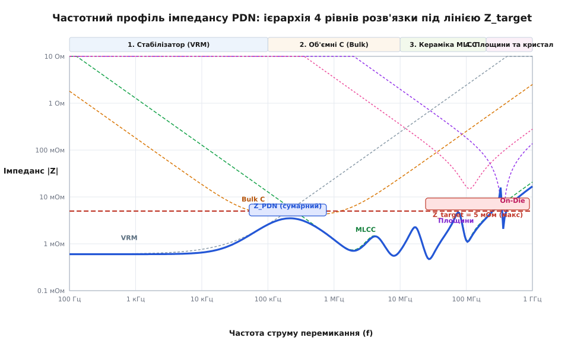
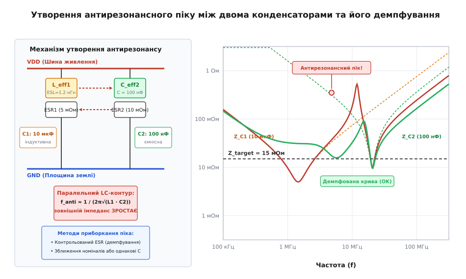

# Імпеданс шини живлення (PDN)

<preknowlist>
- [Закон Ома](root:hw-analog/ohms-law) — напруга дорівнює струм · опір; спад напруги при протіканні струму.
- [Індуктивність](root:ph-electromagnetism/inductance) — опір провідника швидкій зміні струму: V = L·(di/dt).
- [Цілісність живлення](root:hw-pcb/power-integrity) — концепція збереження напруги живлення в межах допуску.
- [Паразити конденсатора](root:hw-components/capacitor-parasitics) — власна індуктивність ESL та послідовний опір ESR.
- [Стрибок землі](root:hw-pcb/ground-bounce) — наведений шум на паразитній індуктивності зворотного шляху струму.
- [Структура шарів плати](root:hw-pcb/pcb-stackup) — міжелектродна ємність та індуктивність полігонів живлення.
</preknowlist>

Сучасний мікроконтролер із частотою 480 МГц, цифровий сигнальний процесор, FPGA чи багатоядерний процесор системи на кристалі (англ. System on Chip, SoC) працюють на напрузі ядра 0.85 В і споживають у стаціонарному режимі струм 15 А. Коли тактовий сигнал запускає конвеєр обчислень, мільйони логічних комірок перемикаються синхронно протягом 500 пікосекунд, викликаючи динамічний стрибок споживання струму на 10 А. Допустиме вікно живлення цифрових транзисторів становить плюс-мінус 3% від номіналу — тобто всього 25.5 мілівольта. Якщо між стабілізатором напруги та кремнієвим кристалом лежить друкований провідник довжиною три сантиметри з типовою індуктивністю два наногенрі, швидкість наростання струму 20 мільярдів амперів за секунду наведе на цьому провіднику зустрічну проти-ЕРС величиною 40 вольтів. Замість дозволених 25.5 мілівольта просідання напруги шина миттєво падає в нуль, логічні комірки втрачають збережений стан, конвеєр процесора збивається, а пристрій зависає або скидається апаратним сторожовим таймером.

Ця фізична реальність доводить: на високих швидкостях шина живлення перестає бути простим провідником із нульовим опором. Вона перетворюється на складний розподілений хвилевід та резонансну систему, що складається з вихідного каскаду стабілізатора, об'ємних електролітичних конденсаторів, сотень керамічних конденсаторів різного типорозміру, перехідних отворів, суміжних мідних площин друкованої плати, контактних кульок корпусу мікросхеми та паразитної ємності самого кремнієвого кристала. Ця сукупність елементів утворює мережу розподілу живлення (англ. Power Distribution Network, PDN).

Інженерна суть проєктування PDN полягає в тому, щоб забезпечити стабільність напруги живлення за будь-яких динамічних змін навантаження. Оскільки струм перемикання цифрових вентилів містить гармонійні складники від постійного струму до гігагерцових частот, напруга на виводах мікросхеми коливається відповідно до частотної характеристики кола живлення. Щоб амплітуда пульсацій не перевищила допустимий поріг за жодних умов, імпеданс цієї мережі має залишатися нижчим за розраховане граничне значення на кожній частоті робочого спектра.

## Фізична природа динамічного струму перемикання цифрових вентилів

Щоб зрозуміти, чому мережа живлення зазнає екстремальних навантажень, необхідно розглянути мікроструктуру перемикання базового логічного елемента КМОН (англ. CMOS, Complementary Metal-Oxide-Semiconductor). Кожен логічний інвертор або логічний вентиль складається з пари комплементарних польових транзисторів: p-канального (підключеного до шини живлення VDD) та n-канального (підключеного до шини землі GND).

У статичному стані, коли на вході вентиля присутній стабільний логічний нуль або одиниця, один із транзисторів повністю відкритий, а інший — надійно закритий. Струм через закритий транзистор обмежується мікроскопічним струмом витоку крізь збіднену область p-n переходу та підпороговим витоком підзатворного діелектрика (від пікоамперів до часток мікроампера на один вентиль). З переходом на нанометрові технологічні норми (від 28 нм до 3 нм FinFET та GAAFET) товщина підзатворного оксиду кремнію зменшилася до кількох атомних шарів, що призвело до появи квантово-механічного прямого тунелювання носіїв заряду (англ. direct tunneling) та термоемісійних витоків. У сучасних процесорах статичний струм витоку сотень мільйонів закритих транзисторів утворює постійне фонове навантаження в десятки амперів ще до початку будь-яких обчислень.

Проте під час зміни логічного стану з 0 на 1 або з 1 на 0 виникають два динамічні процеси:

Перший процес — це наскрізний струм короткого замикання (англ. shoot-through / crowbar current). Під час переходу вхідної напруги через порогове значення перемикання обидва транзистори на короткий інтервал часу (від 20 до 150 пікосекунд) одночасно опиняються у напіввідкритому стані. Між шиною VDD і землею виникає прямий опірний місток із відносно низьким опором, через який протікає короткий імпульс струму наскрізного замикання. Величина цього струму пропорційна крутизні характеристики транзисторів та обернено пропорційна тривалості фронту вхідного сигналу: чим повільніший вхідний фронт, тим довше обидва транзистори проводять струм одночасно і тим більше тепла та шумів виділяється в кристалі.

Другий процес — це струм перезаряджання паразитної ємності вузла навантаження. Вихід вентиля навантажений на паразитну ємність металізації внутрішніх доріжок, вхідні ємності затворів наступних логічних каскадів та власну ємність вихідного p-n переходу. Сумарна ємність навантаження вентиля `C_L` становить від 1 до 50 фемтофарад. Додатково проявляється динамічний ефект Міллера для ємності затвор-стік `C_gd`, який подвоює ефективну ємність у момент швидкої зміни напруги на стоці. Коли вентиль перемикається з 0 у 1, ця ємність заряджається від шини VDD струмом:

```
i_cap(t) = C_L · (dV_out / dt)
```

Окремо взятий вентиль споживає під час перемикання піковий струм від десятків мікроамперів до одиниць міліамперів. Проте в сучасному процесорі одночасно функціонують сотні мільйонів або десятки мільярдів таких вентилів. Коли черговий фронт синхронізувального тактового сигналу надходить на входи тригерів конвеєра, величезна кількість логічних елементів починає змінювати стан синхронно.

Цей процес породжує явище синхронного шуму перемикання (англ. Simultaneous Switching Noise, SSN) або одночасного перемикання виходів (англ. Simultaneous Switching Outputs, SSO). Загальний струм, що відбирається від шини живлення ядра, є інтегральною сумою струмів усіх вентилів:

```
I_total(t) = ∑ i_k(t) + I_static
```

Цей струм має вигляд послідовності дуже гострих наносекундних або субнаносекундних імпульсів, що виникають синхронно з кожним фронтом тактового генератора. Якщо одночасно перемикається паралельна 64-бітна або 128-бітна шина пам'яті, де всі лінії одночасно переходять зі стану 0 у стан 1, зворотний струм повернення, протікаючи через паразитну індуктивність кульок корпусу та переходів землі, індукує миттєвий підйом потенціалу локальної землі мікросхеми (Ground Bounce) та еквівалентне просідання шини живлення (Power Sag).

Спектральний склад такої імпульсної послідовності струму отримують за допомогою розкладу в ряд Фур'є для трапецеїдальних імпульсів. Якщо тривалість наростання фронту струму становить `t_rise`, а період тактування — `T_clk`, то спектральна амплітуда гармонік спадає з ростом частоти:
- Від постійного струму до частоти перегину `f_knee = 0.35 / t_rise` амплітуда гармонік спадає пропорційно `1 / f` (зі швидкістю мінус 20 дБ на декаду);
- Вище частоти `f_knee` амплітуда гармонік спадає пропорційно `1 / f²` (зі швидкістю мінус 40 дБ на декаду).

Це означає, що при фронті наростання 350 пікосекунд спектр споживання струму містить потужні гармонійні складники на частотах аж до 1 ГГц. Якщо на будь-якій із цих частот імпеданс шини живлення має підвищене значення, гармоніка струму викличе пропорційне падіння або викид напруги згідно з законом Ома у комплексній формі: `V(f) = I(f) · Z(f)`.

Крім того, швидкість поширення електромагнітної хвилі в типовому діелектрику друкованої плати (наприклад, склотекстоліті FR-4 з відносною діелектричною проникністю `ε_r ≈ 4.2`) становить:

```
v = c / √(ε_r) = 3.0·10⁸ / √(4.2) ≈ 1.46·10⁸ м/с ≈ 146 мм/нс
```

Затримка поширення сигналу `t_pd` становить близько 6.8 пікосекунди на кожен міліметр провідника. Якщо стабілізатор напруги розташований на платі на відстані 50 мм від процесора, електромагнітна хвиля добігає від процесора до стабілізатора і повертається назад за час:

```
t_roundtrip = 2 · (50 мм / 146 мм/нс) ≈ 0.685 нс = 685 пс
```

Це означає, що протягом перших 685 пікосекунд після початку стрибка споживання струму стабілізатор напруги принципово не здатний дізнатися про подію, що сталася на кристалі. Інформація про зміну навантаження ще фізично не встигла долетіти до виходу регулятора крізь простір плати зі швидкістю світла в діелектрику. У цей початковий інтервал кристал залишається сам на сам зі своїм локальним оточенням і живиться виключно енергією, запасеною в електромагнітному полі найближчих паразитарних та дискретних ємностей.

### Радіус ефективності розв'язувальних конденсаторів

Швидкість світла в діелектрику накладає фундаментальне фізичне обмеження на просторове розміщення конденсаторів на друкованій платі. Конденсатор не може миттєво віддати свій заряд на навантаження: електромагнітна хвиля розрядки повинна дійти від конденсатора до навантаження, а хвиля падіння напруги — повернутися назад.

Відстань, у межах якої конденсатор встигає ефективно зреагувати на стрибок струму з фронтом `t_rise`, називають радіусом ефективності (англ. Radius of Effectiveness):

```
r_eff ≈ (v · t_rise) / 2 = (c · t_rise) / (2 · √(ε_r))
```

**Розрахунок радіуса ефективності для високошвидкісного процесора з фронтом t_rise = 300 пс у FR-4 (ε_r = 4.2):**
```
t_rise = 300 пс = 3.0·10⁻¹⁰ с                          [тривалість фронту наростання струму]
v      = 146 мм/нс = 1.46·10⁸ м/с                      [фазова швидкість світла в діелектрику]

r_eff  = (1.46·10⁸ · 3.0·10⁻¹⁰) / 2                    [розрахунок радіуса ефективності]
       = 0.0438 / 2                                    [проміжне ділення]
       = 0.0219 м                                      [результат у метрах]
       ≈ 21.9 мм                                       [переведення в міліметри]
```

Конденсатори, розташовані на друкованій платі далі ніж за 22 міліметри від кристала, під час початкового фронту тривалістю 300 пс взагалі не беруть участі в компенсації просідання напруги. Енергія від них надійде пізніше, коли первинний перехідний процес уже завершиться або призведе до збою логіки. Це доводить необхідність багатошарового зонного розміщення конденсаторів безпосередньо під виводами мікросхеми.

## Цільовий імпеданс мережі розподілу живлення

Для кількісного формулювання вимог до мережі живлення використовують поняття цільового імпедансу (англ. Target Impedance, від латинського *impedire* — перешкоджати). Цільовий імпеданс визначає максимальний дозволений комплексний опір між вузлом живлення та землею, який гарантує, що за найгіршого розрахункового стрибка струму напруга не вийде за встановлені межі допуску.

Стрибок струму споживання позначають як `I_transient`, номінальну напругу живлення — як `V_dd`, а відносне допустиме відхилення напруги — як `ΔV_ripple` (виражене у частках від одиниці або у відсотках). Тоді абсолютна величина допустимого просідання або викиду напруги `ΔV_max` становить:

```
ΔV_max = V_dd · ΔV_ripple
```

За законом Ома у частотній області зв'язок між спектральним складом струму `I(f)` та виникаючими коливаннями напруги `V(f)` визначається імпедансом мережі `Z_PDN(f)`:

```
V(f) = I(f) · Z_PDN(f)
```

Щоб для найгіршого випадку стрибка струму `I_transient` амплітуда коливань напруги `V(f)` не перевищила `ΔV_max`, значення імпедансу на будь-якій частоті `f` повинно задовольняти нерівність `|Z_PDN(f)| ≤ Z_target`. Звідси отримуємо фундаментальне рівняння цільового імпедансу:

```
Z_target
= ΔV_max / I_transient          [закон Ома для граничного спаду напруги]
= (V_dd · ΔV_ripple) / I_transient  [підстановка виразу максимального допуску напруги]
```

У практичному інженерному проєктуванні величину допустимої пульсації `ΔV_ripple` не віддають повністю на відкуп динамічному шуму PDN. Повний бюджет допустимого відхилення напруги (англ. Noise Margin Budget) розподіляють між різними джерелами похибки:
1. **Статичний спад напруги постійного струму (DC IR Drop):** спад напруги на активному омічному опорі мідних провідників, перехідних отворів, контактів роз'ємів та виводів BGA під дією постійного струму максимального навантаження. На цей спад виділяють від 25% до 35% загального бюджету (типово близько 1% від номіналу напруги).
2. **Власні пульсації та температурний дрейф стабілізатора VRM:** залишкові високочастотні пульсації широтно-імпульсної модуляції (ШІМ) перетворювача та повільний температурний дрейф опорної напруги (Bandgap Reference). На це резервують ще 25–30% бюджету.
3. **Динамічний імпульсний шум PDN (AC Transient Noise):** просідання та викиди напруги під час швидких змін споживання струму ядра. На динамічний шум залишається близько 40–50% загального вікна пульсацій (тобто 1.2–1.5% від номіналу живлення).
4. **Мікросхемний шум від чутливих споживачів (High-Frequency Jitter & PLL Noise):** для аналогових та фазових вузлів (SerDes PLL, ADC, DAC) виділяють окремий суворий субдопуск (менше 0.5% пульсацій), щоб запобігти фазовому джитеру тактових дерев.

Якщо з урахуванням цього розподілу перерахувати цільовий імпеданс, його значення стає ще жорсткішим.

**Розрахунок цільового імпедансу для живлення ядра FPGA (V_dd = 0.85 В, динамічний стрибок 20 А, повний допуск ±3%, з яких на динамічний шум виділено половину):**
```
V_dd          = 0.85 В
ΔV_total      = 0.03          [3% від номіналу]
ΔV_ac_ratio   = 0.015         [1.5% виділено на AC шум]
I_transient   = 20.0 А

ΔV_ac_max     = 0.85 · 0.015
              = 0.01275 В     [12.75 мВ вікна динамічних коливань]
Z_target      = 0.01275 / 20.0
              = 0.0006375 Ом
              = 0.6375 мОм
```

Значення 0.6375 міліома — це надзвичайно малий імпеданс. Для порівняння, опір мідного перехідного отвору діаметром 0.3 мм у платі завтовшки 1.6 мм становить близько 0.5 міліома, а його паразитні реактивні опори на високих частотах вимірюються десятками міліомів. Завдання інженера полягає в тому, щоб утримати комплексний імпеданс шини під цією планкою у смузі від 0 Гц до сотень мегагерців.

Частотна верхня межа, до якої діє вимога цільового імпедансу, визначається тривалістю фронту наростання струму `t_rise`. Для трапецеїдального імпульсу струму спектральна щільність спадає зі швидкістю 20 дБ на декаду до частоти перегину, а вище неї — зі швидкістю 40 дБ на декаду. Частоту перегину спектра (англ. knee frequency) оцінюють за формулою:

```
f_knee ≈ 0.35 / t_rise
```

**Оцінка максимальної частоти для фронту перемикання t_rise = 350 пс:**
```
t_rise = 350 пс = 350·10⁻¹² с                          [тривалість фронту перемикання]
f_knee = 0.35 / (350·10⁻¹²)                            [формула частоти перегину спектра]
       = 0.35 / 3.5·10⁻¹⁰                              [нормалізація знаменника]
       = 1.0·10⁹ Гц                                    [результат у герцах]
       = 1.0 ГГц                                       [переведення в гігагерци]
```

Отже, цільовий імпеданс величиною в одиниці міліомів повинен підтримуватися від постійного струму до частоти 1 ГГц. Жоден окремий фізичний компонент не здатний забезпечити такий низький опір у настільки широкій смузі. Тому мережу живлення будують як багаторівневу ієрархію розв'язки.

### Порівняльний розрахунок Z_target для трьох класів систем

Щоб простежити, як масштабується складність проєктування PDN, порівняємо розрахунок цільового імпедансу для трьох типових систем сучасної електроніки:

Перша система — це вбудований 32-бітний мікроконтролер ARM Cortex-M7 (шина живлення введення/виведення 3.3 В). Напруга живлення становить `V_dd = 3.3 В`, допустиме відхилення `ΔV_ripple = ±5% = 0.05` (максимальний спад напруги `ΔV_max = 165 мВ`). Динамічний стрибок струму під час одночасного перемикання периферійних блоків, флеш-пам'яті та ліній GPIO оцінюється як `I_transient = 0.5 А`. Розрахунковий цільовий імпеданс:

```
Z_target = 0.165 / 0.5 = 0.33 Ом = 330 мОм
```

Такий рівень імпедансу легко досягається встановленням кількох стандартних керамічних конденсаторів ємністю 0.1 мкФ і 1.0 мкФ типорозміру 0603 або 0402 поруч із кожною парою ніжок живлення мікроконтролера.

Друга система — це швидкісний інтерфейс оперативної пам'яті DDR5 / LPDDR5 (шина живлення ліній передачі даних VDDQ / VDD2 = 1.1 В). Напруга живлення становить `V_dd = 1.1 В`, допустиме відхилення `ΔV_ripple = ±3% = 0.03` (`ΔV_max = 33 мВ`). Динамічний стрибок струму під час читання або запису довгого пакета даних сягає `I_transient = 6.0 А`. Розрахунковий цільовий імпеданс:

```
Z_target = 0.033 / 6.0 = 0.0055 Ом = 5.5 мОм
```

Для реалізації такого низького опору на частотах до сотень мегагерців необхідна спеціальна структура шарів друкованої плати з надтонкими діелектриками та масив із десятків мініатюрних керамічних конденсаторів 0201 та 0402, розташованих безпосередньо під контактними площадками мікросхем пам'яті.

Третя система — це серверний багатоядерний процесор або спеціалізований прискорювач нейромереж (шина живлення обчислювального ядра VDD_CORE = 0.75 В). Напруга становить `V_dd = 0.75 В`, допустиме відхилення `ΔV_ripple = ±2.5% = 0.025` (`ΔV_max = 18.75 мВ`). Динамічний стрибок струму під час запуску паралельних матричних обчислень досягає `I_transient = 150.0 А`. Розрахунковий цільовий імпеданс:

```
Z_target = 0.01875 / 150.0 = 0.000125 Ом = 0.125 мОм = 125 мкОм
```

Отримане значення 125 мікроомів вимагає застосування багатофазних стабілізаторів напруги з цифровим керуванням, сотень керамічних конденсаторів у корпусах 0204/0306 зворотного монтажу, інтегрованих конденсаторів на підкладці BGA (Land-Side Capacitors, LSC) та масивних кремнієвих конденсаторів глибокого залягання (Deep Trench Capacitors) на самому кристалі.

### Часовий відгук та кумулятивне розгойдування напруги

Якщо спектр імпульсів споживання містить пачки перемикань із періодом, що збігається з частотою антирезонансу `f_anti`, кожен наступний імпульс додає енергію в резонансний контур до того, як попередні коливання встигнуть згаснути.

Для пачки з `N` періодичних імпульсів амплітуда коливань напруги `ΔV_burst` зростає за експоненційним законом:

```
ΔV_burst = ΔV_single · (1 - e^(-N · π / Q)) / (1 - e^(-π / Q))
```

де `Q` — добротність резонансного контуру, а `ΔV_single` — просідання від одного поодинокого імпульсу.

Якщо добротність висока (`Q = 20`), то після 10 тактів амплітуда коливань зростає майже в 6 разів порівняно з поодиноким перемиканням. Це пояснює, чому процесор може стабільно проходити синтетичні короткі тести, але несподівано зависати під час виконання реальних алгоритмів швидкого перетворення Фур'є або множення матриць, де циклічні операції збуджують резонансні частоти PDN.

## Ієрархія частотної розв'язки мережі PDN

Кожен рівень ієрархії PDN оптимізований для роботи у власному частотному діапазоні. На низьких частотах джерелом енергії виступає активний стабілізатор напруги. Зі зростанням частоти швидкодія стабілізатора вичерпується, і функцію утримання імпедансу підхоплюють пасивні резервуари дедалі меншої ємності, але з меншою власною індуктивністю та розташовані ближче до споживача.


*Частотний профіль імпедансу PDN: сумарна крива формується взаємодією стабілізатора VRM, об'ємних та керамічних конденсаторів, площин плати та ємності кристала під лінією цільового імпедансу Z_target.*

Ієрархія охоплює чотири виражені частотні домени.

### 1. Низькі частоти (DC..100 кГц): модуль регулятора напруги (VRM)

На постійному струмі та низьких частотах імпеданс визначається вихідним каскадом і петлею зворотного зв'язку [імпульсного стабілізатора](root:hw-power/buck) або лінійного регулятора (англ. Voltage Regulator Module, VRM). Для живлення потужних обчислювальних ядер застосовують багатофазні синхронні понижувальні перетворювачі (англ. Multi-Phase Buck Converters), у яких від 4 до 16 фаз працюють паралельно з рівномірним фазовим зсувом `Δθ = 360° / N`. Фазове чергування множить ефективну частоту пульсацій на виході в `N` разів, зменшуючи амплітуду струмових пульсацій у вихідних дроселях і знижуючи теплові втрати.

Сучасні цифрові контролери VRM підтримують технологію динамічного включення фаз на перехідних процесах (англ. Non-Linear Transient Control / Phase Shedding). При повільному зростанні струму регулятор плавно підключає додаткові фази, оптимізуючи ККД. При раптовому катастрофічному накиданні навантаження (виявленому за швидкістю просідання `dV/dt > поріг`) контролер миттєво примусово відкриває верхні ключі всіх фаз одночасно, здійснюючи масивне паралельне впорскування енергії у вихідну шину за лічені частки мікросекунди.

На нульовій частоті (DC) імпеданс дорівнює активному вихідному опору перетворювача з урахуванням опору мідних провідників від виходу до навантаження. Завдяки високому коефіцієнту підсилення підсилювача похибки петлі регулювання стабілізатор ефективно компенсує повільні коливання струму, підтримуючи низький імпеданс (типово 0.5–2 мОм).

Проте смуга пропускання замкненої системи керування стабілізатора `f_c` (англ. crossover frequency) обмежена стійкістю петлі та частотою комутації ключів `f_sw`. Типово `f_c` становить від однієї десятої до однієї п'ятої частини від `f_sw` і рідко перевищує 50–150 кГц. На частотах вище `f_c` петля зворотного зв'язку більше не встигає реагувати на зміни струму. Вихідний імпеданс стабілізатора починає стрімко зростати за законом індуктивного опору вихідного дроселя:

```
Z_out_vrm(f) ≈ 2π · f · L_out
```

Якщо не підключити додаткові конденсатори, індуктивність дроселя `L_out` (зазвичай 0.2–2 мкГн) миттєво підніме імпеданс шини вище цільового рівня вже на частотах у кілька десятків кілогерців.

#### Адаптивне позиціювання напруги (AVP)

У високопродуктивних стабілізаторах живлення процесорів застосовують спеціальну техніку активного керування вихідним імпедансом — адаптивне позиціювання напруги (англ. Adaptive Voltage Positioning, AVP або Load-Line Regulation). 

Традиційний стабілізатор намагається підтримувати напругу абсолютно незмінною незалежно від навантаження. При раптовому скиданні струму з максимуму до нуля виникає викид напруги вгору (Overshoot), а при раптовому накиданні — просідання вниз (Undershoot). Загальний розмах коливань становить подвійну амплітуду: `2 · ΔV`.

Стабілізатор із підтримкою AVP навмисно програмують мати постійний вихідний активний опір `R_droop`, точно рівний цільовому імпедансу:

```
R_droop = Z_target
```

При нульовому струмі споживання стабілізатор видає напругу на верхній межі допуску (`V_nom + ΔV_max / 2`). Зі збільшенням струму напруга лінійно знижується за формулою:

```
V_out(I_load) = V_no_load - I_load · R_droop
```

При максимальному струмі напруга опускається до нижньої межі допуску (`V_nom - ΔV_max / 2`).

Завдяки AVP динамічний викид напруги при миттєвому скиданні струму починається не від номіналу, а від нижньої межі, і ніколи не перевищує верхню допустиму планку. Це вдвічі розширює корисне вікно напруги або дозволяє вдвічі зменшити кількість вихідних конденсаторів на платі при збереженні тієї самої надійності. Крім того, зниження напруги при великому струмі зменшує загальну споживану потужність процесора (`P = V · I`), значно полегшуючи тепловідведення в екстремальних обчислювальних режимах.

### 2. Середні частоти (100 кГц..10 МГц): об'ємні конденсатори (Bulk Capacitors)

Коли стабілізатор втрачає контроль над шиною, енергію починають постачати об'ємні конденсатори великої ємності (від 47 мкФ до кількох тисяч мікрофарад). Для цієї мети застосовують алюмінієві електролітичні конденсатори з провідним полімером, танталові полімерні конденсатори або великогабаритні керамічні конденсатори (типорозмірів 1210, 1206 ємністю 47–100 мкФ).

Порівняно з класичними електролітами на основі рідкого розчину або діоксиду марганцю (MnO₂), сучасні провідні полімери (наприклад, поліетилендіоксітіофен PEDOT:PSS) мають питомий електричний опір у тисячі разів нижчий. Це забезпечує екстремально малий ESR при збереженні високої питомої ємності та виключає катастрофічний ефект теплового розгону і спалаху при пробої діелектричного шару. Крім того, полімерний електроліт не висихає з часом і зберігає низький опір при негативних температурах, де звичайний рідкий електроліт замерзає і багаторазово збільшує свій ESR.

Головне завдання об'ємних конденсаторів — створити низький імпеданс у діапазоні, де індуктивність дроселя VRM уже занадто велика, а дрібні керамічні конденсатори ще не мають достатнього запасу заряду. Імпеданс об'ємного конденсатора на цих частотах визначається його послідовним активним опором (англ. Equivalent Series Resistance, ESR):

```
Z_bulk(f) ≈ ESR_bulk
```

Для сучасних полімерних конденсаторів значення ESR становить від 3 до 25 мОм на один корпус. Для досягнення цільового імпедансу кілька міліомів паралельно встановлюють групу з 3–8 таких компонентів біля входу шини живлення в зону споживача.

Мінімальну сумарну ємність об'ємного банку конденсаторів `C_bulk_min` розраховують виходячи з тривалості паузи реакції стабілізатора `t_vrm`:

```
t_vrm ≈ 1 / (2π · f_c)
```

де `f_c` — смуга зрізу петлі зворотного зв'язку стабілізатора.

За час `t_vrm` об'ємні конденсатори мусять самостійно віддати заряд `ΔQ = I_transient · t_vrm`, не допустивши просідання напруги понад `ΔV_max`:

```
C_bulk_min
= ΔQ / ΔV_max                   [базове співвідношення заряду і напруги ємності]
= (I_transient · t_vrm) / ΔV_max  [підстановка часу реакції стабілізатора]
= I_transient / (2π · f_c · ΔV_max)  [підстановка частоти зрізу петлі стабілізатора]
```

**Розрахунок мінімальної об'ємної ємності для f_c = 80 кГц, I_transient = 15 А, ΔV_max = 25 мВ:**
```
f_c         = 80 кГц = 8.0·10⁴ Гц                      [частота зрізу стабілізатора]
I_transient = 15.0 А                                    [динамічний стрибок струму]
ΔV_max      = 0.025 В                                   [максимальне просідання напруги]

2π · f_c    = 2π · 8.0·10⁴                              [кутова частота зрізу]
            ≈ 5.0265·10⁵ рад/с                          [переведення в радіани/с]

C_bulk_min  = 15.0 / (5.0265·10⁵ · 0.025)               [розрахунок мінімальної ємності]
            = 15.0 / 12566.37                           [проміжне ділення]
            ≈ 0.001194 Ф                                [результат у фарадах]
            ≈ 1194 мкФ                                  [переведення в мікрофаради]
```

Для реалізації цієї вимоги встановлюють, наприклад, три полімерні танталові конденсатори номіналом 470 мкФ із низьким ESR (5 мОм кожен), що дає сумарну ємність 1410 мкФ та сумарний ESR близько 1.67 мОм.

### 3. Високі частоти (10 МГц..200 МГц): керамічні багатошарові конденсатори (MLCC)

Вище 10 МГц паразитна індуктивність виводів та геометрії корпусу об'ємних конденсаторів (типово 1–3 нГн) робить їх неефективними: їхній індуктивний опір перевищує цільовий імпеданс. На цьому рубежі контроль перебирають керамічні багатошарові конденсатори (англ. Multi-Layer Ceramic Capacitors, MLCC) на основі діелектриків класу II (X5R, X7R, X7S, X8R) та класу I (C0G/NP0).

Типовий набір охоплює номінали від 0.1 мкФ до 10 мкФ у мініатюрних корпусах SMD: 0603 (1608 Metric), 0402 (1005 Metric), 0201 (0603 Metric) та спеціалізовані низькоіндуктивні корпуси зворотного монтажу 0306 (0816 Metric) і 0204. Завдяки монолітній конструкції їхній власний еквівалентний індуктивний опір (англ. Equivalent Series Inductance, ESL) становить усього 0.2–0.8 нГн, а ESR лежить у межах 2–20 мОм.

У конденсаторах стандартної геометрії (наприклад, 0603 або 0402) контактні металізовані площадки розташовані на вузьких торцях корпусу. Струм змушений протікати вздовж усього довгого тіла компонента, утворюючи витягнуту петлю магнітного потоку з підвищеною індуктивністю (0.5–0.9 нГн). У конденсаторах зворотного монтажу (Reverse Geometry, наприклад 0306 або 0204) контакти виведені на довгі бічні грані. Шлях протікання струму стає вдвічі коротшим, а ширина фронту струму — втричі більшою. Це знижує внутрішній ESL компонента до 0.15–0.25 нГн, розширюючи робочу смугу розв'язки до 200–300 МГц без збільшення кількості компонентів на платі.

Ці конденсатори розміщують максимально близько до виводів живлення мікросхеми (зокрема, на зворотному боці плати прямо під виводами масиву BGA), щоб мінімізувати площу струмової петлі та паразитну індуктивність монтажних перехідних отворів і доріжок.

### 4. Надвисокі частоти (>200 МГц..ГГц): ємність площин плати та внутрішньокристальна ємність

На частотах понад 150–200 МГц навіть найменший дискретний конденсатор 0201 разом зі своїми монтажними перехідними отворами стає чистою котушкою індуктивності. Сумарна індуктивність петлі монтажу (зазвичай 0.4–1.2 нГн) створює на частоті 500 МГц опір:

```
X_L = 2π · 500·10⁶ · 0.6·10⁻⁹ ≈ 1.88 Ом
```

Це в тисячу разів перевищує цільовий імпеданс 1.275 мОм. Жоден дискретний конденсатор на платі на таких частотах більше не захищає кристал від просідання живлення.

У цьому діапазоні працюють два фізичні механізми:
1. **Міжелектродна розподілена ємність площин живлення та землі друкованої плати (Plane Capacitance).** Пара паралельних мідних шарів живлення й землі, розділених тонким діелектриком (товщиною 25–50 мкм або 1–2 mil), утворює плоский розподілений конденсатор майже з нульовою власною індуктивністю виводів. Він здатен віддавати заряд за частки наносекунди в радіусі поширення електромагнітної хвилі від точки споживання. Для ще більшого збільшення розподіленої ємності застосовують спеціалізовані композитні матеріали вбудованої ємності (Embedded Capacitance Material, ECM), де ультратонкий шар діелектрика (12 мкм) наповнений мікрочастинками кераміки з діелектричною проникністю `ε_r = 16..30`.
2. **Внутрішньокристальна ємність розв'язки (On-Die Decoupling) та ємність підкладки корпусу (Package Capacitance).** Провідники та транзистори всередині самого кремнієвого кристала володіють значною власною паразитною ємністю між шинами VDD та VSS (ємність затворів невикористаних транзисторів, спеціально сформовані trench- та MIM-конденсатори, ємність металізації між шарами). Вона становить від одиниць до сотень нанофарад із внутрішнім послідовним опором у частки ома. Ця ємність бере на себе перший і найшвидший удар струму, утримуючи напругу в перші 50–300 пікосекунд, доки сигнал збурення не дійде крізь мікрокульки корпусу до площин друкованої плати.

### Вплив паразитів корпусу BGA (Package-Die Resonance)

Між площинами друкованої плати та кремнієвим кристалом розташована підкладка корпусу мікросхеми (Package Substrate). Струм живлення проходить крізь контактні кулі BGA, внутрішні мікропровідники підкладки та мікростовпчики (C4 Bumps / Copper Pillars).

Еквівалентна індуктивність підкладки `L_pkg` (типово 0.1–0.4 нГн) утворює разом із ємністю кристала `C_die` послідовний та паралельний резонансні контури. Паралельний резонанс між `L_pkg` та внутрішньокристальною ємністю `C_die` породжує небезпечний Package-Die антирезонансний пік у діапазоні 80–250 МГц. 

Оскільки цей контур фізично розташований усередині корпусу мікросхеми, зовнішні конденсатори на материнській платі не можуть його компенсувати: їхній струм також блокується індуктивністю кульок BGA. Для придушення цього піку виробники застосовують монтаж конденсаторів безпосередньо на підкладку мікросхеми (Land-Side Capacitors, LSC та Die-Side Capacitors, DSC), а також інтегрують у кремній спеціальні глибокі кремнієві конденсатори (Deep Trench Capacitors) із високою питомою ємністю та ультранизьким ESL.

## Паразити реального конденсатора та власний резонанс (SRF)

Щоб точно моделювати й проєктувати мережу PDN, не можна розглядати конденсатор як ідеальну ємність `C`. Фізична конструкція конденсатора включає опір металевих обкладок, виводів і діелектричні втрати, а також просторову петлю струму всередині компонента, яка створює магнітний потік.

Реальний конденсатор описують послідовною еквівалентною схемою RLC:
- `C` — номінальна ємність;
- `ESR` — еквівалентний послідовний опір (втрати у провідниках і діелектрику);
- `ESL` — еквівалентна послідовна індуктивність виводів та внутрішньої структури.

Комплексний імпеданс такого кола на кутовій частоті `ω = 2π · f`:

```
Z_cap(ω) = ESR + j · (ω · ESL - 1 / (ω · C))
```

Модуль комплексного імпедансу:

```
|Z_cap(ω)| = √(ESR² + (ω · ESL - 1 / (ω · C))²)
```

Аналіз цієї формули показує три чіткі області поведінки:
1. **Ємнісна область (`ω << 1 / √(ESL · C)`):** реактивний опір індуктивності `ω · ESL` незначний порівняно з реактивним опором ємності `1 / (ω · C)`. Імпеданс падає зі швидкістю 20 дБ на декаду: `|Z| ≈ 1 / (2π · f · C)`. Фаза імпедансу наближається до мінус 90 градусів.
2. **Точка власного резонансу (`ω = ω_SRF`):** реактивні опори індуктивності та ємності стають рівними за модулем і протилежними за знаком, взаємно компенсуючи один одного:

```
ω_SRF · ESL - 1 / (ω_SRF · C) = 0
```

Частоту власного послідовного резонансу (англ. Self-Resonant Frequency, SRF) визначають за формулою Томпсона:

```
f_SRF = 1 / (2π · √(ESL · C))
```

У точці `f_SRF` реактивна частина імпедансу повністю обнуляється, фаза дорівнює нулю градусів, а модуль імпедансу досягає свого абсолютного мінімуму, який дорівнює чистому активному опору:

```
|Z_cap(f_SRF)| = ESR
```

3. **Індуктивна область (`ω >> 1 / √(ESL · C)`):** реактивний опір ємності стає мізерним, і домінує опір індуктивності. Імпеданс невпинно зростає зі швидкістю плюс 20 дБ на декаду: `|Z| ≈ 2π · f · ESL`. Фаза імпедансу наближається до плюс 90 градусів.

Через це графік залежності модуля імпедансу від частоти на логарифмічній шкалі має характерну V-подібну форму («галочку»).

**Розрахунок частоти SRF та мінімального імпедансу для конденсатора 0.1 мкФ (корпус 0402, ESL = 0.5 нГн, ESR = 12 мОм):**
```
C          = 0.1 мкФ = 1.0·10⁻⁷ Ф                       [номінальна ємність конденсатора]
ESL        = 0.5 нГн = 5.0·10⁻¹⁰ Гн                     [еквівалентна індуктивність]
ESR        = 0.012 Ом                                   [еквівалентний послідовний опір]

ESL · C    = 5.0·10⁻¹⁰ · 1.0·10⁻⁷                       [добуток індуктивності на ємність]
           = 5.0·10⁻¹⁷ с²                               [розмірність у квадратах секунд]
√(ESL · C) = √(50·10⁻¹⁸)                                [вилучення квадратного кореня]
           ≈ 7.071·10⁻⁹ с                               [постійна часу контуру]
f_SRF      = 1 / (2π · 7.071·10⁻⁹)                      [частота Томпсона власного резонансу]
           = 1 / (4.443·10⁻⁸)                           [обчислення знаменника]
           ≈ 22.51·10⁶ Гц                               [результат у герцах]
           = 22.51 МГц                                  [переведення в мегагерци]

|Z(f_SRF)| = ESR = 12 мОм                               [імпеданс на власному резонансі]
```

На частоті 22.51 МГц цей конденсатор є ідеальним шунтом із опором 12 мОм. Але на частоті 225 МГц (на декаду вище) його імпеданс зросте у десять разів і складе приблизно 120 мОм.

### Вплив постійного зміщення на ємність кераміки (DC Bias Effect)

Критичною пасткою при розрахунку керамічних конденсаторів є залежність їхньої реальної ємності від прикладеної постійної напруги (DC Bias). 

Сегнетоелектричні діелектрики класу II (типу титанату барію BaTiO₃, що використовуються в конденсаторах X5R та X7R) мають доменну структуру. Під дією зовнішнього електричного поля спонтанні електричні диполі орієнтуються вздовж поля та насичуються. У результаті діелектрична проникність матеріалу стрімко падає.

Конденсатор номіналом 10 мкФ у типорозмірі 0402 на номінальну напругу 6.3 В при реальній робочій напрузі шини 3.3 В або навіть 1.8 В може втратити від 50% до 80% своєї ємності. Замість 10 мкФ розробник отримує лише 2–3 мкФ.

З падінням ємності точка власного резонансу зміщується у бік вищих частот:

```
f_SRF_новий = f_SRF_ном · √(C_ном / C_реальн)
```

Якщо ємність зменшилася в 4 рази, частота SRF зростає вдвічі, а в низькочастотній ділянці імпеданс збільшується в 4 рази (+12 дБ), що здатне пробити стелю цільового імпедансу. Крім того, керамічні матеріали класу II схильні до часового старіння діелектрика (Aging Rate) — експоненційного падіння ємності зі швидкістю 1.5–3.5% на кожну декаду часу після моменту останнього нагріву вище точки Кюрі (+125°C під час пайки). Додатково сегнетоелектрики мають п'єзоелектричні властивості: під дією пульсацій струму керамічний моноліт починає механічно деформуватися, випромінюючи чутний акустичний писк («спів конденсаторів») та генеруючи паразитний мікрофонний шум напруги при зовнішніх вібраціях плати. Тому при виборі MLCC для PDN обов'язково беруть компоненти з запасом за номінальною напругою (наприклад, на напругу 10–16 В для шини 3.3 В) або більшого фізичного типорозміру (0603 замість 0402 при тій самій ємності), де товщина шарів діелектрика більша і напруженість поля нижча.

### Термомеханічні напруження та надійність пайки MLCC

При складанні та експлуатації друкованої плати керамічні компоненти зазнають циклічних термічних і механічних навантажень. Коефіцієнт теплового розширення (CTE) кераміки BaTiO₃ становить приблизно 9–11 ppm/°C, тоді як CTE склотекстоліту FR-4 вздовж площини дорівнює 14–17 ppm/°C. Під час нагрівання до робочої температури плата розширюється швидше, ніж конденсатор, створюючи зусилля зсуву на паяних з'єднаннях.

Для великих корпусів MLCC (1210, 1206) згинання плати під час встановлення важкого масивного радіатора охолодження процесора часто призводить до виникнення діагональних мікротріщин (Flex Cracking). Через мікротріщину волога проникає всередину багатошарової структури, викликаючи поступову деградацію опору ізоляції та катастрофічне коротке замикання шини живлення з вигоранням ділянки плати. Для запобігання цьому у високонадійних системах використовують конденсатори зі спеціальними пружними полімерними закінченнями виводів (Soft Termination / Flexible Termination), розбивають великі ємності на паралельні ланцюжки дрібних компонентів (0603, 0402) та орієнтують довгі грані корпусів паралельно осям мінімального вигину плати.

## Антирезонансні піки при паралельному з'єднанні

Здавалося б, для розширення смуги низького імпедансу достатньо взяти паралельно набір конденсаторів різного номіналу: великий (наприклад, 10 мкФ) для низьких частот, середній (100 нФ) для середніх і малий (1 нФ) для високих. Проте саме тут виникає найбільш небезпечне явище в цілісності живлення — паралельний резонанс, або **антирезонанс**.


*Схема паралельного контуру між двома конденсаторами: у проміжку між їхніми частотами SRF індуктивність одного вступає в резонанс із ємністю іншого, створюючи різкий стрибок імпедансу.*

### Фізичний механізм утворення антирезонансу

Розгляньмо два паралельно з'єднані конденсатори: `C_1` (великої ємності) та `C_2` (меншої ємності, `C_1 >> C_2`). Нехай їхні власні індуктивності `ESL_1` та `ESL_2` мають приблизно однаковий порядок величини (що типово для однакових або близьких типорозмірів SMD).

Частоти їхніх власних послідовних резонансів:
- `f_SRF1 = 1 / (2π · √(ESL_1 · C_1))`
- `f_SRF2 = 1 / (2π · √(ESL_2 · C_2))`

Оскільки `C_1 > C_2`, маємо `f_SRF1 < f_SRF2`.

Розглянемо поведінку схеми у проміжному частотному діапазоні `f_SRF1 < f < f_SRF2`:
1. На цих частотах конденсатор `C_1` уже пройшов свій власний резонанс і перебуває в індуктивній зоні. Його повний опір носить індуктивний характер і визначається ефективною індуктивністю `L_eff1 ≈ ESL_1`.
2. Конденсатор `C_2` ще не дійшов до свого власного резонансу і перебуває в ємнісній зоні. Його опір носить ємнісний характер і визначається ефективною ємністю `C_eff2 ≈ C_2`.

У результаті між вузлом VDD і землею утворюється **паралельний коливальний LC-контур**, утворений індуктивністю першої гілки `L_eff1` та ємністю другої гілки `C_eff2`.

У паралельному коливальному контурі на резонансній частоті реактивні струми гілок рівні за величиною, але мають протилежні фази. Вони замикаються по кільцю між двома конденсаторами: струм перетікає з першого конденсатора в другий і назад, не виходячи у зовнішнє коло. Для зовнішнього джерела струму еквівалентний імпеданс такого паралельного з'єднання різко зростає до максимуму.

Частота цього антирезонансного піку `f_anti` лежить між `f_SRF1` та `f_SRF2` і наближено дорівнює:

```
f_anti ≈ 1 / (2π · √(ESL_1 · C_2))
```

### Висота та добротність антирезонансного піку

Висота імпедансного піку на частоті `f_anti` визначається виключно активними втратами в контурі — сумою послідовних опорів `ESR_1` та `ESR_2`.

Еквівалентний імпеданс паралельного з'єднання двох гілок:

```
Z_anti(s) = (Z_1(s) · Z_2(s)) / (Z_1(s) + Z_2(s))
```

На частоті паралельного резонансу знаменник досягає мінімуму: `Z_1 + Z_2 = (ESR_1 + ESR_2) + j · (ω · ESL_1 - 1 / (ω · C_2)) ≈ ESR_1 + ESR_2`.

Чисельник при цьому дорівнює добутку модулів імпедансів індуктивної та ємнісної гілок: `|Z_1 · Z_2| ≈ (ω_anti · ESL_1) · (1 / (ω_anti · C_2)) = ESL_1 / C_2`.

Звідси отримуємо наближену формулу для пікового значення імпедансу:

```
Z_peak ≈ ESL_1 / (C_2 · (ESR_1 + ESR_2))
```

Добротність коливального контуру (англ. Quality Factor, Q):

```
Q = √(ESL_1 / C_2) / (ESR_1 + ESR_2)
```

Через високу добротність `Z_peak` може бути вищим за імпеданс кожного окремого конденсатора в десятки або навіть сотні разів:

```
Z_peak = Q · √(ESL_1 / C_2) = Q² · (ESR_1 + ESR_2)
```

**Розрахунок антирезонансного піку між конденсаторами C1 = 10 мкФ (ESL1 = 1 нГн, ESR1 = 5 мОм) та C2 = 100 нФ (ESL2 = 0.5 нГн, ESR2 = 10 мОм):**
```
C_1   = 10 мкФ = 1.0·10⁻⁵ Ф                            [ємність першого конденсатора]
ESL_1 = 1.0 нГн = 1.0·10⁻⁹ Гн                          [індуктивність першого ступеня]
ESR_1 = 0.005 Ом                                       [активний опір першого ступеня]

C_2   = 100 нФ = 1.0·10⁻⁷ Ф                            [ємність другого конденсатора]
ESL_2 = 0.5 нГн = 5.0·10⁻¹⁰ Гн                         [індуктивність другого ступеня]
ESR_2 = 0.010 Ом                                       [активний опір другого ступеня]

f_SRF1 = 1 / (2π · √(1.0·10⁻⁹ · 1.0·10⁻⁵))             [власний резонанс першого конденсатора]
       = 1 / (2π · √(1.0·10⁻¹⁴))                       [добуток під коренем]
       = 1 / (2π · 1.0·10⁻⁷)                           [вилучення кореня]
       ≈ 1.59 МГц                                      [частота послідовного резонансу 1]

f_SRF2 = 1 / (2π · √(5.0·10⁻¹⁰ · 1.0·10⁻⁷))             [власний резонанс другого конденсатора]
       = 1 / (2π · √(5.0·10⁻¹⁷))                       [добуток під коренем]
       ≈ 1 / (2π · 7.071·10⁻⁹)                         [вилучення кореня]
       ≈ 22.51 МГц                                     [частота послідовного резонансу 2]

f_anti ≈ 1 / (2π · √(ESL_1 · C_2))                     [частота паралельного антирезонансу]
       = 1 / (2π · √(1.0·10⁻⁹ · 1.0·10⁻⁷))             [підстановка параметрів контуру]
       = 1 / (2π · √(1.0·10⁻¹⁶))                       [добуток індуктивності та ємності]
       = 1 / (2π · 1.0·10⁻⁸)                           [вилучення кореня]
       ≈ 15.92 МГц                                     [пікова частота антирезонансу]

Z_peak ≈ ESL_1 / (C_2 · (ESR_1 + ESR_2))               [піковий імпеданс антирезонансу]
       = 1.0·10⁻⁹ / (1.0·10⁻⁷ · (0.005 + 0.010))       [підстановка омічних втрат]
       = 1.0·10⁻⁹ / (1.0·10⁻⁷ · 0.015)                 [сума послідовних опорів]
       = 1.0·10⁻⁹ / (1.5·10⁻⁹)                         [обчислення знаменника]
       ≈ 0.667 Ом = 667 мОм                            [результат сплеску імпедансу]
```

Кожен конденсатор окремо мав мінімальний імпеданс 5 мОм та 10 мОм. Але їхнє паралельне з'єднання створило на частоті 15.92 МГц колосальний сплеск імпедансу до 667 міліомів. Якщо цільовий імпеданс становив 5 мОм, то антирезонансний пік перевищив його у 133 рази.

Якщо процесор виконує циклічний код (наприклад, цикл обробки масиву або звернення до пам'яті), період якого або його гармонік збігається з частотою 15.92 МГц, кожне перемикання збуджує резонансний контур. Напруга живлення почне розгойдуватися з амплітудою в сотні мілівольтів, руйнуючи логічні рівні, збільшуючи фазовий джитер тактових генераторів PLL та закриваючи око-діаграму високошвидкісних інтерфейсів.

## Методи демпфування та правила уникнення антирезонансів

Щоб усунути або придушити антирезонансні піки, застосовують чотири інженерні стратегії.

### 1. Метод контрольованого ESR (Controlled ESR Damping)

Найбільш гострі піки створюють сучасні надякісні керамічні конденсатори з ультранизьким ESR (1–3 мОм). Як видно з формули піку, `Z_peak` обернено пропорційний сумі `ESR_1 + ESR_2`.

Якщо штучно збільшити ESR більшого конденсатора до критичного значення демпфування `R_crit`:

```
R_crit ≈ 2 · √(ESL_1 / C_2)
```

Добротність контуру падає нижче одиниці (`Q ≤ 1`), і резонансний пік повністю згладжується.

У практичному дизайні для ролі проміжних об'ємних ємностей навмисно використовують танталові або ніобієві полімерні конденсатори з помірним ESR (20–40 мОм), або послідовно з частиною керамічних конденсаторів ставлять низькоомні демпфуючі резистори 0.1–0.5 Ом.

### 2. Стратегія однакових номіналів (Flat PDN Design)

Замість набору конденсаторів із десятикратним кроком номіналів (10 мкФ + 1 мкФ + 0.1 мкФ + 10 нФ) сучасні методики рекомендують використовувати масив із великої кількості **однакових конденсаторів одного номіналу** максимальної доступної ємності в мінімальному корпусі (наприклад, 40 штук по 1.0 мкФ або 2.2 мкФ у типорозмірі 0402).

При паралельному з'єднанні `N` однакових конденсаторів:
- Загальна ємність збільшується: `C_total = N · C`;
- Еквівалентна індуктивність зменшується: `ESL_total = ESL / N`;
- Еквівалентний опір зменшується: `ESR_total = ESR / N`;
- Частота власного резонансу залишається незмінною:

```
f_SRF_total = 1 / (2π · √((ESL/N) · (N·C))) = 1 / (2π · √(ESL · C))
```

Оскільки всі компоненти мають однакову частоту `f_SRF`, між ними взагалі не виникає паралельних антирезонансів. Імпедансна крива має одну широку й глибоку V-подібну западину, опустившись за абсолютним значенням у `N` разів нижче.

### 3. Правило кроку номіналів при багатономінальному дизайні

Якщо використання різних номіналів неминуче (наприклад, потрібно зв'язати електролітичний конденсатор 470 мкФ і кераміку 0.1 мкФ), відношення ємностей суміжних ступенів не повинно перевищувати 3–5 разів.

Замість стрибка в 100 разів (10 мкФ → 100 нФ) встановлюють ланцюжок: 10 мкФ → 4.7 мкФ → 2.2 мкФ → 1.0 мкФ → 470 нФ → 220 нФ → 100 нФ. Тоді ємності сусідніх ступенів перекривають частотні западини одна одної, а антирезонансні піки виходять низькими й легко гасяться власним ESR конденсаторів.

### 4. Демпфуючі RC-ланцюжки (Snubbers) та небезпека феритових намистин

Для придушення високочастотного антирезонансу між власною ємністю площин плати та сумарною індуктивністю масиву MLCC застосовують розподілені RC-ланцюжки (послідовно з'єднані конденсатор 10–47 нФ та резистор 0.5–2 Ом), розміщені по периметру плати або біля кутів полігонів живлення.

Поширеною грубою помилкою початківців є встановлення феритових намистин (англ. Ferrite Beads) у розрив шини живлення швидкісних цифрових ядер або ліній введення/виведення з наміром «відфільтрувати високочастотний шум». Феритова намистина на низьких частотах є індуктивністю (від 100 нГн до кількох мікрогенрі). Разом із вхідними керамічними конденсаторами мікросхеми вона утворює паралельний коливальний контур із гігантською добротністю. Під час будь-якого стрибка споживання струму ядра індуктивність намистини блокує подачу струму від зовнішнього стабілізатора, викликаючи катастрофічне просідання напруги на десятки відсотків і затяжні загасаючі коливання (Ringing). Застосування феритових намистин допустиме виключно для живлення слабкострумових повністю статичних аналогових вузлів (наприклад, опорної напруги АЦП з постійним струмом менше 5 мА), але суворо заборонене на динамічних цифрових шинах ядра, пам'яті та трансиверів.

## Електромагнітна теорія площин плати та резонаторні моди

Пара суміжних мідних площин живлення (VDD) та землі (GND) у багатошаровій друкованій платі є розподіленою лінією передачі та двовимірним резонатором (англ. 2D Cavity Resonator).

### Розподілена ємність та індуктивність пари площин

Якщо площа перекриття площин становить `A`, товщина діелектрика між ними — `d`, а відносна діелектрична проникність матеріалу — `ε_r`, статична ємність площин розраховується за формулою плоского конденсатора:

```
C_plane = ε₀ · ε_r · (A / d)
```

де `ε₀ = 8.854·10⁻¹² Ф/м` — електрична стала.

**Розрахунок ємності площин для друкованої плати 100 мм × 80 мм з товщиною препрегу 50 мкм (FR-4, ε_r = 4.2):**
```
A       = 0.100 · 0.080 = 0.008 м²                      [площа полігону живлення]
d       = 50 мкм = 5.0·10⁻⁵ м                           [товщина діелектрика]
ε_r     = 4.2                                           [діелектрична проникність]

C_plane = 8.854·10⁻¹² · 4.2 · (0.008 / 5.0·10⁻⁵)       [формула ємності плоского діелектрика]
        = 3.7187·10⁻¹¹ · 160.0                         [проміжний добуток коефіцієнтів]
        ≈ 5.95·10⁻⁹ Ф                                  [результат у фарадах]
        ≈ 5.95 нФ                                      [переведення в нанофаради]
```

Майже 6 нанофарад чистої ємності без жодних корпусних виводів. 

Крім того, поширення струму в просторі між площинами характеризується індуктивністю розтікання (англ. Spreading Inductance). Для пари суміжних площин індуктивність на одиницю площі визначається товщиною зазору:

```
L_sq ≈ μ₀ · d
```

Для зазору `d = 50 мкм` питома індуктивність становить:

```
L_sq = 4π·10⁻⁷ · 5.0·10⁻⁵ ≈ 6.28·10⁻¹¹ Гн/кв = 62.8 пГн/кв
```

Це в десятки разів менше за індуктивність будь-якої друкованої доріжки. Тому зменшення товщини діелектрика між шарами живлення та землі одночасно збільшує корисну ємність і зменшує шкідливу індуктивність розтікання струму.

### Моди резонатора та стоячі хвилі в полігонах

Оскільки мідні площини мають скінченні геометричні розміри, на їхніх відкритих краях електромагнітна хвиля зазнає повного відбиття з коефіцієнтом відбиття `Γ ≈ +1`. На високих частотах площини поводяться як двовимірний порожнинний резонатор із дискретним спектром власних резонансних частот (мод коливань `(m, n)`):

```
f_mn = (c / (2 · √(ε_r))) · √((m / a)² + (n / b)²)
```

де `a` та `b` — лінійні розміри прямокутного полігону, `m` та `n` — цілі числа (порядок просторових мод).

**Розрахунок перших резонансних мод для плати a = 120 мм, b = 80 мм, ε_r = 4.2:**
```
c / (2 · √(ε_r)) = 3.0·10⁸ / (2 · 2.0494)
                 ≈ 7.319·10⁷ м/с

Мода (1, 0) [вздовж довгої сторони 120 мм]:
f_10 = 7.319·10⁷ · (1 / 0.120)                         [оцінка просторової моди X]
     = 7.319·10⁷ · 8.333                               [ділення на довжину]
     ≈ 6.10·10⁸ Гц = 610 МГц                           [частота стоячої хвилі 10]

Мода (0, 1) [вздовж короткої сторони 80 мм]:
f_01 = 7.319·10⁷ · (1 / 0.080)                         [оцінка просторової моди Y]
     = 7.319·10⁷ · 12.50                               [ділення на ширину]
     ≈ 9.15·10⁸ Гц = 915 МГц                           [частота стоячої хвилі 01]

Мода (1, 1) [діагональна мода]:
f_11 = 7.319·10⁷ · √((1/0.12)² + (1/0.08)²)            [діагональна мода резонатора]
     = 7.319·10⁷ · √(69.44 + 156.25)                   [сума квадратів просторових частот]
     = 7.319·10⁷ · √(225.69)                           [підкореневий вираз]
     = 7.319·10⁷ · 15.023                              [вилучення квадратного кореня]
     ≈ 1.10·10⁹ Гц = 1.10 ГГц                          [частота діагональної стоячої хвилі]
```

На цих частотах імпеданс між площинами в певних точках різко підскакує до десятків омів. Якщо точка підключення споживача збігається з пучністю стоячої хвилі напруги для моди `(1, 0)`, рівень шуму на частоті 610 МГц багаторазово зростає. Крім того, відкриті краї полігонів починають інтенсивно випромінювати електромагнітну енергію в навколишній простір, створюючи радіозавади та порушуючи стандарти електромагнітної сумісності (EMC).

### Перфорація площин та «швейцарський сир» у полях BGA

При трасуванні масивних мікросхем BGA з високою щільністю виводів сотні перехідних отворів сигналів пробивають мідні шари площин живлення та землі. Кожен отвір має технологічний зазор розвантаження (Antipad) діаметром 0.4–0.6 мм. Якщо зазори сусідніх отворів зливаються, мідна площина перетворюється на решето («ефект швейцарського сиру»).

Це призводить до трьох важких фізичних наслідків:
1. **Зростання опору DC:** активний переріз міді зменшується на 50–70%, викликаючи додаткове статичне просідання напруги та локальне перегрівання міді під кристалом.
2. **Зростання індуктивності розтікання:** струм змушений огинати отвори звивистими вузькими містками, що збільшує `L_sq` у 3–5 разів.
3. **Руйнування екранування:** високочастотний зворотний струм швидкісних ліній передачі, що проходять крізь перфорацію, створює паразитні вихрові поля, які наводять синфазний шум на шину живлення ядра.

### Розподілена модель передавальної матриці площин (TMM)

Для точного чисельного моделювання перфорованих площин прямокутний полігон розбивають на регулярну двовимірну сітку елементарних комірок (Unit Cells) розміром `Δx × Δy`. Кожна комірка моделюється зосередженими параметрами:

```
L_cell = μ₀ · d
C_cell = ε₀ · ε_r · (Δx · Δy / d)
R_cell = 2 / (σ_cu · t_cu)
G_cell = ω · C_cell · tan(δ)
```

де `σ_cu = 5.8·10⁷ См/м` — провідність міді, `t_cu` — товщина фольги, а `tan(δ)` — тангенс кута діелектричних втрат. За методом передавальних матриць (Transmission Matrix Method, TMM) система з'єднаних комірок згортається в еквівалентну матрицю вузлових провідностей, дозволяючи отримати точний частотний профіль імпедансу `Z(x, y, f)` у будь-якій точці плати з урахуванням усіх вирізів і перехідних отворів.

### Помилка розділених площин (Split Planes) проти суцільної землі

Поширеною помилкою при конструюванні змішаних аналого-цифрових систем є фізичне розрізання площини землі на цифрову та аналогову зони (Split Ground Plane) з єдиною точкою з'єднання біля роз'єму живлення.

Якщо високошвидкісна цифрова траса перетинає цей розріз, зворотний струм високої частоти не може протікати під провідником через наявність повітряного зазору. Струм змушений здійснювати гігантський обхідний шлях довкола всієї щілини, щоб потрапити до точки перемички. Площа струмової петлі зростає в сотні разів, а індуктивність зворотного шляху збільшується з десятків пікогенрі до десятків наногенрі. Це призводить до колосального сплеску наведеного шуму (Ground Bounce) та потужного електромагнітного випромінювання.

Сучасний канон проєктування вимагає створення єдиної суцільної площини землі (Solid Ground Plane) під усіма цифровими та аналоговими блоками без будь-яких щілин і прорізів. Ізоляція шуму досягається просторовим рознесенням (Floorplanning) — розміщенням чутливих аналогових мікросхем в окремому кутку плати, куди високочастотні струми повернення цифрового ядра фізично не затікають завдяки закону найменшого імпедансу.

### Придушення резонансів площин (Stitching Vias та периферійне демпфування)

Для боротьби з резонансами порожнини площин застосовують такі топологічні заходи:
1. **Зшивальні перехідні отвори землі (Ground Stitching Vias):** По краях плати розміщують частокол перехідних отворів землі з кроком `s ≤ λ_min / 20`. Цей екранний бар'єр замикає крайові поля та перешкоджає випромінюванню за межі плати (правило 20H: відступ краю площини живлення всередину відносно краю площини землі на 20 товщин діелектрика).
2. **Периферійне розміщення розв'язувальних конденсаторів:** Конденсатори низької ємності з помірним ESR розміщують по кутах і краях полігонів живлення. У цих точках амплітуда стоячої хвилі максимальна, тому конденсатори ефективно поглинають енергію моди та гасять добротність резонатора.
3. **Розподілена сітка MLCC:** Регулярне рівномірне розміщення керамічних конденсаторів по всій площі плати перетворює однорідний хвилевід на сповільнювальну структуру з великими втратами, зміщуючи та розмиваючи резонансні піки.

## Вплив топології друкованої плати та індуктивність петлі монтажу

Головна помилка при проєктуванні PDN — дивитися лише на паспортні значення `ESL` конденсатора в даташиті. У реальній схемі струм розрядки конденсатора повинен пройти крізь контактні площадки, короткі друковані доріжки, перехідні отвори, шари площин і виводи BGA-корпусу.

Сумарна індуктивність розв'язувального вузла `L_loop` складається з трьох послідовних частин:

```
L_loop = ESL_компонента + L_монтажу + L_площин
```

Паспортний `ESL` конденсатора 0402 становить близько 0.35–0.5 нГн. Проте неграмотний монтаж здатний додати до нього ще 1.5–3.0 нГн індуктивності, знецінивши дорогий високочастотний компонент.

### Розрахунок індуктивності пари перехідних отворів

Струм тече від контактної площадки конденсатора вниз крізь перехідний отвір живлення до внутрішнього шару VDD, розтікається до споживача, повертається по шару GND і піднімається крізь перехідний отвір землі назад до другого виводу конденсатора. Ця структура утворює вертикальну рамку площею `h · s`, де `h` — глибина залягання шару площини, а `s` — відстань між центрами отворів.

Індуктивність пари паралельних перехідних отворів довжиною `h` з радіусом `r` та міжцентровою відстанню `s` визначається магнітним потоком замкненої петлі:

```
L_vias ≈ (μ₀ · h / π) · ln(s / r)
```

Тут `μ₀ = 4π · 10⁻⁷ Гн/м` — магнітна стала.

**Розрахунок індуктивності пари отворів (глибина h = 0.8 мм, радіус r = 0.15 мм, міжцентрова відстань s = 1.0 мм):**
```
μ₀ = 4π·10⁻⁷ Гн/м                                      [магнітна проникність вакууму]
h  = 0.8 мм = 8.0·10⁻⁴ м                               [довжина перехідних отворів]
r  = 0.15 мм = 1.5·10⁻⁴ м                              [радіус металізації отвору]
s  = 1.0 мм = 1.0·10⁻³ м                               [відстань між осями отворів]

ln(s / r) = ln(1.0 / 0.15)                             [логарифм геометричного відношення]
          = ln(6.667)                                  [обчислення аргументу]
          ≈ 1.897                                      [значення натурального логарифма]

L_vias = (4π·10⁻⁷ · 8.0·10⁻⁴ / π) · 1.897              [формула індуктивності контуру]
       = (4 · 8.0·10⁻¹¹ · 1.897)                       [скорочення числа пі]
       = 3.2·10⁻¹⁰ · 1.897                             [проміжний добуток]
       ≈ 6.07·10⁻¹⁰ Гн                                 [індуктивність у генрі]
       ≈ 0.607 нГн                                     [переведення в наногенрі]
```

Лише одна пара перехідних отворів додала 0.61 нГн індуктивності — більше, ніж власний ESL самого конденсатора 0402.

### Взаємна індуктивність та взаємне скорочення магнітних потоків

Якщо отвори живлення і землі розташовані близько, протилежно спрямовані струми генерують протилежні за знаком вектори магнітної індукції `B`. 

Взаємна індуктивність між двома циліндричними провідниками:

```
M = (μ₀ · h / (2π)) · ln(1 + (2h / s)²)
```

Ефективна результуюча індуктивність пари провідників:

```
L_eff = L_1 + L_2 - 2 · M
```

Зменшення відстані `s` збільшує взаємну індуктивність `M`, що віднімається від суми власних індуктивностей. При зближенні отворів із `s = 2.0 мм` до `s = 0.5 мм` сумарна індуктивність контуру падає майже втричі.

### Порівняння топологій підключення конденсаторів

Для досягнення мінімальної індуктивності розглядають 5 конфігурацій монтажу конденсаторів на друкованій платі:
1. **Торцеві довгі доріжки (End Traces):** перехідні отвори винесені за межі контактних площадок на довжину 1–2 мм. Індуктивність петлі досягає 1.5–2.5 нГн. Це найгірший варіант, непридатний для високошвидкісних цифрових схем.
2. **Бічні перехідні отвори (Side Vias):** перехідні отвори розташовані збоку від контактних площадок конденсатора на мінімальній технологічній відстані один від одного. Індуктивність знижується до 0.4–0.6 нГн завдяки суттєвому зменшенню площі контуру та взаємній компенсації зустрічних полів.
3. **Подвійні бічні отвори (Dual Side Vias):** встановлення двох пар перехідних отворів по обидва боки кожної площадки компонента. Паралельне з'єднання переходів зменшує їхню індуктивність удвічі (до 0.25–0.35 нГн).
4. **Перехідні отвори прямо в контактних площадках (Via-in-Pad / VIPPO):** отвори свердляться безпосередньо всередині площадок SMD, заповнюються термопровідною епоксидною смолою і покриваються міддю та фінішним покриттям (ENIG/ENEPIG). Поверхнева паразитна довжина дорівнює нулю, індуктивність монтажу становить усього 0.15–0.25 нГн.
5. **Масив розв'язки на підкладці BGA (Cavity / Land-Side BGA Capacitors):** конденсатори 0201 або 0204 монтуються безпосередньо у внутрішній порожнині або на зворотному боці підкладки BGA-корпусу, підключаючись до кульок ядра найкоротшими мікропереходами довжиною менше 100 мкм. Індуктивність петлі не перевищує 0.05–0.1 нГн.

### Перехідні отвори високої щільності (Microvias) та зворотне висвердлювання (Backdrilling)

У платах із високою щільністю міжз'єднань (Any-Layer HDI) замість наскрізних отворів використовують лазерні глухі мікропереходи (Laser Microvias) діаметром 75–100 мкм і глибиною 50–75 мкм. Індуктивність одного лазерного мікропереходу становить лише 0.03–0.05 нГн, що дозволяє підняти частоту ефективної роботи керамічних конденсаторів аж до 500–700 МГц.

Додатково для наскрізних отворів застосовують технологію зворотного висвердлювання (англ. Backdrilling). Невикористана частина металізованого отвору (Stub), що виступає за межі шару підключення живлення, діє як розімкнений шлейф лінії передачі. На частоті четвертьхвильового резонансу `f_stub = c / (4 · h_stub · √(ε_r))` цей шлейф створює паразитичний короткозамкнений або розімкнений відгук, викликаючи гігантський сплеск шуму. Видалення апендикса свердлом знижує залишкову довжину шлейфа до менше 0.15 мм, зсуваючи резонанси за межі 30 ГГц.

## Наскрізний числовий розрахунок та оптимізація PDN

Розгляньмо повний практичний розрахунок мережі розподілу живлення для 12-шарової материнської плати із системним процесором, що споживає струм живлення ядра з наступними параметрами:
- Напруга живлення ядра: `V_dd = 0.85 В`;
- Максимальний динамічний стрибок струму: `I_transient = 25.0 А`;
- Тривалість фронту наростання: `t_rise = 400 пс`;
- Допустиме відхилення напруги: `ΔV_total = ±3% = 25.5 мВ` (з яких на динамічний шум PDN виділено `ΔV_ac = 12.5 мВ`).

### 1. Розрахунок граничних вимог

Цільовий імпеданс PDN:

```
Z_target = 0.0125 / 25.0 = 0.0005 Ом = 0.50 мОм = 500 мкОм
```

Частота перегину спектра споживання:

```
f_knee = 0.35 / (400 · 10⁻¹²) = 875 МГц
```

Шина живлення повинна забезпечувати імпеданс не вище 0.50 мОм у діапазоні від DC до 875 МГц.

### 2. Вибір структури шарів плати (Stackup)

Для мінімізації індуктивності розтікання застосовують стек шарів із ультратонким діелектриком між площинами живлення та землі:
- Шар 1 (Top): Сигнали та посадочні місця компонентів;
- Шар 2 (GND1): Суцільна площина землі (мідь 35 мкм);
- Діелектрик prepreg 1080 (товщина 50 мкм, `ε_r = 4.1`);
- Шар 3 (VDD1): Суцільна площина живлення ядра 0.85 В (мідь 35 мкм);
- Шар 4 (GND2): Друга площина землі, що екранує внутрішні шари.

Площа перекриття полігону живлення становить `120 мм × 90 мм = 0.0108 м²`. Розрахункова статична ємність площин:

```
C_plane = 8.854·10⁻¹² · 4.1 · (0.0108 / 5.0·10⁻⁵) ≈ 7.84 нФ
```

### 3. Синтез чотирьох рубежів конденсаторів

1. **VRM:** 8-фазний цифровий Buck-стабілізатор із частотою комутації `f_sw = 600 кГц` на фазу (сумарна частота пульсацій 4.8 МГц) та смугою замкненої петлі `f_c = 100 кГц`. Навантажувальна пряма AVP запрограмована на опір `R_droop = 0.50 мОм`.
2. **Об'ємний банк (Bulk):** Для підтримки живлення протягом часу реакції стабілізатора `t_vrm = 1 / (2π · 100 кГц) ≈ 1.59 мкс` необхідна ємність:

```
C_bulk_min = 25.0 / (2π · 100000 · 0.0125) ≈ 3183 мкФ
```

Встановлюють 8 танталових полімерних конденсаторів номіналом 470 мкФ (номінальна напруга 2.5 В, корпус EIA 7343-20, `ESR = 4.5 мОм`, `ESL = 1.2 нГн` кожен). Сумарна ємність становить 3760 мкФ, сумарний опір `ESR_total = 4.5 / 8 = 0.56 мОм`.
3. **Середньочастотний масив MLCC:** 30 керамічних конденсаторів номіналом 22 мкФ у корпусі 0805 (X7R, `ESR = 3.5 мОм`, `ESL = 0.65 нГн` з перехідними отворами Side-Vias).
4. **Високочастотний масив MLCC під BGA:** 60 керамічних конденсаторів номіналом 1.0 мкФ зворотного монтажу 0306 (X7R, `ESR = 6 мОм`, `ESL = 0.18 нГн` із технологією Via-in-Pad).
5. **Внутрішньокристальна ємність кристала:** Специфікація процесора декларує `C_die = 180 нФ` з внутрішнім розподіленим опором `R_die = 0.08 Ом`.

## Особливості проектування PDN для SerDes 112G/224G та оптичних інтерфейсів

Ультрашвидкісні приймачі-передавачі послідовних інтерфейсів (англ. Serializer/Deserializer, SerDes) стандартів PCIe 6.0/7.0, Ethernet 400G/800G та оптичні модулі висувають специфічні вимоги до цілісності живлення. Передавачі використовують 4-рівневу амплітудно-імпульсну модуляцію (PAM4), де відстань між сусідніми логічними рівнями становить лише одну третину від повної амплітуди сигналу (близько 100–150 мВ).

Будь-які високочастотні пульсації на шинах живлення вихідного драйвера (VDDTx) або генератора тактової сітки (VDDPLL) безпосередньо трансформуються в амплітудний шум і фазовий джитер (англ. Power Supply Induced Jitter, PSIJ). Сплеск напруги всього у 10 мілівольтів на частоті 50 МГц здатний викликати періодичний фазовий джитер величиною 2–5 пікосекунд, що повністю закриває вертикальне та горизонтальне вікно прийому ока PAM4 і викликає масову генерацію бітових помилок (BER > 10⁻⁴).

Для захисту SerDes застосовують спеціальну топологічну архітектуру:
1. **Ізольовані полігони живлення (Power Islands):** шини живлення передавачів і ФАПЧ фізично відокремлюють від загальної площини живлення цифрового ядра на окремому внутрішньому шарі плати зазором не менше 1.0 мм.
2. **Локальні лінійні стабілізатори з ультрависоким PSRR:** живлення подається через спеціалізовані LDO-стабілізатори з коефіцієнтом придушення пульсацій живлення (PSRR > 60 дБ на частоті 1 МГц), розташовані в безпосередній близькості до мікросхеми.
3. **Фільтри Pi-конфігурації без феритових бусин:** застосовують низькоомні демпфовані RC-фільтри (резистор 0.1–0.2 Ом + група керамічних конденсаторів C0G/NP0) замість індуктивностей, що запобігає виникненню резонансних викидів при комутації вихідних каскадів.
4. **Неперервність площини повернення:** зворотний шлях струму швидкісних диференціальних пар SerDes обов'язково трасується над неперервною площиною землі GND. Перетин лініями передачі зазорів між різними полігонами живлення суворо заборонений, оскільки це створює паразитні щілинні антени, що випромінюють шум у простір плати.

## Вплив температури, деградація діелектриків та тривимірне EM-моделювання

При безперервній експлуатації друкованої плати в серверній стійці або промисловому блоці температура текстоліту в зоні кристала та силових ключів VRM піднімається до 75–105°C. Нагрівання суттєво змінює фізичні параметри компонентів мережі живлення:

1. **Термодеградація електролітів за законом Арреніуса:** швидкість висихання та окислення електролітичних шарів подвоюється на кожні 10°C підвищення робочої температури:

```
L = L_0 · 2^((T_max - T_op) / 10)
```

де `L_0` — паспортний ресурс при максимальній температурі `T_max` (типово 2000 годин при 105°C), а `T_op` — реальна робоча температура. Танталові полімерні конденсатори демонструють на порядок вищу стабільність, зберігаючи низький ESR протягом 100 000 годин при 85°C.

2. **Температурний дрейф кераміки (TCC):** діелектрики X5R втрачають до 15% ємності при температурі 85°C, тоді як X7R зберігає стабільність у межах ±15% аж до 125°C.

3. **Електроміграція міді у перехідних отворах:** під дією струмів високої густини (`J > 10⁵ А/см²`) та підвищеної температури атоми міді починають фізично дрейфувати у напрямку руху електронів. Це призводить до утворення каверн у тонких стінках перехідних отворів і поступового зростання омічного опору шини. Для запобігання цьому явищу товщину міді в отворах живлення роблять не менше 25–35 мкм і паралелять отвори з розрахунку не більше 1.5–2 А постійного струму на один отвір діаметром 0.3 мм.

### Комп'ютерне 3D електромагнітне моделювання

Аналітичні формули дають чудову початкову оцінку, проте фінальну верифікацію складних багатошарових друкованих плат із перфорованими полігонами виконують за допомогою повнохвильових тривимірних електромагнітних симуляторів (3D EM Solvers).

Симулятори застосовують такі чисельні методи:
- **Метод скінченних елементів (FEM):** розбиває тривимірний простір плати на тетраедричну сітку та розв'язує систему рівнянь Максвелла у частотній області, точно розраховуючи крайові поля та просторові моди стоячих хвиль.
- **Метод еквівалентних контурів з частковими елементами (PEEC):** перетворює геометричні об'єми провідників і діелектриків на розгалужену матрицю взаємних індуктивностей `M_ij`, опорів `R_ij` та ємностей `C_ij`, забезпечуючи блискавичний розрахунок комплексного імпедансу PDN від DC до гігагерцових частот.
- **Вилучення багатопортових матриць розсіювання (S-parameters):** геометрія плати представляється у вигляді файла Touchstone `.sNp`, який імпортується в схемотехнічний симулятор (SPICE) разом із нелінійними моделями вихідного каскаду VRM та IBIS-моделями навантаження ядра для проведення комплексного моделювання в часовій та частотній областях.

## Моделювання та практична перевірка імпедансу PDN

Для аналізу мережі живлення створюють комплексну модель, яка об'єднує матриці провідностей усіх паралельних гілок:
- `Y_VRM(s)` — частотно-залежна провідність стабілізатора;
- `Y_bulk(s)` — сумарна провідність об'ємних конденсаторів;
- `Y_MLCC(s)` — сумарна провідність усіх груп керамічних конденсаторів з урахуванням індуктивності монтажу;
- `Y_plane(s)` — провідність площин плати;
- `Y_die(s)` — провідність внутрішньокристальних кіл.

Сумарна еквівалентна провідність мережі:

```
Y_PDN(s) = Y_VRM(s) + Y_bulk(s) + Y_MLCC(s) + Y_plane(s) + Y_die(s)
```

Результуючий імпеданс:

```
Z_PDN(s) = 1 / Y_PDN(s)
```

Нижче наведено практичну реалізацію аналізатора імпедансу PDN на C та C++, який розраховує повний частотний профіль, перевіряє криву проти лінії цільового імпедансу та автоматично знаходить небезпечні антирезонансні піки.

:::tabs
```c
#include <stdio.h>
#include <stdlib.h>
#include <math.h>
#include <complex.h>
#include <stdbool.h>

#ifndef M_PI
#define M_PI 3.14159265358979323846
#endif

typedef struct {
    double capacitance_f;  /* Номінальна ємність (Ф) */
    double esr_ohm;        /* Еквівалентний послідовний опір (Ом) */
    double esl_h;          /* Еквівалентна індуктивність з монтажем (Гн) */
    int count;             /* Кількість паралельних конденсаторів */
    const char* label;     /* Опис групи */
} DecouplingGroup;

typedef struct {
    double v_dd;           /* Напруга живлення (В) */
    double ripple_ratio;   /* Допустима пульсація (частка, напр. 0.03 = 3%) */
    double i_transient;    /* Стрибок струму споживання (А) */
    double target_z;       /* Розрахований цільовий імпеданс (Ом) */
} PdnSpec;

/* Розрахунок комплексного імпедансу однієї групи конденсаторів */
double complex calc_group_impedance(const DecouplingGroup* g, double freq_hz) {
    if (g->count <= 0 || freq_hz <= 0.0) {
        return CMPLX(1e9, 0.0);
    }
    double w = 2.0 * M_PI * freq_hz;
    double r_eq = g->esr_ohm / (double)g->count;
    double l_eq = g->esl_h / (double)g->count;
    double c_eq = g->capacitance_f * (double)g->count;
    
    double x_l = w * l_eq;
    double x_c = 1.0 / (w * c_eq);
    return CMPLX(r_eq, x_l - x_c);
}

/* Розрахунок сумарного імпедансу мережі PDN */
double complex calc_total_pdn_z(const DecouplingGroup* groups, size_t num_groups,
                                double vrm_r, double vrm_l, double freq_hz) {
    double w = 2.0 * M_PI * freq_hz;
    /* Провідність VRM */
    double complex z_vrm = CMPLX(vrm_r, w * vrm_l);
    double complex y_total = 1.0 / z_vrm;
    
    /* Додавання паралельних провідностей груп конденсаторів */
    for (size_t i = 0; i < num_groups; ++i) {
        double complex z_grp = calc_group_impedance(&groups[i], freq_hz);
        y_total += 1.0 / z_grp;
    }
    return 1.0 / y_total;
}

int main(void) {
    PdnSpec spec = {
        .v_dd = 0.85,
        .ripple_ratio = 0.03,
        .i_transient = 20.0,
        .target_z = (0.85 * 0.03) / 20.0 /* 1.275 мОм */
    };
    
    DecouplingGroup groups[] = {
        { .capacitance_f = 470e-6, .esr_ohm = 0.005, .esl_h = 1.5e-9, .count = 4,  .label = "4x 470uF Bulk Tantalum" },
        { .capacitance_f = 22e-6,  .esr_ohm = 0.006, .esl_h = 0.8e-9, .count = 10, .label = "10x 22uF 0805 MLCC" },
        { .capacitance_f = 1.0e-6, .esr_ohm = 0.010, .esl_h = 0.5e-9, .count = 20, .label = "20x 1.0uF 0402 MLCC" },
        { .capacitance_f = 0.1e-6, .esr_ohm = 0.020, .esl_h = 0.4e-9, .count = 40, .label = "40x 0.1uF 0201 MLCC" }
    };
    size_t num_groups = sizeof(groups) / sizeof(groups[0]);
    
    double vrm_r = 0.0006; /* 0.6 мОм */
    double vrm_l = 2.5e-9;  /* 2.5 нГн */
    
    printf("=== Аналіз профілю імпедансу PDN ===
");
    printf("V_dd = %.2f В, I_step = %.1f А, Допуск = %.1f%%
",
           spec.v_dd, spec.i_transient, spec.ripple_ratio * 100.0);
    printf("Z_target = %.6f Ом (%.3f мОм)

", spec.target_z, spec.target_z * 1000.0);
    
    double f_start = 1e3;   /* 1 кГц */
    double f_stop  = 1e8;   /* 100 МГц */
    int points_per_decade = 5;
    
    double max_z = 0.0;
    double max_z_freq = 0.0;
    bool target_exceeded = false;
    
    for (double f = f_start; f <= f_stop; f *= pow(10.0, 1.0 / points_per_decade)) {
        double complex z = calc_total_pdn_z(groups, num_groups, vrm_r, vrm_l, f);
        double mag_z = cabs(z);
        
        if (mag_z > max_z) {
            max_z = mag_z;
            max_z_freq = f;
        }
        if (mag_z > spec.target_z) {
            target_exceeded = true;
        }
        
        printf("f = %10.1f Гц | |Z| = %8.4f мОм | Фаза = %6.1f град %s
",
               f, mag_z * 1000.0, carg(z) * 180.0 / M_PI,
               (mag_z > spec.target_z) ? " [ПЕРЕВИЩЕННЯ Z_TARGET!]" : "");
    }
    
    printf("
Підсумок аналізу:
");
    printf("Максимальний імпеданс: %.3f мОм на частоті %.2f МГц
",
           max_z * 1000.0, max_z_freq / 1e6);
    if (target_exceeded) {
        printf("СТАТУС: ПОМИЛКА — Профіль імпедансу перевищує Z_target! Потрібне демпфування.
");
    } else {
        printf("СТАТУС: УСПІХ — Профіль імпедансу повністю задовольняє Z_target.
");
    }
    return 0;
}
```
```cpp
#include <iostream>
#include <vector>
#include <complex>
#include <cmath>
#include <numbers>
#include <string_view>
#include <iomanip>
#include <algorithm>
#include <span>

struct DecouplingGroup {
    double capacitance_f{0.0};
    double esr_ohm{0.0};
    double esl_h{0.0};
    int count{1};
    std::string_view label{};

    [[nodiscard]] std::complex<double> impedance_at(double freq_hz) const noexcept {
        if (count <= 0 || freq_hz <= 0.0) {
            return {1e9, 0.0};
        }
        const double w = 2.0 * std::numbers::pi * freq_hz;
        const double r_eq = esr_ohm / count;
        const double l_eq = esl_h / count;
        const double c_eq = capacitance_f * count;
        
        const double x_l = w * l_eq;
        const double x_c = 1.0 / (w * c_eq);
        return {r_eq, x_l - x_c};
    }
};

struct PdnSpecification {
    double v_dd{0.85};
    double ripple_ratio{0.03};
    double i_transient{20.0};

    [[nodiscard]] constexpr double target_impedance() const noexcept {
        return (v_dd * ripple_ratio) / i_transient;
    }
};

class PdnNetworkAnalyzer {
public:
    PdnNetworkAnalyzer(double vrm_r, double vrm_l, std::vector<DecouplingGroup> groups)
        : vrm_resistance_{vrm_r}, vrm_inductance_{vrm_l}, groups_{std::move(groups)} {}

    [[nodiscard]] std::complex<double> calculate_impedance(double freq_hz) const noexcept {
        const double w = 2.0 * std::numbers::pi * freq_hz;
        const std::complex<double> z_vrm{vrm_resistance_, w * vrm_inductance_};
        std::complex<double> y_total = 1.0 / z_vrm;

        for (const auto& group : groups_) {
            y_total += 1.0 / group.impedance_at(freq_hz);
        }
        return 1.0 / y_total;
    }

    struct SweepResult {
        double frequency_hz;
        double magnitude_z;
        double phase_deg;
        bool exceeds_target;
    };

    [[nodiscard]] std::vector<SweepResult> sweep(double f_start, double f_stop,
                                                  int points_per_decade, double z_target) const {
        std::vector<SweepResult> results;
        const double step_factor = std::pow(10.0, 1.0 / points_per_decade);

        for (double f = f_start; f <= f_stop; f *= step_factor) {
            const auto z = calculate_impedance(f);
            const double mag = std::abs(z);
            const double phase = std::arg(z) * 180.0 / std::numbers::pi;
            results.push_back({f, mag, phase, mag > z_target});
        }
        return results;
    }

private:
    double vrm_resistance_{0.0006};
    double vrm_inductance_{2.5e-9};
    std::vector<DecouplingGroup> groups_;
};

int main() {
    const PdnSpecification spec{.v_dd = 0.85, .ripple_ratio = 0.03, .i_transient = 20.0};
    const double z_target = spec.target_impedance();

    std::vector<DecouplingGroup> groups = {
        {.capacitance_f = 470e-6, .esr_ohm = 0.005, .esl_h = 1.5e-9, .count = 4,  .label = "4x 470uF Bulk Tantalum"},
        {.capacitance_f = 22e-6,  .esr_ohm = 0.006, .esl_h = 0.8e-9, .count = 10, .label = "10x 22uF 0805 MLCC"},
        {.capacitance_f = 1.0e-6, .esr_ohm = 0.010, .esl_h = 0.5e-9, .count = 20, .label = "20x 1.0uF 0402 MLCC"},
        {.capacitance_f = 0.1e-6, .esr_ohm = 0.020, .esl_h = 0.4e-9, .count = 40, .label = "40x 0.1uF 0201 MLCC"}
    };

    const PdnNetworkAnalyzer analyzer(0.0006, 2.5e-9, std::move(groups));
    const auto sweep_data = analyzer.sweep(1e3, 1e8, 5, z_target);

    std::cout << std::fixed << std::setprecision(4);
    std::cout << "=== C++20 PDN Network Impedance Sweep ===
";
    std::cout << "Z_target = " << z_target * 1000.0 << " mOhm

";

    double max_z = 0.0;
    double max_f = 0.0;

    for (const auto& pt : sweep_data) {
        if (pt.magnitude_z > max_z) {
            max_z = pt.magnitude_z;
            max_f = pt.frequency_hz;
        }
        std::cout << "f = " << std::setw(11) << pt.frequency_hz << " Hz | "
                  << "|Z| = " << std::setw(8) << pt.magnitude_z * 1000.0 << " mOhm | "
                  << "Phase = " << std::setw(6) << pt.phase_deg << " deg"
                  << (pt.exceeds_target ? " [ALERT: > Z_target]" : "") << "
";
    }

    std::cout << "
Результати перевірки:
";
    std::cout << "Пік імпедансу: " << max_z * 1000.0 << " мОм на " << max_f / 1e6 << " МГц
";
    return 0;
}
```
:::

Повний комплексний алгоритм математичного моделювання розподілених хвильових ефектів у площинах плати, матричного розрахунку перехідних отворів, оптимізації специфікації компонентів (BOM) та автоматичного підбору демпфування реалізовано окремо — відкрийте [аналізатор частотного профілю імпедансу PDN та антирезонансів](root:hw-pcb/pdn-impedance/proj-pdn-impedance-analyzer.md).

## Вимірювання імпедансу PDN на фізичній платі

Теоретичні розрахунки та комп'ютерні симуляції обов'язково верифікують прямими фізичними вимірюваннями на виготовленому прототипі. Оскільки цільовий імпеданс становить міліоми та частки міліома, класичні методи вимірювання двополюсників (наприклад, звичайний мультиметр або стандартне підключення RLC-моста) повністю непридатні: опір щупів і контактів (0.1–0.5 Ом) у сотні разів спотворює результат.

### 2-портовий метод шунтування (2-Port Shunt-Through Method)

Основним промисловим стандартом вимірювання ультранизьких імпедансів PDN у діапазоні від 100 Гц до 3 ГГц є 2-портовий метод вимірювання коефіцієнта передачі `S₂₁` за допомогою векторного аналізатора кіл (англ. Vector Network Analyzer, VNA).

Суть методу:
1. Порт 1 VNA підключають до досліджуваної точки шини живлення крізь 50-омний коаксіальний кабель і подає зондувальний високочастотний сигнал.
2. Порт 2 VNA паралельно підключають до тієї самої точки шини іншим 50-омним коаксіальним кабелем і вимірює напругу, що залишилася на шині.
3. Досліджуваний імпеданс PDN `Z_DUT` шунтує лінію передачі між портом 1 і портом 2 на землю.

Коефіцієнт передачі `S₂₁` для такої схеми пов'язаний з імпедансом `Z_DUT` виразом:

```
S₂₁ = (2 · Z_DUT) / (2 · Z_DUT + Z₀)
```

де `Z₀ = 50 Ом` — хвильовий опір трактів аналізатора.

Оскільки `Z_DUT << Z₀` (наприклад, 1 мОм проти 50 Ом), вираз знаменника спрощується до `2 · Z_DUT + Z₀ ≈ Z₀`. Тоді значення невідомого імпедансу розраховують прямо через виміряний `S₂₁`:

```
Z_DUT = (Z₀ / 2) · (S₂₁ / (1 - S₂₁)) ≈ (Z₀ / 2) · S₂₁ = 25 · S₂₁
```

Якщо модуль `|S₂₁| = -80 дБ = 10⁻⁴`, то виміряний імпеданс:

```
|Z_DUT| = 25 · 10⁻⁴ = 2.5 мОм
```

### Усунення паразитних петель заземлення приладу

Головна проблема 2-портового вимірювання на низьких частотах (до 100 кГц..1 МГц) — наявність замкненого паразитного контуру між обплітками коаксіальних кабелів порту 1 і порту 2, що замикаються через металевий корпус VNA та екран друкованої плати. Струм екрана наводить на паразитній індуктивності обплітки напругу похибки, яка не дозволяє виміряти імпеданси нижче 10–50 мОм.

Для усунення цієї помилки застосовують два рішення:
1. Вмикання високочастотного синфазного дроселя (коаксіального трансформатора на феритовому тороїдальному осерді з високою проникністю `μ_r ≥ 5000`) у коло порту 2, який розриває низькочастотний струм по екрану.
2. Використання спеціалізованих активних диференціальних або напівжорстких пікозондів (Microprobes) із калібруванням SOLT (Short-Open-Load-Thru) безпосередньо на контактних площадках компонента.

### Верифікація у часовій області (Current Step Load Slammer)

Паралельно з частотними вимірюваннями на VNA виконують динамічну перевірку в часовій області. Для цього застосовують спеціальний комутатор динамічного навантаження (англ. Load Slammer) на базі надшвидких GaN-транзисторів, змонтований безпосередньо на посадочне місце мікросхеми.

Комутатор генерує калібровані імпульси струму зі швидкістю наростання `di/dt = 100..1000 А/мкс` різної шпаруватості та частоти повторення. Осцилограф із широкою смугою пропускання (від 1 ГГц) реєструє форму просідання та викиду напруги. За допомогою спектрального аналізу перехідного процесу підтверджують відсутність недопустимих резонансних сплесків, перевіряючи кореляцію між виміряним графіком `ΔV(t)` та розрахунковою кривою `Z_PDN(f)`.

## Інженерний синтез надійної шини живлення

Стійкість швидкісної друкованої плати до просідань і наведених перешкод живлення досягається виконанням комплексного алгоритму проєктування:

```
Технічне завдання: V_dd, I_max, I_step, t_rise, допуск ΔV%
  ↓
1. Розрахунок Z_target = (V_dd · ΔV) / I_step та f_knee = 0.35 / t_rise
  ↓
2. Вибір структури шарів плати (Stackup): відстань VDD-GND ≤ 50 мкм
  ↓
3. Вибір та моделювання вихідного фільтра VRM (DC..100 кГц)
  ↓
4. Підбір об'ємних полімерних конденсаторів з потрібним ESR (100 кГц..10 МГц)
  ↓
5. Синтез масиву керамічних MLCC (10 МГц..200 МГц) за правилом однакових номіналів або демпфованих сходів
  ↓
6. Трасування перехідних отворів за правилом Via-in-Pad або Side-Vias (L_via ≤ 0.3 нГн)
  ↓
7. Симуляція повного S-параметричного профілю Z_PDN(f) та усунення антирезонансів
  ↓
8. Фізична верифікація 2-портовим методом VNA на виготовленій платі
```

Коли кожен рівень ієрархії безперервно передає контроль сусідньому рубежу без виникнення неконтрольованих паралельних контурів, напруга на виводах найшвидшого цифрового кристала залишається непохитною за будь-яких динамічних навантажень.
