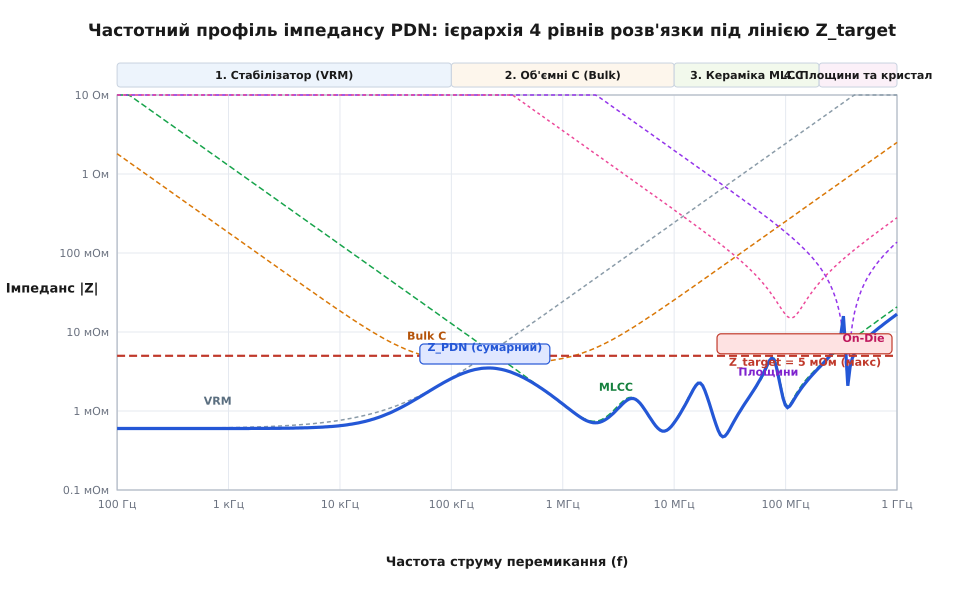
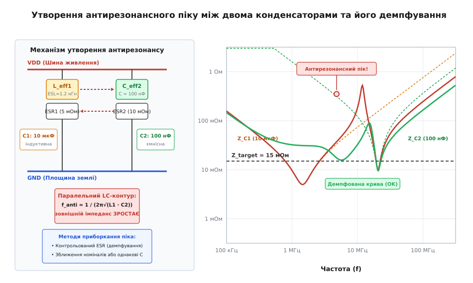

# Імпеданс шини живлення (PDN)

<preknowlist>
- [Закон Ома](root:hw-analog/ohms-law) — зв'язок напруги, струму та опору в електричному колі.
- [Індуктивність](root:ph-electromagnetism/inductance) — опір провідника швидкій зміні струму: V = L·(di/dt).
- [Паразити конденсатора](root:hw-components/capacitor-parasitics) — власна індуктивність ESL та послідовний опір ESR.
</preknowlist>

Сучасний процесор або цифрова логічна мікросхема працює на напрузі ядра близько 0.85–1.0 В і в спокійному режимі споживає помірний стаціонарний струм. Проте під час кожного тактового імпульсу мільйони логічних транзисторів перемикаються синхронно протягом 300–500 пікосекунд. Споживання струму злітає стрибком на 10–20 А. Швидкість наростання струму досягає десятків мільярдів амперів за секунду. Якщо між джерелом живлення та кристалом лежить навіть короткий друкований провідник із паразитною індуктивністю всього два наногенрі, швидка зміна струму наводить на ньому проти-ЕРС самоіндукції у кілька десятків вольтів.

Допустимий запас напруги для нанометрових транзисторів не перевищує 3–5% від номіналу — тобто всього 25–40 мілівольтів. Коли проти-ЕРС провідника стикається зі стрибком навантаження, напруга на ніжках мікросхеми миттєво просідає до нуля. Логічні комірки втрачають збережений стан, біти спотворюються, конвеєр процесора збивається, а пристрій зависає. Друкований провідник чи полігон живлення на таких швидкостях більше не поводиться як простий дріт із нульовим опором. Уся система живлення перетворюється на складне частотно-залежне коло — мережу розподілу живлення (англ. Power Distribution Network, PDN).

## Цільовий імпеданс шини живлення

Щоб утримати коливання напруги в безпечних межах за будь-яких перемикань вентилів, мережа живлення повинна мати гранично низький комплексний опір. Цей граничний поріг називають цільовим імпедансом (англ. Target Impedance, від латинського *impedire* — перешкоджати). Він визначає максимальний дозволений імпеданс між шиною живлення та землею в робочому спектрі частот.

Величину цільового імпедансу розраховують за законом Ома:

```
Z_target = ΔV_max / I_step
```

Якщо напруга ядра становить 0.85 В, допустиме просідання напруги `ΔV_max` обмежене трьома відсотками (близько 25.5 мВ), а динамічний стрибок споживання `I_step` сягає 10 А, цільовий імпеданс не повинен перевищувати 2.55 міліома. Для потужних обчислювальних процесорів зі стрибками струму понад 100 А цільовий імпеданс падає нижче 0.5 міліома — це менше, ніж опір одного перехідного отвору на платі.

Спектр струму при наносекундних фронтах містить потужні гармоніки від постійного струму до частоти перегину `f_knee ≈ 0.35 / t_rise`. При фронті перемикання 350 пікосекунд частотний діапазон сягає 1 ГГц. Мережа PDN зобов'язана втримувати імпеданс нижче рівня `Z_target` у всій цій широкій смузі.

## Частотна ієрархія розв'язки

Жоден окремий елемент схеми не здатний забезпечити опір у частки міліома від постійного струму до гігагерців. Стабілізатор напруги (англ. Voltage Regulator Module, VRM) утримує напругу лише на низьких частотах, оскільки його активний зворотний зв'язок обмежений смугою до кількох сотень кілогерців. До того ж електромагнітна хвиля поширюється в діелектрику плати зі швидкістю близько 150 міліметрів за наносекунду. Поки сигнал про просідання напруги дійде від чіпа до стабілізатора на відстані кількох сантиметрів і повернеться назад, мине понад пів наносекунди — за цей час кристал встигне збійно вимкнутися.

Тому мережу живлення будують як чотирирівневу ієрархію накопичувачів заряду, кожен із яких відповідає за свій частотний діапазон:

- **Стабілізатор напруги VRM (від постійного струму до 100 кГц):** активне джерело, що компенсує повільні зміни навантаження та утримує точну середню напругу шини;
- **Об'ємні електролітичні або танталові конденсатори (100 кГц .. 10 МГц):** мають велику ємність (десятки й сотні мікрофарад) і живлять схему в перші мікросекунди після стрибка навантаження, поки стабілізатор не встиг зреагувати;
- **Керамічні багатошарові конденсатори MLCC (1 МГц .. 200 МГц):** володіють малим послідовним опором (англ. Equivalent Series Resistance, ESR) та низькою власною індуктивністю (англ. Equivalent Series Inductance, ESL). Кераміку номіналом 0.1–10 мкФ у корпусах 0402 чи 0201 монтують максимально близько до виводів живлення мікросхеми;
- **Площини друкованої плати та ємність кристала (понад 200 МГц):** суміжні мідні шари живлення і землі, розділені тонким діелектриком (50–100 мкм), утворюють розподілений плоский конденсатор із майже нульовою індуктивністю підключення. Разом із внутрішньою ємністю кремнієвого кристала вони гасять найшвидші пікосекундні сплески струму.


*Частотний профіль імпедансу PDN: сумарна крива формується взаємодією стабілізатора VRM, об'ємних та керамічних конденсаторів, площин плати та ємності кристала під лінією цільового імпедансу Z_target.*

## Пастка антирезонансів при паралельному з'єднанні

Типова помилка початківця — встановити паралельно конденсатори різної ємності (наприклад, 10 мкФ, 0.1 мкФ і 1 нФ), сподіваючись покрити всі частоти. На практиці кожен конденсатор через наявність паразитної індуктивності ESL має власну послідовну частоту резонансу. Нижче цієї частоти компонент є ємністю, а вище неї — індуктивністю.

Коли паралельно з'єднують більший конденсатор (який на проміжній частоті вже став індуктивністю) та менший конденсатор (який на цій частоті все ще працює як ємність), вони утворюють паралельний коливальний контур. На частоті власного антирезонансу сумарний імпеданс пари різко зростає, утворюючи високий гострий пік.


*Утворення антирезонансного піку між двома конденсаторами різної ємності та його демпфування послідовним опором ESR.*

Якщо частота цього піку збігається з тактовою частотою процесора або гармонікою шини обміну даними, напруга живлення почне розгойдуватися, виходячи за лінію `Z_target`. Замість якісної фільтрації схема отримує схильність до спонтанних зависань під час виконання певних циклічних алгоритмів.

Щоб запобігти появі небезпечних антирезонансних піків, у сучасних швидкісних платах уникають змішування багатьох різних номіналів кераміки. Натомість використовують масиви однакових конденсаторів із мінімальною індуктивністю монтажу або обирають компоненти з контрольованим опором ESR, який природно демпфує добротність резонансного контуру.

---

Повне аналітичне виведення цільового імпедансу, матричні моделі розподілених площин плати та методику розрахунку монтажних переходів наведено у [детальній статті](root:hw-pcb/pdn-impedance/detail). Алгоритм числового розрахунку імпедансу та пошуку антирезонансів реалізовано у вставці [аналізатор частотного профілю імпедансу PDN](root:hw-pcb/pdn-impedance/proj-pdn-impedance-analyzer.md).
