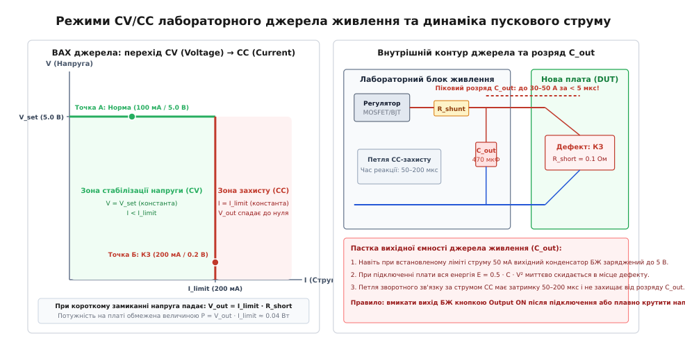
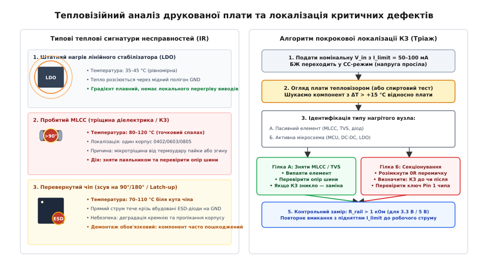

# Перше вмикання нової плати: обмеження струму, димовий тест

<preknowlist>
- [Огляд плати до подачі живлення](root:hw-pcb/ohliad-platy-do-podachi-zhyvlennia) — візуальний контроль монтажу під мікроскопом, продзвонювання шин на КЗ
- [Блок-схема пристрою: вузли, зв'язки, межі](root:hw-pcb/blok-skhema-prystroiu) — архітектура дерева живлення, домени та межі напруг
- [Знижувальний імпульсний перетворювач (Buck)](root:hw-power/buck) — робота ключів, індуктивності та згладжування пульсацій
- [Лінійний стабілізатор із низьким спадом напруги (LDO)](root:hw-power/ldo) — лінійне регулювання, PSRR та тепловідведення
- [Захист від переполюсовки та перенапруги](root:hw-power/reverse-polarity-protection) — діоди Шотткі, P/N-канальні MOSFET та ідеальні діоди
</preknowlist>

Пряме підключення щойно змонтованого прототипу друкованої плати до штатного джерела живлення — акумуляторної батареї з внутрішнім опором у кілька міліом або потужного промислового перетворювача на 24 В зі струмом віддачі 10 А — у більшості випадків закінчується незворотним виходом компонентів із ладу. Якщо на платі залишився невидимий волосяний місток припою між виводами багатовивідного мікроконтролера, змонтовано перевернутий на 180° танталовий конденсатор чи пробито керамічний конденсатор вхідного фільтра через мікротріщину діелектрика, струм короткого замикання сягає десятків ампер за перші кілька мікросекунд. Мідний провідник завширшки 0.2 мм випаровується, перетворюючись на спалах плазми, внутрішні зварні золоті розварювання всередині мікросхем плавляться, а кремнієвий кристал випалюється до стану вугілля. Процедура першого подання напруги, традиційно відома в інженерній практиці як «димовий тест» (англ. *smoke test*), є суворим фізичним і метрологічним регламентом, покликаним верифікувати топологічну та електричну цілісність вузлів пристрою за умов жорсткого обмеження енергії.

## Фізика деструктивних процесів під час першого подання енергії

Коли живлення подається на схему без попереднього обмеження струму, швидкість і характер деструкції визначаються двома фізичними процесами: розрядом накопиченої енергії конденсаторів та тепловою дією струму короткого замикання за законом Джоуля-Ленца.

Енергія `E`, накопичена в конденсаторах фільтра джерела живлення та вхідних ланцюгах плати, пропорційна ємності `C` та квадрату прикладеної напруги `V`:

```txt
E = 0.5 · C · V²
```

Якщо до плати підключається джерело з напругою 24 В і вихідною ємністю 470 мкФ, накопичена енергія становить:

```txt
E = 0.5 · (470 · 10^-6) · 24²
  = 0.5 · 0.00047 · 576
  ≈ 0.1354 Дж       [135.4 мДж накопиченої енергії]
```

Хоча величина 135 мДж здається незначною в масштабах побутових приладів, у разі короткого замикання ця енергія виділяється в мікроскопічному об'ємі металу містка припою або діелектрика конденсатора розміром `0.5 × 0.5 × 0.2 мм` за час розряду менше 2 мікросекунд. Миттєва потужність у точці дефекту досягає:

```txt
P_peak = E / Δt
       = 0.1354 / (2 · 10^-6)
       ≈ 67700 Вт = 67.7 кВт       [пікова миттєва потужність]
```

Густина енергії при цьому перевищує межу випаровування міді та олов'яно-свинцевого чи безсвинцевого припою. Відбувається локальний тепловий вибух, який відшаровує контактні площадки від основи зі склотекстоліту FR-4 та пропалює наскрізні каверни у внутрішніх сигнальних шарах багатошарової друкованої плати.

```txt
Джерело живлення (24 В) ───► [ Мікротріщина в MLCC 0603 ] ───► GND
                                      │
                 Mиттєвий розряд енергії E = 135 мДж за Δt = 2 мкс
                                      │
                 Густина потужності P_peak = 67.7 кВт
                                      │
                 Локальний вибух, розтріскування кераміки та обвуглювання FR-4
```

### Фізика плавлення мідних провідників (Рівняння Ондердонка)

Швидкість руйнування мідної доріжки друкованої плати під дією надструму описується рівнянням плавлення Ондердонка (Onderdonk's equation) для адіабатичного нагріву:

```txt
t_fuse = (A² / I²) · (0.0297 · log10((T_melt - T_amb) / (234.45 + T_amb) + 1))
```

де `A` — площа поперечного перерізу доріжки в квадратних мілах (mils²), `I` — струм короткого замикання в амперах, `T_melt = 1083 °C` — температура плавлення міді, `T_amb` — температура навколишнього середовища (25 °C).

Для типової сигнальної доріжки завширшки 0.25 мм (10 mil) при стандартній товщині фольги 1 oz (35 мкм, 1.37 mil) площа перерізу становить `A = 13.7 mils²`. Якщо струм короткого замикання досягає `I = 15 А`, час повного випаровування мідного провідника становить:

```txt
t_fuse ≈ (13.7² / 15²) · 0.0297 · log10((1083 - 25) / (234.45 + 25) + 1)
       ≈ (187.69 / 225) · 0.0297 · log10(5.08)
       ≈ 0.834 · 0.0297 · 0.706
       ≈ 0.0175 с = 17.5 мс       [час випаровування провідника]
```

За 17 мілісекунд доріжка перетворюється на розрив, спалюючи маску друкованої плати та руйнуючи сусідні сигнальні траси у внутрішніх шарах.

### Механізм піротехнічного руйнування танталових конденсаторів

Окрему смертельну небезпеку при першому вмиканні становлять танталові конденсатори зі твердим діелектриком (MnO₂). На відміну від алюмінієвих електролітичних або керамічних конденсаторів, танталовий конденсатор має виражену несиметричну структуру: анод із пресованого порошку танталу, тонкий діелектричний шар пентоксиду танталу (Ta₂O₅) та катод із діоксиду марганцю (MnO₂).

Якщо танталовий конденсатор запаяно з порушенням полярності (перевернуто на 180°), під дією зворотної напруги вже при 0.5–1.0 В діелектрик Ta₂O₅ зазнає лавинного електричного пробою. Через точку пробою починає текти струм у кілька ампер, що викликає локальний розігрів до температури понад 500 °C. При цій температурі діоксид марганцю MnO₂ починає розкладатися з бурхливим виділенням вільного кисню:

```txt
2 MnO₂ ──► Mn₂O₃ + O₂ (вільний кисень)
```

Вільний кисень миттєво вступає в екзотермічну реакцію горіння з металевим танталом порошкового анода:

```txt
4 Ta + 5 O₂ ──► 2 Ta₂O₅ + Q (велика кількість теплоти)
```

Реакція перетворюється на самопідтримуваний піротехнічний факел із температурою понад 2000 °C. Танталовий конденсатор спалахує відкритим яскравим полум'ям за долі секунди, випалюючи склотекстоліт і сусідні компоненти. Обмеження струму джерела живлення на рівні 50–100 мА не дає дійти до температури розкладання MnO₂, зупиняючи процес на стадії безпечного падіння напруги.

### Паразитний тиристорний ефект (Latch-Up)

Іншим деструктивним механізмом є паразитний тиристорний ефект (англ. *latch-up*) у CMOS-структурах інтегральних мікросхем. Сучасні мікроконтролери та цифрові сигнальні процесори містять мільйони комплементарних польових транзисторів. Через особливості планарної технології виготовлення кремнієвої підкладки між сусідніми N-канальними та P-канальними транзисторами формується паразитна чотиришарова PNPN-структура, еквівалентна кремнієвому керованому вентилю (тиристору).

Якщо в момент першого вмикання через перекіс напруг живлення або зворотне протікання струму через захисні діоди на будь-який сигнальний вивід мікросхеми потрапляє напруга, що перевищує напругу живлення ядра на 0.3–0.5 В, паразитний тиристор відкривається. Після відкривання він переходить у режим автопідтримуваного низькоомного замикання між шиною живлення ядра (VDD) та землею (GND). Струм через мікросхему зростає до 2–5 А навіть після зняття первинного керуючого сигналу, розігріваючи кристал вище 250 °C за долі секунди й незворотно руйнуючи металізацію кремнію.

Димовий тест призначений для того, щоб подати на схему напругу з таким обмеженням струму, за якого виділена енергія `E` фізично не зможе нагріти жоден компонент чи провідник до критичної температури деструкції.

## Лабораторне джерело живлення: анатомія переходів CV/CC та пастка вихідної ємності

Основним інструментом інженера під час першого пуску є регульоване лабораторне джерело живлення з прецизійним двоконтурним регулюванням: стабілізацією напруги (Constant Voltage, CV) та стабілізацією обмеження струму (Constant Current, CC).

Внутрішня схемотехніка якісного лінійного або імпульсного лабораторного джерела містить два незалежні підсилювачі помилки: підсилювач напруги, який порівнює вихідну напругу з встановленим потенціометром значенням `V_set`, та підсилювач струму, який вимірює падіння напруги на внутрішньому струмовому шунті `R_sense` і порівнює його з встановленим порогом `I_limit`. Виходи обох підсилювачів об'єднуються через діодну схему вибору мінімального сигналу (Diode-OR) і керують спільним прохідним регулюючим транзистором (MOSFET або біполярним BJT).


*Вольт-амперна характеристика лабораторного джерела живлення у площині V-I, перехід із режиму CV у режим CC при короткому замиканні та структурна схема внутрішнього контуру з паразитною вихідною ємністю C_out.*

У штатній робочій зоні (Точка А на графіку ВАХ), коли опір навантаження високий (`R_load > V_set / I_limit`), струм через плату менший за встановлений поріг. Джерело працює в режимі CV: вихідна напруга підтримується незмінною `V_out = V_set`, а струм диктується споживанням самої плати.

Коли на платі виникає коротке замикання або струм перевищує встановлений поріг `I_limit` (Точка Б на графіку ВАХ), діодний селектор передає керування підсилювачу струму. Джерело переходить у режим CC: струм фіксується на рівні `I_limit`, а вихідна напруга автоматично просідає до значення:

```txt
V_out = I_limit · R_short
```

Якщо опір короткого замикання становить `R_short = 0.1 Ом`, а ліміт виставлено на рівні `I_limit = 100 мА` (0.1 А), напруга на клемах джерела впаде до:

```txt
V_out = 0.1 · 0.1
      = 0.01 В = 10 мВ
```

При цьому потужність, яка виділяється в точці дефекту, становить лише:

```txt
P_dissipated = V_out · I_limit
             = 0.01 · 0.1
             = 0.001 Вт = 1 мВт       [безпечна розсіювана потужність]
```

Потужність в 1 мВт фізично не здатна нагріти або спалити навіть найтендітніший компонент чи найтоншу доріжку.

### Фізична пастка вихідного конденсатора джерела живлення

Попри наявність контуру CC, у реальних лабораторних джерелах криється прихована небезпека, через яку початківці часто спалюють плати навіть із виставленим лімітом струму 50 мА.

Для придушення високочастотних коливань та забезпечення стійкості вихідного каскаду паралельно вихідним клемам джерела виробник встановлює фільтруючий конденсатор ємністю `C_out_psu` (зазвичай від 100 до 1000 мкФ). Аналоговий контур зворотного зв'язку за струмом має скінченну смугу пропускання і час реакції `t_loop ≈ 50–200 мкс`.

Якщо джерело живлення увімкнене, його вихід активований і на клемах виставлено 12 В при ліміті 100 мА, внутрішній конденсатор `C_out_psu` заряджений до повних 12 В. Якщо тепер узяти щупи або дроти й торкнутися клем плати, на якій присутнє коротке замикання, струм розряду конденсатора `C_out_psu` піде в плату миттєво. Швидкість наростання цього струму обмежена лише індуктивністю дротів.

Протягом перших 5–10 мікросекунд, поки петля зворотного зв'язку джерела живлення «не бачить» стрибка струму і не встигла закрити прохідний транзистор, піковий струм розряду конденсатора досягає 30–50 А. Цієї енергії цілком достатньо для руйнування компонентів.

> 🔧 **Золоте правило безпечного підключення лабораторного джерела:**
> 1. Ніколи не підключати щупи живлення до плати при увімкненому виході джерела (*Hot Plugging* заборонено).
> 2. Спочатку підключити знеструмлені дроти до плати, перевірити полярність.
> 3. Встановити регулятори напруги та струму в нуль.
> 4. Увімкнути кнопку `Output ON` і плавно піднімати напругу від 0 В регулятором (Ramping Up), безперервно контролюючи амперметр.

## Методика ступеневого підняття напруги (Ramping Up) та секціонування рейок

Безпечний процес першого вмикання базується на послідовному секціонуванні схеми та поетапному піднятті напруги від нуля до номіналу.

### Попередній вимір пасивного опору рейок

Перед тим як подавати навіть мінімальну напругу, всі силові шини перевіряються цифровим мультиметром у режимі вимірювання опору відносно землі GND:

```txt
Шина живлення      Очікуваний опір на справній платі       Ознака дефекту
─────────────────────────────────────────────────────────────────────────────
Вхідна шина (24V)  > 100 кОм (заряд ємностей фільтра)      < 10 Ом (КЗ TVS/діода)
Шина 5.0V Buck     > 10 кОм                                < 5 Ом (пробій ключа)
Шина 3.3V I/O      > 500 Ом — 2 кОм                        < 2 Ом (пробій MCU/LDO)
Шина 1.2V Core     10 Ом — 100 Ом (низький опір ядра)      < 0.5 Ом (глухе КЗ)
Шина 3.3V Analog   > 2 кОм — 10 кОм                        < 10 Ом (КЗ фільтра)
```

Слід пам'ятати, що низьковольтні шини живлення сучасних високопродуктивних мікроконтролерів і процесорів (наприклад, лінія 1.0–1.2 В живлення обчислювального ядра) мають природний низький опір у статичному стані (десятки ом), що обумовлено великою кількістю паралельних затворів польових транзисторів і струмами витоку. Плутати такий низький опір із глухим коротким замиканням (менше 0.5 Ом) не можна.

### Послідовність секціонованого пуску та вимоги до секвенування (Power Sequencing)

Грамотно спроектована друкована плата завжди містить засоби фізичної ізоляції функціональних вузлів: нульові резистори (0R), перемички, що запаюються (Solder Jumpers), або знімні феритові намистини (Ferrite Beads), як описано в темі [Блок-схема пристрою: вузли, зв'язки, межі](root:hw-pcb/blok-skhema-prystroiu).

Крім ізоляції, для складних багатодоменних чипів (FPGA, SoC, двоядерні MCU) критичним є правильний порядок підняття напруг (Power Sequencing):
- **Core-before-IO:** Напруга ядра (1.2 В) повинна підніматися раніше або одночасно з напругою вводу-виводу (3.3 В). Якщо подати 3.3 В на периферію при знеструмленому ядрі 1.2 В, через внутрішні захисні діоди виникає неконтрольований струм витоку, що викликає апаратний збій логіки скидання Power-On Reset (POR).
- **Power Good ланцюжки:** Вихід `PGOOD` первинного перетворювача 5.0 В використовується для дозволу роботи (Enable) вторинних регуляторів 3.3 В та 1.2 В, забезпечуючи автоматичне монотонне наростання напруг.

Процедура пуску виконується каскадно:

```txt
Крок 1: Вхідний захист (TVS, P-MOSFET) ──► Тест V_in (струм витоку < 1 мА)
   │
Крок 2: Запаяти 0R на DC-DC Buck 5V ──► Тест виходу 5.0V (пульсації, нагрів)
   │
Крок 3: Запаяти 0R на LDO 3.3V ──► Тест виходу 3.3V (струм спокою 2–10 мА)
   │
Крок 4: Запаяти 0R на живлення MCU ──► Перевірка споживання ядра (20–80 мА)
   │
Крок 5: Підключення силової периферії (Драйвери, реле, трансивери)
```

1. **Крок 1 (Вхідний каскад):** Всі вторинні перетворювачі відключені розмиканням резисторів 0R. На вхід подається первинна напруга (наприклад, 24 В) з лімітом струму 20 мА. Контролюється падіння напруги на ланцюгах захисту від переполюсовки на базі P-MOSFET або ідеального діода ([Захист від переполюсовки та перенапруги](root:hw-power/reverse-polarity-protection)). Струм споживання повинен бути меншим за 1 мА.
2. **Крок 2 (Первинний імпульсний перетворювач):** Запаюється резистор 0R живлення первинного знижувального перетворювача ([Знижувальний імпульсний перетворювач (Buck)](root:hw-power/buck)). Встановлюється ліміт струму 100 мА. Напруга плавно піднімається до 24 В. Перевіряється наявність стабільної напруги 5.0 В на виході перетворювача на холостому ходу. Струм споживання на холостому ходу має становити від 3 до 15 мА залежно від мікросхеми.
3. **Крок 3 (Вторинні стабілізатори):** Запаюються перемички лінійних стабілізаторів ([Лінійний стабілізатор із низьким спадом напруги (LDO)](root:hw-power/ldo)). Перевіряються вихідні напруги 3.3 В та 1.2 В.
4. **Крок 4 (Обчислювальне ядро):** Підключається живлення мікроконтролера. Ліміт струму піднімається до 200 мА. Фіксується штатний струм споживання незапрограмованого чипа (зазвичай 15–40 мА для ядра Cortex-M4/M7).
5. **Крок 5 (Польова периферія):** Послідовно підключаються інтерфейсні трансивери (RS-485, CAN), драйвери двигунів та дисплеї.

### Поріг UVLO та стрибок струму запуску

Під час плавного підйому напруги від 0 В інженер обов'язково спостерігає явище спрацьовування порогу блокування при зниженні напруги (Under-Voltage Lockout, UVLO).

Поки вхідна напруга знаходиться нижче порогу UVLO (наприклад, нижче 4.2 В для перетворювача на 5 В), внутрішня логіка мікросхеми вимкнена, і струм споживання близький до нуля. Як тільки напруга перетинає поріг UVLO, внутрішній генератор починає перемикати силові ключі з максимальною шпаруватістю для швидкого заряду вихідних ємностей. Струм на амперметрі стрибкоподібно зростає. Якщо ліміт струму на блоці живлення встановлено занадто низько (наприклад, 30 мА), джерело в цей момент перейде в режим CC, напруга просяде нижче порогу UVLO, перетворювач вимкнеться, напруга знову зросте, і виникне небезпечний автогенераційний процес релаксаційних коливань (Hiccup Loop).

Тому поріг струму на блоці живлення під час перевірки імпульсних стабілізаторів повинен виставлятися з урахуванням пікового струму відкривання ключів (зазвичай 150–250 мА).

## Тепловізійний моніторинг та тріаж гарячих точок (Thermal Hotspot Triaging)

Найефективнішим неруйнівним методом локалізації прихованих дефектів монтажу під час димового тесту є тепловізійний контроль за допомогою інфрачервоної камери з високою роздільною здатністю та макролінзою.

Фізичною основою методу є випромінювання нагрітими тілами електромагнітних хвиль у дальньому інфрачервоному діапазоні (довжина хвилі 8–14 мкм) за законом Стефана-Больцмана:

```txt
j = ε · σ · T⁴
```

де `ε` — коефіцієнт випромінювання поверхні (Emissivity), `σ` — стала Стефана-Больцмана (`5.67 · 10^-8 Вт/(м² · К⁴)`), `T` — абсолютна температура в кельвінах.

Під час тепловізійної діагностики слід враховувати оптичну неоднорідність друкованої плати: чорні епоксидні корпуси мікросхем QFN/BGA мають високий коефіцієнт випромінювання `ε ≈ 0.95`, тоді як відкриті контактні площадки з блискучим припоєм чи золотим покриттям ENIG мають `ε ≈ 0.05–0.15` і діють як інфрачервоні дзеркала, відображаючи тепло тіла оператора або навколишніх ламп. Для точного вимірювання температури дзеркальні ділянки покривають матовою термострічкою або спиртовим флюсом.


*Типові інфрачервоні теплові сигнатури на друкованій платі при першому вмиканні та алгоритм покрокового тріажу несправностей за допомогою тепловізора.*

### Класифікація теплових сигнатур дефектів

Під час подачі тестової напруги з обмеженням струму на рівні 100–200 мА тепловізор фіксує один із трьох характерних теплових патернів:

1. **Точковий високотемпературний спалах (Hotspot) на пасивному компоненті (> 85 °C):**
   - *Причина:* Пробій багатошарового керамічного конденсатора MLCC (типорозміри 0402, 0603, 0805) або діода захисту від статики TVS.
   - *Фізика:* Внутрішнє розтріскування керамічного діелектрика через механічний згин плати під час монтажу або термоудар під час пайки паяльником. Опір дефектного конденсатора падає до 1–5 Ом. Весь обмежений струм джерела (наприклад, 150 мА) протікає через один крихітний елемент об'ємом `0.1 мм³`, миттєво розігріваючи його вище 100 °C.
   - *Дія:* Зняти підозрілий конденсатор термоповітряним феном або паяльником і повторно виміряти опір шини мультиметром.
2. **Локальний нагрів одного кута або ряду виводів мікросхеми (70–110 °C):**
   - *Причина:* Неправильна просторова орієнтація мікросхеми (зсув на 90° чи 180° відносно ключа Pin 1) або замикання сусідніх сигнальних виводів під корпусом QFN/BGA.
   - *Фізика:* При перевернутому монтажі напруга живлення потрапляє на сигнальні виводи GPIO, викликаючи пряме протікання струму через вбудовані захисні ESD-діоди на землю.
   - *Дія:* Знеструмити плату, випаяти мікросхему. Оскільки кристалічні структури при прямому струмі часто деградують, встановлювати цей самий екземпляр повторно не рекомендується.
3. **Широкий рівномірний градієнт нагріву LDO або силового ключа (35–45 °C):**
   - *Причина:* Штатна робота лінійного стабілізатора.
   - *Фізика:* Тепло рівномірно розподіляється по полігону заземлення навколо термопаду мікросхеми. Градієнт температури спадає плавно, без різких точкових аномалій.

### Експрес-діагностика випаровуванням ізопропанолу

За відсутності професійного тепловізора ефективним експрес-методом локалізації короткого замикання є спиртовий тест.

На підозрілу ділянку плати за допомогою піпетки або пензлика наноситься тонкий шар чистого ізопропілового спирту (ізопропанолу). Після цього на плату подається живлення з лімітом струму 200–300 мА. На справних холодних компонентах спирт випаровується повільно протягом десятків секунд. На компоненті з коротким замиканням через виділення тепла плівка ізопропанолу миттєво закипає і випаровується за 0.5–1 секунду, чітко вказуючи на дефектну деталь сухим блискучим місцем.

## Осцилографічна верифікація: пускові процеси, пульсації та стабільність

Після того як статичні напруги на всіх шинах перевірено мультиметром і перегрів відсутній, настає фаза динамічної верифікації за допомогою цифрового осцилографа.

### Правильна техніка вимірювання пульсацій (Ground Spring Technique)

Вимірювання пульсацій на виході імпульсних стабілізаторів DC-DC звичайним щупом осцилографа з довгим земляним дротом і крокодилом (довжиною 10–15 см) є грубою помилкою. Довгий земляний провідник утворює замкнену антенну петлю індуктивністю `L_loop ≈ 100–150 нГн`. Швидкозмінне магнітне поле від комутації дроселя перетворювача наводить у цій петлі паразитні високочастотні голки напруги амплітудою 200–500 мВ, яких насправді на шині живлення немає.

```txt
Неправильне підключення (Антена):
Щуп ────────────────────────────────────► V_out
Земляний дріт (15 см) ────( Петля EMI )──► GND   [Паразитний сплеск до 500 мВ!]

Правильне підключення (Коаксіальна пружинка):
Щуп ─────────────────────────────► V_out
Пружинка заземлення (< 5 мм) ────► GND безпосередньо на вихідному конденсаторі
```

Для достовірного вимірювання з щупа знімають пластиковий ковпачок-гачок і довгий дріт заземлення, встановлюючи на корпус щупа коротку коаксіальну пружинку (Ground Spring). Вимірювання проводять безпосередньо на виводах вихідного керамічного конденсатора стабілізатора. Вхідний канал осцилографа перемикають у режим закритого входу (AC Coupling) з обмеженням смуги пропускання 20 МГц (Bandwidth Limit 20 MHz).

Для якісного DC-DC перетворювача розмах комутаційних пульсацій (Peak-to-Peak Ripple) не повинен перевищувати 10–30 мВ, а для виходу малошумлячого LDO — менше 2–5 мВ.

### Верифікація форми сигналу у вузлі комутації (SW Node)

Форма напруги у вузлі комутації SW між транзисторами та дроселем знижувального перетворювача несе вичерпну інформацію про стабільність контуру:

1. **Фронти перемикання:** Прямокутний меандр із крутими фронтами наростання та спаду (тривалість `t_rise, t_fall ≈ 5–15 нс`).
2. **Високочастотний дзвін (Ringing):** Коливання на вершині імпульсу свідчать про резонанс паразитної індуктивності виводів транзистора та ємності діода. Якщо амплітуда дзвону перевищує максимально допустиму напругу стоку транзистора, у схему додається RC-снубер.
3. **Режим неперервної провідності (CCM):** Чіткий прямокутний сигнал без перерв.
4. **Режим розривної провідності (DCM):** На малому навантаженні після спаду струму дроселя до нуля спостерігаються затухаючі синусоїдальні коливання — це нормальний стан розривного режиму, а не несправність.

### Динамічний перехідний процес та реакція на стрибок навантаження (Load Step Transient)

Для перевірки запасу стійкості петлі зворотного зв'язку джерел живлення виконується динамічний тест на стрибок струму (Load Step). За допомогою швидкодіючого електронного навантаження або транзисторного комутатора струм навантаження імпульсно змінюється від 10% до 90% номіналу за час менше 1 мкс.

На екрані осцилографа фіксується:
- **Максимальне просідання напруги `ΔV_dip`:** Не повинно перевищувати 3–5% від номіналу шини (наприклад, не більше 150 мВ для шини 3.3 В).
- **Час відновлення `t_recovery`:** Інтервал, за який напруга повертається в межі допуску ±1% (типово 20–100 мкс).
- **Кількість перерегулювань:** Якщо після стрибка струму спостерігається більше двох затухаючих коливань напруги, це свідчить про недостатній запас за фазою (Phase Margin < 45°), що вимагає коригування ланцюгів компенсації зворотного зв'язку стабілізатора.

### Стійкість та самозбудження лінійних стабілізаторів LDO

Класичною інженерною пасткою при першому вмиканні є самозбудження лінійних стабілізаторів LDO. Старі типи LDO (наприклад, серії LM1117 або LP2985) вимагають для стабільності петлі зворотного зв'язку наявності вихідного конденсатора з суворо визначеним діапазоном еквівалентного послідовного опору (ESR від 0.1 до 1.0 Ом).

Якщо розробник замість танталового конденсатора встановив сучасний багатошаровий керамічний конденсатор MLCC з наднизьким опором `ESR ≈ 2–5 мОм`, фазовий зсув у петлі зворотного зв'язку досягає 180°, і стабілізатор перетворюється на високочастотний генератор. На виході 3.3 В замість постійної напруги виникає синусоїдальна генерація частотою 500 кГц — 5 МГц з розмахом 1.0–2.0 В, що призводить до непередбачуваних збоїв логіки мікроконтролера. Наявність генерації виявляється виключно осцилографом.

## Захист від зворотного живлення (Backfeeding) та паразитного запитування

При першому налагодженні нової плати інженер часто підключає до неї зовнішні інтерфейсні кабелі: налагоджувальний адаптер SWD/JTAG (ST-Link, J-Link) або конвертер USB-UART.

Якщо зовнішній адаптер підключено до комп'ютера, а основне живлення плати вимкнено, виникає небезпечне явище паразитного зворотного живлення (Backfeeding):

```txt
USB-UART Адаптер (TX = 3.3 В) ──► Вхід RX мікроконтролера (MCU)
                                           │
                        Внутрішній захисний ESD-діод мікросхеми
                                           │
                                           ▼
                 Внутрішня шина живлення VDD мікроконтролера (≈ 2.7 В)
```

Струм від лінії TX адаптера через верхній захисний діод ESD вхідного виводу мікроконтролера протікає безпосередньо у знеструмлену шину живлення 3.3 В плати. Оскільки пряме падіння на кремнієвому діоді становить близько 0.6 В, шина 3.3 В виявляється під напругою близько 2.7 В.

Аналогічний шлях паразитного витоку виникає через резистори підтяжки (Pull-Up) шини I2C або лінії вибору мікросхеми SPI (Chip Select), якщо вони підтягнуті до зовнішнього активного джерела.

Наслідки паразитного запитування:
1. Мікроконтролер намагається запуститися від слабкострумової лінії інтерфейсу (здатної віддати не більше 5–10 мА). При спробі тактування ядра напруга просідає, процесор скидається сигналом Brownout Reset, напруга знову піднімається, і виникає нескінченний циклічний перезапуск.
2. Протікання струму понад 20–30 мА через мікроскопічний внутрішній захисний діод призводить до його теплового пробою.
3. Виникають умови для тиристорного замикання Latch-up при наступній подачі основного живлення.

Для захисту від зворотного струму входи ліній зв'язку обладнують послідовними резисторами 1 кОм, цифровими ізоляторами (ISO77xx) або буферними мікросхемами з функцією захисту при вимкненому живленні (Partial Power-Down, виводи з підтримкою режиму `I_off`, такі як SN74LVC1T45).

## Програмно-апаратний монітор струму для стендових випробувань

Для автоматизації процедури першого пуску та захисту прототипів використовують автономні цифрові монітори живлення на базі мікросхеми INA226 та силових ключів на MOSFET, детально розглянуті у практичній вставці [Монітор споживання струму з апаратним вимкненням навантаження](root:hw-pcb/pershe-vmykannia-novoi-platy/proj-current-limit-monitor.md).

Нижче наведено порівняльний приклад коду базової конфігурації та опитування струмового монітора на мовах C99 та C++20.

:::tabs
:::code pershe-vmykannia-novoi-platy-d/c/main.c
:::code pershe-vmykannia-novoi-platy-d/cpp/main.cpp
:::

## Зведений регламент безпечного першого вмикання

Повний покроковий чек-лист дій інженера при проведенні димового тесту нової друкованої плати зведено в таблицю:

| Етап перевірки | Інструмент | Критерій успіху | Дія при виявленні дефекту |
|---|---|---|---|
| 1. Візуальний огляд | Мікроскоп (10x–40x) | Відсутність містків припою, правильна орієнтація полярних компонентів і мікросхем | Виправлення пайки, очищення флюсу |
| 2. Пасивне продзвонювання | Мультиметр (Омметр) | Опір шин живлення відносно GND відповідає нормі (> 500 Ом для 3.3 В) | Локалізація КЗ методом випаювання конденсаторів фільтра |
| 3. Холодне підключення | Джерело живлення | Дроти підключені при вимкненому виході `Output OFF`, регулятори в нулі | Перевірка надійності клем |
| 4. Плавний підйом напруги | Джерело в режимі CC | Ліміт струму 50–100 мА, плавний підйом напруги до номіналу | Якщо джерело перейшло в CC і напруга просіла — негайно зняти живлення |
| 5. Тепловізійний контроль | Тепловізор / Ізопропанол | Рівномірний розподіл температури, відсутність гарячих точок > 50 °C | Локалізація та заміна пробитого MLCC або перевернутої ІС |
| 6. Перевірка пульсацій | Осцилограф (Ground Spring) | Пульсації DC-DC < 30 мВ, відсутність генерації на LDO | Підбір вихідної ємності та ESR конденсаторів |
| 7. Підключення SWD/JTAG | Програматор + Осцилограф | Стабільне читання IDCODE мікроконтролера | Перевірка ліній тактування, скидання та живлення ядра |

Дотримання цієї послідовності гарантує 100% збереження компонентів складної друкованої плати та дозволяє локалізувати будь-які технологічні дефекти монтажу за лічені хвилини без ризику термічного руйнування дорогоцінного прототипу.
