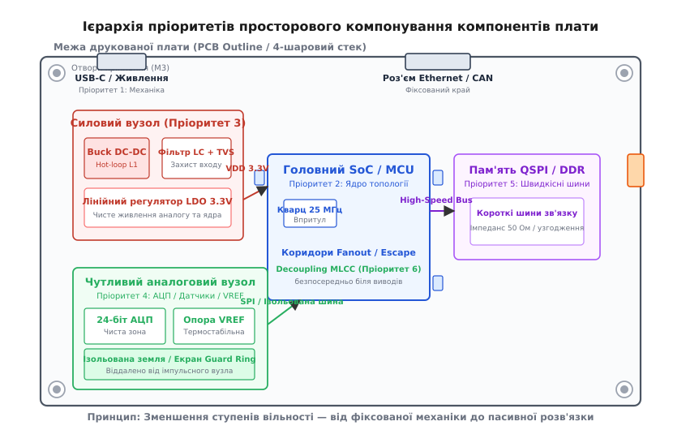
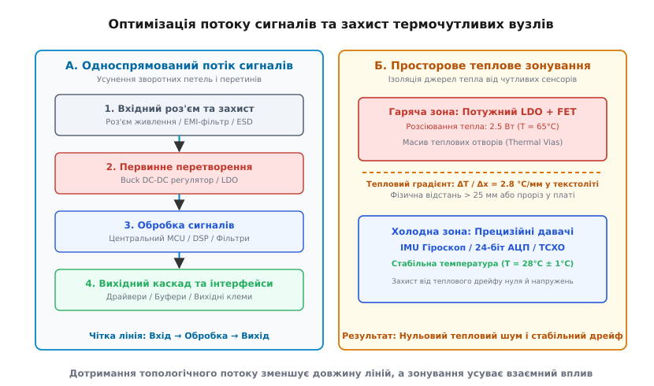

# Порядок розміщення: спочатку те, що не рухається

<preknowlist>
- [Друкована плата (PCB layout)](root:hw-pcb/pcb-layout) — мідна доріжка як паразитний опір та індуктивність, важливість цілісності зворотного шляху.
- [Шарування друкованої плати (Stackup)](root:hw-pcb/pcb-stackup) — чергування сигнальних шарів і суцільних полігонів живлення та землі.
- [Перехресні завади (Crosstalk)](root:hw-pcb/crosstalk) — ємнісний та індуктивний зв'язок між паралельними провідниками.
- [Проєктування шару землі](root:hw-pcb/ground-plane-design) — розтікання зворотного струму високої та низької частоти.
- [Блокувальний конденсатор](root:hw-components/decoupling) — локальний запас заряду біля виводу живлення мікросхеми.
- [Теплові перехідні отвори (Thermal Vias)](root:hw-pcb/thermal-vias) — відведення тепла крізь діелектрик плати.
</preknowlist>

Коли чотиришарова плата вимірювального модуля після першого монтажу видає на 24-бітному аналого-цифровому перетворювачі шум розмахом у 140 мікровольтів замість очікуваних двох, шина пам'яті DDR3 сипле помилками парності на частоті понад 300 МГц, а джерело опорної напруги пливе на 60 ppm/°C через нагрів від сусіднього стабілізатора — трасувальник мідних доріжок уже безсилий. Усі електричні з'єднання за схемою виконані бездоганно, перевірка електричних правил (англ. *Design Rule Check*, DRC) не показує жодного розриву чи замикання, але прилад не працює як єдина система. Причина цієї катастрофи виникла задовго до проведення першої сигнальної лінії: компоненти розкидали по вільних місцях плати без урахування їхньої фізичної природи, теплових потоків і паразитної електродинаміки простору.

Просторове компонування (англ. *floorplanning*, від *floor* — підлога та *plan* — план, первинно розбивка приміщень у будівництві) — це розподіл двовимірної площини та шарів друкованої плати між функціональними вузлами ще до того, як розпочнеться трасування доріжок. Помилку, допущену під час розміщення, неможливо виправити віртуозним розведенням провідників: якщо джерело імпульсної завади з крутим фронтом струму стоїть поруч із високоомним вимірювальним входом, електромагнітна петля зв'язку неминуче передасть енергію через паразитну взаємну індуктивність і ємність. Розміщення компонентів підпорядковується суворому правилу спадання ступенів вільності: компоненти з найжорсткішими геометричними та фізичними обмеженнями монтуються першими, стаючи опорними центрами для наступних вузлів.

## Математика обмежень: принцип спадання ступенів вільності

Кожен електронний компонент на площині плати володіє трьома геометричними ступенями вільності (англ. *degrees of freedom*, від лат. *gradus* — крок, ступінь): двома просторовими координатами центру `(X, Y)` на площині та дискретним кутом повороту довкола осі Z (зазвичай `θ ∈ {0°, 90°, 180°, 270°}`). Додатково існує бінарний вибір сторони монтажу: верхній шар (англ. *Top Layer*) або нижній шар (англ. *Bottom Layer*). Якщо на платі розміщено `N = 400` компонентів, розмірність простору пошуку оптимального взаємного розташування сягає величини `400! · 4⁴⁰⁰ · 2⁴⁰⁰`, що робить прямий перебір абсолютно нездійсненним навіть для найпотужніших суперкомп'ютерів.

```
Ступені вільності вузла:
DOF = { X, Y, θ, Side }
```

Єдиний інженерний спосіб приборкати цю комбінаторну складність — послідовно фіксувати координати елементів за ієрархією пріоритетів, де критерієм є вартість зміни положення компонента на пізніх етапах проєктування. Компонент із нулем ступенів вільності (англ. *Zero Degrees of Freedom*) не може бути пересунутий розробником електроніки без повної переробки корпусу приладу, заміни ливарних форм або переробки кабельних джгутів усього виробу.

| Рівень пріоритету | Клас компонентів | Ступені вільності | Фізичне та системне обмеження |
|---|---|---|---|
| **1. Механічні бази** | Роз'єми, кнопки, отвори кріплення, індикатори, зони заборони | 0 (суворо зафіксовані 3D-моделлю корпусу) | Механічний контакт, зусилля вставляння до 35 Н, вимоги збирання |
| **2. Головні обчислювачі** | SoC, MCU, FPGA, DSP, центральні процесори | 1–2 (локальна зона, поворот з кроком 90°) | Виходи магістральних шин, щільність BGA-виводів, баланс трасування |
| **3. Силові перетворювачі** | Вхідні EMI-фільтри, DC-DC ключі, дроселі, LDO | 2–3 (прив'язка до входу живлення або навантаження) | Струмові контури `dI/dt > 10⁸ А/с`, розсіювання тепла до 5 Вт |
| **4. Чутливий аналог** | 24-бітні АЦП, джерела VREF, інструментальні підсилювачі | 2–3 (локалізований ізольований кластер) | Чутливість до мікровольтів, захист від нагріву й цифрового шуму |
| **5. Високошвидкісні шини** | DDR RAM, QSPI Flash, кварцові резонатори, PHY | 3 (у межах радіуса довжини ліній від MCU) | Затримки поширення `t_pd ≈ 6.5 пс/мм`, узгодження хвильового опору |
| **6. Пасивна розв'язка** | Блокувальні MLCC, підтяжки, демпферні резистори, TP | 4 (вільне локальне положення) | Мінімізація паразитної індуктивності `L_loop < 1 нГн` |

Якщо порушити цей порядок і почати компонування з дрібних резисторів або навіть мікроконтролера в центрі, фіксовані роз'єми на краях плати виявляться заблокованими, а лінії живлення та високошвидкісні шини перетнуться у хаотичний клубок.


*Ієрархія пріоритетів компонування: від закріплених механічних інтерфейсів до локальних блокувальних конденсаторів.*

## Рівень 1: Фіксовані механічні елементи та інтерфейси людина-машина

Перший крок розстановки починається не в редакторі друкованих плат, а на перетині механічного проєктування (MCAD) та схемотехніки (ECAD). Механічні елементи визначають фізичний інтерфейс приладу із зовнішнім світом.

Зовнішні роз'єми (USB Type-C, RJ-45, гвинтові клемні колодки, коаксіальні гнізда SMA) встановлюються строго вздовж краю друкованої плати з урахуванням необхідного виступу за межі контуру текстоліту (англ. *connector overhang*). Якщо роз'єм заглибити всередину плати навіть на 0.5 мм, зовнішній кабель не зможе зафіксуватися у гнізді через товщину стінки корпусу приладу. Крім того, роз'єми зазнають значних механічних навантажень під час експлуатації: зусилля вставляння та висмикування кабелю USB Type-C сягає 30–35 Н, а виламувальний момент від жорсткого коаксіального кабелю може перевищувати 2 Н·м. Тому для таких компонентів завжди обирають корпуси з наскрізними металізованими ніжками екрана (англ. *Through-Hole Shield Pins*), здатними передати механічне навантаження на текстоліт, а не на крихкі SMD-виводи сигнальних ліній.

Отвори кріплення (англ. *mounting holes*) задають точки механічної фіксації плати в шасі. Вони вимагають суворого дотримання зон відчуження (англ. *keepout zones*). Зона навколо отвору діаметром `D_screw` має вільний радіус під головку гвинта або металеву стійку:

```
R_keepout = (D_head / 2) + Clearance
```

Для стандартного гвинта М3 діаметр головки з шайбою становить приблизно 6.5 мм. У зоні радіусом 4.0 мм від центру отвору категорично заборонено розміщувати будь-які компоненти, особливо керамічні чіп-конденсатори у корпусах 0603, 0805 чи 1206. Під час затягування гвинта в текстоліті виникає локальне механічне напруження вигину, що досягає десятків мегапаскалів:

```
σ = (M_torque · y) / I_area
```

Крихкий титанат барію керамічного конденсатора під дією цієї напруги дає мікротріщини, які з часом викликають електричний пробій, коротке замикання шини живлення та термічне руйнування плати.

Елементи інтерфейсу користувача — тактові кнопки, ручки поворотних енкодерів, світлодіоди індикації стану, дисплейні модулі — також мають нуль ступенів вільності, оскільки їхнє положення задане отворами на лицьовій панелі приладу. Додатково на цьому етапі виділяються технологічні поля плати (англ. *breakaway rails*) завширшки 5–7 мм, необхідні для утримання заготовки конвеєрами автоматичних ліній поверхневого монтажу (SMT) та селективного паяння, а також реперні знаки (англ. *fiducial marks*) для оптичного суміщення автоматів установки компонентів.

> 🔧 **Навіщо це.** Якщо зсунути кнопку скидання Reset або роз'єм живлення на 1 мм убік після завершення розведення плати, доведеться перетрасовувати сотні провідників навколо них або викидати на смітник тисячу відлитих пластикових корпусів. Фіксація механіки на самому початку рятує бюджет і час проєкту.

## Рівень 2: Головні обчислювальні центри (MCU, SoC, FPGA)

Після фіксації периметра плати настає черга розміщення її обчислювального ядра — мікроконтролера, систем на кристалі (SoC) або програмованих логічних інтегральних схем (FPGA). Обчислювальний центр є головним вузлом комутації: до нього сходяться сотні сигнальних ліній від датчиків, пам'яті, силових ключів та інтерфейсних мікросхем.

Помилка початківців — автоматично ставити мікроконтролер у геометричний центр плати. Оптимальне розташування процесора визначається не геометрією прямокутника плати, а так званим «центром ваги зв'язків» (англ. *topological center of gravity*). Якщо більшість швидкісних шин (наприклад, 32-бітна шина пам'яті та інтерфейс матричного дисплея) прямують у праву частину плати, чип слід змістити вправо. Це мінімізує сумарну довжину найкритичніших високочастотних трас за рахунок незначного подовження низькочастотних ліній керування (GPIO, повільні UART), які менш чутливі до затримок та паразитної ємності.

Критично важливим кроком є вибір кута повороту чипа (`0°, 90°, 180°, 270°`). Інтегральні мікросхеми у корпусах QFP-100, QFN-64 чи BGA-256 мають фіксований виробником розподіл виводів за функціями: квадрант живлення, квадрант аналогових входів АЦП, квадрант швидкісних ліній SPI/SDIO та квадрант системного тактування. 

**Оцінка перетинів ліній при повороті чипа.** Розглянемо чип, підключений до 16 ліній порту праворуч і 8 ліній датчиків ліворуч.
```
Кут θ = 0°:  лінії датчиків виходять наліво, шина порту направо.
Кількість перехрещень сигналів: N_cross = 0

Кут θ = 180°: лінії датчиків дивляться направо, шина порту наліво.
Кількість перехрещень сигналів: N_cross = 16 × 8 = 128
```
Поворот корпусу на 180 градусів створює 128 топологічних перехрещень, які змусять розробника додавати два додаткові сигнальні шари у стек плати та сотні перехідних отворів, тоді як вибір кута 0° дозволяє виконати трасування в одному шарі взагалі без перехідних отворів.

### Стратегія розведення BGA-виводів (Fanout & Escape Routing)

Для корпусів BGA з малим кроком кульок (0.8 мм, 0.65 мм або 0.5 мм) розміщення процесора нерозривно пов'язане з плануванням виходу провідників з-під корпусу (англ. *escape routing*).

Геометрія каналу трасування між двома сусідніми кульками BGA розраховується за формулою:

```
W_channel = Pitch - D_via_pad - 2 · Clearance_min
```

Для стандартного кроку `Pitch = 0.8 мм`, перехідного отвору з контактною площадкою `D_via_pad = 0.45 мм` і мінімального зазору `Clearance_min = 0.1 мм`:

```
W_channel = 0.8 - 0.45 - 2 · 0.1
= 0.15 мм
```

У цей канал завширшки 0.15 мм (150 мкм) можна прокласти рівно одну доріжку завширшки 0.09 мм (90 мкм) із двома технологічними зазорами по 0.03 мм, або застосувати більш надійні доріжки 0.1 мм із переходом на мікроотвори. 

Зовнішні два ряди кульок BGA завжди виводяться на поверхневому шарі безпосередньо. Третій і четвертий ряди кульок вимагають так званого «собачого фанауту» (англ. *dog-bone fanout*): від кожної контактної площадки відходить короткий провідник під кутом 45° до перехідного отвору, що опускає сигнал на перший внутрішній сигнальний шар. 

Якщо кількість рядів кульок перевищує 6, утворюється так звана зона перфорації опорного шару (англ. *via perforation barrier*). Суцільний масив перехідних отворів розрізає мідні полігони живлення та землі під чипом на вузькі ізольовані острівці, різко збільшуючи опір розтікання струму та руйнуючи шлях повернення швидкісних сигналів. Щоб цього уникнути, у масиві переходів обов'язково планують так звані «коридори повернення» (англ. *escape corridors*), де кожен четвертий отвір з'єднаний із землею і забезпечує неперервність зворотного шляху для сигнальних ліній, що пірнають під чип.

## Рівень 3: Силові перетворювачі та контури живлення (Power Supply Architecture)

Силовий вузол — це одночасно серце плати, що постачає енергію всім каскадам, і найагресивніше джерело електромагнітних завад (EMI). Імпульсні понижувальні (Buck) та підвищувальні (Boost) перетворювачі працюють на частотах від 200 кГц до 3 МГц, комутуючи струми в кілька ампер за лічені наносекунди.

Головне правило розміщення силового вузла — компактність і локалізація струмового контуру з високою швидкістю зміни струму `dI/dt` (англ. *hot loop*). У класичному синхронному понижувальному регуляторі такий контур утворений вхідним керамічним конденсатором `C_in`, верхнім транзистором (High-Side FET) та нижнім транзистором (Low-Side FET або діодом Шотткі).

```
Вхідний контур (Hot Loop):
+---------------------------------------+
|                                       |
|  [ + C_in - ] ---> [ High-Side FET ]  |
|      ^                     |          |
|      |               ( Вузол SW )     |
|      |                     |          |
|  [ Шар GND ] <--- [ Low-Side FET ]    |
|                                       |
+---------------------------------------+
```

Коли верхній ключ закривається, а нижній відкривається, струм через виводи перемикається практично миттєво:

```
dI/dt = I_peak / t_switch
```

Для струму `I_peak = 3 А` і часу перемикання сучасного MOSFET `t_switch = 5 нс`:

```
dI/dt = 3 / (5·10⁻⁹)
= 6·10⁸ А/с
```

Кожен міліметр площі петлі цього контуру володіє паразитною індуктивністю приблизно `1 нГн/мм`. Якщо площа петлі становить `A = 40 мм²`, її індуктивність досягає `L_loop ≈ 8 нГн`. Напруга індуктивного викиду на паразитній індуктивності:

```
U_spike = L_loop · (dI/dt)              [закон електромагнітної індукції Фарадея]
        = 8·10⁻⁹ Гн · 6·10⁸ А/с         [підстановка значень індуктивності та швидкості наростання]
        = 4.8 В                         [результуюча амплітуда індуктивного викиду]
```

Цей викид у майже 5 вольтів діє безпосередньо на виводах мікросхеми живлення, викликаючи високочастотний дзвін, пробій затворів транзисторів і випромінювання потужного магнітного поля в радіусі кількох сантиметрів.

### Розрахунок цільового імпедансу мережі живлення (PDN Target Impedance)

Будь-яка система живлення повинна підтримувати стабільну напругу на виводах чипа при динамічних змінах споживання струму. Цільовий імпеданс мережі доставки живлення (англ. *Power Distribution Network*, PDN) розраховується за формулою:

```
Z_target = (V_nom · Ripple_allowed) / I_transient_step
```

**Приклад розрахунку для ядра сучасного мікропроцесора:**
Номінальна напруга живлення ядра `V_nom = 1.2 В`, допустимі пульсації `Ripple_allowed = 3%` (тобто `ΔV = 0.036 В`), стрибок струму при переході з режиму сну в робочий `I_transient_step = 2.4 А`.

```
Z_target = 0.036 / 2.4
= 0.015 Ом = 15 мОм
```

Це означає, що у всьому діапазоні частот від постійного струму до частот тактування ядра (кількасот мегагерц) сумарний опір шини живлення, включаючи дроселі, конденсатори, полігони та перехідні отвори, не повинен перевищувати 15 мОм. Досягти цього можна виключно правильним розміщенням конденсаторів різного типу та номіналу:
1. Низькі частоти (до 100 кГц) підтримує сам DC-DC перетворювач та його вихідні електролітичні або танталові конденсатори (100–470 мкФ).
2. Середні частоти (100 кГц – 10 МГц) замикають об'ємні керамічні конденсатори MLCC типорозміру 0805 / 1206 номіналом 10–47 мкФ.
3. Високі частоти (10 МГц – 300 МГц) забезпечують мініатюрні конденсатори 0402 / 0201 номіналом 0.1 мкФ – 10 нФ, розташовані безпосередньо на ніжках живлення мікросхеми.

Щоб звести площу гарячого контуру до абсолютного мінімуму, компоненти розміщують у суворому порядку потоку енергії:
1. Вхідний роз'єм живлення та елементи первинного захисту (плавкий запобіжник, TVS-діод від імпульсних перенапруг, вхідний LC-фільтр синфазних завад).
2. Вхідний керамічний конденсатор `C_in` — монтується впритул до виводів `VIN` та `GND` мікросхеми перетворювача, на тому самому шарі, без перехідних отворів.
3. Комутаційний вузол `SW` (точка з'єднання ключів та дроселя) — робиться мінімально можливої площі. Дросель `L_out` ставиться безпосередньо біля виводу `SW`.
4. Вихідний фільтрувальний конденсатор `C_out` — встановлюється одразу за дроселем, замикаючи зворотний струм на вивід землі мікросхеми живлення.
5. Лінійні стабілізатори з малим падінням напруги (LDO) розміщуються безпосередньо біля споживачів їхнього «чистого» живлення, щоб довга доріжка не встигла наловити перешкод від цифрових шин.

> 🔧 **Навіщо це.** Вузол `SW` діє як антена електричного поля `E`, що випромінює напругу прямокутної форми розмахом `VIN` з фронтами в одиниці наносекунд. Що більша мідна пляма вузла `SW`, то більша її паразитна ємність до навколишніх кіл і шарів плати. Зробивши її компактною і поставивши дросель впритул до контролера, ми усуваємо завади біля самого джерела.

## Рівень 4: Чутливі аналогові вузли (Острови тиші)

Аналогова частина плати — це простір слабких сигналів, де амплітуди вимірюються мікровольтами чи навіть нановольтами (виходи тензодатчиків, термопар, біопотенціалів, фотодіодів). Якщо цифрова мікросхема сприймає заваду амплітудою 100 мВ як допустимий шум, то для 24-бітного АЦП із опорною напругою 2.5 В ціна одного молодшого розряду (LSB) становить:

```
1 LSB = V_ref / 2²⁴
= 2.5 / 16777216
≈ 0.149 мкВ
```

Шум амплітудою всього 15 мкВ знищує сім молодших розрядів перетворення, перетворюючи прецизійний 24-бітний вимірювач на посередній 17-бітний.

Аналогові компоненти (вимірювальні інструментальні підсилювачі, джерела опорної напруги VREF, пасивні антиаліасингові RC-фільтри, сигма-дельта АЦП) групують в ізольований кластер — просторовий «острів тиші». Головний принцип його розташування — максимальне віддалення від силових імпульсних вузлів та високочастотних цифрових шин процесора.

### Чотирипровідне підключення Кельвіна (Kelvin Sensing)

Для вимірювання струму через низькоомні шунти (номіналом 1–10 мОм) або зняття сигналу з мостових резистивних давачів критично важлива геометрія точки підключення вимірювальних ліній. Опір припою контактної площадки SMD-резистора становить близько `0.5–1.0 мОм`, що можна порівняти з номіналом самого шунта.

Якщо вимірювальні провідники під'єднати до загальної силової доріжки, падіння напруги силового струму на контактному майданчику додасться до корисного сигналу, викликаючи похибку вимірювання струму до 10–20%:

```
V_measured = I_load · (R_shunt + 2 · R_pad)
```

Схема Кельвіна вимагає підведення двох тонких вимірювальних провідників безпосередньо до внутрішніх країв металізації резистора (окремо від силових полігонів). Оскільки вхідний опір вимірювального підсилювача становить сотні мегаом, струм через вимірювальні лінії практично дорівнює нулю, і падіння напруги на їхньому опорі відсутнє:

```
V_kelvin = I_load · R_shunt
```

Ці дві лінії проводять строго паралельно як симетричну диференційну пару над суцільним шаром землі, захищаючи їх від наведення зовнішніх магнітних полів однакової амплітуди (синфазна завада, яку підсилювач ефективно придушує завдяки високому коефіцієнту CMRR > 100 дБ).

Особливу увагу приділяють організації опорного потенціалу землі. Поширена у минулому практика розрізання шару землі на «аналогову» (AGND) та «цифрову» (DGND) ділянки з вузьким перешийком у сучасних швидкісних змішаних системах часто завдає більше шкоди, ніж користі. Якщо будь-яка цифрова сигнальна лінія (наприклад, лінія синхронізації SPI SCK) перетне такий розріз у землі, її високочастотний зворотний струм не зможе текти під сигналом: йому доведеться обходити всю щілину довкола, утворюючи гігантську рамкову антену, яка випромінює в ефір і наводить напругу прямо в аналогову землю.

Сучасний підхід полягає у використанні **єдиного суцільного шару землі** у поєднанні з суворою **просторовою сегрегацією компонентів** (англ. *floorplan zoning*):
- Аналоговий вхідний роз'єм, підсилювач, фільтр, джерело VREF та АЦП розташовують в одному секторі плати.
- Цифрова частина мікросхеми АЦП (виводи інтерфейсу SPI/I2S) розташовується на межі аналогової та цифрової зон.
- Процесор розташовується з цифрового боку.
- Оскільки зворотні струми високої частоти завжди течуть у полігоні землі строго під своїми сигнальними трасами, швидкісні цифрові струми повернення ніколи фізично не протечуть через аналогову зону, доки між ними немає перехресних сигнальних ліній.

Для надвисокоомних кіл (струми витоку пікоамперного рівня від фотодіодів або скляних pH-електродів) навколо чутливих виводів формують захисне охоронне кільце (англ. *guard ring*) — мідне кільце, що перебуває під тим самим потенціалом, що й вимірювальна лінія (завдяки буферному повторювачу з одиничним коефіцієнтом підсилення). Різниця потенціалів між кільцем і сигналом дорівнює нулю, отже струм витоку через поверхню текстоліту повністю усувається:

```
I_leak = ΔV / R_surface = 0 / R_surface = 0
```

## Рівень 5: Високошвидкісні шини та тактування

Високошвидкісні цифрові інтерфейси — паралельна пам'ять DDR3/DDR4/LPDDR, швидкісна послідовна пам'ять QSPI/OSPI Flash, лінії Ethernet MII/RGMII, диференційні пари USB 2.0/3.0 та PCIe — вимагають хвильового підходу до геометрії. Сигнал у склотекстоліті FR-4 поширюється зі швидкістю приблизно:

```
v = c / √ε_r
= 3·10⁸ / √4.3
≈ 1.45·10⁸ м/с ≈ 145 мм/нс
```

Затримка поширення становить величину:

```
t_pd = 1 / v
≈ 6.9 пс/мм
```

Критична довжина лінії, за якої провідник перестає бути простим дротом і перетворюється на довгу лінію з розподіленими параметрами, визначається часом наростання фронту сигналу `t_r`:

```
l_crit = t_r / (2 · t_pd)
```

Для сучасних мікросхем із фронтом перемикання `t_r = 0.5 нс`:

```
l_crit = 0.5·10⁻⁹ / (2 · 6.9·10⁻¹²)
≈ 36 мм
```

Якщо відстань між процесором і мікросхемою перевищує 36 мм, будь-яка неоднорідність хвильового опору або різниця довжин провідників у шині викличе відбиття сигналу, розфазування та спотворення часових діаграм (джиттер).

### Топології з'єднання шин пам'яті (Fly-by vs T-Branch)

У системах із декількома мікросхемами пам'яті DDR3/DDR4 вибір компонування визначає топологію прокладання шин адреси, команд та синхронізації:

1. **Топологія прямого прольоту (Fly-by Topology):** Сигнали проходять послідовно від контролера до першого чипа пам'яті, потім до другого і закінчуються набором резисторів узгодження (термінаторів), підтягнутих до опорної напруги `V_TT = V_DD / 2`. Ця топологія усуває паразитні ємнісні розгалуження, забезпечуючи роботу на частотах понад 800 МГц (DDR3-1600). Однак вона вносить затримку поширення між першим і другим чипом, яку контролер пам'яті компенсує апаратно за допомогою процедури калібрування зчитування та запису (англ. *Read/Write Leveling*).
2. **Т-подібна симетрична топологія (T-Topology):** Сигнал ділиться у вузлі розгалуження на дві абсолютно рівні гілки однакової довжини до кожного чипа. Застосовується в застарілих системах DDR2 або мікроконтролерах без підтримки вирівнювання затримок. Вимагає симетричного розміщення мікросхем пам'яті з протилежних боків плати (двосторонній дзеркальний монтаж).

Тому мікросхеми оперативної та флеш-пам'яті розміщують на мінімально можливій відстані від процесора (зазвичай 10–25 мм), вирівнюючи їхні корпуси так, щоб забезпечити пряме трасування шин адреси, даних та керування без різких зламів і перетинань.

Окремий найвищий пріоритет у цій групі мають кварцові резонатори та генератори тактової частоти. Кварцовий резонатор працює на основі механічного п'єзоефекту, збуджуючись підсилювачем мікроконтролера через виводи `OSC_IN` та `OSC_OUT`. Цей вузол має високий вхідний імпеданс і надзвичайно малу амплітуду збудження. Його розміщують за непохитними правилами:
1. Кварц і два його навантажувальні конденсатори монтуються **впритул** до виводів мікроконтролера (дистанція менше 3–5 мм).
2. Під корпусом кварца на верхньому шарі заливають суцільний мідний острівець землі, з'єднаний із сигнальною землею мікроконтролера, що екранує резонатор від внутрішніх сигналів.
3. Під зоною тактового генератора на всіх сусідніх внутрішніх шарах категорично заборонено проводити будь-які інші сигнальні траси.
4. Контур «вивід OSC_OUT → кварц → конденсатор → земля генератора» має мікроскопічну площу, що унеможливлює як випромінювання тактової гармоніки в радіоефір, так і захоплення чужих імпульсних завад.

## Рівень 6: Пасивні компоненти та локальна розв'язка (Decoupling & Termination)

Пасивні компоненти — блокувальні конденсатори, резистори узгодження ліній (англ. *series termination resistors*), підтягувальні резистори інтерфейсів (англ. *pull-up resistors*) та тестові точки (англ. *test points*) — володіють найбільшою кількістю ступенів вільності. Їх розставляють останніми, але за суворими законами фізики локальних контурів.

Блокувальний керамічний конденсатор (MLCC) є локальним джерелом заряду, що компенсує кидки струму внутрішніх транзисторів мікросхеми при їхньому одночасному перемиканні (англ. *Simultaneous Switching Noise*, SSN). Реальний конденсатор — це не лише ємність `C`, але й еквівалентний послідовний опір (ESR) та еквівалентна послідовна індуктивність (ESL), до яких додається індуктивність підвідних доріжок та перехідних отворів:

```
L_total = ESL + L_trace + L_via
```

Власна резонансна частота конденсатора визначається як:

```
f_res = 1 / (2 · π · √(L_total · C))
```

На частотах вище `f_res` конденсатор втрачає ємнісні властивості і перетворюється на звичайну індуктивність, опір якої зростає з частотою `Z = 2 · π · f · L_total`. Тому зменшення індуктивності монтажу — єдиний спосіб розширити робочий частотний діапазон розв'язки.

Індуктивність пари з двох перехідних отворів (на шину живлення та на землю) стандартної плати завтовшки 1.6 мм становить приблизно `L_vias ≈ 1.2 нГн`. Індуктивність тонкої доріжки завдовжки 5 мм становить ще близько `5 нГн`. Якщо конденсатор 0.1 мкФ відсунути від виводу живлення мікросхеми на 5 мм, сумарна індуктивність петлі живлення складе:

```
L_loop ≈ 0.5 + 5.0 + 1.2 = 6.7 нГн
```

При стрибку струму споживання ядра мікропроцесора `ΔI = 0.8 А` за час `Δt = 1 нс` просадка напруги на цій паразитній індуктивності сягне:

```
ΔV = L_loop · (ΔI / Δt)
= 6.7·10⁻⁹ · (0.8 / 10⁻⁹)
≈ 5.36 В
```

Для ядра з номінальною напругою живлення 1.2 В просадка навіть у 0.2 В означає миттєве зависання мікроконтролера або скидання за апаратним таймером перезапуску (Brown-out Reset).

### Геометрія розміщення перехідних отворів конденсатора

Існує чотири типові конфігурації розташування перехідних отворів відносно контактних майданчиків MLCC-конденсатора 0402:

1. **Погана (довгі провідники до отворів):** Отвори розташовані за 2 мм від конденсатора. Паразитна індуктивність `L_loop ≈ 4.5 нГн`. Резонансна частота конденсатора 0.1 мкФ зміщується вниз до 7.5 МГц.
2. **Задовільна (отвори на торцях майданчиків):** Отвори розташовані впритул до торців площадки. Паразитна індуктивність `L_loop ≈ 1.8 нГн`.
3. **Добра (парні бічні отвори):** Отвори розташовані з бічних сторін контактних майданчиків якомога ближче один до одного. Взаємна індуктивність провідників частково компенсує власну індуктивність, знижуючи сумарну величину до `L_loop ≈ 0.9 нГн`.
4. **Ідеальна (Via-in-Pad):** Отвори виконані прямо в контактних майданчиках і заповнені міддю або епоксидним компаундом з наступною металізацією (VIPPO). Паразитна індуктивність `L_loop < 0.4 нГн`, що забезпечує ефективне придушення завад на частотах до 250 МГц.

Саме тому блоки розв'язки розміщують за правилом безпосередньої близькості:
- Конденсатор найменшої ємності та мінімального типорозміру (наприклад, 0.1 мкФ або 10 нФ у корпусі 0402 / 0201) монтується **безпосередньо біля виводу живлення**.
- Струм від джерела живлення мусить спочатку заходити на контактний майданчик конденсатора і лише потім потрапляти на вивід мікросхеми:
  ```
  [ Джерело VDD ] ---> [ Контактна площадка MLCC ] ---> [ Ніжка IC ]
  ```
- Перехідні отвори до полігонів живлення та землі розташовують максимально близько до виводів конденсатора, мінімізуючи довжину друкованого провідника.
- Більш ємні резервуарні конденсатори (10–47 мкФ, танталові або керамічні типорозміру 0805/1206) ставлять поруч для підтримки низькочастотного живлення всього банку виводів.

Демпферні резистори послідовного узгодження (номіналом 22–33 Ом) на лініях тактування SPI або шинах даних встановлюють упритул до виходу передавача сигналу (вивід TX або SCK джерела), щоб придушити відбиття хвилі на самому початку лінії. Підтягувальні резистори ліній I2C розміщують у центрі шини, мінімізуючи сумарну паразитну ємність лінії, що обмежує максимальну швидкість наростання фронтів.

## Оптимізація потоку сигналів та взаємного теплового впливу

Правильне розміщення забезпечує чисту конвеєрну архітектуру передачі енергії та інформації вздовж плати, виключаючи хаотичні перехресні зв'язки.

### Односпрямований потік сигналів (Signal Flow Architecture)

Найкраще компонування завжди має візуально помітний генеральний вектор руху інформації: «Вхідні роз'єми → Захист та кондиціювання сигналів → Аналогова фільтрація → Обробка та обчислення → Вихідні буфери та драйвери → Виконавчі роз'єми».

```
+---------------+     +---------------+     +---------------+     +---------------+
| Вхідні лінії  | --> | Первинний     | --> | Обчислювальне | --> | Вихідні       |
| та захист     |     | аналог / АЦП  |     | цифрове ядро  |     | інтерфейси    |
+---------------+     +---------------+     +---------------+     +---------------+
```

За такої організації виключається зворотне повернення (англ. *back-tracking*), коли вихідний потужний сигнал високого рівня повертається через усю плату і проходить поруч із високоомним чутливим входом. Додатково на етапі компонування застосовують метод перепризначення виводів (англ. *Pin Swapping* або *I/O Planning* у мікроконтролерах і FPGA): вибирають виводи одного функціонального блоку GPIO так, щоб сигнальні доріжки виходили паралельно без взаємних перехрещень.


*Односпрямований потік сигналів запобігає утворенню паразитних контурів, а винесення гарячих вузлів захищає аналогові та інерційні сенсори від теплового дрейфу.*

### Тепловий менеджмент та ізоляція термочутливих вузлів

Склотекстоліт FR-4 є дуже посереднім провідником тепла: його коефіцієнт теплопровідності в площині шарів становить близько `k_xy ≈ 0.35 Вт/(м·К)`, а поперек шарів крізь склотканину та епоксидну смолу — лише `k_z ≈ 0.05 Вт/(м·К)`. Для порівняння, теплопровідність чистої міді дорівнює `k_cu ≈ 390 Вт/(м·К)`.

Потужні компоненти — лінійні стабілізатори з великим падінням напруги, силові польові транзистори мостових драйверів двигунів, світлодіоди підсвічування — виділяють тепло, що створює просторовий градієнт температури:

```
dT / dx = P_loss / (k_eff · A_cross)
```

де `P_loss` — потужність теплових втрат, `k_eff` — ефективна теплопровідність плати з урахуванням мідних шарів, `A_cross` — площа поперечного перерізу плати.

Якщо потужний регулятор LDO розсіює `P = 2 Вт`, він нагріває текстоліт навколо себе до температури 65–75 °C. Якщо на відстані 5 мм від нього встановити прецизійний датчик температури, кварцовий генератор із термокомпенсацією (TCXO) або інтегральний тривісний інерційний вимірювальний модуль (IMU: акселерометр + гіроскоп), виникають незворотні деградації параметрів:
- Кремнієві MEMS-структури гіроскопів під дією неоднорідного градієнта температури зазнають термомеханічного вигину підкладки корпусу, що викликає дрейф нульової точки гіроскопа (англ. *zero-rate drift*) до 5–15 °/с, унеможливлюючи точну навігацію безпілотного апарата.
- Опорна напруга джерела VREF змінюється за параболічним законом `ΔV = S_temp · (T - T₀)²`, зміщуючи калібрування всієї системи збору даних.
- Частота нетермокомпенсованого кварца 16 МГц зсувається на десятки герц, призводячи до зриву синхронізації радіоканалу або помилок інтерфейсу CAN/Ethernet.

Щоб запобігти цьому, дотримуються трьох правил теплового компонування:
1. Гарячі силові елементи виносять до верхнього або бічного краю плати, бажано ближче до вентиляційних отворів або точок кріплення тепловідвідного шасі.
2. Термочутливі компоненти (IMU, прецизійні АЦП, джерела VREF) монтують у максимально віддаленому «холодному» кутку плати (дистанція не менше 25–40 мм від силових ключів).
3. Між гарячою та холодною зонами за потреби створюють фізичний бар'єр теплопередачі — наскрізний фрезерований паз у текстоліті (англ. *thermal isolation slot*), що розриває прямий шлях теплопровідності через склотекстоліт.

Для відведення тепла від силових компонентів безпосередньо під їхніми тепловідвідними майданчиками (Exposed Thermal Pads) проєктують матриці теплових перехідних отворів (англ. *thermal vias*) діаметром 0.3 мм із кроком 0.8–1.0 мм, які скидають тепло на внутрішні та нижні суцільні мідні полігони. Детальний фізичний розрахунок кількості таких отворів, теплового опору `R_th(j-a)` та діаметрів наведено в темі [теплові перехідні отвори (Thermal Vias)](root:hw-pcb/thermal-vias).

## Анатомія екранування та розміщення радіочастотних вузлів

Окрему категорію високого пріоритету компонування складають радіочастотні модулі (RF / Wireless) та чутливі трансивери (Wi-Fi, BLE, LoRa, GNSS). 

Головним засобом просторової електромагнітної ізоляції є металеві захисні екрани (англ. *RF Shield Cans*). Екранний ковпак монтується на прямокутний контур із заземлених контактних площадок (Shield Frame), утворюючи замкнену порожнину клітки Фарадея. 

Щоб екран ефективно затримував випромінювання на робочій частоті `f_rf`, крок перехідних отворів, що з'єднують рамку екрана із суцільним внутрішнім шаром землі, повинен бути значно меншим за чверть довжини хвилі:

```
d_via_max < λ / 20
```

**Приклад розрахунку для діапазону Wi-Fi 2.4 ГГц:**
Довжина хвилі у вакуумі:
```
λ = c / f = (3·10⁸) / (2.4·10⁹) = 0.125 м = 125 мм
d_via_max < 125 / 20 = 6.25 мм
```
На практиці крок перехідних отворів вздовж контуру екрана обирають рівним 2.0–3.0 мм. Якщо збільшити крок до 15 мм, отвори між переходами починають діяти як щілинні антени, і енергія радіочастотного передавача проникає на сусідні аналогові каскади.

Усередині екранованого відсіку розміщують виключно компоненти радіотракту: мікросхему трансивера, узгоджувальний LC-балун (Balun), смуговий фільтр ПАР (SAW Filter) та підсилювач потужності (PA). Антена або мікросмускова лінія з хвильовим опором 50 Ом виводиться безпосередньо за межі екрана до краю плати, причому під самою антеною (наприклад, друкованою антеною PCB Trace Antenna або керамічною Chip Antenna) повністю видаляються всі шари міді (повний Keepout полігонів землі та живлення).

## Технологічні обмеження автоматизованого монтажу (DFM / DFA)

Якісне просторове компонування враховує не лише закони електродинаміки, але й фізичні обмеження технології виготовлення та автоматизованого складання друкованих вузлів:

1. **Зазори до вакуумних сопел установок (Pick-and-Place Clearances):** Якщо високий алюмінієвий електролітичний конденсатор або масивний дросель заввишки 8 мм змонтувати впритул до крихітного чіп-резистора 0402, вакуумне сопло автоматичного маніпулятора зачепить сусідній компонент під час швидкісного монтажу (до 40 000 компонентів на годину). Мінімальна дистанція між високим і низьким компонентом повинна становити не менше половини висоти вищого компонента:
   ```
   Clearance_dfa ≥ H_tall / 2
   ```
2. **Тіньовий ефект при груповому паянні (Wave Soldering Shadow Effect):** Якщо плата проходитиме паяння подвійною хвилею припою, дрібні пасивні чіпи, розташовані безпосередньо позаду високих корпусів мікросхем (SOIC, SOT-223) у напрямку руху конвеєра, потрапляють у «гідродинамічну тінь» розплавленого припою, що призводить до дефектів непропаю (англ. *solder skip*).
3. **Ефект «надгробного каменю» (Tombstoning Effect):** При оплавленні паяльної пасти в інфрачервоній печі (Reflow Oven) обидва контакти двовивідного чіпа 0402 / 0603 повинні нагріватися абсолютно синхронно. Якщо одну площадку під'єднати до широкого масивного полігону землі безпосередньо, а другу — до тонкої сигнальної доріжки, масивна мідь відбиратиме тепло, і припій на першій площадці розплавиться на 1–2 секунди пізніше, ніж на другій. Сила поверхневого натягу розплавленого припою на гарячій площадці потягне чіп догори, і він встане вертикально як надгробок. Щоб цього уникнути, усі з'єднання пасивних компонентів із широкими полігонами обов'язково виконують через хрестоподібні теплові розвантаження (англ. *thermal relief spokes*).

## Інженерний розбір аварійних випадків компонування (Post-Mortem Case Studies)

Для закріплення розуміння фізики взаємодії розглянемо три реальні аварійні ситуації з інженерної практики, де порушення правил розміщення призвело до відмови складних приладів:

### Випадок А: Паразитний струмовий зв'язок через полігон аудіокодека

**Симптоми:** У портативному цифровому диктофоні відношення сигнал/шум (SNR) високоякісного 24-бітного звукового кодека впало з паспортних 102 дБ до катастрофічних 58 дБ. У навушниках чітко чутно високочастотний писк частотою 1.2 МГц, що модулюється навантаженням процесора.

**Причина:** Понижувальний стабілізатор DC-DC 5V→3.3V був розміщений у лівому верхньому кутку плати, роз'єм акумулятора — у правому верхньому, а мікросхема аудіокодека — між ними. Зворотний імпульсний струм комутації DC-DC перетворювача розтікався по єдиному полігону землі прямісінько під корпусом аудіокодека. Падіння імпульсної напруги `ΔV = I_pulse · R_gnd` на опорі мідного полігону землі безпосередньо додавалося до вхідного сигналу мікрофонного підсилювача.

**Виправлення:** Вузол DC-DC перетворювача перенесли впритул до роз'єму живлення у правий кут плати. Струмовий контур живлення замкнувся на площі 1.5 см², а зона аудіокодека опинилася в ізольованому тупиковому секторі плати, куди силові зворотні струми фізично не затікають. Рівень шуму повернувся до розрахункових 100 дБ.

### Випадок Б: Термоелектрична ЕРС у вимірювачі температури

**Симптоми:** Прецизійний вимірювач температури на базі термопари типу К та інструментального підсилювача демонстрував плаваючу похибку до +14 °C, яка з'являлася через 3 хвилини після ввімкнення приладу.

**Причина:** Поруч із симетричним вхідним RC-фільтром підсилювача (відстань 4 мм) був розташований лінійний стабілізатор живлення LDO, що розсіював 1.8 Вт тепла. Через асиметрію компонування один із двох резисторів фільтра був на 2 мм ближче до гарячого LDO, ніж другий. Градієнт температури створив різницю температур між контактами резисторів `ΔT ≈ 8 °C`. Внаслідок ефекту Зеєбека на межах «мідь доріжки — припій — металізація резистора» виникла паразитна термоелектрична ЕРС величиною:
```
V_thermo = S_cu_solder · ΔT             [формула термоелектричного ефекту Зеєбека]
         = 3.5 мкВ/°C · 8 °C            [підстановка різниці температур на виводах резистора]
         = 28 мкВ                       [результуюча паразитна термо-ЕРС]
```
Для термопари типу К із чутливістю приблизно `41 мкВ/°C` напруга 28 мкВ була інтерпретована підсилювачем як зміна температури на `28 / 41 ≈ 0.68 °C`, а з урахуванням нагріву холодного спаю похибка мультиплікувалася до 14 °C.

**Виправлення:** Вхідний диференційний каскад винесли на 35 мм в ізольовану зону, а резистори та конденсатори фільтра розташували строго паралельно ізотермічним лініям градієнта тепла. Похибка вимірювання впала нижче 0.1 °C.

### Випадок В: Зрив інтерфейсу QSPI Flash через розрив площини повернення

**Симптоми:** Мікросхема пам'яті QSPI NOR Flash стабільно читалася на частоті 25 МГц, але при переході на режим Quad-DDR 104 МГц процесор фіксував регулярне спотворення бітів під час завантаження коду операційної системи.

**Причина:** Мікросхема пам'яті була розміщена на відстані 45 мм від процесора. На внутрішньому шарі живлення прямо під лініями шини даних `QSPI_D[0..3]` проходила межа розрізу полігонів 3.3V та 1.8V. Високочастотний зворотний струм сигналу з часом наростання фронту `t_r = 0.8 нс`, добігши до розриву полігону, був змушений здійснювати обхідний шлях завдовжки 30 мм через найближчий блокувальний конденсатор. Утворена паразитна петля створила індуктивний викид і дзвін, що зрізав рівень логічної одиниці нижче порогу розпізнавання `V_IH`.

**Виправлення:** Пам'ять перенесли на дистанцію 12 мм від процесора і забезпечили неперервний суцільний шар землі під усіма провідниками шини. Інтерфейс запрацював без помилок на граничній частоті 133 МГц.

## Алгоритмічна перевірка правил компонування

Для автоматизації контролю взаємного розташування компонентів інженери розробляють скрипти верифікації компонування (Floorplan Rule Checkers). Нижче наведено приклад модуля на мовах C та C++, який аналізує масив компонентів плати, обчислює сумарну довжину зв'язків за Мангеттенською метрикою (англ. *Manhattan Distance*), перевіряє дотримання теплових дистанцій між гарячими елементами та чутливими датчиками, а також знаходить порушення правил близькості блокувальних конденсаторів до живлених мікросхем.

Повна математична теорія алгоритмів силового компонування (Force-Directed Placement) та оцінки зв'язків методом напівпериметра Bounding Box (HPWL) розгорнута в окремій практичній вставці [алгоритм оптимізації компонування плати](root:hw-pcb/poriadok-rozmishchennia/proj-floorplan-optimizer.md).

:::tabs
```c
#include <stdio.h>
#include <stdbool.h>
#include <math.h>

#define MAX_COMPONENTS 128
#define MAX_NETS       256

typedef enum {
    KIND_FIXED_MECHANICAL,
    KIND_PROCESSOR_CORE,
    KIND_POWER_HOT,
    KIND_ANALOG_SENSITIVE,
    KIND_DECOUPLING_CAP
} ComponentKind;

typedef struct {
    int id;
    ComponentKind kind;
    double x;      /* координата X в мм */
    double y;      /* координата Y в мм */
    double width;  /* ширина в мм */
    double height; /* висота в мм */
    int assigned_to_ic; /* ID мікросхеми для DECOUPLING_CAP, інакше -1 */
} Component;

typedef struct {
    int comp_a;
    int comp_b;
    double weight;
} NetConnection;

typedef struct {
    Component components[MAX_COMPONENTS];
    int comp_count;
    NetConnection nets[MAX_NETS];
    int net_count;
    double board_width;
    double board_height;
} Floorplan;

/* Обчислення мангеттенської довжини всіх зв'язків */
double calculate_total_manhattan_wirelength(const Floorplan *fp) {
    double total_length = 0.0;
    for (int i = 0; i < fp->net_count; i++) {
        const Component *a = &fp->components[fp->nets[i].comp_a];
        const Component *b = &fp->components[fp->nets[i].comp_b];
        double dx = fabs(a->x - b->x);
        double dy = fabs(a->y - b->y);
        total_length += (dx + dy) * fp->nets[i].weight;
    }
    return total_length;
}

/* Перевірка теплових дистанцій та близькості розв'язки */
bool verify_floorplan_rules(const Floorplan *fp, double min_thermal_dist, double max_decoupling_dist) {
    bool passed = true;

    /* 1. Перевірка теплової ізоляції: Power Hot -> Analog Sensitive */
    for (int i = 0; i < fp->comp_count; i++) {
        if (fp->components[i].kind != KIND_POWER_HOT) continue;
        for (int j = 0; j < fp->comp_count; j++) {
            if (fp->components[j].kind != KIND_ANALOG_SENSITIVE) continue;

            double dx = fp->components[i].x - fp->components[j].x;
            double dy = fp->components[i].y - fp->components[j].y;
            double dist = sqrt(dx * dx + dy * dy);

            if (dist < min_thermal_dist) {
                printf("ПОМИЛКА ТЕПЛА: Гарячий вузол #%d занадто близько до сенсора #%d (%.2f мм < %.2f мм)\n",
                       fp->components[i].id, fp->components[j].id, dist, min_thermal_dist);
                passed = false;
            }
        }
    }

    /* 2. Перевірка близькості блокувальних конденсаторів */
    for (int i = 0; i < fp->comp_count; i++) {
        if (fp->components[i].kind != KIND_DECOUPLING_CAP) continue;
        int target_ic = fp->components[i].assigned_to_ic;
        if (target_ic < 0 || target_ic >= fp->comp_count) continue;

        const Component *ic = &fp->components[target_ic];
        double dx = fp->components[i].x - ic->x;
        double dy = fp->components[i].y - ic->y;
        double dist = sqrt(dx * dx + dy * dy);

        if (dist > max_decoupling_dist) {
            printf("ПОМИЛКА РОЗВ'ЯЗКИ: Конденсатор #%d занадто далеко від IC #%d (%.2f мм > %.2f мм)\n",
                   fp->components[i].id, ic->id, dist, max_decoupling_dist);
            passed = false;
        }
    }

    return passed;
}
```
```cpp
#include <iostream>
#include <vector>
#include <cmath>
#include <string_view>
#include <span>
#include <expected>

enum class ComponentKind {
    FixedMechanical,
    ProcessorCore,
    PowerHot,
    AnalogSensitive,
    DecouplingCap
};

struct Point2D {
    double x{0.0};
    double y{0.0};

    [[nodiscard]] constexpr double manhattan_distance_to(const Point2D& other) const noexcept {
        return std::abs(x - other.x) + std::abs(y - other.y);
    }

    [[nodiscard]] double euclidean_distance_to(const Point2D& other) const noexcept {
        return std::hypot(x - other.x, y - other.y);
    }
};

struct Component {
    int id{0};
    ComponentKind kind{ComponentKind::FixedMechanical};
    Point2D position;
    double width{0.0};
    double height{0.0};
    int assigned_to_ic{-1};
};

struct NetConnection {
    size_t comp_a_index{0};
    size_t comp_b_index{0};
    double weight{1.0};
};

enum class VerificationError {
    ThermalViolation,
    DecouplingViolation,
    BoundaryOverflow
};

class FloorplanVerifier {
public:
    FloorplanVerifier(double board_w, double board_h)
        : m_board_width(board_w), m_board_height(board_h) {}

    void add_component(Component comp) {
        m_components.push_back(comp);
    }

    void add_net(NetConnection net) {
        m_nets.push_back(net);
    }

    [[nodiscard]] double calculate_total_manhattan_wirelength() const noexcept {
        double total = 0.0;
        for (const auto& net : m_nets) {
            if (net.comp_a_index < m_components.size() && net.comp_b_index < m_components.size()) {
                const auto& a = m_components[net.comp_a_index];
                const auto& b = m_components[net.comp_b_index];
                total += a.position.manhattan_distance_to(b.position) * net.weight;
            }
        }
        return total;
    }

    [[nodiscard]] std::vector<std::string> verify_design_rules(double min_thermal_dist, double max_decoupling_dist) const {
        std::vector<std::string> violations;

        for (size_t i = 0; i < m_components.size(); ++i) {
            const auto& comp_i = m_components[i];

            /* Перевірка меж плати */
            if (comp_i.position.x < 0.0 || comp_i.position.x > m_board_width ||
                comp_i.position.y < 0.0 || comp_i.position.y > m_board_height) {
                violations.push_back("Компонент #" + std::to_string(comp_i.id) + " виходить за межі плати");
            }

            /* Теплова ізоляція: гарячі джерела проти чутливих сенсорів */
            if (comp_i.kind == ComponentKind::PowerHot) {
                for (size_t j = 0; j < m_components.size(); ++j) {
                    const auto& comp_j = m_components[j];
                    if (comp_j.kind == ComponentKind::AnalogSensitive) {
                        double dist = comp_i.position.euclidean_distance_to(comp_j.position);
                        if (dist < min_thermal_dist) {
                            violations.push_back("Тепловий конфлікт: Вузол #" + std::to_string(comp_i.id) +
                                                 " на відстані " + std::to_string(dist) + " мм від сенсора #" +
                                                 std::to_string(comp_j.id) + " (мінімум " + std::to_string(min_thermal_dist) + " мм)");
                        }
                    }
                }
            }

            /* Близькість блокувальних конденсаторів до живлених IC */
            if (comp_i.kind == ComponentKind::DecouplingCap && comp_i.assigned_to_ic >= 0) {
                auto it = std::find_if(m_components.begin(), m_components.end(),
                                       [id = comp_i.assigned_to_ic](const Component& c) { return c.id == id; });
                if (it != m_components.end()) {
                    double dist = comp_i.position.euclidean_distance_to(it->position);
                    if (dist > max_decoupling_dist) {
                        violations.push_back("Порушення розв'язки: Конденсатор #" + std::to_string(comp_i.id) +
                                             " на відстані " + std::to_string(dist) + " мм від IC #" +
                                             std::to_string(it->id) + " (максимум " + std::to_string(max_decoupling_dist) + " мм)");
                    }
                }
            }
        }

        return violations;
    }

private:
    double m_board_width{100.0};
    double m_board_height{80.0};
    std::vector<Component> m_components;
    std::vector<NetConnection> m_nets;
};
```
:::

## Інженерний контрольний список поетапного компонування

Підсумовуючи фізичні принципи просторового розміщення, інженерний процес проєктування топології плати зводиться до послідовного алгоритму з семи послідовних кроків, кожен з яких спирається на результати попереднього:

1. **Імпорт геометрії та механічні прив'язки (Step 1):** Завантаження контуру плати (DXF/IDF/STEP), фіксація кріпильних отворів, зон заборони трасування/монтажу, роз'ємів зовнішнього підключення та органів інтерфейсу користувача (кнопки, індикатори) згідно з 3D-моделлю корпусу.
2. **Топологічне зонування (Step 2):** Візуальне розбиття площини плати на функціональні острови: зона первинного живлення, зона високовольтних/імпульсних кіл, зона цифрової обробки, зона високошвидкісної пам'яті, зона прецизійного аналогового тракту, зона радіотракту (RF/Wireless).
3. **Орієнтація та посадка обчислювальних ядер (Step 3):** Розміщення процесорів, мікроконтролерів та FPGA у центрах тяжіння їхніх зв'язків. Обертання корпусів для забезпечення прямого виходу шин без перехрещень провідників.
4. **Компактизація імпульсних джерел живлення (Step 4):** Побудова мінімальних контурів гарячого струму `C_in → FET → L → C_out` безпосередньо біля точок входу живлення. Мінімізація площі комутаційного полігону `SW`.
5. **Формування чутливих та швидкісних кластерів (Step 5):** Розміщення кварцових резонаторів упритул до виводів MCU; монтаж пам'яті DDR/Flash на мінімальній відстані з паралельними коридорами шин; ізоляція аналогового тракту від джерел тепла та імпульсних шумів.
6. **Монтаж локальної розв'язки та пасивних елементів (Step 6):** Розміщення блокувальних MLCC конденсаторів безпосередньо біля кожної пари виводів VDD/GND; встановлення демпферних резисторів біля виходів передавачів.
7. **Верифікація та аналіз трасуваності (Step 7):** Оцінка щільності зв'язків (Ratsnest Wirelength), перевірка відсутності заблокованих каналів трасування (Routing Bottlenecks) та теплових дистанцій за допомогою автоматизованих алгоритмів аналізу. Тільки після успішного проходження цього контролю відкривається доступ до трасування мідних доріжок.
