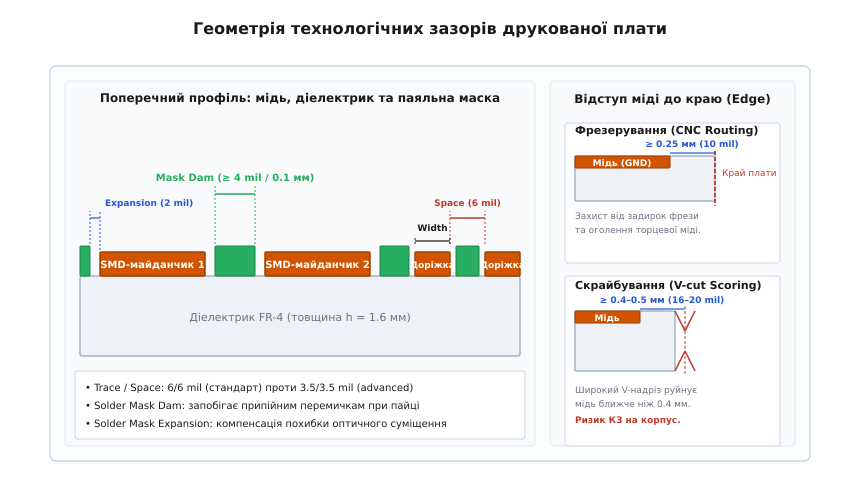
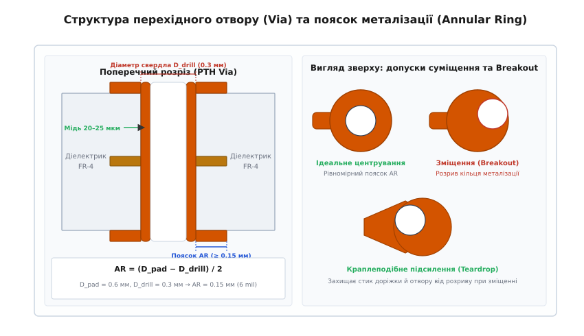

# Правила фабрики як вхідні правила проєкту

<preknowlist>
- [Друкована плата](root:hw-pcb/pcb-layout) — геометрія мідних провідників, сигнальні та силові шари, базові принципи розміщення компонентів.
- [Шарування плати](root:hw-pcb/pcb-stackup) — структура препрегів, мідної фольги, симетрія шарів та діелектрики.
- [Перехідний отвір і полігон під струм](root:hw-pcb/perekhidnyi-otvir-i-polihon-pid-strum) — геометрія отвору, густина струму та теплові обмеження.
- [Пайка оплавленням](root:hw-pcb/reflow-soldering) — термопрофіль оплавлення паяльної пасти, поверхневий натяг та змочуваність майданчиків.
</preknowlist>

Коли розробник завершує трасування друкованої плати в САПР із довільними або залишеними за замовчуванням допусками — наприклад, із зазорами між доріжками 0.09 мм (3.5 mil) та поясками перехідних отворів 0.1 мм на стандартній двошаровій заготовці — експорт файлів Gerber на завод майже неминуче завершується технологічним браком або зупинкою виробництва. Інженер відділу підготовки виробництва (CAM-інженер фабрики) надсилає запит на внесення інженерних змін (англ. *Engineering Query*, EQ), вимагаючи збільшити зазори, або ж автоматична виробнича лінія запускає замовлення у загальному пулі, де хімічне травлення 35-мікронної мідної фольги підмиває тонкі провідники з боків, утворюючи обриви, биття шпинделя свердлильного верстата зрізає вузькі пояски отворів, а занадто тонкі смужки паяльної маски відшаровуються в гальванічних ваннах, створюючи припійні перемички під час монтажу мікросхем.

Щоб плата виготовлялася з першої спроби з максимальним відсотком виходу придатних виробів (англ. *yield*), проєктування має спиратися на методологію проєктування з урахуванням технологічних обмежень виробництва (англ. *Design for Manufacturing*, DFM). Фізичні можливості конкретної фабрики — її фотолітографічних установок, свердлильних верстатів із ЧПК, ліній рідкого нанесення паяльної маски та дискових фрез — повинні бути перекладені на мову числових обмежень системи автоматизованого проєктування (САПР) ще до прокладання першої сигнальної доріжки.

## Технологічний конвеєр виготовлення плат і фізичне походження обмежень

Кожне обмеження в технологічній таблиці заводу (англ. *PCB Capabilities*) — це не випадкова цифра, а прямий наслідок фізико-хімічних процесів, з яких складається виробництво друкованої плати.


*Поперечний переріз друкованої плати з позначенням мінімальної ширини провідника (Width), зазору між доріжками (Space), розширення паяльної маски (Expansion), містка маски (Dam) та відступів міді до краю плати для фрезерування й скрайбування (V-cut).*

### Фотолітографія та бокове підтравлювання міді (Etch Factor)

Формування рисунка провідників на фольгованому склотекстоліті базується на субтрактивному методі: непотрібні ділянки мідної фольги видаляються хімічним розчиненням (травленням) у кислому розчині хлориду заліза, хлориду міді або лужних купрум-аміачних комплексах.

Процес складається з таких послідовних кроків:
1. Поверхня міді очищується та покривається шаром світлочутливого полімеру — сухого плівкового або рідкого фоторезисту.
2. Рисунок схеми експонується ультрафіолетовим випромінюванням крізь фотошаблон або формується за допомогою прямого лазерного експонування (англ. *Laser Direct Imaging*, LDI).
3. Незаполімеризовані ділянки фоторезисту вимиваються слабким лужним розчином карбонату натрію (Na2CO3), оголюючи мідь, яку необхідно витравити.
4. Плата проходить крізь камери струминного травлення, де розчин травника під тиском розчиняє відкриту мідь.

Головна фізична проблема хімічного травлення полягає в його **ізотропності**: розчин розчиняє мідь не лише вертикально вглиб фольги, а й горизонтально під захисний шар полімеризованого фоторезисту. Це явище називають **боковим підтравлюванням** (англ. *undercut*).

```
          [ Захисний шар фоторезисту ]
               |              |
    ───────────┴──────────────┴───────────
   /                                      \  ← Бокове підтравлювання (Undercut)
  /            Мідний провідник            \
 ────────────────────────────────────────────
          Діелектрик FR-4 (основа)
```

Через бокове підтравлювання поперечний переріз доріжки набуває форми трапеції, а її верхня ширина виявляється меншою за ширину експонованого фоторезисту. Відношення глибини вертикального травлення `h` (товщини міді) до величини бокового підтравлювання `u` називають **фактором травлення** (англ. *Etch Factor*):

```
Etch_Factor = h / u
```

Для стандартних промислових ліній струминного травлення фактор травлення становить близько `2.0–3.0`. Це означає, що під час стравлювання стандартної фольги завтовшки `35 мкм` (1 oz) розчин підмиває провідник на `12–17 мкм` з кожного боку:

```
ΔW_total = 2 · u ≈ 25–35 мкм  (1.0–1.4 mil)
```

Якщо закласти в проєкт доріжку завширшки 0.075 мм (3 mil) на міді 1 oz, то після змивання фольги від неї залишиться менше ніж 0.04 мм у верхній частині перерізу, а локальні флуктуації струменя травника спричинять повне перетравлювання і розрив електричного кола (обрив).

Тому мінімальна ширина провідника (Trace Width) і мінімальний зазор (Trace Space) безпосередньо пов'язані з товщиною базової міді. На фользі 0.5 oz (18 мкм) бокове травлення вдвічі менше, що дозволяє формувати провідники 0.09 мм (3.5 mil); на фользі 2 oz (70 мкм) підтравлювання сягає 50–60 мкм, що вимагає розширення мінімальних зазорів до 0.20–0.25 мм (8–10 mil).

### Механічне свердління та похибки позиціонування (Drill Runout & Misregistration)

Формування отворів під вивідні компоненти та перехідні отвори (vias) виконується на високошвидкісних свердлильних верстатах із ЧПК монолітними твердосплавними свердлами з карбіду вольфраму. Шпинделі верстатів обертаються зі швидкістю від 150 000 до 300 000 об/хв.

Незважаючи на мікрометричну точність лінійних приводів ЧПК, реальне положення отвору відхиляється від ідеальних координат у САПР внаслідок накладання кількох фізичних факторів:
- **Радіальне биття шпинделя (Spindle Runout):** неідеальність підшипників та затискної цанги викликає прецесію кінчика свердла з амплітудою `±10–15 мкм`.
- **Прогин і відхилення свердла (Drill Wandering):** тонкі свердла малого діаметра (0.2–0.3 мм) мають скінченну пружність. Під час контакту з твердою поверхнею склотекстоліту та переплетенням скловолокна кінчик свердла зміщується на `±20–35 мкм`.
- **Термомеханічна деформація багатошарового пакета (Layer Misregistration):** під час гарячого пресування внутрішніх шарів за температури 180–200 °C та тиску понад 20 атм смола препрегу полімеризується, викликаючи анізотропну усадку діелектрика. Зсув рисунка внутрішніх шарів відносно зовнішніх сягає `±30–50 мкм`.

Сумарна похибка суміщення центру отвору з контактним майданчиком підпорядковується закону квадратичного додавання дисперсій:

```
Δ_total = sqrt(Δ_spindle² + Δ_wander² + Δ_layer² + Δ_photo²)
```

Для стандартного виробництва `Δ_total` становить `0.075–0.10 мм` (3–4 mil). Якщо контактний майданчик (Pad) навколо отвору спроєктований занадто малим, зміщене свердло вийде за його межі, зрізавши мідний обідок і розірвавши з'єднання з сигнальною доріжкою.

### Нанесення та роздільна здатність паяльної маски (LPI Mask Resolution)

Паяльна маска — це термореактивний полімерний шар (рідка фотопроявна маска, англ. *Liquid Photoimageable*, LPI), що захищає поверхню плати від корозії, запобігає окисненню міді та унеможливлює розтікання розплавленого припою між сусідніми контактними майданчиками під час пайки оплавленням або хвилею.

Процес нанесення маски:
1. Рідка епоксидна емульсія наноситься методом трафаретного друку або розпилення на всю поверхню плати.
2. Плата підсушується до стану нелипкої плівки (англ. *tack-dry*).
3. Через оптичний фотошаблон або LDI-лазером експонуються ділянки, де маска повинна залишитися; зони контактних майданчиків залишаються незасвіченими.
4. Незасвічена маска змивається у проявному розчині карбонату натрію, після чого плата запікається в печі за температури 150 °C для повної полімеризації.

Обмеження маски визначаються двома параметрами:
1. **Розширення вікна маски (Solder Mask Expansion):** зазор між мідним майданчиком і краєм відкритого вікна в масці. Через похибку оптичного суміщення фотошаблона маски з міддю (`±0.03–0.05 мм`) вікно відкриття маски роблять на `0.05 мм` (2 mil) більшим за мідний майданчик у кожний бік. Якщо зробити розширення нульовим, зміщена маска налізе на край майданчика, зменшивши площу пайки.
2. **Місток маски (Solder Mask Dam / Web):** перемичка маски між двома сусідніми відкритими майданчиками. Якщо відстань між мідними майданчиками становить, наприклад, 0.25 мм, а розширення маски з кожного боку дорівнює 0.05 мм, то ширина залишкової смужки маски між ними дорівнює:
```
W_dam = S_copper - 2 · E_mask = 0.25 - 2 · 0.05 = 0.15 мм
```
Якщо спроєктувати місток вужчим за `0.10 мм` (4 mil) для зеленої маски або `0.12–0.15 мм` для масок інших кольорів, тонка смужка полімеру втратить механічну адгезію до текстоліту, розкришиться під час проявлення і відшарується в гальванічній ванні фінішного покриття (HASL/ENIG), що призведе до короткого замикання сусідніх виводів мікросхеми припоєм.

### Механічна обробка контуру: фрезерування проти скрайбування

Після виготовлення заготовки плати на груповій виробничій панелі її необхідно відокремити за фінішним контуром. Для цього застосовують дві технології:

1. **Контурне фрезерування (CNC Milling / Routing):** плата вирізається циліндричною твердосплавною фрезою діаметром 1.5–2.4 мм. Фреза залишає ідеально гладкий торець із точністю позиціонування `±0.10–0.15 мм`. Проте вібрація фрези та локальні сколи склотекстоліту вимагають, щоб будь-яка мідь відступала від лінії різу щонайменше на `0.25–0.30 мм`.
2. **Скрайбування (V-cut / V-scoring):** дискові ножі надрізають панель зверху і знизу під кутом 30° або 45° на глибину 1/3 товщини текстоліту з кожного боку, залишаючи центральну перемичку товщиною 0.3–0.5 мм для подальшого ручного або автоматичного розлому. Через кутове розширення V-подібного паза та осьове биття дискових різців мідь, розташована ближче ніж `0.40–0.50 мм` (16–20 mil) до осі різу, буде розчавлена або оголена на скошеному торці, утворюючи ризик електричного контакту з металевим корпусом пристрою.

---

## Класи складності: Standard Pool проти Advanced Capabilities

Фабрики друкованих плат ділять свої технологічні можливості на дві головні категорії:
- **Стандартні параметри пулу (Standard / Pooling Capabilities):** замовлення багатьох різних клієнтів автоматично об'єднуються на великих стандартних виробничих панелях (Panel Pooling). Це знижує вартість підготовки фотошаблонів і налаштування верстатів, забезпечуючи мінімальну ціну для партій прототипів і дрібних серій.
- **Розширені параметри (Advanced / Non-pool Capabilities):** замовлення виготовляється на індивідуальних панелях із використанням лазерного LDI-експонування, оптичного контролю суміщення кожного шару (AOI), надтонких свердел і контролю імпедансу. Ціна такого виробництва у 3–8 разів вища.

| Технологічний параметр | Standard Pool (Базовий) | Advanced (Висока щільність) | Heavy Copper (2–3 oz) |
|---|---|---|---|
| **Мінімальна ширина провідника (Trace Width)** | 0.15 мм (6.0 mil) | 0.09 мм (3.5 mil) | 0.20–0.25 мм (8–10 mil) |
| **Мінімальний зазор (Trace Space)** | 0.15 мм (6.0 mil) | 0.09 мм (3.5 mil) | 0.20–0.25 мм (8–10 mil) |
| **Мінімальний діаметр свердла (Min Drill)** | 0.30 мм (12 mil) | 0.15–0.20 мм (6–8 mil) | 0.40 мм (16 mil) |
| **Поясок металізації (Annular Ring, AR)** | ≥ 0.15 мм (6.0 mil) | ≥ 0.10 мм (4.0 mil) | ≥ 0.20 мм (8.0 mil) |
| **Місток паяльної маски (Mask Dam)** | ≥ 0.10 мм (4.0 mil) | ≥ 0.08 мм (3.1 mil) | ≥ 0.15 мм (6.0 mil) |
| **Розширення маски (Mask Expansion)** | 0.05 мм (2.0 mil) | 0.025–0.03 мм (1.0 mil) | 0.075 мм (3.0 mil) |
| **Відступ міді до краю (Milling Clearance)** | 0.25–0.30 мм (10–12 mil) | 0.20 мм (8.0 mil) | 0.35–0.40 мм (14–16 mil) |
| **Відступ міді до осі V-cut (V-cut Clearance)** | 0.40–0.50 мм (16–20 mil) | 0.40 мм (16 mil) | 0.50–0.60 мм (20–24 mil) |
| **Граничне співвідношення (Aspect Ratio)** | ≤ 8:1 | ≤ 10:1 – 12:1 | ≤ 6:1 |

> 🔧 **Золоте правило вартості DFM.** Якщо хоча б одна доріжка або один перехідний отвір на всій друкованій платі порушує поріг `Standard Pool` (наприклад, одиночний зазор 0.11 мм замість 0.15 мм), уся плата автоматично переводиться фабрикою в категорію `Advanced`, що збільшує вартість виготовлення всієї партії та подовжує термін виробництва.

---

## Граничне співвідношення отвору (Aspect Ratio) та гідродинаміка металізації

Важливим технологічним обмеженням, що часто ігнорується розробниками-початківцями, є **граничне співвідношення отвору (Aspect Ratio, AR_hole)** — відношення повної товщини друкованої плати `T_pcb` до діаметра свердла `D_drill`:

```
Aspect_Ratio = T_pcb / D_drill
```

Наприклад, якщо стандартна чотиришарова плата має товщину `T_pcb = 1.6 мм`, а інженер використовує перехідні отвори зі свердлом `D_drill = 0.20 мм`:

```
Aspect_Ratio = 1.6 / 0.20 = 8:1
```

### Фізика дифузійного голодування в гальванічній ванні

Під час наскрізної хімічної та гальванічної металізації плата занурюється у ванну з рідким електролітом на основі сульфату міді (CuSO4) та сірчаної кислоти. Щоб мідь осіла на непровідні стінки отвору рівномірним шаром товщиною 20–25 мкм, свіжий розчин з іонами `Cu²⁺` повинен постійно прокачуватися крізь вузький канал отвору за рахунок гідродинамічного перемішування.

Коли співвідношення перевищує `8:1` або `10:1`:
1. **Гідравлічний опір капіляра:** тертя рідини об стінки вузького циліндра різко гальмує ламінарний потік електроліту всередині отвору.
2. **Дифузійне виснаження:** іони міді `Cu²⁺` біля зовнішніх країв отвору осідають швидко, але в центральній зоні товщини плати настає локальне дифузійне голодування.
3. **Ефект кістки (Dog-boning):** шар міді на входах в отвір наростає до 35–45 мкм, перекриваючи отвір, тоді як у центрі товщини стінка виходить тонкою (менше 8–10 мкм) або взагалі залишається з порожнечами (англ. *voids*).

У точці витончення металізації під час термічного розширення текстоліту за віссю Z виникає механічний розрив (Barrel Cracking), що призводить до відмови плати під час нагрівання.

Щоб металізувати плати зі співвідношенням `Aspect Ratio ≥ 10:1` (наприклад, товсті плати 2.4 мм із мікроотворами 0.2 мм), фабрика змушена застосовувати імпульсне гальванічне осадження (Periodic Pulse Reverse Plating), додавати дорогі органічні левелери (Levelers) та ультразвукову кавітацію, що автоматично виводить плату в найвищий ціновий клас.

---

## Геометрія провідників і зазорів: Trace / Space

У системах автоматизованого проєктування мінімальні норми трасування задаються у вигляді пари чисел `W/S` (Width / Space), наприклад `6/6 mil` або `0.15/0.15 мм`.

```
        W_trace                   S_space                   W_trace
   |◄─────────────►|         |◄─────────────►|         |◄─────────────►|
   ┌───────────────┐         │               │         ┌───────────────┐
   │  Провідник 1  │         │   Ізоляція    │         │  Провідник 2  │
   └───────────────┘         │  (FR-4/Маска) │         └───────────────┘
  ───────────────────────────────────────────────────────────────────────
```

### Диференціація зазорів у системі правил

Реальна топологія плати містить об'єкти різного типу, для яких діють різні фізичні механізми взаємодії:
1. **Trace-to-Trace (доріжка–доріжка):** визначається роздільною здатністю травлення та перехресними завадами (crosstalk). Для 1 oz базовий норматив — `0.15 мм`.
2. **Trace-to-Pad (доріжка–майданчик):** визначається точністю суміщення маски з провідником. Якщо доріжка проходить занадто близько до відкритого SMD-майданчика, похибка маски відкриє провідник поруч із майданчиком, що призведе до стікання припою на доріжку та утворення дефекту недостатнього об'єму припою на виводі компонента.
3. **Pad-to-Pad (майданчик–майданчик):** критичний для формування містка паяльної маски. Якщо між сусідніми виводами мікросхеми SOIC чи QFP зазор становить 0.3 мм, то за розширення маски 0.05 мм місток становитиме `0.3 - 2·0.05 = 0.20 мм`, що гарантує надійне утримання маски.
4. **Copper-to-Copper / Polygon-to-Trace (полігон–провідник):** широкі заливки полігонів заземлення під час травлення утримують більше тепла і розчину травника, ніж тонкі лінії. Тому зазор від полігону до сигнальної лінії рекомендовано встановлювати більшим за мінімальний сигнальний — типово `0.20–0.25 мм` (8–10 mil).

### Кислотні пастки (Acid Traps)

Під час трасування під гострими кутами (менше 90°) у внутрішньому куті сходження двох провідників утворюється вузька клиноподібна порожнина. Під час хімічного травлення в цьому вузькому куті за рахунок сил капілярного натягу затримується розчин травника, який не встигає нейтралізуватися та вимитися під час фінішної промивки.

```
       НЕПРАВИЛЬНО: Гострий кут (< 90°)          ПРАВИЛЬНО: Фаска 45° (135°)
              \                                         \
               \  ← Кислотна пастка                      \_____
                \   (локальне перетравлення)              |
                 \                                        |
```

Залишки кислоти або лугу продовжують повільно розчиняти мідь під час подальших технологічних операцій і температурних циклів пайки. Це призводить до витончення кореня провідника і виникнення плаваючого обриву під час експлуатації виробу. Сучасні правила DFM вимагають з'єднувати провідники виключно під кутами 45° або 135° і уникати гострих розгалужень T-подібних з'єднань.

---

## Отвори, свердла та пояски металізації (Drill Size & Annular Ring)

Конструкція перехідного отвору (via) та монтажного отвору з металізацією (Plated Through Hole, PTH) об'єднує геометричні параметри свердла, гальванічного покриття та контактного майданчика.


*Конструкція металізованого перехідного отвору (PTH Via): поперечний розріз із діаметром свердла D_drill, товщиною гальванічної міді та пояском металізації Annular Ring (AR), а також вигляд зверху з ідеальним центруванням, зміщенням свердла (Breakout) та краплеподібним захистом (Teardrop).*

### Номінальне свердло проти фінішного отвору

У САПР інженер задає два параметри отвору: діаметр отвору (Hole Size) і діаметр контактного майданчика (Pad Diameter). Проте важливо розрізняти:
- **Фінішний діаметр отвору (Finished Hole Size, FHS):** внутрішній світловий діаметр отвору після нанесення всіх шарів міді та фінішного покриття (HASL/ENIG).
- **Діаметр інструменту свердління (Tool / Drill Size):** фактичний діаметр свердла, яким верстат ЧПК свердлить заготовку.

У процесі наскрізної металізації стінки просвердленого отвору покриваються шаром гальванічної міді товщиною `t_barrel ≈ 20–25 мкм` (0.8–1.0 mil). Це означає, що мідь наростає з усіх боків, зменшуючи внутрішній діаметр на подвійну товщину покриття:

```
D_finished = D_drill - 2 · t_barrel ≈ D_drill - (0.040–0.050 мм)
```

CAM-інженери фабрики автоматично додають технологічний припуск (англ. *drill overshoot / plating allowance*) до зазначеного в герберах FHS: для отримання готового отвору 0.30 мм свердління виконується свердлом 0.40 мм або 0.35 мм. Для перехідних отворів (vias), де важлива провідність, а не точний внутрішній діаметр під ніжку компонента, завод зазвичай приймає розмір отвору в гербері безпосередньо як діаметр свердла.

### Розрахунок пояска металізації (Annular Ring)

**Поясок металізації (Annular Ring, AR)** — це радіальна ширина мідного кільця контактного майданчика навколо краю просвердленого отвору:

```
AR = (D_pad - D_drill) / 2
```

де `D_pad` — зовнішній діаметр контактного майданчика, а `D_drill` — діаметр отвору свердління.

Наприклад, якщо `D_pad = 0.60 мм` (24 mil), а `D_drill = 0.30 мм` (12 mil):
```
AR = (0.60 - 0.30) / 2 = 0.15 мм  (6.0 mil)
```

Поясок 0.15 мм відповідає стандартному класу надійності Standard Pool. Чому не можна закласти менше?

Якщо сумарна похибка свердління та суміщення шарів `Δ_total = 0.10 мм`, то центр отвору зміститься відносно центру майданчика. Залишковий поясок на одній зі сторін зменшиться до:

```
AR_residual = AR - Δ_total = 0.15 - 0.10 = 0.05 мм  (2.0 mil)
```

Якщо ж початковий поясок було спроєктовано рівним 0.08 мм, то при зміщенні 0.10 мм свердло повністю вийде за межі майданчика — утвориться дефект **розриву пояска (Breakout)**.

```
       ІДЕАЛЬНО                  ДОТИЧНІСТЬ (Tangency)          РОЗРИВ (Breakout)
   ┌──────────────┐                ┌──────────────┐             ┌──────────────┐
   │   ┌──────┐   │                │ ┌──────┐     │             │┌──────┐      │
   │   │Отвір │   │                │ │Отвір │     │             ││Отвір │      │
   │   └──────┘   │                │ └──────┘     │             │└──────┘      │
   └──────────────┘                └──────────────┘             └──────────────┘
    AR = 0.15 мм                    AR_min = 0.0 мм              Обрив доріжки!
```

### Критерії IPC-6012 та краплеподібні підсилення (Teardrops)

Стандарт надійності жорстких друкованих плат **IPC-6012** класифікує допустимість зміщення отворів за трьома класами надійності:
- **Class 1 (Побутова електроніка):** допускається розрив пояска до 180° дуги за умови, що залишковий кут контакту становить не менше 180°.
- **Class 2 (Промислова та телекомунікаційна апаратура):** допускається розрив пояска до 90° дуги за умови, що в місці з'єднання з сигнальною доріжкою збережено не менше 0.05 мм ширини провідника.
- **Class 3 (Аерокосмічна, військова та медична техніка):** розрив пояска **категорично заборонений**. Мінімальний залишковий внутрішній поясок повинен становити не менше `0.025 мм` (1.0 mil), а зовнішній — не менше `0.050 мм` (2.0 mil).

Для запобігання обриву доріжки при випадковому зміщенні свердла застосовують **краплеподібні підсилення (Teardrops)**. САПР автоматично додає плавне трикутне або радіусне розширення міді в місці підходу тонкої доріжки до круглого майданчика перехідного отвору. Навіть якщо свердло зміститься в бік протилежний доріжці, плавний профіль «краплі» збереже суцільне металеве з'єднання і поперечний переріз струмопровідного переходу.

### Неметалізовані отвори (NPTH) та фрезеровані пази (Slots)

Окремою групою отворів на платі є неметалізовані отвори (Non-Plated Through Holes, NPTH) та пази, що використовуються для механічного кріплення плати в корпусі або фіксації силових роз'ємів:
- **NPTH:** свердляться після завершення всіх гальванічних процесів (останньою механічною операцією перед контурним фрезеруванням). На стінках NPTH мідь відсутня.
- **Зазор NPTH-to-Copper:** через відсутність пояска металізації свердло торкається голого текстоліту. Щоб вібрація свердла не замкнула сусідні мідні провідники та не задерла край фольги, зазор від краю неметалізованого отвору до будь-якої міді повинен становити не менше `0.30–0.40 мм` (12–16 mil).
- **Фрезеровані пази (Plated / Non-plated Slots):** прямокутні вирізи під плоскі контакти роз'ємів виконуються кінцевими фрезами діаметром від 0.65 мм до 1.0 мм. Якщо ширина паза менша за 0.65 мм, тонка фреза ламається під час швидкісного різання. Тому мінімальна ширина паза в правилах фабрики завжди жорсткіша за мінімальний діаметр свердла.

---

## Паяльна маска: розширення (Expansion), місток (Dam) та оголення (Sliver)

Співвідношення вікна маски та мідного майданчика визначає одну з двох конструктивних філософій контактних вузлів:

1. **Non-Solder Mask Defined (NSMD):** вікно в паяльній масці більше за мідний майданчик на величину `Expansion` (зазвичай на 0.05 мм з кожного боку). Мідний майданчик повністю відкритий і оточений вільним діелектриком.
   - *Переваги:* припій під час пайки змочує не лише плоску верхівку майданчика, а й його мідні боковини, що збільшує механічну міцність паяного з'єднання на 25–30% і забезпечує найвищу точність самопозиціонування SMD-компонентів. Рекомендовано для 95% дискретних компонентів та BGA-чипів із кроком виводів ≥ 0.5 мм.
2. **Solder Mask Defined (SMD):** вікно в паяльній масці менше за мідний майданчик, тобто краї міді перекриті шаром маски.
   - *Переваги:* маска механічно притискає край мідної фольги до текстоліту, виключаючи відрив мікромайданчика при циклічних теплових напругах. Застосовується для BGA з надмалим кроком (< 0.4 мм) та силових майданчиків роз'ємів.

```
       NSMD (Вікно більше за мідь)                  SMD (Маска перекриває мідь)
    [Маска]       [Маска]                       [Маска]       [Маска]
       │             │                             ├──┐       ┌──┤
       │  ┌───────┐  │                             │  ┌───────┐  │
       └──┤ Мідь  ├──┘                             └──┤ Мідь  ├──┘
  ───────────────────────────────             ───────────────────────────────
          Діелектрик FR-4                             Діелектрик FR-4
```

### Розрахунок мінімального кроку виводів (Pitch Limit)

Зв'язок між мінімальним містком маски `Dam_min` (0.10 мм), розширенням `Expansion` (0.05 мм) та геометрією виводів компонента визначає граничний крок виводів мікросхеми, для якого ще можливе нанесення захисного містка.

Якщо мікросхема має майданчики завширшки `W_pad` із кроком (відстанню між центрами) `Pitch`, то чистий мідний просвіт між ними дорівнює:

```
S_copper = Pitch - W_pad
```

Ширина містка маски між цими майданчиками розраховується як:

```
W_dam = S_copper - 2 · Expansion = (Pitch - W_pad) - 2 · Expansion
```

Розглянемо практичний приклад для мікросхеми в корпусі QFN із кроком виводів `Pitch = 0.50 мм` і шириною площадки `W_pad = 0.25 мм`:
- Просвіт між міддю: `S_copper = 0.50 - 0.25 = 0.25 мм`.
- При стандартному розширенні `Expansion = 0.05 мм`:
```
W_dam = 0.25 - 2 · 0.05 = 0.15 мм  (≥ 0.10 мм → Добре, місток надійний)
```

Якщо ж взяти компонент із кроком `Pitch = 0.40 мм` і шириною площадки `W_pad = 0.22 мм`:
- Просвіт між міддю: `S_copper = 0.40 - 0.22 = 0.18 мм`.
- При стандартному розширенні `Expansion = 0.05 мм`:
```
W_dam = 0.18 - 2 · 0.05 = 0.08 мм  (< 0.10 мм → БРАК: Sliver!)
```

Місток завширшки 0.08 мм є неприпустимим (дефект *Solder Mask Sliver*). Для такого компонента необхідно або зменшити `Expansion` до `0.025–0.03 мм` (перейшовши на технологію Advanced LDI), або створити єдине групове вікно маски на всю лінійку виводів (англ. *Gang Mask Opening*), пожертвувавши містками маски між виводами та збільшивши ризик припійних перемичок при автоматизованому монтажі.

---

## Відступ міді до краю плати (Copper-to-Edge Clearance)

Механічні напруження при розрізанні групової панелі поширюються всередину діелектрика на відстань, що залежить від способу механічної обробки:

1. **Фрезерування контуру (CNC Routing):**
   - Мінімальний відступ зовнішніх сигнальних доріжок: `≥ 0.25 мм` (10 mil).
   - Мінімальний відступ внутрішніх суцільних полігонів живлення та землі (Plane Pullback): `≥ 0.30 мм` (12 mil).
   - *Чому це важливо:* при меншому зазорі обертова циліндрична фреза задирає край мідної фольги, створюючи задирки, що виходять на зовнішній торець плати і викликають коротке замикання на металеві стійки або шасі.

2. **Скрайбування (V-cut Scoring):**
   - Мінімальний відступ будь-якої міді (зовнішньої та внутрішньої): `≥ 0.40–0.50 мм` (16–20 mil).
   - *Чому це важливо:* V-подібний дисковий ніж заглиблюється в матеріал під кутом 30° або 45°. Якщо мідний шар підходить ближче ніж 0.4 мм, ніж перерізає край мідного шару під кутом, оголюючи широку смугу голої міді вздовж усього скосу зламу. Це призводить до корозії від вологи повітря та небезпеки пробою високої напруги.

3. **Технологічні перемички (Mouse Bites):**
   - Для плат складної форми, що тримаються в панелі на перемичках із перфорацією, отвори перфорації діаметром 0.5–0.8 мм повинні мати зазор до мідних доріжок не менше `0.50 мм`, оскільки при виламуванні плати з панелі край склотекстоліту розшаровується вздовж лінії отворів.

---

## Налаштування системи DRC у САПР на основі технологічного профілю

Система перевірки правил проєктування (Design Rule Check, DRC) у сучасних САПР (KiCad 8/9, Altium Designer) є головним бар'єром проти виробничого браку.

У САПР налаштування правил будується за трирівневою ієрархією:
1. **Глобальні обмеження плати (Board-wide Defaults):** задають фізичні ліміти технологічного класу фабрики (`min_trace = 0.15 мм`, `min_space = 0.15 мм`, `min_drill = 0.30 мм`, `min_annular_ring = 0.15 мм`, `edge_clearance = 0.30 мм`).
2. **Класи кіл (Netclasses):** визначають робочі ширини та зазори для конкретних сигналів. Силові шини живлення (Power) призначаються на ширші доріжки (0.5–1.5 мм) та збільшені зазори (0.25 мм), тоді як швидкісні диференційні пари (HighSpeed) отримують суворо розраховані значення для хвильового імпедансу.
3. **Локальні правила та матриця зазорів (Clearance Matrix / Custom Rules):** дозволяють локально звужувати зазори в зонах підключення до компонентів із дрібним кроком (BGA neck-down areas) за умови, що це звуження не порушує абсолютний технологічний мінімум фабрики.

Для автоматизованої перевірки геометричних обмежень плати перед передачею у виробництво логіка DFM-валідатора реалізується у вигляді програмного модуля.

Утиліту імпорту та трансляції технологічних специфікацій фабрик (JLCPCB, PCBWay, Eurocircuits) у файли правил DRC для САПР наведено у вставці [Імпортер технологічних правил фабрики в правила DRC](root:hw-pcb/pravyla-fabryky-iak-vkhidni-pravyla-proiektu/proj-pcb-factory-rules-importer.md).

Нижче наведено програмну модель валідації базових технологічних обмежень друкованої плати:

:::tabs
@tab C (C99)
:::code pravyla-fabryky-iak-vkhidni-pravyla-proiektu-d/c/main.c
@tab C++ (C++20)
:::code pravyla-fabryky-iak-vkhidni-pravyla-proiektu-d/cpp/main.cpp
:::

---

## Підсумковий інженерний чекліст DFM перед запуском у виробництво

Перед експортом виробничих файлів Gerber RS-274X / Gerber X2 та свердлильних файлів Excellon інженер виконує таку послідовність контрольних операцій:

1. **Верифікація товщини міді (Copper Weight Verification):** перевірити, чи відповідають усі зазори плати товщині фольги (якщо плата 2 oz, усі зазори мають бути збільшені до ≥ 0.20 мм замість 0.15 мм).
2. **Перевірка перехідних отворів (Via Sizing):** переконатися, що на всі перехідні отвори додано краплеподібні підсилення (Teardrops), а діаметри майданчиків забезпечують мінімальний поясок ≥ 0.15 мм (для Standard Pool) або ≥ 0.10 мм (для Advanced).
3. **Контроль містків маски (Solder Mask Dam Check):** запустити перевірку правил маски в САПР (`Check solder mask min width`) і перевірити відсутність розкришених містків (Slivers) між ніжками мікросхем QFP/QFN.
4. **Перевірка контуру та відступів (Edge Clearance Audit):** перевірити лінії V-cut та фрезерування у шарі `Edge.Cuts`; переконатися, що жоден внутрішній полігон живлення та сигнальний провідник не заходить у 0.5-міліметрову зону скрайбування.
5. **Тест неметалізованих отворів (NPTH Clearance):** перевірити зазор від кріпильних отворів без металізації (NPTH) до навколишніх мідних заливок (не менше 0.30 мм для запобігання замикання металевими гвинтами).
6. **Формат вихідних виробничих файлів:** обирати сучасний формат Gerber X2 (або IPC-2581), що містить явну розмітку типів шарів (Top Copper, Top Mask, Drill) та виключає помилки неправильного призначення шарів оператором CAM на заводі.
