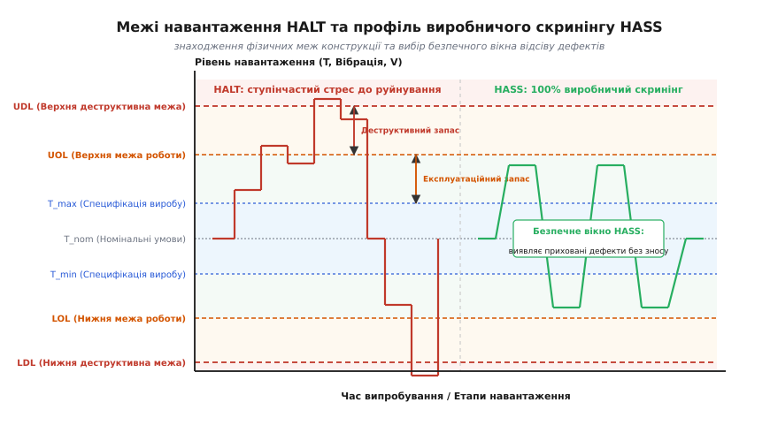
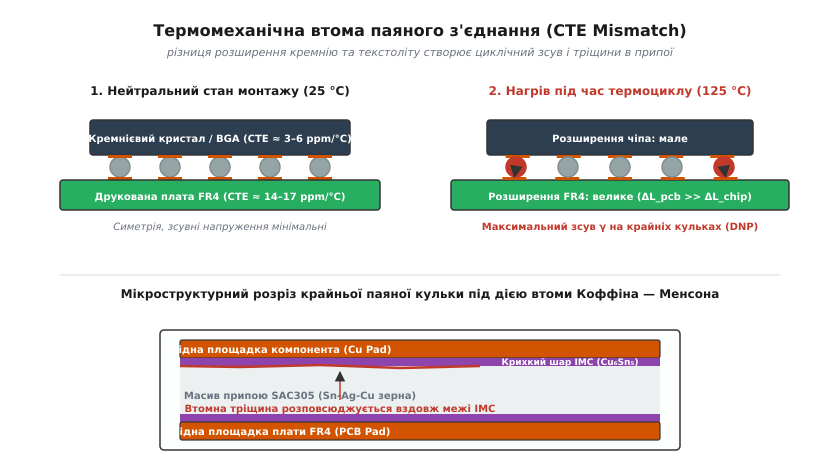
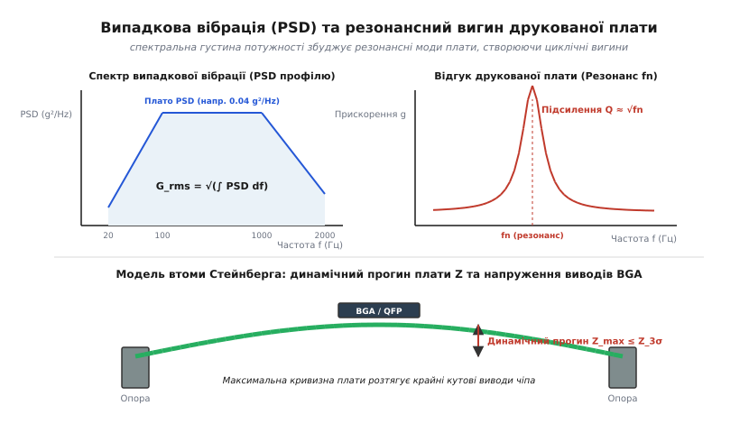
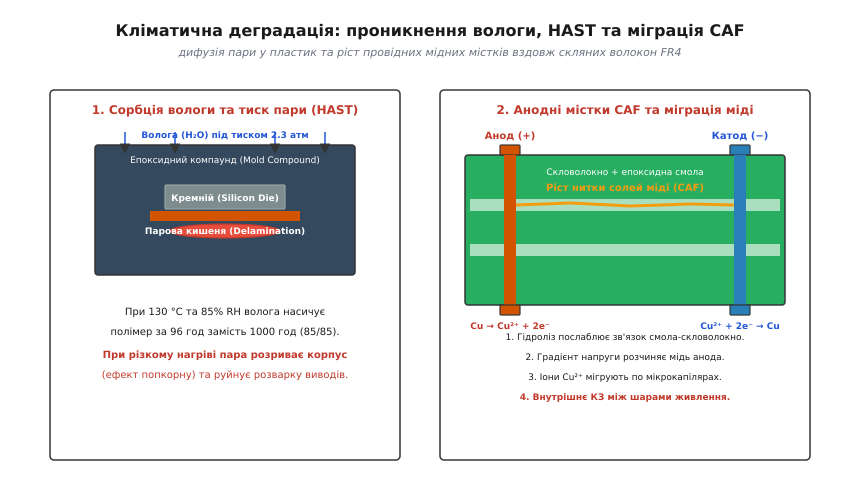

# Прискорені випробування: термоцикл, тряска, вологість

<preknowlist>
- [Евтектичні та безсвинцеві сплави](root:hw-pcb/eutectic-alloys) — мікроструктура припою SAC305, температури солідусу/ліквідусу та термомеханічна повзучість;
- [Структура шарів друкованої плати](root:hw-pcb/pcb-stackup) — коефіцієнти теплового розширення FR4 в осях X, Y, Z та вплив температури склування Tg;
- [Рівні чутливості до вологи (MSL)](root:hw-pcb/moisture-sensitivity-levels) — сорбція атмосферної вологи полімерами корпусів та механізми розшарування;
- [Кабелі й конектори](root:hw-pcb/cables-connectors) — конструкція контактних пар, зусилля утримання та мікропереміщення при вібрації.
</preknowlist>

Електронний блок керування, зібраний на столі розробника за кімнатної температури +22 °C, проходить усі функціональні тести без жодного збою. Проте після шести місяців експлуатації у польових умовах — наприклад, під капотом автомобіля, у неопалюваному промисловому шафі або на борту безпілотника — пристрій починає спорадично перезавантажуватися, втрачати зв'язок по шинах або повністю виходить з ладу. Розтин виявляє зрізані паяні кульки мікросхем BGA через термомеханічну втому, тріщини в керамічних конденсаторах MLCC біля отворів кріплення плати, міжшарові пробої через ріст мідних волокон або корозію контактів роз'ємів. Чекати п'ять або десять років реального часу в польових умовах, щоб перевірити надійність конструкції, комерційно неможливо.

Завдання прискорених випробувань — стиснути роки деградації компонентів, паяних з'єднань і текстоліту в десятки або сотні годин лабораторних тестів. При цьому інженер повинен суворо відокремлювати фізичне прискорення реальних механізмів відмови від штучного руйнування виробу нереалістичним стресом, якого ніколи не виникне в експлуатації.

---

## Філософія навантаження: знайти межі (HALT) чи відсіяти брак (HASS)

Традиційне тестування за стандартом «pass/fail» перевіряє, чи витримає плата заздалегідь визначений рівень стресу (наприклад, 100 циклів від −40 °C до +85 °C). Якщо виріб вижив, тест вважається успішним, але інженер залишається у невіданні: який реальний запас міцності має конструкція і яка саме ланка зламається першою при непередбаченому стрибку температури або вібрації.

Методологія HALT (англ. *Highly Accelerated Life Testing* — високоприскорені випробування на довговічність) має протилежну мету: не підтвердити працездатність, а примусово довести зразок до відмови. Випробування проводять на етапі розробки прототипу (DVT) за допомогою ступінчастого збільшення навантаження (step-stress):

1. **Ступінчастий холодний стрес**: температуру знижують кроками по 10 °C від кімнатної до −100 °C з витримкою на кожному кроці для контролю функціональності.
2. **Ступінчастий гарячий стрес**: температуру підвищують кроками по 10 °C до +150 °C чи вище, фіксуючи збої логіки та вихід параметрів за допуски.
3. **Швидкі термоцикли**: плату піддають термоударам зі швидкістю зміни температури від 40 °C/хв до 60 °C/хв за допомогою потужних повітряних потоків та рідкого азоту, провокуючи екстремальні градієнти температур між компонентами та текстолітом.
4. **Псевдовипадкова вібрація з шістьма ступенями вільності (6DoF)**: вібростенд з пневматичними молотками одночасно збуджує лінійні прискорення по осях X, Y, Z та обертальні моменти в діапазоні від 2 Гц до 10 000 Гц з середньоквадратичним прискоренням до 50–60 g_rms.
5. **Комбінований стрес**: одночасна дія швидких термоциклів, граничної вібрації, нестабільної напруги живлення та екстремальних тактових частот.


*Експлуатаційні та деструктивні межі у процесі HALT, формування безпечного коридору виробничого скринінгу HASS.*

Під час тесту HALT фіксують чотири критичні точки конструкції:

* **Нижня/Верхня експлуатаційна межа (LOL/UOL — Lower/Upper Operating Limit)**: рівень навантаження, за якого пристрій припиняє виконувати свої функції (наприклад, збивається тактовий генератор, зависає процесор через затримки в кремнії), але після повернення навантаження до нормального робочого діапазону працездатність повністю відновлюється без фізичного ремонту (*оборотна відмова*).
* **Нижня/Верхня деструктивна межа (LDL/UDL — Lower/Upper Destruct Limit)**: рівень навантаження, за якого у виробі виникають незворотні фізичні пошкодження (розрив кристала, відрив контактного майданчика, розшарування друкованої плати, розплавлення роз'єму), після яких пристрій не повертається до життя (*необоротна відмова*).

Різниця між граничними вимогами технічного завдання (специфікації) та деструктивними межами визначає **запас міцності конструкції (Design Margin)**. Якщо UOL лише на 5 °C перевищує максимальну робочу температуру за ТЗ, будь-який виробничий розкид параметрів компонентів призведе до масових відмов у споживача.

Коли фізичні межі знайдено і запас міцності розширено, на етапі серійного виробництва застосовують HASS (англ. *Highly Accelerated Stress Screening* — високоприскорений стресовий скринінг). Мета HASS — знайти приховані дефекти збирання, дефектні компоненти з мікротріщинами та неякісну пайку в 100% серійних виробів, перш ніж вони поїдуть замовнику.

Профіль HASS налаштовують на основі результатів HALT: рівні стресу встановлюють приблизно посередині між максимальною специфікацією та експлуатаційною межею (UOL/LOL). Проводять процедуру POSS (англ. *Proof of Screen*): зразок проганяють через профіль HASS від 10 до 20 разів поспіль і після цього перевіряють, що він не втратив більше 5% свого ресурсу втомної міцності. Тільки після такого калібрування скринінг стає безпечним інструментом фільтрації виробничого браку.

---

## Математичні моделі прискорення та коефіцієнт AF

Основа будь-якого прискореного випробування — **коефіцієнт прискорення (Acceleration Factor, AF)**. Він показує, у скільки разів швидше протікає процес деградації за стресових умов випробування порівняно з реальною експлуатацією:

```
AF = t_use / t_stress = N_use / N_stress
```

де `t_use` — час нормальної експлуатації, `t_stress` — необхідна тривалість випробування в камері, `N` — кількість циклів до відмови. Знаючи сумарний `AF`, інженер перераховує необхідний час тесту: `t_stress = t_use / AF`.

Оскільки різні фізичні фактори діють на різні матеріали плати, єдиної універсальної формули не існує. Застосовують специфічні моделі для температури, термоциклів та вологості.

### 1. Модель Арреніуса для температурного старіння

Модель названа на честь шведського фізикохіміка Сванте Арреніуса (*Svante Arrhenius*) і описує швидкість хімічних реакцій та дифузійних процесів. В електроніці її використовують для моделювання механізмів відмов, що активуються постійною високою температурою:

* Електроміграція атомів металу в доріжках мікросхем під дією високої густини струму (модель Блека);
* Деградація підзатворного діелектрика в часі (TDDB — *Time-Dependent Dielectric Breakdown*);
* Термічне старіння та деструкція епоксидної смоли текстоліту FR4;
* Окислення відкритих мідних провідників та контактів роз'ємів;
* Дифузія легуючих домішок у p-n переходах напівпровідників.

Швидкість деградації `k` підпорядковується експоненційному закону:

```
k = A · exp(-E_a / (k_B · T))
```

де `A` — емпірична константа частоти зіткнень, `E_a` — енергія активації процесу відмови в електрон-вольтах (еВ), `k_B = 8.617333 × 10⁻⁵` еВ/К — стала Больцмана (*Ludwig Boltzmann*), а `T` — абсолютна температура в Кельвінах (K = °C + 273.15).

Коефіцієнт прискорення за моделлю Арреніуса `AF_Arrhenius` визначається відношенням швидкостей реакції при стресовій температурі `T_stress` та експлуатаційній `T_use`:

```
AF_Arrhenius
= k_stress / k_use                                     [відношення швидкостей деградації]
= exp(-E_a / (k_B · T_stress)) / exp(-E_a / (k_B · T_use))  [підстановка закону Арреніуса]
= exp((E_a / k_B) · (1/T_use - 1/T_stress))           [зведення показників експоненти]
```

Значення енергії активації `E_a` обирають залежно від домінуючого механізму відмови:

| Механізм відмови | Типовий діапазон `E_a` (еВ) | Критичний вузол |
| :--- | :--- | :--- |
| Пробій діелектрика затвора (TDDB) | 0.60 – 0.75 | MOSFET, цифрові IC |
| Електроміграція в тонких плівках Al/Cu | 0.70 – 0.90 | Кристал кремнію |
| Поверхнева корозія та окислення | 0.45 – 0.60 | Відкриті площадки, роз'єми |
| Термічне розкладання полімерів FR4 | 0.85 – 1.10 | Друкована плата |
| Поширений стандартний консенсус JEDEC | 0.70 | Загальна кваліфікація IC |

**Числовий приклад розрахунку за Арреніусом:**
Необхідно підтвердити 10 років (87 600 годин) безперервної роботи промислового процесора за температури навколишнього середовища +45 °C (318.15 K). Випробування проводять у термокамері за температури +125 °C (398.15 K), прийнявши стандартну енергію активації `E_a = 0.7` еВ:

```
1/T_use - 1/T_stress
= 1/318.15 - 1/398.15                                  [різниця обернених температур]
= 0.00314317 - 0.00251162                              [десятковий запис дробів]
= 0.00063155 K⁻¹                                       [обчислення різниці]

(E_a / k_B) · (1/T_use - 1/T_stress)
= (0.7 / 8.617333·10⁻⁵) · 0.00063155                    [добуток енергетичного бар'єра]
= 8123.16 · 0.00063155                                 [розрахунок відношення Ea/kB]
= 5.1302                                               [обчислення показника степеня]

AF_Arrhenius
= exp(5.1302)                                          [піднесення до експоненти]
≈ 169.05                                               [значення коефіцієнта прискорення]
```

Тепер обчислюємо тривалість стрес-тесту:

```
t_stress
= t_use / AF_Arrhenius                                 [перерахунок часу за коефіцієнтом прискорення]
= 87600 год / 169.05                                   [підстановка 87600 годин і AF = 169.05]
≈ 518.2 години (≈ 21.6 доби)                           [тривалість випробування в камері]
```

Камера при +125 °C за 22 доби створює температурне старіння кристала, еквівалентне десяти рокам у полі при +45 °C.

---

### 2. Модель Коффіна — Менсона для низькоциклової втоми пайки

Постійна висока температура не моделює руйнування паяних з'єднань. Головний ворог пайки — періодична зміна температури (наприклад, циклічне вмикання/вимикання живлення або добові коливання день/ніч).

Коли температура зростає, матеріали друкованого вузла розширюються з різною швидкістю через невідповідність коефіцієнтів теплового розширення (КТР, англ. *CTE — Coefficient of Thermal Expansion*):

* Текстоліт FR4 у площині XY: `alpha_pcb ≈ 14–17 ppm/°C` (частин на мільйон на градус Цельсія);
* Кремнієвий кристал мікросхеми BGA: `alpha_Si ≈ 2.6–3.2 ppm/°C`;
* Керамічні резистори та конденсатори MLCC: `alpha_cer ≈ 6–8 ppm/°C`.


*Виникнення зсувних деформацій у паяних кульках BGA та розповсюдження тріщини біля інтерметалідного шару.*

Різниця КТР призводить до циклічної зсувної деформації (shear strain) `gamma` у кожній паяній кульці або галтелі виводу:

```
Delta L = (alpha_pcb - alpha_chip) · Delta T · L_dnp
gamma = Delta L / h_solder
```

де `L_dnp` — відстань від нейтральної точки симетрії компонента до крайнього виводу (DNP — *Distance to Neutral Point*), `h_solder` — висота паяного з'єднання, а `Delta T` — розмах коливань температури. Крайні кутові виводи BGA зазнають найбільшого зсуву.

Зсувна деформація накопичує мікропластичні пошкодження кристалічної решітки припою. За моделлю Коффіна — Менсона (*L. F. Coffin & S. S. Manson*), кількість циклів до руйнування `N_f` пов'язана з розмахом пластичної деформації:

```
N_f = C · (Delta epsilon_p)^(-m)
```

де `m` — показник втомної міцності припою. Для свинцевого евтектичного припою Sn63Pb37 `m ≈ 1.9–2.1`, а для безсвинцевого SAC305 (Sn-3.0Ag-0.5Cu) через його вищу жорсткість та інтерметаліди `m ≈ 2.5–2.7`.

Базовий коефіцієнт прискорення термоциклування Коффіна — Менсона має вигляд:

```
AF_CM = (Delta T_stress / Delta T_use)^m
```

де `Delta T_stress = T_max_stress - T_min_stress`, а `Delta T_use = T_max_use - T_min_use`.

#### Модифікація Норріса — Ландзберга

Базова модель Коффіна — Менсона не враховує два найважливіших явища у припоях:
1. **Повзучість припою (Creep)**: олово при кімнатній температурі перебуває вище половини своєї абсолютної температури плавлення (`T / T_melt > 0.65`), тому під механічним напруженням воно повільно «тече». Чим довше триває цикл (менша частота `f`), тим більша частка пружної енергії переходить у незворотну пластичну повзучість.
2. **Максимальна температура циклу `T_max`**: за високої температури прискорюється ріст крихких інтерметалідних фаз `Cu6Sn5` та `Cu3Sn`, уздовж яких швидко поширюються тріщини.

Модифікована модель Норріса — Ландзберга (*K. C. Norris & A. H. Landzberg*) об'єднує втому Коффіна — Менсона, частоту циклів та активаційне старіння Арреніуса:

```
AF_NL = (Delta T_stress / Delta T_use)^m · (f_use / f_stress)^n · exp((E_a / k_B) · (1/T_max_use - 1/T_max_stress))
```

де:
* `f_use` та `f_stress` — частота циклів (наприклад, циклів на добу або циклів на годину);
* `n ≈ 0.33` — емпіричний показник частотної релаксації для безсвинцевих припоїв SAC;
* `E_a ≈ 0.122` еВ — енергія активації самодифузії та релаксації напружень в олов'яних сплавах.

**Числовий приклад розрахунку за Норрісом — Ландзбергом:**
Автомобільний блок у реальних умовах зазнає 3 циклів на добу (`f_use = 3` циклів/добу = 0.125 циклів/год) з розмахом `Delta T_use = 40` °C (від +10 °C до +50 °C, тобто `T_max_use = 323.15` K). Випробування проводять у камері швидкого термоциклування з профілем від −40 °C до +125 °C (`Delta T_stress = 165` °C, `T_max_stress = 398.15` K), де один повний цикл триває 60 хвилин (`f_stress = 1.0` циклів/год = 24 циклів/добу). Для припою SAC305 беремо `m = 2.65`, `n = 0.33`, `E_a = 0.122` еВ.

```
Складова розмаху температур (Coffin-Manson):
(Delta T_stress / Delta T_use)^m
= (165 / 40)^2.65                                      [підстановка температурних розмахів]
= (4.125)^2.65                                         [ділення значень у дужках]
≈ 43.14                                                [піднесення до степеня втоми m=2.65]

Складова частоти циклів (Creep relaxation):
(f_use / f_stress)^n
= (3 / 24)^0.33                                        [підстановка частот циклів на добу]
= (0.125)^0.33                                         [ділення частот]
≈ 0.505                                                [піднесення до показника повзучості n=0.33]

Складова максимальної температури (Arrhenius):
1/T_max_use - 1/T_max_stress
= 1/323.15 - 1/398.15                                  [різниця обернених максимальних температур]
= 0.0030945 - 0.0025116                                [десятковий запис]
= 0.0005829 K⁻¹                                        [обчислення різниці]

exp((0.122 / 8.617333·10⁻⁵) · 0.0005829)
= exp(1415.75 · 0.0005829)                             [розрахунок відношення Ea/kB]
= exp(0.8252)                                          [обчислення аргументу експоненти]
≈ 2.282                                                [значення температурного множника]

Підсумковий коефіцієнт прискорення:
AF_NL
= 43.14 · 0.505 · 2.282                                [добуток трьох складових моделі]
≈ 49.72                                                [сумарний коефіцієнт прискорення]
```

Якщо за ТЗ блок повинен витримати 10 років експлуатації (10 950 польових циклів), необхідна кількість циклів у термокамері складає:

```
N_stress
= N_use / AF_NL                                        [перерахунок кількості циклів за коефіцієнтом прискорення]
= 10950 / 49.72                                        [підстановка 10950 польових циклів і AF = 49.72]
≈ 220 циклів                                           [необхідне число циклів у термокамері]
```

220 годинних циклів (близько 9 діб у камері) повністю покривають десятирічний ресурс пайки.

---

### 3. Модель Пека для вологості та температури

Волога викликає гідроліз полімерних корпусів, розшарування шарів плати, корозію алюмінієвих площадок кристалів та електрохімічну міграцію міді (CAF). Прискорення вологості моделюють за формулою Пека (*C. S. Peck*):

```
AF_Peck = (RH_stress / RH_use)^n · exp((E_a / k_B) · (1/T_use - 1/T_stress))
```

де `RH` — відносна вологість у відсотках (наприклад, 85% RH → 85), `n ≈ 2.7–3.0` — степеневий показник вологості, а `E_a ≈ 0.75–0.90` еВ — енергія активації корозійних та міграційних процесів у присутності вологи.

---

## Механічні випробування: випадкова вібрація, резонанси та модель Стейнберга

Вібраційні навантаження в реальному житті — на автомобілі, бронетехніці, літаку або залізниці — мають стохастичний (випадковий) характер. Синусоїдальний тест фіксованої частоти непридатний, оскільки він збуджує лише окремі точки конструкції.

Для випробувань використовують **випадкову вібрацію (Random Vibration)**, де коливання одночасно відбуваються на всіх частотах у заданій смузі (зазвичай від 10 Гц до 2000 Гц).


*Спектр вібраційного навантаження (PSD) та розподіл амплітуди вигину друкованої плати на першій резонансній моді.*

### Спектральна густина потужності (PSD)

Інтенсивність випадкової вібрації задають через спектральну густину потужності прискорення (англ. *Power Spectral Density, PSD*) в одиницях `g²/Hz`.

Сумарне середньоквадратичне прискорення вібропрофілю `G_rms` розраховують інтегруванням PSD за спектром частот:

```
G_rms = sqrt(integral_{f1}^{f2} PSD(f) df)
```

Для простого трапецеїдального профілю (ділянка підйому +3 дБ/октаву, плато `PSD_0`, спад −6 дБ/октаву) інтеграл обчислюють аналітично або сумою за смугами.

### Модель Стейнберга для втомного прогину плати

Коли частоти вібрації збігаються з власною частотою друкованої плати `f_n`, плата входить у резонанс. Її центральна частина починає вигинатися з амплітудою, що в `Q = sqrt(f_n)` разів перевищує вхідне прискорення стенду.

Вигин друкованої плати створює циклічний кутовий натяг та розрив виводів компонентів. Американський інженер Дейв Стейнберг (*Dave S. Steinberg*) вивів інженерний критерій максимального допустимого динамічного прогину плати `Z_3sigma` в дюймах у центрі плати для витримування 20 мільйонів циклів вібрації:

```
Z_3sigma = 0.00022 · B / (c · L · sqrt(t))
```

де:
* `B` — довжина короткої сторони прямокутної плати (дюйми);
* `L` — максимальна довжина корпусу компонента (дюйми);
* `t` — товщина друкованої плати (дюйми, наприклад 0.062" для 1.6 мм);
* `c` — коефіцієнт типу корпусу компонента:
  * `c = 1.0` для стандартних BGA;
  * `c = 1.26` для керамічних безвивідних LCC;
  * `c = 1.75` для мікросхем SOIC та QFP з J-виводами;
  * `c = 2.25` для компонентів з виводами типу «крило чайки» (Gull-wing QFP).

Власна резонансна частота плати на чотирьох кутових опорах оцінюється як:

```
f_n = (pi / 2) · sqrt(D / mu) · ((1/a²) + (1/b²))
```

де `D = E · t³ / (12 · (1 - nu²))` — циліндрична жорсткість плати на згин (`E` — модуль Юнга FR4 ≈ 22 ГПа, `nu` — коефіцієнт Пуассона ≈ 0.14), `mu` — маса плати на одиницю площі, `a` і `b` — габарити плати.

Якщо фактичний динамічний прогин `Z_actual = 3 · sqrt((pi / 2) · PSD(f_n) · f_n · Q) / (2 · pi · f_n)²` перевищує розрахований `Z_3sigma`, кутові кульки BGA тріснуть протягом перших кількох годин тряски. Рішення — додати додаткові механічні стійки кріплення посередині плати або збільшити товщину текстоліту з 1.6 мм до 2.0 мм.

---

### Механічний удар (Shock Testing)

Випробування на удар (стандарти MIL-STD-810H Метод 516.8, IEC 60068-2-27) симулюють падіння виробу, віддачу при пострілі або розкриття піропатронів.

Типові параметри імпульсу:
* **Форма**: напівсинусоїда (half-sine) або пилкоподібна (sawtooth);
* **Пікове прискорення**: від 30 g (11 мс) для цивільного транспорту до 500–1500 g (0.5–1.0 мс) для портативної електроніки та ракетних систем;
* **Кількість ударів**: по 3 удари в прямому та зворотному напрямках уздовж трьох взаємно перпендикулярних осей (всього 18 ударів).

Головні дефекти удару — зріз масивних індуктивностей та електролітичних конденсаторів з плати через інерцію, розтріскування крихких керамічних конденсаторів MLCC біля гвинтів та виривання роз'ємів. Для важких компонентів масою понад 5 г обов'язкова фіксація силіконовим або епоксидним компаундом (staking).

---

## Кліматичні стрес-тести: вологе тепло, HAST та соляний туман


*Проникнення вологи під тиском, електрохімічна міграція міді та ріст волоконних містків CAF у склотекстоліті.*

### 1. Випробування вологим теплом (Damp Heat 85/85)

Класичний тест «85/85» (JEDEC JESD22-A101) передбачає витримку плати за температури +85 °C та відносної вологості 85% RH протягом 1000 годин під електричним зміщенням (THB — *Temperature-Humidity-Bias*).

При такій температурі водяна пара дифундує крізь молекулярну сітку епоксидного компаунда мікросхем за 200–300 годин, досягаючи кремнієвого кристала. Якщо на кристалі є сліди хлоридів або іонів натрію від флюсу, утворюється електроліт, який за наявності напруги живлення розчиняє алюмінієву металізацію за лічені години.

### 2. Автоклавний тест HAST (Highly Accelerated Temperature/Humidity Stress Test)

1000 годин (понад 41 добу) у камері 85/85 — надто довго для швидкої розробки. Стандарт JEDEC JESD22-A110 регламентує випробування HAST: зразки поміщають у герметичний автоклав під надлишковим тиском пари:

* **Температура**: +130 °C;
* **Вологість**: 85% RH;
* **Абсолютний тиск пари**: 230 кПа (≈ 2.3 атмосфери);
* **Тривалість**: 96 годин.

Завдяки надлишковому тиску водяна пара примусово заганяється в пори матеріалу. 96 годин HAST при +130 °C та 85% RH за моделлю Пека еквівалентні 1000 годинам стандартного тесту 85/85.

Розрізняють два типи HAST:
1. **Unbiased HAST (JESD22-A118)**: без подачі живлення. Виявляє вологопоглинання, розшарування (деламінацію) компаунда від підкладки та ефект «попкорну».
2. **Biased HAST (JESD22-A110)**: під номінальною напругою живлення. Виявляє електрохімічну міграцію, струми витоку та корозію шин живлення.

### 3. Електрохімічна міграція та утворення анодних містків (CAF)

У багатошарових друкованих платах найнебезпечнішим дефектом вологості є CAF (англ. *Conductive Anodic Filamentation* — провідні анодні нитки).

Механізм CAF розвивається у чотири стадії:
1. **Гідролітична деструкція**: волога розриває хімічний зв'язок (силанове зшивання) між епоксидною смолою та скляними нитками тканини FR4, утворюючи субмікронні капіляри вздовж скловолокна.
2. **Анодне розчинення міді**: на перехідному отворі з позитивним потенціалом під дією кислого середовища мідь окислюється:
   ```
   Cu → Cu²⁺ + 2e⁻
   ```
3. **Електроміграція іонів**: під дією градієнта електричного поля іони `Cu²⁺` мігрують по мікрокапілярах від анодного отвору до сусіднього катодного отвору (землі або мінусової шини).
4. **Осадження солей міді**: біля катода іони міді контактують з гідроксид-іонами `OH⁻`, утворюючи нерозчинні провідні кристали солей `Cu(OH)2` та `CuO`. Волокно проростає, утворюючи глухе коротке замикання між внутрішніми шарами плати з вигоранням діелектрика.

Для запобігання CAF обирають матеріали FR4 з анти-CAF просоченням (*anti-CAF glass fabric*), збільшують мінімальну відстань між стінками отворів (hole-to-hole clearance) до ≥ 0.5 мм і уникають розташування сусідніх перехідних отворів строго вздовж однієї нитки основи склотканини (рекомендується поворот сітки на 45°).

### 4. Соляний туман (Salt Spray / Fog)

Випробування соляним туманом (стандарти ASTM B117, ISO 9227, IEC 60068-2-11) проводять у камері, де за температури +35 °C безперервно розпилюють 5% водний розчин хлориду натрію (NaCl).

Тест оцінює корозійну стійкість зовнішніх роз'ємів, корпусів та ефективність конформного покриття плати:
* **HASL (SnPb / безсвинцевий)**: утворює оксидні плівки олова, стійкість середня (48–96 годин).
* **ENIG (електрохімічний нікель / імерсійне золото)**: пори в тонкому шарі золота (0.05 мкм) створюють гальванічну пару з підлеглим нікелем; при поганій якості золочення нікель швидко піддається точковій корозії (black pad).
* **Конформні лаки**: акрилові лаки захищають від прямого попадання крапель, але проникні для пари; поліуретанові та силіконові лаки забезпечують високий бар'єр; найкращий захист дає вакуумне напилення парилену (Parylene C/N) товщиною 10–25 мкм.

---

## Інженерний калькулятор коефіцієнтів прискорення випробувань на C та C++

Для автоматизації розрахунку планів випробувань нижче наведено закінчену бібліотеку-калькулятор коефіцієнтів Арреніуса, Коффіна — Менсона, Норріса — Ландзберга та Пека з перерахунком часу лабораторного тестування.

:::tabs
:::code pryskoreni-vyprobuvannia-d/c/main.c
:::code pryskoreni-vyprobuvannia-d/cpp/main.cpp
:::

---

> 🔧 **Навіщо це.**
>
> Проведення прискорених кліматичних та механічних випробувань дозволяє:
> 1. **Виявити конструктивні слабкі місця на стадії DVT**: різниця КТР між великими BGA та FR4, резонанси непідкріплених ділянок друкованої плати, розтріскування MLCC біля гвинтів та чутливість топології до CAF виявляються за лічені тижні до запуску прес-форм і серійного замовлення компонентів.
> 2. **Математично обґрунтувати гарантійний термін**: за допомогою коефіцієнтів Арреніуса, Норріса — Ландзберга та Пека інженер підтверджує надійність на 5, 10 або 15 років експлуатації випробуваннями тривалістю 200–500 годин.
> 3. **Впровадити безпечний скринінг браку HASS**: калібрування профілю скринінгу відсіває 100% прихованого виробничого браку (непропаї, тріщини кристалів, дефекти металізації) без витрати ресурсу втомної міцності приладу.
