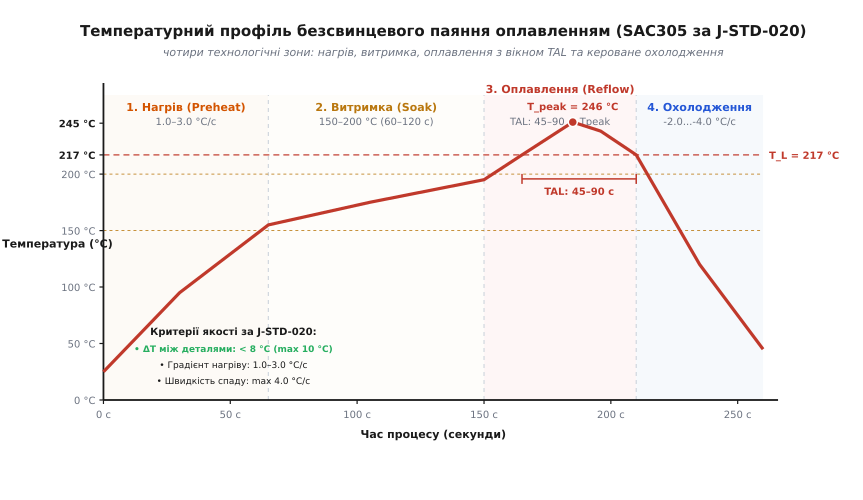
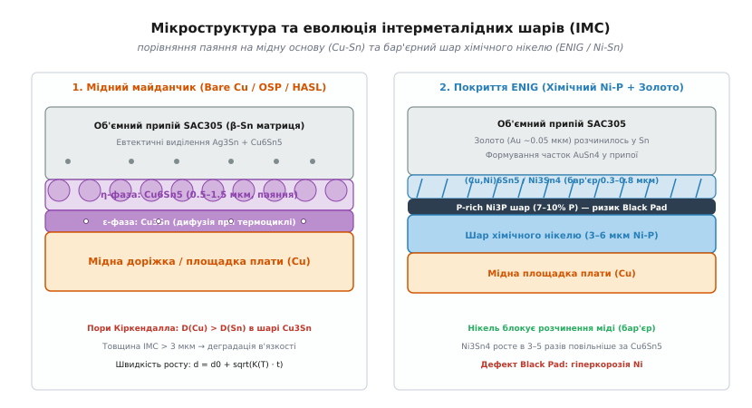

# Паяння оплавленням (Reflow Soldering)

<preknowlist>
- [Шарування плати (PCB stackup)](root:hw-pcb/pcb-stackup) — структура шарів міді, діелектрика FR-4 та теплопровідність основи.
- [Проєктування посадкових місць (Footprint Design)](root:hw-pcb/footprint-design) — розрахунок геометрії контактних площадок за IPC-7351 та баланс натягу.
- [Евтектичні сплави та припої](root:hw-pcb/eutectic-alloys) — фазові діаграми, ліквідус, солідус та поверхневий натяг розплавів.
- [Трафарети для SMD](root:hw-pcb/smd-stencil) — реологія паяльної пасти, апертури трафарету та об'єм нанесеного припою.
- [Рівні чутливості до вологи (MSL)](root:hw-pcb/moisture-sensitivity-levels) — поглинання вологи корпусами мікросхем та ефект попкорнінгу.
- [Основи паяння](root:hw-pcb/basic-soldering) — термодинаміка змочування, дія флюсів та капілярні явища.
- [Теплові перехідні отвори](root:hw-pcb/thermal-vias) — відведення тепла через масиви металізованих отворів під падами.
</preknowlist>

Партія з трьохсот восьмишарових плат процесорного модуля промислового контролера проходить через конвеєрну піч оплавлення припою, проте під час вихідного оптичного та рентгенівського контролю (AXI) лінія фіксує 41% браку. На кутових виводах мікропроцесора в корпусі BGA-484 з кроком кульок 0.8 мм виявлено дефект «голова на подушці» (англ. *Head-in-Pillow*): кулька припою на виводі мікросхеми розплавилася, але не злилася з пастою на контактному майданчику плати через передчасне вигорання флюсу під час затягнутої температурної витримки. Одночасно половина керамічних конденсаторів типорозміру 0402 стала дибки (*tombstoning*), оскільки швидкість наростання температури перевищила 3.5 °C/с і створила часовий розрив у розплавленні протилежних контактів, а під центральними тепловідвідними площадками силових стабілізаторів QFN-32 площа газових каверн (пустот) сягнула 48%, унеможлививши паспортне розсіювання тепла.

Ця технологічна аварія виникла через те, що піч запустили за усередненим заводським шаблоном без побудови термодинамічного профілю плати, розрахунку швидкостей нагріву `dT/dt`, аналізу хімічної активності флюсу та врахування різниці теплових мас масивних котушок індуктивності й мініатюрних чип-компонентів.

---

### Фізика процесу оплавлення та термодинаміка змочування

Паяння оплавленням (англ. *Reflow Soldering*) є домінуючим технологічним методом групового монтажу компонентів поверхневого монтажу (SMD/SMT) на друковану плату. На відміну від ручного паяння паяльником чи паяння хвилею припою, де рідкий метал подається ззовні до попередньо розігрітого вузла, процес оплавлення базується на попередньому нанесенні дозованого об'єму паяльної пасти на контактні площадки через трафарет, встановленні компонентів автоматичним маніпулятором (*Pick-and-Place*) та наступному контрольованому нагріванні всього складального вузла в печі.

Паяльна паста є гетерогенною тиксотропною суспензією, яка складається з двох ключових компонентів:
1. **Металевий порошок (85–90% за масою, ~50% за об'ємом)** — мікроскопічні сферичні гранули безсвинцевого або свинцевого припою стандартизованого гранулометричного складу (за стандартом IPC J-STD-005 типорозмір Type 4 має діаметр сфер 20–38 мкм, Type 5 — 15–25 мкм).
2. **Флюсовий гель-носій (10–15% за масою)** — матриця з термостійких каніфолей або синтетичних смол, органічних кислотних активаторів (дикарбонові кислоти, адипінова, бурштинова кислоти), тиксотропних реологічних модифікаторів та високомолекулярних розчинників.

Перетворення сипкої пастоподібної маси на монолітний металургійний шов підпорядковується законам термодинаміки міжфазних поверхонь. Коли температура сягає точки плавлення сплаву, мікросфери переходять у рідкий стан і прагнуть мінімізувати свою вільну поверхневу енергію. Змочування твердого металу контактної площадки (міді, нікелю) рідким припоєм описується класичним термодинамічним рівнянням Юнга-Дюпре:

```
cos(θ) = (γ_sv - γ_sl) / γ_lv    [термодинамічна рівновага сил Юнга-Дюпре]
```

де:
- `θ` — крайовий кут змочування меніска розплавленого припою;
- `γ_sv` — питома вільна поверхнева енергія на межі «твердий метал — газова фаза печі»;
- `γ_sl` — міжфазний натяг на контакті «твердий метал — рідкий припій»;
- `γ_lv` — поверхневий натяг рідкого припою на межі з газовою атмосферою.

Для отримання якісного паяного шва крайовий кут змочування має становити `θ ≤ 30°` (ідеальне змочування `θ → 0°`). Якщо на поверхні мідної доріжки залишається плівка оксиду міді (CuO або Cu₂O), вільна енергія `γ_sv` падає з 1.3 Дж/м² до мізерних 0.2 Дж/м², через що чисельник стає від'ємним, `cos(θ) < 0`, кут перевищує 90°, і рідкий припій стягується в ізольовані сферичні краплі, відмовляючись розтікатися по контактному майданчику (дефект незмочування, англ. *non-wetting* або *dewetting*).


*Чотири технологічні зони температурного профілю оплавлення за J-STD-020. Крива нагріву безсвинцевого сплаву SAC305: зона попереднього прогріву (Preheat) для захисту від термоудару, ізотермічна витримка (Soak) для активації флюсу та вирівнювання температур, пікове оплавлення (Reflow) з вікном TAL та кероване охолодження (Cooling) для формування дрібнозернистої структури.*

Головна хімічна функція флюсу під час термопрофілю полягає в розчиненні оксидів та зниженні міжфазного натягу `γ_sl` і `γ_lv`. Органічні кислоти вступають у реакцію з оксидами металів за підвищеної температури 140–190 °C:

```
CuO + 2 R-COOH  = Cu(R-COO)₂ + H₂O↑    [розчинення оксиду міді активатором флюсу]
SnO₂ + 4 R-COOH = Sn(R-COO)₄ + 2 H₂O↑  [розчинення оксиду олова активатором флюсу]
```

Утворені солі металів розчиняються в каніфольній матриці флюсу, оголюючи чистий ювенільний метал контактної площадки з високою поверхневою енергією `γ_sv`, що забезпечує миттєве змочування та розтікання рідкого сплаву під дією сил капілярного стягування.

---

### Анатомія температурного профілю за стандартом IPC/JEDEC J-STD-020

Температурний профіль оплавлення (англ. *Reflow Profile*) — це часова залежність температури в характерних точках друкованого вузла при його русі крізь нагрівальні зони печі. Міжнародні стандарти **IPC/JEDEC J-STD-020** (класифікація вологочутливості та термостійкості компонентів) та **IPC-7530** (керівництво з побудови температурних профілів) регламентують чотири обов'язкові технологічні зони:

| Технологічна зона | Температурний діапазон (SAC305) | Швидкість зміни або тривалість | Фізико-хімічні процеси, що відбуваються |
|---|---|---|---|
| **1. Попередній нагрів (Preheat)** | від 25 °C до 150 °C | Градієнт +1.0...+3.0 °C/с | Плавне випаровування легких фракцій розчинника, запобігання тепловому шоку кераміки та попкорнінгу пластикових корпусів. |
| **2. Витримка (Soak / Activation)** | від 150 °C до 200 °C | Тривалість 60–120 с | Хімічне розчинення оксидів кислотними активаторами флюсу, релаксація термомеханічних напружень, мінімізація градієнта ΔT між важкими та легкими деталями. |
| **3. Оплавлення (Reflow Peak)** | вище T_L = 217 °C (пік 240–255 °C) | TAL = 45–90 с, пік на 10–20 с | Фазовий перехід тверде-рідке, капілярне втягування припою у зазори, автоцентрування деталей, розчинення підкладки та ріст інтерметалідів Cu₆Sn₅. |
| **4. Охолодження (Cooling)** | від T_peak до 50 °C | Градієнт -2.0...-4.0 °C/с (max -6 °C/с) | Кристалізація сплаву, формування дрібнодисперсної евтектичної структури β-Sn + Ag₃Sn, запобігання росту крихких голчастих кристалів. |

#### Зона 1: Попередній нагрів (Preheat / Ramp-to-Soak)

Початкова ділянка термопрофілю підіймає температуру друкованої плати від кімнатної (25 °C) до температури початку активності флюсу (150 °C). Ключовим фізичним параметром цієї зони є швидкість зміни температури за часом:

```
dT/dt = const ∈ [+1.0, +3.0] °C/с    [технологічне вікно зони попереднього прогріву]
```

Якщо градієнт нагріву перевищує безпечну межу в +3.0 °C/с, складальний вузол зазнає двох руйнівних дефектів:
1. **Термічний шок керамічних конденсаторів (MLCC).** Багатошарові керамічні чип-конденсатори виготовляються на основі титанату барію (BaTiO₃), який має низьку теплопровідність (близько 2.5 Вт/(м·К)) та високу крихкість. При занадто стрімкому зовнішньому нагріванні зовнішні металізовані обкладки розширюються значно швидше, ніж внутрішнє керамічне осердя. Виникають колосальні внутрішні розтягувальні механічні напруження, що призводить до утворення невидимих мікротріщин у кераміці. Такий конденсатор успішно проходить вихідне тестування на заводі, проте через 100–500 годин експлуатації під напругою волога проникає крізь мікротріщину, викликаючи пробій, коротке замикання шини живлення та термічне вигорання плати.
2. **Розбризкування паяльної пасти (Solder Splattering) та утворення кульок (Solder Balls).** У складі паяльної пасти присутні леткі органічні розчинники з температурами кипіння 100–140 °C. Якщо швидкість прогріву перевищує 3 °C/с, розчинник у глибині шару пасти закипає вибухоподібно, не встигаючи плавно дифундувати на поверхню. Тиск пари розриває масу пасти та розкидає мікрокульки припою навколо контактної площадки на відстань до 1–3 мм. Після оплавлення ці кульки залишаються на паяльній масці та створюють паразитні замикання між сусідніми виводами мікросхем із дрібним кроком.

#### Зона 2: Температурна витримка (Soak / Thermal Equilibrium)

Зона ізотермічної або полого-нахиленої витримки в діапазоні 150–200 °C тривалістю від 60 до 120 секунд виконує дві критичні інженерні задачі: вирівнювання теплового балансу та хімічну підготовку поверхонь.

На друкованій платі одночасно встановлені компоненти з кардинально різною теплоємністю та геометричними розмірами: крихітний резистор типорозміру 0201 масою 0.2 мг і масивний екранований дросель живлення масою 15 г, розташований на суцільному мідному полігоні живлення товщиною 70 мкм. Завдяки різниці теплоємностей (`C = m · c_p`) температура резистора під дією конвекційного потоку зростає значно швидше за температуру важкого дроселя.

Різниця температур між найгарячішою точкою плати (кутовий пасивний компонент) та найхолоднішою точкою (центральний контакт під масивною мікросхемою BGA) позначається як `ΔT`:

```
ΔT = T_max - T_min    [різниця температур між крайніми точками плати]
```

У зоні Soak швидкість конвекційного нагріву сповільнюється до 0.5–0.8 °C/с або переходить у плато. За час витримки 60–120 с тепло за рахунок теплопровідності мідних внутрішніх шарів склотекстоліту FR-4 рівномірно перерозподіляється по всій площі плати, знижуючи значення `ΔT` до безпечної величини менше 5–8 °C перед входом у зону фазового переходу.

Паралельно в зоні витримки повністю випаровуються залишкові фракції рідких розчинників, а каніфоль та синтетичні кислоти розм'якшуються, покривають контактні майданчики суцільним захисним шаром, розчиняють окисні плівки та запобігають повторному окисненню металу киснем повітря печі.

> [!WARNING]
> **Небезпека затягнутої витримки (Over-soaking).** Якщо час витримки перевищує 120–150 секунд, захисні кислотні активатори флюсу повністю виснажуються та окиснюються киснем атмосфери печі ще до моменту розплавлення припою. У результаті при досягненні пікової температури розплавлений метал не змочує окислені виводи, викликаючи масові дефекти холодного паяння, відсутність галтелей та ефект *Head-in-Pillow* на мікросхемах BGA.

#### Зона 3: Оплавлення та час перебування вище ліквідусу (Reflow Peak & TAL)

Зона оплавлення — це високотемпературна ділянка печі, де відбувається безпосереднє формування паяних з'єднань. Головними технологічними параметрами зони є час над ліквідусом (англ. *Time Above Liquidus*, TAL) та абсолютна пікова температура (`T_peak`).

Для класичного безсвинцевого сплаву SAC305 (`96.5% Sn, 3.0% Ag, 0.5% Cu`) температура ліквідус становить `T_L = 217 °C`. Стандарт IPC/JEDEC J-STD-020 жорстко лімітує часове вікно TAL:

```
TAL = t(T ≥ 217 °C) = 45...90 с    [вікно перебування сплаву в рідкій фазі]
```

Пікова температура плати `T_peak` повинна перебувати в діапазоні 240–250 °C (абсолютний технологічний коридор становить 235–260 °C). 

Нижня температурна межа (235 °C) диктується необхідністю перегріву розплаву на `ΔT_superheat = 15...25 °C` вище точки ліквідус 217 °C. Цей перегрів є обов'язковим для:
- Зниження динамічної в'язкості рідкого олова;
- Забезпечення високої капілярної текучості для затікання припою під безвивідні корпуси QFN, DFN, BGA;
- Інтенсифікації термодинамічної дифузії олова в мідь для формування міцного інтерметалідного шару.

Верхня температурна межа (260 °C) визначається граничною термостійкістю корпусів напівпровідникових мікросхем, роз'ємів, світлодіодів та електролітичних конденсаторів. Перевищення позначки 260 °C викликає незворотну деструкцію епоксидного компаунда мікросхем, термічне розшарування склотекстоліту плати (розрив зв'язків між склотканиною та смолою, англ. *delamination*) та деформацію пластикових ізоляторів роз'ємів.

#### Вплив структури шарування плати (PCB Stackup) на теплову інерцію

Теплова поведінка друкованої плати в конвекційній печі критично залежить від її конструктиву та розподілу міді по шарах. Теплопровідність чистого склотекстоліту FR-4 уздовж волокон становить лише близько 0.8–1.0 Вт/(м·К), а поперек шарів (крізь товщину діелектрика) — мізерні 0.3 Вт/(м·К). Натомість теплопровідність електролітичної міді сягає 390 Вт/(м·К), що у 1300 разів вище за діелектрик.

У простих 2-шарових платах товщиною 1.6 мм із рідким сигнальним трасуванням теплопередача у поперечному напрямку відбувається повільно, проте через малу сумарну теплоємність плата прогрівається швидко. На такій платі існує високий ризик локального перегріву тонких сигнальних ділянок вище 255 °C при налаштуванні печі під окремі масивні електролітичні конденсатори.

У складних 8–16-шарових платах серверного та промислового призначення присутні 4–8 суцільних внутрішніх шарів заземлення та живлення товщиною 35–70 мкм. Ці суцільні мідні площини діють як потужні теплові колектори, миттєво поглинаючи тепло з поверхні та розподіляючи його по всьому об'єму плати. Повна теплоємність такого багатошарового вузла зростає у 3–5 разів. Якщо піч налаштована за стандартним профілем легкої плати, внутрішні шари та виводи BGA під центром масивного кристала не встигають нагрітися до температури ліквідус 217 °C за час проходження зони Reflow, що призводить до масового браку холодного паяння. Для таких плат інженери застосовують подовжену зону Soak (до 100–110 с) та підвищену швидкість конвекційного обдування для інтенсифікації теплообміну.

#### Вологочутливість компонентів (MSL) та механіка «ефекту попкорнінгу»

Пластикові епоксидні компаунди, якими заливаються кристали мікросхем у корпусах QFP, BGA, QFN, SOIC, є гігроскопічними полімерами. Під час зберігання на відкритому повітрі цеху пластик поглинає вологу з навколишнього середовища. Стандарт IPC/JEDEC J-STD-020 класифікує компоненти за рівнями вологочутливості від MSL 1 (необмежений термін життя на відкритому повітрі при відносній вологості до 85%) до MSL 6 (обов'язкове попереднє сушіння перед кожним монтажем).

Якщо мікросхема класу MSL 3–5 провела на повітрі більше допустимого часу (Floor Life, наприклад, понад 168 годин для MSL 3), волога накопичується у мікропорах компаунда безпосередньо під кристалотримачем або кремнієвим кристалом. Коли плата потрапляє в зону Reflow Peak і розігрівається до 245–260 °C, накопичена рідка волога миттєво перетворюється на перегріту пару. Оскільки об'єм пари у сотні разів перевищує об'єм рідини, внутрішній тиск пари під кристалом сягає 3–5 МПа (30–50 атмосфер).

Цей колосальний тиск призводить до вибухоподібного розтріскування корпусу мікросхеми — явища, відомого як **ефект попкорнінгу** (англ. *Popcorning*). Наслідки попкорнінгу:
- Внутрішнє розшарування компаунда від металевого тепловідводу (Delamination);
- Розрив мікрозварних золотих або мідних провідників (Wire Bonds), що з'єднують кристал із виводами рамки;
- Виникнення наскрізних тріщин у пластиковому корпусі, крізь які в процесі подальшої експлуатації проникають волога та солі, викликаючи корозію кристала.

Для запобігання попкорнінгу всі розкриті котушки з мікросхемами контролюються за часом перебування в цеху, а перед паянням проходять технологічний цикл дегазаційного сушіння у термошафах при температурі 125 °C протягом 24–48 годин за стандартом J-STD-033.

#### Зона 4: Кероване охолодження (Cooling Zone)

Після виходу з пікової зони оплавлена плата потрапляє в зону примусового охолодження вентиляторами або охолоджуваними теплообмінниками. Швидкість охолодження безпосередньо формує внутрішню кристалічну мікроструктуру паяного з'єднання.

Оптимальна швидкість спаду температури становить:

```
dT/dt = -2.0 ... -4.0 °C/с    [нормативна швидкість гартування структури шва]
```

(максимально допустима за стандартом — до -6.0 °C/с).

Фізичний вплив швидкості охолодження на мікроструктуру:
- **Швидке охолодження (-2.0...-4.0 °C/с).** Швидкий перехід через температуру кристалізації створює умови високого переохолодження розплаву, що викликає масове зародження центрів кристалізації. Формується надзвичайно дрібнозерниста рівномірна евтектична матриця з кристалів β-Sn із рівномірно вкрапленими дрібними виділеннями інтерметалідів Ag₃Sn та Cu₆Sn₅. Такий паяний шов має гладку дзеркальну поверхню, високу пластичність, високу втомну міцність і максимальний опір циклічним температурним навантаженням.
- **Повільне охолодження (< 1.0 °C/с).** За повільного відведення тепла кристали олова встигають вирости у великі дендритні зерна, розділені міжкристалітними межами. Інтерметаліди срібла Ag₃Sn формують довгі голчасті або пластинчасті кристали великого розміру. Велика пластинчаста фаза Ag₃Sn діє як концентратор механічних напружень: під час вібрацій або температурного розширення плати тріщини зароджуються саме вздовж граней цих пластин, що призводить до швидкого втомного руйнування шва.

---

### Металургія інтерметалідних сполук (IMC) та надійність з'єднання

Міцність паяного контакту базується не на механічному прилипанні припою до міді, а на утворенні хімічного металургійного зв'язку — шару інтерметалідних сполук (англ. *Intermetallic Compounds, IMC*).


*Металургія формування та росту інтерметалідних сполук (IMC) на контактних майданчиках. Ліворуч: класична мідна основа (Cu-Sn) з формуванням стовпчастої η-фази Cu₆Sn₅ під час паяння, ростом плоскої ε-фази Cu₃Sn та порами Кіркендалла при термоциклюванні. Праворуч: бар'єрне покриття ENIG з тонким інтерметалідом Ni₃Sn₄, розчиненням золота в припої та зоною ризику гіперкорозії Black Pad.*

#### Металургія контакту на мідній підкладці (Cu-Sn система)

Коли рідкий припій на основі олова контактує з мідною площадкою плати при температурі вище 217 °C, атоми міді починають інтенсивно розчинятися в рідкому олові. При досягненні межі насичення на межі поділу фаз миттєво кристалізується первинна стовпчаста інтерметалідна фаза:

```
6 Cu + 5 Sn = Cu₆Sn₅    [первинна η-фаза, формується в рідкій фазі при T > 217 °C]
```

Кристали Cu₆Sn₅ мають характерну округлу куполоподібну або гребінчасту морфологію (*scallop-type morphology*). Товщина свіжосформованого шару Cu₆Sn₅ безпосередньо після якісного оплавлення становить 0.5–1.5 мкм. Саме цей шар гарантує механічну адгезію припою до мідної доріжки.

Проте при повторних нагрівах (наприклад, двостороннє паяння плати) або під час багаторічної експлуатації виробу за робочих температур 60–100 °C у твердій фазі починається вторинна твердотільна дифузія атомів міді з підкладки крізь шар Cu₆Sn₅. Між міддю та Cu₆Sn₅ зароджується друга інтерметалідна фаза з меншим вмістом олова:

```
3 Cu + Sn = Cu₃Sn    [вторинна ε-фаза, результат твердотільної дифузії міді]
```

Шар Cu₃Sn є плоским, темним на металографічних шліфах і вирізняється вкрай високою крихкістю та підвищеним питомим електричним опором.

Дифузійне зростання сумарної товщини інтерметалідного шару `d(t)` у часі підпорядковується параболічному закону дифузії:

```
d(t) = d₀ + √(K(T) · t)    [параболічний закон дифузійного росту шару IMC]
```

де коефіцієнт швидкості росту `K(T)` підпорядковується класичному термодинамічному рівнянню Арреніуса:

```
K(T) = K₀ · exp(-Q / (R · T))    [залежність швидкості реакції від абсолютної температури]
```

де:
- `d₀` — початкова товщина IMC після оплавлення (0.5–1.5 мкм);
- `K₀` — передекспоненційний кінетичний множник;
- `Q` — енергія активації дифузії в системі Cu-Sn (65–85 кДж/моль);
- `R = 8.314 Дж/(моль·К)` — універсальна газова стала;
- `T` — абсолютна температура в кельвінах (`T_K = T_C + 273.15`);
- `t` — сумарний час температурної витримки.

#### Пори Кіркендалла (Kirkendall Voids)

У твердотільній системі Cu–Cu₃Sn коефіцієнт дифузії атомів міді крізь кристалічну решітку інтерметаліду суттєво перевищує коефіцієнт зустрічної дифузії атомів олова: `D_Cu ≫ D_Sn`.

Через різницю швидкостей дифузійних потоків атоми міді вимиваються з приповерхневого шару мідної площадки швидше, ніж на їхнє місце приходять атоми олова. На межі поділу Cu / Cu₃Sn виникає надлишок незаповнених кристалічних вакансій. З часом ці вакансії коалесціюють (об'єднуються), утворюючи мікроскопічні порожнини — **пори Кіркендалла** (англ. *Kirkendall voids*).

Якщо сумарна товщина інтерметалідного шару перевищує 3.0–5.0 мкм, ланцюжки пор Кіркендалла формують суцільну лінію перфорації вздовж мідної доріжки. При механічному ударі, вібрації або падінні приладу паяний контакт крихко сколюється саме по лінії пор Кіркендалла з нульовою пластичною деформацією шва.

#### Металургія на нікелевих покриттях (ENIG / ENEPIG)

Для запобігання бурхливому розростанню мідних інтерметалідів та забезпечення плоскості контактних майданчиків під мікросхеми BGA високої щільності застосовують фінішне покриття **ENIG** (*Electroless Nickel Immersion Gold* — хімічний нікель із тонким імерсійним золоченням):
- Шар хімічного нікелю, легованого фосфором (Ni-P, товщина 3–6 мкм, вміст фосфору 7–10% за масою);
- Тонкий захисний шар золота (Au, товщина 0.03–0.08 мкм).

Під час паяння оплавленням відбуваються такі процеси:
1. **Миттєве розчинення золота.** Захисний шар золота товщиною 0.05 мкм розчиняється в рідкому олові за лічені частки секунди при температурі 220 °C. Золото повністю переходить в об'єм припою, утворюючи тонкодисперсні інтерметалідні частинки AuSn₄. Завдяки мізерній товщині шару концентрація золота в об'ємі припою не перевищує безпечних 0.2%, що виключає дефект золотого окрихчення (англ. *gold embrittlement*, який виникає при вмісті Au > 3%).
2. **Формування тонкого бар'єрного інтерметаліду нікелю.** Рідке олово вступає в контакт із шаром нікелю. Оскільки швидкість розчинення нікелю в олові в 30–50 разів менша за швидкість розчинення міді, на межі контакту формується дуже тонкий голчастий шар інтерметаліду товщиною всього 0.3–0.8 мкм:

```
Ni + 3 Sn = Ni₃Sn₄    [бар'єрний шар інтерметаліду на хімічному нікелі ENIG]
```

(у присутності міді з припою SAC305 формується потрійний інтерметалід (Cu,Ni)₆Sn₅). Шар нікелю виступає непереборним дифузійним бар'єром, повністю блокуючи вихід міді з плати.

> [!CAUTION]
> **Дефект Black Pad (Чорна площадка).** Якщо хімічний процес нанесення золота на фабриці друкованих плат був порушений (надмірно агресивний кислий розчин золочення), імерсійне золото виїдає нікель уздовж міжкристалітних меж, збагачуючи поверхню нерозчинним фосфором (утворюється шар Ni₃P з мікротріщинами). Під час оплавлення припій не може змочити фосфоризований нікель. Після охолодження виникає дефект «Black Pad»: мікросхема BGA повністю відривається від контактних площадок при найменшому механічному навантаженні.

---

### Технології конвекційного та парофазного паяння (Convection vs Vapor Phase)

У сучасній промисловості поверхневого монтажу застосовують два принципово відмінні фізичні методи передачі теплової енергії до друкованого вузла.

```
┌─────────────────────────────────────────────────────────────────────────────┐
│                   ПОРІВНЯННЯ ТЕХНОЛОГІЙ НАГРІВУ                             │
├──────────────────────────────────────┬──────────────────────────────────────┤
│    БАГАТОЗОННА КОНВЕКЦІЙНА ПІЧ       │     ПАРОФАЗНА ПІЧ (VAPOR PHASE)      │
│  (Forced Hot-Air / Nitrogen N2)      │      (Condensation Heat Transfer)    │
├──────────────────────────────────────┼──────────────────────────────────────┤
│ • Теплоносій: гаряче повітря / N2    │ • Теплоносій: конденсат пари рідини  │
│ • Тепловіддача: h = 30..80 Вт/(м²·К) │ • Тепловіддача: h = 250..600 Вт/(м²K)│
│ • Температурний перепад: ΔT = 5..15°C│ • Температурний перепад: ΔT ≈ 0..2°C │
│ • Ризик перегріву дрібних чипів      │ • Фізична неможливість перегріву     │
│ • Продуктивність: висока (конвеєр)   │ • Продуктивність: середня/дрібносер. │
│ • Сфера: масове серійне виробництво  │ • Сфера: надщільні плати, силові BGA │
└──────────────────────────────────────┴──────────────────────────────────────┘
```

#### Багатозонні конвекційні печі з примусовою циркуляцією (Forced Convection)

Сучасна конвекційна піч оплавлення являє собою тунель довжиною від 2.5 до 6 метрів, розділений на 8–14 незалежно регульованих теплових зон (верхніх і нижніх). Плата переміщується крізь тунель сітчастим або ланцюговим пальцевим конвеєром зі стабільною лінійною швидкістю `v_conv = 0.6...1.4 м/хв`.

Теплопередача до плати описується законом конвективного теплообміну Ньютона-Ріхмана:

```
q = h · A · (T_gas - T_board)    [конвективний тепловий потік Ньютона-Ріхмана]
```

де:
- `q` — тепловий потік, що передається вузлу (Вт);
- `h` — коефіцієнт тепловіддачі примусової конвекції (30–80 Вт/(м²·К));
- `A` — площа поверхні компонентів та плати;
- `T_gas` — температура гарячого газу, що нагнітається турбіною крізь сопла камери;
- `T_board` — поточна температура плати.

Для відповідальних виробів (автомобільна електроніка, авіоніка, медичні прилади, плати з кроком BGA менше 0.5 мм) внутрішню атмосферу печі заповнюють інертним газом **азотом (N₂)** із залишковим вмістом кисню O₂ менше 50–100 ppm (проти 209 000 ppm у звичайному повітрі).

Переваги паяння в азотному середовищі:
- Повне блокування окиснення міді та гранул припою в зоні Soak;
- Зниження поверхневого натягу рідкого припою `γ_lv` на 15–20%, що забезпечує кут змочування `θ < 15°` та втягування припою у найменші зазори;
- Можливість використання слабоактивованих безодмивних флюсів (класу ROL0/ROL1 за J-STD-004), залишки яких не викликають корозії та витоків струму.

#### Парофазне паяння (Vapor Phase Soldering / Condensation Soldering)

Парофазне паяння базується на фундаментальному термодинамічному явищі виділення прихованої теплоти фазового переходу при конденсації пари інертної перфторованої поліефірної рідини (найчастіше рідини марки Galden серій LS230 або HS240) на відносно холодній поверхні друкованої плати.

Фізика процесу:
1. На дні герметичної робочої камери нагрівальні елементи доводять рідину Galden до точки кипіння (наприклад, для рідини Galden LS230 температура кипіння суворо фіксована і становить рівно 230 °C).
2. Над рідиною утворюється шар важкої насиченої пари з високою густиною, яка витісняє весь кисень із робочої зони, створюючи абсолютно безкисневе середовище.
3. Коли друкована плата опускається в парову подушку, пара миттєво конденсується на всіх відкритих поверхнях деталей і плати, утворюючи тонку рідку плівку та виділяючи колосальну питому теплоту пароутворення `L_vap = 65...70 кДж/кг`:

```
Q = m_condensate · L_vap    [теплота фазового переходу при конденсації пари Galden]
```

4. Коефіцієнт тепловіддачі при конденсації рідкої плівки сягає 250–600 Вт/(м²·К), що в 5–10 разів перевищує показники конвекційних печей.

Головні технологічні переваги парофазного паяння:
1. **Абсолютна фізична неможливість перегріву.** Оскільки температура пари суворо обмежена фізичною точкою кипіння рідини (230 °C), жоден компонент на платі не може нагрітися навіть на 0.1 °C вище 230 °C, скільки б часу плата не перебувала в паровій ванні. Це повністю виключає термічну деструкцію чутливих датчиків, світлодіодів та пластику.
2. **Ідеальний нульовий температурний градієнт (`ΔT ≈ 0...2 °C`).** Конденсація відбувається пропорційно локальній температурі: чим холодніший масивний мідний полігон або котушка, тим інтенсивніше на ньому конденсується пара і тим більший тепловий потік він отримує. Уся плата прогрівається абсолютно синхронно незалежно від розподілу міді.
3. **Вакуумування розплаву (Vacuum Vapor Phase).** У найсучасніших парофазних установках камеру в момент пікового розплавлення короткочасно вакуумують до залишкового тиску 5–10 мбар. Завдяки різниці тисків усі мікроскопічні бульбашки газів та розчинників буквально висмоктуються з розплавленого припою під великими тепловими майданчиками QFN і BGA, знижуючи рівень пустот (*voiding*) з типових 15–35% до мізерних менше 1–2%.

---

### Фізико-механічні причини дефектів паяння оплавленням

Дефекти монтажу при паянні оплавленням є наслідком порушення динамічної рівноваги між тепловими полями, фазовими перетвореннями та капілярними силами.

```
┌─────────────────────────────────────────────────────────────────────────────┐
│                     ГОЛОВНІ ДЕФЕКТИ ПАЯННЯ ОПЛАВЛЕННЯМ                      │
├───────────────────────┬─────────────────────────────────────────────────────┤
│ 1. Tombstoning        │ Дисбаланс сил натягу на торцях чіп-компонента        │
│    (Ефект надгробка)  │ через асиметричне плавлення пасти (різниця Δt)      │
├───────────────────────┼─────────────────────────────────────────────────────┤
│ 2. Solder Beading     │ Витискання пасти під корпус чипа з подальшим        │
│    (Кульки під тілом) │ вибуховим кипінням розчинників при швидкому Preheat │
├───────────────────────┼─────────────────────────────────────────────────────┤
│ 3. Solder Bridging    │ Злиття сусідніх площадок через розтікання пасти,    │
│    (Перемички/КЗ)     │ надмірний об'єм припою або деформацію трафарету     │
├───────────────────────┼─────────────────────────────────────────────────────┤
│ 4. Voids              │ Замкнені пари флюсу й розчинника під суцільними     │
│    (Газові пустоти)   │ тепловідвідними площадками (QFN/PowerPAD > 25%)     │
├───────────────────────┼─────────────────────────────────────────────────────┤
│ 5. Head-in-Pillow     │ Вигин підкладки BGA/плати (warpage) + вигорання      │
│    (Голова на подушці)│ флюсу: кулька чіпа торкається пасти без злиття      │
└───────────────────────┴─────────────────────────────────────────────────────┘
```

#### 1. Ефект надгробка (Tombstoning / Manhattan Effect)

Дефект надгробка виникає на двовивідних пасивних чип-компонентах (резистори та конденсатори типорозмірів 0201, 0402, 0603, 0805), коли під час проходження точки ліквідус компонент відривається одним кінцем від плати і стає вертикально на протилежний вивід.

Фізична умова виникнення дефекту описується рівнянням балансу механічних обертальних моментів відносно точки опори:

```
M_net = M_surface_left - M_surface_right - M_gravity > 0    [умова відриву компонента]
```

Для мініатюрного чип-компонента 0201 маса становить `m ≈ 0.2 мг`, а вага `W ≈ 2 мкН`. При цьому капілярна сила поверхневого натягу рідкого олова SAC305 (`γ_lv ≈ 0.55 Н/м`) на ширині виводу `w = 0.3 мм` сягає близько 155 мкН:

```
F_pull = γ_lv · w · cos(θ)    [капілярна сила натягу меніска на торці]
```

Капілярна сила поверхневого натягу в 75 разів перевищує власну вагу деталі! Якщо один контактний майданчик прогрівається швидше за інший (наприклад, лівий майданчик з'єднаний із тонкою сигнальною доріжкою шириною 0.1 мм, а правий втоплений у суцільний мідний полігон заземлення без термобар'єрів), паста на лівому майданчику плавиться на 0.5–1.5 с раніше. Рідкий меніск миттєво змочує лівий торець і створює потужний обертальний момент, який висмикує деталь із твердої пасти правого майданчика та ставить її дибки.

#### 2. Бусини припою (Solder Beading)

Бусини припою являють собою великі ізольовані металеві кульки діаметром 0.2–0.5 мм, які з'являються збоку від корпусу пасивних компонентів типорозмірів 0603, 0805, 1206.

Механізм виникнення:
1. Під час встановлення деталі маніпулятором *Pick-and-Place* сопло вдавлює компонент у паяльну пасту з нормованим зусиллям 1.5–3.0 Н. Частина пасти витискається з контактних площадок у поздовжній зазор під тіло компонента.
2. У зоні Preheat при занадто стрімкому прогріві в'язкість флюсу різко падає (явище термічного розтікання пасти, англ. *hot slump*).
3. Під час розплавлення частинки пасти під корпусом спікаються в єдину краплю. Оскільки зелена паяльна маска під компонентом не змочується припоєм, сила поверхневого натягу виштовхує розплавлену бусину з-під корпусу вбік на вільну поверхню плати.

Для усунення дефекту застосовують спеціальні модифіковані апертури трафарету (форма «домашньої бази» *Home Plate* або вибірка *U-Shape / Inverted Corner*), які зменшують об'єм пасти на внутрішніх краях площадки на 15–25%.

#### 3. Пустоти під тепловідвідними площадками (Voiding in QFN / PowerPAK)

Під великими суцільними мідними майданчиками силових мікросхем QFN, DFN, MOSFET гази, що виділяються при кипінні та розкладі флюсу, не можуть самостійно вийти назовні через малий зазор між корпусом і платою (20–50 мкм) та велику площу рідкої плівки. Газові бульбашки виявляються заблокованими всередині шва, формуючи порожнечі, що займають до 30–50% площі контакту.

Наявність пустот понад 25% за стандартом IPC-A-610 є неприпустимим дефектом для силових компонентів, оскільки повітряні каверни мають мізерну теплопровідність (близько 0.026 Вт/(м·К) проти 55 Вт/(м·К) у припою), що призводить до локального перегріву та теплового пробою силового кристала.

Запобігання пустотам досягається дробленням суцільної апертури трафарету на матрицю дрібних віконець («віконна рама», англ. *Window Pane*) зі збереженням відкритих каналів шириною 0.2–0.3 мм для вільного виходу газів та сумарним зменшенням площі пасти до 50–70% від площі мідного майданчика.

#### 4. Деформація BGA та дефект «голова на подушці» (Warpage & Head-in-Pillow)

Мікросхеми в корпусах BGA (*Ball Grid Array*) складаються з кремнієвого кристала, підкладки з органічного ламінату BT (*Bismaleimide Triazine*) та масиву кульок припою. Коефіцієнт лінійного теплового розширення (КЛТР, англ. *CTE*) кремнію становить близько 3 ppm/°C, органічної підкладки BGA — близько 15 ppm/°C, а склотекстоліту FR-4 друкованої плати — 14–17 ppm/°C.

Під час нагрівання в печі виникає термомеханічний дисбаланс розширень, який викликає динамічне короблення (англ. *dynamic warpage*) корпусу BGA:
- При нагріванні до 180–220 °C кути корпусу BGA вигинаються вгору («форма посмішки», англ. *Smile warpage / Cry warpage*).
- Кутові кульки припою відриваються від нанесеної паяльної пасти на платі на відстань 50–100 мкм.
- Оскільки контакт розірвано, поверхня розплавленої кульки та пасти покривається оксидною плівкою через контакт із гарячим повітрям печі.
- При подальшому охолодженні корпус BGA випрямляється, і кулька опускається у вистигаючу пасту на платі. Проте через наявність окисної плівки та виснаження флюсу злиття розплавів не відбувається: кулька лише вдавлюється у пасту, утворюючи круглу заглибину («голова на подушці»). 

Цей контакт має нестабільний електричний опір і призводить до відмови плати під час вібрації або першого ж температурного перепаду. Запобігання дефекту полягає у скороченні тривалості зони Soak, паянні в середовищі азоту N₂ та застосуванні паст із підвищеною стійкістю флюсу до окиснення (*High-Activity No-Clean Paste*).

---

### Спеціальні технологічні процеси: Двосторонній монтаж та Through-Hole Reflow

Сучасні вузли часто вимагають розміщення компонентів з обох боків плати або монтажу змішаних роз'ємів крізного типу в єдиному конвеєрному циклі оплавлення.

#### Двостороннє паяння оплавленням (Double-Sided Reflow)

При виготовленні двосторонніх плат складальний вузол проходить через піч оплавлення двічі:
1. **Перший прохід (Top Side):** на верхній бік плати наноситься паста, встановлюються компоненти і виконується стандартне оплавлення.
2. **Другий прохід (Bottom Side):** плата перевертається, на нижній бік наноситься паста, встановлюються важкі компоненти, і плата знову йде в піч.

Під час другого проходу компоненти, припаяні на першому етапі, висять донизу у перевернутому стані. Коли температура в печі перевищує 217 °C, паяні з'єднання першої сторони повторно повністю розплавляються.

Компоненти не падають під дією гравітації виключно завдяки високим капілярним силам поверхневого натягу рідкого олова. Умова утримання компонента розплавленим припоєм описується відношенням ваги деталі до сумарної площі контактних площадок:

```
m_chip / A_pad_total ≤ (m / A)_critical ≈ 30 г/см²    (0.03 г/мм²)
```

Для легких пасивних компонентів 0402/0603 та мікросхем QFP це відношення становить лише 1–5 г/см², тому вони надійно утримуються поверхневим натягом. Якщо ж на нижньому боці розташований масивний роз'єм або котушка з питомим навантаженням понад 30 г/см², перед встановленням маніпулятор наносить краплю термостійкого епоксидного клею під центр корпусу деталі з його полімеризацією під час прогріву.

#### Паяння наскрізних виводів у печі оплавлення (Through-Hole Reflow / Pin-in-Paste)

Технологія **Pin-in-Paste (PiP)** дозволяє монтувати масивні вивідні компоненти (силові клемники, роз'єми RJ-45, електролітичні конденсатори) разом зі звичайними SMD-компонентами в єдиному циклі оплавлення, повністю виключаючи дорогий етап ручного паяння або паяння селективною хвилею.

Фізико-математичний розрахунок об'єму пасти для PiP:
Об'єм металізованого наскрізного отвору (PTH) та об'єм шпильки розраховуються геометрією отвору:

```
V_hole = (π · D_hole² / 4) · h_pcb    [об'єм циліндричного металізованого отвору]
V_pin  = A_pin · h_pcb                 [об'єм виводу компонента в отворі]
```

Необхідний об'єм суцільного металевого припою `V_solder` для повного заповнення зазору та формування верхньої і нижньої галтелей становить:

```
V_solder = (V_hole - V_pin) + V_fillet_top + V_fillet_bottom    [цільовий об'єм металу]
```

Оскільки паяльна паста містить лише близько 50% металу за об'ємом (решта 50% — флюс і розчинники, які повністю випаровуються під час паяння), необхідний об'єм нанесеної пасти `V_paste` у 2 рази перевищує об'єм готового шва:

```
V_paste = 2.0 · V_solder    [компенсація усадки флюсу паяльної пасти]
```

Для нанесення такого величезного об'єму пасти через стандартний трафарет товщиною 120 мкм застосовують ступінчасті трафарети (англ. *Step-Up Stencils*, де навколо роз'єму товщина фольги збільшена до 200–250 мкм) або метод надлишкового друку на паяльну маску навколо отвору (*Overprinting*). Завдяки високому поверхневому натягу розплавлений припій під час фазового переходу повністю втягується з поверхні маски всередину металізованого отвору під дією капілярного тиску Лапласа:

```
ΔP = 2 · γ_lv / r_meniscus    [капілярний тиск Лапласа у вузькому зазорі отвору]
```

---

### Залишки флюсу, електрохімічна міграція (ECM) та чистота відмивання

Після проходження печі оплавлення на поверхні друкованої плати залишаються хімічні залишки флюсу. Залежно від хімічного класу пасти (класифікація за IPC J-STD-004) залишки поділяються на:
1. **Безодмивні каніфольні (No-Clean, ROL0/ROL1):** залишки являють собою гідрофобну тверду бурштинову плівку модифікованої каніфолі, яка капсулює залишки кислотних активаторів і не проводить електричний струм при нормальній вологості.
2. **Водозмивні високоактивні (Water-Soluble / Organic Acid, ORH0/ORM1):** містять агресивні водорозчинні кислоти, які вимагають обов'язкового відмивання у деіонізованій воді під високим тиском протягом 1–2 годин після паяння.

Якщо профіль оплавлення був порушений (наприклад, занижена пікова температура або недостатній час над ліквідусом), рідкі пластифікатори флюсу не встигають повністю випаруватися. Залишок флюсу лишається липким та гігроскопічним. Під впливом постійної напруги зміщення між сусідніми провідниками (наприклад, шинами живлення 3.3 В та землею GND) і підвищеної вологості повітря (>80% RH) розгортається процес **електрохімічної міграції (англ. *Electrochemical Migration, ECM*)**:

```
Анод (+): Cu  → Cu²⁺ + 2e⁻             [анодне розчинення металу]
Катод (-): Cu²⁺ + 2e⁻ → Cu (дендрити)  [катодне осадження металевих голок]
```

Іони міді дифундують крізь вологу плівку залишків флюсу від анода до катода. На катоді виростають мікроскопічні ниткоподібні металеві кристали — **дендрити**. Коли вістря дендрита торкається протилежного провідника, виникає коротке замикання, локальне термічне вигорання ділянки та катастрофічна відмова друкованого вузла.

Для контролю чистоти виробів відповідального призначення застосовують тестування поверхневого опору ізоляції (англ. *Surface Insulation Resistance, SIR* за стандартом IPC-TM-650 метод 2.6.3.7) з вимогою `SIR ≥ 100 МОм` після 168 годин випробувань при 85 °C та 85% вологості, а також контроль іонного забруднення методом екстракції ROSE з граничним рівнем еквіваленту `NaCl < 1.56 мкг/см²`.

---

### Математична модель теплообміну та програмний контроль профілю

Термодинамічний нагрів друкованої плати в конвекційній печі моделюється системою диференціальних рівнянь нестаціонарної теплопровідності та конвективно-радіаційного теплообміну. Для елементарного вузла плати масою `m`, площею `A` та питомою теплоємністю `c_p` одновимірний баланс енергії описується рівнянням:

```
m · c_p · (dT/dt) = h · A · (T_zone - T) + σ · ε · A · (T_emitter⁴ - T⁴) + ∑ (k_cu · A_k / L_k) · (T_k - T)
```

де:
- `h · A · (T_zone - T)` — конвективний тепловий потік від гарячого повітря печі;
- `σ · ε · A · (T_emitter⁴ - T⁴)` — випромінювальний теплообмін від інфрачервоних нагрівачів (закон Стефана-Больцмана, `σ = 5.67 · 10⁻⁸ Вт/(м²·К⁴)`, `ε` — коефіцієнт чорноти склотекстоліту та маски 0.85–0.92);
- `∑ (k_cu · A_k / L_k) · (T_k - T)` — кондуктивне перетікання тепла по внутрішніх мідних шарах плати (`k_cu ≈ 390 Вт/(м·К)`).

Для автоматизованої верифікації якості температурного профілю та відповідності стандарту IPC J-STD-020 у промислових вимірювальних термопрофілерах застосовують розрахунок **індексу технологічного вікна процесу (англ. *Process Window Index*, PWI)**:

```
PWI = 100% · max |MeasuredValue_i - TargetValue_i| / (0.5 · (MaxLimit_i - MinLimit_i))
```

Інтерпретація PWI:
- `PWI < 100%` — процес повністю вкладається у паспортне технологічне вікно паяльної пасти та компонентів;
- `PWI < 50%` — процес ідеально зцентрований по середині допусків (найвища стабільність);
- `PWI ≥ 100%` — технологічний брак (один або кілька параметрів вийшли за межі допуску).

Для практичної реалізації моніторингу профілю на вбудованих мікроконтролерах розглянемо алгоритм розрахунку градієнтів нагріву `dT/dt`, часу над ліквідусом TAL, виявлення перегріву та обчислення PWI. Детальний автономний реєстратор із підтримкою інтерфейсу термопар MAX31856 наведено у практичній вставці [Профілювальник термопарного логування та верифікації температурних зон пайки](root:hw-pcb/reflow-soldering/proj-reflow-profile-logger.md).

Нижче наведено базовий алгоритм аналізатора градієнтів та зон профілю мовами C99 та C++20.

:::tabs
=== "C99"
:::code reflow-soldering-d/c/main.c
=== "C++20"
:::code reflow-soldering-d/cpp/main.cpp
:::

---

### Підсумок інженерних правил надійного оплавлення

1. **Суворий контроль температурного градієнта `dT/dt`.** Швидкість наростання температури в зоні Preheat не повинна перевищувати +2.5...+3.0 °C/с для виключення мікротріщин у керамічних конденсаторах та розбризкування кульок припою.
2. **Оптимізація витримки Soak.** Тривалість витримки має бути достатньою (60–100 с) для вирівнювання температурного градієнта `ΔT < 8 °C` між важкими котушками та дрібними резисторами, але не довшою за 120 с, щоб запобігти виснаженню флюсу перед зоною ліквідус.
3. **Дотримання вікна TAL (45–90 с).** Менше 45 секунд — ризик холодного паяння та відсутності змочування; понад 90 секунд — гіпертрофований ріст крихких інтерметалідів Cu₆Sn₅ та Cu₃Sn з порами Кіркендалла.
4. **Кероване швидке охолодження (-2.0...-4.0 °C/с).** Швидке відведення тепла формує пластичну дрібнозернисту евтектичну матрицю з максимальною стійкістю до вібрацій та втоми.
5. **DFA/DFM проєктування плат.** Симетричне трасування контактних площадок чип-компонентів, підключення полігонів через термобар'єри (*Thermal Reliefs*) та розбивка апертур трафарету під великими падами QFN на сітку (*Window Pane*) запобігають дефектам надгробка, бусин та газових пустот ще на етапі трасування топології.
