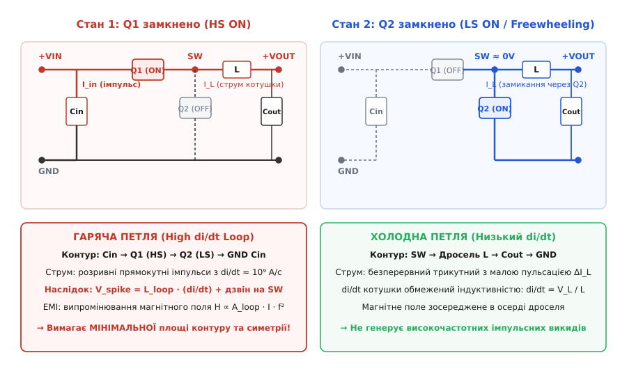
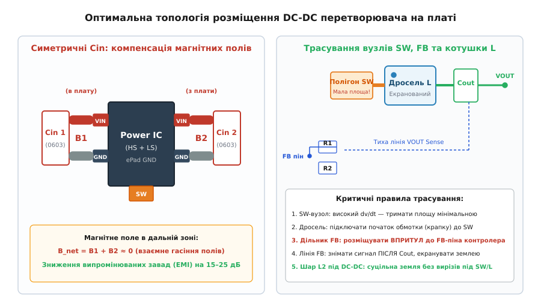

# Розміщення вузла живлення: гаряча петля перетворювача

<preknowlist>
- [Електромагнітна індукція](root:ph-electromagnetism/electromagnetic-induction) — закон Фарадея, зміна магнітного потоку породжує ЕРС самоіндукції V = -L · (di/dt).
- [Шлях зворотного струму](root:hw-pcb/current-return-path) — високочастотний зворотний струм протікає безпосередньо під сигнальним провідником за шляхом найменшої індуктивності.
- [Шарування плати](root:hw-pcb/pcb-stackup) — опорні шари землі та живлення, розподіл діелектричних зазорів для мінімізації площі петель.
- [Імпульсний понижувальний перетворювач](root:hw-power/buck) — комутація ключів high-side та low-side для широтно-імпульсного регулювання напруги.
</preknowlist>

Коли імпульсний перетворювач напруги живить цифровий процесор струмом 15 А, перемикання силових польових транзисторів відбувається за лічені наносекунди. За час наростання фронту `t_r = 2 нс` струм у вхідному колі стрибає від нуля до пікового значення, створюючи швидкість наростання струму `di/dt = 7.5 · 10⁹ А/с`. Якщо вхідний керамічний конденсатор відсунутий від силових транзисторів усього на 10–15 мм, паразитна індуктивність друкованих доріжок та перехідних отворів утворює контур з власною індуктивністю `L_loop = 6 нН`. За законом електромагнітної індукції Фарадея на комутаційному вузлі неминуче виникає імпульсний викид перенапруги:

```
V_spike = L_loop · (di / dt)
= 6 · 10⁻⁹ Гн · 7.5 · 10⁹ А/с    [підстановка індуктивності петлі та швидкості зміни струму]
= 45 В                          [амплітуда індуктивного викиду]
```

Якщо перетворювач живиться від шини 24 В, сумарна напруга на стоці транзистора сягає `24 В + 45 В = 69 В`. Для транзистора з гранично допустимою напругою 30 В або 40 В це означає лавинний пробій (англ. *avalanche breakdown*), локальне теплове руйнування кристала кремнію та миттєвий вихід мікросхеми з ладу. Ба більше, цей струмовий контур працює як рамкова магнітна антена: високочастотний струм випромінює електромагнітне поле, амплітуда якого пропорційна площі петлі та квадрату частоти гармонік. Випромінювані завади наводять бруд на сусідні аналогові сенсори, викликають збої тактових генераторів мікроконтролера та унеможливлюють проходження обов'язкової сертифікації на електромагнітну сумісність (EMC) за стандартами CISPR 25 чи CISPR 32.

Ключ до розв'язання цієї проблеми лежить не в схемотехніці, а в топології друкованої плати. Фізичний контур, у якому струм зазнає миттєвих розривів та стрибків під час комутації ключів, називають **гарячою петлею** (англ. *hot loop* або *high di/dt loop*). Зменшення геометричної площі та паразитної індуктивності цієї петлі є головним інженерним правилом трасування будь-якого вузла живлення.

## Анатомія імпульсних топологій: виявлення гарячої петлі

Щоб знешкодити гарячу петлю, її необхідно знайти на принциповій схемі. Головна помилка інженерів-початківців полягає у спробі мінімізувати весь силовий тракт одночасно, не розрізняючи ділянки з неперервним та розривним струмом. Котушка індуктивності за своєю фізичною природою протидіє миттєвим змінам струму (`V_L = L · di/dt`), тому струм через дросель завжди є неперервним і має форму трикутних пульсацій із відносно невеликою швидкістю зміни. Натомість струм через напівпровідникові ключі та блокувальні конденсатори вмикається і вимикається стрибкоподібно.

Розглянемо базові топології неізольованих перетворювачів постійної напруги (DC-DC) та простежимо контури комутації.

```
+─────────────────────────────────────────────────────────────────────────────+
|       ТОПОЛОГІЯ        |    ДІЛЯНКА З ВИСОКИМ di/dt    |   РОЗМІЩЕННЯ ПЕТЛІ |
+────────────────────────+───────────────────────────────+────────────────----+
| Понижувальний (Buck)   | Вхід: Cin -> HS-FET -> LS-FET | Вхідний контур     |
| Підвищувальний (Boost) | Вихід: LS-FET -> Diode -> Cout| Вихідний контур    |
| Інвертувальний (Invert)| Вхід і вихід через ключ і діод| Вхідно-вихідний    |
| 4-ключовий Buck-Boost  | Вхідний HS/LS + вихідний HS/LS| Дві гарячі петлі   |
+─────────────────────────────────────────────────────────────────────────────+
```

### Понижувальний перетворювач (Buck Converter)

У синхронному понижувальному перетворювачі робочий цикл розбивається на дві фази:

1. **Фаза увімкненого стану верхнього ключа (HS ON):** Верхній транзистор `Q1` відкритий, нижній транзистор `Q2` закритий. Струм тече від позитивної обкладки вхідного конденсатора `C_in` через `Q1`, комутаційний вузол `SW`, котушку індуктивності `L` до вихідного конденсатора `C_out` та навантаження, після чого повертається через спільну земляну площину на негативну обкладку `C_in`.
2. **Фаза увімкненого стану нижнього ключа (LS ON / Freewheeling):** Верхній транзистор `Q1` вимикається, а нижній транзистор `Q2` відкривається, забезпечуючи шлях для неперервного струму дроселя. Струм протікає від землі через `Q2`, вузол `SW`, дросель `L`, вихідний конденсатор `C_out` та повертається на землю `Q2`.


*Розподіл високочастотних струмів у синхронному Buck-перетворювачі: вхідний контур Cin–Q1–Q2 містить розривний струм із критично високим di/dt (гаряча петля), тоді як вихідний контур дроселя L–Cout згладжує пульсації струму (холодна петля).*

Зіставивши обидва стани, бачимо:
- Струм у котушці `L` та вихідному конденсаторі `C_out` присутній у **обох** фазах. Він монотонно зростає під час фази HS ON і спадає під час LS ON. Тут немає крутих фронтів комутації, швидкість наростання струму жорстко обмежена індуктивністю: `(di/dt)_L = (V_in - V_out) / L`. Цей контур є електрично «холодним».
- Струм у вхідному конденсаторі `C_in` та верхньому транзисторі `Q1` тече лише протягом частини періоду `D · T_sw` (де `D = V_out / V_in` — коефіцієнт заповнення ШІМ), а під час паузи різко обривається до нуля.
- Струм у нижньому транзисторі `Q2` тече лише протягом інтервалу `(1 - D) · T_sw`, а під час відкритого `Q1` дорівнює нулю.

Таким чином, у вузлах `C_in (+) -> Q1 (Drain -> Source) -> Q2 (Drain -> Source) -> C_in (-)` струм миттєво перемикається між гілками за час перемикання транзисторів `t_sw` (від 1 до 5 наносекунд). Цей замкнений фізичний периметр і є **вхідною гарячою петлею Buck-перетворювача**.

### Підвищувальний перетворювач (Boost Converter)

У підвищувальному перетворювачі дросель увімкнений безпосередньо між вхідним джерелом живлення та комутаційним вузлом. Тому вхідний струм від джерела та через вхідний конденсатор `C_in` є неперервним.

Натомість на виході ситуація дзеркальна:
- Коли нижній транзистор `Q_low` відкритий, енергія накопичується в магнітному полі дроселя, а струм у навантаження віддає виключно вихідний конденсатор `C_out`. Струм через випрямний діод або верхній синхронний транзистор `Q_high` дорівнює нулю.
- Коли `Q_low` закривається, струм дроселя через `Q_high` вистрілює у вихідний конденсатор `C_out` та навантаження зі швидкістю комутації ключа.

Отже, у Boost-перетворювачі гаряча петля розташована на **виході**:
```
Контур Boost: Q_low -> Q_high (або випрямний діод) -> C_out -> GND повернення до Q_low
```
Будь-яке подовження доріжок між вихідним конденсатором `C_out`, випрямлячем та ключем призводить до величезних викидів напруги на стоці `Q_low`, здатних миттєво спалити транзистор.

### Інвертувальний та чотириключовий Buck-Boost перетворювачі

У класичному інвертувальному Buck-Boost перетворювачі розривний характер мають як вхідний, так і вихідний струми. Коли ключ замкнений, струм наростає в дроселі від входу; коли ключ розімкнений, струм дроселя скидається у вихідне коло з протилежною полярністю. Тому критичної уваги вимагають обидва контури.

У чотириключовому неінвертувальному синхронному Buck-Boost перетворювачі (який містить два транзистори на вході та два на виході) присутні **дві повноцінні гарячі петлі**:
1. Вхідна гаряча петля: `C_in -> Q_A (HS1) -> Q_B (LS1) -> GND C_in`.
2. Вихідна гаряча петля: `C_out -> Q_C (HS2) -> Q_D (LS2) -> GND C_out`.

Під час роботи в режимі Buck активна вхідна петля; у режимі Boost активна вихідна петля; у змішаному 4-фазному режимі Buck-Boost обидві петлі комутують одночасно, що вимагає бездоганного симетричного розташування як вхідних, так і вихідних керамічних конденсаторів.

## Електродинаміка швидкої комутації: di/dt, індуктивність та хвильові процеси

Чому паразитна індуктивність порядку кількох наногенрі стає катастрофою на друкованій платі? Відповідь полягає в масштабах величин, якими оперує сучасна силова електроніка.

### Швидкість зміни струму (di/dt)

Перехідний процес перемикання силового польового транзистора (MOSFET або GaN HEMT) визначається зарядом затвора `Q_g`, опором вихідного каскаду драйвера `R_gate` та паразитними ємностями структури `C_iss`, `C_oss`, `C_gd` (ємність Міллера). У сучасних кремнієвих транзисторах час наростання та спаду струму становить `t_sw = 1.5–5 нс`, а в нітрид-галієвих (GaN) приладах сягає `0.3–1.0 нс`.

Розрахуємо швидкість зміни струму для перетворювача потужністю 100 Вт (`V_in = 24 В`, `V_out = 5 В`, `I_out = 20 А`, амплітуда струму комутації `I_pk = 22 А` з урахуванням пульсацій):

```
di / dt = I_pk / t_sw
= 22 А / (2.0 · 10⁻⁹ с)          [підстановка пікового струму та часу перемикання]
= 1.1 · 10¹⁰ А/с                 [швидкість наростання струму: одинадцять мільярдів ампер за секунду]
```

### Паразитна індуктивність друкованого провідника

Будь-який провідник на платі володіє власною індуктивністю. Для прямокутної мідної доріжки довжиною `l`, шириною `w` та товщиною `t`, розташованої на висоті `h` над суцільним опорним шаром землі, погонна індуктивність визначається геометрією мікросмужкової лінії:

```
L_trace ≈ 0.2 · l · [ln(2 · l / (w + t)) + 0.2235 · (w + t) / l + 0.5]  нН
```

Наближене інженерне емпіричне правило для типових шарів друкованої плати (товщина фольги 35 мкм, ширина доріжки 1–2 мм без безпосереднього зворотного шару впритул):
- Одиночна відкрита доріжка на зовнішньому шарі має індуктивність близько **0.8–1.2 нН на кожен міліметр довжини**.
- Перехідний отвір (via) зі свердлом 0.3 мм та висотою циліндра 1.6 мм додає **0.6–1.2 нН на один отвір**.
- Власний еквівалентний послідовний індуктивний опір (ESL) керамічного SMD-конденсатора типорозміру 0805 становить **0.5–0.8 нН**, а типорозміру 0402 — близько **0.2–0.3 нН**.
- Внутрішні виводи та розварювальні дротики (англ. *bond wires*) всередині корпусу силового транзистора (наприклад, DPAK або SO-8) додають ще **1.5–3.5 нН** (сучасні безвивідні корпуси QFN/DFN та PowerPAK зменшують цю величину до **0.2–0.5 нН** завдяки технології clip-bonding).

Якщо сумарна довжина шляху струму у вхідній петлі становить лише 15 мм по доріжках, містить 2 перехідні отвори та виводи компонентів:

```
L_loop = L_trace + 2 · L_via + L_ESL + L_package
= 12.0 нН + 2 · 0.8 нН + 0.6 нН + 1.2 нН   [сума індуктивностей усіх сегментів]
= 15.4 нН                                  [загальна паразитна індуктивність невдалої петлі]
```

При швидкості наростання струму `di/dt = 1.1 · 10¹⁰ А/с` амплітуда комутаційного викиду перенапруги сягає:

```
V_spike = L_loop · (di / dt)
= 15.4 · 10⁻⁹ Гн · 1.1 · 10¹⁰ А/с          [закон електромагнітної індукції]
= 169.4 В                                  [викид перенапруги на стоці]
```

Жоден низьковольтний транзистор не витримає такого викиду: пробій відбудеться на першому ж тактовому імпульсі перетворювача.

### Високочастотний резонанс і дзвін (Ringing)

Комутаційний викид не є поодиноким гладким імпульсом. У момент закривання транзистора паразитна індуктивність петлі `L_loop` утворює послідовний коливальний контур із вихідною паразитною ємністю закритого польового транзистора `C_oss` (яка зазвичай становить від 100 пФ до 1.5 нФ залежно від площі кристала):

```
f_ring = 1 / (2 · π · √(L_loop · C_oss))
```

Для типових параметрів `L_loop = 4 нН` та `C_oss = 400 пФ`:

```
f_ring = 1 / (2 · 3.14159 · √(4 · 10⁻⁹ · 400 · 10⁻¹²))
= 1 / (2 · 3.14159 · √(1.6 · 10⁻¹⁸))      [обчислення підкореневого виразу]
= 1 / (2 · 3.14159 · 1.265 · 10⁻⁹)        [добуток у знаменнику]
= 1 / (7.948 · 10⁻⁹)                      [значення зворотного часу]
= 1.258 · 10⁸ Гц                          [частота власних коливань контуру]
≈ 126 МГц                                 [резонансна частота дзвону]
```

Цей високочастотний «дзвін» на частоті 100–300 МГц має мале затухання, оскільки активний опір міді та транзистора у відкритому стані становить частки ома. Затухаючі коливання напруги збуджують хвилі в довколишніх провідниках, випромінюються у відкритий простір та накладаються на вихідну напругу, перетворюючись на важкофільтровані високочастотні шуми.

Більш детальний аналіз математичних моделей та програмні алгоритми розрахунку перехідних процесів наведені у практичній вставці [розрахунок індуктивності гарячої петлі](root:hw-pcb/rozmishchennia-vuzla-zhyvlennia/proj-hot-loop-inductance-calc.md).

### Електромагнітне випромінювання гарячої петлі (EMI)

Гаряча петля з точки зору електродинаміки являє собою елементарну магнітну рамкову антену (магнітний диполь). Згідно з рівняннями Максвелла, напруженість електричного поля випромінювання у дальній зоні (на відстані `r` від плати у вільному просторі) виражається формулою:

```
E_rad = (1.316 · 10⁻¹⁴) · (A_loop · I_pk · f²) / r  [В/м]
```

де `A_loop` — площа замкненого струмового контуру гарячої петлі (у м²), `I_pk` — амплітуда струму гармоніки (в А), `f` — частота гармоніки (в Гц), `r` — відстань до антени вимірювання (зазвичай 3 або 10 метрів за стандартами EMC).

З цієї фундаментальної формули випливають три критичні висновки:
1. **Квадратична залежність від частоти (`f²`):** Якщо частота комутації або частота резонансного дзвону зростає в 10 разів (наприклад, з 20 МГц до 200 МГц), потужність випромінювання зростає у **100 разів (+40 дБ)**.
2. **Лінійна залежність від площі петлі (`A_loop`):** Збільшення площі контуру між конденсатором і транзисторами всього втричі (наприклад, з 20 мм² до 60 мм²) призводить до трикратного зростання напруженості поля завад (+9.5 дБ).
3. **Неефективність зовнішньої фільтрації проти ближнього поля:** Випромінювання магнітного поля відкритої петлі наводить паразитні ЕРС у сигнальних провідниках ще до того, як завада дійде до вхідних чи вихідних LC-фільтрів. Єдиний дієвий спосіб придушення — зменшення фізичної площі випромінювального диполя на самій платі.

### Диференціальні та синфазні завади (DM vs CM Noise)

Завади від імпульсного вузла живлення поділяються на дві категорії:

1. **Диференціальні завади (Differential Mode — DM):** Струм завади протікає по силових провідниках у протилежних напрямках: від перетворювача до джерела по лінії живлення і повертається по лінії землі. Головним джерелом диференціальних завад є саме пульсуючий струм гарячої петлі з високим `di/dt`. Їхня амплітуда прямо пропорційна площі петлі `A_loop` та пульсаціям струму `ΔI`.
2. **Синфазні завади (Common Mode — CM):** Струм завади тече по обох силових лініях (і VIN, і GND) в **одному напрямку**, а повертається через паразитарні ємності до металевого корпусу (шасі), захисного заземлення (PE) або паразитарної ємності кабелів до вільного простору. Головним джерелом синфазного шуму є комутаційний вузол `SW` з його колосальною швидкістю зміни напруги `dv/dt`. Струм зміщення через розподілену ємність `C_chassis` між полігоном SW та корпусом дорівнює `i_cm = C_chassis · (dv/dt)`.

Боротьба з диференціальними завадами ведеться зменшенням магнітних петель струму (`di/dt`), а боротьба з синфазними завадами — мінімізацією площі високовольтних комутаційних полігонів (`dv/dt`) та скороченням ємнісного зв'язку.

### Фізика скін-ефекту та вихрових струмів у шарі землі

На низьких частотах (постійний струм або частота 50 Гц) електричний струм у провіднику розподіляється рівномірно по всьому поперечному перерізу, обираючи шлях найменшого **активного опору (R)**. Проте на частотах перемикання DC-DC перетворювача (від 500 кГц до 5 МГц) та особливо на частотах комутаційного дзвону (100–400 МГц) розподіл струму підпорядковується законам електродинаміки надвисоких частот.

Глибина скін-шару (англ. *skin depth*, `δ`) у мідному провіднику визначається питомим електричним опором `ρ ≈ 1.68 · 10⁻⁸ Ом·м` та магнітною проникністю `μ₀ = 4π · 10⁻⁷ Гн/м`:

```
δ = √(ρ / (π · f · μ₀))
```

Розрахуємо глибину проникнення струму в мідь для характерних частот:
- При частоті комутації `f = 1 МГц`:
```
δ = √((1.68 · 10⁻⁸) / (3.14159 · 10⁶ · 4 · 3.14159 · 10⁻⁷))   [підстановка параметрів міді та частоти 1 МГц]
  = √(1.68 · 10⁻⁸ / 3.948 · 10⁰)                               [добуток у знаменнику: π · f · μ₀]
  = √(4.255 · 10⁻⁹)                                            [ділення підкореневого виразу]
  = 6.52 · 10⁻⁵ м                                              [добування квадратного кореня]
  ≈ 65.2 мкм                                                   [переведення в мікрометри]
```
- При частоті високочастотного дзвону `f = 100 МГц`:
```
δ = √((1.68 · 10⁻⁸) / (3.14159 · 10⁸ · 4 · 3.14159 · 10⁻⁷))   [підстановка частоти дзвону 100 МГц]
  = √(1.68 · 10⁻⁸ / 3.948 · 10²)                               [добуток у знаменнику для 100 МГц]
  = √(4.255 · 10⁻¹¹)                                           [ділення підкореневого виразу]
  = 6.52 · 10⁻⁶ м                                              [добування квадратного кореня]
  ≈ 6.52 мкм                                                   [переведення в мікрометри]
```

На частоті 100 МГц товщина скін-шару становить лише 6.5 мкм, що вп'ятеро тонше за стандартну мідну фольгу товщиною 35 мкм (1 oz). Струм тече виключно по поверхні металу.

Ба більше: високочастотний зворотний струм у шарі землі L2 завжди обирає шлях **найменшої індуктивності (L)**, а не найменшого опору. Індуктивність контуру є мінімальною тоді, коли зворотний струм протікає **безпосередньо під провідником прямого струму**, оскільки саме за такої конфігурації магнітні потоки протилежно спрямованих струмів максимально компенсують один одного.

Якщо між шаром L1 та шаром землі L2 розташований тонкий діелектрик товщиною `h = 0.1 мм`, взаємна індуктивність `M` між доріжкою та її дзеркальним відображенням у землі наближається до власної індуктивності доріжки:

```
k = M / L_self ≈ 0.85–0.92
L_eff = L_self · (1 - k²) ≈ L_self · 0.2
```

Завдяки цьому ефективна індуктивність контуру падає на 80%. Проте варто розірвати шар землі під силовою доріжкою щілиною або прорізати його чужою сигнальною трасою, як дзеркальний струм змушений буде обтікати розріз. Шлях струму видовжується, магнітний потік виривається назовні, а індуктивність `L_loop` стрибає у 5–10 разів.

## Топологічні конфігурації гарячої петлі на платі

Існує три основні фізичні способи компонування гарячої петлі на друкованій платі. Вибір правильної конфігурації залежить від кількості шарів, допустимої товщини плати та корпусу силових напівпровідників.

```
+─────────────────────────────────────────────────────────────────────────────+
|               ПОРІВНЯННЯ ТОПОЛОГІЙ КОМПОНУВАННЯ ГАРЯЧОЇ ПЕТЛІ               |
+──────────────────────────+────────────────────────+─────────────────────────+
| ТИП ТОПОЛОГІЇ            | ПЕРЕВАГИ               | НЕДОЛІКИ ТА ОБМЕЖЕННЯ   |
+──────────────────────────+────────────────────────+─────────────────────────+
| 1. Горизонтальна (L1)    | Простота трасування на | Велика геометрична      |
|    Lateral Top Loop      | 2-шарових платах       | площа (20–50 мм²)       |
+──────────────────────────+────────────────────────+─────────────────────────+
| 2. Вертикальна (L1-L2)   | Ультрамала площа через | Вимагає тонкого prepreg |
|    Vertical Inner Loop   | товщину діелектрика    | (<= 0.1 мм) між L1 і L2 |
+──────────────────────────+────────────────────────+─────────────────────────+
| 3. Симетрична подвійна   | Взаємне гасіння полів, | Потребує пари конденса- |
|    Dual Symmetrical Loop | зниження EMI на 20 дБ  | торів та пінів з 2 боків|
+──────────────────────────+────────────────────────+─────────────────────────+
```

### 1. Горизонтальна петля на верхньому шарі (Lateral Loop)

У класичній горизонтальній топології всі компоненти гарячої петлі — вхідний конденсатор `C_in`, верхній транзистор `Q1` та нижній транзистор `Q2` (або мікросхема IC) — розташовані в одній площині на верхньому шарі (Layer 1).
- Струм від позитивного виводу `C_in` тече по поверхні плати до стоку `Q1`, проходить через транзистори до витоку `Q2` і повертається по поверхні до негативного виводу `C_in`.
- Площа петлі формується відстанню між компонентами на поверхні. Навіть при щільному монтажі площа горизонтальної петлі рідко буває меншою за **15–30 мм²**.
- Горизонтальна петля випромінює магнітне поле перпендикулярно до площини друкованої плати.

### 2. Вертикальна петля крізь внутрішній шар (Vertical Loop)

У вертикальній топології контур замикається не по площині верхнього шару, а крізь товщу діелектрика між шарами Layer 1 та Layer 2.
- Прямий струм тече по верхньому шару від `C_in` через транзистори.
- Зворотний струм опускається крізь масив перехідних отворів безпосередньо біля витоку нижнього ключа на внутрішній шар L2 і повертається на L2 прямо під компонентами назад до перехідних отворів `C_in`.
- Оскільки висота петлі дорівнює товщині діелектрика між L1 та L2 (`h ≈ 0.075–0.125 мм`), площа вертикального контуру дорівнює добутку ширини провідника на мікроскопічну висоту: `A_loop = l · h`. Для довжини доріжки `l = 8 мм` площа становить усього `8 мм · 0.1 мм = 0.8 мм²`!
- Площа петлі у 20–30 разів менша, ніж у горизонтальної конфігурації. Крім того, магнітне поле вертикальної петлі орієнтоване паралельно площині плати, що суттєво зменшує наведення на поверхневі доріжки.

### 3. Симетрична здвоєна петля (Dual Symmetrical Loop)

Симетрична топологія поєднує переваги вертикальної петлі з ефектом взаємної деструктивної інтерференції полів (магнітної компенсації).


*Оптимальна топологія розміщення DC-DC перетворювача: ліворуч — симетричне розміщення подвійних вхідних конденсаторів Cin1/Cin2 для взаємної компенсації магнітних полів; праворуч — компактний полігон комутаційного вузла SW, правильне підключення екранованого дроселя та екрановане трасування лінії зворотного зв'язку FB.*

Два ідентичні конденсатори `C_in1` та `C_in2` встановлюються з протилежних боків мікросхеми живлення:
- Струм живлення розділяється на два паралельні потоки однакової амплітуди `I / 2`.
- Вхідна індуктивність двох паралельних гілок зменшується вдвічі: `L_total = L_branch / 2`.
- Магнітні диполі обох контурів спрямовані протилежно: магнітний момент лівої петлі `m₁ = (I/2) · A · ẑ`, магнітний момент правої петлі `m₂ = -(I/2) · A · ẑ`. У просторі навколо плати результуючий дипольний момент `m_total = m₁ + m₂ = 0`. Випромінювання поля падає на 20–25 дБ.

## Мультифазні перетворювачі: фазовий зсув та DrMOS

Коли струм навантаження перевищує 30–40 А (живлення ядер процесорів, графічних чіпів GPU або матриць FPGA), однофазний перетворювач стає неефективним через надмірний нагрів котушки та гігантські пульсації вхідного струму. У таких застосуваннях використовують **мультифазні синхронні Buck-перетворювачі** (англ. *multi-phase interleaved buck converters*).

### Принцип інтерлівінгу (Interleaving)

У мультифазній системі `N` однакових фаз працюють паралельно на спільну вихідну ємність `C_out`. Керуючі ШІМ-сигнали кожної фази зміщені за часом на кут:

```
Δφ = 360° / N
```

Для 4-фазного перетворювача фазовий зсув становить 90°, для 6-фазного — 60°, для 8-фазного — 45°.

Ефект фазового зсуву для гарячих петель:
1. **Зниження пульсацій вхідного струму:** Імпульси струму споживання окремих фаз не накладаються один на один, а чергуються в часі. Ефективне діюче значення струму у вхідних конденсаторах `I_cin_rms` зменшується в `√N` разів, що знижує нагрів кераміки та вимоги до загальної ємності.
2. **Збільшення еквівалентної частоти пульсацій:** Пульсації вихідного струму та напруги мають частоту `f_eff = N · f_sw`. Це дозволяє зменшити габарити вихідних дроселів та покращити динамічну відповідь на стрибки навантаження (load transient response).

### Топологічні правила для модулів DrMOS / Smart Power Stage

Сучасні мультифазні перетворювачі будуються на базі інтегрованих силових каскадів **DrMOS** (Driver + MOSFET) або **SPS** (Smart Power Stage), що поєднують у компактному корпусі QFN 5x5 мм драйвер затворів, верхній і нижній ключі та датчик температури і струму.

Правила трасування мультифазних модулів:
1. **Локальна гаряча петля для кожної фази:** Кожна мікросхема DrMOS повинна мати власні індивідуальні вхідні керамічні конденсатори (0402 та 0603), встановлені безпосередньо біля її виводів VIN/PGND. Категорично заборонено використовувати один загальний блок конденсаторів, віддалений від фаз.
2. **Орієнтація котушок індуктивності:** Дроселі сусідніх фаз розміщують паралельно, але з чергуванням полярності магнітного потоку, або використовують інтегровані здвоєні дроселі (coupled inductors). Якщо дроселі розміщені занадто близько без чергування, їхні магнітні поля розсіювання можуть взаємно підсилюватися, що призведе до передчасного магнітного насичення осердя при пікових струмах.
3. **Симетричний розподіл силових шин живлення:** Шина живлення `VIN` та загальна земля `PGND` повинні підводитися до кожної фази симетричними широкими полігонами однакової довжини, щоб активний опір та паразитна індуктивність підвідних провідників були ідентичними для всіх фаз. Інакше виникне динамічний перекіс струмів між фазами під час швидких перехідних процесів.

## Особливості роботи з транзисторами GaN та SiC

Поява широкозонних напівпровідників — нітриду галію (GaN HEMT) та карбіду кремнію (SiC MOSFET) — відкрила можливість підняти частоти комутації перетворювачів до 2–10 МГц. Проте надвисока швидкість комутації робить їх екстремально чутливими до паразитної індуктивності друкованої плати.

### Фізичні переваги GaN-транзисторів

1. **Відсутність заряду зворотного відновлення (`Q_rr = 0`):** GaN HEMT є латеральним приладом без паразитного p-n переходу (діода тіла). При зворотній провідності він працює за рахунок двовимірного електронного газу (2DEG), що повністю усуває втрати зворотного відновлення та пов'язані з ними викиди струму.
2. **Мікроскопічні паразитні ємності:** Ємність `C_oss` у GaN у 5–10 разів менша, ніж у кремнієвих MOSFET з аналогічним опором каналу `R_DS(on)`.
3. **Швидкість перемикання:** Час наростання струму становить `t_r = 0.3–0.8 нс`, а швидкість зміни струму досягає `di/dt = (20–50) · 10⁹ А/с` при швидкості зміни напруги `dv/dt = (100–200) · 10⁹ В/с`.

### Головні небезпеки при трасуванні GaN-каскадів

За швидкості `di/dt = 30 · 10⁹ А/с` навіть мізерна паразитна індуктивність `L_loop = 1 нН` створює викид перенапруги:

```
V_spike = 1 · 10⁻⁹ Гн · 30 · 10⁹ А/с = 30 В
```

Для 48-вольтового GaN-транзистора з максимальною напругою 80 В такий викид є фатальним.

Крім того, виникають дві специфічні загрози:

#### 1. Помилкове відмикання через ефект Міллера (Miller Turn-On)

При закриванні нижнього GaN-ключа напруга на вузлі `SW` злітає вгору зі швидкістю `dv/dt = 100 В/нс`. Цей стрибок напруги інжектує струм зміщення через ємність затвор-стік `C_gd`:

```
i_Miller = C_gd · (dv / dt)
```

Цей струм протікає через вихідний опір вимкненого драйвера затвора `R_driver_off` та паразитну індуктивність доріжки затвора `L_gate`, створюючи динамічний підйом напруги на затворі:

```
V_gs_induced = i_Miller · R_driver_off + L_gate · (di_Miller / dt)
```

Оскільки порогова напруга відкривання GaN-транзистора становить усього `V_th ≈ 1.3–1.7 В`, навіть невеликий індукований імпульс здатний відкрити закритий транзистор у момент, коли верхній ключ відкритий. Виникає катастрофічний наскрізний струм (shoot-through) прямо між шинами живлення, який знищує обидва ключі за один такт.

#### 2. Трасування ультракомпактного контуру затвора для GaN

Щоб запобігти помилковому відмиканню:
- Драйвер затвора встановлюють **безпосередньо біля GaN-транзистора** (відстань між виводами менше 1 мм).
- Сигнальна доріжка затвора та зворотна доріжка витоку прокладаються як тісно зв'язана копланарна або мікросмужкова лінія одна над одною на шарах L1 та L2, мінімізуючи індуктивність контуру затвора до рівня `< 0.2 нН`.
- Для надійного утримання затвора в закритому стані застосовують драйвери з окремими виводами для увімкнення та вимкнення (Source/Sink) або використовують двополярне живлення затвора з негативною напругою вимикання (наприклад, +5 В / -2 В).

## Бутстрепний ланцюг (Bootstrap) та від'ємні викиди на вузлі SW

Для керування N-канальним верхнім польовим транзистором (High-Side FET) напруга на його затворі повинна перевищувати напругу вхідної шини живлення `V_in` на величину повної напруги відкривання (`V_gate = V_in + 5 В`). Для створення цієї напруги використовується **бутстрепне коло (Bootstrap circuit)**, що складається з зовнішнього або внутрішнього діода підзаряду та керамічного конденсатора `C_boot` (зазвичай 0.1 мкФ), увімкненого між виводами `BOOT` та `SW` мікросхеми.

### Механізм заряду бутстрепного конденсатора

1. Під час фази увімкненого нижнього транзистора (LS ON) комутаційний вузол `SW` притискається до землі (`V_SW ≈ 0 В`).
2. Внутрішнє джерело живлення драйверів `V_CC` (зазвичай 5 В) заряджає конденсатор `C_boot` через бутстрепний діод до напруги `V_boot ≈ V_CC - V_diode ≈ 4.5 В`.
3. Під час фази HS ON вузол `SW` піднімається до `V_in`. Напруга на піні `BOOT` автоматично «підстрибує» до `V_in + 4.5 В`, забезпечуючи живлення верхнього драйвера затвора відносно плаваючого потенціалу витоку.

### Небезпека від'ємних викидів (Negative SW Spikes)

У проміжку між вимиканням верхнього та вмиканням нижнього ключа (мертвий час, dead-time) струм індуктивності не може зупинитися і замикається через антипаралельний діод (діод тіла) закритого нижнього ключа або через його паразитну ємність.

Струм, що стрімко втікає із землі у вузол `SW`, протікає через паразитну індуктивність виводу витоку нижнього ключа та земляної доріжки `L_gnd_ls`. Це створює на вузлі `SW` потужний від'ємний імпульс напруги:

```
V_SW_negative = -V_diode_drop - L_gnd_ls · (di / dt)
```

Для падіння на діоді `V_diode = 0.9 В`, індуктивності `L_gnd_ls = 2 нН` та швидкості зміни струму `di/dt = 2 · 10⁹ А/с`:

```
V_SW_negative = -0.9 В - (2 · 10⁻⁹ Гн · 2 · 10⁹ А/с) = -0.9 В - 4.0 В = -4.9 В
```

Цей від'ємний сплеск напруги викликає дві важкі системні аварії:
1. **Перенапруга на конденсаторі `C_boot`:** Оскільки пін `BOOT` залишається зарядженим відносно землі, диференціальна напруга між пінами `BOOT` та `SW` стрибає до `V_boot_diff = V_CC - V_SW_negative = 5 В - (-4.9 В) = 9.9 В`. Для драйверів з абсолютним максимумом `V_boot-sw = 6 В` це призводить до миттєвого пробою внутрішньої ізоляції драйвера.
2. **Паразитне защіпання кристала (CMOS Latch-Up):** Від'ємний потенціал на піні `SW` зміщує ізолюючі p-n переходи всередині кремнієвої підкладки інтегральної схеми в прямому напрямку. Інжекція неосновних носіїв заряду відмикає паразитний чотиришаровий тиристор (p-n-p-n структуру) всередині мікросхеми, викликаючи коротке замикання шини живлення на землю через кристал і повне вигоряння контролера.

### Топологічний захист бутстрепного кола

1. **Мінімальний контур `C_boot`:** Конденсатор `C_boot` розміщують безпосередньо біля мікросхеми на відстані менше 1 мм від пінів BOOT та SW.
2. **Послідовний бутстрепний резистор `R_boot`:** Послідовно з `C_boot` встановлюють резистор опором `2.2–5.1 Ом`. Він обмежує піковий струм заряджання затвора верхнього ключа, згладжує фронт `dv/dt` і повністю демпфує високочастотний дзвін між `C_boot` та паразитною індуктивністю виводів.
3. **Зовнішній діод Шотткі (Catch Diode):** Паралельно нижньому транзистору встановлюють швидкодіючий діод Шотткі в мініатюрному корпусі з ультракороткими доріжками. Оскільки пряме падіння на діоді Шотткі становить лише 0.35–0.4 В (проти 0.9–1.2 В у кремнієвого діода тіла MOSFET), струм мертвого часу тече через Шотткі, надійно обмежуючи амплітуду від'ємного викиду на рівні `V_SW > -0.7 В`.

## Архітектура Constant-On-Time (COT) та штучна інжекція пульсацій

У високопродуктивних перетворювачах для живлення процесорів широкої популярності набула архітектура керування з фіксованим часом увімкненого стану — **Constant-On-Time (COT)** або гістерезисне керування.

### Принцип роботи COT

На відміну від класичного ШІМ-керування з фіксованим тактовим генератором, у COT-контролері внутрішній компаратор безперервно порівнює напругу зворотного зв'язку на піні `FB` з внутрішнім джерелом опорної напруги `V_ref`:
1. Щойно напруга `V_FB` опускається нижче `V_ref` внаслідок розряджання вихідних конденсаторів струмом навантаження, компаратор миттєво відкриває верхній ключ на фіксований інтервал часу `t_on = k · (V_out / V_in)`.
2. Після закінчення часу `t_on` верхній ключ закривається, і вмикається нижній ключ доти, доки напруга `V_FB` знову не впаде до `V_ref`.

Головна перевага COT — **миттєва реакція на стрибок струму навантаження (Zero Latency)**: контролеру не потрібно чекати наступного такту генератора, він відкриває серію імпульсів `t_on` практично без затримки.

### Проблема керамічних конденсаторів та фазовий зсув пульсацій

Для коректної роботи компаратора COT-контролера на піні `FB` повинні бути присутні пульсації напруги амплітудою щонайменше `10–20 мВ`, які за фазою **синфазні зі струмом дроселя**:
- В епоху електролітичних конденсаторів з помітним еквівалентним послідовним опором (ESR) пульсація вихідної напруги формувалася за законом Ома: `ΔV_out(t) = ΔI_L(t) · R_ESR`. Ця напруга точно повторювала трикутну форму струму дроселя без фазового запізнення.
- Проте при використанні сучасних керамічних конденсаторів MLCC їхній опір `R_ESR` настільки малий (1–3 мОм), що падіння на ньому становить частки мілівольта. Пульсація напруги на кераміці визначається виключно процесом ємнісного інтегрування струму: `v_out(t) = (1/C) · ∫ i_C(t) dt`.

Інтегрування зміщує фазу трикутних пульсацій напруги на **90° назад** відносно піків струму. Компаратор COT-контролера починає спрацьовувати з фазовою помилкою, що призводить до виникнення субгармонійного хаосу, подвійних імпульсів (double pulsing) та повної втрати стабільності вихідної напруги.

### Схема штучної інжекції пульсацій (Ripple Injection Circuit)

Щоб відновити стабільну роботу COT-перетворювача з вихідними керамічними конденсаторами MLCC, застосовують зовнішній ланцюг штучної інжекції пульсацій:

```
+─────────────────────────────────────────────────────────────────────────────+
|               СХЕМА ШТУЧНОЇ ІНЖЕКЦІЇ ПУЛЬСАЦІЙ ДЛЯ COT-РЕГУЛЯТОРА           |
+─────────────────────────────────────────────────────────────────────────────+
|                                                                             |
|      (Вузол SW) ───[ R_ripple ]───┬───[ C_ac ]───> (Пін FB контролера)      |
|                                   │                        │                |
|                              [ C_ripple ]                 [ R1 ]            |
|                                   │                        │                |
|                                  GND                   (До VOUT)            |
|                                                                             |
+─────────────────────────────────────────────────────────────────────────────+
```

Принцип роботи:
1. Ланцюг `R_ripple – C_ripple`, підключений до прямокутних імпульсів вузла `SW`, інтегрує напругу перемикання, формуючи чистий трикутний сигнал, ідеально синфазний зі струмом котушки `L`.
2. Конденсатор зв'язку `C_ac` підмішує цей сформований трикутний сигнал змінного струму безпосередньо у високоомний вузол `FB`, не порушуючи при цьому передачу постійної складової напруги через резистивний дільник `R1/R2`.

Правила трасування ланцюга інжекції пульсацій:
- Елементи `R_ripple`, `C_ripple`, `C_ac` повинні розташовуватися **безпосередньо біля піна FB** мікросхеми, а не біля вузла SW.
- Доріжка від вузла SW до резистора `R_ripple` є шумною, тому її прокладають на внутрішньому шарі плати подалі від чутливих аналогових кіл.

## Паразитні параметри компонентів силового каскаду

Якість розведення гарячої петлі безпосередньо залежить від фізичних властивостей використовуваної компонентної бази. Розглянемо особливості керамічних конденсаторів, силових ключів та індуктивностей.

### Керамічні конденсатори MLCC: типорозміри, ESL та DC-Bias

Багатошарові керамічні конденсатори (MLCC) є єдиним типом конденсаторів, здатних ефективно фільтрувати струми з наносекундними фронтами комутації. Проте їхні реальні характеристики істотно відрізняються від ідеальної ємності.

#### 1. Еквівалентна послідовна індуктивність (ESL)

Індуктивність MLCC визначається геометрією струму, що тече через металеві обкладки конденсатора від одного терміналу до іншого.

```
+─────────────────────────────────────────────────────────────────────────────+
|               ПАРАЗИТНА ІНДУКТИВНІСТЬ SMD-КОНДЕНСАТОРІВ (ESL)               |
+───────────────────────+──────────────────────────+──────────────────────────+
| ТИПОРОЗМІР (EIA)      | ГЕОМЕТРІЯ ВИВОДІВ        | ТИПОВИЙ ESL (нГн)        |
+───────────────────────+──────────────────────────+──────────────────────────+
| 1210                  | Стандартна (по вузьких)  | 0.90–1.20 нГн            |
| 1206                  | Стандартна (по вузьких)  | 0.80–1.00 нГн            |
| 0805                  | Стандартна (по вузьких)  | 0.50–0.75 нГн            |
| 0603                  | Стандартна (по вузьких)  | 0.35–0.50 нГн            |
| 0402                  | Стандартна (по вузьких)  | 0.20–0.30 нГн            |
| 0201                  | Стандартна (по вузьких)  | 0.12–0.18 нГн            |
| 0306 (Reverse Geo)    | Зворотна (по широких)    | 0.10–0.15 нГн            |
| 0508 (Reverse Geo)    | Зворотна (по широких)    | 0.12–0.18 нГн            |
+───────────────────────+──────────────────────────+──────────────────────────+
```

Конденсатори зворотної геометрії (Reverse Geometry, наприклад, 0306 або 0508) мають виводи на довгих сторонах прямокутного корпусу. Завдяки ширшому фронту протікання струму та меншій відстані між обкладками їхній ESL у 3–4 рази менший порівняно зі стандартними корпусами того самого об'єму.

#### 2. Ефект зміщення постійною напругою (DC-Bias Effect)

Керамічні конденсатори класу II з високою діелектричною проникністю (діелектрики X5R, X7R, X8R на основі титанату барію `BaTiO₃`) зазнають сильної деградації ємності під дією постійної електричної напруги.

Під впливом прикладеного поля домени спонтанної поляризації в кристалічній решітці орієнтуються вздовж поля та насичуються. У результаті конденсатор номіналом 10 мкФ / 25 В у корпусі 0805 при реальній робочій напрузі 12 В може втратити до **60–70% своєї ємності**, перетворившись на конденсатор 3.3 мкФ, а при напрузі 20 В — на 1.8 мкФ!

Інженерне правило:
Для вхідного блокування DC-DC перетворювача завжди слід обирати конденсатори з запасом за номінальною напругою мінімум у **2–2.5 раза** від робочої напруги шини (наприклад, конденсатори на 50 В для шини 24 В, або на 25 В для шини 12 В) або використовувати конденсатори більшого типорозміру (1206 замість 0603 для великих ємностей), де товщина шарів діелектрика більша, а напруженість внутрішнього електричного поля нижча.

### Корпуси силових транзисторів та індуктивність витоку (Common Source Inductance)

У дискретних силових польових транзисторах критичним фактором є індуктивність виводу витоку (Source), яка є спільною для силового контуру та контуру керування затвором — **спільна індуктивність витоку (Common Source Inductance — CSI, `L_cs`)**.

```
+─────────────────────────────────────────────────────────────────────────────+
|                    ВПЛИВ СПІЛЬНОЇ ІНДУКТИВНОСТІ ВИТОКУ                      |
+─────────────────────────────────────────────────────────────────────────────+
|                                                                             |
|            Gate Driver (+) ──[ R_gate ]──┐                                  |
|                                          ▼ Gate                             |
|                                     ┌───┴───┐                               |
|                                     │ MOSFET│                               |
|                                     └───┬───┘                               |
|                                         ▼ Source                            |
|                                         ├─── (Спільна точка)                |
|                                         │                                   |
|                                      [ L_cs ] (Паразитна індуктивність)     |
|                                         │                                   |
|            Gate Driver (-) ─────────────┴───> Силовий струм у GND           |
|                                                                             |
+─────────────────────────────────────────────────────────────────────────────+
```

Коли транзистор відкривається, силовий струм стоку стрімко зростає (`di/dt > 0`). Цей струм протікає через паразитну індуктивність `L_cs`, створюючи на ній падіння напруги:

```
V_Lcs = L_cs · (di / dt)
```

Ця напруга прикладена плюсом до витоку транзистора, тобто **протидіє** напрузі керування затвором від драйвера:

```
V_gs_real = V_driver - L_cs · (di / dt)
```

Виникає потужний негативний зворотний зв'язок: що швидше намагається відкритися транзистор, то сильніше напруга індуктивного викиду на витоку прикриває затвор, затягуючи час перемикання у 3–5 разів. Це призводить до колосального зростання динамічних втрат перемикання (англ. *switching losses*) та перегріву кристала.

Шляхи усунення CSI:
1. **Використання виводу Kelvin Source:** Сучасні корпуси транзисторів (наприклад, TO-247-4L, PowerPAK SO-8 з виводом Source Sense, DFN 5x6) мають окремий пін витоку виключно для зворотного проводу драйвера затвора. Силовий струм тече через силові піни витоку, а контур затвора підключається безпосередньо до кристала, повністю огинаючи `L_cs`.
2. **Безвивідні корпуси (DFN / QFN / WLCSP):** Відсутність довгих розварювальних дротів та гнучких виводів зменшує внутрішню індуктивність корпусу з 3–5 нН (у TO-220 чи DPAK) до **0.1–0.4 нН**.

## Демпфування комутаційного вузла: розрахунок RC-снабера

Якщо незважаючи на якісне трасування плати амплітуда високочастотного дзвону на вузлі `SW` залишається неприпустимо високою, для поглинання енергії магнітного поля застосовують **демпфувальний RC-ланцюг (RC-снабер)**, увімкнений паралельно нижньому транзистору або між вузлом `SW` та силовою землею `PGND`.

Снабер працює шляхом внесення активного опору в коливальний `LC`-контур на резонансній частоті, знижуючи добротність контуру `Q` до критичного демпфування (`Q ≈ 0.5–0.7`).

### Покрокова інженерна методика розрахунку RC-снабера

Для точного підбору елементів снабера застосовують метод резонансного зсуву (метод додавання тестової ємності):

#### Крок 1: Вимірювання початкової частоти дзвону

За допомогою широкосмугового осцилографа з коаксіальним адаптером вимірюють частоту власних коливань напруги на вузлі `SW` без снабера: `f_ring1`.

```
f_ring1 = 1 / (2 · π · √(L_loop · C_oss))
```

#### Крок 2: Додавання тестового конденсатора

Паралельно нижньому ключу припаюють невеликий високочастотний керамічний конденсатор відомої ємності `C_test` (зазвичай 470–1000 пФ) і повторно вимірюють нову, зменшену частоту дзвону `f_ring2`.

```
f_ring2 = 1 / (2 · π · √(L_loop · (C_oss + C_test)))
```

#### Крок 3: Розрахунок паразитної індуктивності та ємності схеми

Знаючи співвідношення частот `k_f = f_ring1 / f_ring2`, аналітично знаходять вихідну паразитну ємність вузла `C_oss` та індуктивність петлі `L_loop`:

```
C_oss = C_test / ((f_ring1 / f_ring2)² - 1)
L_loop = 1 / ((2 · π · f_ring1)² · C_oss)
```

#### Крок 4: Вибір номіналів снабера

Оптимальна ємність конденсатора снабера `C_snub` вибирається у 2–3 рази більшою за власну ємність вузла:

```
C_snub = 2.5 · C_oss
```

Резистор снабера `R_snub` вибирають рівним характеристичному імпедансу контуру для досягнення критичного коефіцієнта демпфування:

```
R_snub = √(L_loop / C_oss)
```

#### Крок 5: Розрахунок потужності розсіювання на резисторі

Конденсатор снабера заряджається до `V_in` та розряджається до нуля кожного періоду комутації. Потужність, яка виділяється на резисторі `R_snub` у вигляді тепла, становить:

```
P_snub = C_snub · V_in² · f_sw
```

Для перетворювача з `V_in = 24 В`, `f_sw = 1 МГц` та `C_snub = 1.2 нФ`:

```
P_snub = 1.2 · 10⁻⁹ Ф · (24 В)² · 10⁶ Гц   [підстановка C_snub, V_in та частоти 1 МГц]
       = 1.2 · 10⁻⁹ · 576 · 10⁶            [квадрат напруги: 24² = 576 В²]
       = 0.691 Вт                          [добуток енергії циклу на робочу частоту]
```

Резистор снабера повинен бути розрахований на розсіювання щонайменше 1 Вт тепла (типорозмір 1206 або 1210), а сам конденсатор `C_snub` повинен бути виготовлений з високостабільного діелектрика класу NP0 / C0G, оскільки діелектрики X7R на таких частотах перегріваються через діелектричні втрати (`tan δ`).

## Вхідні фільтри електромагнітної сумісності (EMI Filters) та критерій Мідлбрука

Для того щоб імпульсний шум перетворювача не проникав у спільну мережу живлення та не порушував стандарти кондуктивних завад (Conductive Emissions, CISPR 25 / CISPR 32), на вході встановлюють дволанковий низькочастотний LC-фільтр (π-фільтр).

Проте додавання вхідного фільтра несе в собі серйозну загрозу втрати стійкості перетворювача через явище **від'ємного вхідного диференціального імпедансу**.

### Фізика від'ємного вхідного опору

Будь-який імпульсний перетворювач зі замкненим контуром регулювання стабілізує вихідну потужність навантаження:

```
P_out = V_out · I_out = const
P_in = P_out / η = V_in · I_in = const
```

Якщо вхідна напруга `V_in` стрибкоподібно зростає, для підтримки постійної потужності контролер зменшує коефіцієнт заповнення ШІМ `D`, що призводить до пропорційного **зменшення вхідного струму `I_in`**.

Диференціальний вхідний опір регулятора є від'ємним:

```
R_in_diff = dV_in / dI_in = -V_in / I_in = -V_in² · η / P_out < 0
```

### Критерій стійкості Мідлбрука (Middlebrook Stability Criterion)

Якщо вихідний комплексний імпеданс вхідного LC-фільтра `Z_out_filter(s)` на резонансній частоті перевищує модуль вхідного імпедансу перетворювача `|Z_in_converter(s)|`, система утворює нестійкий автогенератор:

```
|Z_out_filter(f)| << |Z_in_converter(f)|  [критерій абсолютної стійкості Мідлбрука]
```

При порушенні критерію Мідлбрука перетворювач починає хаотично коливатися, напруга на вході модулюється потужними автоколиваннями низької частоти (10–50 кГц), а контролер може повністю втратити синхронізацію або згоріти.

### Паралельне демпфування вхідного фільтра

Щоб обмежити резонансний пік імпедансу вхідного фільтра `Z_out_filter`, паралельно до керамічного вхідного конденсатора `C_f` додають демпфувальну електролітичну або танталову ємність `C_d` з послідовним демпфувальним резистором `R_d`:

```
C_d ≈ 3–4 · C_f
R_d = √(L_f / C_f)
```

Резистор `R_d` поглинає коливальну енергію на частоті резонансу вхідного фільтра, обмежуючи максимальний вихідний імпеданс фільтра до безпечного рівня `Z_out_peak ≤ R_d`.

## Трасування вимірювальних кіл струму (Current Sense)

У перетворювачах з струмовим керуванням (Current Mode Control) та схемах захисту від перевантаження за струмом критично важливим є зняття сигналу миттєвого струму дроселя або ключа.

Існує три основні методи зняття струму:
1. **Вимірювальний резистор (Current Sense Resistor / Shunt):** Низькоомний резистор (1–10 мОм), увімкнений послідовно з дроселем або витоком ключа.
2. **Вимірювання за активним опором обмотки дроселя (DCR Sensing):** Використання падіння напруги на внутрішньому мідному опорі котушки `R_dcr` за допомогою паралельного інтегрувального RC-ланцюга.
3. **Вимірювання за опором відкритого каналу (`R_DS(on)` Sensing):** Вимірювання падіння напруги між стоком і витоком відкритого транзистора.

### Правила трасування диференціальної пари Current Sense

Сигнал струмового сенсора має мілівольтову амплітуду (зазвичай повна шкала становить 50–100 мВ). При цьому синфазна напруга на виводах сенсора може стрибати від нуля до десятків вольт зі швидкістю `dv/dt = 20 В/нс`.

```
+─────────────────────────────────────────────────────────────────────────────+
|               ТРАСУВАННЯ ДИФЕРЕНЦІАЛЬНОЇ ПАРИ CURRENT SENSE                 |
+─────────────────────────────────────────────────────────────────────────────+
|                                                                             |
|      [ Котушка L / Шунт R_sense ]                                           |
|         │ Pad A             │ Pad B                                         |
|         └──┬───────────────┬┘  (Kelvin Connection безпосередньо з падів)    |
|            │ CS+           │ CS-                                            |
|            │               │                                                |
|            ├───────────────┤   (Тісно зв'язана диференціальна пара,         |
|            │               │    однакова довжина трас, ширина 0.15–0.2 мм)  |
|            │               │                                                |
|            ▼               ▼   (Екрановано суцільною землею з 2 боків)      |
|         [ R_filter ]   [ R_filter ]                                         |
|            │               │                                                |
|            └───┬───────┬───┘                                                |
|                │ [C_f] │       (Фільтр встановлено ВПРИТУЛ до мікросхеми)   |
|                ▼       ▼                                                    |
|             (Пін ISENSE+ / ISENSE- контролера)                              |
|                                                                             |
+─────────────────────────────────────────────────────────────────────────────+
```

Вимоги до розведення ліній CS:
1. **Чотирипровідне підключення Кельвіна (Kelvin Connection):** Доріжки вимірювання струму повинні підключатися до внутрішніх сторін контактних майданчиків шунта, повністю відокремлено від широких силових полігонів, якими протікає робочий струм.
2. **Диференціальне трасування:** Доріжки `CS+` та `CS-` прокладають паралельно одна одній з мінімальним зазором (0.15–0.25 мм) на внутрішньому сигнальному шарі, оточеному суцільними шарами землі L2 та L4.
3. **Віддаленість від вузла SW:** Категорично заборонено прокладати лінії CS під або поруч з полігоном SW чи неекранованим дроселем.
4. **Розташування фільтра:** Фільтрувальні компоненти (`R_filter`, `C_filter`) повинні стояти безпосередньо біля виводів мікросхеми контролера, щоб завади, наведені на довгі доріжки, зрізалися перед входом у підсилювач.

## Теплове моделювання та геометрія полігонів тепловідведення

Імпульсний перетворювач генерує значні теплові втрати, зосереджені в надмалому об'ємі кремнієвого кристала.

Загальні втрати потужності в силовому каскаді `P_loss` складаються з чотирьох складових:

```
P_loss = P_cond + P_sw + P_gate + P_coss
```

де:
- `P_cond = I_rms² · R_DS(on)` — втрати провідності;
- `P_sw = 0.5 · V_in · I_out · (t_r + t_f) · f_sw` — динамічні втрати перемикання;
- `P_gate = Q_g · V_gate · f_sw` — втрати на перезаряд затворів;
- `P_coss = 0.5 · C_oss · V_in² · f_sw` — втрати на заряд паразитної ємності стоку.

### Тепловий опір та розтікання тепла в шарах плати

Тепло від кристала передається на контактний майданчик (ePad), після чого розсіюється через мідні шари друкованої плати у повітря. Сумарний тепловий опір кристал-довкілля:

```
R_θJA = R_θJC + R_θPCB + R_θconv
```

Оскільки склотекстоліт FR-4 є тепловим ізолятором (`k_FR4 ≈ 0.25–0.30 Вт/(м·К)` проти `k_Cu ≈ 385 Вт/(м·К)` для міді), тепло може ефективно розтікатися лише вздовж тонких мідних полігонів.

Ефективний радіус розтікання тепла від силового чіпа на друкованій платі становить усього **15–25 мм**. Будь-яке збільшення мідного полігону за межі радіуса 25 мм майже не впливає на зниження температури, оскільки тепловий опір тонкої мідної фольги на великій відстані перевищує тепловий опір тепловіддачі в повітря.

### Матриця теплових перехідних отворів (Thermal Vias)

Єдиним надійним шляхом передачі тепла з верхнього шару L1 на внутрішні та нижній шари плати є встановлення **матриці теплових перехідних отворів** безпосередньо під термальним падом мікросхеми (ePad):

1. **Геометрія отворів:** Оптимальний діаметр свердла становить `0.3 мм` (або `0.33 мм`). Менший отвір гірше металізується міддю на фабриці, а більший отвір (0.5 мм і більше) призводить до витікання припою на зворотний бік плати під час оплавлення (solder wicking), що створює порожнечі під чіпом і порушує контакт.
2. **Крок сітки:** Отвори розташовують за квадратною сіткою з кроком `1.0–1.2 мм`.
3. **Товщина металізації:** Товщина мідної стінки отвору повинна становити не менше `25 мкм`. Тепловий опір одного перехідного отвору довжиною 1.6 мм становить близько `120 °C/Вт`. Матриця з 16 паралельних отворів знижує тепловий опір до `7.5 °C/Вт`, забезпечуючи безпечний тепловий режим навіть при потужності розсіювання 3–5 Вт.

## Шарування друкованої плати (Stackup) для силових вузлів

Правильний вибір структури шарів плати (англ. *PCB stackup*) є фундаментом низькоіндуктивного трасування. Нижче наведено оптимальні варіанти шарування для 4-шарових та 6-шарових плат.

```
+─────────────────────────────────────────────────────────────────────────────+
|               ОПТИМАЛЬНЕ 4-ШАРОВЕ СИЛОВЕ ШАРУВАННЯ (STACKUP)                |
+───────+──────────+────────────+─────────────────────────────────────────────+
| ШАР   | ТИП ШАРУ | ТОВЩИНА    | ПРИЗНАЧЕННЯ ТА ПРАВИЛА РОЗВЕДЕННЯ           |
+───────+──────────+────────────+─────────────────────────────────────────────+
| L1    | Сигнальний| 35 мкм (1oz)| Силові компоненти (IC, Cin, L, Cout), SW    |
| ----- | Prepreg  | 0.075-0.1мм| Тонкий діелектрик для максимального зв'язку |
| L2    | Ground   | 35 мкм (1oz)| МОНОЛІТНА СИЛОВА ЗЕМЛЯ (PGND) без вирізів   |
| ===== | Core     | 1.2-1.4 мм | Механічна основа склотекстоліту FR-4        |
| L3    | Power    | 35 мкм (1oz)| Шини постійного живлення (VIN, VOUT)        |
| ----- | Prepreg  | 0.075-0.1мм| Тонкий діелектрик                           |
| L4    | Сигнальний| 35 мкм (1oz)| Сигнали керування, зворотний зв'язок (FB)   |
+───────+──────────+────────────+─────────────────────────────────────────────+
```

### Ключові правила шарування

1. **Мінімальний зазор L1–L2:** Відстань між верхнім шаром з компонентами та другим шаром землі повинна бути мінімальною (75–100 мкм). Це зменшує індуктивність петлі на 70–80% завдяки ефекту дзеркальних струмів.
2. **Симетричний 6-шаровий стек для потужних перетворювачів:**
   - Layer 1 (Top): Силові ключі, вхідні конденсатори, компактний SW-вузол.
   - Layer 2: Суцільна земля `GND 1` (екран для L1).
   - Layer 3: Чутливі сигнальні лінії (Sense, FB, тактові сигнали), захищені зверху землею L2, а знизу землею L4.
   - Layer 4: Суцільна земля `GND 2` (екран для внутрішніх сигналів).
   - Layer 5: Полігони вихідної напруги `VOUT` або додаткового живлення.
   - Layer 6 (Bottom): Допоміжні компоненти, додаткові тепловідвідні полігони.

## Методика вимірювання та діагностики комутаційного вузла

Типова помилка інженерів під час налагодження імпульсного вузла полягає у використанні стандартного щупа осцилографа з довгим земляним проводом з крокодилом (довжиною 10–15 см).

Земляний дріт довжиною 12 см має власну індуктивність близько **100–120 нН**. Разом із вхідною ємністю щупа (10–15 пФ) він утворює резонансний контур на частоті:

```
f_probe = 1 / (2 · π · √(120 · 10⁻⁹ · 12 · 10⁻¹²))   [підстановка L_probe = 120 нГн та C_probe = 12 пФ]
        = 1 / (2 · 3.14159 · √(1.44 · 10⁻¹⁸))        [добуток індуктивності та ємності]
        = 1 / (2 · 3.14159 · 1.2 · 10⁻⁹)             [добування квадратного кореня]
        ≈ 132 МГц                                    [резонансна частота щупа з земляним дротом]
```

Коли інженер торкається вузла `SW` таким щупом, він бачить на екрані жахливий дзвін з амплітудою в десятки вольт. Проте у 90% випадків цей дзвін відсутній на самій платі — його згенерував сам вимірювальний щуп під дією електромагнітного поля, наведеного на петлю земляного крокодила!

```
+─────────────────────────────────────────────────────────────────────────────+
|                     ПРАВИЛЬНЕ ВИМІРЮВАННЯ ВУЗЛА SW                          |
+─────────────────────────────────────────────────────────────────────────────+
|  НЕПРАВИЛЬНО:                             ПРАВИЛЬНО:                        |
|                                                                             |
|      Щуп                                      Щуп                           |
|       │                                        │                            |
|     [===> ─── (Пін SW)                       [===> ─── (Пін SW)             |
|       │                                      ┌─┴─┐                          |
|     (Довгий дріт 12 см)                      │ Пружинний контакт (< 3 мм)   |
|       │                                      └─┬─┘                          |
|       └───> (Земля плати)                      └───> (Земляний пад прямо    |
|                                                       біля піна SW)         |
|  (Петля щупа ловить поле,                  (Мінімальна петля вимірювання,   |
|   показує фальшивий дзвін)                  показує реальний сигнал)        |
+─────────────────────────────────────────────────────────────────────────────+
```

Правильна методика вимірювань:
1. **Коаксіальний пружинний контакт (Ground Spring):** Зніміть зі щупа пластиковий ковпачок з гачком і надіньте на земляне кільце коротку металеву пружину. Торкайтеся наконечником щупа піна `SW`, а пружиною — найближчої точки заземлення безпосередньо біля витоку транзистора.
2. **Прямий коаксіальний роз'єм (U.FL або MMCX):** Для прецизійних вимірювань GaN-транзисторів на платі спеціально розводять мініатюрний коаксіальний роз'єм U.FL або гніздо MMCX, підключене резистивним дільником 50 Ом впритул до стоку і витоку ключа.

## Програмний аналіз та моделювання паразитної індуктивності

Для автоматизації проектування та перевірки топології застосовують алгоритмічні модулі розрахунку. Нижче наведено розрахунковий блок параметрів гарячої петлі двома мовами програмування:

:::tabs
:::code rozmishchennia-vuzla-zhyvlennia-d/c/main.c
:::code rozmishchennia-vuzla-zhyvlennia-d/cpp/main.cpp
:::

## Наскрізний інженерний проєкт (Industrial Case Study)

Проілюструємо повний комплекс викладених правил на реальному інженерному прикладі проектування 4-шарового модуля живлення промислового контролера.

### Технічне завдання
- Вхідна напруга: `V_in = 24 В` (діапазон 18–36 В від промислової шини).
- Вихідна напруга: `V_out = 3.3 В`.
- Номінальний струм навантаження: `I_out = 15 А` (піковий до 20 А).
- Частота комутації: `f_sw = 1.2 МГц`.
- Використовувані транзистори: інтегрована силова мікросхема Smart Power Stage з симетричним розташуванням виводів VIN.

```
+─────────────────────────────────────────────────────────────────────────────+
|               РОЗПОДІЛ ПАРАМЕТРІВ ПРОМИСЛОВОГО МОДУЛЯ 24V -> 3.3V           |
+──────────────────────────────────────────+──────────────────────────────────+
| ПАРАМЕТР                                 | ЗНАЧЕННЯ ТА ТИП КОМПОНЕНТА       |
+──────────────────────────────────────────+──────────────────────────────────+
| Вхідні конденсатори Cin                  | 2 шт. 4.7 мкФ / 50V (X7R, 0805)  |
| Високочастотне блокування Cin_hf         | 2 шт. 0.22 мкФ / 50V (X7R, 0402) |
| Вхідний демпфувальний конденсатор Cd     | 47 мкФ / 50V (Алюміній-полімер)  |
| Послідовний резистор демпфування Rd      | 0.5 Ом (типорозмір 1206)         |
| Силовий дросель L                        | 1.0 мкГн, Isat = 28 A, екранований|
| Вихідні конденсатори Cout                | 4 шт. 47 мкФ / 10V (X7R, 1206)   |
| Бутстрепний конденсатор Cboot            | 0.1 мкФ / 25V (0402) + Rboot 2.2Ω|
| Резистивний дільник FB (R1, R2)          | 30.1 кОм / 10.0 кОм (0.1%, 0402) |
+──────────────────────────────────────────+──────────────────────────────────+
```

### Покрокове виконання трасування шарів

1. **Шар 1 (Top Layer):**
   - Мікросхема SPS встановлюється в центрі силової зони.
   - Пара конденсаторів `Cin_hf` (0402) припаюється безпосередньо до виводів VIN1/PGND1 зліва та VIN2/PGND2 справа на відстані 0.5 мм.
   - Безпосередньо за ними встановлюється пара `Cin` (0805).
   - Полігон вузла `SW` формується прямокутником розміром усього `6 мм x 4 мм`, що з'єднує виводи SW мікросхеми з початком обмотки дроселя `L`.
   - Вихідні конденсатори `Cout` розміщуються з правого боку дроселя, утворюючи компактний вихідний земляний контур.
2. **Шар 2 (Layer 2 — Solid Ground):**
   - Суцільний мідний полігон землі `PGND` товщиною 35 мкм.
   - Відстань між L1 та L2 у структурі prepreg становить рівно `0.09 мм`.
   - Жодної сигнальної доріжки на шарі L2 у зоні перетворювача!
3. **Шар 3 (Layer 3 — Power & Quiet Signals):**
   - Полігон вхідного живлення `+24V VIN`, який підводить постійний струм від вхідного роз'єму до перехідних отворів біля конденсаторів `Cin`.
   - Тонкі траси диференціального зняття струму `ISENSE+ / ISENSE-` прокладаються на L3 строго під екраном землі L2.
4. **Шар 4 (Layer 4 — Bottom Layer):**
   - Допоміжний земляний полігон `GND`, на який через матрицю з 16 теплових перехідних отворів (сітка 1.0 мм, отвори 0.3 мм) передається тепло від мікросхеми.
   - Компоненти дільника `FB` та фільтра струму розташовані на L4 безпосередньо під контролером, повністю екрановані внутрішніми шарами землі від силових полів.

Результат лабораторних випробувань розробленого модуля:
- Рівень індуктивного дзвону на стоці транзисторів: `< 1.8 В` (пікова напруга на ключах не перевищує 26.5 В при живленні 24 В).
- Перегрів силового кристала при тривалому навантаженні струмом 15 А без примусового обдуву: `ΔT = 28 °C`.
- Рівень випромінюваних електромагнітних завад: запас `14 дБ` нижче граничної лінії стандарту CISPR 25 Class 5 у діапазоні частот 30–1000 МГц.

## Діагностика електромагнітної сумісності за допомогою сканування ближнім полем

Коли плата не проходить сертифікаційні випробування в безлунній камері за стандартами CISPR 25 чи CISPR 32, загальний спектрограма далекого поля не вказує на конкретний компонент-порушник. Для локалізації джерел випромінювання на столі розробника застосовують **сканування ближнім полем (Near-Field Probing)** за допомогою аналізатора спектра та набору зондів магнітного (`H-field`) і електричного (`E-field`) полів.

### Використання магнітних зондів H-field

Зонд магнітного поля являє собою мініатюрну екрановану рамкову антену (діаметром від 2 мм до 20 мм), підключену до високочастотного підсилювача:
1. **Зонд великого діаметра (10–20 мм):** Володіє високою чутливістю. Його використовують для первинного швидкого огляду всієї плати на висоті 10–20 мм, виявляючи загальну зону з найбільшою щільністю магнітного потоку.
2. **Мікрозонд малого діаметра (2–5 мм):** Володіє високою просторовою роздільною здатністю (до 0.5 мм). Його притискають впритул до виводів компонентів, скануючи окремо вхідний конденсатор `C_in`, корпус мікросхеми, виводи транзисторів та котушку індуктивності.
3. **Орієнтація площини зонда:** Згідно з законом індукції Фарадея, ЕРС на виході зонда є максимальною, коли лінії магнітної індукції `B` пронизують площину рамки перпендикулярно. Повертаючи зонд на 90° навколо осі, інженер точно визначає векторний напрямок струму в гарячій петлі: якщо максимум сигналу спостерігається при горизонтальному положенні рамки — струм циркулює в горизонтальній площині верхнього шару; якщо при вертикальному — в товщі діелектрика між шарами L1 та L2.

### Використання зондів електричного поля E-field

Зонд електричного поля являє собою мініатюрний неізольований штир (монополь):
- Його підносять до комутаційного вузла `SW` та радіаторів силових ключів для вимірювання паразитного випромінювання `dv/dt`.
- Якщо магнітний зонд фіксує сильне поле біля конденсатора `C_in` (струмовий диполь `di/dt`), то зонд електричного поля дає максимум сигналу над відкритим мідним полігоном `SW` (потенціальний монополь `dv/dt`).

### Лабораторні методи виправлення помилок трасування на готовому прототипі

Якщо на першій ревізії плати виявлено надмірну індуктивність гарячої петлі, випробувати виправлення можна без перевиготовлення друкованої плати:
1. **Монтаж конденсатора «бутербродом» (Piggyback Mounting):** Високочастотний конденсатор 0402 припаюють безпосередньо поверх корпусу мікросхеми між виводами `VIN` та `PGND`, скорочуючи довжину петлі до часток міліметра.
2. **Встановлення RC-снабера поверх ключів:** Мініатюрний снабер 0402 припаюють безпосередньо між виводом `SW` та земляним термальним майданчиком мікросхеми.
3. **Екранування феритовими полімерними пластинами (Ferrite Absorber Sheets):** Тонку гнучку пластину з магнітом'якого композиту (товщиною 0.2–0.5 мм) наклеюють поверх котушки індуктивності та вузла живлення. Пластина замикає магнітні силові лінії розсіювання через себе, поглинаючи високочастотну енергію на частотах 100–500 МГц та знижуючи випромінюване поле на 6–10 дБ.

## Покроковий чек-лист розведення DC-DC вузла на платі

Щоб систематизувати процес проектування, рекомендується дотримуватися суворої послідовності кроків під час трасування вузла імпульсного живлення:

1. **Крок 1: Вхідний конденсатор (`C_in`) та мікросхема / транзистори.** Розмістіть керамічний конденсатор `C_in` безпосередньо біля виводів `VIN` та `PGND`. Якщо корпус підтримує подвійний вхід — встановіть симетричну пару конденсаторів `C_in1` та `C_in2`.
2. **Крок 2: Опорний шар землі (Layer 2).** Переконайтеся, що на шарі L2 безпосередньо під силовим вузлом розташований монолітний полігон землі без вирізів і розривів.
3. **Крок 3: Комутаційний вузол (`SW`) та дросель (`L`).** Розташуйте котушку індуктивності впритул до виводу `SW`. Сформуйте короткий широкий мідний полігон мінімальної площі на верхньому шарі. Початок обмотки дроселя (позначений крапкою) підключіть до вузла `SW`.
4. **Крок 4: Вихідний конденсатор (`C_out`).** Розташуйте вихідний конденсатор біля другого виводу дроселя. З'єднайте землю `C_out` із загальним земляним полігоном.
5. **Крок 5: Дільник зворотного зв'язку (`FB`).** Розмістіть резистори `R1`, `R2` дільника напруги впритул до піна `FB`. Трасуйте вимірювальну лінію від `C_out` окремою тонкою доріжкою через внутрішній шар або екрануйте її землею, тримаючи якомога далі від вузла `SW` та дроселя `L`.
6. **Крок 6: Земляний острівець `AGND`.** Зберіть усі аналогові компоненти на тихий острівець `AGND` і з'єднайте його з силовою землею `PGND` в одній точці — безпосередньо під тепловим майданчиком мікросхеми.
7. **Крок 7: Теплові перехідні отвори (Thermal Vias).** Під термальним майданчиком мікросхеми встановіть матрицю перехідних отворів (сітка 1.0–1.2 мм зі свердлом 0.3 мм) для відведення тепла на внутрішні та нижній шари плати.

Дотримання цієї топологічної дисципліни перетворює шумний і нестабільний перетворювач на надійний, тихий і високоефективний вузол живлення сучасної електронної апаратури.
