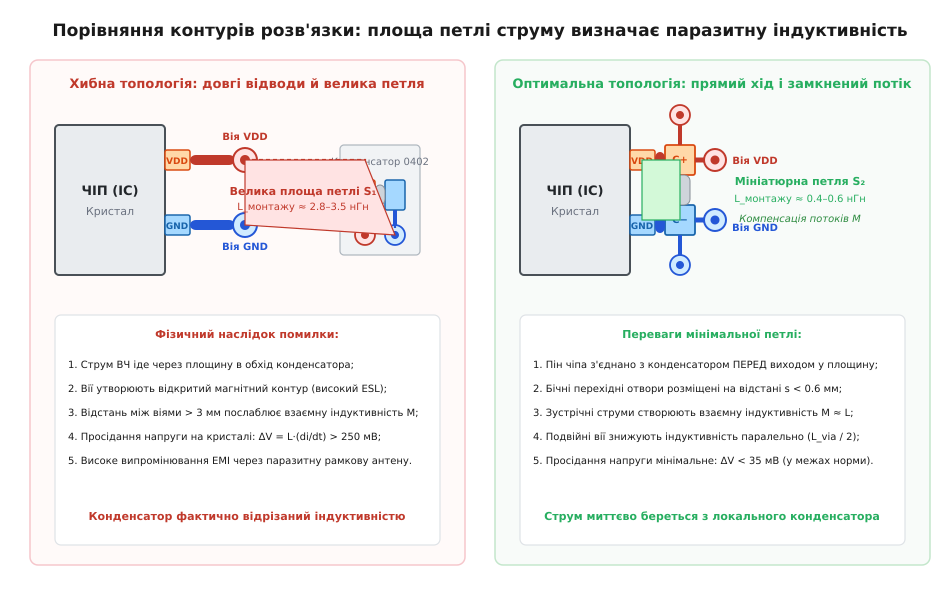
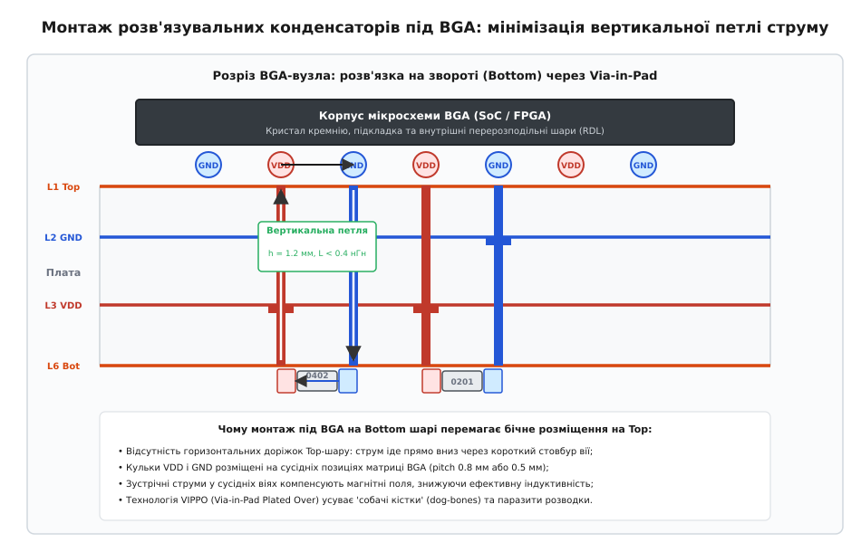

# Розводка розв'язки: площа петлі й де насправді стоїть конденсатор

<preknowlist>
- [Індуктивність і магнітний потік](root:ph-electromagnetism/inductance)
- [Паразитні параметри компонентів](root:hw-components/capacitor-parasitics)
- [Структура багатошарових друкованих плат](root:hw-pcb/pcb-stackup)
- [Цілісність живлення (Power Integrity)](root:hw-pcb/power-integrity)
</preknowlist>

Під час запуску нового прототипу обчислювального модуля на базі сучасного процесора або матриці FPGA інженери часто стикаються з незрозумілою нестабільністю: система раптово зависає під час пікових навантажень, тактові генератори PLL втрачають синхронізацію, а на шинах високошвидкісних інтерфейсів стрімко зростає кількість бітових помилок. При цьому принципова електрична схема виглядає бездоганно — за рекомендаціями виробника чіпа встановлено кілька десятків керамічних конденсаторів номіналом 100 нФ, 1 мкФ та 10 мкФ, увімкнених паралельно шині живлення ядра `VDD_CORE`.

Коли до шини живлення безпосередньо біля виводів мікросхеми підключають широкосмуговий осцилограф, замість стабільної постійної напруги 0.90 В фіксуються потужні високочастотні провали амплітудою до 250–300 мВ із крутими фронтами наростання. У мікроелектронних компонентах із напругою живлення нижче одного вольта допустиме вікно коливань зазвичай становить не більше `±3%` або `±5%` (для напруги 0.90 В це діапазон від 0.855 В до 0.945 В). Падіння напруги нижче 0.70 В призводить до фатального порушення часових затримок логічних вентилів усередині кремнієвого кристала.

Причина такого збою полягає в тому, що на принциповій схемі конденсатор зображено як ідеальний зосереджений елемент, підключений до безрозмірного еквіпотенціального вузла. Проте на реальній друкованій платі ніяких «точкових вузлів» не існує. Електричний струм — це просторовий потік зарядів, який завжди протікає замкненим фізичним контуром. Уся геометрія провідників, контактних площадок і перехідних отворів між кремнієвим кристалом та обкладками конденсатора утворює просторову магнітну петлю з власною паразитною індуктивністю.

Якщо швидкість наростання споживаного струму логічних блоків чіпа сягає `di/dt = 40 А/нс`, а недбало розведена друкована плата вносить у контур лише `2.0 нГн` паразитної індуктивності монтажу, напруга на виводах живлення чіпа зазнає стрибкоподібного динамічного падіння:

```
V_drop = L_loop · (di/dt)               [закон електромагнітної індукції Фарадея]
       = 2.0·10⁻⁹ Гн · (40 / 10⁻⁹ А/с)  [підстановка паразитної індуктивності 2 нГн та швидкості 40 А/нс]
       = 80 В                           [теоретичний стрибок динамічної проти-ЕРС]
```

У реальному пристрої струм обмежується внутрішніми паразитними ємностями та активними опорами схеми, проте цей стрибок повністю спустошує локальний запас енергії, створюючи глибоке просідання напруги (Power Rail Droop). Конденсатор, розташований на схемі «паралельно виводу», у просторі друкованої плати через невдале трасування виявляється відрізаним індуктивним бар'єром, що перетворює його на абсолютно безкорисний компонент.

Розуміння фізики просторової петлі струму, точний розрахунок балансу індуктивностей монтажу та дотримання правил тривимірного розміщення розв'язувальних компонентів є фундаментальною основою проєктування сучасних цифрових систем.

## Електродинамічна природа індуктивності контуру

У квазістаціонарному наближенні електродинаміки поняття індуктивності є математичною мірою здатності геометричного контуру накопичувати магнітну енергію в навколишньому просторі при протіканні електричного струму.

Повна магнітна енергія `W_m`, зосереджена в об'ємі діелектрика друкованої плати навколо провідників зі струмом `I`, визначається інтегралом:

```
W_m = (1 / 2) · ∫∫∫ μ · |H(r)|² dV = (1 / 2) · L_loop · I²
```

де `H(r)` — вектор напруженості магнітного поля в точці `r`, `μ` — абсолютна магнітна проникність середовища, а `L_loop` — повна петлева індуктивність контуру.

З цього фундаментального рівняння випливає ключовий закон цілісності живлення:
> **Індуктивність — це не внутрішня властивість радіодеталі, а геометрична характеристика тривимірного простору, охопленого контуром струму.**

Щоб мінімізувати паразитну індуктивність `L_loop`, розробник зобов'язаний мінімізувати об'єм простору, в якому існує ненульове магнітне поле `H(r)`. Якщо прямий струм живлення `VDD` і зворотний струм землі `GND` течуть паралельно в безпосередній просторовій близькості один від одного, вектори їхніх магнітних полів мають протилежні напрямки:

```
H_total(r) = H_vdd(r) + H_gnd(r) ≈ 0
```

У зовнішньому просторі магнітні поля суперпонуються та взаємно знищуються. Густина магнітної енергії `|H_total(r)|²` прямує до нуля, що автоматично зводить до мінімуму повну індуктивність монтажу `L_loop`. Навпаки, рознесення прямого та зворотного провідників у просторі відкриває широку петлю, магнітне поле якої заповнює великий об'єм плати, багаторазово збільшуючи індуктивність і перешкоджаючи швидкій передачі енергії від конденсатора до навантаження.

## Високочастотні ефекти в провідниках: скин-ефект та ефект близькості

При аналізі роботи розв'язувальних кіл на високих частотах необхідно враховувати зміну характеру протікання струму всередині самих мідних провідників.

### 1. Скин-ефект (Skin Effect)

Зі зростанням частоти струму вихрові магнітні поля всередині провідника витісняють рухомі заряди з центральної частини поперечного перерізу до його зовнішньої поверхні. Густина струму експоненційно спадає від поверхні вглиб металу. Глибина проникнення струму (Skin Depth, `δ`), на якій густина струму зменшується в `e ≈ 2.718` разів, визначається виразом:

```
δ = 1 / √(π · f · μ · σ)
```

Для міді (`σ = 5.8 · 10⁷ См/м`, `μ = μ₀ = 1.2566 · 10⁻⁶ Гн/м`) маємо:
- На частоті `f = 1 МГц`: `δ ≈ 66.0 мкм` (струм тече практично всім перерізом стандартної фольги товщиною 35 мкм);
- На частоті `f = 10 МГц`: `δ ≈ 20.9 мкм`;
- На частоті `f = 100 МГц`: `δ ≈ 6.6 мкм`;
- На частоті `f = 1 ГГц`: `δ ≈ 2.1 мкм`.

Скин-ефект кардинально змінює баланс індуктивностей. На низьких частотах повна індуктивність провідника складається із зовнішньої індуктивності (магнітне поле зовні провідника) та внутрішньої індуктивності (магнітне поле всередині металу, що дає константу `0.5` у формулі Гровера). На частотах вище 50 МГц через витіснення струму на поверхню внутрішнє магнітне поле зникає, а внутрішня індуктивність прямує до нуля. Повна індуктивність визначається виключно зовнішньою геометрією контуру.

### 2. Ефект близькості (Proximity Effect)

Коли два провідники з протилежно спрямованими струмами розташовані поруч, магнітне поле одного провідника впливає на розподіл носіїв заряду в іншому. Струми притягуються до внутрішніх суміжних граней провідників.

У результаті ефективна площа поперечного перерізу контуру між струмовими нитками стає ще меншою, ніж геометрична відстань між центрами провідників. Це додатково знижує результуючу індуктивність пари провідників на 10–15% порівняно з квазістатичним розрахунком, підтверджуючи критичну важливість максимально щільного зближення перехідних отворів живлення та землі.

## Анатомія паразитної індуктивності монтажу

Повна петлева індуктивність монтажу розв'язувального конденсатора (Mounting Loop Inductance, `L_mount`) не є фіксованою паспортною величиною компонента. Це результат електромагнітної взаємодії всіх геометричних ділянок, якими рухається прямий струм від конденсатора до навантаження і повертається назад через опорні площини.


*Порівняння площі контуру струму та паразитної індуктивності монтажу: некоректна топологія з довгими доріжками (ліворуч, L = 2.92 нГн) проти оптимальної бічної конфігурації з мінімальною петлею (праворуч, L = 0.78 нГн)*

Повний шлях струму в просторі плати розбивається на шість послідовних складових:

```
L_mount = L_ESL + L_pad + L_trace + (L_via_gnd + L_via_pwr - 2 · M_via) + L_spread
```

Розглянемо фізичну сутність та енергетичний внесок кожної складової:

1. **Власна індуктивність корпусу конденсатора (`L_ESL`)**: Внутрішня геометрія багатошарового керамічного конденсатора (MLCC) містить паралельні металеві обкладки та торцеві виводи металізації. Струм, що входить крізь один торець і виходить крізь інший, утворює всередині компонента просторову петлю. Для типового конденсатора розміру 0805 власна індуктивність становить `0.8–1.1 нГн`, для 0603 — `0.5–0.7 нГн`, для 0402 — `0.35–0.45 нГн`, а для мініатюрного 0201 — близько `0.18–0.25 нГн`.
2. **Індуктивність поверхневих контактних площадок (`L_pad`)**: Контактні площадки друкованої плати (SMD Pads), до яких припаюються виводи конденсатора, є плоскими прямокутними провідниками з типовими розмірами від 0.5 × 0.5 мм до 1.0 × 1.0 мм. Через ненульову довжину та ширину вони створюють додаткову власну індуктивність у діапазоні від `0.10` до `0.35 нГн`.
3. **Індуктивність поверхневих друкованих доріжок (`L_trace`)**: Відрізки друкованих доріжок, що з'єднують контактні площадки з перехідними отворами або з виводами мікросхеми. Для стандартної мікросмужкової лінії на поверхневому шарі погонна індуктивність становить приблизно `0.6–1.0 нГн/мм` при звичайній ширині провідника 0.2–0.3 мм. Траса довжиною лише 2 мм здатна подвоїти загальну індуктивність монтажу.
4. **Власна індуктивність перехідних отворів (`L_via_gnd` та `L_via_pwr`)**: Вертикальні металізовані стовбури, що пронизують діелектрик плати від поверхні монтажу до внутрішніх мідних шарів живлення та землі. Кожен стовбур діє як вертикальний лінійний провідник. Індуктивність отвору прямо пропорційна його глибині (товщині діелектрика до опорного шару) і становить від `0.3` до `1.2 нГн` на одну вію.
5. **Взаємна індуктивність між перехідними отворами (`M_via`)**: Коли прямий струм опускається по перехідному отвору шини `VDD`, а зворотний струм одночасно піднімається по сусідньому отвору землі `GND`, магнітні поля, створені цими протилежно спрямованими струмами, накладаються одне на одне в навколишньому просторі. Оскільки струми спрямовані назустріч один одному, їхні магнітні поля мають протилежні векторні напрямки і взаємно компенсуються. У результуючому виразі петлевої індуктивності взаємна індуктивність входить зі знаком мінус і подвійним коефіцієнтом: `-2 · M_via`. Чим ближче розташовані один до одного отвори живлення та землі, тим більше значення має `M_via`, і тим нижчою стає сумарна індуктивність пари.
6. **Індуктивність розтікання струму в площинах (`L_spread`)**: У точках входу перехідних отворів у внутрішні суцільні мідні полігони струм розтікається радіально від циліндра вії в об'єм площини. Цей процес створює додаткову розподілену індуктивність, яка залежить від відстані між площинами живлення і землі та радіуса отворів (зазвичай `0.02–0.10 нГн`).

У невдало розведеному вузлі, де конденсатор відсунутий від мікросхеми на 3–4 мм і з'єднаний тонкими трасами з довільно розкиданими перехідними отворами, сумарна індуктивність монтажу сягає `3.0–4.0 нГн`. У результаті високоякісний дорогий конденсатор працює не краще, ніж дешевий компонент удвічі більшого типорозміру, перетворюючись на генератор резонансних сплесків напруги.

Для детального аналітичного розрахунку всіх складових цієї матриці часткових індуктивностей, формул Гровера для контактних площадок і моделей Клейтона Пола для взаємодії циліндричних вій створено [детальний інженерний розрахунок та калькулятор еквівалентної індуктивності монтажу на C та C++](root:hw-pcb/rozvodka-rozviazky/proj-decoupling-loop-calc.md).

## Еволюція форм-факторів конденсаторів та власна індуктивність ESL

Основним дискретним елементом сучасної розв'язки є багатошаровий керамічний конденсатор (Multi-Layer Ceramic Capacitor, MLCC). Внутрішня структура MLCC являє собою монолітний керамічний паралелепіпед із чергованими електродами, з'єднаними з двома зовнішніми металізованими виводами.

Геометрія корпусу безпосередньо визначає величину власної еквівалентної послідовної індуктивності (Equivalent Series Inductance, ESL). Індуктивність будь-якого провідника пропорційна його довжині та обернено пропорційна його ширині (поперечному перерізу). Чим довший шлях струму всередині компонента від одного торця до іншого, тим більше просторове магнітне поле він створює.

Нижче наведено порівняльний аналіз стандартних типорозмірів поверхневого монтажу (SMD) для керамічних конденсаторів класу діелектрика X7R/X5R:

| Типорозмір EIA (метричний) | Довжина L (мм) | Ширина W (мм) | Типовий ESL (нГн) | Частота SRF (100 нФ) |
|---|---|---|---|---|
| 1206 (3216) | 3.20 | 1.60 | 1.20–1.50 нГн | ~13.5 МГц |
| 0805 (2012) | 2.00 | 1.25 | 0.80–1.05 нГн | ~16.5 МГц |
| 0603 (1608) | 1.60 | 0.80 | 0.50–0.70 нГн | ~21.0 МГц |
| 0402 (1005) | 1.00 | 0.50 | 0.35–0.45 нГн | ~25.5 МГц |
| 0201 (0603) | 0.60 | 0.30 | 0.18–0.25 нГн | ~36.0 МГц |
| 01005 (0402) | 0.40 | 0.20 | 0.10–0.15 нГн | ~48.0 МГц |

Зменшення геометричного типорозміру з 1206 до 0201 забезпечує зниження власної індуктивності майже в шість разів. Однак для живлення високопродуктивних ядер процесорів навіть індуктивність 0.35 нГн у корпусі 0402 може виявитися завеликою.

Для подальшого подолання індуктивного бар'єра розроблено спеціалізовані конструкції керамічних конденсаторів:

### 1. Конденсатори з реверсивною геометрією (Reverse Geometry / Wide-Terminal)

У класичному конденсаторі типорозміру 0603 контактні виводи розташовані на вузьких торцях компонента шириною 0.8 мм, а струм протікає вздовж довгої сторони 1.6 мм.

У реверсивному конденсаторі типорозміру **0306** (або **0508**) виводи перенесені на довгі бічні грані: ширина контактного електрода стає рівною 1.6 мм, а відстань між виводами скорочується до 0.8 мм. Завдяки двократному скороченню довжини струмової траєкторії та двократному розширенню провідника власна індуктивність `L_ESL` знижується до `0.10–0.15 нГн`, тобто у 3–4 рази порівняно зі звичайним 0603.

### 2. Багатовивідні інтердигітальні конденсатори (Interdigitated Capacitors — IDC)

Конденсатори типу IDC мають 8 або 10 контактних виводів, розташованих почергово по периметру корпусу за схемою `VDD - GND - VDD - GND`. Струм, що входить у компонент, розбивається на кілька паралельних протилежно спрямованих потоків. Магнітні поля сусідніх електродів взаємно гасяться безпосередньо всередині керамічного тіла, що дозволяє досягти рекордно низької власної індуктивності `0.035–0.050 нГн`.

### 3. Балансні чотириполюсні конденсатори X2Y

Конденсатори технології X2Y являють собою інтегровану чотириполюсну структуру з двома внутрішніми сигнальними обкладками та двома бічними екрануючими виводами землі. При протіканні струму формуються симетричні взаємно ортогональні магнітні поля, які повністю ліквідують паразитну індуктивність у диференційній моді, забезпечуючи ефективну фільтрацію до частот у кілька гігагерців.

## Фізика індуктивності друкованих доріжок та ефект дзеркального шару

Поширена інженерна помилка полягає у спробі з'єднати конденсатор із мікросхемою за допомогою друкованої доріжки довільної довжини на поверхневому шарі друкованої плати.

Одиничний прямолінійний провідник у вільному просторі має власну індуктивність, яка логарифмічно залежить від його довжини та поперечного перерізу. За наближеною формулою, для провідника довжиною `l` та шириною `w` погонна індуктивність становить близько `1 нГн на кожен міліметр довжини`.

Однак реальна друкована доріжка на багатошаровій платі ніколи не розглядається у вакуумі — вона розташована над суцільним внутрішнім опорним шаром міді (зазвичай шаром землі `GND` на глибині `h`).

Згідно з теорією електромагнітного поля, високочастотний струм, що протікає поверхневою доріжкою, індукує у розташованому під нею шарі землі дзеркальний зворотний струм (Image Current). Цей зворотний струм концентрується безпосередньо під сигнальною доріжкою, повторюючи її форму з поперечним розподілом густини за законом:

```
j(x) = (I / π) · (h / (h² + x²))
```

де `x` — поперечна відстань від осі доріжки, а `h` — відстань по вертикалі від доріжки до шару землі.

Індуктивність мікросмужкової лінії над суцільною площиною описується виразом:

```
L_microstrip = (μ₀ · h · l) / (w · K_f)
```

де крайовий коефіцієнт розсіювання `K_f`:

```
K_f = 1 + 1.393 · (h / w) + 0.667 · (h / w) · ln((w / h) + 1.444)
```

З цього рівняння випливають фундаментальні інженерні висновки:
1. **Індуктивність прямо пропорційна товщині діелектрика `h`**: Чим ближче суцільний шар землі розташований до поверхневого шару, тим менша площа поперечного перерізу просторової петлі між прямою доріжкою та її дзеркальним струмом, і тим меншою є результуюча індуктивність. Якщо в структурі плати (Stackup) перший препрег між шарами L1 (Top) та L2 (GND) має товщину `75 мкм` замість `250 мкм`, індуктивність усіх поверхневих доріжок розв'язки автоматично зменшується більше ніж утричі.
2. **Індуктивність обернено пропорційна ширині доріжки `w`**: Збільшення ширини провідника живлення з 0.25 мм до 1.0 мм знижує його погонну індуктивність у 2.5–3 рази. Підключення розв'язувальних конденсаторів ніколи не слід виконувати тонкими сигнальними трасами — для цього завжди застосовують широкі мідні полігони (Polygon Pours) або суцільні шини максимально можливої ширини.
3. **Будь-яке подовження доріжки додає індуктивність лінійно**: Кожен міліметр довжини доріжки над типовим шаром діелектрика `0.12 мм` додає близько `0.35–0.45 нГн`. Доріжка довжиною лише 2.5 мм повністю зводить нанівець переваги переходу від корпусу 0805 до надкомпактного 0201.

## Індуктивність перехідних отворів та взаємна компенсація магнітних полів

Коли струм живлення переходить із поверхневого шару на внутрішній полігон живлення або землі, він проходить крізь вертикальний металізований перехідний отвір (Via).

Перехідний отвір — це порожнистий мідний циліндр радіусом `r_v` та висотою `h`, де `h` дорівнює фізичній глибині залягання цільового шару від поверхні плати.

Часткова самоіндуктивність одного циліндричного перехідного отвору обчислюється за формулою:

```
L_via = (μ₀ · h / (2π)) · [ln(2h / r_v) + 0.25]
```

Для стандартного перехідного отвору з діаметром свердління `0.25 мм` (`r_v = 0.125 мм`) індуктивність становить:
- При глибині до шару L2 (`h = 0.12 мм`): `L_via ≈ 0.18 нГн`;
- При глибині до шару L3 (`h = 0.60 мм`): `L_via ≈ 0.85 нГн`;
- При повній товщині плати крізь усі шари (`h = 1.60 мм`): `L_via ≈ 1.85 нГн`.

Звідси стає очевидною критична роль чергування шарів у стекапі: якщо шар землі `GND` розташований на найближчому до поверхні шарі L2, його перехідний отвір вносить мінімальну індуктивність. Якщо ж площина живлення `VDD` заглиблена на шар L5 чи L6, довгий стовбур вії живлення створює значний паразитний індуктивний опір.

Проте індуктивність перехідних отворів не додається як проста арифметична сума окремих вій. Стовбури отворів живлення та землі працюють як паралельні провідники з протилежним напрямком струмів.

Взаємна індуктивність `M_via` між двома паралельними циліндрами висотою `h`, розташованими на відстані між їхніми центрами `s`, строго визначається моделлю Клейтона Пола:

```
M_via = (μ₀ · h / (2π)) · [ln((h / s) + √(1 + (h / s)²)) - √(1 + (s / h)²) + (s / h)]
```

Повна індуктивність пари перехідних отворів дорівнює:

```
L_pair = L_via_gnd + L_via_pwr - 2 · M_via
```

Розглянемо чисельний приклад для двох перехідних отворів глибиною `h = 0.60 мм`:
- Якщо отвори рознесені на відстань `s = 3.0 мм`, взаємна індуктивність становить лише `M_via ≈ 0.04 нГн`. Сумарна індуктивність пари дорівнює:
  `L_pair = 0.85 + 0.85 - 2 · 0.04 = 1.62 нГн`.
- Якщо ті самі отвори зблизити до мінімального технологічного зазору `s = 0.55 мм`, взаємна індуктивність зростає до `M_via ≈ 0.38 нГн`. Сумарна індуктивність пари становить:
  `L_pair = 0.85 + 0.85 - 2 · 0.38 = 0.94 нГн`.

Зближення перехідних отворів живлення та землі знижує індуктивність перехідного вузла майже вдвічі без внесення будь-яких змін у схему або зміни діаметра свердла. Перехідні отвори живлення та землі кожного розв'язувального конденсатора завжди повинні проєктуватися як щільно зв'язана координована пара.

## Порівняльний аналіз топологій трасування розв'язки

На практиці якість розв'язки визначається не стільки номіналом конденсатора, скільки топологічним розташуванням перехідних отворів відносно контактних площадок компонента.

Розглянемо шість базових топологічних конфігурацій монтажу конденсатора типорозміру 0402 на типовій 6-шаровій платі товщиною 1.6 мм:

### 1. Віддалене трасування з довгими доріжками (Far Traces)

Конденсатор встановлений на відстані 3–5 мм від мікросхеми. З'єднання виконано тонкими поверхневими доріжками шириною 0.25 мм. Перехідні отвори розміщені за межами конденсатора з довільним рознесенням 3–4 мм.
- Баланс індуктивностей: `L_ESL = 0.38 нГн`, `L_pads = 0.36 нГн`, `L_traces = 1.28 нГн`, `L_vias = 0.82 нГн`, `L_spread = 0.24 нГн`.
- Сумарна індуктивність монтажу: **`3.08 нГн`**.
- Резонансна частота системи зміщується з 25.5 МГц до **`9.1 МГц`**. На тактовій частоті 100 МГц реактивний імпеданс конденсатора зростає до `1.94 Ом`. Ця топологія є неприпустимою для сучасних цифрових вузлів.

### 2. Фатальна топологічна пастка: «Пін → Вія → Полігон → Вія → Конденсатор»

У цій конфігурації розробник розміщує перехідний отвір безпосередньо біля виводу мікросхеми, опускаючи струм на внутрішній шар, а конденсатор підключає окремою парою перехідних отворів поруч на платі.

У результаті високочастотний струм ядра, що шукає шлях найменшого імпедансу, виходить крізь перехідний отвір у внутрішню площину живлення і поширюється всім полігоном друкованої плати, минаючи конденсатор. Конденсатор виявляється підключеним як бічне відгалуження (Stubs) через додаткову пару перехідних отворів, що вносить ще `1.5–2.0 нГн` паразитної індуктивності.

Правило прямого струму (Direct Flow Rule) стверджує:
> **Вивід мікросхеми повинен спершу з'єднуватися з контактною площадкою конденсатора, і лише після проходження крізь конденсатор траса може підключатися до перехідного отвору внутрішнього шару.**

У такому разі конденсатор стоїть безпосередньо на шляху струму, діючи як первинний фільтр перехідних процесів.

### 3. Торцеве розміщення перехідних отворів (End-Via)

Перехідні отвори просвердлені на поздовжній осі компонента безпосередньо за торцями контактних площадок.
- Відстань між центрами отворів дорівнює довжині корпусу плюс відступи: `s ≈ 1.8–2.0 мм`.
- Баланс індуктивностей: `L_ESL = 0.38 нГн`, `L_pads = 0.28 нГн`, `L_traces = 0.12 нГн`, `L_vias = 0.48 нГн`, `L_spread = 0.10 нГн`.
- Сумарна індуктивність монтажу: **`1.36 нГн`**.
- Це найбільш поширена, але субоптимальна топологія. Через велику відстань між отворами коефіцієнт взаємної індуктивності `M_via` залишається малим.

### 4. Бічне розміщення перехідних отворів (Side-Via)

Перехідні отвори розвертаються на 90 градусів і розташовуються вздовж довгих бічних граней контактних площадок назустріч один одному.
- Відстань між центрами отворів скорочується до ширини корпусу плюс зазор: `s ≈ 0.65–0.75 мм`.
- Завдяки скороченню відстані взаємна індуктивність `M_via` зростає у 4–5 разів, компенсуючи власну індуктивність стовбурів.
- Баланс індуктивностей: `L_ESL = 0.38 нГн`, `L_pads = 0.18 нГн`, `L_traces = 0.04 нГн`, `L_vias = 0.14 нГн`, `L_spread = 0.04 нГн`.
- Сумарна індуктивність монтажу: **`0.78 нГн`**.
- Простий поворот перехідних отворів у САПР знижує індуктивність монтажу майже вдвічі без будь-яких додаткових витрат.

### 5. Подвійні симетричні бічні отвори (Double Side-Via — 4 отвори)

Біля кожної контактної площадки симетрично розміщується по два перехідні отвори (всього 4 вії на один конденсатор).
- Отвори утворюють два паралельні контури струму, що знижує власну індуктивність перехідних отворів удвічі.
- Квадрупольна симетрія магнітних полів забезпечує практично повне взаємне гасіння зовнішніх магнітних ліній.
- Сумарна індуктивність монтажу падає до **`0.55–0.60 нГн`**.
- Ця топологія є золотим стандартом для поверхневого монтажу критичних кіл живлення PLL, блоків SerDes та шин опорної напруги ADC/DAC.

### 6. Вплив термобар'єрів (Thermal Relief) на індуктивність

Поширеною помилкою топологів є використання автоматичних правил термобар'єрів («хрестовин») для перехідних отворів розв'язки при підключенні до внутрішніх площин. Термобар'єр являє собою 4 тонкі мідні перемички шириною 0.2 мм, покликані полегшити прогрів площадки при ручній пайці.

Однак у високочастотних колах ці тонкі перемички діють як дроселі, збільшуючи індуктивність підключення кожної вії на `0.25–0.40 нГн`. Для всіх перехідних отворів і площадок розв'язувальних конденсаторів підключення до площин живлення та землі повинно виконуватися **суцільним заливанням (Direct Connect)** без термобар'єрів.

## Розміщення розв'язки під BGA-матрицею та технологія Via-in-Pad

Для сучасних великих процесорів, GPU та FPGA у корпусах BGA (Ball Grid Array) із кількістю виводів від 500 до 3000 кулькових контактів розміщення розв'язувальних конденсаторів на лицьовій стороні (Top) по периметру чіпа стає фізично неефективним.


*Вертикальний розріз друкованої плати під BGA-мікросхемою: розв'язувальні конденсатори на шарі Bottom підключені безпосередньо до стовбурів перехідних отворів живлення та землі за технологією VIPPO (IPC-4761 Type VII)*

При розмірах корпусу BGA `35 × 35 мм` відстань від конденсатора на периферії до виводів живлення ядра в центрі матриці становить `15–20 мм`. Навіть при трасуванні широким полігоном така відстань вносить понад `4–6 нГн` індуктивності, що повністю блокує субнаносекундне живлення.

Єдиним ефективним рішенням є встановлення мініатюрних керамічних конденсаторів (типорозміру 0201 або 0402) на **зворотному боці друкованої плати (Bottom Layer)** безпосередньо під масивом виводів BGA.

У такій конфігурації реалізується технологія **Via-in-Pad Plated Over (VIPPO)**:
1. Перехідні отвори просвердлюються безпосередньо всередині контактних площадок BGA на верхньому шарі або всередині контактних площадок конденсатора на нижньому шарі;
2. Згідно зі стандартом **IPC-4761 Type VII**, стовбури отворів заповнюються неелектропровідною епоксидною пастою з підібраним коефіцієнтом термічного розширення (CTE-matched epoxy);
3. Торці отворів поліруються в площину поверхні плати та покриваються суцільним шаром гальванічної міді (Cap Plating) товщиною не менше `12–15 мкм`.

Завдяки технології VIPPO струм від конденсатора до кулькового виводу BGA рухається суто вертикально крізь стовбур отвору найкоротшим шляхом. Довжина горизонтальних поверхневих доріжок стає рівною нулю. Повна індуктивність монтажу під BGA знижується до **`0.35–0.45 нГн`**, забезпечуючи безперешкодне постачання струму до кремнієвого кристала.

## Просторовий радіус ефективної дії розв'язки

Швидкість поширення електромагнітної хвилі в діелектричній основі друкованої плати обмежена її відносною діелектричною проникністю `ε_r`:

```
v_prop = c₀ / √(ε_r)
```

Для стандартного склотекстоліту FR-4 (`ε_r ≈ 4.2–4.4`) швидкість поширення становить `v_prop ≈ 144–146 мм/нс` (приблизно половина швидкості світла у вакуумі).

Це означає, що будь-яка зміна напруги, викликана комутацією транзисторів, не з'являється на виводах конденсатора миттєво. Електромагнітна хвиля збурення повинна добігти по шині живлення до конденсатора, зарядити або розрядити його і повернутися назад до мікросхеми.

Щоб конденсатор встиг компенсувати динамічне просідання напруги на певній гармоніці частоти `f`, затримка поширення сигналу в лініях плати не повинна перевищувати чверть періоду хвилі (а з урахуванням інженерного запасу фази `k_safety = 4` — не більше `1 / (8π)` періоду):

```
r_eff(f) = v_prop / (2π · f · k_safety)
```

Нижче наведено розрахункові значення ефективного просторового радіуса дії `r_eff` для матеріалу FR-4:

- **f = 10 МГц**: `r_eff ≈ 580 мм` (конденсатор ефективно живить усю плату в радіусі понад пів метра);
- **f = 50 МГц**: `r_eff ≈ 116 мм` (конденсатор обслуговує локальну зону плати);
- **f = 100 МГц**: `r_eff ≈ 58 мм` (конденсатор повинен знаходитися на відстані не більше 5–6 см);
- **f = 500 МГц**: `r_eff ≈ 11.6 мм` (вимагає розміщення впритул до корпусу мікросхеми);
- **f = 1.0 ГГц**: `r_eff ≈ 5.8 мм` (розміщення можливе виключно на зворотному боці під BGA);
- **f = 2.5 ГГц**: `r_eff ≈ 2.3 мм` (фізично перевищує товщину плати; дискретні зовнішні конденсатори повністю втрачають ефективність).

З цих фундаментальних обмежень випливає закон просторової ієрархії: на частотах понад 1 ГГц жоден дискретний конденсатор, встановлений на поверхні друкованої плати, не здатний забезпечити розв'язку ядра. На гігагерцових частотах живлення кристала забезпечується виключно внутрішньою міжшаровою ємністю самої друкованої плати, конденсаторами на підкладці корпусу чіпа (Package Capacitors) та вбудованою ємністю кристала (On-Die Decoupling).

## Синтез імпедансного профілю PDN та паралельні антирезонанси

Розподілена мережа постачання живлення (Power Distribution Network, PDN) повинна підтримувати свій комплексний вихідний опір нижче розрахункового цільового значення (Target Impedance) у всьому робочому діапазоні частот від постійного струму до гігагерцових гармонік:

```
Z_target = (V_nom · Ripple_percent) / I_transient
```

Для процесора з напругою `V_nom = 0.90 В`, допустимими пульсаціями `±3%` (`ΔV = 27 мВ`) та стрибком струму `I_transient = 18 А` цільовий опір становить:

```
Z_target = 0.027 В / 18 А = 0.0015 Ом = 1.5 мОм
```

Для перекриття широкої смуги частот розробники часто встановлюють паралельно конденсатори різних номіналів: наприклад, 10 мкФ, 100 нФ та 1 нФ. Проте неграмотне паралельне з'єднання створює небезпечне фізичне явище — **паралельний антирезонанс (Anti-Resonance Peak)**.

Кожен конденсатор має частоту власного послідовного резонансу (SRF):

```
f_SRF = 1 / (2π · √(L_mount · C))
```

Нижче частоти `f_SRF` конденсатор має ємнісний характер імпедансу (`Z_C = 1 / (jωC)`), а вище цієї частоти — чисто індуктивний характер через паразитну індуктивність монтажу (`Z_L = jωL_mount`).

Коли в паралель вмикаються два конденсатори:
- Більший конденсатор `C1 = 10 мкФ` на частоті 50 МГц уже перебуває глибоко в індуктивній зоні і діє як котушка індуктивності `L_mount1`;
- Менший конденсатор `C2 = 100 нФ` на тій самій частоті 50 МГц ще зберігає ємнісний характер.

Індуктивність першого конденсатора утворює з ємністю другого конденсатора паралельний коливальний LC-контур. На частоті антирезонансу імпеданс шини живлення стрибкоподібно зростає до значення:

```
Z_anti ≈ √(L_mount / C2) · (1 / (ESR1 + ESR2))
```

Замість очікуваного зниження опору до 1.5 мОм на цій частоті виникає вузький пік імпедансу величиною `0.5–2.0 Ом`. Якщо тактова частота або спектральні гармоніки комутації ядра випадково збігаються з частотою антирезонансу, у системі виникає високодобротний резонансний дзвін (Power Rail Ringing), амплітуда якого в рази перевищує допустимий рівень шуму.

Правила безпечного проектування PDN для усунення антирезонансів:
1. **Використання однакових оптимізованих номіналів**: Замість комбінації `10 мкФ + 1 мкФ + 100 нФ + 10 нФ` набагато безпечніше встановити масив із 20–30 однакових конденсаторів `100 нФ 0402` з ідентичною геометрією монтажу. У цьому разі паралельне з'єднання ідентичних компонентів знижує результуючий імпеданс у `N` разів без утворення жодного антирезонансного піку.
2. **Контрольований опір демпфування (ESR Damping)**: Використання керамічних конденсаторів із наднизьким `ESR < 2 мОм` збільшує добротність паразитного контуру. Застосування компонентів із помірним `ESR = 10–30 мОм` природним чином демпфує амплітуду антирезонансних піків, згладжуючи імпедансну криву шини живлення.

## Семирівнева архітектура мережі живлення

У сучасних багатошарових платах надійна робота системи живлення базується на суворій часовій та частотній ієрархії, що складається із семи взаємодоповнюючих рівнів:

1. **Рівень 1 (Часовий діапазон 0–100 пс, смуга > 2 ГГц)**: Он-дай ємність кремнієвого кристала (On-Die Decoupling Capacitance, `C_die ≈ 20–100 нФ`). Формується паразитними ємностями затворів транзисторів і спеціальними MOS-конденсаторами, інтегрованими безпосередньо в топологію кристала. Живить логіку на перших пікосекундах фронту перемикання.
2. **Рівень 2 (Часовий діапазон 100 пс – 1 нс, смуга 500 МГц – 2 ГГц)**: Конденсатори підкладки корпусу мікросхеми (Package Capacitors, `C_pkg ≈ 1–10 мкФ`). Кремнієві глибокотраншейні конденсатори (Deep Trench Silicon Capacitors) або мініатюрні MLCC типорозміру 01005, розпаяні на верхньому або нижньому боці підкладки BGA безпосередньо біля кристала.
3. **Рівень 3 (Часовий діапазон 1–5 нс, смуга 100 МГц – 500 МГц)**: Міжшарова розподілена ємність друкованої плати (Plane Capacitance, `C_plane ≈ 2–10 нФ`). Утворюється тонким діелектриком (50–100 мкм) між внутрішніми суцільними мідними шарами живлення та землі. Володіє нульовою індуктивністю виводів і забезпечує миттєве радіальне живлення.
4. **Рівень 4 (Часовий діапазон 5–30 нс, смуга 20 МГц – 100 МГц)**: Високочастотні керамічні конденсатори на зворотному боці плати під BGA (Bottom VIPPO MLCC 0201/0402 номіналом `100 нФ`, сумарно `2–10 мкФ`). Завдяки мінімальній індуктивності вертикальних вій перекривають потреби чіпа на субмікросекундних інтервалах.
5. **Рівень 5 (Часовий діапазон 30–200 нс, смуга 2 МГц – 20 МГц)**: Середні керамічні конденсатори по периметру чіпа на лицьовій стороні (Top MLCC 0603/0805 номіналом `1–10 мкФ`, сумарно `20–100 мкФ`). Відновлюють енергію під-BGA конденсаторів.
6. **Рівень 6 (Часовий діапазон 200 нс – 2 мкс, смуга 100 кГц – 2 МГц)**: Об'ємні полімерні, танталові або алюмінієві конденсатори (Bulk POSCAP/SP-Cap `47–470 мкФ`). Розташовуються біля виходу джерела живлення та живлять плату під час реакції DC-DC перетворювача.
7. **Рівень 7 (Часовий діапазон > 2 мкс, смуга DC – 100 кГц)**: Імпульсний регулятор напруги (Voltage Regulator Module, VRM / PMIC). Контролює петлю зворотного зв'язку за напругою та відновлює статичний рівень живлення.

Усі 7 рівнів утворюють безперервний ланцюг: кожен наступний рівень заряджає попередній швидший рівень, підтримуючи вихідний імпеданс системи стабільним у всьому спектральному діапазоні.

## Оптимізація розташування виводів BGA: шаховий патерн 1:1

На рівні корпусування великих цифрових НІС конфігурація матриці виводів BGA (Pinout Assignment) має вирішальний вплив на паразитну індуктивність живлення.

Розглянемо два принципово різні підходи до призначення виводів живлення `VDD` та землі `GND` у центрі матриці чіпа:

### 1. Однополярні кластери (Island Pattern)

Усі виводи живлення `VDD` згруповані в один суцільний прямокутний блок контактів (наприклад, 4 × 4 виводи), а виводи землі `GND` розташовані окремим блоком поруч.

У такій конфігурації струм живлення входить через один масив, а повертається через інший масив, віддалений на 4–6 мм. Просторова площа петлі струму між блоками досягає `15–25 мм²`, а індуктивність зростає до `1.5–2.2 нГн`. При одночасному перемиканні вихідних буферів це створює потужний ефект підстрибування землі (Ground Bounce) та просідання живлення (Power Bounce).

### 2. Шаховий патерн 1:1 (Checkerboard Pattern)

Виводи живлення та землі чергуються в шаховому порядку, де кожна кулька `VDD` з усіх чотирьох боків оточена кульками `GND`.

У шаховому патерні:
- Кожна елементарна комірка утворює квадрупольний контур із протилежними струмами;
- Відстань між прямим і зворотним струмами мінімальна і дорівнює кроку сітки BGA `p = 0.8 мм` (або `0.5 мм`);
- Магнітні поля сусідніх комірок взаємно гасяться на 85–90%;
- Еквівалентна індуктивність на одну пару виводів знижується до **`0.05–0.08 нГн`**.

Шаховий розподіл контактів живлення та землі в BGA-матриці є обов'язковим стандартом проектування високошвидкісних обчислювальних мікросхем.

## Хвильові резонанси площинної порожнини та крайове випромінювання EMI

Пара внутрішніх мідних шарів живлення та землі, розділена діелектриком, утворює паралельну площинну лінію передачі з низьким хвильовим опором. Проте на краях друкованої плати ця лінія раптово обривається, утворюючи відкриті магнітні стінки з коефіцієнтом відбиття електромагнітної хвилі `Γ ≈ +1`.

У результаті площинна структура починає працювати як двовимірний об'ємний електромагнітний резонатор. Власні частоти коливань моди `TM_{mn}` для плати розмірами `a × b` визначаються виразом:

```
f_mn = (c₀ / (2 · √(ε_r))) · √((m / a)² + (n / b)²)
```

де `m` та `n` — моди стоячих хвиль по осях X та Y.

На цих частотах імпеданс шини живлення в певних точках плати може зростати в 10–30 разів. Крім того, на краях плати електричне поле виходить назовні, створюючи інтенсивне електромагнітне випромінювання (Edge Radiation), що призводить до провалу сертифікаційних тестів на ЕМС (CISPR 32 / FCC Class B).

Для придушення площинних резонансів та крайового випромінювання застосовують дві взаємодоповнюючі методики:
1. **Правило 20-H (20-H Rule)**: Площина живлення `VDD` відступає від краю плати на відстань, що дорівнює `20 · h` (де `h` — товщина діелектрика між площинами). Це втягує лінії електричного поля всередину площини землі, зменшуючи випромінювання на краях на 10–12 дБ;
2. **Периметральна розв'язка (Perimeter Stitching)**: По периметру плати з кроком `d ≤ λ_min / 10` встановлюються керамічні конденсатори `1–10 нФ` або масив зшиваючих перехідних отворів землі (GND Stitching Vias). Вони створюють високочастотне коротке замикання на краях плати, повністю гасячи стоячі хвилі в площині.

## Технологічні процеси та надійність паяних швів під BGA

Використання перехідних отворів усередині контактних площадок (VIPPO) висуває особливі вимоги до технології виробництва друкованих плат та монтажу компонентів.

### Класифікація перехідних отворів за стандартом IPC-4761

Стандарт IPC-4761 регламентує захист та заповнення перехідних отворів:
- **Type I (Tented Via)**: Отвір лише закритий захисною маскою зверху. Непридатний для контактних площадок, оскільки припій під час пайки затікає всередину стовбура (ефект гнота — Solder Wicking), викликаючи утворення пустот (Voids) та холодних пайок;
- **Type III / Type IV (Plugged Via)**: Отвір частково заповнений маскою або смолою без вирівнювання поверхні;
- **Type VII (Filled and Capped Via — VIPPO)**: Отвір повністю заповнений термостійким епоксидним компаундом, відполірований у площину площадки та вкритий гальванічним шаром міді товщиною не менше 12 мкм. Це єдиний тип отворів, дозволений для монтажу компонентів безпосередньо поверх вії.

### Механічна міцність та термоциклювання (Thermal Fatigue)

Під час роботи процесор циклічно нагрівається до 70–90°C та охолоджується до кімнатної температури. Різниця коефіцієнтів лінійного теплового розширення (CTE):
- Кремнієвий кристал: `CTE ≈ 2.6 ppm/°C`;
- Матеріал підкладки FCBGA: `CTE ≈ 12–15 ppm/°C`;
- Друкована плата FR-4: `CTE ≈ 14–17 ppm/°C`;
- Кераміка конденсатора MLCC: `CTE ≈ 8–10 ppm/°C`.

Ця різниця викликає циклічні зсувні зусилля у паяних з'єднаннях керамічних конденсаторів 0201/0402 під BGA. Через кілька сотень циклів у стандартному олов'яно-свинцевому або безсвинцевому (SAC305) паяному шві можуть з'явитися мікротріщини, що призводить до відриву конденсатора.

Для запобігання цій проблемі в надійній електроніці (Automotive, Industrial, Aerospace) застосовують керамічні конденсатори з **м'якими полімерними виводами (Soft Termination / FlexiCap)**. У конструкцію торцевого електрода вводиться шар електропровідного еластичного полімеру, який демпфує термічні та механічні згинальні напруження друкованої плати, виключаючи розтріскування кераміки.

## Динаміка перехідних процесів: феномен трьох просідань (Three Droops)

При стрибкоподібному збільшенні навантаження напруга на шині живлення процесора зазнає трьох послідовних хвиль динамічного просідання (Three Droops Phenomenon):

1. **First Droop (Час реакції 0–500 пс)**: Первинне падіння напруги, викликане індуктивністю підкладки корпусу мікросхеми `L_pkg` та мікрозварних з'єднань. Амплітуда повністю визначається величиною он-дай ємності `C_die` кремнієвого кристала. Друкована плата в цей інтервал часу фізично не встигає зреагувати через затримку поширення електромагнітної хвилі;
2. **Second Droop (Час реакції 5–50 нс)**: Вторинне просідання напруги, коли заряд он-дай ємності вичерпано, а струм починає споживатися з конденсаторів на друкованій платі. Амплітуда Second Droop цілком і повністю визначається паразитною індуктивністю монтажу `L_mount` під-BGA конденсаторів. Якщо індуктивність монтажу перевищує 1.5 нГн, Second Droop пробиває нижню межу допустимої напруги живлення, спричиняючи скидання системи;
3. **Third Droop (Час реакції 100 нс – 2 мкс)**: Третє просідання напруги, що виникає в інтервалі, коли керамічні конденсатори плати частково розрядилися, а імпульсний стабілізатор живлення VRM ще не встиг наростити вихідний струм через затримку петлі зворотного зв'язку ШІМ-контролера. Компенсується об'ємними полімерними танталовими конденсаторами ємністю 100–470 мкФ.

Мінімізація індуктивності монтажу розв'язки на друкованій платі є єдиним дієвим інструментом придушення найнебезпечнішого другого піку просідання напруги (Second Droop).

## Ізоляція змішаних доменів живлення та опорні площини

Сучасні системи на кристалі (SoC) містять цифрові ядра, аналогові блоки фазового автопідстроювання частоти (PLL), високошвидкісні приймачі SerDes та аналогово-цифрові перетворювачі (ADC).

Поширеною помилкою минулих років було фізичне розрізання опорного шару землі (Split Ground Plane) на окремі «цифрову» та «аналогову» ділянки. У сучасних високошвидкісних платах це призводить до катастрофічних наслідків: якщо високошвидкісна сигнальна траса перетинає такий розріз у шарі землі, її зворотний струм змушений обтікати розріз широкою петлею, що створює потужні електромагнітні завади та руйнує цілісність сигналу.

Сучасне інженерне правило формування опорних шарів:
> **Опорний шар землі `GND` повинен бути єдиним, нерозривним і суцільним під усією площею мікросхеми.**

Розділення доменів живлення виконується виключно на рівні шарів живлення:
1. Для аналогових вузлів (PLL, ADC) створюються локальні ізольовані острови живлення (Power Islands) на внутрішніх або поверхневих шарах;
2. Кожен острів живиться через локальний LC-фільтр (феритовий чіп-дросель із низьким активним опором плюс керамічний конденсатор з монтажем Side-Via);
3. Зворотний струм усіх доменів безперешкодно повертається через єдиний монолітний шар землі `GND`, не утворюючи паразитних петель.

## Технології HDI та Any-Layer у високощільній розв'язці

При переході до надщільних корпусів із кроком BGA `0.4–0.5 мм` класичні механічні свердла діаметром 0.20–0.25 мм стають непридатними через геометричні обмеження паяльних площадок (Pad Size). У таких дизайнах застосовують технологію друкованих плат високої щільності (High Density Interconnect, HDI):

1. **Лазерні мікровії (Laser Microvias)**: Лазерний промінь формує глухі отвори діаметром `75–100 мкм` на глибину одного шару діелектрика (`50–80 мкм`). Індуктивність однієї лазерної мікровії становить лише `0.04–0.07 нГн` (у 5–8 разів менше за класичну наскрізну вію);
2. **Стек мікровій (Stacked Microvias)**: Лазерні мікровії розташовуються строго одна над одною крізь 2–3 поверхневі шари та заповнюються суцільною гальванічною міддю (Copper Filled Microvias). Це дозволяє виводити живлення від шару L1 до L3 з рекордно низькою петлевою індуктивністю `0.10–0.15 нГн`;
3. **Any-Layer HDI**: Технологія, де кожен шар плати з'єднується з будь-яким іншим шаром за допомогою мікровій без наскрізних отворів. Це дозволяє розпаювати надмініатюрні конденсатори 01005 безпосередньо у внутрішніх сигнальних шарах плати, наближаючи розв'язку впритул до кремнієвого кристала.

## Фазовий шум генераторів та джитер (PSIJ)

Шум на шинах живлення є головною причиною деградації фазового шуму та джитеру високошвидкісних інтерфейсів (Power Supply Induced Jitter, PSIJ).

Усередині мікросхеми затримка поширення сигналу логічного інвертора описується спрощеною формулою:

```
t_prop = (C_load · V_dd) / (μ · C_ox · (W / L) · (V_dd - V_th)²)
```

де `V_dd` — напруга живлення, а `V_th` — порогова напруга транзистора.

Будь-які високочастотні коливання напруги живлення `ΔV_dd(t)` викликають модуляцію часової затримки логічних буферів тактового дерева, перетворюючись на фазовий джитер тактового сигналу.

Якщо через невдале трасування розв'язки на шині живлення виникає антирезонансний пік на частоті 150 МГц, завада амплітудою всього 30 мВ генерує паразитні бічні спектральні смуги (Spurs) у вихідному сигналі PLL, що призводить до закриття «очного вікна» (Eye Diagram) у каналах PCIe Gen 5 (32 Гбіт/с) та 112G PAM4 SerDes. Використання топології `Double Side-Via` або конденсаторів `X2Y` для живлення AVDD є критичною умовою забезпечення низького джитеру.

## Вплив напруги зміщення (DC Bias) та температури на MLCC

При виборі конденсаторів для розв'язки необхідно враховувати два фундаментальні фізичні ефекти кераміки класу II (титанату барію `BaTiO₃`):

### 1. Ефект постійної напруги зміщення (DC Bias Effect)

Прикладення постійної електричної напруги до керамічного діелектрика поляризує його сегнетоелектричні домени. Вільні диполі фіксуються в напрямку поля, що зменшує здатність матеріалу реагувати на змінний сигнал.

У результаті реальна ефективна ємність конденсатора стрімко падає зі зростанням прикладеної напруги:
- Конденсатор `100 нФ 6.3V 0402 X7R` під напругою `0.9 В` зберігає близько `92%` номінальної ємності;
- Той самий конденсатор під напругою `3.3 В` втрачає до `45%` ємності (`C_eff ≈ 55 нФ`);
- Під напругою `5.0 В` реальна ємність падає до `20–25 нФ` (втрата 75–80%).

Падіння ємності зміщує резонансну частоту `f_SRF` вгору, несподівано змінюючи імпедансний профіль PDN. Правило проектування: робоча номінальна напруга конденсатора повинна бути щонайменше у 2–3 рази вищою за фактичну напругу шини живлення.

### 2. Температурний дрейф

При низьких температурах (`-40°C`) активний опір `ESR` полімерних та танталових конденсаторів зростає у 3–5 разів через зниження рухливості іонів, що може спричинити втрату стійкості петлі стабілізатора VRM. Керамічні конденсатори X7R зберігають стабільність у межах `±15%` у діапазоні від `-55°C` до `+125°C`, залишаючись найнадійнішим базисом високочастотної розв'язки.

## Вбудовані ємнісні матеріали (Embedded Capacitance Materials)

Для ультрависокопродуктивних обчислювальних плат (серверні процесори, прискорювачі нейромереж) дискретні керамічні конденсатори на поверхні плати навіть з оптимізованим монтажем не завжди здатні забезпечити наднизький цільовий імпеданс у гігагерцовому діапазоні.

У таких системах застосовують передову технологію **вбудованих ємнісних матеріалів (Embedded Capacitance Materials, ECM)**, таких як DuPont Interra, 3M C-Ply або Oak-Mitsui FaradFlex.

Матеріал ECM являє собою ультратонкий діелектричний шар товщиною від `12 мкм` до `24 мкм`, покритий з обох боків мідною фольгою. До складу діелектрика вводяться керамічні наночастинки титанату барію, що підвищує відносну діелектричну проникність до `ε_r ≈ 10–25` (проти `ε_r = 4.2` у звичайного FR-4).

Порівняння параметрів розподіленої міжшарової ємності:
- **Стандартний FR-4 препрег (товщина 100 мкм, ε_r = 4.2)**: питома ємність становить близько `37 пФ/см²`;
- **Тонкий препрег FR-4 (товщина 50 мкм, ε_r = 4.2)**: питома ємність `74 пФ/см²`;
- **Матеріал FaradFlex MC24M (товщина 24 мкм, ε_r = 16.0)**: питома ємність досягає `590 пФ/см²`;
- **Матеріал 3M C-Ply (товщина 12 мкм, ε_r = 22.0)**: питома ємність досягає **`1620 пФ/см²`** (понад 1.6 нФ на квадратний сантиметр).

Вбудований шар ECM під процесором розміром 40 × 40 мм (площа 16 см²) створює власну розподілену ємність величиною `26 нФ`. Оскільки ця ємність розподілена безпосередньо всередині структури плати між суцільними мідними шарами, її індуктивність виводів та контактних площадок строго дорівнює **нулю**. Шар ECM діє як ідеальний безіндуктивний конденсатор, що забезпечує ультранизький імпеданс аж до частот 3–5 ГГц.

## Комп'ютерне 3D EM моделювання та екстракція S-параметрів

Сучасне проектування систем живлення high-speed плат неможливе без тривимірного електромагнітного моделювання в спеціалізованих пакетах Power Integrity (Ansys SIwave / HFSS, Cadence Sigrity PowerSI, Keysight ADS).

Процедура комп'ютерної валідації PDN включає такі етапи:
1. **Імпорт геометрії друкованої плати**: САПР імпортує повну базу даних плати (формати ODB++, IPC-2581) з точними розмірами провідників, перехідних отворів та характеристиками діелектриків;
2. **Адаптивне сіткове розбиття (Meshing)**: Полігони живлення, землі та металізовані циліндри вій розбиваються на скінченні тривимірні або планарні елементи (Finite Element Method — FEM / Method of Moments — MoM);
3. **Екстракція багатополюсних S-параметрів**: Симулятор обчислює частотну характеристику системи від 10 кГц до 5 ГГц, формуючи Touchstone-матрицю розсіювання (файли `.sNp`), яка враховує всі взаємні індуктивності та ємності між сотнями отворів;
4. **Ко-симуляція в часовій та частотній областях**: До екстрагованої моделі підключаються SPICE-моделі конденсаторів з урахуванням ESR/ESL, моделі регулятора VRM та IBIS-моделі струму споживання процесора.

Результатом моделювання є детальний графік вихідного імпедансу `Z(f)` у кожному вузлі живлення чіпа та тривимірна карта розподілу високочастотних струмів, що дозволяє виявити небезпечні антирезонансні піки та перевантажені перехідні отвори ще до виготовлення дослідного зразка плати.

## Покроковий алгоритм розведення розв'язки в САПР

Для гарантованого досягнення мінімальної індуктивності монтажу в середовищах Altium Designer, Cadence Allegro або KiCad рекомендується дотримуватися наступної покрокової послідовності дій:

1. **Крок 1. Конфігурація стек-апу**: Розмістіть шар землі `GND` безпосередньо під верхнім шаром монтажу (шар L2) з товщиною діелектричного препрегу не більше `75–100 мкм`. Це мінімізує індуктивність усіх поверхневих контактних площадок і доріжок;
2. **Крок 2. Створення оптимізованих посадкових місць (Footprints)**: Для конденсаторів 0402 та 0603 створіть посадкові місця з бічним розташуванням перехідних отворів (Side-Via). Для конденсаторів 0201/0402 під BGA застосуйте площадки з інтегрованими отворами VIPPO (Type VII);
3. **Крок 3. Первинне розміщення розв'язки**: Розмістіть високочастотні конденсатори 0201 на шарі Bottom прямо під BGA-матрицею. Вирівняйте осі конденсаторів паралельно найближчим парам виводів VDD/GND чіпа;
4. **Крок 4. Трасування за правилом прямого струму**: Підключіть виводи живлення мікросхеми безпосередньо до площадок конденсаторів. Забороняється скидати струм у внутрішній шар до проходження крізь конденсатор;
5. **Крок 5. Налаштування правил DRC (Design Rules)**: Задайте правило `Direct Connect` (без термобар'єрів) для всіх перехідних отворів і полігонів кіл розв'язки;
6. **Крок 6. Контроль паяльної маски (Solder Mask Dam)**: Переконайтеся, що між близько розташованими перехідними отворами та контактними площадками нанесено перемичку маски шириною не менше `75 мкм` для виключення утворення паяльних перемичок при монтажі.

## Практичні розрахунки на C та C++ у проекті

Для автоматизованого розрахунку цільового імпедансу PDN, аналізу петлевої індуктивності для різних топологій і визначення частот резонансу наведено програмний модуль двома мовами програмування.

:::tabs
:::code rozvodka-rozviazky-d/c/main.c
:::code rozvodka-rozviazky-d/cpp/main.cpp
:::

## Практична метрологія та вимірювальна валідація на платі

Перевірка якості розведення розв'язки на виготовленій платі вимагає прецизійних радіовимірювань.

Стандартний щуп осцилографа з довгим земляним проводом типу «крокодил» довжиною 10 см має власну паразитну індуктивність близько `100 нГн`. У поєднанні з вхідною ємністю щупа 10–15 пФ утворюється контур, який резонує на частотах 130–160 МГц, створюючи на екрані осцилографа фальшиві викиди напруги амплітудою в сотні мілівольт.

Для достовірного вимірювання імпедансу PDN та реальної індуктивності монтажу застосовується метод **2-портового прохідного шунтування (2-Port Shunt-Thru)** на векторному аналізаторі кіл (VNA):
1. Два 50-омні коаксіальні кабелі підключаються до Порту 1 та Порту 2 VNA;
2. На платі коаксіальні кабелі припаюються безпосередньо до контактних площадок тестованого конденсатора паралельно один одному;
3. На коаксіальні кабелі встановлюються феритові синфазні ізолятори для блокування блукаючих струмів заземлення приладів;
4. VNA вимірює коефіцієнт прямої передачі `S21` у діапазоні від 100 кГц до 3 ГГц.

Комплексний опір монтажного вузла обчислюється як:

```
Z_DUT = 25 · (S₂₁ / (1 - S₂₁)) ≈ 25 · S₂₁
```

Графік виміряного імпедансу має три чіткі характерні ділянки:
- **Низькочастотна гілка з нахилом -20 дБ/декаду**: Визначається чистою ємністю конденсатора `C`;
- **Точка мінімуму (дно імпедансу)**: Відповідає частоті послідовного резонансу `f_SRF`, де реактивні опори компенсуються, а виміряне значення дорівнює чистому активному опору `ESR`;
- **Високочастотна гілка з нахилом +20 дБ/декаду**: Повністю визначається сумарною індуктивністю монтажу `L_mount`.

За нахилом високочастотної гілки або за точкою резонансу індуктивність монтажу розраховується з високою точністю:

```
L_mount = 1 / ((2π · f_SRF)² · C)
```

Цей метод дозволяє експериментально перевірити якість трасування перехідних отворів і підтвердити відповідність параметрів плати вимогам цілісності живлення.

## Зведений інженерний чек-лист для тополога

Перед передачею розведеної друкованої плати на виробництво виконайте перевірку за наступним контрольним списком:

1. **[ ] Перевірка порядку струму (Direct Flow)**: Переконайтеся, що вивід живлення мікросхеми спершу з'єднується з площадкою конденсатора, і лише потім — із перехідним отвором внутрішнього шару.
2. **[ ] Бічне розміщення вій (Side-Via Orientation)**: Для всіх конденсаторів розміру 0402, 0603 та 0805 перехідні отвори повинні розташовуватися вздовж довгих сторін площадок назустріч один одному.
3. **[ ] Мінімальна відстань у парі вій (Via Pair Spacing)**: Отвори живлення `VDD` та землі `GND` кожного конденсатора повинні знаходитися на мінімально допустимій технологічній відстані (`s ≤ 0.75 мм`).
4. **[ ] Тонкий верхній діелектрик (Thin L1-L2 Prepreg)**: Опорний шар землі `GND` у стекапі повинен знаходитися на шарі L2 на відстані не більше `0.10–0.12 мм` від шару монтажу.
5. **[ ] Конденсатори під BGA (Under-BGA Decoupling)**: Для процесорів та FPGA з тактовими частотами вище 500 МГц або струмами понад 10 А високочастотні конденсатори 0201/0402 встановлені на шарі Bottom під чіпом із використанням технології VIPPO (IPC-4761 Type VII).
6. **[ ] Відсутність спільних перехідних отворів (Individual Vias)**: Кожен конденсатор має власні незалежні перехідні отвори. Спільне використання однієї вії двома конденсаторами суворо заборонено.
7. **[ ] Пряме підключення до площин (Direct Plane Connect)**: Перехідні отвори розв'язки підключені до площин живлення суцільною міддю без використання термобар'єрів («хрестовин»).
8. **[ ] Однорідність номіналів масиву (Array Homogeneity)**: Масив локальної розв'язки під чіпом зібраний із конденсаторів однакового номіналу та типорозміру для виключення паразитних антирезонансних піків.
