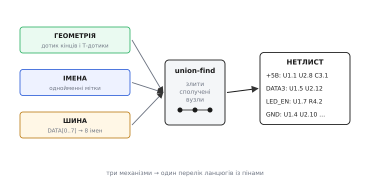

# ⚙️ Як редактор збирає нетлист із ліній, міток і шин

> Схема в редакторі — це купа намальованих об'єктів: відрізки дротів, написи-мітки, товсті шини, символи деталей із пінами. Око людини читає її як коло, та програмі картинка нічого не каже сама собою. Щоб вивести плату, редактор мусить **звести намальоване в нетлист** — перелік ланцюгів (англ. *net*), де для кожного зібрано всі піни, які мусять стати однією мідною точкою. Тут розберемо саме **складання** ланцюга: як із розкиданих відрізків виходить один дріт, як однойменні мітки зливаються в одну мережу попри відсутність лінії між ними, як `DATA[0..7]` розгортається у вісім окремих ланцюгів — і як на цьому ж кроці ловляться друкарські помилки в іменах та одинокі (висячі) ланцюги. Це не перевірка правил уже готового нетлиста — це сам момент, коли геометрія та імена перетворюються на електрику.

### Задача

Перед редактором лежить аркуш. На ньому — десятки **відрізків дроту** (кожен заданий двома кінцями, бо користувач веде лінію кусень за куснем і ставить злами), **піни** деталей (точка на аркуші, де символ під'єднується до кола), **мітки ланцюгів** (напис, прив'язаний до точки: локальний у межах аркуша чи глобальний на весь проєкт), **шини** (товста лінія з ім'ям-діапазоном) і **відгалуження від шин**. Жоден із цих об'єктів не несе в собі готового номера ланцюга — ланцюги треба **вирахувати**.

Питання, на яке має відповісти програма, одне: **які точки аркуша електрично сполучені?** І відповідь складається з трьох незалежних механізмів, що діють разом:

- **геометрія** — два об'єкти сполучені, якщо вони **дотикаються** координатами (кінець дроту лежить на іншому дроті, на піні чи на крапці-з'єднанні);
- **ім'я** — дві точки сполучені, якщо на них висять **однакові мітки** (того самого радіуса дії), навіть коли лінії між ними немає взагалі;
- **шина** — член шини `DATA3` сполучений з усім, що теж зветься `DATA3`, а сама шина — це лише компактний запис восьми таких імен.

Зібравши все це, програма мусить ще й **застерегти**: якщо ланцюг складається з єдиної точки (дріт у нікуди), або якщо ім'я схоже на сусіднє, але не збігається до символу (друкарська помилка), — це майже напевно недогляд, і про нього треба сказати, доки помилка не поїхала на плату.

> 🔧 **Навіщо це.** Цей крок — **межа між «намалював» і «спаяв»**. Усе, що редактор зрозуміє неправильно тут, далі поїде в розведення й у фотошаблон без жодного опору: доріжка ляже не туди або не ляже зовсім. Тому варто розуміти не лише, *що* робить ця машинерія, а й *де* вона мовчки помиляється, — бо саме там народжуються плати, що «зібрані точно за схемою, а не працюють».

### Ідея: спершу склеїти за дотиком, потім долити за іменем

Перший механізм — геометрія — це класична задача про **зв'язні компоненти**: уявімо піни й кінці дротів вершинами, а кожен дотик — ребром; тоді ланцюг є групою вершин, усе всередині якої сполучене. Знаходять такі групи **системою неперетинних множин** (англ. *union-find*): спершу кожна точка — окрема множина, далі за кожним дотиком дві множини **зливають**, наприкінці кожна множина, що лишилась, — окремий ланцюг. (Сам цей рушій і перевірка правил уже готового нетлиста — окрема тема: [нетлист і ERC очима редактора](root:hw-pcb/nodes-connections/proj-netlist-erc.md). Тут нас цікавить не він, а те, **що саме** ми в нього зливаємо.)

Уся сіль — у тому, як із намальованого добути ребра. І тут є три тонкощі, через які наївне «склеїти кінці, що збіглися» не працює.

**Перша: дріт — це не один відрізок.** Користувач веде лінію зламами, і навіть пряма ділянка може складатися з кількох відрізків, що лежать **на одній прямій впритул**. Якщо просто шукати збіги кінців, два колінеарні відрізки, чий спільний кінець нікуди більше не веде, склеяться правильно. Та є гірший випадок — **Т-дотик**: кінець одного дроту впирається не в кінець, а в **середину** іншого. На схемі це трійник із крапкою. Геометрично кінець C лежить десь усередині відрізка A–B, і якщо звіряти лише «кінець до кінця», цей дотик загубиться. Отже, ребро треба ставити не лише коли збіглися кінці, а й коли **точка лежить на відрізку**.

**Друга: дотик — це збіг на сітці, а не «майже».** Координати на аркуші дискретні: редактори притягують усе до сітки саме для того, щоб «дотик» був точною рівністю двох цілих чисел, а не порівнянням дробів із допуском. Два кінці, що розійшлися на піксель, — це **різні** точки й **різні** ланцюги, хоч на око «все сполучено». Тому в коді координата — ціле число кроків сітки, а збіг — звичайне `==`.

**Третя: крапка-з'єднання теж об'єкт.** Жирна крапка на 4-перехресті — це окремий елемент, що каже «усі чотири дроти, які тут сходяться, з'єднати». Без неї перетин двох дротів **не** дає ребра: лінії просто проходять одна повз одну.

Коли геометрію зведено, додають **другий механізм — імена**. Збираємо всі мітки, групуємо за `(ім'я, радіус_дії)` і всередині кожної групи зливаємо ланцюги точок, на яких ці мітки висять. Радіус дії важливий: дві локальні мітки `SDA` на **різних** аркушах — то різні ланцюги, а дві глобальні `+5В` — той самий, де б вони не стояли. Тому ключ групування — не саме ім'я, а пара «ім'я + область видимості».

**Третій механізм — шина** — це, по суті, той самий механізм імен, лише з попереднім **розгортанням**. Запис `DATA[0..7]` не ланцюг — це **скорочення** для восьми імен `DATA0…DATA7`. Редактор спершу розгортає діапазон, а далі поводиться з кожним членом як зі звичайною міткою: `DATA3` на шині та `DATA3` на піні деталі зливаються за збігом імені — рівно так само, як зливаються дві мітки `+5В`. Сама товста лінія й скісні «зриви» з неї **не несуть струму** в нетлисті: вони лише носять імена. Саме тому дріт, упертий прямо в товсту лінію без мітки, редактор **проігнорує** — він не знає, до якої з восьми внутрішніх ліній ви тягнетеся.


*Три потоки, що сходяться в один нетлист. **Геометрія**: кінці й Т-дотики дротів дають ребра, які union-find зливає у зв'язні групи. **Імена**: однойменні мітки доливають ребра «без лінії». **Шина**: `DATA[0..7]` розгортається у вісім імен, кожне зливається як звичайна мітка. На виході — перелік ланцюгів із пінами.*

### Робоче ядро: від об'єктів до ланцюгів

Зберемо це в код. Тон — як у справжньому редакторі схем (це настільна програма на C++), тож структури тримають геометрію та імена, а union-find зводить усе докупи. Почнемо з типів і координатної арифметики на сітці.

:::tabs
:::code proj-netlist-build/cpp/roboche-iadro-vid-obiektiv.cpp
:::code proj-netlist-build/py/roboche-iadro-vid-obiektiv.py
:::

Координати — цілі кроки сітки, бо «дотик» мусить бути рівністю, а не наближенням. Тепер геометричний предикат — серце склеювання. Кінець дроту дотикається до іншого дроту або тоді, коли збігається з його кінцем, або коли **лежить на ньому всередині** (Т-дотик). Для ортогональних (горизонтальних/вертикальних) дротів — а на схемі такі майже всі — перевірка «точка на відрізку» зводиться до простого порівняння координат.

:::tabs
:::code proj-netlist-build/cpp/roboche-iadro-vid-obiektiv-2.cpp
:::code proj-netlist-build/py/roboche-iadro-vid-obiektiv-2.py
:::

Тепер union-find. Він короткий, але саме він робить «склеювання»: спершу кожен об'єкт сам собі ланцюг, далі за кожним дотиком два ланцюги зливаються в один.

:::tabs
:::code proj-netlist-build/cpp/roboche-iadro-vid-obiektiv-3.cpp
:::code proj-netlist-build/py/roboche-iadro-vid-obiektiv-3.py
:::

Зведімо геометрію. Кожному пінові й кожному кінцю дроту дамо **вузол** — індекс у DSU. Щоб не плодити вузлів-двійників на тих самих координатах, заведемо мапу `Point → вузол`: усе, що сходиться в одну точку сітки, дістає **той самий** вузол — і цим уже автоматично злите. Лишається додати Т-дотики, яких збігом координат не зловиш.

:::tabs
:::code proj-netlist-build/cpp/roboche-iadro-vid-obiektiv-4.cpp
:::code proj-netlist-build/py/roboche-iadro-vid-obiektiv-4.py
:::

Геометрія склеєна. Тепер **долити імена**. Збираємо мітки в групи за ключем «ім'я + радіус дії» і всередині кожної групи зливаємо вузли точок, на яких ці мітки висять. Локальні мітки додатково розрізняємо за номером аркуша — щоб `SDA` з аркуша 1 не злився з `SDA` з аркуша 2.

:::code proj-netlist-build/cpp/roboche-iadro-vid-obiektiv-5.cpp

Тепер **шина**. Запис `DATA[0..7]` — це скорочення; розгорнімо його у вісім окремих імен. Розбір простий: префікс, відкрита дужка, два числа через `..`, закрита дужка. Кожне розгорнуте ім'я далі — звичайна мітка, тож шина не потребує окремого механізму злиття, лише цього розгортання.

:::code proj-netlist-build/cpp/roboche-iadro-vid-obiektiv-6.cpp

Маючи розгортання, відгалуження від шини обробляємо як звичайні мітки: на кінці кожного «зриву» стоїть мітка члена (`DATA3`), і вона зливається з однойменним пином деталі через `merge_by_labels`. А мітку на самій шині (`DATA[0..7]`) розгортаємо й кожному членові ставимо точку на шині — щоб `DATA3`-член і `DATA3`-пін зустрілися за іменем.

Лишається **зібрати нетлист** — згрупувати піни за коренем DSU — і **дати ланцюгам імена**. Ім'я ланцюга бере мітка, якщо вона на ньому є; інакше редактор присвоює службове на кшталт `Net-(U1-Pad3)`.

:::code proj-netlist-build/cpp/roboche-iadro-vid-obiektiv-7.cpp

Це повний кістяк: координатний дотик (включно з Т-дотиками й крапками), злиття за іменами з урахуванням радіуса дії, розгортання шин — і збір ланцюгів із іменами. Усе разом — лінійно швидке, бо union-find із стисненням шляху працює майже за сталий час на операцію.

### Ловля помилок просто на цьому кроці

Найцінніше — що **той самий прохід** дає матеріал, щоб застерегти про дві типові біди ще до плати. Перша — **одинокий ланцюг**: точка, що нікуди не сполучена. Друга, підступніша — **друкарська помилка в імені**: мітка, схожа на сусідню, але не та сама, тихо рве з'єднання й заразом створює зайвий «майже однойменний» ланцюг.

Висячий ланцюг видно одразу: у ньому рівно один пін і жодної мітки, що тяглася б далі.

```cpp
// Ланцюг із єдиного піна без мітки — майже напевно «дріт у нікуди».
static void warn_singletons(const std::vector<Net>& nets) {
    for (const auto& n : nets)
        if (n.pins.size() == 1 && n.name.rfind("Net-", 0) == 0)
            printf("ПОПЕРЕДЖЕННЯ: одинокий ланцюг %s — пін нікуди не під'єднано\n",
                   n.name.c_str());
}
```

Друкарська помилка — тонше. Редактор не знає, що `LED_EN` і `LED_NE` мали бути одним ланцюгом. Та він **може** запідозрити: якщо два **різні** ланцюги мають імена, що відрізняються на крихту (одна літера), і кожен при цьому «бідний» (мало пінів) — це підозра на одрук. Корисна евристика — **відстань Левенштайна** (англ. *Levenshtein distance* — мінімум вставок/вилучень/замін літер, щоб зробити один рядок іншим): імена на відстані 1 варто показати інженерові.

:::code proj-netlist-build/cpp/lovlia-pomylok-prosto-na.cpp

Ця евристика не безгрішна (`D0` і `D1` — теж відстань 1, а це навмисно різні ланцюги), тож вона лише **підказує**, а не забороняє. Але саме вона ловить найкаверзніший випадок із наступного розділу — кириличну літеру в латинському імені, бо для неї `VCC` і `VСС` — два рядки на відстані заміни.

### Складність і пастки

**Складність.** Розгортання шин і збір ланцюгів лінійні. Союз-пошук із стисненням шляху дає майже сталу вартість на дотик, тож геометричне склеювання — практично лінійне від числа дротів і пінів. Дорожчий — наївний прохід по Т-дотиках (для кожного вузла — усі дроти, тобто O(вузли·дроти)); справжні редактори замінюють його просторовим індексом (сіткою чи R-деревом), що зводить пошук дотику до майже сталого. Перевірка одруків квадратична по числу **імен** (порівнюємо кожну пару), але імен набагато менше за піни, тож це дешево.

А ось пастки — і саме вони псують реальні плати:

- **Кирилична літера в латинському імені.** `VCC` латинськими й `VСС`, де друга й третя «С» — кирилична С (Unicode U+0421, тоді як латинська C — U+0043), для людини **однакові**, а для редактора це два різні рядки байтів і два різні ланцюги. Деталь лишиться без живлення, а схема виглядатиме бездоганно. Це той самий механізм, що й у фішингових доменах-двійниках; Консорціум Unicode навіть веде окремий перелік таких «плутаників» (`confusables.txt`). На рівні нетлиста рятує лише звірка байтів імен (саме її й робить евристика Левенштайна вище) та звичка не змішувати розкладки в іменах ланцюгів. *(Походження U+0421/U+0043 і перелік `confusables.txt` — підтверджено документацією Unicode.)*

- **Прямий дріт у товсту шину.** Дріт, упертий просто в лінію шини без мітки члена, редактор **проігнорує**: він не знає, до якого з `DATA0…DATA7` ви тягнетеся. Під'єднання до шини — **лише за іменем члена**, ніколи геометрією дотику. У старих редакторах (KiCad 5 і раніше) було ще й зворотне джерело сюрпризів: дозволялося стикувати **по-різному названі** шини, а їхні члени мовчки зливались під час складання нетлиста — і яке ім'я дістане сигнал, передбачити було важко. У KiCad 6 цю поведінку **прибрали** саме через непередбачуваність результату. *(Зміну поведінки шин у KiCad 6 підтверджено офіційною документацією KiCad.)*

- **Дроти, що ЛЕДЬ не торкаються.** Якщо кінці двох дротів розійшлися на крок сітки, спільної координати немає — і union-find їх **не** зіллє. Вийдуть два ланцюги там, де на око «все сполучено». Тому координати тримають цілими кроками сітки, а кінці притягують до сітки **під час малювання**, а не звіряють із допуском при складанні: «майже дотик» — це не дотик.

- **Забута крапка на 4-перехресті.** Перетин двох дротів без крапки — **коректна** топологія (лінії просто проходять одна повз одну), тож складач нетлиста все зробить «правильно» й **нічого не запідозрить**. Якщо крапку забули там, де хотіли з'єднати, матимете тихий обрив, якого цей крок не зловить — він вірний геометрії, а не задуму. Через це гарне креслення взагалі **уникає** чотирьох дротів в одній точці, розводячи з'єднання на два трійники.

- **Випадково однакове ім'я.** Дзеркало одруку: дали двом незв'язаним ланцюгам **одну** мітку — і злиття за іменем стулило їх в один. Закоротка, якої ви не малювали, причому без жодної лінії між ними. Евристика подібності тут не порятує (імена **однакові**, не схожі); ловить це вже перевірка правил готового нетлиста — два виходи в одному ланцюзі.

- **Радіус дії мітки.** Локальна мітка `SDA` діє лише в межах аркуша; чекати, що вона дотягнеться до сусіднього, — помилка, і складач чесно лишить два ланцюги. І навпаки: **глобальна** мітка з надто загальним іменем (скажімо, `CLK`) може ненавмисно злитися з однойменною з геть іншого вузла схеми. Ключ злиття — пара «ім'я + область», і плутанина областей дає або зайвий обрив, або зайве з'єднання.

Отже, складання нетлиста — це три прості механізми, що діють разом: дотик координат зливає лінії в ланцюг, збіг імен доливає з'єднання без ліній, а розгортання `DATA[0..7]` зводить шину до тих самих імен. Уся хитрість — у крайових випадках: Т-дотик, який легко проґавити; «майже дотик», який дотиком не є; і ім'я, що для ока збігається, а для байтів — ні. Хто розуміє ці три механізми й знає, де вони мовчать, той довіряє нетлисту рівно настільки, наскільки той заслуговує, — і ловить тихі помилки на схемі, а не на платі.
