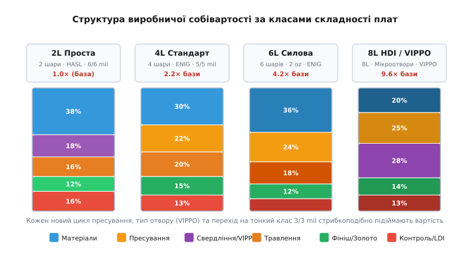
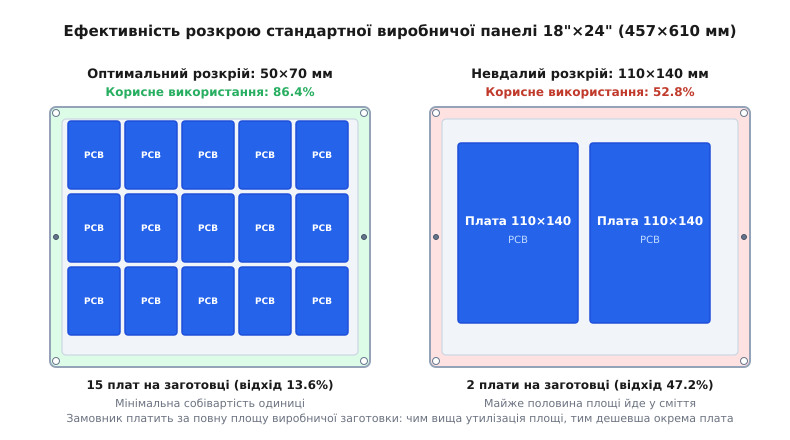

# Що ганяє ціну плати: шари, розмір, отвори, клас, покриття, строк

<preknowlist>
- [Шарування плати](root:hw-pcb/pcb-stackup) — внутрішня будова багатошарової плати: чергування мідної фольги, діелектричних сердечників (core) та препрегів.
- [Перехідний отвір і полігон під струм](root:hw-pcb/perekhidnyi-otvir-i-polihon-pid-strum) — геометрія отворів, металізація стінок і струмова здатність мідних шарів.
- [Зазори на платі](root:hw-pcb/creepage-clearance) — відстані між провідниками та електрична міцність ізоляційних проміжків.
- [Перелік компонентів (BOM)](root:hw-pcb/bom) — взаємозв'язок специфікації компонентів, форм-факторів корпусів і вимог до технології друкованої плати.
</preknowlist>

Коли інженер завершує трасування плати, експортує виробничий архів Gerber або ODB++ і завантажує його на портал контрактного виробника, початкова оцінка вартості часто шокує. Плата розміром `102 × 102 мм` виявляється вдвічі дорожчою за плату `98 × 98 мм`; додавання одного глухого перехідного отвору для розведення мікросхеми BGA підіймає чек утричі; перехід із базової товщини міді `1 oz` на `2 oz` додає 60% до вартості заготовки, а скорочення терміну виготовлення з 5 днів до 48 годин подвоює підсумковий рахунок.

Ці стрибки не є випадковою маркетинговою націнкою. Виробництво друкованих плат — це не адитивний тривимірний друк, де вартість пропорційна витраченій масі пластику, а багатостадійний хіміко-механічний конвеєр, який оперує великими стандартними заготовками — робочими панелями (англ. *Working Panels*). Будь-яке інженерне рішення, що виходить за межі стандартного технологічного маршруту, вимагає додаткових циклів пресування, прецизійного лазерного свердління, агресивних хімічних ванн із солями дорогоцінних металів або ручного переналаштування свердлувальних верстатів.

Щоб проектувати надійні пристрої без марнотратства бюджету, розробник повинен бачити плату очима технолога фабрики: розуміти, які саме фізичні операції стоять за кожною галочкою у формі замовлення, і знати, де пролягають межі стрибкоподібного здорожчання.

---

## 1. Анатомія виробничої собівартості: панель замість плати

Головний економічний принцип виробництва друкованих плат полягає в тому, що фабрика продає замовнику не окремі друковані плати, а корисну площу виробничої панелі та машинний час технологічного обладнання.

Типовий виробничий процес побудовано довкола стандартних листових матеріалів. Найпоширенішим форматом заготовки у світовій індустрії є панель розміром `18" × 24"` (`457 × 610 мм`), рідше застосовуються формати `12" × 18"` (`305 × 457 мм`) або `21" × 24"` (`533 × 610 мм`). Усі хімічні ванни гальваніки, вакуумні преси, установки прямого лазерного експонування (LDI) та свердлувальні верстати з ЧПК жорстко стандартизовані під кріплення та транспортування саме таких заготовок.


*Розподіл виробничої собівартості між матеріалами, пресуванням, свердлінням, хімічною обробкою та оптичним контролем для плат різної складності.*

Повна вартість виготовлення партії плат `Cost_total` математично розділяється на дві принципово різні частини:

```
Cost_total = NRE_tooling + N_panels · Cost_panel
```

1. **Фіксовані інженерні витрати на підготовку виробництва (NRE — Non-Recurring Engineering)**:
   * Перевірка DFM-правил (Design for Manufacturing) інженером фабрики;
   * Генерація керуючих програм для свердлувальних верстатів та контурних фрез;
   * Програмування оптичних інспекційних систем AOI (Automated Optical Inspection) та лазерних установок LDI;
   * Виготовлення фотошаблонів або адаптерів електричного тестування.
2. **Змінні витрати на обробку заготовок (Variable Panel Cost)**:
   * Вартість склотекстоліту FR-4, мідної фольги, препрегів та хімічних реагентів;
   * Амортизація свердлувального, пресового та травильного обладнання;
   * Витрати електроенергії на тривалі високотемпературні цикли спікання;
   * Очищення технологічних вод та утилізація відходів солей міді, свинцю та нікелю.

Для прототипів обсягом 5–10 штук частка NRE може складати до 80% вартості замовлення. У масовому виробництві (від 1 000 одиниць) NRE амортизується майже до нуля, і собівартість визначається виключно геометрією розкрою панелі, товщиною шарів та технологічним виходом придатних виробів.

---

## 2. Кількість шарів: стрибкоподібне зростання через цикли пресування

Найбільш помітний стрибок вартості відбувається під час переходу між категоріями шаруватості: `2 → 4 → 6 → 8 → 10+` шарів. Якщо збільшення розмірів плати на 10% здорожчує її пропорційно зміні площі, то додавання пари внутрішніх шарів підіймає вартість заготовки на 80–120%.

```
Кількість шарів       Співвідношення вартості панелі
2 шари (Базова)       1.0×  (готовий двосторонній фольгований CCL)
4 шари (Стандарт)     2.1× – 2.3×  (1 цикл гарячого вакуумного пресування)
6 шарів (Розширена)   3.8× – 4.2×  (2 ядра, 2 препреги, посилений AOI)
8 шарів (Щільна)      5.5× – 6.2×  (3 ядра, строгі допуски суміщення < 25 мкм)
```

Причина такого здорожчання лежить у зміні фізичного маршруту виготовлення заготовки.

### 2.1. Двошарова плата: пряме механічне оброблення

Двошарова плата виготовляється з готового фабричного листа діелектрика (CCL — Copper Clad Laminate), який уже має шар мідної фольги з обох боків, нанесений на хімічному заводі. Фабрика виконує прямий цикл: свердління наскрізних отворів → хімічна та гальванічна металізація міддю → нанесення фоторезисту → експонування → травлення зовнішнього малюнка → нанесення паяльної маски та шовкографії. Плата жодного разу не потрапляє під прес.

### 2.2. Чотиришарова плата: внутрішнє травлення та гаряче спікання

У чотиришаровій платі внутрішні шари (L2 і L3) знаходяться всередині склотекстолітового моноліту. Виробник бере тонкий двосторонній сердечник (англ. *core* — армований склотекстоліт завтовшки 0.1–0.5 мм із двосторонньою міддю), наносить фоторезист, експонує топологію внутрішніх шарів і витравлює їх.

Після цього виконується обов'язкова операція автоматичної оптичної інспекції (AOI): спеціальна камера сканує мікродоріжки шарів L2 і L3, порівнюючи їх із вектором Gerber. Якщо після пресування всередині виявиться обрив або коротке замикання, виправити дефект буде фізично неможливо, і вся готова панель піде в брак.

Далі слідує хімічна підготовка поверхні (нанесення коричневого або чорного оксиду для створення мікрошорсткості), збирання пакету з ядра, шарів препрегу (тканого скловолокна, просоченого напівзатверділою епоксидною смолою ступеня B-stage) та зовнішніх листів мідної фольги. Пакет завантажується у вакуумний гідравлічний прес, де протягом 2–3 годин витримується за температури `180–200 °C` під тиском `20–30 бар`. Під час нагрівання епоксидна смола переходить у рідкий стан, затікає у проміжки між витравленими внутрішніми доріжками та необоротно полімеризується у твердий моноліт (C-stage).

Лише після пресування та обрізання країв заготовка потрапляє на звичайну лінію свердління двошарових плат.

### 2.3. Шести- та восьмишарові плати: точність суміщення та рентгенівський контроль

Зі збільшенням кількості шарів зростає кількість ядер та препрегів у сендвічі. Під час термічного розширення та полімеризації внутрішні тонкі ядра зазнають нерівномірних механічних напружень і мікрозсувів.

Щоб отвір діаметром 0.3 мм точно пройшов крізь центри контактних майданчиків (annular rings) на всіх восьми шарах без розриву мідного кільця, виробник застосовує прецизійне оптичне позиціонування за реперними мітками та рентгенівські свердлувальні установки (англ. *X-Ray Target Drilling*). Рентгенівський промінь просвічує готову панель наскрізь, розраховує фактичний математичний центр зміщених внутрішніх шарів і лише після цього свердлить базові технологічні отвори для суміщення.

---

## 3. Діелектрики та термостійкість: стандарти Tg, Td і CTI

Вибір базового матеріалу безпосередньо впливає на стійкість плати до термічних циклів пайки та на її собівартість:

* **FR-4 Standard Tg (130–140 °C)**: стандартний епоксидний склотекстоліт. Застосовується для простих пристроїв зі свинцевим паянням (температура ліквідусу евтектики Sn63Pb37 складає `183 °C`).
* **FR-4 High-Tg (170–180 °C)**: обов'язковий матеріал для безсвинцевого паяння (Lead-Free reflow), де пікова температура профілю сягає `250–260 °C`. Перевищення температури склування `Tg` призводить до різкого стрибка коефіцієнта теплового розширення по осі Z (Z-axis CTE зростає з `50 ppm/°C` до `300 ppm/°C`). Якщо багатошарова плата має стандартний Tg130, швидке теплове розширення діелектрика просто розриває мідні гільзи наскрізних перехідних отворів (дефект barrel cracking). High-Tg склотекстоліт дорожчий на 15–25%, проте для плат від 6 шарів фабрики часто взагалі не дозволяють обирати низький Tg через ризик масового браку.
* **Порівняльний індекс трекінгу (CTI — Comparative Tracking Index)**: визначає стійкість діелектрика до утворення струмопровідних вуглецевих містків під дією високої напруги у вологому середовищі. Матеріали з CTI Class 1 (> 600 В) вимагають спеціальних смоляних композицій і коштують на 20–35% дорожче за стандартний FR-4 (CTI Class 3, 175–250 В).

---

## 4. Типи перехідних отворів: стандартні, глухі, мікроотвори та VIPPO

Свердління та металізація отворів — один із найбільш трудомістких етапів. Залежно від обраної топології отворів вартість виробництва може зрости у 2–10 разів.

### 4.1. Наскрізні отвори (PTH — Plated Through-Hole)

Стандартний і найдешевший варіант. Усі отвори свердляться механічними карбідними свердлами крізь весь стек плати за одну технологічну установку після фінального пресування заготовки. Отвори очищуються від смоляного нагару (англ. *desmear*), покриваються субмікронним шаром хімічної міді (electroless copper) для створення провідності стінок і гальванічно дорощуються до товщини мідної гільзи `20–25 мкм`.

Обмеження PTH полягає в тому, що наскрізний отвір проходить крізь усі шари, займаючи цінне місце на внутрішніх сигнальних площинах, навіть якщо з'єднує лише шари L1 та L2.

### 4.2. Глухі та приховані отвори (Blind & Buried Vias)

Глухі отвори (англ. *Blind Vias*) з'єднують зовнішній шар з одним або кількома внутрішніми; приховані отвори (англ. *Buried Vias*) з'єднують виключно внутрішні шари й не виходять на поверхню.

Кожен тип глухого або прихованого отвору вимагає окремого підциклу виробництва:
1. Внутрішній сердечник свердлиться механічно або лазером до загального пресування;
2. Стінки отворів металізуються в гальванічній ванні;
3. Виконується фотолітографія та травлення шарів підпакета;
4. Отвори заповнюються смолою або спеціальним компаундом;
5. Підпакет складається з іншими шарами та відправляється на повторне пресування (Sequential Lamination).

Кожен додатковий цикл пресування додає щонайменше 40–70% до базової вартості плати через подвоєння часу перебування в гарячих пресах та ризик розшарування (деламінації) під час термічних ударів.

### 4.3. Мікроотвори HDI та послідовне нарощування (Sequential Build-Up)

Для розведення сучасних процесорів, FPGA та пам'яті в корпусах BGA з кроком виводів `0.4–0.5 мм` стандартні механічні свердла не підходять: їхній мінімальний практичний діаметр становить `0.15–0.20 мм`, а контактний майданчик вимагає діаметра не більше `0.25–0.30 мм`.

У технології HDI (High Density Interconnect) застосовуються мікроотвори діаметром `75–125 мкм`, які випалюються імпульсним CO₂- або UV-лазером. Лазерний промінь випаровує діелектрик препрегу і зупиняється на мідній площині внутрішнього шару завдяки різниці температур абляції металу та полімеру.

Співвідношення глибини до діаметра (Aspect Ratio) мікроотвору не повинно перевищувати `1:1` (глибина не більше 100 мкм при діаметрі 100 мкм), інакше електроліт не зможе рівномірно заповнити отвір міддю. Технологічні структури позначаються як `1+N+1` (один лазерний шар зверху та знизу центрального ядра), `2+N+2` (два послідовних лазерних шари) або `Any-Layer HDI` (усі шари з'єднані лазерними мікроотворами). Вартість структури `2+N+2` перевищує вартість простої 8-шарової плати у 3–5 разів.

### 4.4. Технологія VIPPO (Via-in-Pad Plated Over)

Коли крок BGA настільки малий, що перехідний отвір неможливо винести за межі контактного майданчика (трасування типу «dog-bone»), отвір розміщують безпосередньо всередині паяльного майданчика.

Якщо такий отвір залишити відкритим, під час паяння рідкий припій затече всередину капіляра отвору, що призведе до утворення порожнеч (voids), ненадійного контакту або короткого замикання кульки BGA. Тому застосовується технологічний процес VIPPO (стандарт IPC-4761 Type VII):
1. Отвір свердлиться та металізується міддю;
2. Порожнина гільзи під тиском заповнюється неелектропровідною епоксидною пастою з контрольованим коефіцієнтом теплового розширення (CTE);
3. Паста запікається в печі до повної полімеризації;
4. Поверхня механічно шліфується (планаризується) врівень із площиною плати;
5. Поверх заповненого отвору гальванічно наноситься суцільний мідний ковпачок, на який згодом наноситься фінішне покриття.

VIPPO вимагає п'яти додаткових операцій і додає від $0.02 до $0.05 до вартості кожного окремого перехідного отвору, що для великих BGA-чипів на 1 500 виводів виливається у значне здорожчання кожного екземпляра плати.

---

## 5. Фінішне покриття: планарність, золото і хімічні ванни

Відкрита мідь контактних майданчиків окислюється на повітрі за лічені години, утворюючи шар оксиду купруму `CuO`, який не змочується припоєм під час паяння. Для консервації міді застосовуються різні типи захисних фінішних покриттів, кожне з яких має свою собівартість та фізичні обмеження.

```
Покриття         Планарність       Зберігання   Цикли пайки   Співвідношення ціни
HASL (Lead-Free) Нерівне (купол)   12–24 міс.   3–4           1.0× (база)
OSP              Ідеально пласке   3–6 міс.     1–2           0.90× – 0.95×
ENIG (Золото)    Ідеально пласке   12–24 міс.   3–5           1.25× – 1.45×
Immersion Ag     Пласке            6–12 міс.    2–3           1.15× – 1.25×
ENEPIG           Ідеально пласке   24+ міс.     5+            1.80× – 2.20×
```

### 5.1. HASL (Hot Air Solder Leveling)

Плата занурюється у ванну з розплавленим припоєм (евтектика Sn63Pb37 за температури `245 °C` або безсвинцевий сплав SAC0307 / SAC305 за температури `260–270 °C`), після чого струмені стисненого гарячого повітря («повітряні ножі») здувають надлишки припою.

* **Переваги**: найнижча ціна, висока надійність паяного з'єднання, тривалий строк зберігання, можливість багаторазового перепаювання.
* **Недоліки**: через сили поверхневого натягу рідкий припій застигає на майданчиках у формі випуклого меніска (купола). Перепад висоти між центром і краєм майданчика може досягати `15–25 мкм`. Це призводить до перекосу та зміщення компонентів (tombstoning), утворення містків припою під мікросхемами QFN та відриву кульок BGA з кроком менше `0.8 мм`. Для сучасного монтажу дрібних компонентів HASL непридатний.

### 5.2. ENIG (Electroless Nickel Immersion Gold)

Двостадійне хімічне покриття: спочатку методом каталітичного відновлення наноситься шар нікелю завтовшки `3–6 мкм` (легованого 7–9% фосфору), після чого у ванні заміщення наноситься ультратонкий шар чистого золота завтовшки `0.05–0.10 мкм` (2–4 мікродюйми).

Нікель виконує роль бар'єру, що запобігає дифузії міді в припій, а золото захищає сам нікель від окиснення до моменту монтажу. Під час паяння золото миттєво розчиняється в рідкому припої, утворюючи інтерметаліди `AuSn4`, а паяне з'єднання формується безпосередньо з шаром нікелю (`Ni3Sn4`).

* **Переваги**: абсолютна планарність контактних майданчиків (перепад висоти менше 0.1 мкм), ідеальна база для тонких BGA, QFN та пасивних компонентів типорозміру 0201/01005, відмінна стійкість до окиснення.
* **Недоліки та ціна**: висока вартість золотих солей у ваннах та ризик технологічного дефекту «black pad» (чорного майданчика) — мікрокорозії шару нікелю фосфором під час надмірно тривалого перебування у ванні золочення, що викликає крихкий злам паяного з'єднання під час механічного удару.

### 5.3. OSP (Organic Solderability Preservative)

Хімічна пасивація міді органічним складом на основі похідних бензотриазолу або імідазолу. Утворює прозору органометалічну плівку завтовшки `0.2–0.5 мкм`.

* **Переваги**: найдешевше з усіх покриттів (дешевше навіть за HASL), абсолютно пласке, не містить важких металів.
* **Недоліки**: органічна плівка руйнується після першого ж проходження крізь піч оплавлення (reflow). Для двостороннього монтажу плата повинна паятися в середовищі захисного азоту (N₂), інакше відкрита мідь на нижньому боці окислиться ще до нанесення другої дози паяльної пасти. Чутливе до дотиків пальцями (жир розчиняє плівку) та має обмежений строк зберігання на складі (не більше 3–6 місяців).

### 5.4. ENEPIG (Electroless Nickel Electroless Palladium Immersion Gold)

Тришарове покриття: нікель (`3–6 мкм`) → хімічний паладій (`0.05–0.15 мкм`) → імерсійне золото (`0.03–0.05 мкм`). Паладієвий проміжний шар повністю блокує дифузію та гіперкорозію нікелю, виключаючи дефект «black pad».

Це універсальне покриття преміум-класу, що дозволяє одночасно виконувати пайку SMD-компонентів та пряме ультразвукове розварювання кристалів золотим або алюмінієвим дротом (Wire Bonding). Застосовується в аерокосмічній та медичній техніці, коштує у 2 рази дорожче за HASL.

---

## 6. Товщина міді: тепло й струм проти ціни травлення

Базовим промисловим стандартом є фольга товщиною `1 oz` (1 унція міді на квадратний фут площі, що відповідає фізичній товщині `35 мкм`). На внутрішніх шарах за замовчуванням часто використовується фольга `0.5 oz` (`18 мкм`).

Для силових плат (перетворювачі живлення, драйвери електродвигунів, зарядні станції) розробники часто обирають товсту мідь: `2 oz` (70 мкм), `3 oz` (105 мкм) або `4 oz` (140 мкм). Це рішення тягне за собою низку технологічних наслідків:

1. **Дорожча сировина**: ціна склотекстоліту з фольгою 2 oz та 3 oz зростає на 40–90% через витрати чистої електролітичної міді;
2. **Триваліший час травлення та підтравлювання (Undercut)**: рідкий травильний розчин розчиняє метал не лише вертикально вглиб, а й горизонтально під шар захисного фоторезисту. Чим товща фольга, тим сильніший ефект бокового підтравлювання (англ. *Etch Factor*). Якщо для 1 oz міді мінімальний зазор між провідниками складає `4–5 mil` (0.10–0.12 мм), то для 3 oz міді фабрика вимагає мінімальний технологічний зазор не менше `10–12 mil` (0.25–0.30 мм);
3. **Заповнення рельєфу смолою препрегу**: товсті провідники утворюють глибокі каньйони. Щоб під час пресування смола повністю заповнила простір між силовими доріжками й не залишила повітряних мікропухирців (voids / delamination), фабрика повинна використовувати кілька шарів дорожчого препрегу з підвищеним вмістом смоли (high-resin prepregs, наприклад типи 1080 або 2116), що збільшує загальну товщину заготовки та вартість матеріалів.

---

## 7. Клас точності, розміри елементів та вихід придатних (Yield)

Під час формування малюнка друкованої плати фабрики поділяють замовлення за класами точності мінімальної ширини провідника та зазору (Trace / Space):

* **Стандартний клас (`6/6 mil` або 0.15/0.15 мм)**: виготовляється на стандартних лініях із плівковими фотошаблонами в приміщеннях загальної чистоти (ISO Class 8). Вихід придатних виробів перевищує `98–99%`.
* **Високоточний клас (`4/4 mil` або 0.10/0.10 мм)**: вимагає установок прямого лазерного експонування фоторезисту (LDI) для уникнення оптичного розсіювання світла на краях фотошаблону.
* **Мікроелектронний клас (`3/3 mil` або `2/2 mil` — 0.075/0.075 мм та менше)**: вимагає чистих кімнат високого класу (ISO Class 5/6), прецизійного вакуумного травлення та постійного лазерного контролю геометрії.

Виробничий вихід придатних плат `Y` описується експоненційною залежністю від площі плати `A` та ефективної густини дефектів `D`:

```
Y = exp(-D · A · k_class)
```

де `k_class` різко зростає при переході від 6 mil до 3 mil: мікроскопічна порошинка розміром 15 мкм не зашкодить доріжці шириною 150 мкм (6 mil), проте гарантовано перерве або закоротить провідник шириною 75 мкм (3 mil).

Якщо через жорсткі норми трасування вихід придатних виробів падає з 98% до 82%, фабрика змушена закладати вартість 18% бракованих плат у фінальну ціну решти 82% придатних виробів, що оплачується замовником.

---

## 8. Панелізація: де втрачаються від 20% до 40% бюджету

Оскільки собівартість розраховується на всю виробничу заготовку, коефіцієнт корисного використання площі панелі `K_util` безпосередньо формує ціну одиничної плати:

```
K_util = (N_boards · Width_board · Height_board) / (Width_panel · Height_panel)
```


*Порівняння коефіцієнта використання робочої заготовки для оптимального (86.4%) та некратного (52.8%) розмірів друкованих плат.*

Розгляньмо, чому виникають втрати:

1. **Технологічні поля (Tooling Strips)**: по периметру кожної панелі резервується смуга шириною `10–15 мм`. Вона містить отвори кріплення шпинделів верстатів, реперні оптичні знаки суміщення, тестові купони для перевірки товщини гальванічної міді та структури імпедансу, а також мідні сітки для вирівнювання щільності струму в гальванічній ванні (thieving pads).
2. **Зазори між платами**:
   * **Фрезерування (Routing)**: плати вирізаються циліндричною фрезою діаметром `2.0–2.4 мм`. Між сусідніми платами закладається проміжок не менше `2.0 мм`, а в кутах залишаються перемички з отворами розламування (mouse bites / breakout tabs).
   * **V-скрейбінг (V-scoring)**: дискові ножі прорізають V-подібні канавки з обох боків плати на глибину 1/3 товщини текстоліту під кутом 30° або 45°. Зазор між платами дорівнює нулю (`0.0 мм`), що дає максимальну економію площі, проте цей метод застосовний лише для прямокутних плат без круглих вирізів по контуру.
3. **Геометрична некратність**: якщо робоча зона панелі має ширину 430 мм, а плата має розмір `110 мм`, у ряд поміститься лише 3 плати (`330 мм`), а `100 мм` дорогого матеріалу перетвориться на сміття. Якщо зменшити ширину плати до `105 мм`, у ряд поміститься 4 плати, що миттєво знизить ціну кожної плати на 25%.

---

## 9. Контроль імпедансу, спеціальні операції та паяльна маска

Окрім базової геометрії, на ціну впливають додаткові інженерні опції:

### 9.1. Контрольований імпеданс та тестові купони (TDR Testing)

Коли на платі розводяться швидкісні диференційні пари USB 3.0, PCIe або пам'ять DDR4/DDR5, розробник вказує вимогу контрольованого хвильового опору (наприклад, `90 Ом ± 10%` або `50 Ом ± 5%`).

Щоб гарантувати цей параметр, фабрика виконує такі кроки:
* Спеціальний розрахунок товщини препрегів з урахуванням витікання смоли під час пресування;
* Розміщення на технологічних полях панелі спеціальних тестових купонів (impedance coupons), які точно повторюють ширину доріжок і стек діелектрика робочих плат;
* Вимірювання хвильового опору кожного купона рефлектометром часової області (англ. *TDR — Time Domain Reflectometry*) перед відправленням замовлення.

Вимога допуску `±5%` замість стандартних `±10%` вимагає тестового пресування пробного купона перед запуском партії, що додає $50–100 до NRE та підвищує вартість обробки панелі на 15–25%.

### 9.2. Колір паяльної маски та роздільна здатність шовкографії

Зелена паяльна маска є базовим галузевим стандартом: її хімічний склад оптимізовано для максимально швидкої фотополімеризації під UV-лампами, а фабричні лінії працюють із нею цілодобово без переналаштування.

Вибір нестандартного кольору маски (матова чорна, біла, синя, прозора) призводить до додаткових витрат:
* **Чорна маска**: містить пігменти вуглецю, які поглинають світло під час фотоекспонування. Час засвічення збільшується у 2–3 рази, що знижує пропускну здатність лінії;
* **Біла маска**: відбиває UV-промені, викликаючи бічне паразитарне засвічення під контактні майданчики, що ускладнює формування тонких масочних містків (solder mask dams) між виводами дрібних мікросхем;
* **Очищення обладнання**: перехід на інший колір вимагає промивки валків та сіток, через що фабрики встановлюють націнку від $15 до $40 за зміну кольору для дрібних партій.

### 9.3. Металізація торців та напівпази (Castellated Holes)

Якщо плата проектується як монтажний субмодуль, що запаюється поверх іншої материнської плати, по краях розміщуються напівкруглі металізовані пази (англ. *Castellated Holes / Castellations*).

Технологія їх виготовлення вимагає двох циклів фрезерування: спочатку отвори свердляться та металізуються, після чого панель фрезерується точно по осьовій лінії ряду отворів. Щоб обертова фреза не загнула та не відірвала тонку мідну фольгу від стінок напівкруглих пазів, верстат працює на зниженій швидкості зі спеціальними алмазними фрезами, що додає фіксовану націнку $30–80 на партію.

---

## 10. Строки виробництва: фізика експрес-замовлень (Rush vs Standard)

Різниця в ціні між стандартним терміном (5–7 робочих днів) та експрес-виготовленням за 24–48 годин становить від `2.0×` до `4.0×`. Це обумовлено технологічною логікою конвеєра:

* **Стандартне виробництво (Pooling Service)**: фабрика накопичує замовлення від сотень різних клієнтів і компонує їх на спільних збірних панелях за однаковими параметрами (наприклад, 4 шари, 1 oz, ENIG, 1.6 мм). Це дозволяє завантажити заготовку на 90–95% та повністю розподілити фіксовані витрати NRE між усіма учасниками пулу.
* **Термінове замовлення (Dedicated Monopanel)**: плата не може чекати наповнення пулу і запускається на окремій персональній панелі клієнта. Фабрика перериває плановий графік верстатів, виділяє індивідуальні ванни та оплачує понаднормові нічні зміни інженерів і операторів контролю.

---

## 11. Алгоритмічна модель оцінки собівартості

Для автоматизації розрахунку та інтеграції в EDA-системи розроблено алгоритм розрахунку вартості партії плат.

Нижче наведено фрагмент розрахункового модуля на C та C++ у форматі вкладок `:::tabs`:

:::tabs
```c
#include <stdio.h>
#include <math.h>

typedef struct {
    double width_mm;
    double height_mm;
    int layer_count;
    double copper_oz;
    double min_trace_mil;
    int quantity;
    int turnaround_hours;
} QuickPcbSpec;

double calculate_quick_estimate(const QuickPcbSpec* s) {
    const double panel_w = 457.0 - 25.0; // 18" мінус поля
    const double panel_h = 610.0 - 25.0; // 24" мінус поля

    int nx = (int)floor((panel_w + 2.0) / (s->width_mm + 2.0));
    int ny = (int)floor((panel_h + 2.0) / (s->height_mm + 2.0));
    int per_panel = (nx > 0 && ny > 0) ? (nx * ny) : 1;

    double layer_factor = 1.0 + 0.45 * (double)(s->layer_count > 2 ? s->layer_count - 2 : 0);
    double cu_factor = 1.0 + 0.40 * (s->copper_oz > 1.0 ? s->copper_oz - 1.0 : 0.0);
    double rush_factor = (s->turnaround_hours <= 48) ? 2.5 : 1.0;

    double panel_base_cost = 45.0 * layer_factor * cu_factor * rush_factor;
    double nre_base = (s->layer_count > 2 ? 150.0 : 60.0) * rush_factor;

    int panels = (s->quantity + per_panel - 1) / per_panel;
    double total = nre_base + (double)panels * panel_base_cost;

    return total / (double)s->quantity;
}
```
```cpp
#include <iostream>
#include <cmath>
#include <algorithm>

struct QuickPcbSpec {
    double width_mm{0.0};
    double height_mm{0.0};
    int layer_count{2};
    double copper_oz{1.0};
    double min_trace_mil{6.0};
    int quantity{100};
    int turnaround_hours{120};
};

[[nodiscard]] constexpr double calculate_quick_estimate(const QuickPcbSpec& s) noexcept {
    constexpr double panel_w = 457.0 - 25.0; // 18" мінус поля
    constexpr double panel_h = 610.0 - 25.0; // 24" мінус поля

    const int nx = static_cast<int>(std::floor((panel_w + 2.0) / (s.width_mm + 2.0)));
    const int ny = static_cast<int>(std::floor((panel_h + 2.0) / (s.height_mm + 2.0)));
    const int per_panel = std::max(1, nx * ny);

    const double layer_factor = 1.0 + 0.45 * static_cast<double>(s.layer_count > 2 ? s.layer_count - 2 : 0);
    const double cu_factor = 1.0 + 0.40 * std::max(0.0, s.copper_oz - 1.0);
    const double rush_factor = (s.turnaround_hours <= 48) ? 2.5 : 1.0;

    const double panel_base_cost = 45.0 * layer_factor * cu_factor * rush_factor;
    const double nre_base = (s.layer_count > 2 ? 150.0 : 60.0) * rush_factor;

    const int panels = (s.quantity + per_panel - 1) / per_panel;
    const double total = nre_base + static_cast<double>(panels) * panel_base_cost;

    return total / static_cast<double>(s.quantity);
}
```
:::

Повну параметричну модель із розрахунком густини дефектів за законом Пуассона, аналізом типів фінішних покриттів, вибором орієнтації розкрою та підтримкою VIPPO реалізовано в проектній вставці: [Параметричний калькулятор собівартості друкованих плат](root:hw-pcb/shcho-haniaie-tsinu-platy/proj-pcb-cost-estimator.md).

---

> 🔧 **Навіщо це.**
>
> 1. **Дотримуйтесь кратності 100 × 100 мм на етапі прототипування**: якщо габарити плати можна вкласти у `98 × 98 мм` замість `105 × 105 мм`, вартість перших п'яти прототипів буде в 10–15 разів нижчою завдяки потраплянню в автоматизований пул фабрики.
> 2. **Уникайте глухих отворів, доки не вичерпано ресурс наскрізних**: перехід від 6-шарової плати з отворами PTH до структури з глухими мікроотворами HDI підіймає вартість заготовки втричі. Перш ніж призначати глухі перехідні отвори, перевірте можливість зменшення діаметра отворів PTH до 0.2/0.4 мм або додавання пари додаткових сигнальних шарів.
> 3. **Не призначайте ENIG без технологічної потреби**: якщо на платі немає компонентів із дрібним кроком (BGA, QFN з кроком менше 0.8 мм) та контактів кнопок, стандартне покриття Lead-Free HASL забезпечить надійніше паяне з'єднання без ризику дефекту «black pad» та заощадить 20–30% бюджету.
> 4. **Розпаралелюйте шари замість товстої міді 3 oz**: якщо плата поєднує високі струми та мікроконтролерне керування, чотири шари міді 1 oz з паралельними полігонами дозволять зберегти тонкий зазор 4/4 mil біля мікросхем і коштуватимуть дешевше, ніж двошарова плата з важкою міддю 3 oz, яка потребує зазорів 12 mil.
