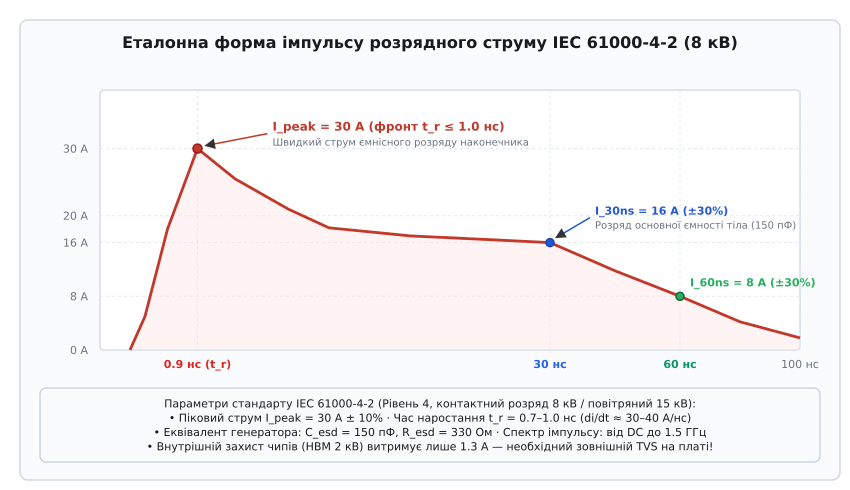
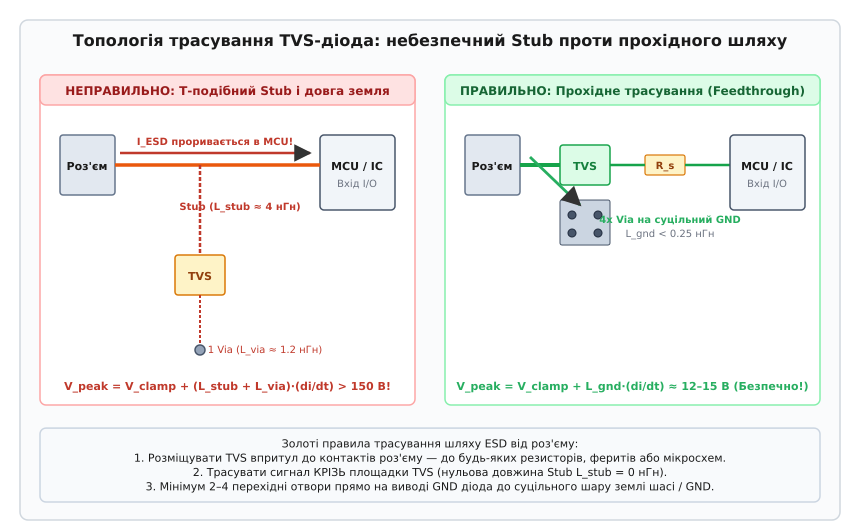

# Шлях ESD від роз'єму до землі

<preknowlist>
- [Шлях зворотного струму](root:hw-pcb/current-return-path) — фізика повернення високочастотного струму по шляху найменшої індуктивності.
- [Шар землі](root:hw-pcb/ground-plane-design) — організація суцільних опорних полігонів і усунення розривів.
- [Перехідний отвір і полігон під струм](root:hw-pcb/perekhidnyi-otvir-i-polihon-pid-strum) — розрахунок індуктивності та струмонавантажувальної здатності via.
- [TVS-діод](root:hw-components/tvs-diode) — вольт-амперна характеристика, лавинний пробій і час спрацьовування напівпровідникових супресорів.
- [Кабелі й конектори](root:hw-pcb/cables-connectors) — конструкція контактних пар, опір стягування та екранування інтерфейсних з'єднань.
</preknowlist>

Коли оператор торкається рукою металевого корпусу або відкритих контактів роз'єму USB чи Ethernet, на плату розряджається статичний потенціал до 8–15 кВ. За час менше однієї наносекунди струм розряду наростає від нуля до 30 А, створюючи швидкість зміни струму понад 30 мільярдів амперів за секунду. Якщо на друкованій платі не сформовано прямий шлях найменшого імпедансу для скидання цього струму в захисну землю шасі, навіть наявність дорогого TVS-діода стає марною: на паразитній індуктивності короткого чотириміліметрового відгалуження доріжки виникає індуктивний стрибок напруги понад 150 В, який миттєво пробиває підзатворний діелектрик вхідних транзисторів мікроконтролера та випаровує внутрішню алюмінієву металізацію кристала.

Захист сучасних цифрових і аналогових систем від електростатичного розряду (Electrostatic Discharge — ESD) базується не на пасивній надії на внутрішні діоди чипів, а на суворому контролі геометрії та електродинаміки повернення струму на платі. Енергія розряду повинна бути перехоплена в точці її входу на плату — безпосередньо на контактах роз'єму — і спрямована в масивний опорний полігон землі за найкоротшим можливим геометричним контуром із нульовою довжиною відгалужень.

---

## Фізика утворення електростатичного заряду та трибоелектричний ефект

Електростатичний заряд на тілі людини або технологічному обладнанні виникає внаслідок контактної електризації (трибоелектричного ефекту). Коли два різні діелектричні або слабкопровідні матеріали стикаються (наприклад, полімерна підошва взуття з синтетичним килимовим покриттям, пластиковий корпус приладу з пакувальною плівкою), електрони переходять із матеріалу з меншою роботою виходу на матеріал із більшою спорідненістю до електрона.

При подальшому механічному розведенні поверхонь заряджене тіло набуває надлишкового статичного заряду `Q`. Оскільки ємність ізольованого тіла людини у просторі відносно навколишніх заземлених предметів і підлоги становить від `C_body = 100` пФ до `C_body = 250` пФ, напруга на тілі визначається фундаментальним електростатичним співвідношенням:

```text
V = Q / C_body
```

У середовищі зі зниженою відносною вологістю повітря (10–20%, типовою для зимового опалювального сезону або кондиціонованих серверних приміщень) звичайне переміщення оператора по підлозі генерує потенціал від 8 до 15 кВ. При цьому поріг відчутності статичного удару людиною становить близько 2.5–3.0 кВ: розряди з напругою 500–1500 В людина не відчуває взагалі, хоча для субмікронних напівпровідникових структур (де товщина підзатворного оксиду SiO2 не перевищує 3–8 нанометрів, а напруга електричного пробою становить усього 5–10 В) такий непомітний розряд є абсолютно фатальним.

---

## Анатомія загрози ESD: стандарт IEC 61000-4-2 та фізика розряду

В електронній промисловості розрізняють два принципово різні рівні стійкості до електростатики: компонентний рівень (тести виробництва чипів) та системний рівень (тести готового виробу в реальних умовах експлуатації).

### Компонентні стандарти проти системного стандарту IEC 61000-4-2

На етапі виготовлення мікросхем у чистих кімнатах виробники тестують напівпровідникові кристали за стандартами Human Body Model (HBM — ANSI/ESDA/JEDEC JS-001) або Charged Device Model (CDM — JS-002). Мета цих випробувань — гарантувати, що мікросхема не згорить від дотику маніпулятора робота чи монтажника в антистатичному браслеті під час встановлення на плату. Типовий рівень захисту HBM Class 2 моделює розряд ємності 100 пФ через опір 1500 Ом при напрузі 2 кВ:
- Піковий струм розряду: `I_peak ≈ 1.33` А;
- Час наростання фронту: `t_r = 10 - 20` нс;
- Загальна енергія імпульсу: `E_HBM = 0.2` мДж.

Після того, як мікросхема запаяна на друковану плату та встановлена в кінцевий прилад, вона потрапляє під дію міжнародного стандарту системного рівня **IEC 61000-4-2** (в Україні — ДСТУ EN 61000-4-2). Цей стандарт імітує розряд людини, яка тримає в руці металевий предмет (ключ, викрутку, роз'єм кабелю) і торкається обладнання:
- Еквівалентна ємність накопичувача: `C_esd = 150` пФ;
- Розрядний опір тіла: `R_esd = 330` Ом;
- Час наростання первинного піку: `t_r = 0.7 - 1.0` нс;
- Піковий струм при контактному розряді 8 кВ (Рівень 4): `I_peak = 30.0` А (коефіцієнт 3.75 А/кВ);
- Енергія імпульсу: `E_IEC = 4.8` мДж (у 24 рази більше за HBM);
- Піковий струм при повітряному розряді 15 кВ (Рівень 4): струм до 45–50 А.

```
       Параметр             JEDEC JS-001 (HBM)            IEC 61000-4-2 (Рівень 4)
  ────────────────────────────────────────────────────────────────────────────────
  Напруга тесту             2 кВ (Class 2)                8 кВ контактний / 15 кВ повітряний
  Ємність джерела           100 пФ                        150 пФ
  Розрядний опір            1500 Ом                       330 Ом
  Час наростання (t_r)      10–20 нс                      0.7–1.0 нс (субнаносекундний)
  Піковий струм             1.33 А                        30.0 А ± 10%
  Енергія в навантаженні    0.20 мДж                      4.80 мДж
  Швидкість di/dt           0.13 А/нс                     30.0–40.0 А/нс
```

Внутрішні кремнієві діоди мікроконтролерів, розраховані на струми 1.3 А протягом 10 нс, фізично не здатні розсіяти імпульс 30 А стандарту IEC 61000-4-2. При прямому проходженні системного розряду кристал випаровується менш ніж за 1 наносекунду. Тому на рівні друкованої плати обов'язково встановлюються зовнішні швидкодіючі супресори (TVS-діоди).

### Часова структура хвилі розряду IEC 61000-4-2

Еталонний імпульс струму стандарту IEC 61000-4-2 має характерну двогорбу форму.


*Еталонна часова форма імпульсу розрядного струму за стандартом IEC 61000-4-2 при контактному розряді 8 кВ (Рівень 4). Перший субнаносекундний пік амплітудою 30 А (t_r ≤ 1.0 нс) формується розрядом паразитної ємності наконечника, другий пік (16 А за 30 нс) та хвіст (8 А за 60 нс) визначаються розрядом основного накопичувача 150 пФ через опір 330 Ом.*

Імпульс складається з трьох критичних часових фаз:
1. **Початковий субнаносекундний пік (`t = 0 - 2` нс)**: Перший сплеск амплітудою 30 А досягає максимуму всього за 0.7–1.0 нс. Він формується розрядом розподіленої паразитної ємності розрядного наконечника пістолета та металевого предмета в руці людини. Цей пік генерує максимальну швидкість наростання струму `di/dt ≈ 37.5` А/нс, що є головним джерелом індуктивних перенапруг і випромінюваних завад;
2. **Другий максимум (`t = 30` нс)**: Струм спадає до рівня 16 А (±30%). Ця фаза відповідає розряду основної зосередженої ємності тіла 150 пФ через внутрішній опір 330 Ом;
3. **Хвостова фаза (`t = 60 - 100` нс)**: Струм зменшується до 8 А (±30%) і плавно згасає до нуля протягом 100–150 нс. У цій фазі виділяється основна частка загальної теплової енергії розряду.

---

## Шлях найменшого імпедансу: фізика високої частоти та індуктивності

Поширена помилка розробників — аналізувати шлях струму ESD за законами постійного струму (DC), вважаючи, що струм потече туди, де товща мідь або менший активний опір. Насправді наносекундний імпульс ESD є ультрависокочастотним процесом.

### Спектральний склад імпульсу розряду та скін-ефект

Гранична верхня частота спектра (частота зламу спектра або knee frequency) для фронту тривалістю `t_r = 0.8` нс дорівнює:

```text
f_knee = 0.35 / t_r = 0.35 / (0.8 · 10^-9) ≈ 437.5 МГц
```

Спектр імпульсу містить значну потужність на гармоніках аж до 1.5–2.0 ГГц. Повний електричний імпеданс провідника на такій частоті визначається векторною сумою активного та індуктивного опорів:

```text
Z = sqrt(R^2 + (omega · L)^2) = sqrt(R^2 + (2 · pi · f · L)^2)
```

При активному опорі доріжки `R = 0.05` Ом та власній індуктивності `L = 5` нГн на частоті 500 МГц індуктивний опір становить:

```text
X_L = 2 · pi · (500 · 10^6) · (5 · 10^-9) ≈ 15.7 Ом
```

Індуктивний опір перевищує омічний у понад 300 разів (`X_L ≫ R`). Тому струм розряду розтікається не по шляху найменшого активного опору, а виключно по **шляху найменшої петльової індуктивності** (контуру з мінімальною геометричною площею петлі).

Крім того, на частотах понад 500 МГц проявляється виражений поверхневий ефект (Skin Effect). Товщина скін-шару в міді становить:

```text
delta = sqrt(rho_cu / (pi · f · mu_0 · mu_r))
```

де `rho_cu = 1.68 · 10^-8` Ом·м — питомий опір міді, `mu_0 = 4·pi·10^-7` Гн/м — магнітна стала, `mu_r = 1.0`.
На частоті `f = 500` МГц товщина скін-шару дорівнює:

```text
delta = sqrt( (1.68 · 10^-8) / (pi · 500 · 10^6 · 4·pi·10^-7) ) ≈ 2.91 мкм
```

При стандартній товщині мідної фольги друкованої плати 35 мкм (1 oz/ft²) струм розряду протікає лише у зовнішньому поверхневому шарі товщиною менше 3 мікрометрів, що багаторазово збільшує ефективний опір високій частоті та посилює вимоги до ширини полігонів.

### Повна формула динамічної напруги обмеження TVS

Реальна напруга фіксації перенапруги `V_clamp_total`, яку бачить захищувана сигнальна лінія під час удару розряду, описується фундаментальним рівнянням:

```text
V_clamp_total = V_breakdown + I_peak · R_dyn + L_parasitic · (di/dt)
```

де:
- `V_breakdown` (або `V_BR`) — статична напруга лавинного пробою TVS-діода при випробувальному струмі 1 мА (типово 6.0–6.8 В для 5-вольтових ліній або 3.6–4.0 В для 3.3-вольтових ліній);
- `I_peak` — піковий струм розряду стандарту IEC 61000-4-2 (30 А при рівні 8 кВ);
- `R_dyn` — внутрішній динамічний диференційний опір напівпровідникового кристала діода у відкритому стані (типово 0.15–0.5 Ом для якісних діодів і 1.5–3.0 Ом для застарілих супресорів);
- `L_parasitic` — сумарна паразитна індуктивність усього шляху скидання струму (індуктивність відгалуження доріжки `L_stub`, виводів корпусу діода `L_pkg` та масиву перехідних отворів заземлення `L_gnd_via`);
- `di/dt` — швидкість наростання струму на передньому фронті розряду (30–40 А/нс).

```
   Компоненти напруги обмеження при розряді 8 кВ (30 А, di/dt = 37.5 А/нс):

   1. Напруга пробою V_BR                 : 6.0 В
   2. Омічне падіння I_peak · R_dyn      : 30 А · 0.25 Ом = 7.5 В
   3. Індуктивний викид L · (di/dt)       :
      • При ідеальному трасуванні (0.3 нГн): 0.3 нГн · 37.5 А/нс = 11.25 В  → V_total ≈ 24.75 В
      • При наявності Stub 4 мм (4.0 нГн)  : 4.0 нГн · 37.5 А/нс = 150.0 В   → V_total ≈ 163.5 В!
```

Цей числовий розрахунок наочно показує: при недбалому трасуванні саме третій доданок (`L · di/dt`) становить понад 90% усієї напруги, яка руйнує мікроконтролер.

---

## Топологія розміщення TVS-діода: принцип прямого прохідного трасування (Stub-Free Routing)

Геометричне взаємне розташування роз'єму, TVS-діода та захищуваної мікросхеми на платі має вирішальне значення для успішного перехоплення струму розряду.

### Небезпека Т-подібного відгалуження (Stub Routing)

Класична помилка інженерів-початківців полягає у трасуванні прямої сигнальної лінії від роз'єму до мікроконтролера з відведенням окремого бічного апендикса (Stub) до контактної площадки TVS-діода.


*Порівняння топології трасування TVS-діода біля інтерфейсного роз'єму. Ліворуч (НЕПРАВИЛЬНО): Т-подібний Stub довжиною 4 мм і одиночний перехідний отвір додають 5.2 нГн індуктивності, генеруючи індуктивний викид понад 150 В у мікроконтролер. Праворуч (ПРАВИЛЬНО): пряме прохідне трасування крізь виводи TVS, масив із 4 перехідних отворів заземлення та послідовний резистор розв'язки R_s знижують напругу до безпечних 12–15 В.*

Чому Т-відгалуження призводить до катастрофи:
1. Хвиля розрядного струму з крутим фронтом 0.8 нс добігає до вузла розгалуження (Т-з'єднання);
2. Гілка у бік TVS-діода має паразитну індуктивність `L_stub ≈ 2 - 5` нГн. Індуктивний опір цієї гілки в перші 500 пікосекунд становить десятки або сотні ом;
3. Гілка у бік мікроконтролера веде до високоімпедансного входу CMOS-буфера. Не маючи змоги миттєво звернути у високу індуктивність відгалуження TVS, струм перенапруги рухається прямолінійно до входу мікросхеми;
4. Напруга на виводі мікроконтролера підскакує до рівня пробою затвора задовго до того, як TVS-діод у кінці відгалуження встигне увійти в режим лавинного пробою.

### Золоте правило: Прохідне трасування (Feedthrough Routing)

Правильна топологія передбачає, що сигнальна доріжка від контакту роз'єму заходить безпосередньо на вхідний вивід TVS-діода, проходить крізь його внутрішню структуру або контактну площадку SMD і лише потім виходить у бік внутрішніх кіл плати.

Вимоги до прохідного трасування:
- **Нульова довжина відгалуження (`L_stub = 0`)**: Сигнал не має бічних апендиксів. Уся енергія хвилі фізично змушена пройти через контакт діода;
- **Розміщення впритул до контактів роз'єму**: TVS-діод розташовується на відстані не більше 1–3 мм від виводів роз'єму. Це мінімізує довжину неізольованої «брудної» ділянки плати;
- **Широкі короткі доріжки**: Відстань від роз'єму до TVS виконується провідником шириною не менше 0.4–0.8 мм (якщо це дозволяє хвильовий імпеданс лінії) для зниження власної індуктивності ділянки підведення.

---

## Багатоточкове заземлення та індуктивність перехідних отворів

Скидання струму 30 А із сигнального виводу в землю означає, що цей струм повинен перейти з верхнього шару плати на внутрішній шар заземлення (GND Plane). Елементом переходу є вертикальний металізований перехідний отвір (Via).

### Індуктивність одиночного перехідного отвору

Одиночний перехідний отвір діаметром `d = 0.3` мм у стандартній платі товщиною `h = 1.6` мм має власну паразитна індуктивність:

```text
L_via = 0.2 · h · [ ln(4 · h / d) + 1 ] = 0.2 · 1.6 · [ ln(4 · 1.6 / 0.3) + 1 ] ≈ 1.30 нГн
```

При швидкості наростання струму `di/dt = 37.5` А/нс падіння напруги на одному отворі становить:

```text
Delta_V_via = 1.30 · 10^-9 Гн · 37.5 · 10^10 А/с ≈ 48.75 В
```

Якщо контактна площадка GND TVS-діода з'єднана з полігоном землі всього одним перехідним отвором, потенціал самої площадки діода підстрибне на 48.75 В відносно внутрішнього шару землі. Цей потенціал буде прикладений до сигнальної лінії та внутрішніх вузлів схеми.

### Масиви паралельних отворів (Via Stitching)

Для радикального зниження індуктивності заземлення площадка GND TVS-діода підключається до опорного шару заземлення масивом із 3–4 паралельних отворів, розташованих впритул до SMD-виводу.

З урахуванням взаємної індуктивності `M_via` між сусідніми отворами, розташованими на відстані `s = 0.8` мм:
- Еквівалентна індуктивність масиву з 2 отворів: `L_2via ≈ 0.78` нГн;
- Еквівалентна індуктивність масиву з 3 отворів: `L_3via ≈ 0.58` нГн;
- Еквівалентна індуктивність масиву з 4 отворів: `L_4via ≈ 0.45` нГн.

При прямому безвивідному монтажі в корпусах DFN або QFN із великою центральною площадкою заземлення (Exposed Ground Pad) перехідні отвори розміщують безпосередньо у самій площадці (Via-in-Pad) із застосуванням глушіння та покриття міддю (Filled & Capped Vias за стандартом IPC-4761 Type VII). Це знижує сумарну індуктивність контуру заземлення діода до менш ніж 0.15 нГн.

### Заборона термобар'єрів (Thermal Relief) на колах ESD

Стандартне правило автоматичного трасування в багатьох САПР формує термобар'єри (термохрестовини) навколо перехідних отворів і SMD-площадок заземлення для полегшення ручного паяння.
На ланцюгах скидання ESD використання термобар'єрів **суворо заборонено**!
Тонкі промені термохрестовини (завширшки 0.2 мм) додають від 1.5 до 3.0 нГн паразитної індуктивності та мають високий омічний опір. Під дією струму 30 А промені термобар'єра можуть фізично перегоріти як плавкі запобіжники. Підключення площадок і перехідних отворів TVS-діодів до полігону землі виконується виключно **монолітним заливанням (Solid Connection)**.

---

## Стек шарів друкованої плати та контур зворотного струму

Ефективність захисту від ESD залежить від структури шарів плати (Stackup) не менше, ніж від вибору компонентів.

```
       Двошарова плата (1.6 мм)                  Чотиришарова плата (L1-SIG / L2-GND)
   ┌──────────────────────────────┐          ┌───────────────────────────────────────┐
L1 │ D (Сигнал роз'єму)           │       L1 │ D (Сигнал роз'єму)                    │
   ├──────────────────────────────┤          ├─ ─ ─ ─ ─ ─ ─ ─ ─ ─ ─ ─ ─ ─ ─ ─ ─ ─ ─ ─┤ Препрег 0.1 мм
   │                              │       L2 │═══════════════════════════════════════│ Суцільний GND
   │ Діелектрик FR-4 (1.6 мм)     │          ├───────────────────────────────────────┤
   │                              │       L3 │---------------------------------------│ Живлення / Сигнали
   ├──────────────────────────────┤          ├───────────────────────────────────────┤
L2 │══════════════════════════════│       L4 │---------------------------------------│ Нижній шар
   └──────────────────────────────┘          └───────────────────────────────────────┘
   Велика площа контуру (S ≈ 16 мм²)         Мікроскопічна площа контуру (S ≈ 0.5 мм²)
   L_loop ≈ 15–20 нГн                        L_loop ≈ 0.5–1.0 нГн
```

### Двошарова плата: пастка для розряду

У стандартній 2-шаровій платі товщиною 1.6 мм сигнальна доріжка розташована на верхньому шарі, а зворотний шар землі — на нижньому. Відстань між ними становить 1.6 мм.
Площа контуру, утвореного сигнальним провідником і зворотним шляхом у землі, є дуже великою. Індуктивність петлі досягає 15–25 нГн. Під час розряду 30 А цей контур випромінює потужне магнітне поле, яке наводить високовольтні завади на всі навколишні мікросхеми, навіть якщо сам сигнал заземлено через TVS.

### Чотиришарова плата: еталонний захист

У сучасній 4-шаровій платі шар 2 (Layer 2) проектується як суцільний монолітний шар заземлення (Solid GND Plane), відокремлений від верхнього сигнального шару тонким шаром препрегу товщиною всього 0.1–0.15 мм:
- Висота перехідного отвору від TVS до шару землі становить лише 0.1 мм (індуктивність менше 0.08 нГн);
- Зворотний високочастотний струм концентрується безпосередньо під сигнальною доріжкою у вигляді вузької смуги, створюючи протилежно спрямоване магнітне поле, яке компенсує поле прямого струму;
- Петльова індуктивність падає нижче 1 нГн, що зводить електромагнітне випромінювання розряду практично до нуля.

---

## Архітектура розділення шасі (Chassis GND), екрана та сигнальної землі

Конструкція сучасних приладів містить два типи землі:
1. **Захисна земля шасі (Chassis Ground / Earth PE)**: Металевий корпус приладу, металевий екран роз'ємів (Connector Shell), захисний провідник мережі живлення 230 В;
2. **Сигнальна цифрова/аналогова земля (Signal GND)**: Опорний потенціал мікросхем, процесора та ліній живлення.

### Правило первинного скидання на шасі

Головне правило системного захисту: **струм ESD повинен відводитися на металеве шасі або захисну землю корпусу в обхід сигнальної землі друкованої плати**.

Коли розряд потрапляє на металевий корпус роз'єму (наприклад, металеву обичайку гнізда USB Type-C або екранований корпус RJ45):
- Корпус роз'єму повинен мати прямий монолітний електричний контакт із металевим шасі приладу через струмопровідні пружні контакти (EMC Gaskets / BeCu Fingers);
- Якщо металевий корпус приладу відсутній (пластиковий корпус), екран роз'єму запаюється в широкий виділений полігон шасі на платі (Chassis Ring), який з'єднується з точкою кріплення плати до гвинта заземлення.

### Гібридне RC-з'єднання між Chassis GND та Signal GND

Якщо сигнальна земля буде безпосередньо закорочена на шасі в багатьох точках, виникають паразитні низькочастотні контури вирівнювання потенціалів (Ground Loops 50 Гц), що генерують фоновий шум в аудіо- та вимірювальних трактах.

Для розв'язки застосовують паралельну схему:
- Високовольтний керамічний конденсатор ємністю 1.0–4.7 нФ із робочою напругою 2–3 кВ (типорозмір 1206 або 1812);
- Високоомний резистор номіналом 1.0 МОм (для повільного стікання статичного заряду);
- Іскровий проміжковий розрядник (PCB Spark Gap) із зазором 0.2–0.3 мм, витравлений на міді плати.

На низьких частотах (DC і 50 Гц) імпеданс конденсатора становить мегаоми, що запобігає утворенню земляних петель. На високих частотах фронту ESD (400 МГц – 1.5 ГГц) імпеданс конденсатора 4.7 нФ падає до 0.035 Ом, забезпечуючи ідеальний шлях найменшого опору для скидання розряду.

---

## Фізика внутрішніх руйнувань у кремнії та тиристорний ефект Latch-up

Коли імпульс перенапруги ESD проривається через слабкий зовнішній захист на вхідний вивід мікроконтролера, руйнування кристала відбувається за одним із трьох фізичних сценаріїв.

### 1. Пробій підзатворного діелектрика польових транзисторів (Dielectric Breakdown)

Вхідні каскади цифрових мікросхем побудовані на польових МОН-транзисторах (MOSFET). Затвор транзистора ізольований від кремнієвого каналу ультратонким шаром діоксиду кремнію (SiO2) або діелектрика з високою проникністю (High-k, наприклад, оксид гафнію HfO2).
- Напруженість електричного поля пробою для SiO2 становить `E_breakdown ≈ 10^7` В/см (1 В/нм);
- При товщині підзатворного оксиду `t_ox = 5` нм напруга пробою становить усього 5.0 В;
- Коли імпульс амплітудою 30–50 В тривалістю навіть кілька сотень пікосекунд потрапляє на затвор, квантово-механічне тунелювання електронів (струм Фаулера-Нордгейма) перетворюється на лавинний пробій діелектрика. У шарі оксиду утворюється наскрізний струмопровідний мікроканал, і затвор назавжди замикається на підкладку.

### 2. Теплове випаровування металізації (Electromigration & Fusing)

Внутрішні алюмінієві або мідні доріжки кристала мікросхеми, що підводять струм від контактної площадки (Bonding Pad) до транзисторів, мають ширину 0.5–2.0 мкм і товщину 0.3–0.8 мкм.
Площа поперечного перерізу такої мікродоріжки становить менше `S ≈ 1.0 · 10^-12` м².
При протіканні струму 10 А густина струму в металі досягає:

```text
J = 10 А / (1.0 · 10^-12 м²) = 1.0 · 10^13 А/м² = 10^7 А/мм²!
```

За час менше 1 наносекунди адіабатичний джоулів нагрів підвищує температуру металу вище точки плавлення алюмінію (660 °C). Доріжка випаровується подібно до мікроскопічного плавкого запобіжника з розривом ланцюга.

### 3. Тиристорний ефект замикання (CMOS Latch-Up)

Найпідступнішим наслідком впливу ESD є активація паразитної чотиришарової тиристорної структури `p-n-p-n`, що неминуче формується всередині будь-якого CMOS-кристала між карманами p-типу та n-типу підкладки.

Два паразитні біполярні транзистори (p-n-p та n-p-n) утворюють замкнений контур позитивного зворотного зв'язку між шиною живлення `V_DD` і землею `V_SS`.
У нормальному робочому стані обидва транзистори закриті. Проте коли імпульс ESD інжектує надлишковий струм у підкладку через захисний діод входу, відкривається перший транзистор, який своїм колекторним струмом відкриває другий транзистор. Контур замикається:
- Між шиною `V_DD` і землею `V_SS` виникає пряме коротке замикання з внутрішнім опором менше 1–2 Ом;
- Навіть після повного завершення імпульсу ESD (через мікросекунди або секунди) тиристор залишається відкритим, живлячись струмом від основного джерела живлення плати;
- Струм споживання мікроконтролера стрибає з 30 мА до 2–5 А; кристал розігрівається до 150–200 °C і за кілька секунд згорає.

Єдиний спосіб вивести систему з стану Latch-Up — повністю зняти напругу живлення `V_DD` за допомогою керованого силового ключа (Load Switch).

---

## Захист швидкісних диференціальних інтерфейсів (USB, Ethernet, HDMI, PCIe)

Застосування стандартних TVS-діодів на швидкісних цифрових шинах стикається з фундаментальним фізичним обмеженням: паразитною ємністю p-n переходу `C_io`.

### Ємнісне навантаження та спотворення очних діаграм

Звичайний силовий або низькочастотний TVS-діод (наприклад, серій SMAJ, SMBJ або звичайний SOT-23) має власну ємність `C_io = 10 - 100` пФ.
На високошвидкісних лініях така ємність працює як паралельний конденсатор великої ємності:
- Для інтерфейсу USB 2.0 High-Speed (480 Мбіт/с, час наростання 500 пс) гранично допустима ємність TVS становить `C_io ≤ 1.5 - 2.5` пФ;
- Для USB 3.2 Gen 2 (10 Гбіт/с) та HDMI 2.1 (12 Гбіт/с/канал, час наростання < 50 пс) ємність понад 0.3–0.5 пФ повністю завалює фронти, спотворює очну діаграму (Eye Diagram) та викликає непереборні бітові помилки (Bit Error Rate — BER).

### Архітектура наднизькоємнісних мостових діодних збірок

Для отримання ємності `C_io < 0.2` пФ застосовують комбіновану кремнієву архітектуру:
- На кожній сигнальній лінії встановлюється пара швидкодіючих діодів керування (Steering Diodes) із надмалою площею p-n переходу (власна ємність кожного діода менше 0.1 пФ);
- Діоди спрямовують струм позитивного розряду на внутрішню шину, а негативного — на землю;
- Між внутрішньою шиною та землею встановлюється один потужний центральний зенерівський стабілітрон (Zener Clamp) великої площі.

Оскільки мала ємність діодів керування підключена послідовно з ємністю центрального зенера, результуюча ємність виводу зменшується за правилом послідовного з'єднання конденсаторів:

```text
C_total = (C_steering · C_zener) / (C_steering + C_zener) ≈ C_steering < 0.2 пФ
```

Така топологія забезпечує захист від розряду 8 кВ при ємності всього 0.15–0.25 пФ, що робить її повністю прозорою для гігагерцових сигналів.

### Локальний виріз полігону землі під площадками TVS (Pad Voiding)

Контактні площадки SMD-компонента TVS мають більшу ширину (наприклад, 0.4–0.5 мм) порівняно з тонкою доріжкою мікросмужки (0.15–0.20 мм для 90-омної диференціальної пари). Це створює локальне ємнісне потовщення лінії, що викликає провал хвильового імпедансу до 70–75 Ом.
Для компенсації на суміжному шарі GND L2 безпосередньо під площадками TVS роблять прямокутний виріз міді (Copper Void), а опорна площина для цієї короткої ділянки переноситься на третій шар GND L3. Це відновлює диференціальний імпеданс до еталонних 90 Ом ± 5%.

### Диференціальні синфазні перетворення та несиметричність трасування (Mode Conversion)

На високошвидкісних диференціальних інтерфейсах (USB 3.x, HDMI, PCIe) електростатичний розряд зазвичай надходить як синфазна завада (Common-Mode), тобто однаковий потенціал наводиться на обидва провідники `D+` та `D-`.
Проте якщо топологія діодного захисту має геометричну або параметричну асиметрію (наприклад, доріжка `D+` до TVS довша на 0.5 мм за доріжку `D-`, або ємності каналів TVS відрізняються на 0.05 пФ):
- Виникає явище паразитного перетворення мод (Mode Conversion: Common-Mode to Differential-Mode Conversion);
- Синфазний високовольтний сплеск перетворюється на диференціальний сигнал амплітудою в сотні мілівольтів або вольт між лініями `D+` і `D-`;
- Оскільки диференціальний приймач фізичного рівня (PHY) налаштований на посилення саме диференціальної різниці напруг, цей хибний перетворений імпульс миттєво сприймається вхідним компаратором як валідний цифровий перепад;
- Це породжує спотворення бітової синхронізації, фальшиві переривання та збій протоколу зв'язку (Protocol Desynchronization).

Для запобігання перетворенню мод вимагається сувора симетрія топології:
1. Застосування виключно симетричних багатоканальних TVS-матриць в єдиному монолітному корпусі (Monolithic Array), де всі діодні канали виготовлені на одному кремнієвому кристалі з розкидом ємності менше 0.01 пФ;
2. Дзеркально симетричне трасування обох провідників диференціальної пари крізь виводи корпусу TVS із контролем довжин (Length Matching / Skew) з точністю до 0.1 мм (менше 1 пікосекунди часового зсуву).

---

## Двокаскадна координація та розрахунок залишкової напруги

Для гарантування абсолютної надійності вхідних каскадів мікросхем застосовують двокаскадний захист: первинний потужний зовнішній TVS-діод на роз'ємі перехоплює 95–98% енергії розряду, а послідовний елемент розв'язки координує роботу зовнішнього TVS із внутрішніми захисними діодами кристала чипа.

Детальний математичний апарат, розрахунок системи диференціальних рівнянь, чисельні алгоритми моделювання та автоматизований підбір номіналів реалізовано в інженерному розрахунковому модулі [Проєктування системи ESD-захисту: розрахунок TVS, індуктивності та залишкової напруги](root:hw-pcb/shliakh-esd-vid-roziemu-do-zemli/proj-esd-protection-designer.md).

---

## Комплексний аналіз антипатернів трасування друкованих плат (Layout Antipatterns)

Навіть при бездоганному виборі компонентів на принциповій схемі неправильне трасування на платі може повністю звести нанівець захисну дію TVS-діода. Розглянемо п'ять найпоширеніших критичних помилок трасування, які регулярно виявляються в лабораторних тестах EMC.

### 1. Антипатерн «TVS на протилежному боці плати через довгі перехідні отвори»

У гонитві за щільністю монтажу розробник іноді розміщує роз'єм на верхньому шарі (Top Layer), а TVS-діод — на нижньому шарі (Bottom Layer) безпосередньо під роз'ємом.
- Сигнальна доріжка від контакту роз'єму проходить через перехідний отвір на нижній шар до площадки діода, а потім через другий перехідний отвір повертається на верхній шар для підключення до решти схеми;
- Кожен сигнальний перехідний отвір у платі товщиною 1.6 мм додає близько 1.2–1.3 нГн індуктивності. Два отвори на сигнальній лінії разом із перехідними отворами заземлення утворюють контур із сумарною паразитною індуктивністю понад 4.5–5.0 нГн;
- При швидкості наростання струму `di/dt = 37.5` А/нс падіння напруги на переході через плату перевищує 170 В, а хвильовий імпеданс лінії передачі зазнає катастрофічного розриву;
- **Правильне рішення**: TVS-діод завжди розміщується **на тому самому шарі**, що й виводи роз'єму. Якщо двосторонній монтаж неминучий, застосовують сліпі мікроотвори (Blind Microvias) глибиною не більше 0.1 мм до внутрішнього шару землі.

### 2. Антипатерн «Спільний земляний імпеданс (Common-Impedance Coupling)»

Коли площадка GND TVS-діода підключається до загальної тонкої доріжки заземлення, яка далі використовується для підключення аналогового датчика, кварцового резонатора або опорного джерела напруги:
- Під час розряду 30 А струм протікає через спільну ділянку доріжки землі з опором всього `R = 0.1` Ом та індуктивністю `L = 2` нГн;
- На спільній ділянці виникає миттєвий стрибок потенціалу:
  ```text
  V_bounce = I · R + L · (di / dt) = (30 · 0.1) + (2 · 10^-9 · 37.5 · 10^9) = 3.0 В + 75.0 В = 78.0 В
  ```
- Опорна земля чутливого аналогового сенсора підстрибує на 78 В відносно решти схеми. Це призводить до миттєвого зависання АЦП, збою тактового генератора процесора та виходу з ладу прецизійних операційних підсилювачів;
- **Правильне рішення**: Площадка заземлення TVS-діода підключається безпосередньо до суцільного внутрішнього шару землі масивом переходів, повністю ізольовано від сигнальних трас повернення слабкострумових аналогових вузлів.

### 3. Антипатерн «Розрив у шарі землі під роз'ємом (Split Ground Plane)»

Спроба «ізолювати» цифрову землю від аналогової або шасі шляхом прорізання вузької щілини (розрізу міді) у внутрішньому опорному шарі безпосередньо під сигнальними лініями:
- Коли швидкісна сигнальна лінія або лінія з імпульсом ESD перетинає розріз у шарі землі, зворотний струм високої частоти не може перестрибнути через діелектричну щілину;
- Зворотний струм змушений огинати розріз по периметру, проходячи шлях довжиною 50–100 мм через віддалену точку об'єднання земель;
- Площа петлі контуру струму збільшується у 50–100 разів, а індуктивність зростає до 50–80 нГн. Плата перетворюється на потужну випромінювальну рамкову антену, яка генерує паразитні завади на всю внутрішню електроніку;
- **Правильне рішення**: Шар землі під вхідними роз'ємами та TVS-діодами повинен бути суцільним і монолітним без жодних розрізів і щілин.

### 4. Антипатерн «Встановлення феритової намистини (Ferrite Bead) перед TVS-діодом»

Іноді розробники встановлюють феритову намистину на вході роз'єму, сподіваючись «відфільтрувати завади до діода»:
- Феритова намистина має високу індуктивність на високих частотах (від 100 нГн до кількох мікрогенрі);
- Коли на такий вхід надходить імпульс струму ESD зі швидкістю `di/dt = 37.5` А/нс, на фериті виникає колосальний індуктивний стрибок напруги:
  ```text
  V_ind = L_ferrite · (di / dt) = 500 · 10^-9 Гн · 37.5 · 10^9 А/с = 18 750 В!
  ```
- Ця напруга миттєво пробиває ізоляцію феритового компонента по поверхні у вигляді високовольтної дуги (Flashover), руйнує феритову намистину та безперешкодно проходить далі у схему;
- **Правильне рішення**: TVS-діод завжди встановлюється першим на шляху сигналу. Феритові намистини або резистори встановлюються виключно **після** TVS-діода, де вони виконують корисну роль елемента розв'язки другого ступеня захисту.

### 5. Антипатерн «Розміщення TVS-діода біля процесора посередині плати»

Встановлення діода захисту за 30–50 мм від роз'єму «для компактного групування біля процесора»:
- Високовольтний імпульс 8 кВ вільно проходить через роз'єм і рухається по сигнальній доріжці через усю друковану плату;
- Протягом часу пробігу хвилі (близько 300–400 пікосекунд) ця довга незахищена доріжка випромінює потужні електромагнітні поля, які наводять паразитні імпульси амплітудою десятки вольт на всі сусідні сигнальні лінії, шини скидання RESET та лінії живлення;
- Навіть якщо TVS біля процесора врешті-решт відкриється і врятує конкретний пін, процесор зависне через наведення на шину тактування або перезавантажиться через помилковий сигнал на вході RESET;
- **Правильне рішення**: TVS-діод монтується впритул до металевого корпусу роз'єму (відстань ≤ 2 мм).

---

## Проектування багатошарових стеків для 4-, 6- та 8-шарових плат

Розподіл сигнальних та опорних шарів у багатошаровій друкованій платі (Stackup Architecture) є фундаментом стійкості до перехідних процесів.

```
       Шестишаровий стек високої стійкості до ESD / EMC (Stripline Stackup):

   ┌─────────────────────────────────────────────────────────┐
L1 │ Сигнали інтерфейсів + TVS-діоди (Microstrip)            │
   ├─ ─ ─ ─ ─ ─ ─ ─ ─ ─ ─ ─ ─ ─ ─ ─ ─ ─ ─ ─ ─ ─ ─ ─ ─ ─ ─ ─ ─ ┤ Тонкий препрег (0.09 мм)
L2 │═════════════════════════════════════════════════════════│ Суцільний суміжний шар землі (GND 1)
   ├─────────────────────────────────────────────────────────┤ Ядро FR-4 (0.4 мм)
L3 │ Високошвидкісні шини пам'яті та диференціальні пари     │ (Повністю екранований шар Stripline)
   ├─ ─ ─ ─ ─ ─ ─ ─ ─ ─ ─ ─ ─ ─ ─ ─ ─ ─ ─ ─ ─ ─ ─ ─ ─ ─ ─ ─ ─ ┤ Тонкий препрег (0.09 мм)
L4 │---------------------------------------------------------│ Площини розподілу живлення (Power Plane)
   ├─────────────────────────────────────────────────────────┤ Ядро FR-4 (0.4 мм)
L5 │═════════════════════════════════════════════════════════│ Другий суцільний шар землі (GND 2)
   ├─ ─ ─ ─ ─ ─ ─ ─ ─ ─ ─ ─ ─ ─ ─ ─ ─ ─ ─ ─ ─ ─ ─ ─ ─ ─ ─ ─ ─ ┤ Тонкий препрег (0.09 мм)
L6 │ Низькошвидкісні керуючі сигнали (Bottom Microstrip)      │
   └─────────────────────────────────────────────────────────┘
```

Переваги даного 6-шарового стека:
1. **Мінімальна індуктивність L1-L2**: Товщина препрегу між верхнім сигнальним шаром L1 та внутрішнім шаром землі L2 становить усього 0.09 мм (90 мкм). Індуктивність перехідного отвору від площадки TVS до шару землі не перевищує 0.07 нГн;
2. **Екранування внутрішніх шин (Stripline)**: Швидкісні лінії шини пам'яті DDR та внутрішні процесорні шини на шарі L3 розташовані між двома суцільними площинами міді (GND L2 та Power L4), утворюючи ідеальну замкнену клітку Фарадея. Жодне електромагнітне поле від розряду на роз'ємах зовнішнього шару L1 не може проникнути у внутрішні шари;
3. **Ефективна розподілена міжплощинна ємність (Power-GND Interplane Capacitance)**: Шари L4 (Power) та L5 (GND 2), розділені тонким шаром діелектрика, утворюють високоякісний високочастотний розподілений конденсатор ємністю близько 50–100 пФ/см² з нульовою власною індуктивністю, який додатково поглинає високочастотні завади по шинах живлення.

---

## Захист силових портів живлення постійного струму (DC Power Ports)

Окрім інформаційних інтерфейсів, зовнішні роз'єми живлення (гнізда DC Jack 12V/24V, роз'єми USB Power Delivery 20V/48V, промислові гвинтові клемні колодки живлення) щоденно піддаються ризику як електростатичних розрядів від дотику монтажника, так і індуктивних стрибків напруги при комутації навантажень (Surge за IEC 61000-4-5 та EFT/Burst за IEC 61000-4-4).

### Ступенева комбінована схема захисту шини живлення

Для силових портів застосовують триступеневу інтегровану схему:
1. **Первинний енергоємний обмежувач**: Варистор на основі оксиду цинку (MOV) типорозміру 14D або 20D (наприклад, 14D560K для шини 24 В). Варистор здатний поглинати велику енергію (до 50–100 Дж) тривалих мікросекундних імпульсів грозового захисту (форма 8/20 мкс та 10/1000 мкс), але має час спрацьовування 10–25 нс;
2. **Швидкодіючий напівпровідниковий TVS-діод великої потужності**: Встановлюється паралельно після варистора (наприклад, супресор серії SMCJ28CA або 5KP28A потужністю 1500–5000 Вт). Завдяки субнаносекундному часу відгуку (< 100 пс) TVS-діод миттєво зрізає швидкий передній фронт імпульсу ESD або EFT, утримуючи напругу на безпечному рівні до моменту відкривання потужного варистора;
3. **Послідовний самовідновний запобіжник (PPTC PolySwitch)**: Захищає TVS-діод та варистор від термічного перевантаження та руйнування при тривалому аварійному замиканні або переполюсовці вхідної напруги живлення;
4. **Вхідний LC / Pi-фільтр (Common-Mode & Differential-Mode Filter)**: Синфазний дросель на тороїдальному осерді та керамічні X-конденсатори ємністю 0.1–1.0 мкФ напругою 100–250 В разом із демпферним електролітичним конденсатором з низьким еквівалентним послідовним опором (Low-ESR).

Така комбінована топологія повністю перекриває весь спектр можливих загроз перенапруги: від наносекундного ESD-розряду 15 кВ до тривалого грозового імпульсу Surge струмом до 2–5 кА.

---

## Особливості захисту поширених промислових та споживчих інтерфейсів

Кожен тип інтерфейсу має власну специфіку схемотехніки захисту від ESD.

### 1. Інтерфейс USB Type-C (USB 3.2 / USB4 / Power Delivery)

Роз'єм USB Type-C містить 24 виводи з малим кроком (0.5 мм), серед яких сусідять високошвидкісні лінії даних (10–20 Гбіт/с), низькошвидкісні канали конфігурації (CC1/CC2) та силова шина живлення VBUS із напругою до 48 В при потужності до 240 Вт (USB PD 3.1 EPR):
- **Лінії даних SuperSpeed (TX/RX)**: Захищаються 4-канальними TVS-матрицями з наднизькою ємністю `C_io ≤ 0.15 - 0.25` пФ і робочою напругою `V_RWM = 3.3` В;
- **Лінії CC1/CC2 та SBU1/SBU2**: Працюють на низькій частоті, але через ризик механічного замикання на сусідній пін VBUS (20–48 В) при неакуратному вставлянні штекера вимагають TVS-діодів із високою напругою пробою `V_RWM ≥ 24 - 28` В;
- **Шина живлення VBUS**: Захищається потужним односпрямованим супресором (потужністю 600–1500 Вт) із робочою напругою `V_RWM = 28` В або `54` В залежно від підтримуваного профілю живлення.

### 2. Інтерфейс Gigabit Ethernet (1000BASE-T RJ45)

У трактах Ethernet первинним бар'єром ізоляції виступає імпульсний трансформатор (Magnetics), який забезпечує гальванічну розв'язку до 1.5 кВ (50 Гц протягом 60 с):
- Синфазний розряд ESD легко долає міжобмоткову паразитну ємність трансформатора (15–30 пФ) і потрапляє на боковий бік мікросхеми фізичного рівня (PHY);
- TVS-діодна матриця з ультранизькою ємністю встановлюється між виводами трансформатора та мікросхемою PHY;
- Центральні відводи обмоток трансформатора з боку кабелю з'єднуються за схемою Боба Сміта (Bob Smith Termination) через резистори 75 Ом і високовольтний конденсатор 1000 пФ 2 кВ на землю шасі.

### 3. Автомобільні шини CAN-FD та LIN

В автомобільній електроніці захист проектується за стандартом ISO 10605 (розряд до ±25 кВ):
- Застосовуються спеціалізовані TVS-діоди з сертифікацією AEC-Q101;
- Напруга пробою вибирається на рівні 27–32 В для виключення пошкодження при аварійному стрибку напруги генератора (Load Dump за ISO 7637-2 Pulse 5b) та запуску двигуна від зовнішнього джерела 24 В (Jump Start);
- TVS-діод завжди розміщується **до** синфазного дроселя (Common-Mode Choke), щоб запобігти високовольтному пробою міжвиткової ізоляції дроселя.

---

## Напівпровідникові структури Snap-Back TVS та їхні переваги

Останнім досягненням у галузі напівпровідникового захисту від ESD є TVS-діоди з ефектом зворотного замикання характеристики (Snap-Back TVS, Foldback TVS).

### Вольт-амперна характеристика з від'ємним диференційним опором

У класичному TVS-діоді після досягнення напруги лавинного пробою `V_BR` напруга фіксації монотонно зростає пропорційно струму:

```text
V_clamp(I) = V_BR + I · R_dyn
```

При струмі 30 А напруга фіксації діода з `V_BR = 6.8` В та `R_dyn = 0.4` Ом досягає:

```text
V_clamp = 6.8 В + (30 А · 0.4 Ом) = 18.8 В
```

У Snap-Back TVS-діоді використовується інтегрована тиристорна структура. Коли напруга на виводі досягає напруги спрацьовування тригера `V_trigger` (наприклад, 7.5 В), внутрішній тиристор лавиноподібно відкривається, і напруга на діоді різко падає до низької напруги утримання `V_holding` (наприклад, 3.5–4.0 В).
Після цього напруга зростає з точки `V_holding` з дуже малим динамічним опором `R_dyn ≈ 0.15` Ом:

```text
V_clamp_snapback(30 A) = V_holding + I · R_dyn = 3.5 В + (30 А · 0.15 Ом) = 8.0 В!
```

Залишкова напруга на платі знижується з 18.8 В до всього 8.0 В. Це зменшує навантаження на вхідний каскад мікросхеми більш ніж удвічі та повністю усуває загрозу теплового руйнування внутрішніх діодів.

### Небезпека помилкового замикання шини живлення

Застосування Snap-Back TVS накладає жорстке обмеження на вибір компонента: напруга утримання `V_holding` діода обов'язково повинна бути більшою за максимальну робочу напругу шини `V_bus_max` із запасом не менше 15–20%:

```text
V_holding > 1.2 · V_bus_max
```

Якщо це правило порушено (наприклад, Snap-Back діод із `V_holding = 3.5` В встановлено на шину живлення 5.0 В):
1. Імпульс ESD відкриває тиристорну структуру діода;
2. Напруга на шині падає до 3.5 В;
3. Джерело живлення 5.0 В намагається підняти напругу і починає закачувати в діод максимальний струм короткого замикання (до кількох амперів);
4. Оскільки напруга джерела перевищує 3.5 В, діод не може самостійно закритися. Виникає стан самопідтримуваного короткого замикання (Sustained Latch-Up);
5. Діод розігрівається струмом джерела живлення і згорає через кілька секунд.

Тому для захисту шин живлення використовують виключно класичні не-Snapback TVS-діоди, а Snap-Back елементи застосовують виключно на високошвидкісних сигнальних лініях даних із малим струмом короткого замикання.

---

## Електромагнітне наведення в ближньому полі (Near-Field Coupling) та захисні екрани

Високовольтний наносекундний імпульс ESD випромінює потужні електромагнітні поля, які можуть наводити небезпечні потенціали на сусідні доріжки плати навіть за відсутності прямого гальванічного контакту.

### Механізми паразитного наведення

Розрізняють два види наведення в ближній зоні:
1. **Ємнісне наведення електричного поля (Capacitive Crosstalk)**:
   ```text
   i_coupled = C_mutual · (dV / dt)
   ```
   При швидкості зміни напруги `dV/dt = 8000 В / 0.8 нс = 1.0 · 10^13 В/с` навіть мізерна паразитна ємність зв'язку `C_mutual = 0.05` пФ між двома сусідніми доріжками плати генерує наведений струм:
   ```text
   i_coupled = 0.05 · 10^-12 Ф · 1.0 · 10^13 В/с = 0.5 А!
   ```
   Цей струм викликає на високоімпедансному вході сусідньої мікросхеми перенапругу в десятки вольт;
2. **Індуктивне наведення магнітного поля (Inductive Crosstalk)**:
   ```text
   v_coupled = M_mutual · (di / dt)
   ```
   Взаємна індуктивність `M_mutual` між контуром розряду та контуром сусіднього сигналу перетворює вхідний тракт роз'єму на первинну обмотку імпульсного повітряного трансформатора, вторинною обмоткою якого виступає доріжка плати.

### Правило просторової ізоляції «Брудної зони»

Для захисту від наведень у ближньому полі друкована плата розділяється на дві суворо ізольовані топологічні зони:
1. **Брудна ESD-зона (Dirty Zone)**: Включає вхідні контакти роз'єму, вхідні площадки TVS-діодів та полігон захисного заземлення шасі;
2. **Чиста зона (Clean Zone)**: Вся решта цифрової та аналогової схемотехніки після TVS-діодів.

Правила трасування між зонами:
- **Захисний бар'єр відстані**: Між будь-яким неізольованим провідником брудної зони та доріжками чистої зони витримується зазор не менше 3.0–5.0 мм;
- **Заборона паралельного трасування**: Категорично заборонено прокладати незахищені вхідні лінії паралельно лініям тактування (CLK), лініям скидання (RESET), шинам живлення або аналоговим сенсорним входам;
- **Захисні екрануючі бар'єри (Ground Fences)**: Між зонами роз'ємів прокладається суцільна смуга заземлення шириною 1.0–2.0 мм, густо прошита перехідними отворами з кроком 2–3 мм.

---

## Захист радіочастотних портів (RF Frontend Protection)

Захист антенних входів (Wi-Fi 2.4/5 ГГц, LTE/5G, GNSS GPS/Galileo, LoRa 868 МГц) вимагає особливого підходу, оскільки будь-який доданий елемент вносить втрати потужності сигналу та збільшує коефіцієнт шуму (Noise Figure — NF) малошумливого підсилювача (LNA).

### 1. Радіочастотні TVS-діоди ультранизької ємності

Для діапазонів до 6 ГГц застосовують спеціалізовані RF-TVS діоди з ємністю `C_io ≤ 0.05 - 0.1` пФ у надкомпактних корпусах 0201 (0.6×0.3 мм). Такі діоди забезпечують внесені втрати `S21 < 0.15` дБ на частоті 2.4 ГГц і не погіршують чутливість радіоприймача.

### 2. Чвертьхвильовий короткозамкнений шлейф (Quarter-Wave Shorting Stub)

Для стаціонарних радіостанцій і базових станцій із фіксованою робочою частотою найнадійнішим методом захисту є використання чвертьхвильового відрізка лінії передачі, замкненого на кінці на землю:
- Довжина шлейфа вибирається рівною одній четвертій довжини хвилі в діелектрику плати:
  ```text
  l_stub = lambda / 4 = v_prop / (4 · f_0)
  ```
- На робочій частоті `f_0` вхідний імпеданс чвертьхвильового короткозамкненого шлейфа прямує до нескінченності:
  ```text
  Z_in = j · Z_0 · tg(beta · l) = j · Z_0 · tg(pi / 2) -> infinity
  ```
  Шлейф є абсолютно прозорим для корисного радіосигналу і не вносить жодних втрат;
- Для низькочастотних складових та постійного струму імпульсу ESD шлейф є прямим глухим коротким замиканням на землю шасі з нульовим опором. Увесь струм розряду 30 А стікає в землю без найменшої загрози для транзисторів LNA.

---

## Програмний модуль діагностики та телеметрії транзієнтних подій

У критично важливих промислових системах управління, медичній апаратурі та автономних комплексах недостатньо просто розсіяти розряд: система повинна зафіксувати факт перехідного процесу, зареєструвати кількість подій у журналі енергонезалежної пам'яті (EEPROM/Flash) та вжити захисних заходів (наприклад, перезавантажити завішений інтерфейсний трансивер або виконати безпечне скидання лінії).

Нижче наведено програмний модуль моніторингу та телеметрії транзієнтів, реалізований мовами C99 та ідіоматичним сучасним C++20.

:::tabs
:::code shliakh-esd-vid-roziemu-do-zemli-d/c/esd_monitor.h
:::code shliakh-esd-vid-roziemu-do-zemli-d/cpp/esd_monitor.hpp
:::

---

## Теплова акумуляція при серійних розрядах та теплове розігрівання (Thermal Runaway)

У реальних умовах експлуатації та під час сертифікаційних лабораторних випробувань за стандартом IEC 61000-4-2 прилад піддається не поодиноким розрядам, а серії з 10–50 послідовних імпульсів із частотою повторення від 1 до 20 Гц (або в режимі сканування «ESD Gun Sweep» із частотою 20 Гц для пошуку вразливих точок корпусу).

### Динаміка накопичення тепла в кристалі TVS

Хоча тривалість одного імпульсу становить менше 100 нс, тепловий опір перехід-навколишнє середовище `R_theta_JA` мініатюрного SMD-корпусу (DFN1006 або SOD-882) досягає 250–400 °C/Вт, а теплоємність кристала становить мікроскопічні частки джоуля на кельвін.
- Після першого розряду температура в зоні p-n переходу стрибкоподібно зростає на 40–80 °C;
- Час теплової релаксації мікрокристала до мідної площадки плати становить кілька мілісекунд;
- Якщо наступний розряд надходить до повного охолодження кристала (інтервал 50–100 мс), початкова температура наступного циклу зміщується вгору (Thermal Accumulation).

### Експоненціальне зростання струму витоку та Thermal Runaway

Струм зворотного витоку напівпровідникового p-n переходу `I_leak` експоненціально залежить від абсолютної температури кристала:

```text
I_leak(T) = I_leak_25C · 2^((T - 25) / 10)
```

Кожні 10 °C підвищення температури подвоюють струм витоку.
Коли температура кристала TVS внаслідок серії розрядів досягає 125–150 °C, струм витоку зростає від початкових 0.05 мкА до 50–100 мкА.
При постійній робочій напрузі на лінії `V_standoff = 5.0` В постійна потужність саморозігріву становить:

```text
P_static = V_standoff · I_leak(T)
```

Якщо швидкість виділення статичного тепла перевищує швидкість тепловідводу через контактні площадки плати, виникає лавиноподібне теплове саморозігрівання (Thermal Runaway). Струм витоку неконтрольовано зростає, що призводить до локального термічного пробою кремнієвого переходу з утворенням наскрізного замикання лінії даних на землю вже після завершення самої серії розрядів.

### Топологічні заходи тепловідводу для TVS-компонентів

Для запобігання тепловому накопиченню та руйнуванню супресорів застосовують спеціальні правила розведення міді:
1. **Збільшення площі контактної площадки заземлення (Copper Heatsinking)**: Вивід GND діода підключається до прямокутного мідного полігону площею не менше 4–8 мм² на зовнішньому шарі;
2. **Прямий тепловий міст через перехідні отвори**: Безпосередньо під полігоном розміщують масив із 4–6 глухих або наскрізних металізованих переходів, які ефективно відводять тепло у масивний внутрішній суцільний шар міді GND L2 товщиною 35 мкм;
3. **Вибір діодів із низьким температурним коефіцієнтом пробою (Low-TC Avalanche Structures)**: Сучасні супресори використовують прецизійно леговані епітаксійні структури з позитивним температурним коефіцієнтом `alpha_VBR < +0.06 %/°C`, що забезпечує стабільність напруги обмеження при температурах кристала до 150 °C.

---

## Методологія сертифікаційних випробувань за IEC 61000-4-2

Для отримання сертифіката CE / FCC електронний виріб проходить обов'язкові випробування в акредитованій лабораторії електромагнітної сумісності.

### Обладнання випробувального стенду

Стенд складається з таких елементів:
- **ESD-генератор (пістолет)** із каліброваною розрядною насадкою для контактного розряду (гострий металевий наконечник) та насадкою для повітряного розряду (сферичний наконечник діаметром 8 мм);
- **Опорна площина заземлення (Reference Ground Plane — RGP)**: Металевий лист (мідь або оцинкована сталь товщиною не менше 0.25 мм) розміром не менше 1.6×0.8 м, розстелений на підлозі лабораторії та надійно заземлений;
- **Дерев'яний стіл** висотою 0.8 м над площиною RGP;
- **Горизонтальна площина зв'язку (Horizontal Coupling Plane — HCP)** розміром 1.6×0.8 м на столі, з'єднана з RGP через заземлювальний кабель із двома послідовними безіндуктивними резисторами по 470 кОм на кінцях;
- **Вертикальна площина зв'язку (Vertical Coupling Plane — VCP)** розміром 0.5×0.5 м, розташована вертикально на відстані 10 см від досліджуваного приладу;
- **Ізоляційна підкладка** товщиною 0.5 мм між досліджуваним приладом та площиною HCP.

### Порядок проведення тестів та оцінка критеріїв працездатності

Випробування проводяться поетапно:
1. **Контактний розряд**: Подається на всі відкриті металеві частини корпусу, екрани роз'ємів, гвинти та заземлювальні клеми з напругою 2 кВ, 4 кВ, 6 кВ та 8 кВ (по 10 позитивних і 10 негативних імпульсів на кожну точку з інтервалом не менше 1 секунди);
2. **Повітряний розряд**: Подається на всі діелектричні поверхні, щілини пластикового корпусу, клавіші, індикатори, роз'єми з пластиковими напрямними з напругою 2 кВ, 4 кВ, 8 кВ та 15 кВ;
3. **Непрямий розряд**: Подається на площини HCP та VCP для оцінки стійкості приладу до випромінюваних електромагнітних полів від сусідніх розрядів.

Результати оцінюються за чотирма нормативними критеріями стандарту:
- **Критерій A (Pass)**: Прилад працює повністю стабільно, передача даних не переривається, параметри перебувають у межах паспортних норм;
- **Критерій B (Pass)**: Тимчасове погіршення роботи (наприклад, втрата одного пакета та його автоматична повторна передача за протоколом TCP), що самовідновлюється без втручання оператора;
- **Критерій C (Fail/Conditional)**: Прилад зависає або вимикається, для відновлення потрібне ручне натискання кнопки скидання або перезавантаження живлення оператором;
- **Критерій D (Fail)**: Незворотне пошкодження обладнання (пробій мікроконтролера, згорання захисного діода, руйнування друкованої плати).

Лише суворе дотримання топології шляху ESD від роз'єму до землі дозволяє виробу впевнено отримати найвищу оцінку — Критерій A за всіма рівнями випробувань стандарту IEC 61000-4-2.

---

## Інженерний чек-лист перевірки топології друкованої плати

Перед відправкою друкованої плати на виробництво трасування кожного зовнішнього роз'єму перевіряється за такими обов'язковими критеріями:

- [ ] **Місце розміщення**: TVS-діод розташований безпосередньо біля виводів роз'єму (до будь-яких конденсаторів, фільтрів чи резисторів);
- [ ] **Прохідна топологія**: Сигнальна лінія проходить крізь виводи TVS-діода без створення бічних Т-відгалужень (Stub-free);
- [ ] **Заземлення TVS**: Площадка GND діода з'єднана з суцільним шаром землі масивом із щонайменше 2–4 перехідних отворів без термобар'єрів (Solid Connection);
- [ ] **Захист екрана конектора**: Металевий корпус роз'єму надійно з'єднаний із землею шасі широким полігоном або масивом отворів;
- [ ] **Стек шарів**: Безпосередньо під верхнім сигнальним шаром розташовано суцільний шар землі GND (відстань діелектрика ≤ 0.15 мм);
- [ ] **Паразитна ємність**: Для високошвидкісних ліній (USB 3.x, HDMI, Ethernet) вибрано TVS-діоди з ємністю `C_io < 0.5` пФ (для швидкостей > 5 Гбіт/с — `C_io < 0.2` пФ);
- [ ] **Розв'язка шасі та землі**: Якщо сигнальна земля ізольована від шасі, встановлено високовольтний паралельний ланцюг 1 МОм + 1–4.7 нФ 2 кВ та іскровий розрядник Spark Gap;
- [ ] **Зона ізоляції ESD**: Траси роз'єму до TVS-діода відокремлені від інших сигналів захисним зазором не менше 3–5 мм.
