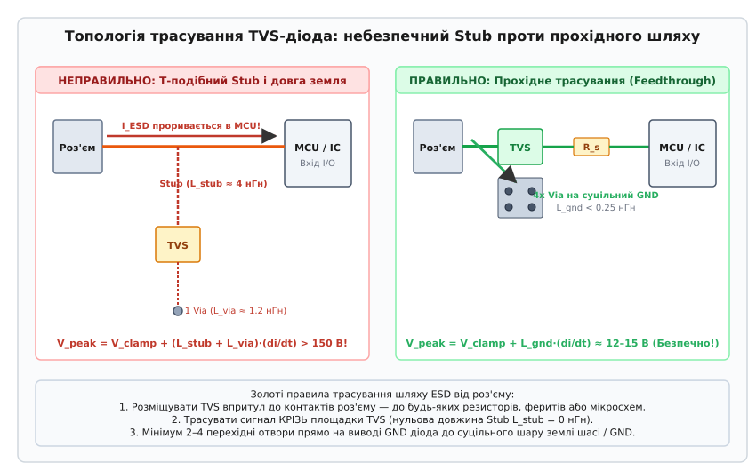

# Шлях ESD від роз'єму до землі

<preknowlist>
- [Шлях зворотного струму](root:hw-pcb/current-return-path) — повернення високочастотного струму по контуру мінімальної індуктивності.
- [Шар землі](root:hw-pcb/ground-plane-design) — організація суцільних опорних полігонів і усунення щілин.
- [TVS-діод](root:hw-components/tvs-diode) — вольт-амперна характеристика, лавинний пробій і обмеження перенапруг.
</preknowlist>

Коли оператор або заряджений предмет торкається металевого корпусу роз'єму чи відкритих контактів USB, Ethernet або налагоджувальних портів, накопичений статичний потенціал у 8–15 кВ розряджається в друковану плату. За час менше однієї наносекунди струм розряду зростає від нуля до 30 А (стандарт IEC 61000-4-2, Рівень 4), створюючи швидкість зміни струму понад 30 мільярдів амперів за секунду. Тонкий підзатворний діелектрик польових транзисторів сучасних мікросхем товщиною лише 3–5 нанометрів пробивається при напрузі 5–10 В, а фабричні захисні діоди на кристалі розраховані виключно на виробничі маніпуляції зі струмами до 1.3 А. Під дією польового розряду кристал миттєво плавиться або переходить у незворотне тиристорне замикання (CMOS Latch-up).

Щоб зберегти працездатність приладу, енергію розряду необхідно перехопити в першій же точці входу на плату — безпосередньо біля виводів роз'єму — і скинути в опорну землю за контуром із мінімальною індуктивністю.

---

## Чому наносекундний розряд підкоряється індуктивності, а не опірності

Поширена помилка під час проектування захисних кіл — розраховувати рух струму за законами постійного струму, покладаючись на товщину міді та низький активний опір доріжок. Імпульс електростатичного розряду є ультрависокочастотним процесом: передній фронт із часом наростання 0.7–1.0 нс формує спектр гармонік із частотою зламу понад 400–500 МГц.

На таких частотах повний імпеданс провідника визначається не активним опіром `R`, а індуктивним опором `X_L = 2 · pi · f · L`. Для доріжки з індуктивністю 5 нГн на частоті 500 МГц індуктивний опір перевищує 15 Ом, що у сотні разів більше за її омічний опір. Струм розряду рухається не туди, де товстіша мідь, а виключно шляхом найменшої петльової індуктивності.

Повна напруга фіксації перенапруги `V_clamp`, яку бачить захищуваний вхід мікроконтролера під час удару, описується виразом:

```text
V_clamp = V_BR + I_peak · R_dyn + L · (di/dt)
```

де `V_BR` — статична напруга лавинного пробою TVS-діода (типово 6 В), `I_peak · R_dyn` — падіння напруги на внутрішньому динамічному опорі відкритого діода (при струмі 30 А та опорі 0.25 Ом це становить 7.5 В), а `L · (di/dt)` — індуктивний стрибок напруги на паразитної індуктивності провідників.

Сам кремнієвий кристал діода обмежує напругу до безпечних 13.5 В (`6 В + 7.5 В`). Проте якщо діод підключений через бічне відгалуження доріжки довжиною всього 4 мм з індуктивністю близько 4 нГн, швидкість наростання струму `di/dt = 37.5` А/нс генерує додатковий індуктивний сплеск:

```text
V_ind = 4.0 · 10^-9 Гн · 37.5 · 10^9 А/с = 150 В
```

Сумарна напруга на вході мікроконтролера стрибає до 163.5 В. Цей пік у десятки разів перевищує гранично допустиму напругу пробою діелектрика затвора, і чип виходить із ладу задовго до того, як TVS-діод устигне повноцінно відкритися.

---

## Топологія розміщення: прохідне трасування замість відгалужень

Щоб усунути паразитну індуктивність `L`, захисний TVS-діод розміщують за принципом прямого прохідного монтажу без бічних відгалужень (Stub-Free Feedthrough Routing).


*Порівняння топології трасування TVS-діода біля інтерфейсного роз'єму. Ліворуч (НЕПРАВИЛЬНО): бічний Stub довжиною 4 мм додає паразитну індуктивність, яка генерує сплеск понад 150 В у мікроконтролер. Праворуч (ПРАВИЛЬНО): пряме прохідне трасування крізь площадки TVS, масив перехідних отворів заземлення та послідовний резистор розв'язки R_s знижують напругу до безпечного рівня.*

Правильна організація топології спирається на три жорсткі правила:
1. **Розміщення впритул до роз'єму**: Сигнальна доріжка від контакту роз'єму заходить безпосередньо на вхідний вивід TVS-діода на відстані не більше 1–2 мм від конектора. До діода на лінії не повинно бути жодних інших компонентів чи перехідних отворів;
2. **Нульова довжина відгалуження (`L_stub = 0`)**: Траса проходить крізь SMD-площадку діода наскрізно. Струм розряду фізично не може оминути діод або зустріти на шляху до нього додаткову індуктивність відгалуження;
3. **Послідовний резистор розв'язки (`R_s`)**: Між виходом TVS-діода та входом мікросхеми встановлюють резистор номіналом `R_s = 22 - 33` Ом. Цей резистор разом із власною вхідною ємністю чипа утворює фільтр низьких частот, згладжує залишковий субнаносекундний фронт і бере на себе основне падіння залишкової напруги перехідного процесу.

---

## Скидання струму в землю: перехідні отвори та опорні шари

Перехоплення струму діодом є лише половиною задачі: перехоплені 30 А потрібно миттєво відвести у шар заземлення.

Одиночний перехідний отвір (Via) діаметром 0.3 мм у стандартній платі товщиною 1.6 мм має власну індуктивність близько 1.3 нГн. Під час проходження розряду падіння напруги на такому отворі досягає `1.3 нГн · 37.5 А/нс ≈ 48.7 В`. Якщо земляний вивід TVS-діода з'єднаний із внутрішнім полігоном лише одним перехідним отвором, потенціал самої площадки заземлення діода підстрибне на 48.7 В відносно землі плати, піднявши потенціал усієї захищуваної лінії.

Для мінімізації індуктивності заземлення застосовують такі рішення:
- **Масив паралельних перехідних отворів (Via Stitching)**: Земляний контакт TVS підключають до шару GND групою з 3–4 отворів, розташованих впритул до площадки. Паралельне з'єднання знижує еквівалентну індуктивність переходу до 0.4–0.5 нГн;
- **Сувора заборона термобар'єрів (Thermal Relief)**: Контактні площадки та перехідні отвори кіл ESD повинні підключатися до суцільної міді виключно монолітним заливанням (Solid Connection). Тонкі промені термохрестовин додають до 3 нГн індуктивності й під струмом 30 А можуть фізично перегоріти;
- **Чотиришаровий стек із суцільним полігоном GND**: Найкращий захист забезпечує 4-шарова плата, де шар L2 є монолітним опорним полігоном землі на глибині всього 0.1 мм від сигнального шару L1. Це мінімізує площу контуру повернення струму (менше 0.5 мм²) та зменшує петльову індуктивність нижче 1 нГн, запобігаючи випромінюванню магнітного поля в сусідні провідники.

---

## Розділення захисного шасі та сигнальної землі

У приладах із металевим корпусом або екранованими кабелями струм розряду, що потрапляє на металеву обичайку роз'єму, не повинен протікати крізь цифрову сигнальну землю плати.

Екран роз'єму підключають безпосередньо до металевого корпусу приладу (Chassis Ground / PE) за допомогою пружних струмопровідних контактів або широкого полігону шасі на платі. Якщо сигнальну землю потрібно гальванічно розв'язати від шасі для запобігання низькочастотним фоновим земляним петлям (50 Гц у чутливих аналогових колах), між ними встановлюють паралельне RC-коло:
- Високовольтний керамічний конденсатор ємністю 1.0–4.7 нФ із робочою напругою 2–3 кВ;
- Високоомний резистор номіналом 1.0 МОм для повільного стікання статичного потенціалу.

На постійному струмі та низьких частотах імпеданс конденсатора становить мегаоми, що повністю блокує низькочастотні паразитні струми. На високих частотах фронту ESD (понад 400 МГц) реактивний опір конденсатора 4.7 нФ падає до часток ома, забезпечуючи прямий шлях найменшого імпедансу для скидання струму розряду на шасі в обхід чутливих компонентів схеми.

---

## Підсумок і глибше занурення

Стійкість електронного пристрою до статичного розряду визначається не паспортом окремого TVS-діода, а геометричною дисципліною трасування: встановленням захисту впритул до роз'єму за прохідною схемою, монолітним багатоточковим заземленням і суворим контролем петльової індуктивності контуру повернення струму.

Детальний математичний апарат розрахунку перехідних процесів, оцінку теплової стійкості кристалів за моделлю Вунша-Белла, особливості проектування захисту високошвидкісних гігабітних ліній та готовий C/C++ інструмент розрахунку наведено в [детальній статті](root:hw-pcb/shliakh-esd-vid-roziemu-do-zemli/shliakh-esd-vid-roziemu-do-zemli-d.md) та практичному модулі [проєктування системи ESD-захисту](root:hw-pcb/shliakh-esd-vid-roziemu-do-zemli/proj-esd-protection-designer.md).
