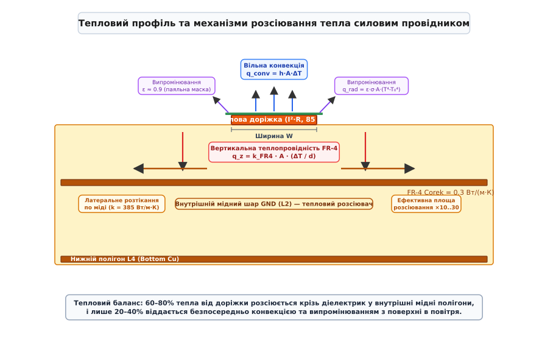
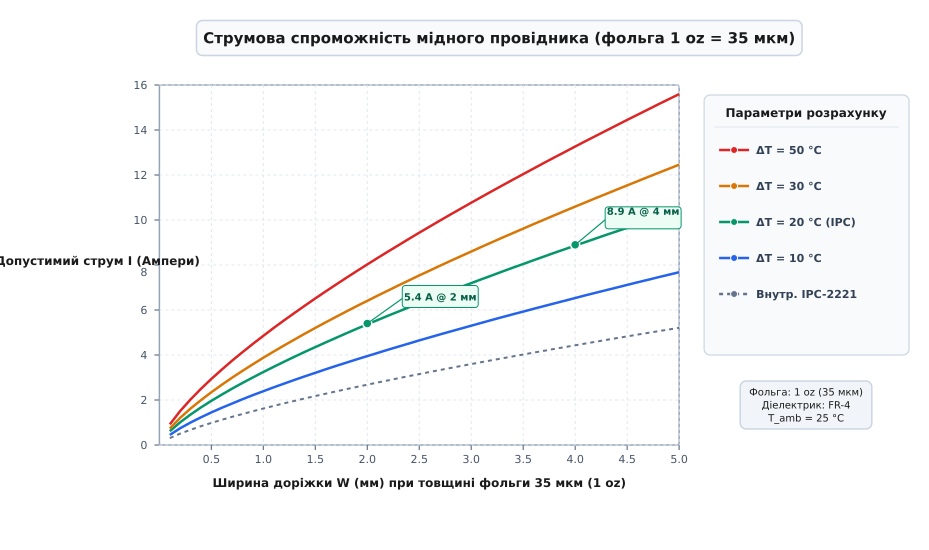

# Ширина доріжки, струм і нагрів

<preknowlist>
- [Джоулеве тепло](root:ph-electromagnetism/joule-heating) — струм у провіднику виділяє потужність P = I²·R, що перетворюється на теплову енергію.
- [Тепловий опір](root:ph-thermodynamics/thermal-resistance) — різниця температур ΔT = P · Rθ, баланс генерації та розсіювання тепла.
- [Теплопровідність](root:ph-thermodynamics/thermal-conductivity) — механізм передачі тепла крізь тверде тіло за законом Фур'є.
- [Друкована плата](root:hw-pcb/pcb-layout) — топологія мідних провідників, опір шару та паразитні індуктивності.
- [Шарування плати](root:hw-pcb/pcb-stackup) — структура шарів друкованої плати, різниця між зовнішніми та внутрішніми шарами.
- [Перехідний отвір і полігон під струм](root:hw-pcb/perekhidnyi-otvir-i-polihon-pid-strum) — геометрія полігонів та провідність матриць перехідних отворів.
- [Теплові перехідні отвори](root:hw-pcb/thermal-vias) — відведення тепла від гарячих компонентів у внутрішні мідні шари.
</preknowlist>

Коли на друкованій платі вмикається силовий перетворювач — наприклад, синхронний понижувальний конвертер живлення ядра мікропроцесора на 25 А або трифазний міст керування безколекторним мотором на 40 А фазного струму, — звичні геометричні правила розведення сигнальних ліній миттєво призводять до аварії. Сигнальна доріжка завширшки 0.25 мм на стандартній мідній фользі завтовшки 35 мкм має площу поперечного перерізу всього 0.00875 мм²; за струму 20 А густина струму всередині неї досягає астрономічного значення 2280 А/мм². Опір десятисантиметрового відрізка такого провідника становить близько 0.2 Ом, і на ньому за законом Джоуля–Ленца безперервно виділяється 80 Вт теплової потужності на крихітній площі у чверть квадратного сантиметра. Об'ємна густина тепловиділення перевищує 90 кВт на кубічний сантиметр — протягом кількох секунд температура міді перетинає позначку 250 °C, склотекстоліт FR-4 закипає й обвуглюється, паяльна маска вигорає з виділенням задушливого диму, а металева смужка відшаровується від діелектрика через катастрофічний тиск газів деструкції епоксидної смоли.

Щоб плата залишалася надійною протягом десятиліть експлуатації в жорстких температурних діапазонах, інженер зобов'язаний закладати ширину силових доріжок, товщину фольги та топологію перехідних отворів на основі точного термодинамічного розрахунку. Це вимагає розуміння фізики джоулевого нагріву, температурної залежності опору міді, механізмів розсіювання тепла конвекцією, випромінюванням і теплопровідністю крізь композитний діелектрик, а також використання сучасного галузевого стандарту IPC-2152 замість спрощених і часто оманливих емпіричних моделей минулого століття.

## Фізичні першопричини нагріву: Джоулеве тепло, опір міді та позитивний тепловий зворотний зв'язок

Рух електричного струму крізь металевий провідник є спрямованим дрейфом вільних електронів під дією прикладеної напруги. Рухаючись крізь кристалічну ґратку міді, електрони безперервно стикаються з тепловими коливаннями іонів кристалічної решітки (фононами), міжкристалітними межами зерен металу (модель Маядаса–Шацкеса) та структурними дефектами кристала. У кожному такому зіткненні кінетична енергія спрямованого руху передається коливанням ґратки, збільшуючи їхню амплітуду — це явище на макроскопічному рівні реєструється як підвищення температури металу. За законом Джоуля–Ленца потужність тепловиділення `P` у ватах на провіднику з електричним опором `R` під дією постійного або діючого змінного струму `I` виражається фундаментальною квадратичною залежністю:

```
P = I² · R
```

Електричний опір постійному струму відрізка друкованої доріжки прямокутного або трапецієподібного перерізу довжиною `L` з площею поперечного перерізу `A` визначається питомим електричним опором матеріалу `ρ`:

```
R = ρ · (L / A)
```

Для виготовлення друкованих плат застосовують електролітично осаджену мідь (англ. *electrodeposited copper, ED*) або катану відпалену мідь (англ. *rolled-annealed copper, RA*). За міжнародним стандартом IACS (International Annealed Copper Standard, прийнятим ще у 1913 році) питомий опір стандартної чистої міді при температурі `T₀ = 20 °C` становить:

```
ρ₀ = 1.7241 · 10⁻⁸ Ом·м = 0.017241 Ом·мм²/м = 17.241 нОм·м
```

Реальна мідна фольга друкованої плати містить мікроскопічні домішки та має специфічну стовпчасту кристалічну структуру після гальванічного осадження в сірчанокислому електроліті, тому її питомий опір на практиці коливається в діапазоні `1.72–1.78 · 10⁻⁸ Ом·м` при кімнатній температурі. Крім того, на нижній поверхні фольги виробники створюють мікроскопічний рельєф (дендритні нарости зубців міді заввишки від 2 до 8 мкм) для забезпечення адгезії зі смолою FR-4. Ця шорсткість збільшує реальну довжину шляху протікання ліній струму в приповерхневому шарі, що додатково підвищує ефективний опір на 2–5% навіть на постійному струмі.

Ключовим фактором, який часто ігнорують початківці, є сильна температурна залежність питомого опору металів. Зі зростанням температури амплітуда коливань іонів ґратки зростає, що скорочує середню довжину вільного пробігу електронів і збільшує електричний опір. У діапазоні робочих температур електроніки від -40 °C до +150 °C ця залежність із високою точністю описується лінійною формулою:

```
ρ(T) = ρ₀ · (1 + α · (T - T₀))
```

де `α` — температурний коефіцієнт електричного опору (ТКО). Для міді стандартної чистоти:

```
α = 0.00393 K⁻¹ = +0.393% / °C
```

Це означає, що при нагріванні провідника від кімнатних `20 °C` до гранично допустимих для силових плат `120 °C` (перегрів `ΔT = 100 °C`) питомий опір міді зростає майже на 40%:

```
ρ(120 °C) = 1.724 · 10⁻⁸ · (1 + 0.00393 · 100) = 2.402 · 10⁻⁸ Ом·м
```

Цей ефект створює явище **позитивного теплового зворотного зв'язку** (англ. *positive thermal feedback*). Якщо через доріжку протікає фіксований струм навантаження від стабілізатора струму чи індуктивного перетворювача:
1. Початковий струм виділяє тепло `P₀ = I² · R₀`.
2. Провідник нагрівається до температури `T₁ = T₀ + ΔT₁`.
3. Опір провідника зростає до `R₁ = R₀ · (1 + α · ΔT₁)`.
4. Виділення тепла зростає до `P₁ = I² · R₁ > P₀`.
5. Додаткове тепло викликає вторинне зростання температури `T₂ > T₁`.

У стабільно спроєктованій системі це наростання сходиться до точки динамічної теплової рівноваги, де швидкість розсіювання тепла в навколишнє середовище дорівнює швидкості генерації тепла за гарячого опору. Проте якщо тепловідвід недостатній або густина струму завищена понад критичну межу (зазвичай понад `60–80 А/мм²` для тривалого режиму на зовнішніх шарах), позитивний зворотний зв'язок перетворюється на тепловий розгін (thermal runaway), що закінчується локальним розплавленням міді або перегоранням доріжки, подібно до плавкого запобіжника.

Геометричний профіль реальної доріжки відрізняється від ідеального прямокутника. У процесі хімічного рідинного травлення заготовки плати в розчині хлориду заліза або персульфату амонію травильний розчин розчиняє мідь не лише вертикально вглиб діелектрика, а й у боки під захисний шар фоторезисту. Це явище називають **боковим підтравлюванням** (англ. *undercut* або *etch factor*). 

Фактор травлення визначається як відношення глибини вертикального травлення (товщини фольги `t`) до величини бокового підтравлювання під маску `u`:

```
Etch_Factor = t / u
```

Для стандартних виробничих ліній фактор травлення становить від 2:1 до 3:1. У результаті верхня грань доріжки виходить вужчою за нижню основу, яка контактує зі склотекстолітом, утворюючи трапецієподібний переріз. Якщо проектна ширина фотошаблону становить `W`, а товщина фольги `t`, то ширина верхньої грані зменшується до `W_top ≈ W - (0.5…0.8) · t`, а нижньої — `W_bottom ≈ W`. Дійсна площа поперечного перерізу такої трапеції обчислюється як:

```
A_eff = (W_top + W_bottom) / 2 · t
      = (W - 0.35 · t) · t
```

Для тонких фольг (18 мкм) трапецієподібність майже не впливає на опір, але для силових товстих шарів 70–105 мкм (2–3 oz) втрата площі поперечного перерізу сягає 10–15%, що пропорційно збільшує діючий електричний опір і тепловиділення.

## Товщина мідної фольги: одиниці вимірювання, стандарти та виробничі допуски

В інженерній практиці проектування друкованих плат історично закріпилася специфічна одиниця вимірювання товщини міді — **унція на квадратний фут** (позначається `oz` або `oz/ft²`). Ця величина визначає товщину шару міді, якщо одну тройську/авердюпуа унцію міді (масою 28.3495 г) рівномірно розкатати по площі в один квадратний фут (0.092903 м²). Знаючи густину чистої міді `d_Cu = 8.96 г/см³ = 8960 кг/м³`, легко обчислити метричний еквівалент:

```
t = Маса / (Площа · Густина)
  = 0.0283495 кг / (0.092903 м² · 8960 кг/м³)   [підстановка маси 1 oz, площі 1 фут² та густини міді]
  = 3.407 · 10⁻⁵ м                              [обчислення відношення маси до густини]
  ≈ 34.8 мкм ≈ 1.37 mil                         [переведення в мікрони та тисячні дюйма]
```

У світовій PCB-індустрії стандартною номінальною товщиною для 1 oz прийнято вважати рівно **35 мкм** (або 1.378 mil).

| Позначення фольги | Маса на площу | Товщина в мікронах (мкм) | Товщина в мілах (mil) | Типове застосування в схемотехніці |
|---|---|---|---|---|
| **0.5 oz** | 15.3 г/фут² | 17.5 мкм | 0.69 mil | Базовий шар для зовнішніх шарів HDI-плат, тонкі сигнальні лінії 0.075 мм |
| **1.0 oz** | 30.5 г/фут² | 35.0 мкм | 1.38 mil | Загальновживаний стандарт за замовчуванням для сигнальних і помірно силових плат |
| **2.0 oz** | 61.0 г/фут² | 70.0 мкм | 2.76 mil | Силові шини, імпульсні конвертери струмом 10–30 А, плати моторних приводів |
| **3.0 oz** | 91.5 г/фут² | 105.0 мкм | 4.13 mil | Потужні DC-DC модулі, автомобільна електроніка, зварювальне та тягове обладнання |
| **4.0 oz** | 122.0 г/фут² | 140.0 мкм | 5.51 mil | Важка силова електроніка (heavy copper PCB), сонячні інвертори, батарейні BMS |

Під час замовлення друкованої плати необхідно чітко розрізняти **базову товщину фольги** (англ. *base copper*) та **фінішну товщину міді** (англ. *finished copper*). 

Внутрішні шари багатошарової плати виготовляються з двостороннього фольгованого діелектрика (core), малюнок якого труїться безпосередньо і далі запресовується препрегом. Для них фінішна товщина точно дорівнює товщині вихідної фольги мінус невелике зменшення через мікротравлення при підготовці поверхні (близько 1–2 мкм).

Зовнішні шари плати проходять складніший технологічний маршрут. Щоб забезпечити металізацію наскрізних перехідних отворів, на заготовку з базовою фольгою (зазвичай 0.5 oz = 18 мкм або 1.0 oz = 35 мкм) гальванічним способом нарощують шар міді. Гальваніка одночасно осаджує метал усередині стінок отворів і на всій поверхні зовнішніх шарів. Відповідно до стандарту IPC-6012 товщина гальванічного шару в отворах для плат Class 2 повинна становити не менше 20 мкм (Class 3 — не менше 25 мкм). Отже, на поверхні зовнішніх провідників до базової фольги 0.5 oz (18 мкм) додається ще 20–35 мкм міді, утворюючи підсумкову фінішну товщину близько 38–53 мкм (еквівалент 1.1–1.5 oz). Якщо ж базовою фольгою зовнішнього шару була обрана 1.0 oz (35 мкм), то фінішна товщина досягає 55–70 мкм (1.6–2.0 oz).

Гальванічне осадження міді на зовнішніх шарах має істотну просторову нерівномірність. Силові лінії електричного струму в гальванічній ванні концентруються на краях панелі та на ізольованих одиночних доріжках. Навпаки, у зонах високої щільності міді осадження відбувається повільніше. Щоб вирівняти щільність осадження металу, технологи розміщують на вільних ділянках плати балансувальні мідні сітки (thieving / copper balancing pads). 

Згідно зі стандартом IPC-4562 допуск на товщину базової фольги становить ±10%, а загальна варіація товщини фінішної міді на зовнішньому шарі може досягати -15%...+30% від номіналу. Тому при критичних теплових і струмових розрахунках розробник повинен завжди враховувати найгірший випадок виробничого мінусового допуску (наприклад, приймаючи для розрахунку 1 oz товщину не 35 мкм, а консервативні 30–31 мкм).

## Термодинаміка друкованої плати: три канали розсіювання тепла та роль FR-4

Тепло, що виділяється у внутрішньому об'ємі мідного провідника, підпорядковується фундаментальному закону збереження енергії:

```
P_gen = P_stored + P_dissipated
```

У стаціонарному тепловому режимі, коли температура провідника перестає зростати, накопичення тепла припиняється (`P_stored = 0`), і вся потужність джоулевих втрат `P_gen = I² · R` повністю розсіюється в навколишній простір через систему теплових опорів друкованої плати.

Відведення тепла від провідника на друкованій платі здійснюється трьома паралельними фізичними процесами:
1. **Теплове випромінювання (радіація) з поверхні плати.**
2. **Вільна або примусова конвекція повітря.**
3. **Теплопровідність у товщу діелектрика FR-4 та латеральне розтікання по мідних полігонах.**


*Поперечний розріз 4-шарової друкованої плати: шляхи розсіювання джоулевого тепла від силової доріжки крізь діелектрик FR-4 у внутрішній суцільний полігон заземлення (GND L2) та у навколишній простір через конвекцію й випромінювання паяльної маски.*

Розглянемо детально фізику кожного з цих трьох механізмів.

### 1. Теплове випромінювання

Кожна нагріта поверхня випромінює електромагнітні хвилі інфрачервоного спектра згідно із законом Стефана–Больцмана. Результуючий тепловий потік випромінювання `q_rad` з поверхні площею `A_surf` за абсолютної температури поверхні `T_surf` (у Кельвінах) та температури навколишнього середовища `T_amb` виражається рівнянням:

```
q_rad = ε · σ · A_surf · (T_surf⁴ - T_amb⁴)
```

де `σ = 5.670374 · 10⁻⁸ Вт/(м²·К⁴)` — стала Стефана–Больцмана, а `ε` — ступінь чорноти (коефіцієнт випромінювання) поверхні (безрозмірна величина від 0 до 1).

Ступінь чорноти критично залежить від стану поверхні:
- Чиста полірована мідь має дуже низьку випромінювальну здатність: `ε_Cu ≈ 0.03–0.07`. Вона майже не випромінює інфрачервоне тепло, працюючи як дзеркало.
- Окислена мідь демонструє `ε ≈ 0.6–0.7`.
- Стандартна паяльна маска (зелена, синя, чорна, червона) на основі акрилатних та епоксидних смол є чудовим випромінювачем інфрачервоного світла зі ступенем чорноти `ε_mask ≈ 0.85–0.93`.

Покриття силової доріжки паяльною маскою, всупереч інтуїтивному побоюванню «укутати провідник у теплоізолятор», кардинально покращує відведення тепла. Хоча тонкий шар маски (15–25 мкм) має власний невеликий тепловий опір теплопровідності, десятикратне збільшення коефіцієнта випромінювання `ε` підвищує сумарне розсіювання тепла на 15–30% порівняно з голою блискучою міддю. При помірних перегрівах (`ΔT = 20–40 °C`) теплове випромінювання забезпечує від 25% до 40% загального теплообміну відкритої поверхні друкованої плати.

### 2. Вільна та примусова конвекція

Конвективний теплообмін виникає внаслідок нагрівання шару повітря, що прилягає до поверхні плати. Густина нагрітого повітря зменшується, і під дією сили Архімеда воно піднімається вгору, створюючи постійний висхідний потік, на зміну якому підтікає холодне повітря з навколишнього середовища. Тепловий потік конвекції підпорядковується закону теплопередачі Ньютона–Ріхмана:

```
q_conv = h_conv · A_surf · (T_surf - T_amb)
```

де `h_conv` — коефіцієнт тепловіддачі конвекцією у `Вт/(м²·К)`.

Значення `h_conv` не є фізичною константою матеріалу — воно залежить від швидкості руху повітря, різниці температур, геометричних розмірів плати та її просторової орієнтації у гравітаційному полі:
- **Вільна (природна) конвекція у нерухомому повітрі закритого корпусу:** `h_conv ≈ 8–15 Вт/(м²·К)`. При вертикальному розташуванні плати коефіцієнт тепловіддачі на 15–20% вищий, ніж при горизонтальному, завдяки безперешкодному висхідному руху ламінарного повітряного стовпа вздовж усієї площини текстоліту. На горизонтальній платі верхня гаряча сторона віддає тепло ефективніше (`h ≈ 12 Вт/(м²·К)`), тоді як під нижньою стороною плати утворюється застійний мішок гарячого повітря, що знижує тепловіддачу майже вдвічі (`h ≈ 6 Вт/(м²·К)`).
- **Примусова конвекція (вентиляторний обдув):** За швидкості потоку повітря `v = 1–2 м/с` коефіцієнт зростає до `h_conv ≈ 30–50 Вт/(м²·К)`; при швидкостях `v = 3–5 м/с` досягає `80–120 Вт/(м²·К)`. Примусовий обдув знижує перегрів силових провідників у 2.5–4 рази при тому самому струмовому навантаженні.

### 3. Теплопровідність у діелектрик та латеральне розтікання тепла

Теплопровідність усередині твердих тіл плати підпорядковується закону Фур'є: густина теплового потоку прямо пропорційна градієнту температури та коефіцієнту теплопровідності середовища `k`:

```
q_cond = -k · ∇T
```

Порівняємо коефіцієнти теплопровідності матеріалів сучасної друкованої плати:
- Чиста мідь: `k_Cu ≈ 385–400 Вт/(м·К)`.
- Склотекстоліт FR-4 (композит із переплетеної склотканини та епоксидної смоли):
  - Перпендикулярно площині шарів (вісь Z): `k_z ≈ 0.25–0.30 Вт/(м·К)`.
  - У площині шарів уздовж волокон скла (осі X-Y): `k_xy ≈ 0.50–0.80 Вт/(м·К)`.
- Алюміній (для порівняння, в платах на металевій основі IMS): `k_Al ≈ 180–220 Вт/(м·К)`.
- Повітря (нерухоме): `k_air ≈ 0.026 Вт/(м·К)`.

Мідь проводить тепло майже у **1500 разів краще за діелектрик FR-4**. Одинока вузька доріжка на чистому двошаровому текстоліті без прилеглих полігонів має дуже обмежений шлях тепловідведення: діелектрик товщиною 1.6 мм працює як тепловий бар'єр. Тепло від вузької смужки міді шириною 1 мм повільно проникає вглиб FR-4, утворюючи крутий локальний градієнт температури (гарячий тепловий купол безпосередньо під провідником).

Структура склотканини FR-4 складається з плетіння ниток E-скла (скловолокно, де теплопровідність становить `k ≈ 1.0 Вт/(м·К)`) та епоксидного сполучного компаунда (`k ≈ 0.18–0.22 Вт/(м·К)`). Різні типи препрегів (наприклад, щільний склотекстоліт марки 7628 з масовою часткою скла 58% проти тонкого препрегу 1080 з часткою скла 35%) мають помітно різну анізотропію теплопровідності. У щільних типах склотканини латеральне розтікання тепла в площині плати значно ефективніше.

Ситуація кардинально змінюється на 4-шарових і багатошарових платах, де під силовою доріжкою верхнього шару (L1) на відстані всього `d = 0.15–0.20 мм` діелектрика (препрегу) розташований внутрішній суцільний мідний шар заземлення (L2 GND Plane). 

Розрахуємо тепловий опір діелектричного прошарку під ділянкою доріжки довжиною `L = 100 мм` та шириною `W = 2 мм`:
```
R_th = d / (k_z · A)                                  [закон теплопровідності Фур'є для плаского діелектрика]
     = 0.0002 м / (0.3 Вт/(м·К) · (0.002 м · 0.1 м))  [підстановка d=0.2 мм, k=0.3 Вт/(м·К), A=2 см²]
     = 0.0002 / 0.00006                               [обчислення знаменника]
     ≈ 3.33 К/Вт                                      [підсумковий тепловий опір препрегу]
```

Це надзвичайно низький тепловий опір. Тепло від доріжки L1 через тонкий препрег миттєво провалюється у внутрішній суцільний шар міді L2. Потрапивши в мідний екран, тепло за рахунок колосальної теплопровідності міді (`k = 385 Вт/(м·К)`) миттєво розтікається в боки по всій площі плати. Ефективна площа теплообміну зростає від вихідних 2 см² до 50–100 см² площі всієї плати.

Крім того, важливо враховувати **взаємний тепловий вплив паралельних силових провідників** (thermal proximity effect). Якщо дві силові доріжки прокладені паралельно з малим зазором (наприклад, 0.5 мм), їхні теплові куполи в діелектрику перекриваються. Сумарна площа розсіювання тепла стає меншою за суму окремих площ кожного провідника. Для оцінки взаємного нагріву використовують коефіцієнт теплового зв'язку `K_th`:

```
ΔT_total = ΔT₁ + K_th · ΔT₂
```

де `K_th ≈ exp(-s / s₀)`, де `s` — зазор між доріжками, а `s₀ ≈ 2.5–3.5 мм` — характерна довжина термічного затухання у FR-4. Якщо зазор між силовими лініями менший за 3 мм, допустимий струм кожної доріжки необхідно знижувати (дерейтинг) на 15–25%.

> 🔧 **Навіщо це.** Внутрішній суцільний шар заземлення або живлення є найефективнішим тепловим радіатором у конструкції плати. До 70–85% тепла, згенерованого силовою доріжкою зовнішнього шару, розсіюється не прямим випромінюванням і конвекцією в повітря, а скидається крізь тонкий діелектрик у внутрішні мідні полігони, які розподіляють його по всій поверхні виробу.

## Внутрішні шари проти зовнішніх: еволюція поглядів від IPC-2221 до IPC-2152

Протягом чотирьох десятиліть (з 1968 по 2009 рік) розробники електроніки користувалися стандартом IPC-2221 (раніше IPC-D-275 та військовим стандартом MIL-STD-275E). Головне правило цього стандарту стверджувало: **провідник на внутрішньому шарі плати витримує рівно вдвічі менший струм, ніж такий самий провідник на зовнішньому шарі при однаковому допустимому перегріві `ΔT`**.

Коефіцієнт `k` в емпіричній формулі IPC-2221 становив:
- `k = 0.048` для зовнішніх провідників (External Traces);
- `k = 0.024` для внутрішніх провідників (Internal Traces).

Через це інженери змушені були розширювати внутрішні силові шини у 2–2.5 раза або виносити всі потужні лінії виключно на верхній та нижній шари.

### У чому полягала фізична вада експериментів IPC-2221?

Історичні вимірювання, які лягли в основу MIL-STD-275 і згодом перекочували в IPC-2221, проводилися Національним бюро стандартів США (NBS) ще у 1954–1956 роках під керівництвом інженера Charles F. Ruffing. Експерименти ставилися на примітивних двошарових платах на фенольній та епоксидній основі без жодних додаткових мідних шарів. Внутрішню доріжку моделювали шляхом запресовування одиночної смужки міді всередину товстого масиву діелектрика без прилеглих полігонів живлення чи заземлення.

В ізольованому масиві склотекстоліту без металевих екранів внутрішня доріжка справді виявлялася у термодинамічній пастці: повітря навколо немає, конвекція та пряме випромінювання відсутні, а товстий шар теплоізолятора FR-4 з усіх боків блокує відтік тепла. У таких штучних умовах внутрішній провідник грівся вдвічі сильніше за зовнішній.

### Що відкрив стандарт IPC-2152?

У 2009 році асоціація IPC після десятиліття масштабних досліджень під егідою робочої групи IPC 1-10b під керівництвом Майкла Джуерса (Michael Jouppi, Thermal Man, Inc.) випустила кардинально оновлений стандарт **IPC-2152** (*Standard for Determining Current-carrying Capacity in Printed Board Design*). Дослідження базувалося на комп'ютерному 3D-моделюванні методом скінченних елементів (FEA) та тисячах натурних тепловізійних вимірювань реальних багатошарових плат із різними структурами стеків (stackup) у вакуумній камері та в умовах вільної конвекції.


*Порівняння струмової навантажувальної здатності мідної доріжки товщиною 1 oz (35 мкм) при допустимому перегріві ΔT від 10 °C до 50 °C за стандартом IPC-2152 та внутрішнього шару за старим IPC-2221.*

Результати експериментів IPC-2152 спростували міф про «вдвічі гірші» внутрішні шари:
1. **Роль внутрішніх мідних полігонів:** Якщо внутрішня доріжка розташована між двома шарами заземлення на типовій відстані препрегу 0.1–0.25 мм, тепло від неї симетрично відводиться в обидва боки (вгору і вниз). Теплопровідність мідних площин настільки переважає слабку вільну конвекцію повітря зовнішнього шару, що **внутрішня доріжка за наявності суміжних мідних площин нагрівається МЕНШЕ, ніж ізольована зовнішня доріжка за того самого струму**.
2. **Товщина плати:** Плата товщиною 2.4 мм відводить тепло значно краще за плату 0.8 мм, оскільки більший об'єм діелектрика забезпечує менший тепловий опір теплопровідності в площині X-Y.
3. **Ширина плати та ефект розсіювача:** Чим ширша друкована плата і чим більше на ній суцільних полігонів (навіть не зв'язаних електрично з силовою шиною), тим нижча підсумкова робоча температура провідників.

## Математичні моделі розрахунку струмової спроможності: формули та поправочні коефіцієнти

Розглянемо практичні математичні апарати розрахунку ширини та нагріву доріжок.

### Спрощена модель IPC-2221A

Стандарт IPC-2221A використовує степеневу емпіричну залежність струму `I` (у амперах) від допустимого перегріву `ΔT` (у градусах Цельсія) та площі поперечного перерізу міді `A` (у квадратних мілах, `mils²`):

```
I = k · ΔT^0.44 · A^0.725
```

де:
- `k = 0.048` — для зовнішніх шарів із захисною паяльною маскою;
- `k = 0.024` — для внутрішніх шарів за консервативною моделлю ізольованого провідника.

Щоб знайти необхідну площу поперечного перерізу `A` (у `mils²`) за заданим струмом `I` та перегрівом `ΔT`, формулу обертають:

```
A = (I / (k · ΔT^0.44))^(1 / 0.725)
  = (I / (k · ΔT^0.44))^1.3793
```

Знаючи площу `A` в `mils²` та товщину фольги `t` (у мілах, наприклад `1.378 mil` для 1 oz), мінімальну ширину доріжки `W` у мілах обчислюють як:

```
W_mils = A / t_mils
```

Для переведення у метричну систему (міліметри):

```
W_mm = W_mils · 0.0254
A_mm² = A_mils² · 0.00064516
```

#### Межі застосовності IPC-2221A:
- Струм: від 0.1 А до 35 А.
- Площа перерізу: від 0.5 mils² (0.0003 мм²) до 2000 mils² (1.3 мм²).
- Перегрів: `ΔT` від 1 °C до 100 °C.
- Товщина фольги: від 0.5 oz до 3 oz.

Формула IPC-2221A є простою, але має тенденцію до **надлишкового перезакладання** ширини (на 20–40%) для внутрішніх шарів за наявності мідних площин та **недооцінки нагріву** для дуже товстих плат без примусового охолодження.

### Багатофакторна модель IPC-2152

Стандарт IPC-2152 побудовано за модульним принципом базової номограми та коригувальних коефіцієнтів.

1. **Базова крива (Universal Baseline):**
Спочатку визначається базовий струм `I_base` для ізольованого провідника товщиною 3 oz (105 мкм) на тестовій платі у нерухомому повітрі або вакуумі. Апроксимація базової кривої IPC-2152 для площі перерізу `A` (у мм²) та перегріву `ΔT` описується функцією:

```
I_base = C₀ · A^C₁ · ΔT^C₂
```

де емпіричні коефіцієнти апроксимації кривих IPC-2152 для метричних одиниць складають `C₀ ≈ 0.064`, `C₁ ≈ 0.695`, `C₂ ≈ 0.435`.

2. **Модифікатор товщини плати (`M_thick`):**
Для тонких плат (0.8 мм) тепловідвід гірший (`M_thick ≈ 0.85–0.92`), для стандартних 1.6 мм — `M_thick = 1.0`, для товстих 2.4 мм — `M_thick ≈ 1.08–1.15`.

3. **Модифікатор наявності та близькості мідного полігону (`M_plane`):**
Якщо на відстані `d` від провідника є суцільний мідний шар:
- `d = 0.15 мм` (1 prepreg): `M_plane ≈ 1.35–1.50` (+35–50% до струму);
- `d = 0.35 мм` (2 prepregs): `M_plane ≈ 1.20–1.30`;
- `d = 0.80 мм`: `M_plane ≈ 1.05–1.10`;
- Мідний шар відсутній: `M_plane = 1.00`.

4. **Модифікатор товщини мідної фольги (`M_cu`):**
При однаковій площі поперечного перерізу широка тонка доріжка (наприклад, 4 мм шириною на фользі 0.5 oz) має більшу площу контакту з діелектриком та повітрям, ніж вузька товста доріжка (1 мм на фользі 2 oz). Тому широка тонка доріжка охолоджується краще: `M_cu ≈ 1.05–1.12`.

5. **Модифікатор умов навколишнього середовища (`M_env`):**
Враховує примусовий обдув (`M_air ≈ 1.4–2.2`) або розріджену атмосферу / вакуум аерокосмічних застосувань (`M_vac ≈ 0.65–0.75`).

Результуючий допустимий струм становить добуток усіх модифікаторів:

```
I_actual = I_base · M_thick · M_plane · M_cu · M_env
```

Для детального ознайомлення з алгоритмами числової апроксимації та повною програмною реалізацією калькулятора зверніться до статті [Інженерний калькулятор IPC-2152](root:hw-pcb/shyryna-dorizhky-strum-i-nahriv/proj-ipc2152-trace-thermal-calc.md).

## Перехідні отвори (vias) для силових струмів: розрахунок перерізу, опору та теплової стійкості

Коли силовий провідник переходить з одного шару плати на інший або підключається до виводів SMD-компонентів, струм протікає крізь перехідні отвори (англ. *vias*). У силових ланцюгах одиночний отвір часто стає найвужчим пляшковим горлом усієї плати.

### Геометрія та поперечний переріз гільзи отвору

Перехідний отвір не є суцільним мідним циліндром. Це порожниста трубка (гільза, barrel), утворена тонким шаром гальванічної міді на стінках висвердленого в склотекстоліті циліндричного каналу.

Нехай:
- `d_hole` — діаметр отвору після свердління (drill size);
- `t_barrel` — товщина металізації стінки отвору (plating thickness);
- `h_board` — товщина плати (довжина гільзи отвору).

Площа поперечного перерізу металізованої гільзи `A_via` дорівнює площі кільця між зовнішнім радіусом `r_out = d_hole / 2` та внутрішнім радіусом `r_in = d_hole / 2 - t_barrel`:

```
A_via = π · (r_out² - r_in²)                         [площа кільцевого перерізу циліндричної гільзи]
      = π · ((d_hole / 2)² - (d_hole / 2 - t_barrel)²)  [вираження зовнішнього та внутрішнього радіусів]
      = π · (d_hole · t_barrel - t_barrel²)          [розкриття дужок і спрощення різниці квадратів]
      = π · t_barrel · (d_hole - t_barrel)           [винесення спільного множника t_barrel за дужки]
```

Оскільки товщина металізації `t_barrel` (18–25 мкм) значно менша за діаметр свердла `d_hole` (300–600 мкм), на практиці часто використовують спрощену лінійну формулу середнього периметра:

```
A_via ≈ π · d_hole · t_barrel
```

Розрахуємо еквівалентний переріз для найпоширенішого перехідного отвору `d_hole = 0.3 мм` (12 mil) при стандартній металізації IPC Class 2 (`t_barrel = 20 мкм = 0.020 мм`):

```
A_via = π · 0.020 мм · (0.300 мм - 0.020 мм)
      = 3.14159 · 0.020 · 0.280
      ≈ 0.0176 мм²
```

Порівняємо це з площею перерізу пласкої доріжки на фользі 1 oz (товщина 0.035 мм):

```
W_equiv = A_via / t_cu = 0.0176 мм² / 0.035 мм ≈ 0.50 мм
```

Таким чином, один стандартний отвір 0.3 мм із товщиною стінки 20 мкм за площею перерізу еквівалентний вузькій доріжці шириною всього **0.50 мм**. Якщо через такий одиночний отвір пропустити силовий струм 10 А, густина струму в металі гільзи досягне `568 А/мм²`, викликаючи катастрофічний локальний перегрів.

### Електричний опір та падіння напруги на отворі

Електричний опір `R_via` мідної гільзи завдовжки `h_board` (для типової 4-шарової плати `h_board = 1.6 мм = 0.0016 м`) за температури `T = 20 °C` становить:

```
R_via = ρ₀ · (h_board / A_via)
      = (1.724 · 10⁻⁸ Ом·м · 0.0016 м) / (1.76 · 10⁻⁸ м²)
      ≈ 1.567 · 10⁻³ Ом = 1.57 мОм
```

З урахуванням нагріву до робочих 80 °C (`ΔT = 60 °C`):

```
R_via(80 °C) = 1.57 мОм · (1 + 0.00393 · 60) ≈ 1.94 мОм
```

За струму 10 А крізь один отвір на ньому впаде `V = 10 А · 1.94 мОм = 19.4 мВ`, а потужність локального тепловиділення складе `P = 10² · 1.94 мОм = 0.194 Вт`. На перший погляд, 0.2 Вт здаються незначною величиною, але об'єм металу гільзи отвору становить лише:

```
V_Cu = A_via · h_board = 0.0176 мм² · 1.6 мм = 0.0282 мм³ = 2.82 · 10⁻⁵ см³
```

Об'ємна густина тепловиділення всередині металу отвору перевищує:

```
q_vol = 0.194 Вт / (2.82 · 10⁻⁵ см³) ≈ 6880 Вт/см³ = 6.88 кВт/см³
```

За такої густини тепловиділення безпосередньо навколо отвору виникає локальна зона екстремального теплового градієнта.

### Матриці перехідних отворів (Via Arrays) для силових шин

Щоб безпечно пропустити силовий струм крізь шари плати, використовують паралельні масиви отворів (via arrays / stitching vias). 

Для розрахунку необхідної кількості отворів `N_vias` використовують консервативне правило: **струм на один отвір діаметром 0.3 мм при товщині стінки 20–25 мкм не повинен перевищувати 1.5–2.0 А** для допустимого перегріву `ΔT ≤ 20 °C`.

```
N_vias ≥ I_total / I_per_via
```

Для струму 20 А необхідно закладати масив щонайменше з `20 / 1.5 ≈ 14–16` отворів діаметром 0.3 мм (або 8–10 отворів діаметром 0.5 мм).

Під час проектування матриць отворів необхідно дотримуватися критичних топологічних правил:
1. **Нерівномірність розподілу струму (Current Crowding):** Струм вибирає шлях найменшого повного опору. Якщо широка силова доріжка впирається в прямокутний масив отворів, до 50–70% усього струму затікає в перший ряд отворів, найближчий до точки входу, тоді як дальні ряди майже не навантажуються. Щоб вирівняти струми, масиви отворів розтягують уздовж напрямку руху струму або розташовують шаховим порядком (staggered pattern).
2. **Крок сітки отворів (Via Pitch):** Відстань між центрами сусідніх отворів повинна становити не менше `2.5 · d_hole` (наприклад, крок 0.8–1.0 мм для отворів 0.3 мм). Якщо просвердлити отвори занадто близько один до одного, перетин теплових полів створить зону загального перегріву, а суцільне руйнування ниток склотканини в діелектрику призведе до виникнення мікротріщин при механічних вібраціях.

### Термомеханічна надійність: проблема різниці КТР металізації

Найчастішою причиною прихованих відмов силових друкованих плат є втомне руйнування металізації отворів через **невідповідність коефіцієнтів теплового розширення (КТР, англ. *Coefficient of Thermal Expansion, CTE*)** міді та діелектрика FR-4.

| Матеріал | КТР по осі X (ppm/K) | КТР по осі Y (ppm/K) | КТР по осі Z (ppm/K) нижче Tg | КТР по осі Z (ppm/K) вище Tg |
|---|---|---|---|---|
| **Мідь (Cu)** | 16.5–17.0 | 16.5–17.0 | 16.5–17.0 | 16.5–17.0 |
| **FR-4 Standard (Tg ≈ 130 °C)** | 13.0–15.0 | 13.0–15.0 | **50.0–70.0** | **250.0–350.0** |
| **High-Tg FR-4 (Tg ≈ 170 °C)** | 12.0–14.0 | 12.0–14.0 | **40.0–50.0** | **200.0–250.0** |

У площині плати (осі X та Y) склотканина жорстко стримує розширення епоксидної смоли, тому `CTE_xy` склотекстоліту (13–15 ppm/K) майже ідеально узгоджений із міддю (17 ppm/K).

Проте вздовж осі Z (перпендикулярно платі) склотканина не має переплетених волокон. Нижче температури склування `Tg` склотекстоліт розширюється утричі-вчотири рази сильніше за мідь (`CTE_z ≈ 50–70 ppm/K`). Коли ж температура плати перетинає точку склування `Tg` (наприклад, під час безсвинцевої пайки при 245–260 °C або при аварійному перегріві силової шини понад 140 °C), епоксидна смола переходить із твердого склоподібного стану у високоеластичний стан, і `CTE_z` стрибкоподібно зростає до **250–350 ppm/K** — тобто діелектрик розширюється по осі Z у **15–20 разів сильніше за мідну гільзу отвору**.

Розширюючись по вертикалі, товща діелектрика розтягує мідну гільзу, як пружину. У стінках отвору та в місці стику гільзи із зовнішніми контактними площадками (англ. *via knee / pad-to-barrel junction*) виникають колосальні напруження зрізу та розтягу, що перевищують границю плинності осадженої міді (200–300 МПа). При багаторазових циклах нагрівання й охолодження за методом випробувань IPC-TM-650 2.6.7 виникає втомна тріщина:
- Розрив циліндра металізації посередині плати (barrel cracking);
- Відрив контактної площадки від гільзи (corner cracking).

Для силових виробів обов'язковим правилом є використання склотекстоліту класу **High-Tg (Tg ≥ 170 °C, наприклад Isola 370HR, Shengyi S1000-2)**, забезпечення гарантованої товщини металізації стінки отвору не менше **25 мкм (IPC Class 3)** та додавання каплеподібних підсилень (teardrops) на переходах від провідника до контактної площадки отвору.

## Падіння напруги проти теплового обмеження: що насправді лімітує ширину доріжки

Багато інженерів роблять критичну помилку, розраховуючи силову доріжку виключно за допустимим нагрівом `ΔT ≤ 10 °C` або `20 °C`. Проте в сучасній низьковольтній електроніці з великими струмами лімітуючим фактором майже завжди виступає не нагрів, а **допустиме падіння напруги на провіднику (IR Drop)**.

Розглянемо практичний інженерний розрахунок для реального пристрою:
- Живлення FPGA / ASIC: напруга живлення ядра `V_core = 0.90 В`.
- Максимальний постійний струм споживання: `I = 25 А`.
- Довжина траси від виходу імпульсного стабілізатора VRM до виводів мікросхеми: `L = 120 мм = 0.12 м`.
- Допустима статична просадка напруги на лінії за специфікацією процесора: `ΔV_max = 1.5% = 13.5 мВ`.
- Допустимий перегрів: `ΔT = 20 °C`.

### Крок 1. Розрахунок за тепловим критерієм IPC-2152
Для зовнішнього шару на фользі 1 oz (35 мкм) за формулою IPC для струму 25 А при `ΔT = 20 °C` достатньо мати площу перерізу близько `A ≈ 0.55 мм²`, що відповідає ширині доріжки:

```
W_thermal = 0.55 мм² / 0.035 мм ≈ 15.7 мм
```

### Крок 2. Розрахунок електричного опору та падіння напруги
Обчислимо гарячий опір (при 45 °C) доріжки шириною 15.7 мм:

```
A = 15.7 мм · 0.035 мм = 0.5495 мм²
R(45 °C) = 1.724 · 10⁻⁸ · (1 + 0.00393 · 25) · (0.12 м / (0.5495 · 10⁻⁶ м²))
         ≈ 1.893 · 10⁻⁸ · 218380 ≈ 4.13 мОм
```

Обчислимо падіння напруги на такій доріжці за повного струму 25 А:

```
V_drop = I · R = 25 А · 4.13 мОм = 103.3 мВ
```

Падіння напруги становить **103.3 мВ**, або **11.5% від напруги живлення ядра**! Процесор гарантовано вийде в аварійне перезавантаження або зависне через порушення таймінгів внутрішньої логіки, хоча доріжка буде ледь теплою (+45 °C).

### Крок 3. Розрахунок за критерієм допустимого падіння напруги
Максимально допустимий опір провідника, що забезпечує просадку не більше 13.5 мВ:

```
R_max = ΔV_max / I = 0.0135 В / 25 А = 0.54 мОм
```

Необхідна площа поперечного перерізу міді:

```
A_req = ρ(45 °C) · (L / R_max)
      = 1.893 · 10⁻⁸ Ом·м · (0.12 м / 0.00054 Ом)
      ≈ 4.207 · 10⁻⁶ м² = 4.21 мм²
```

Необхідна ширина доріжки на фользі 1 oz (35 мкм):

```
W_req = 4.21 мм² / 0.035 мм ≈ 120.3 мм
```

Щоб забезпечити працездатність схеми, замість 15.7 мм потрібна ширина **120 мм** (або суцільний полігон на двох внутрішніх шарах 2 oz завширшки 30 мм).

> 🔧 **Навіщо це.** Завжди розраховуйте силові шини за двома критеріями одночасно: тепловим (нагрів `ΔT`) та електричним (падіння напруги `IR drop`). У низьковольтних ланцюгах (0.8–3.3 В) критерій падіння напруги вимагає у 3–10 разів більшого перерізу міді, ніж тепловий розрахунок IPC.

## Імпульсні та перехідні струми: адіабатичний нагрів і тепловий інтеграл Джоуля

У багатьох силових схемах струм протікає не постійно, а короткими потужними імпульсами: пусковий заряд вхідних конденсаторів (inrush current), перемикання силових ключів інвертора, короткі замикання до моменту спрацьовування захисту (eFuse, автоматичного вимикача чи плавкої вставки).

Якщо тривалість імпульсу струму `t_pulse` є дуже короткою (від мікросекунд до десятків мілісекунд, `t_pulse < 50 мс`), тепло, згенероване всередині міді, фізично не встигає передатися крізь тепловий опір у діелектрик FR-4 чи навколишнє повітря. Такий режим називають **адіабатичним нагріванням**.

Уся виділена енергія йде виключно на нагрівання власної маси міді провідника. Рівняння адіабатичного теплового балансу для ділянки провідника масою `m = d_Cu · A · L` та питомою теплоємністю міді `c_Cu ≈ 385 Дж/(кг·К)` має вигляд:

```
Q = ∫ I²(t) · R(T) dt = m · c_Cu · ΔT
```

Величину `∫ I²(t) dt` називають **тепловим інтегралом Джоуля** (англ. *Joule integral* або *I²t rating*, вимірюється в `А²·с`).

Для адіабатичного розрахунку граничного струму короткого замикання використовують класичну формулу Ондердонка (I. M. Onderdonk):

```
I_rms = A_mils² · √( log₁₀((T_max - T_amb) / (234.45 + T_amb) + 1) / (33 · t_sec) )
```

де `T_max` — гранично допустима температура провідника під час аварії (зазвичай 150 °C для збереження цілісності FR-4 або 1083 °C для температури плавлення міді при розрахунку вигорання доріжки-запобіжника), `T_amb` — початкова температура, `t_sec` — час дії імпульсу в секундах, `A_mils²` — площа перерізу в квадратних мілах.

Якщо система повинна витримувати пусковий струм 150 А протягом 5 мс, розрахунок показує, що тепловий інтеграл складає `I²t = 150² · 0.005 = 112.5 А²·с`. Вузька доріжка сигнального перерізу при цьому зазнає миттєвого стрибка температури на десятки градусів, що з часом спричиняє втомне розтріскування міді.

## Програмний розрахунок ширини доріжки та параметрів нагріву

Нижче наведено практичну інженерну програму на C99 та C++20, яка реалізує розрахунок необхідної ширини доріжки, її гарячого опору, падіння напруги, розсіюваної потужності та необхідної кількості перехідних отворів за алгоритмами IPC-2221A та модифікаторами IPC-2152.

:::tabs
:::code shyryna-dorizhky-strum-i-nahriv-d/c/main.c
:::code shyryna-dorizhky-strum-i-nahriv-d/cpp/main.cpp
:::

## Практичні інженерні правила трасування силових ланцюгів (Design Guidelines)

На основі викладеної фізики та вимог стандартів сформулюємо обов'язковий звід правил для конструктора друкованих плат:

1. **Вибір товщини фольги на старті проекту:**
   - Для струмів до 3–5 А достатньо стандартної фольги 1 oz (35 мкм).
   - Для струмів понад 10–15 А переходьте на мідь 2 oz (70 мкм) або 3 oz (105 мкм). Збільшення товщини фольги вдвічі дозволяє вдвічі звузити доріжки, звільняючи критичну площу плати.
2. **Використання полігонів замість тонких доріжок:**
   - Силові ланцюги живлення та заземлення завжди розводьте суцільними мідними заливками (копланарними полігонами) максимальної доступної площі. Полігон не лише зменшує опір, а й збільшує площу поверхні теплообміну в десятки разів.
3. **Близькість екранів заземлення (Ground Plane Proximity):**
   - Розміщуйте внутрішній шар заземлення GND безпосередньо під зовнішнім силовим шаром на мінімальній технологічній товщині препрегу (0.10–0.15 мм). Це максимізує теплопровідність у діелектрик і створює природний радіатор.
4. **Правило перехідних отворів:**
   - Завжди дублюйте перехідні отвори на силових лініях. Не використовуйте одиночні отвори для струмів понад 1.5 А.
   - Розміщуйте масиви отворів із кроком не менше `2.5 · d_hole` та додавайте каплеподібні скруглення (teardrops) для виключення концентраторів механічних напружень на кутах гільзи.
5. **Теплові бар'єри (Thermal Reliefs) проти надійного струмопроводу:**
   - На контактах компонентів ручного монтажу (Through-Hole) використовуйте 4-променеві термобар'єри для полегшення пайки. Проте на силових планарних виводах SMD-транзисторів, шунтів та дроселів термобар'єри **заборонені**: підключайте полігон до площадки суцільною заливкою, а якість пайки забезпечуйте правильним термопрофілем у печі оплавлення.
6. **Контроль падіння напруги (IR Drop Analysis):**
   - Для всіх ліній живлення з напругою нижче 5.0 В проводьте обов'язкову перевірку на допустиме падіння напруги. Якщо розрахунковий `IR drop` перевищує 1–2% номіналу живлення, збільшуйте переріз міді незалежно від того, що каже тепловий розрахунок IPC.
7. **Врахування теплового інтеграла короткого замикання:**
   - Перевіряйте силові лінії на стійкість до струмів короткого замикання за формулою Ондердонка, щоб переконатися, що захисні запобіжники або eFuse спрацюють раніше, ніж мідний провідник досягне критичної температури деградації діелектрика.
8. **Термічна симетрія при пайці SMD-компонентів:**
   - Якщо один вивід силового шунта чи конденсатора підключений до широкого масивного полігону, а інший — до вузької доріжки, під час пайки оплавленням виникає різниця температур і сил поверхневого натягу припою. Це призводить до ефекту надгробного каменя (tombstoning) або неякісної кристалізації припою. Забезпечуйте симетричний тепловідвід від обох контактних площадок.
