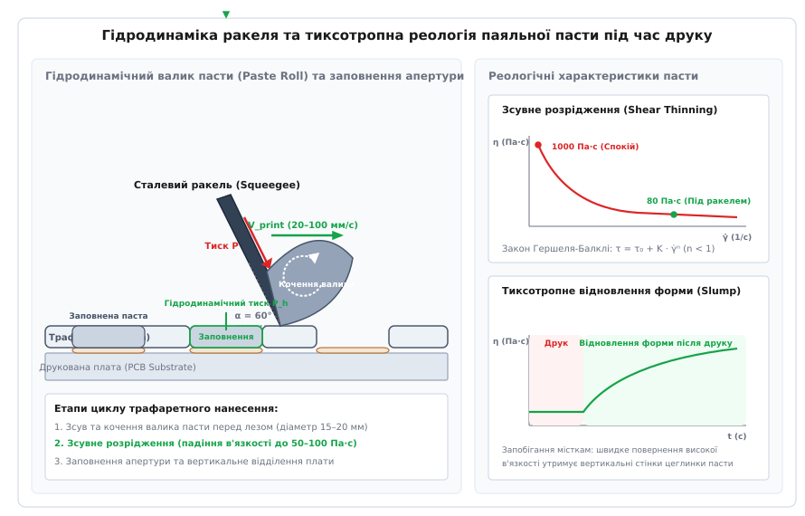
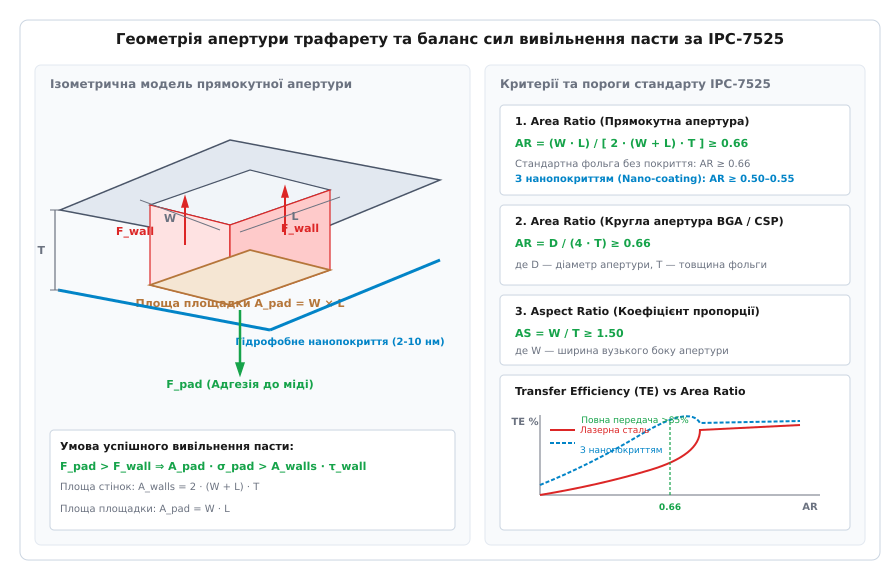

# Трафаретний друк паяльної пасти (SMD Stencil Printing)

<preknowlist>
- [Основи паяння](root:hw-pcb/basic-soldering) — механізм змочування, утворення галтелей та інтерметалідів припою.
- [Евтектичні сплави та припої](root:hw-pcb/eutectic-alloys) — фазові переходи, поверхневий натяг та змочуваність припою.
- [Проєктування посадкових місць](root:hw-pcb/footprint-design) — контактні площадки, паяльна маска, геометрія зазору за IPC-7351.
- [Пайка оплавленням](root:hw-pcb/reflow-soldering) — термопрофіль, нагрівання, оплавлення та охолодження SMT-вузлів.
- [Вимоги фабрики до проєкту (DFM)](root:hw-pcb/pravyla-fabryky-iak-vkhidni-pravyla-proiektu) — технологічні зазори, класи точності та виробничі допуски.
</preknowlist>

Партія з двох тисяч промислових плат контролерів безколекторних двигунів проходить конвеєрну лінію оплавлення припою, проте під час вихідного оптичного контролю (AOI) з'ясовується, що 38% виробів мають критичний виробничий брак. На мікроконтролерах у корпусах QFN-48 із кроком виводів 0.4 мм виявлено масові мікроперемички припою (англ. *solder bridges*) між сусідніми сигнальними контактами, а центральні тепловідвідні майданчики мікросхем підняті над площиною плати на 180 мкм через надлишок припою, який утворив опуклу лінзу й відірвав кутові сигнальні виводи від мідних доріжок. Одночасно половина керамічних конденсаторів типорозміру 0201 у колах розв'язки живлення стала вертикально дибки, утворивши дефект надгробка (англ. *tombstoning*), а на чіп-резисторах 0603 сформувалися паразитні металеві кульки (англ. *solder beads*), які вичавилися з-під корпусів і заклинили під сусідніми провідниками.

Причиною цього масового виходу з ладу стало хибне конструювання трафарету для нанесення паяльної пасти: інженер вибрав стандартну сталеву фольгу товщиною 150 мкм з апертурами масштабу 1:1 відносно мідних площадок плати. Для тонких виводів кроку 0.4 мм коефіцієнт площі апертури (англ. *Area Ratio*) становив лише 0.52 при нормативному мінімумі 0.66 за стандартом IPC-7525, що викликало неконтрольоване застрягання пасти у вікнах трафарету та її хаотичне виривання. Натомість під великим тепловим майданчиком QFN площею 25 мм² суцільна апертура перенесла надмірний об'єм пасти, який закипів у печі від виділення летких фракцій флюсу, утворивши велетенські газові каверни (англ. *voids*) та витиснувши надлишок розплавленого металу на сусідні сигнальні лінії.

Статистика сучасної електронної промисловості свідчить, що від 60% до 70% усіх дефектів поверхневого монтажу (SMT — *Surface Mount Technology*, від англ. *surface* — поверхня та *mount* — монтувати) зароджуються саме на першому етапі технологічного циклу — під час дозування та трафаретного друку паяльної пасти. Будь-яка похибка в об'ємі, висоті, формі або просторовому зміщенні відбитка пасти не може бути виправлена подальшими автоматами встановлення компонентів чи термічним профілем печі оплавлення.

---

### Реологія паяльної пасти: нелінійна гідродинаміка та тиксотропія

Паяльна паста є гетерогенною трифазною дисперсною системою, що складається з металевого порошку (сферичних мікрогранул сплаву припою) та рідкої флюсової зв'язуючої матриці (англ. *flux vehicle*). Металева фракція становить 88–91% за масою (англ. *weight percent, wt%*), проте через значну різницю в густині металу (`~7.4–8.4 г/см³`) та органічного флюсу (`~1.0–1.1 г/см³`) об'ємна частка металу становить приблизно 50%.

```
Масова частка металу:     88% – 91% (wt%)
Об'ємна частка металу:   48% – 52% (vol%)
Об'ємна частка флюсу:    48% – 52% (vol%)
```

Порошок припою класифікується за розміром гранул згідно зі стандартом IPC J-STD-005. Сферичність гранул є критичною: відхилення від ідеальної сфери більше ніж на 10% різко підвищує внутрішнє тертя в пасті, погіршуючи плинність крізь мікроапертури трафарету.

| Тип пасти за IPC | Діапазон розміру часток (мкм) | Мінімальна ширина апертури (мкм) | Типовий крок компонентів (Pitch) |
|---|---|---|---|
| **Type 3** | 25 – 45 мкм | ≥ 225 мкм | Стандартний монтаж, компоненти 0603, SOIC, QFP ≥ 0.65 мм |
| **Type 4** | 20 – 38 мкм | ≥ 180 мкм | Fine-pitch QFP 0.5 мм, BGA 0.5–0.8 мм, чіпи 0402 |
| **Type 5** | 15 – 25 мкм | ≥ 120 мкм | Ultra-fine pitch 0.3–0.4 мм, WLCSP, CSP 0.4 мм, чіпи 0201 |
| **Type 6** | 5 – 15 мкм | ≥ 75 мкм | Мікромодулі, System-in-Package (SiP), чіпи 01005 / 008004 |

Для надійного заповнення апертури діє фундаментальне інженерне **правило п'яти кульок** (англ. *Rule of 5-8 Balls*): найвужчий лінійний розмір апертури трафарету повинен містити щонайменше 5 найбільших діаметрів гранул обраного типу пасти, інакше виникає ефект гідродинамічного заклинювання (англ. *particle jamming*), коли частки металу утворюють механічний міст на вході в апертуру, блокуючи проходження флюсу та решти суспензії.

Флюсова матриця містить чотири функціональні групи хімічних компонентів:
1. **Плівкоутворювальні смоли (Resins/Rosins)** (модифікована живична каніфоль ROL0/ROL1 або синтетичні полімерні смоли No-Clean) — забезпечують липкість (англ. *tackiness* для фіксації встановлених компонентів на платі до печі) та захищають очищену мідь від повторного окиснення під час нагрівання.
2. **Активатори (Activators)** (органічні дикарбонові кислоти — бурштинова, адипінова, глутарова) — за робочої температури `130–180°C` розчиняють плівки оксидів на мідних контактних площадках та на поверхні самих кульок припою.
3. **Висококиплячі розчинники (Solvents)** (гліколеві ефіри) — регулюють робочу в'язкість та запобігають передчасному висиханню пасти на трафареті (забезпечуючи час життя на трафареті *Stencil Life* не менше 8 годин).
4. **Тиксотропні загусники (Thixotropic agents)** (гідрогенізована рицинова олія, поліамідні віски) — формують полімерну просторову сітку водневих зв'язків, що відповідає за нелінійні реологічні властивості пасти.

Паяльна паста є **неньютонівською тиксотропною псевдопластичною рідиною з границею плинності** (англ. *shear-thinning thixotropic fluid with yield stress*). Реологічна поведінка пасти описується математичною моделлю Гершеля-Балклі (англ. *Herschel-Bulkley model*):

```
τ = τ₀ + K · γ̇ⁿ      [модель Гершеля-Балклі для напруження зсуву]
```

де `τ` — напруження зсуву (Па), `τ₀` — початкова границя плинності пасти (англ. *yield stress*, становить `50–150 Па`), `K` — коефіцієнт консистенції (Па·сⁿ), `γ̇` — швидкість деформації зсуву (с⁻¹), `n` — індекс плинності (для паяльних паст `n = 0.3–0.6`, що значно менше одиниці й визначає ефект зсувного розрідження).

Ефективна динамічна в'язкість `η` визначається відношенням напруження до швидкості деформації:

```
η = τ / γ̇ = (τ₀ / γ̇) + K · γ̇ⁿ⁻¹      [динамічна в'язкість пасти]
```


*Гідродинаміка ракеля та тиксотропна реологія паяльної пасти під час друку. Ліворуч: формування та кочення валика пасти перед лезом ракеля під кутом 60° із нагнітанням пасти в апертуру. Праворуч: графіки зсувного розрідження в'язкості (Shear Thinning) під напруженням та тиксотропного відновлення в'язкості в спокої (Slump Resistance).*

У стані спокою на поверхні трафарету паста перебуває під напруженням `τ < τ₀`. Внутрішня просторова сітка загусника не зруйнована, і паста поводиться як м'яке пружне тверде тіло з надвисокою спостережуваною в'язкістю `η ≈ 800–1200 Па·с`. Це запобігає її самочинному стіканню крізь отвори трафарету під дією власної ваги.

Коли лезо ракеля починає рух по трафарету, воно захоплює пасту, створюючи високу швидкість деформації зсуву `γ̇ ≈ 1000–5000 с⁻¹`. Молекулярні ланцюги загусника орієнтуються вздовж ліній течії, просторова сітка руйнується, і динамічна в'язкість пасти стрибкоподібно падає на півтора порядки — до `η ≈ 50–100 Па·с`. Паста перетворюється на рухливу рідину, яка під дією гідродинамічного тиску вільно затікає в мікроапертури трафарету, повністю заповнюючи весь внутрішній об'єм.

Щойно ракель проходить повз апертуру, швидкість зсуву спадає до нуля (`γ̇ → 0`). Вмикається механізм **тиксотропного відновлення** (англ. *thixotropic recovery*): молекулярна структура зв'язуючої речовини поступово регенерує протягом `10–30 с`. Відновлення високої початкової в'язкості утримує вертикальні стінки нанесеного прямокутного стовпчика пасти (англ. *paste brick*), запобігаючи дефекту розпливання (англ. *hot/cold slump*) та розтіканню сусідніх відбитків назустріч один одному до моменту входження в піч оплавлення.

---

### Гідродинаміка ракеля: нагнітання, кут атаки та заповнення апертур

Процес перенесення пасти на плату відбувається за рахунок механічного руху леза ракеля (англ. *squeegee*, від англ. *squeegee* — скребок, гумовий або сталевий ракель).

Для бездефектного друку перед лезом ракеля повинна знаходитися чітко дозована маса пасти циліндричної форми — валик пасти (англ. *paste roll*) діаметром від `15 мм` до `20 мм`. Рух ракеля вперед викликає обертання цього валика навколо власної горизонтальної осі.

Кочення валика виконує дві критичні функції:
1. **Постійний тиксотропний зсув**: паста перед лезом перебуває у безперервному русі, що підтримує її низьку робочу в'язкість (`~80 Па·с`).
2. **Створення клинового гідродинамічного тиску**: на стику між нахиленим лезом ракеля та горизонтальною поверхнею трафарету утворюється звужувальний клин.

Гідродинамічний тиск нагнітання пасти `P_h` у зоні вістря леза розраховується за спрощеним інтегралом рівняння Нав'є-Стокса для зсувної течії в клині (розв'язок Тейлора):

```
P_h = (6 · η · v · sin²(α)) / [ h_eff · (α - sin(α) · cos(α)) ]
```

де `v` — лінійна швидкість руху ракеля (`мм/с`), `η` — динамічна в'язкість пасти в зоні зсуву (`Па·с`), `α` — кут атаки ракеля до площини трафарету (градуси), `h_eff` — ефективна товщина шару пасти під вістрям леза.

З цієї залежності випливає фізика вибору технологічних параметрів принтера:

1. **Кут атаки ракеля (`α`)**: Стандартом сучасної SMT-індустрії є кут **`α = 60°`** (допустимий діапазон `45°–60°`). Якщо кут зменшити до `45°` або нижче, гідродинамічний тиск `P_h` зростає занадто сильно: паста починає підіймати лезо ракеля, просочуватися під нижню площину трафарету (англ. *bleeding/scavenging*) та утворювати перемички. Якщо ж кут наблизити до `90°` (вертикальний ракель), вертикальна складова гідродинамічної сили зникає, і паста не встигає заповнити глибокі вузькі апертури.
2. **Швидкість руху ракеля (`v`)**: Робочий діапазон становить від `20 мм/с` до `150 мм/с` (типово `40–80 мм/с`). Час, протягом якого апертура шириною `W` перебуває під зоною нагнітання валика, становить `t_fill = L_roll / v`. Для компонентів надвисокої щільності (QFN 0.4 мм, CSP 0.4 мм) швидкість друку знижують до `25–35 мм/с`, щоб надати тиксотропній пасті достатній час на повне заповнення мікрооб'єму.
3. **Тиск ракеля на трафарет (`F_down`)**: Нормативний тиск вимірюється в кілограмах на погонний сантиметр леза і становить **`0.15–0.30 кг/см`** (наприклад, для леза шириною 300 мм загальне зусилля становить `4.5–9.0 кг`). Тиск вважається ідеально відкаліброваним, якщо після проходу ракеля на верхній поверхні сталевого трафарету залишається ідеально чистий дзеркальний слід фольги без тонкої розмазаної плівки флюсу. Надмірний тиск ракеля призводить до дефекту вичерпування пасти з широких апертур (англ. *squeegee scooping*): пружне металеве лезо прогинається всередину вікон площею > 2 мм² (наприклад, площадок дроселів або роз'ємів) і вишкрібає звідти до 30% корисного об'єму пасти.
4. **Матеріал леза ракеля**: Застосовуються виключно леза з пружинної нержавіючої сталі або нікельованого сплаву з тефлоновим зносостійким покриттям. Застарілі поліуретанові (гумові) ракелі в сучасному монтажі заборонені: м'який поліуретан твердістю 70–90 Shore A зазнає сильної пружної деформації під час руху, що призводить до катастрофічного вичерпування пасти з апертур та нерівномірної товщини нанесення.

---

### Фізика вивільнення пасти та геометричні критерії IPC-7525

Після проходження ракеля та заповнення апертур настає вирішальна фаза циклу друку: вертикальне розділення друкованої плати та трафарету (англ. *stencil separation*, або *snap-off*).

У цей момент стовпчик пасти, укладений всередині порожнини апертури, зазнає дії двох протидіючих сил:

1. **Сила зчеплення з контактною площадкою плати (`F_pad`)**: тягне пасту вниз за рахунок адгезії липкої флюсової фракції до шорсткої мідної площадки, покритої фінішним покриттям (ENIG, OSP, HASL, Immersion Tin):
   ```
   F_pad = A_pad · σ_pad
   ```
   де `A_pad` — площа основи контактної площадки (`мм²`), `σ_pad` — питома адгезійна міцність зчеплення пасти з поверхнею плати (`Н/мм²`).
2. **Сила тертя та адгезії до внутрішніх стінок апертури (`F_wall`)**: утримує пасту всередині трафарету за рахунок напруження зсуву та тертя об металеві стінки фольги:
   ```
   F_wall = A_walls · τ_wall
   ```
   де `A_walls` — сумарна площа всіх чотирьох внутрішніх бічних стінок апертури (`мм²`), `τ_wall` — питоме напруження зсуву на межі «паста — метал трафарету» (`Н/мм²`).


*Геометрія апертури трафарету та баланс сил вивільнення пасти за IPC-7525. Ліворуч: ізометрична модель апертури з позначенням площі контактної площадки A_pad та площі бічних стінок A_walls. Праворуч: математичні співвідношення та залежність Transfer Efficiency від Area Ratio для звичайної фольги та фольги з гідрофобним нанопокриттям.*

Для того щоб паста повністю відірвалася від стінок трафарету та залишилася на друкованій платі у вигляді чіткого прямокутного стовпчика, повинна виконуватися фундаментальна умова:

```
F_pad > F_wall
A_pad · σ_pad > A_walls · τ_wall
(A_pad / A_walls) > (τ_wall / σ_pad)
```

Відношення площі основи площадки до сумарної площі бічних стінок називається **коефіцієнтом площі (Area Ratio, AR)**.

Стандарт міжнародної асоціації IPC — **IPC-7525 (Stencil Design Guidelines)** — формалізує цей фізичний баланс у вигляді двох обов'язкових розрахункових критеріїв.

#### 1. Коефіцієнт площі (Area Ratio, AR)

Для прямокутної апертури з шириною `W`, довжиною `L` та товщиною фольги трафарету `T`:

```
A_pad = W · L                     [площа основи контактної площадки]
A_walls = 2 · (W + L) · T         [сумарна площа чотирьох бічних стінок]

AR = (W · L) / [ 2 · (W + L) · T ]
```

Для квадратних контактних площадок (`W = L`) формула спрощується:

```
AR = (W · W) / [ 2 · (W + W) · T ] = W² / (4 · W · T) = W / (4 · T)
```

Для круглих апертур (кулькові виводи BGA, CSP) діаметром `D`:

```
A_pad = π · (D / 2)² = (π · D²) / 4
A_walls = π · D · T

AR = [ (π · D²) / 4 ] / (π · D · T) = D / (4 · T)
```

**Нормативний поріг за IPC-7525:**
- Для стандартних лазерних трафаретів із нержавіючої сталі: **`AR ≥ 0.66`**.
- Для електрополірованих трафаретів та трафаретів із гідрофобним нанопокриттям: **`AR ≥ 0.50–0.55`**.

#### 2. Коефіцієнт пропорції (Aspect Ratio, AS)

Коефіцієнт пропорції визначає співвідношення між найвужчим лінійним розміром апертури `W` та товщиною фольги `T`:

```
AS = W / T
```

**Нормативний поріг за IPC-7525:** **`AS ≥ 1.50`**.

Якщо `AS < 1.50`, апертура стає надмірно глибокою та вузькою («колодязем»). Ракель не здатний проштовхнути пасту на саме дно колодязя до контакту з міддю плати, внаслідок чого адгезія `F_pad` падає майже до нуля, і при підйомі трафарету вся паста залишається всередині вікна.

#### Коефіцієнт передачі пасти (Transfer Efficiency, TE)

Кількісним критерієм якості процесу вивільнення є коефіцієнт передачі пасти (англ. *Transfer Efficiency, TE*), який вимірюється в процентах як відношення фактичного об'єму нанесеного відбитка пасти `V_actual` (за даними 3D-інспекції SPI) до теоретичного геометричного об'єму порожнини апертури `V_theoretical = A_pad · T`:

```
TE = (V_actual / V_theoretical) · 100%
```

Залежність Transfer Efficiency від Area Ratio має характерну сигмоїдну форму:
- **Зона катастрофічного зриву (`AR < 0.50`)**: `TE` падає нижче `40–50%` з величезним статистичним розкидом (коефіцієнт варіації `CV > 25%`). Виникають регулярні дефекти недостатності припою (англ. *starved solder joints*) та порожні площадки.
- **Зона перехідного режиму (`0.50 ≤ AR < 0.66`)**: `TE` становить `60–80%`. Друк нестабільний і критично залежить від вологості повітря, свіжості пасти та чистоти стінок.
- **Зона стабільного процесу (`AR ≥ 0.66`)**: `TE` виходить на стабільне плато `85–100%`, а дисперсія об'єму знижується до `CV < 5%`, гарантуючи високу відтворюваність паяних з'єднань.

---

### Динаміка вертикального розділення: профіль швидкості Z-осі

Процес відриву трафарету від плати не може здійснюватися з постійною високою швидкістю. Коли плата починає рухатися вниз відносно нерухомої фольги трафарету, всередині стовпчика пасти виникає складне поле розтягувальних та зсувних деформацій.

Якщо підйом трафарету виконати різким ривком зі швидкістю `> 5 мм/с`, паста не встигає деформуватися пластично: виникає крихкий когезійний розрив тіла пасти посередині висоти апертури. Половина об'єму залишається на платі з рваними «зубчастими» піками (дефект «собачих вух», англ. *dog ears*), а половина залишається на стінках сталі, викликаючи миттєве забивання трафарету.

Сучасні SMT-принтери з цифровими сервоприводами застосовують **двофазний профіль швидкості розділення (Separation Velocity Profile)**:

```
Фаза 1 (Повільний мікростарт):  Швидкість v_sep = 0.1 – 0.5 мм/с на відстані перших 0.5 – 1.0 мм
Фаза 2 (Швидке розведення):    Швидкість v_fast = 10 – 30 мм/с на решті ходу по осі Z
```

На першій фазі мікроруху зі швидкістю `0.1–0.3 мм/с` паста повільно ковзає вздовж відполірованих стінок фольги. Сили адгезії флюсу до мідної площадки плати переважають над зсувним опором стінки, і паста виходить із вікна на 95–98% свого об'єму, зберігаючи плоску верхню грань та строго вертикальні бічні стінки. Після того як стовпчик повністю вийшов з апертури (відстань `~1 мм`), стіл принтера швидко опускається на максимальній швидкості для скорочення загального часу циклу складання.

---

### Товщина фольги, матеріали та технології виготовлення трафаретів

Вибір товщини фольги трафарету є головним технологічним компромісом при проектуванні SMT-складання плати, на якій одночасно встановлені мініатюрні мікросхеми та масивні силові компоненти.

Стандартний промисловий ряд товщин фольги з нержавіючої сталі:
- **`80 мкм (0.08 мм)`**: Ultra-fine pitch монтаж (WLCSP, 0.35–0.4 мм BGA, чіп-компоненти 01005 та 0201).
- **`100 мкм (0.10 мм)`**: Висока щільність монтажу (Fine-pitch QFN/QFP 0.4–0.5 мм, 0.5 мм BGA, компоненти 0201/0402).
- **`120–130 мкм (0.12–0.13 мм)`**: **Базовий золотий стандарт SMT** для змішаного монтажу споживчої та промислової електроніки (QFP 0.5–0.8 мм, BGA 0.8–1.0 мм, 0402, 0603, 0805, SOIC).
- **`150 мкм (0.15 мм)`**: Стандартний монтаж для дискретних пасивів 0603/0805/1206, мікросхем SOIC, DPAK, силових транзисторів.
- **`180–200 мкм (0.18–0.20 мм)`**: Силова електроніка, масивні роз'єми наскрізного монтажу в технології «Pin-in-Paste» (англ. *Through-Hole Reflow, THR*).

#### Ступінчасті трафарети (Step Stencils)

Коли на одній платі по сусідству знаходяться компоненти протилежних вимог — наприклад, BGA-процесор із кроком 0.4 мм (вимагає фольги `100 мкм`) та потужний дросель живлення або силовий роз'єм THR (вимагає фольги `150–180 мкм` для заповнення отворів припоєм) — застосовують багаторівневі ступінчасті трафарети:

1. **Step-Down (Потоншення)**: Базова фольга трафарету має товщину `130–150 мкм`, проте на ділянках розташування прецизійних мікросхем BGA/QFN фольга локально протравлюється або прецизійно фрезерується лазером із верхнього або нижнього боку до товщини `100–110 мкм`.
2. **Step-Up (Потовщення)**: Базова фольга `100–120 мкм` нарощується мікрозварюванням або гальванічним осадженням нікелю на ділянках силових роз'ємів до товщини `160–200 мкм`.

**Правило зони відчуження переходу (Step Transition Keep-Out Zone):**
Ракель не є абсолютно гнучким лезом; під час наїзду на сходинку фольги він на деякій відстані втрачає щільний контакт із трафаретом. Згідно з IPC-7525, технологічний ухил сходинки повинен становити не крутіше ніж `1:20` (відношення висоти сходинки до довжини перехідної фаски). Мінімальна відстань від межі сходинки до найближчої апертури повинна становити не менше **`2.5–3.0 мм`**, інакше ракель підніметься над апертурою й не заповнить її пастою.

#### Технології виготовлення фольги

Якість вивільнення пасти визначається мікроструктурою та гладкістю внутрішніх стінок апертури.

```
Хімічне травлення:        Шорсткість Ra ≈ 0.8–1.2 мкм (боковий підтрав, форма «пісочного годинника»)
Лазерна різка:            Шорсткість Ra ≈ 0.5–0.8 мкм (конічність 1–2°, наявність шлаку)
Електрополірування:       Шорсткість Ra < 0.2 мкм (дзеркальні стінки, зняття термічного грату)
Електроформування (Ni):   Шорсткість Ra < 0.1 мкм (ідеально гладкі стінки, трапецієподібний профіль)
```

1. **Хімічне травлення (Chemical Etching)**: Найстаріший та найдешевший метод. Металева фольга покривається фоторезистом з обох боків, експонується та труїться розчином хлорного заліза. Оскільки рідина труїть метал ізотропно в усіх напрямках, виникає боковий підтрав під фоторезист: у середині товщини фольги утворюється виступ, надаючи стінці форми «пісочного годинника». Цей виступ механічно заклинює паяльну пасту, унеможливлюючи друк компонентів із кроком менше 0.65 мм.
2. **Лазерна різка (Laser Cutting)**: Сучасний базовий стандарт. Прецизійний волоконний або діодний імпульсний лазер із ЧПК (довжина хвилі `1064 нм`, діаметр променя `20–25 мкм`) прорізає отвори за CAD-векторами. Природна розбіжність лазерного променя формує невелику позитивну конічність апертури (кут нахилу стінки `1°–2°`), при якій вихідний отвір на нижньому боці трафарету (з боку плати) на `5–10 мкм` ширший за вхідний отвір зверху. Цей розтруб суттєво полегшує вивільнення пасти під час підйому трафарету.
3. **Електрополірування (Electropolishing)**: Після лазерного різання на краях апертур залишається мікрошлак (оплавлений грат). Трафарет занурюють у ванну з кислотним електролітом (суміш фосфорної та сірчаної кислот) і підключають як анод. Під дією високої густини струму мікровиступи та задирки на стінках апертур розчиняються в першу чергу. Шорсткість стінки `Ra` падає з `0.8 мкм` до менше ніж `0.2 мкм`, що знижує поверхневе тертя `τ_wall` на 30–40%.
4. **Електроформування (Electroforming)**: Адитивна прецизійна технологія. На базову металеву оправку фотолітографічно наносяться стовпчики фоторезисту за формою майбутніх апертур. Потім оправку поміщають у гальванічну ванну сульфамату нікелю, де навколо резистивних стовпчиків атом за атомом вирощується суцільна нікелева фольга. Нікель має менший коефіцієнт тертя, ніж сталь, а стінки апертур виходять дзеркально гладкими з ідеальним трапецієподібним профілем. Це найдорожчий тип трафаретів, який застосовується для надгустих модулів SiP із чіпами 01005 та кроком контактів BGA `0.3 мм`.

---

### Нанопокриття трафаретів (Nano-Coatings)

Нанопокриття — це ультратонкі поверхнево-активні модифікатори, що наносяться на нижню (контактну з платою) площину трафарету та на внутрішні стінки апертур для зміни їхньої поверхневої енергії.

За хімічною природою розрізняють два основні типи нанопокриттів:
1. **Самоорганізовані моношари фосфонатів (SAMP — Self-Assembled Monolayer Phosphonates)**: Покриття товщиною всього **`2–10 нм`** (один-два молекулярні шари). Полярна фосфонатна головка молекули утворює міцний ковалентний зв'язок з атомами оксиду хрому на поверхні нержавіючої сталі, а неполярний фторований вуглеводневий хвіст орієнтується перпендикулярно назовні, формуючи мономолекулярний килим надзвичайно низької поверхневої енергії.
2. **Фторполімерні плазмові наноплівки**: Полімерні шари товщиною **`50–100 нм`**, що наносяться методом вакуумного плазмохімічного осадження (PECVD). Забезпечують вищу механічну зносостійкість при тисячах циклів друку.

```
Крайовий кут змочування чистої сталі водою:         θ ≈ 40° – 50°  (висока поверхнева енергія)
Крайовий кут змочування сталі з нанопокриттям:     θ > 110° – 120° (гідрофобність та олеофобність)
Крайовий кут змочування флюсом:                    θ > 70° – 85°   (флюс не розтікається по сталі)
```

#### Фізико-технологічний вплив нанопокриття:

- **Зниження критичного порогу Area Ratio**: Завдяки падінню напруження зсуву `τ_wall` мінімально допустимий поріг `AR` знижується з **`0.66`** до **`0.50–0.55`**. Це дозволяє використовувати дешеву фольгу товщиною `120 мкм` для друку компонентів із кроком 0.4 мм, де без нанопокриття довелося б замовляти дорогий ступінчастий трафарет Step-down на `100 мкм`.
- **Запобігання підтіканню флюсу (Anti-Bleed Effect)**: Під час контакту трафарету з платою флюс із пасти намагається затекти в мікрощілини між маскою плати та нижньою площиною трафарету через капілярний ефект. Олеофобне нанопокриття повністю блокує капілярне втягування флюсу: рідина згортається в краплі й не розтікається під сталь.
- **Скорочення частоти циклів очищення трафарету**: Звичайний сталевий трафарет вимагає автоматичного протирання нижнього боку кожні 3–5 друкованих плат. Трафарет із якісним нанопокриттям забезпечує стабільний друк протягом **`15–25 циклів`** без жодного протирання, що підвищує продуктивність SMT-лінії на 10–15% та економить сотні метрів протирального паперу та літрів розчинника.
- **Зростання індексу придатності процесу (Cpk)**: Статистичний індекс відтворюваності об'єму пасти `Cpk` для апертур 0402 та BGA 0.4 мм зростає з `1.05–1.15` (граничний нестабільний процес) до `1.55–1.80` (високостабільний процес рівня «Six Sigma»).

---

### Модифікації форми апертур для спеціальних компонентів

Пряме копіювання геометрії мідних контактних площадок у шар паяльної пасти (масштаб 1:1) неприпустиме для більшості типів сучасних компонентів.

#### 1. Великі теплові майданчики (Thermal Pads у QFN, DFN, PowerPAK, DPAK)

Тепловий майданчик сучасного мікроконтролера або силового MOSFET має площу від `4 мм²` до `50 мм²`. Якщо нанести на цей майданчик суцільний відбиток пасти розміром 1:1, виникають три важкі дефекти:

1. **Газові каверни (Voiding > 40–60%)**: Під час нагрівання в печі розчинники та активатори флюсу бурхливо випаровуються. З-під велетенського суцільного металевого дна мікросхеми леткі гази не встигають вийти назовні й залишаються затиснутими в розплавленому припої у вигляді велетенських бульбашок. Тепловий опір `R_th` такого вузла зростає в 3–5 разів, призводячи до локального перегріву та деградації кристала.
2. **Спливання та перекіс компонента (Hydrodynamic Component Floating)**: Величезний об'єм розплавленого припою під дією поверхневого натягу стягується в єдину опуклу лінзу. Легкий корпус QFN спливає на рідкій подушці, зміщується вбік і зависає в повітрі, відриваючи сигнальні виводи від плати.
3. **Витискання припою під сигнальні площадки (Solder Squeeze-out Bridging)**: Під вагою деталі розплавлений надлишок припою вичавлюється з-під центру на периферію, утворюючи глухі короткі замикання між сигнальними доріжками.

**Інженерне рішення: Віконна решітка (Window Pane / Cross-Hatch)**.

Суцільна апертура великого майданчика розбивається на матрицю невеликих квадратних або прямокутних вікон (`2×2`, `3×3` або `4×4` вікна) із проміжками чистої сталі (англ. *webbing*) шириною **`0.20–0.40 мм`**.

```
Цільове покриття площі пастою (Paste Coverage):  50% – 70% від площі міді
Ширина технологічних перемичок (Web Width):     0.25 – 0.35 мм
Зниження відсотка порожнеч (Void Area):         з 45% до < 10–15%
```

Проміжки між вікнами слугують каналами дегазації: під час оплавлення леткі фракції флюсу вільно виходять цими сухими каналами до того, як розплавлені острівці припою зіллються в суцільний рівний тонкий шар товщиною `30–50 мкм`.

#### 2. Чіп-компоненти (0402, 0603, 0805, 1206) та дефект Solder Beads

Під час встановлення чіп-конденсатора або резистора автомат Pick-and-Place втискає виводи компонента в сиру паяльну пасту з нормованим зусиллям `1–3 Н`. При цьому паста на внутрішніх краях контактних площадок частково вичавлюється в зазор під центральне керамічне тіло компонента. Під час оплавлення ця витиснена маса плавиться окремо від основної галтелі, стягується в ізольовану металеву кульку (англ. *solder bead*, або *mid-chip ball*) і вистрілює вбік під дією тиску киплячого флюсу, утворюючи паразитне замикання на сусідні доріжки.

**Інженерне рішення: Спеціальні контури апертур**.

- **Апертура «Home Plate» (П'ятикутник)**: Внутрішня грань апертури підрізається у формі вістря домашньої бази бейсболу (кут 90° або 120°), видаляючи надлишок пасти саме в зоні під корпусом деталі.
- **Апертура «Inverted Home Plate»**: Внутрішня грань має клиноподібний виріз всередину апертури.
- **Апертура «Bowtie» (Метелик)**: Двостороння симетрична виїмка для симетричного розподілу поверхневого натягу.
- **Редукція внутрішнього краю (Inward Offset)**: Прямокутна апертура зменшується на 10–20% виключно з внутрішнього боку контактної площадки при збереженні повного зовнішнього краю для формування опірного носка галтелі (Toe).

#### 3. Заокруглення кутів апертур (Corner Radii)

Гострі кути 90° лазерних прямокутних апертур є пастками для пасти: сили капілярного зчеплення в кутових зонах `(r → 0)` прагнуть до нескінченності, через що мікрогранули припою застрягають у кутах і висихають там після 2–3 циклів друку.

Введення обов'язкового радіуса заокруглення кутів **`R = 0.05–0.15 мм`** (або радіуса, рівного 25% ширини апертури) знижує внутрішню площу стінок, усуває мертві зони адгезії та підвищує Transfer Efficiency на 8–12%.

---

### Топологічні пастки плати: відкриті отвори Via-in-Pad

Однією з найнебезпечніших причин локальної втрати пасти під час монтажу є наявність відкритих перехідних отворів безпосередньо у контактних площадках компонентів (англ. *Via-in-Pad*).

Якщо перехідний отвір у площадці BGA або тепловому майданчику QFN не герметизований епоксидною смолою з мідним перекриттям (стандарт IPC-4761 Type VII / VIPPO — *Via-in-Pad Plated Over*), а залишений відкритим (Tent / Plugged):

1. **Капілярне всмоктування (Solder Wicking)**: Під час оплавлення в печі розплавлений припій під дією сил поверхневого натягу та градієнта тиску Лапласа втягується всередину металізованого циліндра перехідного отвору.
2. **Втрата об'єму на площадці**: До 70–80% об'єму рідкого припою стікає крізь отвір на зворотний бік друкованої плати, утворюючи там паразитно звисаючі краплі або бурульки.
3. **Холодні неконтакти BGA (Head-in-Pillow, HiP)**: Кулька BGA не знаходить під собою достатнього об'єму пасти, не зливається з контактною площадкою плати та залишається лежати на оксидованому шарі у вигляді неспаяного стику.

**Вимога DFM до трафаретного шару:**
Якщо тополог змушений застосувати відкриті перехідні отвори на тепловому майданчику QFN через технологічні обмеження бюджетного виробника плати, апертури трафарету віконної решітки повинні бути зміщені так, щоб жодне вікно пасти не перекривало отвір. Вікна пасти розташовують суворо на суцільних мідних ділянках між отворами з відступом не менше `0.20–0.25 мм` від краю свердління.

---

### Технологія Pin-in-Paste (Through-Hole Reflow, THR)

Технологія Pin-in-Paste (паяння вивідних компонентів у загальному SMT-процесі оплавлення) виключає витратну стадію ручного паяння або паяння хвилею припою. Силові роз'єми, електролітичні конденсатори та реле наскрізного монтажу встановлюються прямо у металізовані отвори плати (PTH), в які попередньо нанесено паяльну пасту трафаретним принтером.

Головна інженерна проблема Pin-in-Paste полягає в тому, що після розплавлення об'єм пасти скорочується рівно вдвічі:

```
V_solder = 0.50 · V_paste
V_paste_required = 2.0 · V_solder_target
```

Необхідний цільовий об'єм твердого припою `V_solder_target` повинен повністю заповнити зазор між виводом і стінкою металізованого отвору, а також сформувати нормативні верхню та нижню конічні галтелі за стандартом IPC-A-610 Class 3 (100% вертикальне заповнення отвору).

Математичний розрахунок необхідного об'єму пасти:

```
V_hole = π · (D_hole / 2)² · H_pcb                  [об'єм циліндра отвору плати]
V_pin = π · (D_pin / 2)² · H_pcb                    [об'єм виводу всередині отвору]
V_barrel_gap = V_hole - V_pin                       [об'єм зазору в металізації]

V_fillet_top = 0.25 · V_barrel_gap                  [об'єм верхньої галтелі меніска]
V_fillet_bot = 0.25 · V_barrel_gap                  [об'єм нижньої галтелі меніска]

V_solder_target = V_barrel_gap + V_fillet_top + V_fillet_bot
V_paste_required = 2.0 · V_solder_target
```

Оскільки об'єм циліндра отвору набагато перевищує об'єм стандартної апертури фольги `120 мкм`, застосовують два методи забезпечення пастою:

1. **Оверпринт на паяльну маску (Aperture Overprint)**: Апертура трафарету розширюється за межі мідного кільця площадки на сусідню паяльну маску у вигляді квадрата або пелюсток розміром до `2–3 мм`. Під час нагрівання в печі розплавлений припій не змочує паяльну маску (кут `θ > 120°`) і під дією сил капілярного втягування Лапласа повністю стягується з маски всередину металізованого отвору.
2. **Ступінчастий трафарет Step-up**: Локальне потовщення фольги до `180–200 мкм` навколо роз'єму в поєднанні з оверпринтом.

---

### Дефекти трафаретного друку: класифікація та фізичні першопричини

| Дефект друку / пайки | Візуальний прояв | Фізична першопричина дефекту | Метод усунення |
|---|---|---|---|
| **Містковий ефект (Bridging)** | Злиття пасти між сусідніми виводами | Надлишковий об'єм пасти; `AR > 0.8` на кроці 0.4 мм без редукції; тиск ракеля вище норми; відсутність герметизації (Gasketing); температура цеху > 26°C (падіння в'язкості). | Редукція ширини апертури на 10–15%; зменшення товщини фольги; регулювання тиску ракеля; нанесення нанопокриття. |
| **Недостатність пасти (Starved Joint)** | Об'єм пасти на площадці < 60% номіналу | Порушення критерію `AR < 0.66` або `AS < 1.50`; забивання апертур засохлою пастою; швидкість друку занадто висока; заклинювання часток (Type 3 замість Type 4/5). | Зменшення товщини фольги; перехід на пасту з меншими частками (Type 4/5); електрополірування апертур; зниження швидкості друку. |
| **Ефект надгробка (Tombstoning)** | Чіп-компонент піднявся вертикально на один вивід | Різниця об'ємів пасти на двох площадках > 20%; асиметрія змочування через підключення однієї площадки до масивного мідного полігону без термобар'єрів. | Вирівнювання об'ємів апертур; додавання термобар'єрів (Thermal Reliefs); редукція апертур за формою Home Plate. |
| **Паразитні кульки (Solder Beads)** | Окремі кульки припою біля тіла чіпів | Видавлювання пасти під корпус деталі під час установки Pick-and-Place; надмірний об'єм пасти на внутрішній грані площадки. | Застосування апертур форми Home Plate або U-подібних виїмок; зниження зусилля притискання автомата Pick-and-Place. |
| **Змазування відбитка (Slump / Smear)** | Розтікання стовпчика пасти, втрата чітких граней | Поглинання вологи пастою з повітря (відносна вологість цеху > 65%); деградація тиксотропного загусника; перевищення часу життя пасти на трафареті (> 8 год). | Контроль мікроклімату цеху (21–25°C, 40–55% RH); своєчасна заміна пасти на свіжу; регулярне протирання нижнього боку трафарету. |
| **Площинне зміщення (Misalignment)** | Відбиток пасти зсунутий відносно міді плати | Помилка оптичного розпізнавання реперних знаків (Fiducial Marks); механічний люфт кріплення плати або рамки трафарету; температурна невідповідність розширення. | Очищення камер принтера; використання трьох реперів замість двох; калібрування приводів осі X/Y/Theta. |

---

### Очищення трафарету: автоматичні та періодичні системи

Під час безперервного друку на нижньому боці фольги трафарету та на бічних стінках апертур накопичуються мікрозалишки липкого флюсу та відірвані кульки припою. Якщо їх не видаляти, шар бруду створює зазор між трафаретом і платою (англ. *gasketing breakdown*), через який паста витікає під фольгу, викликаючи масові перемички.

#### 1. Автоматичне підтрафаретне очищення (Under-Stencil Wiping, USW)

Сучасні SMT-принтери оснащені рухомим вузлом протирання, що рухається під нижньою площиною трафарету. Процес очищення програмується у вигляді тристадійного циклу:

```
1. Стадія змочування (Wet Wipe):    Рулонний безворсовий папір змочується розчинником і розчиняє флюс.
2. Стадія вакуумного всмоктування (Vacuum Wipe): Вакуумна планка втягує залишки пасти зсередини апертур.
3. Стадія сухого протирання (Dry Wipe):          Сухий папір насухо витирає нижню площину сталі.
```

**Хімія розчинників для протирання:**
Застосовуються спеціалізовані суміші на основі модифікованих ізопарафінових вуглеводнів або модифікованих спиртів із високою швидкістю випаровування та нульовим вмістом води. Звичайний технічний спирт або ізопропанол (IPA) високої концентрації в сучасних автоматичних лініях небажаний: ізопропанол вимиває пластифікатори з нанопокриттів, швидко деградуючи гідрофобний шар, а його швидке неконтрольоване випаровування охолоджує трафарет, викликаючи конденсацію атмосферної вологи.

#### 2. Повне періодичне відмивання трафаретів (Offline Cleaning)

Після завершення виробничої зміни або при заміні найменування плати трафарет знімається з принтера та проходить глибоку очистку в спеціалізованих установках:
- **Ультразвукові мийні машини**: Трафарет занурюється у ванну з водно-лужним або сольвентним розчином. Ультразвукова кавітація частотою `40 кГц` гарантовано вибиває залишки полімеризованого флюсу з найвужчих мікроапертур `BGA 0.3 мм`.
- **Струминні машини високого тиску (Spray-in-Air)**: Обмивання обертовими форсунками під тиском `3–5 бар` із подальшим ополіскуванням деіонізованою водою та сушінням гарячим очищеним повітрям.

#### Контроль механічного натягу трафарету (Stencil Tension)

Фольга трафарету натягнута на алюмінієву рамку через сітку з поліефірних ниток або безпосередньо затиснута в пневматичну рамку багаторазового використання (системи типу *VectorGuard*, *ZelFlex*).

Натяг фольги вимірюється механічним або електронним тензометром у **ньютонах на сантиметр (Н/см)**:
- **Нормативний натяг нового робочого трафарету**: **`35–45 Н/см`**.
- **Допустимий робочий натяг**: **`30–35 Н/см`**.
- **Критична межа вибракування**: **`< 25 Н/см`**.

Якщо натяг падає нижче 25 Н/см, фольга починає провисати під вагою ракеля (ефект батута). Під час підйому трафарету відбувається нерівномірне горизонтальне коливання металу, яке змазує свіжі відбитки пасти. Такий трафарет підлягає негайній утилізації.

---

### Кліматичні умови цеху та регламент поводження з пастою

Паяльна паста є високочутливим хімічним матеріалом із суворим регламентом зберігання та підготовки:

1. **Температурний режим зберігання**: Паста повинна зберігатися у спеціалізованих холодильниках за температури від **`+4°C`** до **`+8°C`**. За цієї температури швидкість окиснення кульок припою та реакція кислотних активаторів із каніфоллю сповільнюються на 95%, забезпечуючи збереження властивостей протягом 6 місяців.
2. **Пасивна акліматизація перед відкриттям**: Категорично заборонено відкривати банку або картридж із пастою одразу після виймання з холодильника, а також підігрівати її феном або на термостолі. При контакті холодної поверхні пасти (`+5°C`) з теплим вологим повітрям цеху на ній миттєво конденсується шар мікрокрапель води. Під час паяння в печі ця затиснута волога миттєво закипає при `100°C`, викликаючи вибухове розбризкування припою та масове утворення мікрокульок. Банка повинна відстоюватися закритою за кімнатної температури щонайменше **`4–6 годин`** (картридж — `2–3 години`).
3. **Автоматизоване планетарне перемішування**: Перед нанесенням на трафарет паста перемішується в центрифужному безлопатевому змішувачі (англ. *Planetary Centrifugal Mixer*) протягом `1–3 хвилин`. Одночасне обертання банки навколо власної осі та навколо центру ротора під дією перевантаження `40–80 g` рівномірно гомогенізує відшарований флюс і видаляє розчинені мікробульбашки повітря без механічного пошкодження сферичних кульок металу.
4. **Контроль мікроклімату в SMT-цеху**:
   - **Температура повітря**: `21°C – 25°C` (при підвищенні до 28°C в'язкість пасти падає удвічі, провокуючи стікання та перемички).
   - **Відносна вологість (RH)**: `40% – 55%` (при `RH < 35%` розчинники флюсу випаровуються за 1–2 години, паста засихає в апертурах; при `RH > 65%` паста поглинає вологу з повітря, викликаючи розтріскування флюсу в печі).

---

### 3D SPI: оптичний контроль та замкнений цикл керування (Closed-Loop)

3D-інспекція паяльної пасти (SPI — *Solder Paste Inspection*) встановлюється безпосередньо після трафаретного принтера перед автоматами Pick-and-Place.

На відміну від застарілих 2D-систем, які бачили лише площу та зміщення відбитка, 3D SPI вимірює повний тривимірний профіль кожного відкладення пасти методом фазової профілометрії структурованого світла (англ. *Phase Shift Profilometry, PSP*) або інтерферометрії смуг Муара.

Оптична головка проектує на плату серію кодованих синусоїдальних світлових решіток, а швидкісна CMOS-камера фіксує просторовий зсув фази смуг на нерівностях рельєфу, розраховуючи карту висот `Z(x, y)` з субмікронною точністю (`± 0.5 мкм`).

Об'єм кожного відбитка обчислюється чисельним інтегруванням поверхні:

```
V = ∬ Z(x, y) dx dy
```

3D SPI виконує 100% контроль наступних параметрів кожної контактної площадки:
1. **Висота відбитка (Height)**: Нормативний діапазон `85%–120%` від номінальної товщини фольги трафарету `T`.
2. **Об'єм пасти (Volume)**: Нормативний діапазон `75%–125%` від теоретичного об'єму апертури.
3. **Площа покриття (Area)**: Нормальний діапазон `85%–115%`.
4. **Зсув у площині (Offset X / Y)**: Максимально допустиме зміщення не більше `15–25 мкм`.
5. **Дефекти форми**: Виявлення містків, деформації кутів, розривів та вичерпування пасти.

#### Статистичний контроль процесів (SPC) та індекси Cp / Cpk

Для об'єктивної оцінки стабільності нанесення пасти SPI розраховує індекси придатності процесу:

```
Cp = (USL - LSL) / (6 · σ)                           [потенційна придатність процесу]
Cpk = min( (USL - μ) / (3 · σ), (μ - LSL) / (3 · σ) ) [реальна придатність процесу]
```

де `USL` та `LSL` — верхня та нижня межі допуску (наприклад, 130% та 70% об'єму), `μ` — вибіркове середнє значення об'єму, `σ` — середньоквадратичне відхилення об'єму.

- **`Cpk < 1.0`**: Процес нестабільний, брак перевищує `2700 ppm` (дефектів на мільйон).
- **`Cpk = 1.33`**: Базовий рівень 4 Sigma (близько `63 ppm`), прийнятний для більшості комерційних плат.
- **`Cpk ≥ 1.67`**: Високопрецизійний процес 5–6 Sigma (менше `3.4 ppm`), обов'язковий для автомобільної, медичної та аерокосмічної електроніки.

#### Замкнений контур зворотного зв'язку (Closed-Loop Feedback: SPI → Printer)

Сучасні SMT-лінії об'єднують 3D SPI та трафаретний принтер у єдиний інтелектуальний замкнений контур:
- **Автоматична корекція позиціонування**: Якщо SPI фіксує систематичний статистичний дрейф зміщення відбитків (наприклад, `+12 мкм` по осі X через температурне розширення плати), система автоматично передає в принтер команду корекції координат столу на наступну плату без зупинки лінії та втручання оператора.
- **Адаптивне ініціювання очищення трафарету**: Якщо на певній мікросхемі QFN об'єм пасти падає на трьох платах поспіль (симптом початку забивання апертури), SPI негайно посилає сигнал принтеру на виконання позачергового вакуумного циклу підтрафаретного протирання.

---

### Розрахунок геометрії та оптимізація апертур у коді

Для автоматизації перевірки правил DFM та генерації скоригованих шарів пасти розробляють інженерні алгоритми, що аналізують геометрію кожного посадкового місця, розраховують коефіцієнти AR/AS та розбивають великі теплові майданчики на віконні матриці.

Практичну програмну реалізацію комплексного калькулятора та валідатора апертур трафарету наведено в суміжній практичній вставці [Калькулятор апертур трафарету та оптимізація перенесення пасти](root:hw-pcb/smd-stencil/proj-stencil-aperture-calc.md).

Нижче наведено базові розрахункові модулі математичної перевірки критеріїв IPC-7525 та оцінки очікуваного Transfer Efficiency.

:::tabs
```c
#include <stdio.h>
#include <stdbool.h>
#include <math.h>

typedef enum {
    APERTURE_RECTANGLE,
    APERTURE_CIRCLE
} ApertureShape;

typedef struct {
    ApertureShape shape;
    double width_mm;      /* Ширина або діаметр для кола */
    double length_mm;     /* Довжина (для прямокутника) */
    double foil_thick_mm; /* Товщина фольги трафарету T */
    bool has_nano_coating;/* Наявність гідрофобного нанопокриття */
} StencilAperture;

typedef struct {
    double area_ratio;
    double aspect_ratio;
    double expected_transfer_eff; /* Очікуваний коефіцієнт передачі 0.0 - 1.0 */
    bool is_ipc_ar_valid;
    bool is_ipc_as_valid;
} ValidationResult;

ValidationResult validate_aperture(const StencilAperture* ap) {
    ValidationResult res;
    double w = ap->width_mm;
    double l = ap->length_mm;
    double t = ap->foil_thick_mm;

    if (ap->shape == APERTURE_CIRCLE) {
        /* Для круглої апертури AR = D / (4 * T) */
        res.area_ratio = w / (4.0 * t);
        res.aspect_ratio = w / t;
    } else {
        /* Для прямокутної апертури AR = (W * L) / (2 * (W + L) * T) */
        double a_pad = w * l;
        double a_walls = 2.0 * (w + l) * t;
        res.area_ratio = a_pad / a_walls;
        res.aspect_ratio = (w < l ? w : l) / t;
    }

    double ar_limit = ap->has_nano_coating ? 0.55 : 0.66;
    res.is_ipc_ar_valid = (res.area_ratio >= ar_limit);
    res.is_ipc_as_valid = (res.aspect_ratio >= 1.50);

    /* Моделювання сигмоїди Transfer Efficiency за моделлю IPC */
    double k = ap->has_nano_coating ? 14.0 : 11.0;
    double ar0 = ap->has_nano_coating ? 0.45 : 0.55;
    res.expected_transfer_eff = 0.95 / (1.0 + exp(-k * (res.area_ratio - ar0)));

    return res;
}

int main(void) {
    /* Аналіз виводу QFN 0.4 мм: W = 0.20 мм, L = 0.80 мм, Фольга T = 0.12 мм */
    StencilAperture qfn_lead = {
        .shape = APERTURE_RECTANGLE,
        .width_mm = 0.20,
        .length_mm = 0.80,
        .foil_thick_mm = 0.12,
        .has_nano_coating = true
    };

    ValidationResult r = validate_aperture(&qfn_lead);
    printf("Аналіз апертури QFN 0.4mm (Фольга 120 мкм, Нанопокриття):\n");
    printf("  Area Ratio:   %.3f (Норма >= %.2f) -> %s\n", 
           r.area_ratio, qfn_lead.has_nano_coating ? 0.55 : 0.66, 
           r.is_ipc_ar_valid ? "PASS" : "FAIL");
    printf("  Aspect Ratio: %.3f (Норма >= 1.50) -> %s\n", 
           r.aspect_ratio, r.is_ipc_as_valid ? "PASS" : "FAIL");
    printf("  Очікуваний Transfer Efficiency: %.1f%%\n", r.expected_transfer_eff * 100.0);

    return 0;
}
```
```cpp
#include <iostream>
#include <iomanip>
#include <cmath>
#include <algorithm>
#include <string_view>

enum class ApertureShape {
    Rectangle,
    Circle
};

struct StencilAperture {
    ApertureShape shape{ApertureShape::Rectangle};
    double width_mm{0.0};
    double length_mm{0.0};
    double foil_thick_mm{0.12};
    bool has_nano_coating{false};
};

struct ValidationResult {
    double area_ratio{0.0};
    double aspect_ratio{0.0};
    double expected_transfer_eff{0.0};
    bool is_ipc_ar_valid{false};
    bool is_ipc_as_valid{false};

    [[nodiscard]] constexpr double ar_threshold(bool nano) const noexcept {
        return nano ? 0.55 : 0.66;
    }
};

class StencilValidator {
public:
    [[nodiscard]] static ValidationResult evaluate(const StencilAperture& ap) noexcept {
        ValidationResult res;
        const double w = ap.width_mm;
        const double l = ap.length_mm;
        const double t = ap.foil_thick_mm;

        if (ap.shape == ApertureShape::Circle) {
            res.area_ratio = w / (4.0 * t);
            res.aspect_ratio = w / t;
        } else {
            const double a_pad = w * l;
            const double a_walls = 2.0 * (w + l) * t;
            res.area_ratio = a_pad / a_walls;
            res.aspect_ratio = std::min(w, l) / t;
        }

        const double ar_limit = res.ar_threshold(ap.has_nano_coating);
        res.is_ipc_ar_valid = (res.area_ratio >= ar_limit);
        res.is_ipc_as_valid = (res.aspect_ratio >= 1.50);

        const double k = ap.has_nano_coating ? 14.0 : 11.0;
        const double ar0 = ap.has_nano_coating ? 0.45 : 0.55;
        res.expected_transfer_eff = 0.95 / (1.0 + std::exp(-k * (res.area_ratio - ar0)));

        return res;
    }
};

int main() {
    constexpr StencilAperture qfn_lead{
        .shape = ApertureShape::Rectangle,
        .width_mm = 0.20,
        .length_mm = 0.80,
        .foil_thick_mm = 0.12,
        .has_nano_coating = true
    };

    const auto r = StencilValidator::evaluate(qfn_lead);

    std::cout << std::fixed << std::setprecision(3);
    std::cout << "Аналіз апертури QFN 0.4mm (Фольга 120 мкм, Нанопокриття):\n";
    std::cout << "  Area Ratio:   " << r.area_ratio << " (Норма >= " 
              << r.ar_threshold(qfn_lead.has_nano_coating) << ") -> "
              << (r.is_ipc_ar_valid ? "PASS" : "FAIL") << "\n";
    std::cout << "  Aspect Ratio: " << r.aspect_ratio << " (Норма >= 1.500) -> "
              << (r.is_ipc_as_valid ? "PASS" : "FAIL") << "\n";
    std::cout << "  Очікуваний Transfer Efficiency: " 
              << std::setprecision(1) << (r.expected_transfer_eff * 100.0) << "%\n";

    return 0;
}
```
:::

---

### Виробничий контрольний чек-лист DFM для трафаретного друку

Перед передачею Gerber-файлів шару паяльної пасти (шари `GTP` / `GBP` або `F.Paste` / `B.Paste`) у виробництво інженер зобов'язаний верифікувати наступні критичні параметри:

1. **Товщина фольги підібрана за найменшим посадковим місцем**: Якщо на платі присутній хоча б один чіп 0201 або QFN 0.4 мм, загальна товщина фольги не повинна перевищувати `100–120 мкм` (або замовляється трафарет Step-down).
2. **Перевірено критерій Area Ratio (`AR ≥ 0.66`) для кожного виводу**: Для всіх прямокутних та круглих контактів коефіцієнт площі має бути строго вищим за 0.66 (або 0.55 при замовленні обов'язкового гідрофобного нанопокриття).
3. **Виконано редукцію площі на 10–15% для Fine-Pitch компонентів**: Апертури мікросхем із кроком 0.4–0.5 мм зменшені по ширині на `0.03–0.05 мм` відносно мідних площадок для запобігання перемичкам.
4. **Усі великі теплові майданчики площею > 4 мм² розбиті на вікна**: Загальне покриття пастою становить `50%–70%`, а ширина каналів дегазації — не менше `0.25–0.35 мм`.
5. **Застосовано форми Home Plate або Bowtie для пасивів 0402–1206**: Внутрішній край апертури має редукцію або виїмку для усунення дефекту вичавлювання кульок припою (Solder Beads).
6. **На трафареті передбачено щонайменше 3 оптичні репери (Fiducial Marks)**: Репери повинні бути наскрізно прорізаними або напівпротравленими з чорним матовим заповненням, розташованими асиметрично по кутах рамки для однозначного розпізнавання плати камерами принтера.
7. **Введено радіуси заокруглення кутів (`R = 0.05–0.10 мм`)**: Гострі кути 90° усунуті для покращення виходу пасти.
