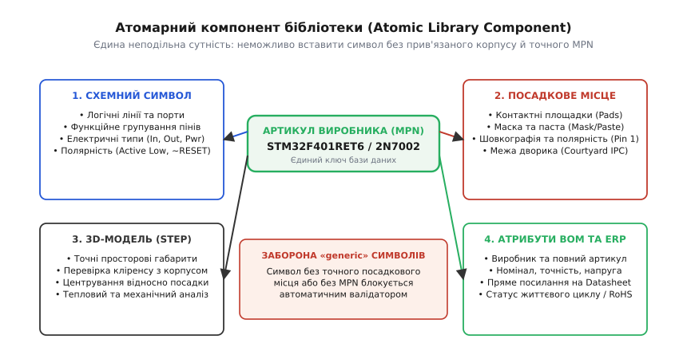
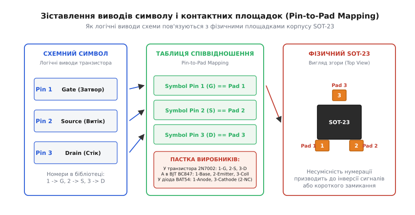

# Свій символ і свій компонент у бібліотеці

<preknowlist>
- [Принципова схема (Schematic)](root:hw-pcb/schematic-purpose) — призначення схеми, вузли та абстракція електричних зв'язків.
- [Символ мікросхеми на схемі](root:hw-pcb/ic-schematic-symbol) — умовні графічні позначення, логіка виводів та орієнтація першого піна.
- [Проектування посадкового місця (Footprint Design)](root:hw-pcb/footprint-design) — мідні контактні площадки, паяльна маска, паста та шовкографія за стандартами IPC-7351.
- [Перелік компонентів (BOM)](root:hw-pcb/bom) — позиційне позначення, артикул виробника (MPN) та перелік дозволених замін.
</preknowlist>

Партія з п'ятдесяти зібраних плат промислового контролера вартістю вісім тисяч доларів перетворюється на непридатний брухт у першу секунду подачі живлення 24 В на вхідний клемник. Замість очікуваного запуску вторинного імпульсного перетворювача над платою здіймається дим: мікроконтролер розколюється з характерним тріском, а захисні TVS-діоди на лініях інтерфейсу перетворюються на сплавлений кремнієвий коротун. Повний функціональний аналіз показує цілковиту справність схемного задуму та відсутність помилок монтажу на складальній лінії. Катастрофа сталася через одну графічну деталь у бібліотеці: розробник використав «універсальний» символ польового транзистора в корпусі SOT-23, де вивід номер 1 було позначено як затвор (*Gate*), вивід номер 2 — як витік (*Source*), а вивід номер 3 — як стік (*Drain*). Проте в реальному фізичному компоненті з замовленим закупівлею артикулом вивід номер 1 був витоком, а вивід номер 2 — затвором. У результаті силовий транзистор виявився постійно відкритим задом наперед через вбудований паразитно-технологічний діод, а вхідна напруга 24 В пішла прямо на сигнальний вивід порту мікроконтролера з максимально допустимою напругою 3.6 В.

Ця аварія — типовий наслідок порушення бібліотечної культури в системі автоматизованого проектування (САПР, англ. *electronic design automation*, EDA). Електрична схема та фізична друкована плата не мають магічного зв'язку: вони спілкуються виключно крізь цифрові моделі компонентів. Якщо зв'язок між логічним символом і фізичними контактними площадками зроблено недбало, найдосконаліший алгоритм трасування та найсуворіший заводський контроль безсилі.


*Атомарний компонент бібліотеки є неподільною цифровою моделлю. Центральний ключ (номер деталі виробника, MPN) жорстко фіксує відповідність між логічним схемним символом, фізичним посадковим місцем на текстоліті, просторовою 3D-моделлю та виробничими параметрами в переліку матеріалів BOM.*

---

## Анатомія розриву: чому «вільні» бібліотеки знищують розробку

В аматорському проектуванні та в застарілих методологіях 1990-х років панував підхід так званих «вільних» або «узагальнених» бібліотек (*Generic Component Libraries*). За цим підходом у схемний редактор ставиться абстрактний символ резистора, діода чи транзистора, який не містить жодної інформації про реальний корпус або конкретного виробника. Потім, уже на етапі переходу до проектування друкованої плати, інженер вручну призначає кожному символу посадкове місце (*footprint*) зі списку доступних геометрій — наприклад, призначає діоду корпус `SMA`, `SMB` або `SOD-123`.

Такий підхід неминуче породжує три критичні системні вразливості:

1. **Людський фактор на стику редакторів.** Коли проект містить від трьохсот до тисячі компонентів, ручне зіставлення посадкових місць перетворюється на монотонну рутину, де ймовірність помилки наближається до 100%. Достатньо один раз помилково обрати резистор типорозміру `0402` замість `0805`, щоб складальний автомат не зміг змонтувати компонент через несумісність контактних площадок і силової потужності розсіювання.
2. **Розрив нумерації виводів (Pin-to-Pad mismatch).** Абстрактний символ не знає, як саме його логічні виводи співвідносяться з номерами мідних площадок конкретного фізичного корпусу. Символ діода може мати номери пінів `1` (анод) та `2` (катод), тоді як у посадковому місці контактні площадки можуть бути пронумеровані навпаки або позначені літерами `A` та `C`. При передачі списку з'єднань (*netlist*) виникає інверсія полярності.
3. **Відсутність виробничих даних (BOM gap).** Узагальнений символ містить лише номінал (наприклад, `10 uF`). Він не містить робочої напруги (6.3 В, 16 В чи 50 В), типу діелектрика (`X7R`, `Y5V`, `C0G/NP0`), температурного діапазону, допуску та точного номера виробника (*Manufacturer Part Number*, MPN). Відділ закупівлі або замовляє випадковий дешевий компонент, або зупиняє підготовку виробництва на дні чи тижні для узгодження списків.

Щоб назавжди виключити цей клас системних дефектів, у професійній інженерії застосовують концепцію **атомарних бібліотек** (*Atomic Libraries*).

---

## Культура атомарних бібліотек (Atomic Libraries)

**Атомарний компонент** (англ. *atomic component*, від грец. *atomos* — неподільний) — це суворо фіксована цифрова сутність у базі даних САПР, де схемний символ, топологічне посадкове місце, тривимірна механічна модель і виробничі атрибути закупівлі жорстко пов'язані між собою і не можуть бути розділені або підмінені під час проектування.

Коли розробник розміщує на схемі атомарний компонент, він розміщує не «транзистор взагалі», а конкретний фізичний виріб: наприклад, польовий N-канальний транзистор `2N7002K` від виробника `onsemi` в корпусі `SOT-23-3`. Такий компонент уже має:
- чітко визначений графічний символ із перевіреними типами та номерами пінів;
- жорстко прив'язане посадкове місце з точною геометрією міді, маски, пасти та шовкографії за стандартами IPC-7351B/C;
- просторову 3D-модель у форматі STEP (*Standard for the Exchange of Product model data*), вирівняну за висотою, кутом і центром мас відносно контактних площадок;
- повний комплект атрибутів для автоматичного формування переліку матеріалів (BOM) без необхідності ручного редагування.

### Чотири стовпи атомарного компонента

Кожна бібліотечна одиниця спирається на чотири взаємопов'язані шари інформації:

```
┌────────────────────────────────────────────────────────────────────────┐
│                        АТОМАРНИЙ КОМПОНЕНТ                             │
│                  MPN: STM32F401RET6 (LQFP-64)                          │
├────────────────────────────────┬───────────────────────────────────────┤
│ 1. СХЕМНИЙ СИМВОЛ              │ 2. ПОСАДКОВЕ МІСЦЕ (FOOTPRINT)        │
│    • Логічні лінії та шини     │    • Мідні контактні площадки (Pads)  │
│    • Електричні типи пінів     │    • Паяльна маска та паста           │
│    • Функційні блоки (Units)   │    • Шовкографія (Pin 1) та дворик    │
├────────────────────────────────┼───────────────────────────────────────┤
│ 3. 3D STEP-МОДЕЛЬ              │ 4. АТРИБУТИ BOM ТА ERP                │
│    • Точні просторові габарити │    • Виробник (STMicroelectronics)    │
│    • Висота та термоінтерфейс  │    • Робоча напруга, струм, пам'ять   │
│    • Кліренс до корпусу        │    • URL даташиту, RoHS, статус EOL   │
└────────────────────────────────┴───────────────────────────────────────┘
```

Розгляньмо кожен із цих чотирьох шарів докладніше з погляду вимог до їхнього створення, параметризації та верифікації.

---

## Внутрішня будова файлів бібліотек у САПР

Сучасні системи автоматизованого проектування зберігають описи компонентів у вигляді структурованих текстових файлів. Наприклад, у KiCad версій 6, 7 і 8 використовується формат S-виразів (*S-expressions*). Розуміння того, як саме САПР кодує пін, допомагає уникнути прихованих дефектів.

Ось типовий опис символу в текстовому форматі `.kicad_sym`:

```lisp
(symbol "STM32F401RET6" (in_bom yes) (on_board yes)
  (property "Reference" "U" (id 0) (at -15.24 22.86 0))
  (property "Value" "STM32F401RET6" (id 1) (at 0 22.86 0))
  (property "Footprint" "Package_QFP:LQFP-64_10x10mm_P0.5mm" (id 2) (at 0 -25.4 0))
  (property "Datasheet" "https://www.st.com/resource/en/datasheet/stm32f401re.pdf" (id 3))
  (property "MPN" "STM32F401RET6" (id 4))
  (property "Manufacturer" "STMicroelectronics" (id 5))
  (symbol "STM32F401RET6_1_1"
    (pin power_in line (at -17.78 15.24 0) (length 2.54)
      (name "VBAT" (effects (font (size 1.27 1.27))))
      (number "1" (effects (font (size 1.27 1.27))))
    )
    (pin bidirectional line (at -17.78 12.7 0) (length 2.54)
      (name "PC13" (effects (font (size 1.27 1.27))))
      (number "2" (effects (font (size 1.27 1.27))))
    )
    (pin input line (at -17.78 -10.16 0) (length 2.54)
      (name "~{NRST}" (effects (font (size 1.27 1.27))))
      (number "7" (effects (font (size 1.27 1.27))))
    )
  )
)
```

Зверніть увагу на поля `power_in`, `bidirectional`, `input` — це оголошення електричного типу виводу. Поле `number "7"` — це зв'язок із площадкою номер 7 на друкованій платі. Якщо в посадковому місці `LQFP-64` площадка 7 буде відсутня чи названа `RESET`, компілятор схеми не зможе побудувати електричне коло й видасть критичну помилку генерації списку з'єднань.

---

## 1. Проектування схемного символу: правила та гігієна

Схемний символ призначений для передачі **інженерного змісту кола**, а не механічного розташування виводів на кристалі чи корпусі. Головна вимога до символу — легкість читання потоку сигналів людиною та однозначність для комп'ютерного алгоритму верифікації правил електричних з'єднань (*Electrical Rules Check*, ERC).

### Функційне групування виводів

Класична помилка інженера-початківця — малювання прямокутного символу мікросхеми, де виводи розташовані строго в тому порядку, у якому вони виходять із фізичного корпусу (наприклад, виводи з 1 по 16 ліворуч, з 17 по 32 знизу тощо). Така схема перетворюється на заплутаний лабіринт перехресних ліній, де неможливо зрозуміти, куди тече струм і як керується мікросхема.

Професійний стандарт створення символів вимагає **функційного групування**:

1. **Шини живлення — зверху:** виводи додатного живлення (`VDD`, `VCC`, `+3V3`, `VBAT`, `AVDD`) завжди спрямовують угору або групують у верхній частині символу.
2. **Земляні шини — знизу:** виводи спільного проводу (`GND`, `VSS`, `AGND`, `DGND`, `EPAD/Thermal Pad`) завжди спрямовують униз.
3. **Інформаційні входи — ліворуч:** виводи, які приймають сигнали керування, аналогові входи АЦП, тактові сигнали (`CLK`, `EN`, `RX`, `MOSI`, `IN+`, `IN-`), розміщують на лівій стороні символу.
4. **Інформаційні виходи — праворуч:** виводи, які генерують керування, аналогові виходи ЦАП чи підсилювача, передавачі (`TX`, `MISO`, `OUT`, `PWM`), розміщують на правій стороні символу.
5. **Двоспрямовані шини та інтерфейсні порти:** виводи групують компактними логічними кластерами. Наприклад, лінії шини I2C (`SDA`, `SCL`) або інтерфейсу USB (`D+`, `D-`, `VBUS`, `ID`) малюють поруч як неподільну групу сигналів.

```
                  +3V3 (Power In)
                     │ [Pin 1]
              ┌──────┴──────┐
  (Input)  ───┤ IN+     OUT ├─── (Output) [Pin 4]
  [Pin 2]     │             │
  (Input)  ───┤ IN-    ~FLT ├─── (Open Drain) [Pin 5]
  [Pin 3]     │             │
              └──────┬──────┘
                     │ [Pin 6]
                    GND (Power In)
```

### Багатосекційні символи (Multi-Unit / Multi-Part Components)

Мікросхеми, що містять кілька однакових функційних вузлів в одному корпусі (наприклад, подвійні та зчетверені операційні підсилювачі `LM358`, `LM324`, логічні вентилі `74HC00`, багатоканальні оптопари чи аналогові ключі), проектують у вигляді **багатосекційних символів** (*Multi-Unit Symbols*).

Кожна секція (позначається літерами `Unit A`, `Unit B`, `Unit C`, `Unit D`) розміщується в тому місці принципової схеми, де це зручно для читання топології кола. При цьому виводи живлення часто виносять в окрему службову секцію (`Unit Power` або `Unit E`). Це дозволяє розмістити блокувальні конденсатори живлення на аркуші живлення схеми, не захаращуючи сигнальні ланцюги.

У мікроконтролерах із кількістю виводів від 64 до 1000+ розбиття на секції виконують за периферійними блоками:
- `Unit A` — Ядро, тактування (`OSC_IN`, `OSC_OUT`), апаратне скидання (`~NRST`), конфігурація завантаження (`BOOT0`);
- `Unit B` — Банки ліній вводу-виводу загального призначення (`GPIOA`, `GPIOB`);
- `Unit C` — Високошвидкісні інтерфейси та аналогові блоки (`ADC`, `DAC`, `USB`, `Ethernet`);
- `Unit Power` — Усі пари виводів `VDD/VSS`, лінії фільтрації опорної напруги `VREF+` та живлення годинника реального часу `VBAT`.

---

## 2. Електричні типи виводів (Pin Electrical Types) та матриця ERC

Кожен пін схемного символу має фундаментальний числовий та якісний атрибут — **електричний тип виводу** (*Electrical Pin Type*). Цей тип не впливає на геометричний вигляд лінії на екрані, але є єдиною основою для роботи автоматичного валідатора електричних правил (ERC).

| Тип виводу | Англійська назва | Фізична поведінка в схемі | Допустимі зв'язки | Заборонені зв'язки в ERC |
|---|---|---|---|---|
| **Вхід** | `Input` | Високий вхідний імпеданс, струм майже нульовий | З виходами, шинами, пасивними елементами | Не може висіти в повітрі без підтяжки |
| **Вихід** | `Output` | Активний двотактний вихід (Push-Pull), низький імпеданс | Із входами | **Суворо заборонено** з'єднувати з іншим `Output` чи `Power Out` (КЗ!) |
| **Двоспрямований** | `Bidirectional` | Може бути входом або виходом (GPIO, шини даних) | З іншими `Bidirectional`, `Input`, `Passive` | Не дозволено з'єднувати прямо з жорсткими джерелами живлення |
| **Тристабільний** | `Tri-state (3-state)` | Має високий Z-стан при вимкненні | З шинами даних через арбітраж | Постійне одночасне активування двох джерел |
| **Пасивний** | `Passive` | Резистори, конденсатори, індуктивності, клемники | Будь-які типи без обмежень | Не генерує помилок виходу |
| **Вхід живлення** | `Power Input` | Споживач напруги (ніжка `VCC`/`VDD`/`GND` мікросхеми) | **Мусить** бути з'єднаний із шиною живлення або `Power Output` | Заборонено залишати без джерела |
| **Вихід живлення** | `Power Output` | Джерело напруги (вихід стабілізатора `VOUT`, вихід батареї) | З'єднується з `Power Input` | Заборонено з'єднувати два `Power Output` різного потенціалу |
| **Відкритий колектор/стік** | `Open Collector / Drain` | Притягує до землі, не може видавати високий рівень | З'єднується з іншими `Open Drain` та лінією підтяжки (*Pull-up*) | Робота без підтягувального резистора |
| **Не підключено** | `Not Connected (NC)` | Фізично ізольований або заборонений до контакту пін | **Нічого.** Має залишатися вільним | Будь-яке підключення до провідника є помилкою ERC |

```
Повна матриця правил ERC:
                In    Out    BiDir   TriSt   Pass   PwrIn   PwrOut   OpDrn   NC
Input        │  OK  │  OK  │  OK   │  OK   │  OK  │  OK   │  OK    │  OK*  │ ERR
Output       │  OK  │ ERR! │ WARN  │  OK   │  OK  │ ERR!  │ ERR!   │ WARN  │ ERR
Bidirection  │  OK  │ WARN │  OK   │  OK   │  OK  │ WARN  │ WARN   │  OK   │ ERR
Tri-state    │  OK  │  OK  │  OK   │  OK   │  OK  │  OK   │  OK    │  OK   │ ERR
Passive      │  OK  │  OK  │  OK   │  OK   │  OK  │  OK   │  OK    │  OK   │ ERR
Power Input  │  OK  │ ERR! │ WARN  │  OK   │  OK  │  OK   │  OK    │  ERR  │ ERR
Power Output │  OK  │ ERR! │ WARN  │  OK   │  OK  │  OK   │ ERR!   │  ERR  │ ERR
Open Drain   │  OK* │ WARN │  OK   │  OK   │  OK  │  ERR  │  ERR   │  OK*  │ ERR
Not Connected│ ERR  │ ERR  │ ERR   │  ERR  │ ERR  │  ERR  │  ERR   │  ERR  │ OK

Легенда:
  OK    — коректне з'єднання без обмежень.
  OK*   — коректно за наявності резистора підтяжки (Pull-up).
  WARN  — потенційний конфлікт (наприклад, два двоспрямовані порти без арбітражу).
  ERR!  — критична помилка (пряме коротке замикання або спалювання вихідного каскаду).
```

### Проблема прапорця живлення (Power Flag / PWR_FLAG)

Один із найпоширеніших парадоксів, з яким стикаються розробники під час перевірки ERC — помилка «*Pin connected to other pins, but not driven by any pin*» («Пін підключений до кола, але жоден пін не є джерелом живлення»).

Ця ситуація виникає, коли напруга живлення надходить на плату не з мікросхеми стабілізатора (яка має вивід типу `Power Output`), а крізь пасивний компонент — наприклад, крізь захисний діод Шотткі, дросель фільтрації або контакт вхідного розніму. Оскільки контакти розніму та виводи дроселя мають тип `Passive`, комп'ютерний аналізатор не знає, що цей провідник несе живлення, і фіксує порушення: виводи мікроконтролера `Power Input` живляться від кола без джерела.

Для вирішення цієї проблеми в САПР використовують спеціальний псевдосимвол — **прапорець живлення** (`PWR_FLAG`). Цей символ має рівно один невидимий вивід типу `Power Output`. Його розміщення на лінії живлення повідомляє компілятору: «Цей ланцюг є активним джерелом живлення, навіть якщо струм прийшов через пасивний рознім чи запобіжник».

---

## 3. Полярність логічних сигналів та угоди щодо Active-Low

Логічні сигнали в цифровій схемотехніці поділяються на два класи:
- **Прямі сигнали (Active-High):** активний стан сигналу відповідає високому логічному рівню (напрузі живлення `VDD` або `VCC`, логічна одиниця `1`). Приклади: `ENABLE`, `START`, `READY`.
- **Інверсні сигнали (Active-Low):** активний стан відповідає низькому логічному рівню (потенціалу землі `GND`, логічний нуль `0`). Приклади: сигнал апаратного скидання мікропроцесора, вибір мікросхеми на шині SPI, сигнал дозволу виходу буфера.

Інверсні сигнали є домінантними в цифровій техніці з двох фізичних причин: по-перше, вихідні каскади з відкритим колектором/стоком природно тягнуть лінію до землі; по-друге, перешкодозахищеність і споживання енергії в стані спокою при підтяжці до живлення історично були кращими для ТТЛ та КМОН-логіки.

### Стандарти позначення інверсії на символі

Щоб читач схеми та автоматичний аналізатор однозначно розуміли логіку роботи, застосовують графічні та текстові угоди:

1. **Графічне позначення:** на кінці виводу біля тіла символу малюють **маленьке порожнє кільце інверсії** (*Inversion Bubble*). Воно графічно означає логічне заперечення «НЕ».
2. **Текстове позначення з рискою згори (Overbar / Vinculum):** класичний математичний запис заперечення, де над назвою сигналу ставиться риска: `RESET̅`, `CS̅`. В юнікоді це комбінований символ `U+0304` після кожної літери: `R̅E̅S̅E̅T̅`.
3. **Синтаксис САПР:**
   - **KiCad:** тильда з фігурними дужками навколо імені — `~{RESET}`, `~{CS_FLASH}`. Редактор автоматично малює суцільну лінію над текстом.
   - **Altium Designer:** зворотний слеш після кожного символу (`R\E\S\E\T\`) або префікс зворотного слешу.
   - **Legacy / Verilog / ASCII:** префікс `n` чи `_`, або суфікс `#` чи `_N`: `nRESET`, `RESET#`, `_CS`, `RESET_L`.

> ⚠️ **Залізне правило інверсії: ніколи не подвоюйте заперечення.** Якщо на символі біля виводу вже намальовано графічне кільце інверсії (*bubble*), текст сигналу повинен бути прямим: `RESET`. Якщо ви одночасно намалюєте кільце і напишете `~{RESET}` або `nRESET`, виникає логічна невизначеність: чи це подвійна інверсія (тобто сигнал Active-High), чи просто недбалість автора бібліотеки. Стандарт IEEE 315 вимагає: або графічний кружечок з прямим текстом, або прямий вивід із текстовим запереченням.

---

## 4. Зіставлення виводів і площадок: Pin-to-Pad Mapping

**Зіставлення виводів** (англ. *Pin-to-Pad Mapping*) — це міст між логічним світом схеми та фізичним світом міді друкованої плати.

Коли САПР компілює принципову схему, вона генерує список електричних кіл (*Netlist*). У ньому кожен зв'язок описується переліком пар «Позиційне позначення — Номер фізичної площадки»:
```
NET "SPI_CLK_3V3":
  U1.15   (STM32F401, Pin 15 / Footprint Pad 15)
  U3.6    (W25Q128 Flash, Pin 6 / Footprint Pad 6)
  R4.1    (Pull-down resistor, Pin 1 / Footprint Pad 1)
```

Редактор топології друкованої плати не знає назв сигналів `MOSI` чи `VCC` всередині мікросхеми — він оперує виключно **номерами контактних площадок** (*Pad Numbers*) на посадковому місці. Якщо номер піна на символі не збігається з номером площадки на посадковому місці, сигнал піде не на ту ніжку.


*Зіставлення номерів пінів символу з номерами площадок посадкового місця SOT-23. Через відсутність єдиного стандарту між виробниками напівпровідників пряме копіювання чужих узагальнених символів призводить до переплутування контактів і спалювання компонентів.*

### Класичні інженерні пастки розпіновки

Розгляньмо чотири головні пастки, де найчастіше трапляються фатальні помилки невідповідності виводів.

#### Пастка 1: Діоди (Anode vs Cathode і конфлікт IPC-7351)

У схемних символах діод традиційно має виводи з номерами `1` та `2`, де `1` — це анод (*Anode*), а `2` — катод (*Cathode*). Деякі розробники замість цифр вписують літери `A` та `K` (або `C`).

Водночас міжнародний стандарт проектування посадкових місць **IPC-7351B/C** встановлює однозначне геометричне правило для двовивідних компонентів із полярністю (діодів, танталових та електролітичних конденсаторів):
- **Площадка номер 1 завжди є катодом (чи позитивним виводом для конденсатора), біля якого ставиться позначка полярності на шовкографії.**

Якщо інженер бере посадкове місце зі стандартної бібліотеки IPC (де катод — це Pad 1), але підключає схемний символ, де анод пронумеровано як Pin 1, діод на платі підключається у зворотному напрямку. При увімкненні випрямляч або захисний діод блокує лінію живлення, викликаючи коротке замикання джерела.

```
Схемний символ:            Посадкове місце IPC-7351:
  [1: Анод] ───|>|─── [2: Катод]     [Pad 1: Катод] ═══ [Pad 2: Анод]
        │                   │              ▲                  ▲
        └─────── ПОМИЛКА: ──┴──────────────┴──────────────────┘
                Струм тече навпаки!
```

**Правило захисту:** у бібліотеці для діодів номери виводів символу мусять суворо збігатися з номерами площадок: якщо на футпринті катод позначено площадкою `1` (за IPC), то й на символі катод повинен мати номер `1`.

#### Пастка 2: Транзистори в корпусі SOT-23

Корпус `SOT-23` (і його модифікації `SOT-23-3`, `SOT-23-5`, `SOT-23-6`) — найпоширеніший трививідний корпус для дискретних напівпровідників. Фізично він має три контактні площадки: якщо дивитися на корпус згори, розташувавши дві ніжки знизу, а одну зверху:
- **Площадка 1:** ліворуч знизу;
- **Площадка 2:** праворуч знизу;
- **Площадка 3:** по центру зверху.

Проте розташування кристала та розварювання виводів кардинально відрізняються залежно від типу напівпровідника та виробника:

| Тип компонента | Приклад MPN | Pad 1 (знизу зліва) | Pad 2 (знизу справа) | Pad 3 (зверху) |
|---|---|---|---|---|
| **NPN BJT** | `BC847B` (Nexperia) | **База (Base)** | **Емітер (Emitter)** | **Колектор (Collector)** |
| **PNP BJT** | `BC857B` (Diodes Inc) | **База (Base)** | **Емітер (Emitter)** | **Колектор (Collector)** |
| **N-Channel MOSFET** | `2N7002` (onsemi) | **Затвор (Gate)** | **Витік (Source)** | **Стік (Drain)** |
| **N-Channel MOSFET (alt)** | `BSS138` (Microchip) | **Затвор (Gate)** | **Витік (Source)** | **Стік (Drain)** |
| **P-Channel MOSFET (alt)** | `SI2301CDS` (Vishay) | **Затвор (Gate)** | **Витік (Source)** | **Стік (Drain)** |
| **P-Channel BJT (Japan)** | `2SA1037` (ROHM) | **Емітер (Emitter)** | **База (Base)** | **Колектор (Collector)** |
| **Одинарний діод** | `BAT54` (Nexperia) | **Анод (Anode)** | **Не підключено (NC)** | **Катод (Cathode)** |
| **Подвійний діод (серія)** | `BAT54S` (ST) | **Анод 1** | **Катод 2** | **Вузол K1/A2** |

Спроба використати «загальний символ MOSFET» або «загальний символ транзистора» призводить до того, що затвор сідає на колектор, база на витік, а схема або не працює взагалі, або згорає від наскрізного струму. В атомарній бібліотеці для кожного MPN створено окремий компонент, де таблиця маппінгу вивірена за даташитом конкретного виробника.

#### Пастка 3: Розніми, штирьові роз'єми та дзеркальне відображення

Нумерація виводів багатоконтактних рознімів містить дві небезпеки:
1. **Зигзаг проти лінійного порядку:** у дворядних штирьових роз'ємах (*Pin Headers* 2.54 мм чи 1.27 мм) стандартом є зигзагоподібна нумерація (перший ряд: 1, 3, 5; другий ряд: 2, 4, 6) або послідовна (ряд 1: 1..10; ряд 2: 11..20).
2. **Вигляд згори проти вигляду знизу (Top View vs Bottom View):** наскрізні роз'єми (*Through-Hole Technology*, THT), що монтуються на верхній стороні плати, розпаюються знизу. Якщо інженер дивиться на роз'єм з боку паяння і нумерує виводи, він створює дзеркальне посадкове місце. Підключений шлейф подає напругу живлення на земляні контакти мікросхем.

#### Пастка 4: Матричні корпуси BGA та заборонені літери

У кулькових матричних корпусах (BGA, *Ball Grid Array*) та безвивідних панелях LGA координати контактів задаються рядками (літери латиниці) та стовпчиками (числа): `A1`, `A2`, `B1`... `H12`.

Міжнародний стандарт **JEDEC JESD95-1** суворо забороняє використання шести літер латинського алфавіту в нумерації контактів BGA:
- Заборонено: **`I`**, **`O`**, **`Q`**, **`S`**, **`X`**, **`Z`**.

Ці літери виключено через високий ризик плутанини з цифрами: `I` плутається з `1`, `O` та `Q` — з `0`, `S` — з `5`, `X` — з позначкою відсутності, `Z` — з `2`. Якщо в бібліотеці символ сформовано за простим алфавітним генератором без урахування правила JEDEC (наприклад, після рядка `H` створено рядок `I`), усі наступні рядки зсуваються, роблячи матрицю виводів повністю несумісною з реальним чипом.

---

## 5. Розрахунок геометрії контактних площадок за стандартом IPC-7351

Посадкове місце повинно гарантувати надійне формування паяного меніска (галтелі припою). Стандарт IPC-7351 визначає три рівні густини монтажу:
- **Рівень A (Most Material Condition / Maximum Density):** максимальний розмір площадок для військової та авіаційної техніки, де пріоритетом є максимальна механічна міцність і вібростійкість.
- **Рівень B (Nominal Density):** стандартний рівень для промислової та споживчої електроніки, збалансований між розміром і надійністю паяння.
- **Рівень C (Least Material Condition / Minimum Density):** мінімальний розмір площадок для надкомпактних мобільних пристроїв та сенсорів.

Розмір контактної площадки для SMD-компонентів розраховується за трьома геометричними надбавками:
1. **Носок (Toe, J_T):** виліт площадки за межі виводу назовні (формує зовнішній меніск припою).
2. **П'ята (Heel, J_H):** виліт площадки під вивід усередину корпусу (формує внутрішній опорний меніск).
3. **Бік (Side, J_S):** ширина площадки з боків виводу.

```
Формули IPC-7351 для розрахунку довжини (Z, G) та ширини (X) площадок:

  Z_max = L_min + 2·J_T + √(C_L² + C_F² + C_P²)      [зовнішній габарит між площадками]
  G_min = S_max − 2·J_H − √(C_S² + C_F² + C_P²)      [внутрішній зазор між площадками]
  X_max = W_min + 2·J_S + √(C_W² + C_F² + C_P²)      [ширина контактної площадки]

де:
  L — загальна довжина корпусу з виводами;
  S — відстань між внутрішніми торцями виводів;
  W — ширина металевого виводу компонента;
  C_L, C_S, C_W — виробничі допуски на розміри компонента з даташиту;
  C_F — виробничий допуск фабрики на виготовлення плати (типово 0.05 мм);
  C_P — точність автомата розстановки компонентів Pick-and-Place (типово 0.05 мм).
```

### Контур обмеження (Courtyard)

Навколо кожного посадкового місця на спеціальному шарі `Courtyard` наноситься замкнена полігональна лінія. Вона визначає фізичний габарит деталі разом із розширенням на допуски монтажу. Згідно з IPC-7351, мінімальний зазор між контурами двох сусідніх деталей становить:
- Рівень A: **0.50 мм**;
- Рівень B: **0.25 мм**;
- Рівень C: **0.10 мм**.

Якщо під час трасування контури Courtyard перетинаються, автоматична перевірка DRC (*Design Rule Check*) генерує помилку колізії деталей.

---

## 6. Моделювання термоплощадок (Exposed Pad) та трафарету паяльної пасти

Сучасні мікросхеми стабілізаторів напруги, драйверів двигунів, процесорів та радіочастотних трансиверів у безвивідних корпусах `QFN`, `DFN` та `PowerPAD` мають знизу велику металеву пластину — **термоплощадку** (*Exposed Pad / EPAD*).

Вона виконує дві критичні функції:
1. **Тепловідведення:** тепло від кристала передається безпосередньо у внутрішні мідні шари плати через масив теплових перехідних отворів (*Thermal Vias*).
2. **Електричний контакт:** для більшості мікросхем термоплощадка з'єднана з підкладкою кристала і мусить бути підключена до шини `GND`. Проте в деяких мікросхемах (наприклад, у високовольтних драйверах чи підсилювачах з двополярним живленням) вона мусить з'єднуватися з від'ємною шиною живлення `V-` або залишатися електрично ізольованою. Помилка у визначенні електричного типу піна EPAD призводить до міжшинного короткого замикання.

### Пастка суцільного нанесення паяльної пасти

Якщо площадка EPAD має розмір, наприклад, 5×5 мм, і шар паяльної пасти (*Paste Mask*) зробити суцільним вікном 1:1, під час оплавлення в печі виникає грубий технологічний дефект:
- Великий об'єм флюсу всередині пасти закипає й утворює газову бульбашку (*Voiding*), яка підіймає мікросхему над платою («ефект поплавка»). Маленькі сигнальні виводи по периметру втрачають контакт із площадками плати, утворюючи обриви (*Open Circuit*), або припій видавлюється назовні, закорочуючи сусідні ніжки.

Щоб запобігти цьому, шар пасти на термоплощадці розбивають на **матрицю невеликих вікон** (віконний трафарет, *Windowpaning*). Площа покриття пастою повинна становити **50–70%** від загальної площі термоплощадки.

```
  ┌─────────────────────────┐
  │  ┌───┐   ┌───┐   ┌───┐  │
  │  │   │   │   │   │   │  │  ← Паяльна паста нанесена окремими вікнами.
  │  └───┘   └───┘   └───┘  │    Сумарна площа = 60% площі міді.
  │  ┌───┐   ┌───┐   ┌───┐  │
  │  │   │   │   │   │   │  │  ← Гази флюсу вільно виходять через канали
  │  └───┘   └───┘   └───┘  │    між вікнами під час паяння.
  │  ┌───┐   ┌───┐   ┌───┐  │
  │  │   │   │   │   │   │  │
  │  └───┘   └───┘   └───┘  │
  └─────────────────────────┘
```

---

## 7. Службові компоненти та прецизійні вимірювальні структури

Окрім активних мікросхем і дискретних напівпровідників, бібліотека містить спеціальні технологічні та службові компоненти:

### Чотирививідне підключення Кельвіна (Kelvin Current Sense)

Для прецизійного вимірювання струму в діапазоні від міліампер до сотень ампер застосовують низькоомні струмові шунти (номінал 0.5 мОм – 50 мОм). Якщо шунт підключити двома стандартними контактними площадками, паразитна напруга на переході припою (`R_solder ≈ 0.5–2 мОм`) спотворює показання підсилювача струму в рази.

Тому в бібліотеці створюють спеціальне посадкове місце з чотирма площадками (Kelvin Footprint):
- Площадки 1 та 2 (широкі) — силові виводи струму (*Force Pins*);
- Площадки 3 та 4 (вузькі, розміщені з внутрішнього боку резистивного елемента) — вимірювальні виводи напруги (*Sense Pins*).
Схемний символ такого резистора має чотири виводи й підключається чотирма незалежними провідниками безпосередньо до вхідних диференціальних входів мікросхеми моніторингу струму.

### Реперні знаки та технологічні отвори

- **Реперні знаки (Fiducial Marks):** мідні круги діаметром 1.0 мм, оточені кільцем маски діаметром 2.0 мм без шовкографії. Вони є оптичними мітками для камер системи технічного зору монтажного автомата. У бібліотеці вони створюються як атомарні компоненти з атрибутом `Virtual / Do Not Populate` (не включаються у закупівлю BOM).
- **Кріпильні отвори (Mounting Holes):** металізовані отвори з кільцевим вінцем міді для болтів M2/M3/M4. Якщо вінець підключається до шасі приладу, символ має один пін типу `Passive` зі з'єднанням із сигнальною чи захисною землею `PE`.

---

## 8. Програмна модель компонента та верифікація в коді

Для автоматизованої перевірки цілісності бібліотек пишуться службові скрипти та модулі верифікації. Нижче наведено структуру даних для моделювання атомарного компонента та алгоритм перевірки коректності Pin-to-Pad відповідності, реалізований мовами C та C++.

Повну реалізацію консольного валідатора цілісності бібліотек з парсером та розширеною матрицею ERC наведено в окремій статті-проєкті [Валідатор бібліотек компонентів на C99/C++20](root:hw-pcb/svii-symvol-i-svii-komponent-u-bibliotetsi/proj-library-component-validator.md).

:::tabs
:::code svii-symvol-i-svii-komponent-u-bibliotetsi-d/c/main.c
:::code svii-symvol-i-svii-komponent-u-bibliotetsi-d/cpp/main.cpp
:::

---

## Чекліст верифікації нового компонента перед додаванням до бібліотеки

Створення компонента вважається завершеним лише після проходження повного циклу верифікації за контрольним списком (Checklist):

1. **Верифікація символу (Symbol Audit):**
   - [ ] Чи відповідає полярність кожного піна даташиту виробника?
   - [ ] Чи призначено правильні типи виводів (`Power In` для VDD, `Passive` для пасивних компонентів, `Open Drain` для відповідних інтерфейсів)?
   - [ ] Чи згруповано виводи функціонально (живлення зверху/знизу, входи зліва, виходи справа)?
   - [ ] Чи використано стандартний синтаксис інверсії (`~{RESET}`) без дублювання графічного кільця інверсії?
2. **Верифікація посадкового місця (Footprint Audit):**
   - [ ] Чи збігається крок контактних площадок (*Pitch*) та їхні розміри з рекомендаціями даташиту (*Land Pattern Recommendation*)?
   - [ ] Чи є чітке маркування першого виводу (Pin 1) на шовкографії та шарі складання (*Fab Layer*)?
   - [ ] Чи створено замкнений контур обмеження (*Courtyard*) за IPC-7351 для уникнення накладання компонентів під час автоматичного монтажу?
   - [ ] Чи відкрито термоплощадку (*Exposed Pad*) від маски та чи розбито паяльну пасту на вікна 50–70% площі?
3. **Верифікація Pin-to-Pad маппінгу:**
   - [ ] Чи перевірено кожну пару «номер піна — номер площадки» безпосередньо за таблицею виводів (*Pin Description Table*) даташиту конкретного MPN?
   - [ ] Для діодів: чи перевірено відповідність Анод/Катод згідно з прийнятим стандартом бібліотеки (IPC Pad 1 = Cathode)?
   - [ ] Для транзисторів SOT-23: чи зіставлено Gate/Source/Drain або Base/Emitter/Collector з фізичними виводами 1, 2, 3?
4. **Верифікація 3D-моделі та параметрів BOM:**
   - [ ] Чи завантажено точну 3D-модель STEP та чи вирівняно її за осями X/Y/Z і висотою відносно контактних площадок?
   - [ ] Чи заповнено повний номер виробника (MPN), назву виробника, точний опис, корпус та робочу напругу/струм/допуск?
   - [ ] Чи вказано робоче посилання на офіційний даташит виробника?

---

> 🔧 **Підсумок для розробника.** Створення власного компонента — це не просто креслення прямокутника з лініями, а формування цифрового контракту між розробником схеми, трасувальником друкованої плати, автоматом поверхневого монтажу та відділом закупівлі деталей. Перехід на строгу культуру атомарних компонентів виключає цілі класи виробничого браку, дозволяючи зосередитися на самій схемотехніці.
