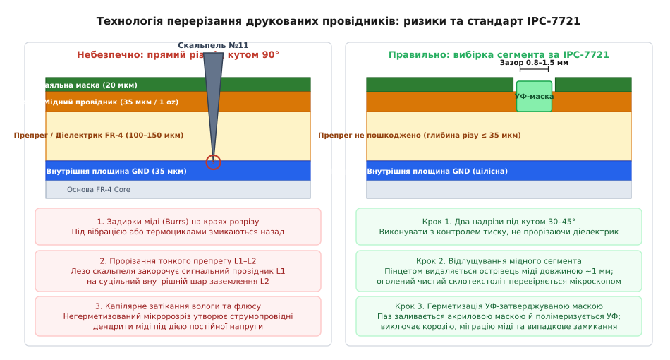
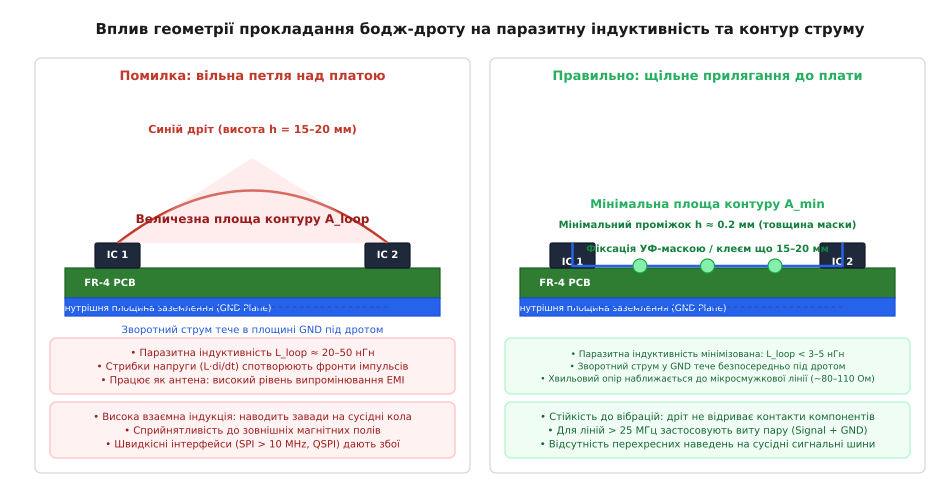

# Сині дроти й ремонт ревізії А

<preknowlist>
- [Вузли й з'єднання](root:hw-pcb/nodes-connections) — логічні сітки (nets), класи електричних ланцюгів та вузли схеми.
- [Перше вмикання нової плати: обмеження струму, димовий тест](root:hw-pcb/pershe-vmykannia-novoi-platy) — методика первинного вмикання, захист від КЗ та тепловізійний аналіз.
- [Площина заземлення](root:hw-pcb/ground-plane) — екранування, неперервність мідного полігону та контроль імпедансу.
- [Шарування плати](root:hw-pcb/pcb-stackup) — структура діелектриків, препрегів та внутрішніх мідних шарів.
- [Шлях зворотного струму](root:hw-pcb/current-return-path) — електродинаміка повернення високочастотного сигналу через опорну площину.
- [Базове паяння](root:hw-pcb/basic-soldering) — температурні режими паяльника, вибір флюсів та металургія паяного з'єднання.
</preknowlist>

Коли партія з десяти дослідних зразків ревізії А вартістю кілька десятків тисяч доларів повертається з контрактного монтажного виробництва за три тижні до польових випробувань, а перше ж подання живлення виявляє дзеркально переплутані лінії RX та TX апаратного UART, інвертовану логіку сигналу вибору мікросхеми CS на шині SPI та коротке замикання через зміщення виводів під корпусом QFN, проєкт опиняється під загрозою зриву термінів. Повний цикл виправлення топології у САПР, повторного замовлення голого текстоліту на фабриці та монтажу нової партії ревізії B вимагає від трьох до шести тижнів і нового виробничого бюджету. Тим часом команді програмістів вбудованого програмного забезпечення, системним інженерам та фахівцям з радіочастотної верифікації необхідні фізично робочі екземпляри плати без жодного дня затримки.

Єдиним інженерним виходом у такій кризовій точці стає локальна мікромодифікація друкованої плати, відома в індустріальній практиці як монтаж перемичок (англ. *bodge wire modifications* або *blue wire rework*). Кваліфіковане перерізання друкованих провідників скальпелем, захист розкритих внутрішніх діелектриків, встановлення навісних компонентів та прокладання тонких ізольованих проводів калібру AWG 30–36 дозволяють повністю компенсувати схемотехнічні й топологічні прорахунки, трансформуючи непрацездатний зразок у повноцінний інструмент верифікації. Однак межа між прецизійним інженерним доопрацюванням і незворотним руйнуванням плати проходить крізь точне розуміння механіки мікророзрізів, термомеханічних властивостей діелектриків FR-4, стандарту IPC-7711/7721 та електродинаміки високочастотних сигнальних контурів.

## Філософія модифікації ревізії А та межі застосовності

Дослідний зразок друкованої плати першої ітерації (ревізія А) принципово проектується як об'єкт пошуку дефектів. Складна взаємодія мікроконтролерів, силіконових драйверів, польових транзисторів та чутливих сенсорів рідко запрацює ідеально з першого разу. У промисловій розробці зразок ревізії А з десятьма змонтованими тонкими проводами вважається не браком, а успішним проміжним результатом, якщо ці модифікації дозволили запустити всі підсистеми, виявити приховані помилки в прошивці та передати в САПР повністю перевірений нетлист для ревізії B.

```
                  Життєвий цикл ревізії А та точка ремонту
                  
┌──────────────────┐      ┌──────────────────┐      ┌──────────────────┐
│ Монтаж ревізії А │ ───> │ Перше вмикання   │ ───> │ Виявлення дефекту│
│ (Фабрика / SMT)  │      │ (Bring-up / КЗ)  │      │ (Схема / Нетлист)│
└──────────────────┘      └──────────────────┘      └──────────────────┘
                                                              │
                                                              ▼
┌──────────────────┐      ┌──────────────────┐      ┌──────────────────┐
│ Ревізія B у САПР │ <─── │ Верифікація FW   │ <─── │ ECO Ремонт плати │
│ (Чистий реліз)   │      │ (Повні тести)    │      │ (Bodge Wires/Cut)│
└──────────────────┘      └──────────────────┘      └──────────────────┘
```

Помилки, що усуваються за допомогою монтажних проводів та підрізання міді, поділяються на чотири базові класи:

1. **Логічні та попінові інверсії:** Переплутані місцями лінії прийому й передачі UART (RX ↔ TX), прямі та інверсні сигнали дозволу роботи драйверів (Active-High замість Active-Low), зміщені піни шин I2C/SPI внаслідок помилки в даташиті виробника чіпа або дзеркального відображення посадкового місця конектора.
2. **Прорахунки ланцюгів зміщення та конфігурації:** Забуті підтягуючі (англ. *pull-up*) або стягуючі (англ. *pull-down*) резистори на лініях `BOOT0`, `nRESET`, `EN`, що залишають цифрові входи мікроконтролера у невизначеному плаваючому стані (англ. *floating input*).
3. **Помилки живлення та опорних напруг:** Подання напруги 3.3 В на вивід чіпа, розрахований виключно на 1.8 В, або відсутність з'єднання між аналоговою землею AGND та цифровою землею DGND під прецизійним АЦП.
4. **Топологічні короткі замикання:** Прокладання сигнального провідника занадто близько до термального майданчика (англ. *exposed pad*) силової мікросхеми, що призводить до оплавлення маски та металургійного замикання під час оплавлення припою в печі.

Проте інженерне доопрацювання має суворі фізичні обмеження. Модифікація дротами є неприйнятною або вимагає спеціальних методів у таких випадках:

- **Диференційні гігагерцові пари:** Лінії PCIe Gen 3/4, USB 3.2 Gen 2 (10 Гбіт/с) чи SATA мають жорстко контрольований диференційний імпеданс 90–100 Ом та вимогу узгодження фазової затримки з точністю до десятих часток пікосекунди. Звичайний монтажний дріт руйнує хвильовий опір лінії, викликаючи катастрофічні відбиття сигналу та повне закриття очної діаграми.
- **Внутрішні шари високої щільності:** Якщо помилкова доріжка проходить на шарі L3 або L4 восьмишарової плати під масивом кульок BGA з кроком 0.5 мм, фізично дістатися до неї скальпелем без незворотного перерізання сусідніх сигнальних шарів L1 та L2 неможливо.
- **Сильнострумові силові полігони:** Спроба пропустити імпульсний струм 20 А фази живлення ядра процесора (VCORE) через тонкий провід призведе до його миттєвого перегорання або неприпустимого падіння напруги в десятки мілівольт.

## Механіка різання доріжок та мікрохірургія міді

Найбільш відповідальною та незворотною операцією ремонту друкованої плати є фізичне переривання помилкового електричного з'єднання. Невміла робота ріжучим інструментом здатна перетворити локальний дефект на невідновне міжшарове коротке замикання або спровокувати відшарування навколишніх контактних майданчиків.


*Пошарове перерізання друкованого провідника за стандартом IPC-7721 та ризики прямого вертикального надрізу скальпелем.*

### Інструментарій та підготовка робочого місця

Для мікрохірургії друкованих плат непридатні будівельні чи канцелярські ножі. Операція вимагає спеціалізованого комплекту:

- **Хірургічний скальпель:** Рукоятка №3 або №4 з одноразовими змінними лезами з високовуглецевої сталі форми №11 (гострокінцеве трикутне лезо) або №15 (закруглене лезо для делікатного вискоблювання).
- **Стереоскопічний мікроскоп:** Оптичне збільшення від 10x до 40x із регульованим безтіньовим кільцевим світлодіодним освітленням та робочою відстанню не менше 100 мм для вільного маніпулювання інструментом.
- **Прецизійні антистатичні пінцети:** Пінцети з титановим або високолегованим немагнітним жалом типу SMD (вигнуті під кутом 45° з кінчиками завширшки 0.1–0.2 мм).
- **Абразивні скловолоконні олівці (Fiberglass abrasive pens):** Інструмент для локального зняття паяльної маски без пошкодження мідного шару.
- **Ізопропіловий спирт високої чистоти (IPA ≥ 99.8%) та безворсові серветки:** Для ретельного видалення мідної стружки, залишків флюсу та пилу склотекстоліту.

### Стандарт IPC-7721: Чому прямий різ 90° є неприпустимим

Початківці часто намагаються перерізати доріжку одним сильним натисканням скальпеля перпендикулярно до поверхні плати. Такий підхід порушує вимоги розділу 3.1 міжнародного стандарту **IPC-7711/7721 (Rework, Modification and Repair of Electronic Assemblies)** і неминуче породжує три критичні дефекти:

1. **Утворення мідних задирок (англ. *Copper Burrs*):** Під час прямого натискання пластична мідь (товщиною 18 або 35 мкм) деформується вниз і вбік. Утворюється мікроскопічний зазор шириною менше 10–20 мкм. Під впливом вібрації, термоциклів або температурного розширення текстоліту задирки змикаються, відновлюючи паразитичний контакт.
2. **Прорізання ізоляційного шару препрегу:** У сучасних 4- і 6-шарових платах товщина діелектричного проміжку між зовнішнім шаром L1 та внутрішнім шаром L2 (який зазвичай є суцільною площиною заземлення GND або живлення PWR) становить лише 100–120 мкм. Гостре лезо скальпеля з легкістю пробиває склотканину і врізається у внутрішню площину. Мідна задирка з шару L1 затягується лезом углиб і закорочує розрізаний провідник на внутрішній полігон заземлення. Усунути таке внутрішнє КЗ без висвердлювання плати наскрізь неможливо.
3. **Капілярне затікання вологи та електрохімічна міграція:** Негерметизований тонкий мікророзріз утворює капіляр, куди затягуються залишки флюсу, волога та іони солей з повітря. Під дією постійної напруги між розділеними ділянками виникає електрохімічна міграція міді з утворенням струмопровідних дендритів, що призводить до спонтанних відмов через кілька тижнів роботи.

### Техніка подвійної кутової вибірки сегмента (V-Cut Removal)

Правильний регламент виконання розрізу за IPC-7721 складається з таких послідовних операцій:

- **Локалізація зони різу:** Обирається пряма ділянка провідника подалі від перехідних отворів та виводів компонентів (бажано на відстані не менше 1.5–2.0 мм від паяних з'єднань, щоб уникнути відриву контактного майданчика під дією механічного натягу).
- **Зняття паяльної маски:** За допомогою скловолоконного олівця або легкого скоблення скальпелем під кутом 15° з ділянки доріжки довжиною 2 мм акуратно видаляється захисна зелена маска до появи чистого мідного блиску.
- **Виконання першого надрізу під кутом 30–45°:** Лезо скальпеля ставиться під гострим кутом до площини текстоліту і з помірним тиском виконує надріз міді. Кутовий різ виключає вертикальне продавлювання скловолокна діелектрика.
- **Виконання другого надрізу:** На відстані `L_gap = 0.8–1.5 мм` паралельно першому виконується другий зустрічний надріз під кутом 30–45°.
- **Піддівання та видалення мідного острівця:** Кінчиком скальпеля або гострим пінцетом піддівається вивільнений мідний прямокутник і повністю видаляється з плати. На його місці утворюється чистий ізоляційний рівчачок з оголеним склотекстолітом FR-4.
- **Оптичний контроль та електричний прозвон:** Під мікроскопом перевіряється повна відсутність залишкових мідних волокон чи задирок на дні паза. Мультиметром у режимі вимірювання опору (шкала 20 МОм) контролюється відсутність витоку між розірваними сегментами, а також відсутність замикання на сусідні ланцюги й шину заземлення.
- **Герметизація УФ-маскою:** Очищений ізопропіловим спиртом паз покривається краплею акрилової рідкої паяльної маски та опромінюється ультрафіолетовим ліхтариком (довжина хвилі 365–395 нм) протягом 30–60 секунд до повної полімеризації. Це відновлює вологозахисний бар'єр і фіксує краї розрізаної міді від відшарування.

## Вибір провідників: Емальований мікропровід, Kynar та МГТФ

Для створення нових електричних з'єднань поверх друкованої плати використовують спеціалізовані монтажні проводи, що кардинально відрізняються типом металу жили, температурною стійкістю та механічними властивостями ізоляції.

```
                  Типові матеріали монтажних проводів
                  
┌─────────────────────────────────────────────────────────────────────────┐
│ Емальований мідний дріт (Magnet Wire / Enamelled Copper, AWG 34–38)     │
│ [Мідна жила 0.12 мм] ──> [Поліуретановий термозачисний лак (15 мкм)]    │
│ Особливість: самолудний при 380 °C, компактний, монтаж під QFP/BGA      │
├─────────────────────────────────────────────────────────────────────────┤
│ Дріт Kynar / PVDF (Wire-Wrap Wire, AWG 30)                              │
│ [Посріблена мідь 0.25 мм] ──> [Фторопластова ізоляція Kynar 0.5 мм]     │
│ Особливість: жорсткий, тримає форму, механічна міцність, яскравий колір │
├─────────────────────────────────────────────────────────────────────────┤
│ Термостійкий дріт МГТФ (AWG 30–32, PTFE скрутка)                        │
│ [Мідні мікронитки 0.05 мм] ──> [Спіральна стрічкова плівка фторопласту] │
│ Особливість: не плавиться до 250 °C, гнучкий, потребує мікрострипера    │
└─────────────────────────────────────────────────────────────────────────┘
```

### Емальований самолудний дріт (Polyurethane Enameled Wire)

Емальований мідний дріт діаметром 0.10–0.16 мм (калібри AWG 34–38) є основним інструментом для мікропайки до виводів мікросхем із дрібним кроком (QFP 0.5 мм, DFN/QFN, контакти пасивних компонентів типорозмірів 0402 та 0201).

Головна перевага проводів із поліуретановою ізоляцією класу 155 °C або 180 °C (стандарт IEC 60317-20 / NEMA MW 79-C) — **термічне самолудження** (англ. *solder-through enamel*). При контакті з краплею рідкого припою на жалі паяльника за температури 360–380 °C поліуретановий лак миттєво сублімується й випаровується протягом 1–2 секунд, а поверхня міді одночасно лудиться без необхідності попереднього механічного зняття ізоляції. Це виключає ризик надрізу або обриву тонкої мідної жили діаметром 100 мкм.

> ⚠️ **Попередження:** Для монтажу бодж-проводів заборонено використовувати обмотувальні дроти старих типів із поліімідною (ПЭТВ) або масляно-смоляною емаллю. Такі лаки не розкладаються при температурі рідкого припою і вимагають хімічного змивання їдкими розчинниками або агресивного здирання скальпелем, що неминуче стоншує жилу й створює приховані концентратори механічних напружень.

### Дроти з ізоляцією Kynar (PVDF) та МГТФ (PTFE)

Для силових ланцюгів, шин живлення, довгих сигнальних трас уздовж усієї плати та зовнішніх міжплатних міжз'єднань застосовують проводи калібру AWG 30 (діаметр жили 0.25 мм):

- **Kynar (полівініліденфторид, PVDF):** Класичний дріт для монтажу накруткою (англ. *wire-wrap*). Завдяки однодротовій посрібленій мідній жилі він чудово тримає задану геометрію вигинів, не пружинить і дозволяє викладати естетичні паралельні траси під прямими кутами вздовж корпусів мікросхем. Тонка жорстка ізоляція з PVDF стійка до проколів об гострі виводи штирьових роз'ємів.
- **МГТФ (Мідний Гнучкий Термостійкий Фторопластовий):** Багатодротовий провід з ізоляцією зі спірально навитої плівки фторопласту-4 (PTFE). Витримує температури до +250 °C без оплавлення ізоляції під час торкання паяльником сусідніх контактів. Його недолік — волокниста структура навивки, що потребує обов'язкового використання спеціальних термічних стриперів або заточених мікрокусачок для запобігання розпушуванню мідних ниток.

### Розрахунок допустимого струму та падіння напруги

При відновленні силових шин діаметр проводу обирається за стандартами струмового навантаження **IPC-2152**. Падіння напруги `ΔU` на ділянці монтажного проводу довжиною `L` розраховується за класичним законом Ома:

```
R_wire = ρ · L / S_wire
ΔU = I_load · R_wire
```

де `ρ` — питомий електричний опір міді (`1.72·10⁻⁸ Ом·м` при 20 °C), `S_wire = π · d² / 4` — площа поперечного перерізу жили, `I_load` — робочий струм навантаження.

| Калібр AWG | Діаметр жили `d` (мм) | Переріз `S` (мм²) | Опір на метр `R` (Ом/м) | Макс. струм `I_max` (ΔT = 10 °C) | Типове застосування |
|---|---|---|---|---|---|
| **AWG 30** | 0.254 | 0.0507 | 0.338 | 0.85 А | Шини живлення MCU 3.3 В / 5 В, силові ключі |
| **AWG 32** | 0.203 | 0.0324 | 0.531 | 0.55 А | Допоміжне живлення сенсорів, лінії світлодіодів |
| **AWG 34** | 0.160 | 0.0201 | 0.855 | 0.35 А | Сигнальні шини GPIO, UART, I2C, SPI |
| **AWG 36** | 0.127 | 0.0127 | 1.360 | 0.20 А | Виводи мікросхем QFP 0.5 мм, майданчики 0402 |
| **AWG 38** | 0.101 | 0.0081 | 2.130 | 0.12 А | Мікропайка під мікроскопом, чіпи 0201 / WLCSP |

**Приклад розрахунку:** Необхідно відновити шину живлення 3.3 В для бездротового модуля з піковим споживанням `I = 400 мА` під час передачі радіопакета. Довжина траси становить `L = 15 см` (0.15 м).
- При використанні проводу AWG 36: опір `R = 0.15 м · 1.36 Ом/м = 0.204 Ом`. Падіння напруги складе `ΔU = 0.4 А · 0.204 Ом = 81.6 мВ`. Це становить 2.5% від номіналу 3.3 В і разом із пульсаціями регулятора може викликати спрацьовування детектора коричневого збою (англ. *Brown-out Reset*, BOR) мікроконтролера.
- При використанні проводу AWG 30: опір `R = 0.15 м · 0.338 Ом/м = 0.051 Ом`. Падіння напруги складе лише `ΔU = 0.4 А · 0.051 Ом = 20.4 мВ` (менше 0.6%), що гарантує стабільну роботу радіотракту.

## Технологія паяння та механічна фіксація на платі

Пайка бодж-проводів вимагає найвищої акуратності. Неякісно припаяний дріт створює нестійкий контакт, а механічний натяг незакріпленого провідника відриває мініатюрні SMD-майданчики разом із фольгою текстоліту при найменшій вібрації.

### Паяння до компонентів, виводів та перехідних отворів

Існує чотири базові типи точок припаювання монтажного проводу:

1. **Контактні площадки пасивних компонентів (0402 / 0603):** Найбільш надійна точка. Дріт підпаюється до бічної грані виводу резистора або конденсатора. Попередньо на площадку наноситься крапля безвідмивного гелевого флюсу (класу ROL0 або REL0), жало паяльника форми "мікрохвиля" або тонкий конус (0.2–0.4 мм) прогріває стик за температури 320–340 °C протягом не більше 1.5–2.0 секунд.
2. **Перехідні отвори (Vias):** Якщо перехідний отвір закритий паяльною маскою (англ. *tented via*), маску акуратно зчищають скловолоконним олівцем до блиску мідного кільця. За наявності відкритого отвору зачищений кінчик дроту AWG 34/36 вставляють безпосередньо в отвір і пропаюють із зворотного або лицьового боку.
3. **Виводи мікросхем QFP / SOIC:** Дріт підводиться зверху до "п'ятки" ніжки мікросхеми біля самого корпусу чіпа, де механічна жорсткість виводу максимальна.
4. **Підняття виводу чіпа (Pin Lifting):** Якщо внутрішню доріжку під мікросхемою перерізати неможливо, а сигнал на конкретному виводі треба ізолювати від плати, вивід піднімають у повітря. Під час нагріву контактної площадки паяльником під ніжку підводиться тонка хірургічна голка або емальований дріт, вивід акуратно відгинається вгору на кут 20–30° над текстолітом, після чого до висячого в повітрі виводу припаюється бодж-провід.

```
                     Техніка монтажу компонентів
                     
   Монтаж "на спині" (Dead Bug)          Підняття виводу (Pin Lifting)
   
        ┌───┐ 10k Pull-up                      ┌───────────────┐
   ┌────┤ R ├────┐ [AWG 34]              [Дріт]│               │
   │    └───┘    │                         └───┤ Ніжка піднята │
   │ 3.3V        ▼                             │ над платою    │
┌──┴──┐       ┌─────┐                          │               │
│ VCC │       │ GPIO│                          │   Корпус IC   │
│     │       │     │                          │               │
└─────┘       └─────┘                          └───────────────┘
```

### Навісний монтаж компонентів: «Dead Bug» та «Tombstone»

Часто ремонт ревізії А вимагає додавання дискретних елементів, які не були передбачені схемотехніком:

- **Монтаж «надгробком» (Tombstone):** Резистор або конденсатор типорозміру 0603/0805 встановлюється вертикально. Один його вивід припаюється безпосередньо до штатної контактної площадки на платі, а до верхнього виводу підпаюється провід або другий компонент.
- **Монтаж «догори лапами» (Dead Bug):** Додаткова мікросхема в корпусі SOIC, SOT-23 або SC-70 перевертається виводами догори і приклеюється краплею епоксидного клею або двостороннього каптонового скотчу до вільної ділянки плати або прямо на поверхню центрального процесора. До вигнутих лапок мікросхеми підпаюються проводи живлення, блокувальні конденсатори 0.1 мкФ безпосередньо між виводами `VCC` і `GND`, а також сигнальні лінії.

### Механічне закріплення, термоцикли та адгезиви

Голий довгий провід, залишений без фіксації на платі (явище, відоме серед інженерів як "макарони"), має власну резонансну частоту коливань у діапазоні 50–500 Гц. Під час транспортування, роботи вентиляторів охолодження чи вібраційних випробувань провід зазнає знакозмінних навантажень. 

Крім того, критичним фактором є різниця коефіцієнтів теплового розширення (КТР, англ. *CTE — Coefficient of Thermal Expansion*). Склотекстоліт FR-4 у площині XY розширюється зі швидкістю приблизно `14–17 ppm/°C`, мідна жила має КТР `16.5 ppm/°C`, а припій SAC305 — `21 ppm/°C`. Під час термоциклування від -40 °C до +85 °C незакріплений провід розширюється й стискається, передаючи весь механічний момент безпосередньо на мікроскопічну галтель припою майданчика 0402. Втома металу неминуче призводить до відламування жили або відриву мідної фольги від діелектрика.

Для надійної фіксації траси застосовують такі матеріали:

- **УФ-затверджувана акрилова паяльна маска:** Наноситься точковими краплями кожні 15–20 мм вздовж траси та безпосередньо біля паяних з'єднань для зняття механічного напруження (англ. *strain relief*). Полімеризується під УФ-променями за 30 секунд.
- **Ціанакрилатний клей (Super Glue) з аерозольним активатором:** Забезпечує миттєву (1–2 секунди) фіксацію проводів до склотекстоліту. Застосовується для довгих пучків проводів.
- **Каптонова поліімідна стрічка (Kapton Tape):** Стійка до температур до 260 °C, має високу діелектричну міцність (понад 5 кВ) і не залишає липких слідів під час демонтажу. Ідеально підходить для тимчасового утримання джгутів проводів під час відладки.

## Електродинаміка швидкісних сигналів та цілісність контурів

Найбільш підступна помилка при монтажі синіх проводів — ігнорування хвильової природи сигналів. Інженер-початківець розглядає провід як ідеальний провідник із нульовим опором. Проте високошвидкісний цифровий сигнал (зі швидкістю наростання фронту `t_r < 2 нс`, що характерно для будь-яких сучасних мікроконтролерів Cortex-M4/M7 або FPGA) поширюється не всередині металу, а у вигляді електромагнітної хвилі в просторі між сигнальним провідником та опорною площиною повернення струму (англ. *return path*).


*Геометрія прокладання монтажного дроту над полігоном заземлення та мінімізація індуктивності сигнального контуру.*

### Індуктивність контуру та висота над площиною заземлення

Погонна індуктивність циліндричного дроту діаметром `d`, розташованого на висоті `h` над нескінченною ідеальною площиною заземлення, описується класичним рівнянням електродинаміки:

```
L_wire = (μ_0 / 2π) · ln(4h / d)
```

де `μ_0 = 4π·10⁻⁷ Гн/м` — магнітна проникність вакууму.

Якщо дріт прокладений "по повітрю" у вигляді вільної дуги на висоті `h = 15 мм` над платою (діаметр жили AWG 30 `d = 0.254 мм`):

```
L_wire = (2·10⁻⁷) · ln(4 · 15 / 0.254)
L_wire = (2·10⁻⁷) · ln(236.2) = 2·10⁻⁷ · 5.46 = 1.09 мкГн/м = 1.09 нГн/мм
```

Для траси довжиною 10 см (100 мм) сумарна індуктивність петлі складе гігантські `L_loop ≈ 109 нГн`.

Якщо ж той самий дріт щільно притиснутий до поверхні плати і зафіксований маскою (висота над внутрішнім шаром GND `h ≈ 0.3 мм`):

```
L_wire = (2·10⁻⁷) · ln(4 · 0.3 / 0.254)
L_wire = (2·10⁻⁷) · ln(4.72) = 2·10⁻⁷ · 1.55 = 0.31 нГн/мм
```

Індуктивність контуру падає в 3.5 рази — до `31 нГн`.

### Коливання та індуктивний дзвін (L · di/dt)

Зворотний струм високої частоти завжди прагне текти безпосередньо під сигнальним провідником у площині GND за шляхом найменшої індуктивності. Коли бодж-провід піднімається високо в повітря, між проводом і площиною GND утворюється гігантська площа контуру `A_loop`.

Згідно із законом електромагнітної індукції Фарадея, швидка зміна струму `di/dt` під час перемикання цифрового буфера генерує проти-ЕРС індуктивного стрибка напруги:

```
ΔV_noise = L_loop · (di/dt)
```

**Числовий приклад:** Вихідний буфер мікроконтролера перемикає лінію тактування SPI частотою 25 МГц зі швидкістю наростання фронту `t_r = 1.2 нс` та струмом перезаряду ємності навантаження `ΔI = 25 мА` (`di/dt = 0.025 А / 1.2·10⁻⁹ с ≈ 2.08·10⁷ А/с`).
- Для проводу в повітрі (`L = 109 нГн`): амплітуда індуктивного дзвону складе `ΔV = 109·10⁻⁹ · 2.08·10⁷ ≈ 2.27 В`! На сигналі логічного рівня 3.3 В цей викид викличе багаторазове помилкове перемикання тригерів приймача (англ. *double clocking*), фазове тремтіння (джитер) та повну втрату синхронізації пакета SPI.
- Для проводу, притиснутого до плати (`L = 31 нГн`): викид зменшується до `ΔV ≈ 0.64 В`, що легко демпфується включенням послідовного резистора номіналом 22–33 Ом (англ. *series damping resistor*).

### Спеціальні методики для швидкісних сигналів (>25 МГц)

Якщо доопрацюванню підлягає швидкісна лінія (інтерфейси QSPI Flash, SDIO, Ethernet RMII 50 МГц або тактові генератори 24–48 МГц), звичайного одинарного проводу недостатньо:

1. **Монтаж витою парою (Twisted Pair Modification):** Сигнальний провід AWG 34 скручується разом із другим таким самим проводом заземлення з кроком 3–4 витки на сантиметр. Дріт заземлення припаюється до найближчого перехідного отвору GND безпосередньо біля джерела сигналу і до отвору GND біля приймача. Це створює локальний опорний шлях повернення струму безпосередньо поруч із сигнальною жилою, стабілізуючи хвильовий опір на рівні приблизно 100–120 Ом та пригнічуючи випромінювання електромагнітних завад (EMI).
2. **Мікрокоаксіальний кабель (Micro-Coax):** Для критичних радіочастотних сигналів до 1–2 ГГц (лінії тактування ПЛІС, виходи синтезаторів частоти) використовують мініатюрні коаксіальні кабелі діаметром 0.8–1.13 мм (типу RG-178 або кабелі U.FL). Центральна жила припаюється до сигнального тракту, а екранна оплітка надійно заземлюється з обох боків круговим швом до полігону GND.

> 🔧 **Навіщо це:** Притискання бодж-дроту до плати та фіксація УФ-маскою кожні 15 мм перетворює його з неконтрольованої антени-випромінювача на квазі-мікросмужкову лінію передачі, рятуючи дослідні зразки від фатальних збоїв цілісності сигналів.

## Типові сценарії ремонту та практичні кейси

Для закріплення розуміння розглянемо три найбільш поширені ситуації доопрацювання ревізії А, з якими стикається розробник під час оживлення плати:

### Сценарій 1: Виправлення переплутаних ліній UART (TX ↔ RX)

Найпопулярніша помилка схемотехніки — з'єднання виходу `TXD` мікроконтролера з виходом `TXD` зовнішнього трансивера або моста USB-UART замість входу `RXD`.
- **Діагностика:** Світлодіод активності передачі світиться постійно або на шині встановлюється невизначений рівень ~1.6 В через конфлікт двох вихідних каскадів типу Push-Pull.
- **Розрізи:** Виконуються два розрізи за технологією V-cut на верхньому шарі L1 біля вихідних резисторів R1 та R2.
- **Прокладка:** Два дроти AWG 34 довжиною по 25 мм прокладаються навхрест. Один з'єднує вихід MCU TX з входом Bridge RX, другий — Bridge TX з MCU RX. Траси фіксуються краплею УФ-маски в точці перехрестя для запобігання взаємного тертя.

### Сценарій 2: Усунення плаваючого виводу скидання nRESET

Мікроконтролер спонтанно перезавантажується під час увімкнення реле або запуску імпульсного стабілізатора через відсутність зовнішнього підтягуючого резистора на лінії `nRESET`.
- **Рішення:** Застосовується монтаж «надгробком» (Tombstone). Резистор 0402 номіналом 10 кОм припаюється нижнім виводом безпосередньо до контактної площадки конденсатора фільтра скидання C12.
- **З'єднання:** До верхнього виводу резистора підпаюється тонкий дріт AWG 36 і виводиться на найближчий тестовий майданчик або вивід конденсатора шини 3.3 В.

### Сценарій 3: Конфлікт доменів напруги шини I2C (1.8 В проти 3.3 В)

Сенсор температури з максимально допустимою напругою на лініях введення-виведення 1.98 В був помилково підключений до шини I2C з підтяжкою до 3.3 В.
- **Рішення:** Резистори підтяжки R10 та R11 (4.7 кОм) до шини 3.3 В демонтуються гарячим пінцетом.
- **Монтаж перетворювача:** Додатковий двоканальний польовий транзистор BSS138DW у корпусі SOT-363 монтується методом "Dead Bug" (догори виводами) поруч із сенсором. До нього підпаюються резистори зміщення 10 кОм до домену 1.8 В та 10 кОм до домену 3.3 В. Це створює повноцінний двонаправлений транслятор рівнів на площі менше 4 мм².

## Оформлення інженерних змін: Процедура ECO

Найбільш небезпечний сценарій у командній розробці — "недокументований синій дріт". Якщо інженер вручну перерізав три доріжки і запаяв два дроти на платі зразка №1, але не зафіксував це у формальному документі, решта команди опиниться в дезорієнтації: зразок №2 у програмістів поводитиметься інакше, ніж зразок №1 у схемотехніка, а при переході до серійного виробництва ревізії B забуті виправлення призведуть до повторного замовлення плати з тими самими старими дефектами.

Стандартом промислової фіксації модифікацій є регламент **ECO (Engineering Change Order — Розпорядження про інженерні зміни)**.

```
                  Структура робочого процесу ECO
                  
┌─────────────────────────────────────────────────────────────────┐
│ 1. Ідентифікація дефекту:                                       │
│    • Номер ревізії: Плата Rev A -> Модифікація Rev A.1          │
│    • Причина: Несумісність розпіновки U3 pin 4 (TX) та U1 pin 12│
├─────────────────────────────────────────────────────────────────┤
│ 2. Покрокова інструкція для монтажника (Rework Run-Sheet):      │
│    • CUT-01: Перерізати доріжку L1 між U3.4 та R12 (X:45.2, Y:30)│
│    • ADD-01: Прокласти дріт AWG 34 від U3.4 до U1.12 (L=42 мм)  │
│    • COMP-01: Запаяти резистор 0402 10k між U1.8 (EN) та 3.3V   │
│    • MASK-01: Залити герметиком UV-Mask розріз CUT-01 та вузол U3│
├─────────────────────────────────────────────────────────────────┤
│ 3. Чекліст контролю та верифікації:                             │
│    • [ ] Опір ізоляції CUT-01 > 10 МОм                          │
│    • [ ] Продзвін ланцюга U3.4 ──> U1.12 = 0.2 Ом                │
│    • [ ] Перевірка живлення 3.3V до підключення USB              │
└─────────────────────────────────────────────────────────────────┘
```

Регламентний документ ECO повинен містити вичерпний покроковий опис: точні координати розрізів у системі САПР, точки старту й фінішу проводів із зазначенням калібру та довжини, специфікацію додаткових компонентів (BOM mod parts) та критерії верифікації.

Для автоматизації складання, перевірки топологічної несуперечливості та експорту виробничих інструкцій ECO застосовують спеціалізоване програмне забезпечення. Детальний аналіз архітектури, розрахункових моделей індуктивності та повну програмну реалізацію генератора інструкцій модифікації розкрито у практичній вставці [Генератор інструкцій модифікації ECO для ремонту ревізій](root:hw-pcb/syni-droty-i-remont-revizii/proj-bodge-wire-doc.md).

## Практичний регламент виконання доопрацювання

Перед початком модифікації будь-якої друкованої плати дослідницької партії рекомендується дотримуватися суворого контрольного чекліста:

```
[ ] 1. Антистатичний захист (ESD): підключити антистатичний браслет через резистор 1 МОм.
[ ] 2. Знеструмлення: відключити всі джерела живлення, акумулятори та кабелі програматорів.
[ ] 3. Фотофіксація ДО: зробити макрознімок ділянки плати високої роздільної здатності.
[ ] 4. Різання доріжок (Cuts): подвійний V-подібний різ 45°, видалення мідного сегмента 1 мм.
[ ] 5. Контроль розриву: перевірити відсутність КЗ мультиметром (R > 10 МОм).
[ ] 6. Пайка проводів (Adds): лудження кінців AWG 30–36, пайка без перегріву (<2 с, 330 °C).
[ ] 7. Прокладання та фіксація: укладання дроту на площину GND, фіксація УФ-маскою кожні 15 мм.
[ ] 8. Фінішне очищення: промивка зони пайки ізопропіловим спиртом високої чистоти.
[ ] 9. Електрична верифікація: продзвін з'єднань, контроль відсутності КЗ на шинах живлення.
[ ] 10. Фотофіксація ПІСЛЯ та маркування: нанести на плату наліпку «Rev A.1 (ECO-001)».
```

Дотримання цієї технологічної дисципліни перетворює ремонт ревізії А з хаотичного кустарного втручання на передбачуваний інженерний процес, зберігаючи час розробників, бюджет проєкту та забезпечуючи своєчасний вихід продукту на ринок.
