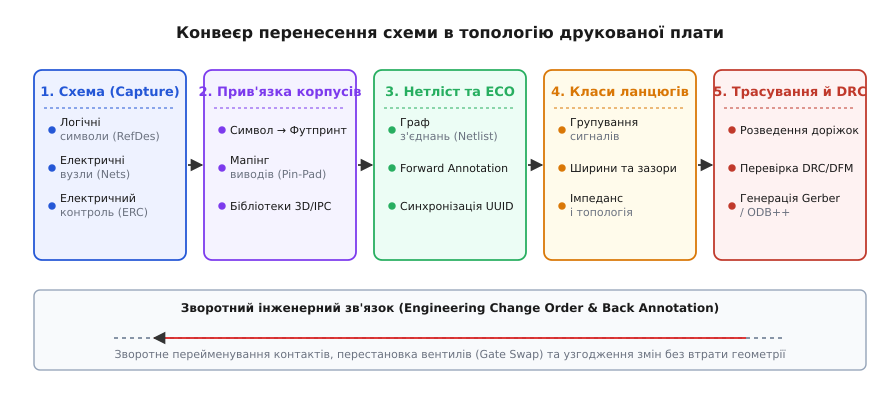
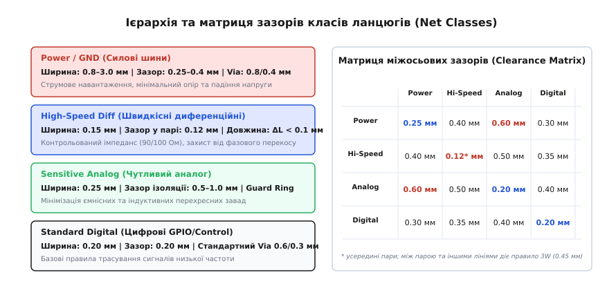

# Від схеми до плати: нетлист, футпринти, класи ланцюгів, DRC

<preknowlist>
- [Принципова схема](root:hw-pcb/schematic-purpose) — графічне представлення електричних зв'язків та логіки схеми.
- [Вузли й з'єднання](root:hw-pcb/nodes-connections) — поняття електричного вузла, точки потенціалу та топологічної еквівалентності.
- [Друкована плата (PCB layout)](root:hw-pcb/pcb-layout) — перетворення теоретичного кола у фізичну геометрію міді та діелектрика.
- [Посадкові місця (footprint)](root:hw-pcb/footprint-design) — геометричний інтерфейс монтажу корпусів компонентів на контактні площадки.
</preknowlist>

Коли принципова електрична схема накреслена й замкнена в редакторі, вона не містить жодного міліметра простору. На схемі з'єднання між виводом мікроконтролера та затвором силового польового транзистора — це невагома лінія нульового опору, яка миттєво передає електричний потенціал. Проте спроба виготовити друковану плату безпосередньо за цим графічним малюнком призводить до фізичного глухого кута: виробничий верстат не знає, чи є транзистор крихітним безвивідним корпусом DFN розміром `2 × 2` мм, чи масивним TO-220 з тепловідводом, чи здатна мідна доріжка пропустити імпульс струму 15 А без теплового руйнування, і на якій відстані високовольтна шина повинна оминати чутливу лінію аналого-цифрового перетворювача.

Щоб абстрактний граф електричних зв'язків перетворився на фізичний виріб із міді, склотекстоліту та припою, система автоматизованого проектування (англ. *Electronic Design Automation*, EDA) здійснює серію суворих формальних перетворень. Центральними ланками цього конвеєра виступають перелік з'єднань (нетліст), прив'язка логічних контактів до фізичних посадкових місць, групування ланцюгів за класами з призначенням просторових обмежень та безперервний геометричний контроль правил проектування.


*Конвеєр перенесення схеми в топологію друкованої плати: від логічних символів та електричних вузлів крізь генерацію нетліста й прив'язку футпринтів до призначення класів ланцюгів, трасування і фінальної верифікації DRC.*

## Чому схема не є платою: розрив між логічним графом і фізичним простором

Принципова електрична схема — це суто математичний граф, де вершинами є виводи компонентів, а ребрами — еквіпотенційні електричні вузли (англ. *nets*). У цьому графі діють закони Кірхгофа для кіл із зосередженими параметрами, але повністю відсутні закони електродинаміки Максвелла та просторова метрика реального тривимірного світу.

У фізичній реальності друкованої плати будь-яка ділянка провідника володіє розподіленим активним опором, паразитною індуктивністю та взаємною ємністю до сусідніх провідників і опорних площин. Перехід від схеми до топології вимагає вирішення кількох фундаментальних проблем несумісності між логічною та просторовою моделями:

### 1. Відсутність геометричних габаритів та координат у символах

Символ резистора на схемі виглядає однаково незалежно від того, чи відповідає він ультракомпактному SMD-компоненту типорозміру 0201 (довжина 0.6 мм, ширина 0.3 мм, допустима потужність розсіювання 0.05 Вт), чи масивному цементному дротяному резистору на 10 Вт (довжина 50 мм, діаметр 10 мм). Схема фіксує лише номінал, допуск та функціональний зв'язок між вузлами. 

Топологічний редактор плати, навпаки, вимагає абсолютно точних декартових координат `(X, Y)` для кожної контактної площадки, форми паяльного вікна, радіуса заокруглення кутів, товщини шару паяльної пасти, висоти компонента для перевірки механічних колізій із корпусом та контуру шовкографії.

### 2. Неоднозначність нумерації виводів (Pin-to-Pad Mapping)

Логічний символ на схемі оптимізовано для сприйняття людиною: входи малюють ліворуч, виходи — праворуч, живлення — зверху, землю — знизу. Логічний вивід операційного підсилювача «неінвертуючий вхід» позначається знаком `+`, але у фізичному 8-вивідному корпусі SOIC-8 він жорстко прив'язаний до виводу номер 3, а у здвоєному підсилювачі — до виводу 3 (для каналу A) або виводу 5 (для каналу B).

Для багатосекційних мікросхем (наприклад, логіки 74HC00, що містить чотири окремі елементи 2І-НЕ) схема відображає чотири незалежні вентилі, розподілені по різних функціональних аркушах проекту, але на платі всі вони мусять бути фізично зведені в один спільний корпус із 14 або 16 виводами. Крім того, мікросхема має приховані виводи живлення (наприклад, `VCC` на виводі 14 і `GND` на виводі 7), які на логічній схемі часто не малюються біля кожного логічного вентиля, а виносяться в окремий блок живлення.

### 3. Електродинамічна неоднорідність середовища

На схемі лінія силового живлення `+12V`, за якою тече струм 5 А, і лінія підключення високоомного датчика температури з амплітудою сигналу 2 мВ кресляться однаковими тонкими лініями. Проте на платі провідник — це довга лінія передачі. 

Швидкість поширення електромагнітної хвилі у діелектрику FR4 (відносна діелектрична проникність `ε_r ≈ 4.2 – 4.5`) становить приблизно половину швидкості світла у вакуумі:

```
v = c / √(ε_r)
= 3·10⁸ / √(4.3)
≈ 3·10⁸ / 2.0736
≈ 1.447·10⁸ м/с = 144.7 мм/нс
```

Звідси час затримки поширення сигналу становить:

```
t_pd = 1 / v
= 1 / 144.7
≈ 0.00691 нс/мм = 6.91 пс/мм
```

Якщо час наростання фронту цифрового сигналу `t_r` становить `1 нс` (типово для сучасної логіки CMOS), то критична довжина лінії, за якої провідник перестає бути простим дротом і перетворюється на довгу лінію з хвильовими процесами та відбиттями, обчислюється за правилом:

```
l_crit = t_r / (2 · t_pd)
= 1 / (2 · 0.00691)
≈ 1 / 0.01382
≈ 72.35 мм
```

Якщо довжина доріжки перевищує 72 мм, будь-яке неузгодження імпедансу породить відбиті хвилі, що спотворять логічні рівні. На схемі цієї критичної довжини немає; вона з'являється виключно в момент фізичного розміщення компонентів і трасування міді.

### 4. Фізичні інтерфейси монтажу та стандарти посадкових місць (IPC-7351)

Будь-який електронний компонент взаємодіє з друкованою платою через контактні площадки. Стандарт IPC-7351 регламентує три рівні щільності розміщення посадкових місць:
* **Рівень щільності A (Most Material Condition — Maximum):** максимальні розміри площадок, призначені для військової, аерокосмічної техніки та умов із високою вібрацією, де потрібен масивний галтельний шов припою;
* **Рівень щільності B (Nominal Material Condition — Median):** стандартний рівень для більшості промислових і споживчих приладів, що забезпечує баланс між щільністю монтажу та надійністю пайки;
* **Рівень щільності C (Least Material Condition — Minimum):** мінімальні контактні площадки для портативних пристроїв високої щільності (смартфони, модулі зв'язку), де критичний кожен квадратний міліметр площі плати.

Крім сигнальних виводів, сучасні мікросхеми містять великі металеві пластини на череві корпусу — теплові площадки (англ. *Exposed Thermal Pad / EP*). На схемі вони можуть позначатися як звичайний вивід землі, але на платі вимагають масиву металізованих перехідних отворів (англ. *thermal via array*) для відведення тепла на внутрішні шари та розбивки паяльної пасти на матрицю дрібних вікон (англ. *stencil windowing*), щоб киплячий флюс під час оплавлення не підняв мікросхему над платою.

Для корпусів типу BGA (Ball Grid Array) важливим є вибір типу контактних площадок:
* **SMD (Solder Mask Defined):** розмір площадки обмежений вікном паяльної маски, яка заходить на краї міді. Має високу механічну міцність, але меншу площу паяння.
* **NSMD (Non-Solder Mask Defined):** мідна площадка повністю відкрита, а маска відступає навколо неї. Це забезпечує точнішу геометрію міді під час травлення та дозволяє припою охоплювати бічні стінки площадки, що суттєво підвищує стійкість до циклічних теплових напружень.

> 🔧 **Навіщо це.** Без суворого транслятора схеми в топологію неможливо створити надійний пристрій. Спроба проектувати плату шляхом ручного малювання доріжок без нетліста гарантовано призводить до переплутаних дзеркальних виводів мікросхем, закорочених полігонів живлення або розірваних контурів зворотного струму землі, які виявляються лише після виготовлення та монтажу дорогої серії плат.

## Анатомія та структура нетліста (Netlist)

**Нетліст** (англ. *netlist*, від *network list* — список мережі) є головним формальним мостом між принциповою схемою та топологічним редактором друкованої плати. Це текстовий або бінарний файл бази даних, який описує повний перелік фізичних компонентів та топологічний граф з'єднань між їхніми виводами.

### Структурні компоненти бази даних нетліста

Будь-який стандартний нетліст містить три рівні ієрархії:

1. **Компоненти (Components / Instances):**
   * *Reference Designator (RefDes):* позиційне позначення (`R1`, `C15`, `U3`, `Q2`), яке слугує ключем для людини та складальних автоматів.
   * *Value / Part Number:* номінал деталі або унікальний артикул виробника (`10k 1% 0603`, `STM32G474RET6`, `TPS62130RGTR`).
   * *Footprint (Посадкове місце):* повна назва бібліотечного посадкового місця, що визначає фізичну геометрію контактних площадок (`Resistor_SMD:R_0603_1608Metric`, `Package_DFN_QFN:QFN-16-1EP_3x3mm_P0.5mm_EP1.8x1.8mm`).
   * *Instance UUID:* унікальний 128-бітний ідентифікатор екземпляра в базі даних EDA, який гарантує незмінність прив'язки при зміні імені `RefDes`.
   * *Атрибути монтажу:* прапорці `DNP` (Do Not Populate — не монтувати), допуски, класи точності та посилання на 3D-моделі STEP.

2. **Електричні ланцюги (Nets):**
   * Кожен ланцюг має системний код (індекс) та символьне ім'я.
   * *Іменовані ланцюги (User Nets):* отримують назву від міток на схемі (`+3V3`, `GND`, `I2C1_SDA`, `MOTOR_PWM_A`).
   * *Автогенеровані ланцюги (Unnamed / Auto Nets):* отримують системний префікс для ліній, які з'єднують деталі без явних міток (наприклад, `Net-(R4-Pad2)` або `N$00412`).

3. **Вузли з'єднання (Nodes / Pin References):**
   * Список конкретних виводів компонентів, об'єднаних у кожен ланцюг. Кожен вузол описується кортежем `(RefDes, PinNumber, PinType)`.
   * *Електричний тип виводу (Pin Type):* `power_in`, `power_out`, `input`, `output`, `bidirectional`, `passive`, `open_collector`, `tri_state`, `unspecified`. Типи виводів використовуються під час перевірки електричних правил (ERC — Electrical Rules Check), щоб не допустити прямого з'єднання двох виходів типу `output` між собою.

### Ієрархічні схеми, векторні шини та віртуальні з'єднувачі (Net Ties)

У великих проектах схема будується ієрархічно: окремі функціональні модулі (живлення, мікроконтролер, аналоговий інтерфейс, радіотракт) виносяться на підлеглі аркуші (англ. *hierarchical sheets*). 

Зв'язок між аркушами здійснюється трьома способами:
1. **Глобальні мітки (Global Labels):** ланцюг з одним іменем (наприклад `VCC`, `GND`) автоматично об'єднується на всіх аркушах проекту;
2. **Ієрархічні порти (Hierarchical Pins & Labels):** передача сигналів між батьківським аркушем і вкладеним модулем за принципом виклику функції з іменованими аргументами;
3. **Векторні шини (Buses):** об'єднання групи споріднених сигналів у єдиний товстий дріт на схемі (наприклад, шина адрес `ADDR[15..0]` або складена шина інтерфейсу `SPI_BUS = {MOSI, MISO, SCK, CS_N}`). Генератор нетліста автоматично розгортає шину у плоский набір незалежних ланцюгів `ADDR0`, `ADDR1`, ..., `ADDR15`.

Особливою топологічною задачею є **зіркове розділення земель**. Якщо на схемі аналогова земля `AGND` та цифрова земля `DGND` повинні мати спільний потенціал, але з'єднуватися суворо в одній точці біля виводу джерела живлення, їх не можна просто замкнути лінією на схемі — інакше генератор нетліста об'єднає їх в один ланцюг і автотрасувальник або інженер замкне їх по всій площі плати. 

Для цього застосовують **віртуальний з'єднувач ланцюгів** (англ. *Net Tie*). На схемі Net Tie позначається як перемичка між двома різними ланцюгами, а на платі йому відповідає футпринт із двох площадок, з'єднаних невеликим шматочком міді без паяльної маски. Для системи DRC такий елемент є винятком із правил короткого замикання, що дозволяє ізолювати ланцюги на схемі та контролювати фізичну точку їхнього фізичного злиття на міді.

### Формати та синтаксис нетлістів

У промисловості використовують кілька загальноприйнятих стандартів запису нетлістів:

* **KiCad S-expression (`.net`):** сучасний формат на базі Lisp-подібних дужкових структур, що легко піддається синтаксичному аналізу, версіонуванню в Git та ручному аудиту.
* **Telesis / Protel Netlist:** класичний блочний текстовий формат, розроблений у 1980-х роках, де секції деталей позначені заголовками `[comp]`, а ланцюги — блоками `(net)`.
* **IPC-D-356:** стандартизований виробничий нетліст тестування друкованих плат. На відміну від схемотехнічного нетліста, IPC-D-356 містить точні координати центрів контактних площадок на платі `(X, Y)`, розміри отворів, позначення шарів (`TOP`, `BOTTOM`, `MID1`) та статус доступу для щупів тестера. За цим файлом завод перевіряє виготовлену плату на стенді з рухомими зондами (англ. *flying probe tester*) на відсутність мікрообривів і замикань ще до монтажу компонентів.

Нижче наведено репрезентативний фрагмент опису схеми джерела опорної напруги у форматі KiCad S-expression:

```lisp
(export (version "E")
  (design
    (source "/projects/sensor_node/power_stage.kicad_sch")
    (date "2026-08-28"))
  (components
    (comp (ref "C1")
      (value "10uF 25V X7R")
      (footprint "Capacitor_SMD:C_0805_2012Metric")
      (tstamp "7b89f2a0-410a-48d1-bc91-23a45c000001"))
    (comp (ref "U1")
      (value "REF3030AIDBZR")
      (footprint "Package_TO_SOT_SMD:SOT-23-3")
      (tstamp "7b89f2a0-410a-48d1-bc91-23a45c000002"))
    (comp (ref "C2")
      (value "100nF 16V X7R")
      (footprint "Capacitor_SMD:C_0402_1005Metric")
      (tstamp "7b89f2a0-410a-48d1-bc91-23a45c000003")))
  (nets
    (net (code "1") (name "+5V_IN")
      (node (ref "C1") (pin "1") (pintype "passive"))
      (node (ref "U1") (pin "1") (pintype "power_in")))
    (net (code "2") (name "VREF_3V0")
      (node (ref "U1") (pin "2") (pintype "power_out"))
      (node (ref "C2") (pin "1") (pintype "passive")))
    (net (code "3") (name "GND")
      (node (ref "C1") (pin "2") (pintype "passive"))
      (node (ref "U1") (pin "3") (pintype "power_in"))
      (node (ref "C2") (pin "2") (pintype "passive")))))
```

Для обробки структури нетліста в пам'яті EDA-інструменти використовують зв'язні графічні структури. Розглянемо модель зберігання та пошуку зв'язків між контактами та ланцюгами на мовах C та C++.

:::tabs
```c
#include <stdio.h>
#include <stdlib.h>
#include <string.h>

#define MAX_IDENT_LEN 64

typedef struct PinNode {
    char refdes[MAX_IDENT_LEN];
    char pin_number[MAX_IDENT_LEN];
    char pin_type[MAX_IDENT_LEN];
    struct PinNode* next;
} PinNode;

typedef struct NetEntry {
    char name[MAX_IDENT_LEN];
    int code;
    size_t pin_count;
    PinNode* pins;
    struct NetEntry* next;
} NetEntry;

typedef struct NetlistGraph {
    NetEntry* head_net;
    size_t total_nets;
} NetlistGraph;

NetlistGraph* netlist_graph_create(void) {
    NetlistGraph* g = (NetlistGraph*)malloc(sizeof(NetlistGraph));
    if (!g) return NULL;
    g->head_net = NULL;
    g->total_nets = 0;
    return g;
}

int netlist_graph_add_pin(NetlistGraph* g, const char* net_name,
                          const char* refdes, const char* pin, const char* pintype) {
    if (!g || !net_name || !refdes || !pin) return 0;

    NetEntry* curr = g->head_net;
    while (curr) {
        if (strcmp(curr->name, net_name) == 0) break;
        curr = curr->next;
    }

    if (!curr) {
        curr = (NetEntry*)malloc(sizeof(NetEntry));
        if (!curr) return 0;
        strncpy(curr->name, net_name, MAX_IDENT_LEN - 1);
        curr->name[MAX_IDENT_LEN - 1] = '\0';
        curr->code = (int)(g->total_nets + 1);
        curr->pin_count = 0;
        curr->pins = NULL;
        curr->next = g->head_net;
        g->head_net = curr;
        g->total_nets++;
    }

    PinNode* p = (PinNode*)malloc(sizeof(PinNode));
    if (!p) return 0;
    strncpy(p->refdes, refdes, MAX_IDENT_LEN - 1);
    p->refdes[MAX_IDENT_LEN - 1] = '\0';
    strncpy(p->pin_number, pin, MAX_IDENT_LEN - 1);
    p->pin_number[MAX_IDENT_LEN - 1] = '\0';
    strncpy(p->pin_type, pintype ? pintype : "passive", MAX_IDENT_LEN - 1);
    p->pin_type[MAX_IDENT_LEN - 1] = '\0';

    p->next = curr->pins;
    curr->pins = p;
    curr->pin_count++;
    return 1;
}

void netlist_graph_destroy(NetlistGraph* g) {
    if (!g) return;
    NetEntry* n = g->head_net;
    while (n) {
        NetEntry* next_n = n->next;
        PinNode* p = n->pins;
        while (p) {
            PinNode* next_p = p->next;
            free(p);
            p = next_p;
        }
        free(n);
        n = next_n;
    }
    free(g);
}
```
```cpp
#include <iostream>
#include <string>
#include <string_view>
#include <vector>
#include <unordered_map>
#include <memory>
#include <optional>

namespace eda {

struct PinNode {
    std::string refdes;
    std::string pin_number;
    std::string pin_type;
};

struct NetEntry {
    std::string name;
    int code{0};
    std::vector<PinNode> pins;
};

class NetlistGraph {
public:
    bool add_pin(std::string_view net_name, std::string_view refdes,
                 std::string_view pin, std::string_view pintype = "passive") {
        auto& net = nets_[std::string(net_name)];
        if (net.name.empty()) {
            net.name = std::string(net_name);
            net.code = static_cast<int>(nets_.size());
        }
        net.pins.push_back(PinNode{std::string(refdes), std::string(pin), std::string(pintype)});
        return true;
    }

    [[nodiscard]] std::optional<std::reference_wrapper<const NetEntry>>
    find_net(std::string_view net_name) const noexcept {
        auto it = nets_.find(std::string(net_name));
        if (it != nets_.end()) {
            return std::cref(it->second);
        }
        return std::nullopt;
    }

    [[nodiscard]] const std::unordered_map<std::string, NetEntry>& all_nets() const noexcept {
        return nets_;
    }

    [[nodiscard]] std::size_t total_nets() const noexcept {
        return nets_.size();
    }

private:
    std::unordered_map<std::string, NetEntry> nets_;
};

} // namespace eda
```
:::

## Пряма анотація та інженерні зміни (ECO — Engineering Change Order)

Розробка друкованої плати — це ітераційний процес. Інженер ніколи не створює ідеальну схему з першого разу: у процесі трасування виникає потреба додати фільтрувальні конденсатори, змінити тип корпусу транзистора на менший або перепризначити піни мікроконтролера для розплутування перехрещених сигнальних доріжок.

### Механізм Forward Annotation

Пряма анотація (англ. *Forward Annotation*) — це трансляція змін із принципової схеми в топологію плати. Коли інженер оновлює плату за схемою, EDA-система виконує диференціальне порівняння двох станів бази даних (граф схеми проти графа плати) і формує пакет транзакцій — **повідомлення про інженерні зміни** (англ. *Engineering Change Order*, ECO).

Повний цикл виконання ECO складається з таких обов'язкових кроків:

1. **Матчинг екземплярів за ідентифікаторами (UUID Tracking):**
   У сучасних системах зв'язок між деталями на схемі та на платі підтримується не за текстовим позначенням `RefDes`, а за унікальними 128-бітними UUID. Якщо інженер перенумерує всі резистори схеми (`R1 -> R101`, `R2 -> R102`), процедура ECO оновить текст шовкографії на платі, але не видалить жодної вже прокладеної мідної доріжки та збереже координати розміщення.
2. **Диференційний аналіз зв'язків (Netlist Diffing):**
   Система класифікує зміни на чотири типи дій:
   * `ADD COMPONENT / ADD NET`: додавання нових деталей або ланцюгів;
   * `DELETE COMPONENT / DELETE NET`: видалення деталей, знятих зі схеми;
   * `CHANGE FOOTPRINT`: заміна геометрії посадкового місця зі збереженням зв'язків;
   * `RECONNECT PIN`: перепідключення виводу від старого ланцюга до нового.
3. **Збереження цілісності виконаного трасування:**
   Якщо при зміні схеми ланцюг було видалено, прив'язані до нього мідні доріжки не видаляються миттєво, а переводяться в статус «неприв'язаної міді» (англ. *unassigned copper*), або позначаються помилкою DRC як короткозамкнені ділянки, дозволяючи інженеру свідомо перетрасувати або перепризначити їх.
4. **Оновлення нерозведених зв'язків (Ratsnest / Airwires):**
   Для всіх нових або змінених вузлів система перераховує мінімальне кістякове дерево (англ. *Minimum Spanning Tree*, MST) і малює тонкі напрямні лінії («гумові нитки»), що показують найкоротші відстані між нез'єднаними контактними площадками.

### Зворотна анотація (Back Annotation), Pin Swap та Gate Swap

Під час трасування багатовивідних цифрових мікросхем (FPGA, мікроконтролерів у корпусах LQFP-144 або BGA-256) пряме підключення ліній шин часто створює складний «вузол» із перехрещених доріжок, що вимагає переходу на 4–6 шарів металізації.

Якщо виводи мікросхеми є універсальними (наприклад, лінії GPIO або входи перепрограмованої логіки FPGA), інженер може виконати оптимізацію безпосередньо на платі:

* **Pin Swap (Перестановка виводів):** обмін ліній сигналів між двома сусідніми фізичними ніжками одного порту мікроконтролера (наприклад, поміняти місцями `PA0` та `PA1`).
* **Gate Swap (Перестановка логічних вентилів):** обмін незалежних функціональних секцій усередині одного корпусу або між однаковими корпусами (наприклад, використання вільного інвертора з мікросхеми `U2` замість перевантаженого вузла біля `U1`).

Після завершення топологічної оптимізації запускається процес **зворотної анотації** (англ. *Back Annotation*). Система зчитує змінену конфігурацію зв'язків із плати й автоматично вносить виправлення в аркуші принципової схеми. Це гарантує повну синхронізацію: принципова схема завжди залишається точною документацією фактично реалізованого заліза.

Нижче наведено алгоритм диференціального порівняння двох версій списків виводів ланцюга для генерації директив ECO.

:::tabs
```c
#include <stdio.h>
#include <stdlib.h>
#include <string.h>

typedef enum {
    ECO_NO_CHANGE,
    ECO_NET_CREATED,
    ECO_NET_DELETED,
    ECO_PINS_MODIFIED
} EcoStatus;

typedef struct EcoDiffResult {
    char net_name[64];
    EcoStatus status;
    int added_pins_count;
    int removed_pins_count;
} EcoDiffResult;

static int string_in_array(const char* target, const char* const* arr, int size) {
    for (int i = 0; i < size; ++i) {
        if (strcmp(target, arr[i]) == 0) return 1;
    }
    return 0;
}

EcoDiffResult compute_eco_diff(const char* net_name,
                               const char* const* old_pins, int old_count,
                               const char* const* new_pins, int new_count) {
    EcoDiffResult res;
    strncpy(res.net_name, net_name, 63);
    res.net_name[63] = '\0';
    res.added_pins_count = 0;
    res.removed_pins_count = 0;

    if (old_count == 0 && new_count > 0) {
        res.status = ECO_NET_CREATED;
        res.added_pins_count = new_count;
        return res;
    }
    if (old_count > 0 && new_count == 0) {
        res.status = ECO_NET_DELETED;
        res.removed_pins_count = old_count;
        return res;
    }

    for (int i = 0; i < new_count; ++i) {
        if (!string_in_array(new_pins[i], old_pins, old_count)) {
            res.added_pins_count++;
        }
    }
    for (int i = 0; i < old_count; ++i) {
        if (!string_in_array(old_pins[i], new_pins, new_count)) {
            res.removed_pins_count++;
        }
    }

    if (res.added_pins_count == 0 && res.removed_pins_count == 0) {
        res.status = ECO_NO_CHANGE;
    } else {
        res.status = ECO_PINS_MODIFIED;
    }
    return res;
}
```
```cpp
#include <iostream>
#include <string>
#include <string_view>
#include <vector>
#include <unordered_set>
#include <format>

namespace eda {

enum class EcoStatus {
    NoChange,
    NetCreated,
    NetDeleted,
    PinsModified
};

struct EcoDiffResult {
    std::string net_name;
    EcoStatus status{EcoStatus::NoChange};
    std::size_t added_pins_count{0};
    std::size_t removed_pins_count{0};
};

class EcoEngine {
public:
    static EcoDiffResult compute_diff(std::string_view net_name,
                                      const std::vector<std::string>& old_pins,
                                      const std::vector<std::string>& new_pins) {
        EcoDiffResult result{std::string(net_name)};

        if (old_pins.empty() && !new_pins.empty()) {
            result.status = EcoStatus::NetCreated;
            result.added_pins_count = new_pins.size();
            return result;
        }
        if (!old_pins.empty() && new_pins.empty()) {
            result.status = EcoStatus::NetDeleted;
            result.removed_pins_count = old_pins.size();
            return result;
        }

        std::unordered_set<std::string_view> old_set(old_pins.begin(), old_pins.end());
        std::unordered_set<std::string_view> new_set(new_pins.begin(), new_pins.end());

        for (const auto& pin : new_pins) {
            if (!old_set.contains(pin)) {
                result.added_pins_count++;
            }
        }
        for (const auto& pin : old_pins) {
            if (!new_set.contains(pin)) {
                result.removed_pins_count++;
            }
        }

        if (result.added_pins_count == 0 && result.removed_pins_count == 0) {
            result.status = EcoStatus::NoChange;
        } else {
            result.status = EcoStatus::PinsModified;
        }
        return result;
    }
};

} // namespace eda
```
:::

## Класи ланцюгів (Net Classes): мова фізичних обмежень

Якщо імпортувати схему на плату без явного визначення правил, система автоматично застосує до всіх провідників єдиний базовий шаблон правил (Default Net Class): наприклад, ширину доріжки `0.20 мм` та зазор `0.20 мм`. 

Для простих цифрових сигналів низької частоти це допустимо. Проте в будь-якому реальному пристрої такий підхід гарантовано призведе до катастрофічних наслідків:

* Силова лінія живлення з шириною 0.20 мм перегріється на 60°C і створить неприпустиме омічне падіння напруги на навантаженні;
* Диференційна лінія USB 2.0 High-Speed з випадковим зазором отримає неконтрольований хвильовий опір, що викличе спотворення очного графіка та зрив зв'язку;
* Аналоговий сигнал датчика положення з амплітудою 5 мВ підхопить комутаційні завади від сусіднього ШІМ-сигналу через паразитну мікроємність між паралельними трасами.

Щоб запобігти цим дефектам, у проекті визначають **класи ланцюгів** (англ. *Net Classes*) — логічні сукупності провідників, що мають спільну фізичну природу та підпорядковуються єдиному набору топологічних обмежень.


*Ієрархія та матриця зазорів класів ланцюгів (Net Classes): геометричні профілі основних типів сигналів і таблиця міжосьових зазорів для виключення взаємних перешкод.*

### Фізичний зміст та параметри основних класів ланцюгів

#### 1. Клас силового живлення та землі (Power / Ground)

* **Фізична мета:** доставка великих струмів із мінімальним активним опором `R`, мінімальним індуктивним викидом `L · dI/dt` та обмеженим тепловим нагрівом.
* **Ширина провідників:** від `0.8 мм` до `3.0 мм` для виділених доріжок, або виконання у вигляді суцільних полігонів (англ. *copper pour*).
* **Розрахунок за стандартом IPC-2152:**
  Струмонесуча здатність зовнішньої мідної доріжки товщиною 1 oz (35 мкм) розраховується з урахуванням допустимого перегріву `ΔT = 10°C`:
  
  Доріжка завширшки `1.0 мм` при товщині `35 мкм` має площу перерізу приблизно `54.2 mils²`. Розрахунковий струм становить:
  ```
  I = 0.048 · (ΔT)⁰·⁴⁴ · A⁰·⁷²⁵         [формула стандарту IPC-2152 для зовнішніх шарів]
    = 0.048 · (10)⁰·⁴⁴ · (54.2)⁰·⁷²⁵    [підстановка перегріву ΔT = 10°C та площі A = 54.2 mils²]
    = 0.048 · 2.754 · 18.06             [обчислення проміжних степенів]
    ≈ 2.39 А                            [допустимий струм навантаження]
  ```
  При струмі 2.4 А доріжка шириною 1 мм нагріється рівно на 10°C вище температури навколишнього середовища.
* **Геометрія перехідних отворів (Via):** збільшений діаметр отвору (свердло `0.4 – 0.5 мм`, мідний поясок `0.8 – 1.0 мм`). При струмах понад 1.5 А використовують масиви з 2–4 паралельних отворів для зниження паразитної індуктивності та опору.

#### 2. Клас швидкісних диференційних сигналів (High-Speed Differential)

* **Фізична мета:** передача сигналів гігагерцового діапазону (USB, PCIe, Ethernet, HDMI, LVDS) зі збереженням форми хвилі та пригніченням синфазного шуму.
* **Розрахунок хвильового опору мікросмужка (Microstrip):**
  Хвильовий опір одиночного провідника шириною `w` і товщиною `t` над площиною землі на висоті `h` при проникності діелектрика `ε_r` розраховується за формулою IPC-2141:
  ```
  Z_0 = (87 / √(ε_r + 1.41)) · ln((5.98 · h) / (0.8 · w + t))
  ```
  Для симетричної смужкової лінії (Stripline), розташованої всередині між двома суцільними площинами землі на відстані `b`, формула набуває вигляду:
  ```
  Z_0 = (60 / √(ε_r)) · ln((1.9 · b) / (0.8 · w + t))
  ```
  Смужкові лінії у внутрішніх шарах мають фундаментальну перевагу: вони повністю екрановані від зовнішнього випромінювання, а їхній зворотний струм протікає в однорідному діелектрику, що зводить перехресні завади дальнього кінця (FEXT) практично до нуля.
* **Контрольований диференційний імпеданс:** суворе дотримання ширини провідника `w` та відстані між ними `s` над опорною площиною землі. Для мікросмужкової диференційної лінії над FR4 товщиною діелектрика `h = 0.1 мм`:
  * Ширина доріжки: `w = 0.15 мм`;
  * Зазор у парі: `s = 0.12 мм`;
  * Диференційний імпеданс: `Z_diff = 90 Ом ± 10%` (для USB).
* **Вирівнювання довжин (Length Matching / Skew Control):** різниця довжин між прямим `D+` та інверсним `D-` провідниками не повинна перевищувати `ΔL < 0.10 – 0.15 мм`. Фазовий розсинхрон перетворює диференційний сигнал на синфазний, викликаючи різке електромагнітне випромінювання (EMI).
* **Правило 3W:** для запобігання наведенню завад від інших ліній відстань від диференційної пари до будь-якої сусідньої сторонньої траси повинна бути не меншою за три ширини провідника:
  ```
  Clearance_to_other >= 3 · w = 3 · 0.15 мм = 0.45 мм
  ```

#### 3. Клас швидкісної паралельної пам'яті (DDR3 / DDR4 / LPDDR)

* **Фізична мета:** одночасна передача десятків паралельних ліній даних (DQ) і стробів (DQS) на швидкостях до 3200 Мбіт/с.
* **Топологія Fly-By:** замість деревоподібного T-розгалуження лінії адрес і команд (ADDR/CMD/CLK) прокладаються послідовним ланцюжком від процесора через усі мікросхеми пам'яті з кінцевим узгоджувальним термінатором (англ. *On-Die Termination / VTT Termination*), що повністю усуває паразитні відгалуження (stubs).
* **Байтове групування (Byte Lane Matching):** всі 8 ліній даних байта (`DQ0..DQ7`), маска даних (`DM`) та диференційний строб (`DQS_P/DQS_N`) вирівнюються за довжиною з допуском `ΔL < 0.05 мм` (`Δt < 0.5 пс`), тоді як між різними байтовими групами допускається більший розсинхрон, що компенсується вбудованим калібруванням контролера пам'яті (англ. *Write Leveling*).

#### 4. Клас чутливих аналогових ланцюгів (Sensitive Analog)

* **Фізична мета:** захист сигналів мікровольтового діапазону (входи операційних підсилювачів, датчики мостового типу, лінії опорної напруги ADC) від ємнісного та індуктивного проникнення цифрового шуму.
* **Правила ізоляції:** збільшений зазор до всіх цифрових і силових ланцюгів (`0.50 – 1.00 мм`).
* **Охоронні кільця (Guard Rings):** прокладання навколо сигнальної контактної площадки замкненого провідника землі або буферизованого потенціалу екранування, що перехоплює струми поверхневого витоку діелектрика плати.
* **Цілісність опорної площини:** повна заборона трасування над будь-якими розрізами або щілинами в шарі землі.

#### 5. Клас радіочастотних трас (RF / Microwave)

* **Фізична мета:** передача сигналів на частотах 2.4 ГГц, 5.8 ГГц (антени Wi-Fi, Bluetooth, LoRa) без втрат енергії та відбиттів.
* **Копланарний хвилевід із заземленням (CPWG):** центральна сигнальна смужка шириною `w = 0.40 мм` відокремлена від верхньої бічної землі зазором `s = 0.25 мм` при висоті до внутрішнього шару землі `h = 0.20 мм`, що забезпечує хвильовий опір `Z_0 = 50 Ом`.
* **Захисний паркан з отворів (Via Fence):** масив заземлювальних отворів вздовж траси з кроком між отворами `p <= λ / 10`. На частоті 2.4 ГГц довжина хвилі у FR4 становить `λ ≈ 60 мм`, отже крок отворів не повинен перевищувати `6 мм` (на практиці обирають `1.5 – 2.0 мм`).

#### 6. Клас стандартних цифрових сигналів (Standard Digital / GPIO)

* **Фізична мета:** щільне трасування великої кількості керуючих ліній та низькошвидкісних шин (UART, I2C, світлодіоди, кнопки).
* **Параметри:** базова ширина `0.20 мм`, технологічний зазор `0.20 мм`, стандартний перехідний отвір `0.3 / 0.6 мм`.
* **Локальне звуження трас (Neck-Down):** дозвіл на локальне звуження провідника до `0.12 – 0.15 мм` виключно під час виходу з щільних матриць контактів BGA або дрібнокрокових роз'ємів на довжині не більше `3 – 5 мм`.

### Нерозривність зворотного шляху струму та перехресні завади

Головна помилка при трасуванні швидкісних сигналів — ігнорування зворотного струму. Змінний струм високої частоти завжди повертається джерелу найкоротшим індуктивним шляхом — тонкою смужкою безпосередньо в опорній площині під сигнальною доріжкою. 

Якщо доріжка перетинає щілину або розрив у шарі землі (наприклад, межу розділу аналогової та цифрової землі), зворотний струм не може перестрибнути повітряний зазор. Він змушений огинати щілину по контуру. 

Це призводить до різкого роздування площі струмової петлі:
* Індуктивність петлі зростає з `1 нГн/мм` до `20 – 50 нГн`;
* Зростає імпеданс лінії, викликаючи сильне відбиття сигналу;
* Петля перетворюється на рамкову антену, яка випромінює потужні електромагнітні завади (EMI) та спричиняє перехресні наведення на всі сусідні провідники.

У випадках, коли сигнальна доріжка переходить із верхнього шару на нижній крізь перехідний отвір, зворотний струм також повинен змінити свій опорний шар. Для цього поруч із сигнальним отвором обов'язково встановлюють **зворотний перехідний отвір землі** (англ. *Ground Return Via*), який з'єднує обидві площини землі й забезпечує мінімальну площу петлі переходу.

### Матриця перехресних зазорів між класами (Clearance Matrix)

Коли в одному проекті працюють ланцюги різних класів, простого правила «зазор класу» недостатньо. Необхідно задавати **матрицю міжосьових зазорів**, де кожна клітинка визначає допустиму дистанцію між парою різних класів:

| Клас ланцюга | Power | High-Speed | Analog | Digital | RF |
|---|---|---|---|---|---|
| **Power** | 0.25 мм | 0.40 мм | 0.60 мм | 0.30 мм | 1.00 мм |
| **High-Speed** | 0.40 мм | 0.12 мм* | 0.50 мм | 0.35 мм | 0.80 мм |
| **Analog** | 0.60 мм | 0.50 мм | 0.25 мм | 0.40 мм | 1.00 мм |
| **Digital** | 0.30 мм | 0.35 мм | 0.40 мм | 0.20 мм | 0.60 мм |
| **RF** | 1.00 мм | 0.80 мм | 1.00 мм | 0.60 мм | 0.25 мм |

*\* Примітка: зазор 0.12 мм діє виключно між провідниками всередині однієї диференційної пари; між парою та зовнішніми сигналами діє правило 3W (0.45 мм).*

Для автоматизації призначення класів ланцюгів та перевірки матриці зазорів у сучасних конвеєрах розробки використовують спеціалізовані утиліти обробки нетлістів; детальний алгоритмічний розбір та програмна реалізація такого інструменту на C та C++ наведені у вставці [парсер нетлістів та автоматичний класифікатор ланцюгів](root:hw-pcb/vid-skhemy-do-platy/proj-netlist-class-mapper.md).

## Автоматичний контроль правил проектування (DRC — Design Rule Check)

Трасування плати людиною або автоматичним трасувальником неминуче містить геометричні неточності та помилки. **Контроль правил проектування** (англ. *Design Rule Check*, DRC) — це формальна математична перевірка всієї двовимірної та тривимірної геометрії друкованої плати на відповідність електричним, технологічним і виробничим обмеженням.

DRC працює у двох режимах:
1. **Інтерактивний DRC (Online DRC):** працює в реальному часі під час руху курсора миші з доріжкою. Алгоритм будує навколо провідника «зону заборони» (англ. *clearance boundary*) і фізично зупиняє або відштовхує доріжку від сусідніх площадок іншого ланцюга за допомогою алгоритмів штовхання (англ. *Push & Shove Routing*).
2. **Пакетний DRC (Batch DRC):** запускається як фінальний комплексний аудит перед експортом виробничої документації, скануючи мільйони пар геометричних примітивів на платі.

### Просторові алгоритми та структури даних DRC

Прямий перебір пар примітивів для плати з `N = 50 000` сегментів доріжок вимагає `O(N²)` операцій порівняння, що становить 1.25 мільярда обчислень і призводить до зависання комп'ютера. 

Сучасні ядра DRC використовують алгоритми просторового індексування:
* **R-дерева (R-trees) та ієрархії обмежувальних об'ємів (BVH):** простір плати рекурсивно розбивається на прямокутні регіони (Bounding Boxes). Перевірка зазору виконується лише для тих об'єктів, чиї зовнішні рамки перетинаються або розташовані ближче за максимальний тестовий радіус. Це знижує складність пошуку колізій до `O(N · log N)`.
* **Обчислювальна геометрія багатокутників (Polygon Clipping):** точне знаходження найкоротшої євклідової відстані між довільними векторними примітивами (відрізок до відрізка, відрізок до дуги, точка до багатокутника) за алгоритмами Гілберта — Джонсона — Кірті (GJK).

### Систематична класифікація помилок DRC

#### 1. Електричні зазори (Clearance Violations)
Перевірка найкоротшої євклідової відстані між металевими елементами, що належать різним електричним ланцюгам:
* `Track-to-Track`: зазор між паралельними або перехресними доріжками;
* `Track-to-Pad`: відстань від сигнальної лінії до контактної площадки сторонньої деталі;
* `Pad-to-Pad`: зазор між виводами різних компонентів (найчастіша помилка при надто щільному розміщенні мікросхем);
* `Via-to-Track`: відстань від мідного кільця перехідного отвору до сусіднього провідника;
* `Hole-to-Copper`: відстань від краю неметалізованого кріпильного отвору до найближчого мідного провідника (щоб головка металевого гвинта не здерла захисну маску й не замкнула сигнал на корпус).

#### 2. Топологічна цілісність (Connectivity & Net Integrity)
* `Unconnected Nets / Missing Connections`: наявність нерозведених зв'язків із нетліста. Помилка фіксує наявність незамкнених ліній ratsnest. Жодна плата не може передаватися на виробництво за наявності хоча б одного нез'єднаного вузла.
* `Short Circuit (Коротке замикання)`: фізичне перекриття або дотик двох мідних примітивів, яким присвоєно різні ідентифікатори ланцюгів у нетлісті.
* `Isolated / Dead Copper (Мертва мідь)`: ділянки мідного полігону, які в процесі автоматичного заливання виявилися відрізаними іншими доріжками від свого опорного ланцюга (землі). Острівці мертвої міді діють як антени-перевипромінювачі шуму і мають бути або видалені, або підключені додатковими перехідними отворами.

#### 3. Високочастотні дефекти та аномалії ліній передачі
* `Stub Traces (Антенні відростки)`: ділянка доріжки, підключена до ланцюга лише з одного боку і незамкнена на іншому. Виникає, коли інженер перетрасував сегмент лінії, але забув видалити старе відгалуження. На високих частотах відросток довжиною кілька міліметрів створює паразитний резонанс і випромінює завади.
* `Differential Skew Violations`: перевищення ліміту різниці довжин у диференційній парі.
* `Max Length Violations`: перевищення максимальної довжини лінії, заданої правилами для забезпечення ліміту затримки поширення.
* `Meander Spacing Violations`: порушення геометрії вирівнювальних «змійок» (англ. *serpentine delay tuning*). Якщо витки змійки розташовані надто близько один до одного (зазор менше `3 · w` або висота меандру менше `3 · s`), сигнал перестрибує через витки за рахунок внутрішньої взаємної ємності, що зменшує реальну затримку і спотворює форму фронту.

Нижче наведено алгоритм обчислення відстаней між прямокутними обмежувальними рамками (Bounding Box) та виявлення порушень DRC на мовах C та C++.

:::tabs
```c
#include <stdio.h>
#include <math.h>

typedef struct {
    double x_min;
    double y_min;
    double x_max;
    double y_max;
    int net_id;
    char label[32];
} CopperPrimitive;

double primitive_distance(const CopperPrimitive* a, const CopperPrimitive* b) {
    double dx = 0.0;
    if (a->x_max < b->x_min) {
        dx = b->x_min - a->x_max;
    } else if (b->x_max < a->x_min) {
        dx = a->x_min - b->x_max;
    }

    double dy = 0.0;
    if (a->y_max < b->y_min) {
        dy = b->y_min - a->y_max;
    } else if (b->y_max < a->y_min) {
        dy = a->y_min - b->y_max;
    }

    return sqrt(dx * dx + dy * dy);
}

int evaluate_clearance_drc(const CopperPrimitive* a, const CopperPrimitive* b,
                           double required_clearance, char* log_buffer, size_t log_size) {
    if (!a || !b) return 0;
    if (a->net_id == b->net_id) return 1; // Один ланцюг — зазор дозволено

    double actual_dist = primitive_distance(a, b);
    if (actual_dist < required_clearance) {
        if (log_buffer && log_size > 0) {
            snprintf(log_buffer, log_size,
                     "DRC VIOLATION: [%s (Net %d)] and [%s (Net %d)] distance %.3f mm < required %.3f mm",
                     a->label, a->net_id, b->label, b->net_id, actual_dist, required_clearance);
        }
        return 0;
    }
    return 1;
}
```
```cpp
#include <iostream>
#include <cmath>
#include <string>
#include <string_view>
#include <vector>
#include <format>
#include <optional>

namespace eda {

struct CopperPrimitive {
    double x_min{0.0};
    double y_min{0.0};
    double x_max{0.0};
    double y_max{0.0};
    int net_id{0};
    std::string label;

    [[nodiscard]] double distance_to(const CopperPrimitive& other) const noexcept {
        double dx = 0.0;
        if (x_max < other.x_min) {
            dx = other.x_min - x_max;
        } else if (other.x_max < x_min) {
            dx = x_min - other.x_max;
        }

        double dy = 0.0;
        if (y_max < other.y_min) {
            dy = other.y_min - y_max;
        } else if (other.y_max < y_min) {
            dy = y_min - other.y_max;
        }

        return std::hypot(dx, dy);
    }
};

class DrcEngine {
public:
    static std::optional<std::string> check_pair(const CopperPrimitive& a,
                                                const CopperPrimitive& b,
                                                double min_clearance) {
        if (a.net_id == b.net_id) {
            return std::nullopt;
        }

        double actual_dist = a.distance_to(b);
        if (actual_dist < min_clearance) {
            return std::format("DRC VIOLATION: '{}' (Net {}) vs '{}' (Net {}) distance {:.3f} mm < limit {:.3f} mm",
                               a.label, a.net_id, b.label, b.net_id, actual_dist, min_clearance);
        }
        return std::nullopt;
    }
};

} // namespace eda
```
:::

## Виробничі правила фабрики (DFM — Design for Manufacturing)

Топологія, яка бездоганно пройшла електричний DRC, може виявитися технологічно непридатною для виготовлення на заводі друкованих плат. Правила проектування для виробництва (англ. *Design for Manufacturing*, DFM) враховують фізичні та хімічні допуски процесів фотолітографії, рідинного травлення міді, гальванічної металізації та механічного свердління.

### Основні виробничі обмеження та дефекти DFM

#### 1. Мінімальний мідний поясок перехідного отвору (Annular Ring)

Свердло верстата з ЧПК має механічну вібрацію та похибку позиціонування (зазвичай `±25 – 35 мкм`). Крім того, шари склотекстоліту під час гарячого пресування зазнають невеликого температурного розширення та зсуву (англ. *layer-to-layer misregistration*).

Ширина мідного пояска визначається за формулою:

```
Annular Ring = (Pad_Diameter - Drill_Diameter) / 2
```

Якщо контактна площадка має діаметр `0.55 мм`, а свердло — `0.30 мм`, номінальний поясок становить:

```
Annular Ring = (0.55 - 0.30) / 2 = 0.125 мм = 125 мкм
```

Якщо похибка свердління перевищить 125 мкм, отвір зміститься за межі мідної площадки — виникне розрив пояска (англ. *breakout*), що призведе до розриву ланцюга або руйнування металізації стінки отвору під час паяння. За стандартом IPC Class 2 мінімальний поясок після свердління повинен становити не менше `0.05 мм` у найвужчому місці.

#### 2. Аспектне співвідношення отвору (Aspect Ratio)

Аспектне співвідношення — це відношення повної товщини плати `H` до номінального діаметра отвору свердла `D`:

```
Aspect Ratio = H / D
```

Для стандартної 4-шарової плати товщиною `1.6 мм` з отвором `0.20 мм` аспектне співвідношення дорівнює `8:1`. Якщо інженер обере свердло `0.10 мм`, співвідношення підскочить до `16:1`. 

При таких екстремальних значеннях капілярний ефект не дозволяє рідинним хімічним розчинам вільно циркулювати всередині вузького тунелю під час гальванічного осадження міді. У результаті мідь на стінках у центрі плати виходить тонкою (менше 10 мкм замість стандартних 25 мкм), утворюються газові каверни та порожнечі, що викликає раптове перегорання перехідного отвору при температурних коливаннях. Стандартний ліміт доступних фабрик — не більше `8:1` або `10:1`.

#### 3. Місток паяльної маски (Solder Mask Dam / Bridge)

Паяльна маска — це захисний шар рідкого або плівкового фотополімеру, який наноситься на плату для захисту міді від окиснення та запобігання розтіканню рідкого припою під час монтажу.

Між сусідніми відкритими контактними площадками мікросхеми (наприклад, у корпусі QFP або TSSOP із кроком виводів 0.5 мм) повинна залишатися стійка смужка маски — **місток** (англ. *solder mask dam*). 
* Якщо крок виводів становить `0.50 мм`, а ширина мідної площадки — `0.30 мм`, то зазор між мідними площадками дорівнює `0.20 мм`.
* При необхідному зазорі відкриття маски `0.05 мм` з кожного боку ширина залишку зеленого фотополімеру становить:
  ```
  Mask Dam = 0.20 - (2 · 0.05) = 0.10 мм = 100 мкм
  ```
* Якщо ця смужка опуститься нижче технологічного порогу фотополімеру (`< 0.075 мм`), маска відлущиться під час проявлення (утвориться дефект *sliver*), і під час паяння рідкий припій затече в щілину між виводами, утворивши коротке замикання (англ. *solder bridge*).

#### 4. Кислотні пастки (Acid Traps)

Коли дві мідні доріжки сходяться під гострим кутом менше `90°`, поверхневий натяг утримує рідинний розчин кислотного травителя у вузькій щілині довше, ніж на відкритих ділянках плати. Під час відмивання хімікати залишаються в кутку й продовжують роз'їдати мідь (підтравлювання), викликаючи локальне витончення провідника або повний обрив лінії в процесі експлуатації.

Правило DFM вимагає трасувати всі повороти тупими кутами `135°` (зріз 45 градусів) або плавними радіусами, а місця приєднання доріжок до масивних полігонів посилювати краплеподібними переходами (англ. *teardrops*).

#### 5. Відступ міді від краю плати (Copper Pull-Back)

Після виготовлення мультиплікованої панелі плати вирізають механічною дисковою пилою (V-Scoring) або фрезерують кінцевою фрезою. Фреза має механічний допуск биття до `±0.15 – 0.20 мм`. Якщо мідний полігон землі підходить упритул до контуру плати, лезо фрези замне край мідної фольги на торець склотекстоліту, що створить електричне замикання між зовнішнім та внутрішніми шарами. Правило DFM вимагає витримувати відступ міді від контуру плати не менше `0.30 – 0.50 мм`.

#### 6. Оптичні реперні знаки (Fiducial Markers)

Сучасні роботизовані установники компонентів (англ. *Pick-and-Place Machines*) встановлюють мікросхеми BGA та пасивні чіпи 0201 зі швидкістю до 50 000 компонентів на годину. Щоб автоматично компенсувати невеликий перекіс та розтягнення плати у затискачах конвеєра, на плату наносять оптичні мітки — **фідуціали** (англ. *fiducials*).

Фідуціал є круглою мідною площадкою діаметром `1.0 мм`, оточеною круглим вікном паяльної маски діаметром `2.0 мм` без шовкографії та доріжок поруч. На платі обов'язково розміщують:
* **Глобальні фідуціали (Global Fiducials):** три мітки по кутах плати (або технологічної рамки панелі), що задають нульову точку координат і компенсують кутовий поворот плати;
* **Локальні фідуціали (Local Fiducials):** дві мітки по діагоналі біля мікросхем із дрібним кроком (BGA, QFN на 64+ виводів) для надточного позиціонування конкретної мікросхеми перед опусканням на паяльну пасту.

#### 7. Мультиплікація та депанелізація (Panelization)

У серійному виробництві окремі плати об'єднують у виробничі панелі розміром, наприклад, `200 × 300 мм`. Це дозволяє одночасно наносити паяльну пасту та монтувати десятки виробів за один цикл конвеєра.

Розділення плати після пайки виконується двома методами:
* **V-Scoring (Надрізання V-подібними дисковими фрезами):** канавки глибиною в третину товщини плати з обох боків. Вимагає абсолютно прямолінійного контуру плати. Всі компоненти та доріжки повинні мати відступ від лінії різу не менше `1.0 мм`, щоб механічне напруження при розламуванні не розкололо крихкі керамічні SMD-конденсатори.
* **Tab Routing з перфорацією («Mouse Bites»):** плату оконтурюють наскрізною фрезою шириною 2 мм, залишаючи невеликі містки (шириною 3–5 мм), пронизані рядом дрібних отворів діаметром `0.5 мм`. Після монтажу плату виламують руками або пневмокусачками. Щоб залишки відламаних зубців не виступали за габарити пристрою, лінію отворів втоплюють усередину контуру плати на `0.2 – 0.3 мм`.

#### 8. Розрахунок апертур паяльного трафарету (Stencil Design за IPC-7525)

Нанесення паяльної пасти здійснюється металевим ракелем крізь лазерно вирізані отвори в сталевому трафареті товщиною `T = 100 – 120 мкм`. Щоб паста легко виходила з апертури й залишалася на контактній площадці, а не прилипала до внутрішніх стінок трафарету, площа контакту пасти з площадкою повинна перевищувати площу тертя об стінки.

Стандарт IPC-7525 встановлює критерій коефіцієнта площі (англ. *Area Ratio*):

```
Area_Ratio = (W · L) / (2 · (W + L) · T) >= 0.66
```

де `W` — ширина апертури, `L` — довжина апертури, `T` — товщина фольги трафарету. Якщо цей коефіцієнт опускається нижче 0.66 (наприклад, для наддрібних площадок чіпів 01005 або мікросхем CSP з кроком 0.35 мм), паста застрягає в трафареті, що спричиняє дефект непропаю (англ. *insufficient solder joint*).

## Системний синтез: від задуму до бездоганного виробничого пакета

Шлях від принципової схеми до готової друкованої плати — це послідовна зміна моделей представлення інформації. На кожному кроці абстрактний електричний задум збагачується конкретними просторовими й фізичними властивостями матеріального світу.

1. **Схема:** формує логічний граф взаємодій і фіксує функціональну коректність системи за допомогою перевірки електричних правил (ERC).
2. **Нетліст та анотація:** транслюють граф у стандартизований опис бази даних, де кожному вузлу ставиться у відповідність точний набір фізичних виводів реальних корпусів, а механізм ECO на основі UUID забезпечує неперервність і стабільність ітераційних змін.
3. **Класи ланцюгів:** розбивають однорідні зв'язки схеми на спеціалізовані фізичні домени — силове живлення з розрахунком нагріву за IPC-2152, швидкісні диференційні лінії з контролем хвильового імпедансу, чутливі аналогові вузли з охоронними кільцями та радіочастотні хвилеводи.
4. **DRC та DFM:** замикають конвеєр верифікації, виступаючи строгим математичним і технологічним фільтром. Вони гарантують повну відсутність топологічних дефектів (коротких замикань, обривів, антенних відростків) та 100% сумісність геометричних примітивів із допусками заводських технологічних процесів.

Фінальним артефактом проектування виступає виробничий пакет:
* **Gerber X2 / RS-274X:** шар за шаром векторні малюнки міді, маски, шовкографії та пасти;
* **Excellon / NC Drill:** координати, діаметри та режими свердління металізованих і неметалізованих отворів;
* **IPC-D-356:** еталонний нетліст для заводського тестування плати рухомими щупами;
* **ODB++ / IPC-2581:** сучасні інтегровані контейнери, що містять повну цифрову модель виробу (шари, нетліст, компоненти, BOM-перелік, 3D-моделі) в єдиній ієрархічній структурі без ризику втрати синхронізації файлів.

Тільки повне дотримання цієї наскрізної дисципліни дозволяє інженеру отримати виробничий пакет, який без збоїв і затримок перетворюється заводом на надійний, серійний електронний пристрій.
