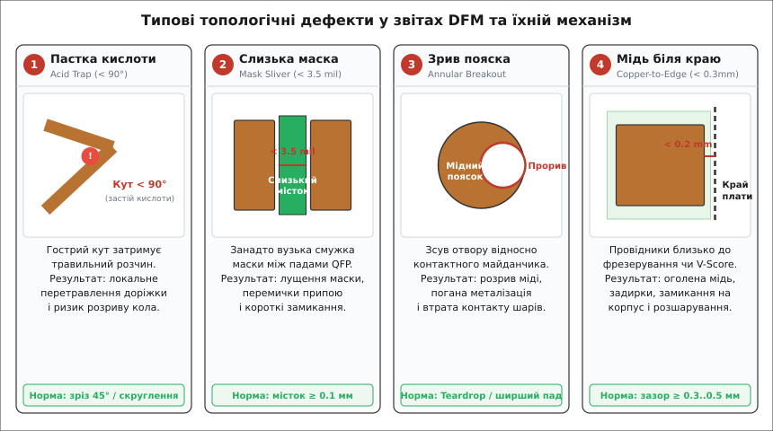
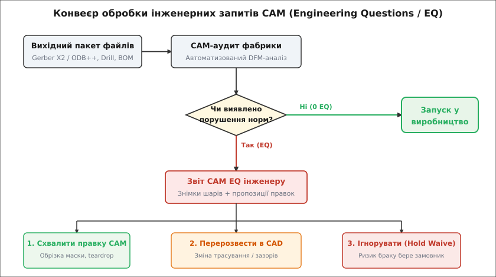

# Вибір фабрики й читання чужого DFM-звіту

<preknowlist>
- [Топологія друкованої плати](root:hw-pcb/pcb-layout) — геометрія шарів, провідників, контактних майданчиків та перехідних отворів.
- [Структура шарів друкованої плати](root:hw-pcb/pcb-stackup) — чергування мідної фольги, діелектричних препрегів та ягідного ламінату.
- [Перехідні отвори й мідні полігони під струм](root:hw-pcb/perekhidnyi-otvir-i-polihon-pid-strum) — металізація отворів, струмонесуча здатність та пояски.
- [Захисні покриття друкованої плати](root:hw-pcb/zakhysne-pokryttia-platy) — паяльна маска, фінішні металеві покриття HASL, ENIG, OSP.
- [Мінімальна пайка](root:hw-pcb/basic-soldering) — формування паяльних галтелей, змочуваність та дефекти містків припою.
- [Перелік компонентів (BOM)](root:hw-pcb/bom) — зв'язок позиційних позначень, корпусів і виробничих специфікацій.
</preknowlist>

Коли розробник завершує трасування друкованої плати в САПР (Altium Designer, KiCad чи Cadence Allegro) і натискає кнопку експорту виробничих файлів Gerber або ODB++, файли потрапляють не відразу на верстати з числовим програмним керуванням (ЧПК), а до відділу комп'ютерної підготовки виробництва (англ. *Computer-Aided Manufacturing*, CAM) заводу-виробника. За кілька годин інженер отримує електронного листа з темою «Engineering Questions (EQ) — Order on Hold» та вкладеним звітом технологічності (англ. *Design for Manufacturing*, DFM). У звіті інженер фабрики показує фрагменти топології з червоними колами: у мікросхеми QFN паяльна маска між виводами має ширину лише 0.06 мм і лущиться, отвір перехідного отвору зсувається на межу контактного майданчика, а в гострому куті доріжки живлення накопичується травильний розчин. Якщо розробник не розуміє фізики хімічного травлення, допусків механічного свердління та оптичної фотолітографії, він ризикує або бездумно погодитися на «автоматичне виправлення» фабрики, що порушить цілісність сигналів, або отримати партію плат із мікротріщинами в металізації, злитими ніжками мікросхем і обірваними доріжками.

Звіт DFM — це інженерний діалог між математичною моделлю плати та фізичними обмеженнями хіміко-механічного конвеєра. Уміння читати зауваження технологів фабрики, відрізняти критичні дефекти від формальних попереджень і правильно обирати виробника під завдання прототипування чи масової серії визначає, чи перетвориться спроєктований пристрій на надійний виріб, чи піде в кошик для браку.

## Від векторної геометрії до хімічного травлення: навіщо потрібен CAM-аудит

САПР оперує ідеальною математичною геометрією: доріжка — це нульової товщини вектор із заданою шириною, контактний майданчик — точний прямокутник чи коло, а перехідний отвір — ідеальна точка з координатами `(X, Y)`. Реальне виробництво друкованої плати — це ланцюг хімічних, оптичних і механічних операцій, кожна з яких має власний розкид параметрів і фізичні обмеження:

1. **Фотолітографія (англ. *photolithography*) та пряме лазерне експонування (LDI, *Laser Direct Imaging*):** Фоторезист на поверхні міді засвічується ультрафіолетовим лазером. Оптична роздільна здатність, розсіювання світла в товщі фоточутливого шару та дифракція на межах обмежують мінімальну ширину провідника та зазору між ними.
2. **Рідинне хімічне травлення (англ. *chemical etching*):** Плата занурюється у струмінь кислого або лужного розчину (хлорне залізо FeCl₃, купрум-хлорид CuCl₂ або мідно-аміачний комплекс), який змиває незахищену мідь. Травильний розчин розчиняє мідь не лише вертикально вглиб, а й горизонтально під шар фоторезисту. Це явище зветься боковим підтравлюванням (англ. *undercut*). Відношення глибини травлення до величини бокового розчинення називають фактором травлення (англ. *etch factor*):

```
Etch_factor = h_cu / d_undercut   [фактор травлення: глибина / бокове підтравлення]
```

Через бокове підтравлення доріжка на платі в поперечному перерізі має вигляд не прямокутника, а трапеції, звуженої догори. Щоб готова доріжка мала проєктну ширину 0.10 мм (4 mil) на мідній фользі завтовшки 35 мкм (1 oz), CAM-інженер змушений штучно розширити її на фотошаблоні на 0.02–0.03 мм. Це розширення називають компенсацією травлення (англ. *etch compensation*). Якщо зазор між двома сусідніми доріжками в CAD спочатку становив лише 0.08 мм, то після додавання компенсації зазор на фотошаблоні звузиться до 0.04 мм, що унеможливить якісне вимивання неекспонованого фоторезисту.

3. **Механічне свердління отворів (англ. *CNC drilling*):** Отвори в склотекстоліті FR-4 свердлять твердосплавними вольфрам-кобальтовими свердлами на швидкостях 150 000–300 000 обертів за хвилину. Тонке свердло діаметром 0.2–0.3 мм зазнає механічного прогину під час удару об склонитки тканини (англ. *fiberglass bundle*), шпиндель верстата має динамічне радіальне биття (англ. *spindle runout*), а координатні приводи мають похибку позиціонування. Сумарний радіальний зсув осі свердління відносно теоретичного центру майданчика становить від ±0.03 мм до ±0.07 мм.
4. **Температурна усадка та розширення препрегів (англ. *lamination shrinkage*):** Багатошарову плату склеюють із шарів фольгованого діелектрика та епоксидного препрегу під пресом за температури 180–200 °C і тиску 20–30 атмосфер. Під час нагрівання й охолодження полімерна матриця FR-4 деформується нерівномірно вздовж ниток основи та утоку склотканини. Це викликає мікродеформації внутрішніх шарів до 0.05–0.1%.

```
Математична модель CAD (Gerber / ODB++)
                  │
                  ▼
   [ CAM-аудит технологічності ]
   ├── Перевірка компенсації травлення
   ├── Розрахунок зміщення свердел
   ├── Перевірка розподілу паяльної маски
   └── Аналіз контурної механічної обробки
                  │
         ┌────────┴────────┐
         ▼                 ▼
   [ Без дефектів ]   [ Engineering Questions (EQ) ]
         │                 │
         ▼                 ▼
  Виробничий конвеєр  Зупинка замовлення (Hold) -> Узгодження
```

Через це фабрика не може виготовити плату безпосередньо з CAD-файлів. CAM-інженер завантажує гербери у спеціалізовані пакети інженерного аналізу (Genesis 2000, Frontline InCAM або UcamX), де алгоритми автоматично порівнюють геометрію кожного шару з матрицею технологічних обмежень виробничої лінії. Усі виявлені невідповідності формуються у звіт DFM, який надсилається замовнику у вигляді інженерних питань (CAM EQ).


*Каталог найпоширеніших дефектів у DFM-звітах виробників друкованих плат: пастки кислоти в гострих кутах, тонкі смужки паяльної маски між контактами, зрив пояска металізації через зміщення свердла та занадто малий відступ міді від лінії механічного розділення.*

## Анатомія звіту CAM EQ: класифікація зауважень та ризики

Коли виробник надсилає DFM-звіт, зауваження поділяються на три принципові категорії, кожна з яких вимагає різної реакції інженера:

1. **Критичні виробничі блокування (англ. *Hard Production Stops*):** Фізична неможливість виготовити плату на поточному обладнанні. Приклади: мінімальний зазор між мідними провідниками становить 0.05 мм при ліміті фабрики 0.09 мм; діаметр свердла 0.10 мм для механічного свердління при мінімумі 0.20 мм; відсутній шар контуру плати (Edge Cuts / Outline). Фабрика безумовно зупиняє замовлення до отримання виправленого CAD-пакета.
2. **Попередження про зниження виходу придатних (англ. *Yield Warnings / Reliability Risks*):** Геометрія формально вкладається в крайні допуски, але гарантований відсоток виходу придатних виробів (англ. *production yield*) різко падає, або плата матиме приховані дефекти надійності, які проявляться через місяці експлуатації. Приклади: контактний поясок отвору на межі зриву (Tangency), паяльна маска між виводами IC тонша за 0.08 мм, кут сходження доріжок менший за 90°. Фабрика просить або схвалити запропоновані нею зміни, або підтвердити запуск «під власну відповідальність замовника» (англ. *waive liability*).
3. **Запити на косметичну та технологічну автокорекцію (англ. *Auto-fix Queries*):** Дрібні оптимізації, які CAM-інженер може виконати автоматично без зміни електричної схеми. Приклади: підрізання шовкографії, що налізла на вікна паяльної маски (англ. *silkscreen clipping*); додавання краплеподібних переходів (англ. *teardrops*) до перехідних отворів; видалення невикористаних мідних майданчиків на внутрішніх шарах (англ. *unconnected inner layer pads removal*).


*Блок-схема прийняття рішень під час отримання DFM-звіту: від автоматичного CAM-аналізу до перевірки інженером електричних і механічних наслідків кожного зауваження.*

> ⚠️ **Небезпека «мовчазного схвалення».** Деякі дешеві прототипні фабрики мають опцію «Auto-approve DFM / Proceed with CAM changes». Якщо її увімкнути, алгоритми фабрики автоматично зріжуть майданчики під BGA-чіпом, щоб збільшити зазори, або зменшать діаметри переходів у силових колах живлення. Завжди вимагайте надсилання CAM-звіту на ручне затвердження. Зміна геометрії міді на 0.02 мм у високочастотному тракті (RF) чи диференційній парі USB/PCIe змінить хвильовий імпеданс і зірве роботу пристрою.

## Детальний аналіз п'яти головних дефектів DFM

Розгляньмо фізичні та хімічні механізми виникнення дефектів, які найчастіше фігурують у звітах заводів.

### 1. Недостатній поясок металізації перехідного отвору (Annular Ring Breakout)

Перехідний отвір складається з отвору свердління (англ. *drill hole*) та мідного контактного майданчика (англ. *capture pad*). Мідне кільце, що оточує отвір після свердління й хіміко-гальванічної металізації міддю, називається **пояском металізації** (англ. *annular ring*).

Ширина пояска в ідеальному проєктному стані обчислюється за формулою:

```
AR_nominal = (D_pad - D_drill) / 2   [номінальний поясок: різниця радіусів]
```

Де `D_pad` — діаметр контактного майданчика, а `D_drill` — діаметр інструментального свердла.

Важливо розрізняти кінцевий діаметр металізованого отвору (англ. *finished hole size, FHS*), зазначений на кресленні, та діаметр свердла (англ. *tool size*). Під час гальванічного осадження міді на стінки циліндра отвору осідає шар міді завтовшки 20–35 мкм. Тому для отримання готового отвору `FHS = 0.30 мм` фабрика свердлить отвір свердлом `D_drill = 0.40 мм` (додаючи 0.10 мм на товщину шару міді). Якщо розробник заклав у CAD майданчик `D_pad = 0.50 мм` під отвір `0.30 мм`, то номінальний поясок становить:

```
(0.50 мм - 0.40 мм) / 2 = 0.05 мм (2 mil)
```

Під час виробництва сумарна похибка суміщення шарів, температурної усадки текстоліту та зсуву свердла досягає `Δr = 0.05–0.07 мм`. Якщо `Δr >= AR_nominal`, отвір виходить за межі майданчика:

```
[Поясок металізації: перехід від норми до руйнування]

    Норма (Class 3)          Дотик (Tangency)          Прорив (Breakout Class 2)
      ┌─────────┐               ┌─────────┐                 ┌─────────┐
    ┌─┤         ├─┐           ┌─┤         ├─┐             ┌─┤         ├─┐
    │ │  ( O )  │ │           │ │   ( O)  │ │             │ │    ( O  │)│  <-- розрив міді!
    └─┤         ├─┘           └─┤         ├─┘             └─┤         ├─┘
      └─────────┘               └─────────┘                 └─────────┘
    AR >= 0.05 мм               AR = 0 мм (90° дотик)       Розрив дуги > 90°
```

Стандарт [IPC-A-600](root:hw-pcb/perekhidnyi-otvir-i-polihon-pid-strum) класифікує дефекти пояска за трьома класами надійності:
- **Class 1 (Побутова електроніка):** Допускається прорив пояска (англ. *breakout*) за межі майданчика, якщо збережено не менше 70% площі контакту отвору з доріжкою.
- **Class 2 (Промислова та телекомунікаційна апаратура):** Допускається прорив до 90° дуги кола майданчика за умови, що залишковий зазор до сусідніх провідників не порушує норми мінімального діелектричного зазору, а в місці з'єднання з доріжкою немає розриву провідника.
- **Class 3 (Високонадійна техніка: аерокосмічна, автомобільна, медична):** Прорив суворо заборонений. Навіть дотик отвору до краю майданчика (англ. *tangency / zero annular ring*) є браком. Мінімальний поясок після свердління на внутрішніх шарах має становити не менше 0.025 мм (1 mil), а на зовнішніх — не менше 0.050 мм (2 mil).

Якщо отвір прориває мідний майданчик у місці підходу сигнальної доріжки, під час травлення кислота розчиняє тонку мідну перемичку. Під час термоциклування або вібрації в розриві виникає мікротріщина, що призводить до повного зникнення контакту між шарами плати.

**Інженерне вирішення проблеми:**
1. Використання краплеподібних переходів (англ. *teardrops*). Це плавне розширення доріжки у формі конуса або краплі в місці її стику з перехідним отвором. Навіть при зміщенні свердла на 0.08 мм кут контакту міді з доріжкою залишається цілим.
2. Збільшення розміру контактного майданчика: для отвору `FHS = 0.3 мм` обирайте майданчик `D_pad >= 0.6 мм` (для стандартного 6-го класу точності).

### 2. Слизькі місця та перемички паяльної маски (Solder Mask Slivers < 3.5 mil)

Паяльна маска — це рідкий фотополімерний лак (англ. *Liquid Photoimageable solder mask*, LPI), який наноситься на поверхню плати, сушиться, засвічується через фотошаблон і вимивається розчином карбонату натрію Na₂CO₃ у місцях відкриття контактних майданчиків.

Між сусідніми контактними майданчиками поверхневого монтажу (SMD) наноситься тонка смужка маски — **паяльний місток** (англ. *solder mask dam / bridge / sliver*). Її функція — створити фізичний термостійкий бар'єр, який не змочується рідким припоєм під час оплавлення в печі, запобігаючи утворенню паяльних перемичок (англ. *solder bridging*) та коротких замикань між ніжками мікросхеми.

```
[Формування паяльного містка між ніжками мікросхеми QFP]

     SMD Пад 1            Масковий місток (Sliver)           SMD Пад 2
    ┌─────────┐            ░░░░░░░░░░░░░░░░░░░░            ┌─────────┐
    │  Мідь   │            ░  Полімер маски   ░            │  Мідь   │
    │         │            ░  (w >= 0.10 мм)  ░            │         │
    └─────────┘            ░░░░░░░░░░░░░░░░░░░░            └─────────┘
         │<── Expansion ──>│                  │<── Expansion ──>│
```

Ширина маскового містка `W_bridge` залежить від кроку виводів чіпа (англ. *pitch*), ширини мідного майданчика `W_pad` та величини технологічного розширення вікна маски (англ. *mask expansion* `E_mask`):

```
W_bridge = Pitch - W_pad - (2 · E_mask)   [ширина маскового містка між падами]
```

Для тонконіжкових корпусів QFP, QFN чи TSSOP із кроком виводів `Pitch = 0.50 мм` і шириною майданчика `W_pad = 0.30 мм`, при стандартному розширенні маски в CAD `E_mask = 0.05 мм` (2 mil), ширина містка маски становить:

```
0.50 мм - 0.30 мм - (2 · 0.05 мм) = 0.10 мм (3.9 mil)
```

Якщо розробник помилково встановить розширення маски `E_mask = 0.075 мм` (3 mil), ширина залишку маски зменшиться до:

```
0.50 мм - 0.30 мм - (2 · 0.075 мм) = 0.05 мм (2 mil)
```

**Фізичний механізм руйнування смужки маски:**
Полімерний шар маски завтовшки 20–30 мкм, що має ширину менше ніж 0.075–0.09 мм (3.0–3.5 mil), не має достатньої адгезійної площі зчеплення з поверхнею діелектрика FR-4. Під час проявлення в лужній ванні та наступного промивання під тиском водяних струменів тонка смужка полімеру відшаровується й перетворюється на плаваючий фрагмент («луску»).

Наслідки дефекту мають подвійний характер:
1. Між сусідніми виводами мікросхеми зникає бар'єр, і під час [паяння оплавленням](root:hw-pcb/basic-soldering) рідкий припій стягується між ніжками, утворюючи глухе коротке замикання.
2. Відірвана луска маски потрапляє на сусідній контактний майданчик і запікається під ніжкою іншого компонента, викликаючи відсутність контакту (англ. *open circuit / non-wetting*).

**Варіанти розв'язання в CAM EQ:**
- **Перехід на групове вікно (англ. *Gang Relief / Pocket Mask*):** CAM-інженер видаляє всі індивідуальні перемички маски між ніжками чіпа й відкриває одне велике вікно паяльної маски над усім рядом виводів. Це виключає лущення полімеру, але вимагає точного дозування паяльної пасти на трафареті, щоб уникнути спаювання ніжок.
- **Оптимізація геометрії контактів (NSMD замість SMD):** Перехід на майданчики, не обмежені паяльною маскою (англ. *Non-Solder Mask Defined*, NSMD), зі зменшенням ширини майданчика до 0.25 мм та зменшенням маскового розширення до 0.03 мм.

### 3. Пастки кислоти в гострих кутах топології (Acid Traps < 90°)

Коли дві сигнальні доріжки сходяться під гострим кутом (менше 90°), або коли доріжка входить у контактний майданчик чи полігон живлення під кутом 30°–45°, утворюється вузька V-подібна щілина.

Під час хімічного травлення плата рухається конвеєром крізь камери струминного зрошення травильним розчином із наступним проходженням промивних камер із деіонізованою водою. Завдяки силам поверхневого натягу рідини в ультратонкому клині кута виникає **капілярний ефект**:

```
[Механізм утворення дефекту Acid Trap]

  Гострий кут трасування (< 90°)           Капілярне утримання кислоти та підтрав
         \       /                                \       /
          \     /                                  \ ~~~ /   <-- застій травильного розчину
           \   /                                    \   /
            \ /   <-- V-подібний клин                \ /     <-- локальне стоншення міді
             │                                        │          (necking / перепал)
```

1. Травильний розчин потрапляє у вершину гострого кута і через високий гідродинамічний опір мікрощілини не вимивається струменями води на етапі промивання.
2. Кислота залишається затиснутою в куті й продовжує повільно розчиняти мідь під шаром захисного покриття навіть тоді, коли плата виходить із сушильної печі.
3. У вершині з'єднання утворюється локальне звуження провідника (англ. *trace necking*), де товщина та ширина міді можуть впасти на 50–80% від номіналу.

**Наслідки:**
У високострумових ланцюгах живлення звужена ділянка має підвищений питомий опір. Під час проходження номінального струму на ній виділяється надлишкове тепло за законом Джоуля-Ленца (`P = I^2 · R`), що призводить до локального перегріву, вигорання доріжки та відшарування фольги від діелектрика. У сигнальних колах мікротріщина виникає внаслідок механічних вібрацій або температурних розширень плати під час роботи виробу.

**Інженерне вирішення:**
- Трасування тільки під кутами 135° (повороти на 45°);
- Скруглення внутрішніх кутів полігонів (англ. *filleting*);
- Т-подібні врізання доріжок під кутом рівно 90° з додаванням скруглень.

### 4. Недостатній зазор міді до контуру плати (Copper-to-Edge Clearance)

Після виготовлення мультиплікованої групової панелі (англ. *production panel*) окремі друковані плати відділяються за допомогою механічної обробки. Фабрики застосовують два основні методи розділення:
- **Контурне фрезерування (англ. *CNC routing*):** Обертова кінцева твердосплавна фреза діаметром 1.5–2.4 мм вирізає паз по периметру плати. Допуск точності позиціонування фрези становить `±0.15–0.20 мм`.
- **Скрайбування або V-подібне надрізання (англ. *V-Scoring*):** Дискові ножі надрізають панель із двох боків на 1/3 товщини плати під кутом 30° або 45°. Точність ведення диска становить `±0.10 мм`, а під час фінального ламання текстоліту край має шорстку поверхню з мікросколами скловолокна.

```
[Поперечний переріз плати біля лінії фрезерування]

             Безпечна зона                Аварійна зона
       |<────── 0.40 мм ──────>|          |<─ 0.10 мм ─>|
  ═════╧═══════════════════════╤══════════╧═════════════╤══════ Лінія фрези
  [Маска]                      │                        │       (допуск ±0.2 мм)
  ─────────────────────────────┼────────────────────────┼───────
  [Шар міді Top]  ██████████   │             ███████████│███ <-- Фреза зрізає мідь!
  ─────────────────────────────┼────────────────────────┼───────
  [Діелектрик FR-4]            │                        │
  ─────────────────────────────┼────────────────────────┼───────
  [Шар міді Bottom]            │                        │
  ═════════════════════════════╧════════════════════════╧══════
```

Якщо внутрішні полігони живлення (GND / VCC) або провідники підходять до контуру плати ближче ніж на 0.25–0.30 мм:
1. **Оголення міді (англ. *exposed copper*):** Фреза зрізає край мідного полігону, залишаючи відкриту мідну грань на торці плати. Під час монтажу в металевий корпус або при встановленні в напрямні пази шасі виникає коротке замикання шини живлення на корпус.
2. **Утворення струмопровідних задирок (англ. *copper burrs*):** М'яка мідь під дією зубів фрези не зрізається чисто, а затягується вздовж ребра зрізу, закорочуючи сусідні шари багатошарової плати між собою (наприклад, шар 1 на шар 2).
3. **Розшарування текстоліту (англ. *delamination*) та вологе проростання:** У місці контакту фрези з краєм міді порушується герметичність зчеплення мідної фольги зі смолою FR-4. Через мікротріщини вглиб плати проникає волога та іони солей, викликаючи ріст струмопровідних анодних ниток (англ. *Conductive Anodic Filament, CAF*) та міжшарові пробої.

**Норми безпечного зазору від міді до краю:**
- При контурному фрезеруванні: `Clearance >= 0.30 мм` (12 mil);
- При V-Scoring: `Clearance >= 0.50 мм` (20 mil);
- Для високовольтних кіл (> 50 В) згідно зі стандартом безпеки IEC 62368-1: `Clearance >= 1.0–2.0 мм` з урахуванням довжини шляху витоку ([creepage distance](root:hw-pcb/creepage-clearance)).

### 5. Шовкографія на контактних майданчиках (Silkscreen on Pads & Clipping)

Маркування плати (позиційні позначення компонентів `R1`, `C1`, контури корпусів, полярність) наноситься на поверхню епоксидною або поліуретановою фарбою:
- **Трафаретний друк (англ. *Screen Printing*):** Фарба продавлюється крізь сітчастий трафарет. Точність суміщення становить `±0.10–0.15 мм`.
- **Прямий цифровий струменевий друк (англ. *Direct Legend Printing, DLP*):** Краплі УФ-чорнил наносяться друкуючою голівкою з оптичним позиціонуванням по реперних мітках. Точність — `±0.05 мм`.

Фарба маркування є діелектриком і містить органічні полімери. Якщо лінія шовкографії випадково накладається на відкритий контактний майданчик SMD або на металізований отвір:
1. **Незмочуваність припоєм (англ. *non-wetting / de-wetting*):** Фарба не дозволяє рідкому припою вступити в металургійний контакт із фінішним покриттям міді (ENIG або HASL). Припій скочується в кульку, утворюючи «холодну пайку» або повну відсутність електричного з'єднання.
2. **Ефект «надгробного каменю» (англ. *tombstoning*):** Якщо фарба потрапила на один із двох майданчиків пасивного компонента типорозміру 0402 чи 0201, сила поверхневого натягу припою на чистому майданчику значно перевищує силу на забрудненому. Під час оплавлення деталь піднімається вертикально на одному виводі, немов надгробок.

```
[Помилка накладання шовкографії та автообрізка CAM]

  Вихідний Gerber у CAD          Автообрізка CAM (Auto-clip)      Залишок фарби
    ┌──────────┐                     ┌──────────┐                 на майданчику
    │  Пад C1  │                     │  Пад C1  │                 ┌──────────┐
    │ ┌──────┐ │ <── Лінія «C1»      │          │                 │ ░░░░░░░░ │ <-- Брак пайки!
    │ └──────┘ │     перекриває      │          │                 └──────────┘
    └──────────┘     майданчик       └──────────┘ (текст зрізано)
```

**Реакція CAM-системи та приховані пастки:**
За замовчуванням більшість фабрик запускає скрипт автоматичного підрізання шовкографії (англ. *auto-clipping*): усі елементи фарби, що потрапляють у вікно паяльної маски плюс захисний зазор 0.075 мм (3 mil), видаляються.

Якщо розробник розмістив позначення `+` біля полярного танталового конденсатора або крапку біля першої ніжки мікросхеми надто близько до майданчика, скрипт без попередження зріже половину символу. На монтаж надійде плата без позначення полярності, що спричинить масовий монтаж мікросхем із розворотом на 180°.

## Вибір виробника: прототипи проти серійного виробництва

Критерії вибору виробничого партнера докорінно відрізняються залежно від фази життєвого циклу продукту: швидкої валідації концепту (1–10 плат) чи стабільного випуску серії (тисячі одиниць).

| Критерій оцінки | Прототипна фабрика (Pool / Rapid PCB) | Серійний завод (Dedicated Production) |
|---|---|---|
| **Модель виробництва** | Збірні панелі (*Panel Sharing*): на одній панелі об'єднуються плати 10–30 різних замовників. | Індивідуальні панелі: розкладка оптимізована виключно під геометрію одного виробу. |
| **Структура шарів (Stackup)** | Фіксований стандартний стек матеріалів (наприклад, 4 шари: Core 1.0 мм + 2× Prepreg 2116). Власні товщини діелектрика не допускаються. | Повний контроль: вибір конкретних марок ламінатів (Isola, Rogers, Shengyi), точна товщина препрегів під контрольований імпеданс. |
| **Мінімальні норми (Trace / Space)** | Зазвичай 5/5 mil або 6/6 mil (0.127/0.127 мм) за базовою ціною. 3/3 mil — зі значною націнкою. | Високоточні лінії: стабільне травлення 3/3 mil (0.075 мм), підтримка сліпих/захованих переходів (HDI Microvias). |
| **Фінішне покриття** | За замовчуванням гаряче лудіння HASL / Lead-free HASL. ENIG доступний як платна опція на всю панель. | Будь-які покриття: ENIG, ENEPIG (для розварювання золотого дроту), іммерсійне срібло (ImAg), OSP, тверде золото для рознімів. |
| **Контроль імпедансу** | Розрахунковий (теоретичний калькулятор САПР) без вимірювання фізичних зразків на купонах. | Апаратний контроль на кожній панелі за допомогою TDR-рефлектометрії з генерацією тестового сертифіката (допуск ±5% або ±10%). |
| **Електричний тест** | Тестування літаючими щупами (*Flying Probe*): 0 витрат на оснащення (NRE = $0), час тесту 1–5 хвилин на плату. | Голчасті адаптери (*Bed-of-Nails*): дороге оснащення ($300–$1500), час тесту 2–5 секунд на плату, повна перевірка 100% виробів. |
| **Зворотний зв'язок DFM** | Автоматизований вебінтерфейс. Якщо є помилки, замовлення ставиться на «Hold» через веб-тікет. | Персональний провідний CAM-інженер, детальний звіт із мікрошліфами зрізів металізації (Microsectioning Report) та сертифікатом відповідності IPC. |
| **Строки виготовлення** | 24–72 години для швидких ітерацій. | 3–6 тижнів із урахуванням виготовлення оснащення, підготовки панелей і перевірки першого зразка (First Article Inspection). |

### Фінішні покриття: фізичні обмеження вибору

Вибір фінішного покриття міді безпосередньо впливає на DFM-норми контактних майданчиків:

1. **HASL (Hot Air Solder Leveling — гаряче лудіння припоєм):** Плату занурюють у ванну з розплавленим припоєм Sn63Pb37 або бессвинцевим сплавом SAC305, після чого надлишки здуваються струменями гарячого повітря під тиском.
   - *Недолік:* Нерівномірний профіль покриття. У центрі великих майданчиків утворюються випуклі «подушки» припою завтовшки до 30–40 мкм, а по краях — тонкий шар < 1 мкм.
   - *DFM-обмеження:* Непридатне для монтажу BGA-чіпів із кроком менше ніж 0.8 мм та мікросхем QFN із кроком 0.4–0.5 мм (кривизна поверхні призводить до зміщення та перекосу мікросхеми під час оплавлення).
2. **ENIG (Electroless Nickel Immersion Gold — хімічний нікель із іммерсійним золотом):** На мідь хімічно осаджується шар нікелю завтовшки 3–5 мкм (який є реальним паяльним бар'єром), а зверху — найтонший шар чистого золота завтовшки 0.05–0.10 мкм (для захисту нікелю від окиснення).
   - *Перевага:* Ідеально пласка поверхня майданчиків (копланарність у межах часток мікрона).
   - *Ризик (Black Pad):* При порушенні технології осадження у шарі нікелю накопичується надлишковий фосфор (> 11%), що викликає корозію нікелевої матриці та відрив BGA-кульок під час експлуатації.
3. **OSP (Organic Solderability Preservative — органічний консервант паяємості):** На чисту мідь наноситься найтонша плівка на основі бензотриазолу завтовшки 0.2–0.5 мкм.
   - *Перевага:* Найдешевше пласке покриття.
   - *Обмеження:* Органічна плівка руйнується після першого проходження крізь піч оплавлення. Якщо плата має двосторонній монтаж і вимагає двох або трьох циклів паяння (Top reflow, Bottom reflow, Selective wave soldering), на фінальних етапах відкрита мідь окиснюється, що вимагає застосування агресивних флюсів.

## Практична верифікація правил DFM у коді

Щоб не чекати на отримання звітів CAM EQ від виробника й не втрачати час на ітерації виправлення файлів, перевірку базових геометричних правил доцільно автоматизувати на рівні скриптів передгенераційного аудиту (Pre-flight checks) у внутрішньому конвеєрі CI/CD розробки.

Нижче наведено алгоритм аудиту параметрів пояска перехідного отвору (Annular Ring) та зазору міді до краю плати (Copper-to-Edge), реалізований мовами C99 та C++20.

:::tabs
```c
/*
 * dfm_audit_core.c — Базовий модуль верифікації топологічних норм DFM (C99).
 * Перевіряє запас пояска металізації та зазор до контуру плати.
 */

#include <stdio.h>
#include <stdbool.h>
#include <math.h>

typedef enum {
    DFM_OK = 0,
    DFM_ERR_ANNULAR_BREAKOUT = (1 << 0),
    DFM_ERR_ANNULAR_TANGENCY = (1 << 1),
    DFM_ERR_COPPER_TO_EDGE   = (1 << 2)
} dfm_status_t;

typedef struct {
    double min_annular_ring_mm;    /* Мінімально допустимий поясок (Class 3: >= 0.05 мм) */
    double min_copper_to_edge_mm;  /* Мінімальний відступ до контуру (Milling: >= 0.30 мм) */
    double drill_tool_oversize_mm; /* Технологічне розширення свердла під металізацію (0.10 мм) */
} dfm_rules_t;

typedef struct {
    double pad_diameter_mm;
    double finished_hole_mm;
    double drill_misreg_mm;        /* Розрахункове радіальне зміщення свердління (наприклад 0.05 мм) */
    double dist_to_outline_mm;     /* Найкоротша відстань від краю міді до контуру плати */
} via_metric_t;

dfm_status_t audit_via_dfm(const via_metric_t *via, const dfm_rules_t *rules)
{
    dfm_status_t status = DFM_OK;

    /* Розрахунок діаметра інструментального свердла */
    double actual_drill_tool = via->finished_hole_mm + rules->drill_tool_oversize_mm;

    /* Номінальний поясок без урахування зміщення */
    double nominal_ar = (via->pad_diameter_mm - actual_drill_tool) / 2.0;

    /* Фактичний залишковий поясок у найгіршому напрямку зміщення свердла */
    double worst_case_ar = nominal_ar - via->drill_misreg_mm;

    if (worst_case_ar < 0.0) {
        /* Отвір повністю прорвав майданчик (Breakout) */
        status |= DFM_ERR_ANNULAR_BREAKOUT;
    } else if (worst_case_ar < rules->min_annular_ring_mm) {
        /* Поясок тонший за вимогу IPC Class 3 або утворився дотик (Tangency) */
        status |= DFM_ERR_ANNULAR_TANGENCY;
    }

    /* Перевірка зазору до контуру обрізки плати */
    if (via->dist_to_outline_mm < rules->min_copper_to_edge_mm) {
        status |= DFM_ERR_COPPER_TO_EDGE;
    }

    return status;
}

int main(void)
{
    dfm_rules_t standard_rules = {
        .min_annular_ring_mm = 0.05,
        .min_copper_to_edge_mm = 0.30,
        .drill_tool_oversize_mm = 0.10
    };

    via_metric_t test_via = {
        .pad_diameter_mm = 0.50,
        .finished_hole_mm = 0.30,
        .drill_misreg_mm = 0.04,
        .dist_to_outline_mm = 0.22
    };

    dfm_status_t res = audit_via_dfm(&test_via, &standard_rules);

    if (res != DFM_OK) {
        printf("Виявлено DFM-порушення (код 0x%X):\n", res);
        if (res & DFM_ERR_ANNULAR_BREAKOUT) printf(" - Критичний прорив пояска металізації!\n");
        if (res & DFM_ERR_ANNULAR_TANGENCY) printf(" - Поясок менший за ліміт Class 3 (ризик дотику)\n");
        if (res & DFM_ERR_COPPER_TO_EDGE)   printf(" - Мідь занадто близько до контуру плати!\n");
    } else {
        printf("Параметри переходу повністю відповідають технологічним нормам.\n");
    }

    return 0;
}
```
```cpp
/*
 * dfm_audit_core.cpp — Базовий модуль верифікації топологічних норм DFM (C++20).
 * Застосовує структуровані типи, std::expected та розширені звіти.
 */

#include <iostream>
#include <string_view>
#include <vector>
#include <expected>
#include <cstdint>

enum class DfmViolation : uint8_t {
    AnnularBreakout,
    AnnularTangency,
    CopperToEdgeTooClose
};

struct DfmRules {
    double min_annular_ring_mm{0.05};
    double min_copper_to_edge_mm{0.30};
    double drill_tool_oversize_mm{0.10};
};

struct ViaMetric {
    double pad_diameter_mm;
    double finished_hole_mm;
    double drill_misregistration_mm;
    double distance_to_outline_mm;
};

class DfmAuditor {
public:
    explicit DfmAuditor(DfmRules rules) : rules_(rules) {}

    [[nodiscard]] std::expected<void, std::vector<DfmViolation>> audit_via(const ViaMetric& via) const {
        std::vector<DfmViolation> violations;

        const double actual_drill_tool = via.finished_hole_mm + rules_.drill_tool_oversize_mm;
        const double nominal_ar = (via.pad_diameter_mm - actual_drill_tool) / 2.0;
        const double worst_case_ar = nominal_ar - via.drill_misregistration_mm;

        if (worst_case_ar < 0.0) {
            violations.push_back(DfmViolation::AnnularBreakout);
        } else if (worst_case_ar < rules_.min_annular_ring_mm) {
            violations.push_back(DfmViolation::AnnularTangency);
        }

        if (via.distance_to_outline_mm < rules_.min_copper_to_edge_mm) {
            violations.push_back(DfmViolation::CopperToEdgeTooClose);
        }

        if (violations.empty()) {
            return {};
        }
        return std::unexpected(std::move(violations));
    }

private:
    DfmRules rules_;
};

int main() {
    DfmRules rules{
        .min_annular_ring_mm = 0.05,
        .min_copper_to_edge_mm = 0.30,
        .drill_tool_oversize_mm = 0.10
    };

    DfmAuditor auditor(rules);

    ViaMetric via{
        .pad_diameter_mm = 0.50,
        .finished_hole_mm = 0.30,
        .drill_misregistration_mm = 0.04,
        .distance_to_outline_mm = 0.22
    };

    auto result = auditor.audit_via(via);

    if (!result.has_value()) {
        std::cout << "Виявлено порушення виробничих норм DFM:\n";
        for (const auto& violation : result.error()) {
            switch (violation) {
                case DfmViolation::AnnularBreakout:
                    std::cout << " - [CRITICAL] Прорив пояска металізації перехідного отвору\n";
                    break;
                case DfmViolation::AnnularTangency:
                    std::cout << " - [WARNING] Поясок менший за 0.05 мм (IPC Class 3 violation)\n";
                    break;
                case DfmViolation::CopperToEdgeTooClose:
                    std::cout << " - [CRITICAL] Зазор міді до контуру плати менший за 0.30 мм\n";
                    break;
            }
        }
    } else {
        std::cout << "Параметри переходу задовольняють вимогам фабрики.\n";
    }

    return 0;
}
```
:::

Повний функціонал локального парсера виробничих звітів DFM та векторного геометричного аналізатора гербер-файлів із виявленням пасток кислоти та аналізом смужок паяльної маски детально розібрано в окремому проектному матеріалі: [Утиліта автоматизованого аналізу DFM-зауважень та аудиту герберів](root:hw-pcb/vybir-fabryky-i-chytannia-chuzhoho-dfm-zvitu/proj-dfm-report-parser.md).

## Чекліст підготовки та погодження замовлення

Перед відправленням замовлення на виробництво інженер має пройти контрольний чекліст:

1. **Стек і матеріали:** Чи відповідає замовлений стек шарів розрахунку хвильового опору? Чи вказано точну марку високочастотного ламінату (якщо плата містить RF-тракти)?
2. **Товщина міді (Base Copper Weight):** Для зовнішніх шарів із тонкими зазорами 0.09–0.10 мм слід обирати базову фольгу 0.5 oz (18 мкм), яка після нарощування гальванічної міді перетвориться на 1.0 oz (35 мкм), забезпечуючи мінімальне бокове підтравлювання.
3. **Обробка переходів (Via Protection):** Чи не потрапляють відкриті перехідні отвори під майданчики мікросхем BGA/QFN? Якщо переходи розміщені безпосередньо в контактах (англ. *Via-in-Pad*), чи вказано в замовленні вимогу заливки міддю або епоксидною смолою з наступним планаруванням (IPC-4761 Type VII)?
4. **Контур і фрезерування:** Чи всі внутрішні вирізи та пази продубльовані на окремому шарі креслення `Edge Cuts / Mechanical 1` із зазначенням радіуса фрези (зазвичай `R >= 0.8 мм`)?
5. **Аналіз звіту EQ:** Ніколи не погоджуйтеся на автоматичну обрізку елементів шовкографії без попереднього перегляду графічного знімка (Gerber overlay). Перевірте, чи не зрізані ключі мікросхем, маркування рознімів і позначення полярності.
