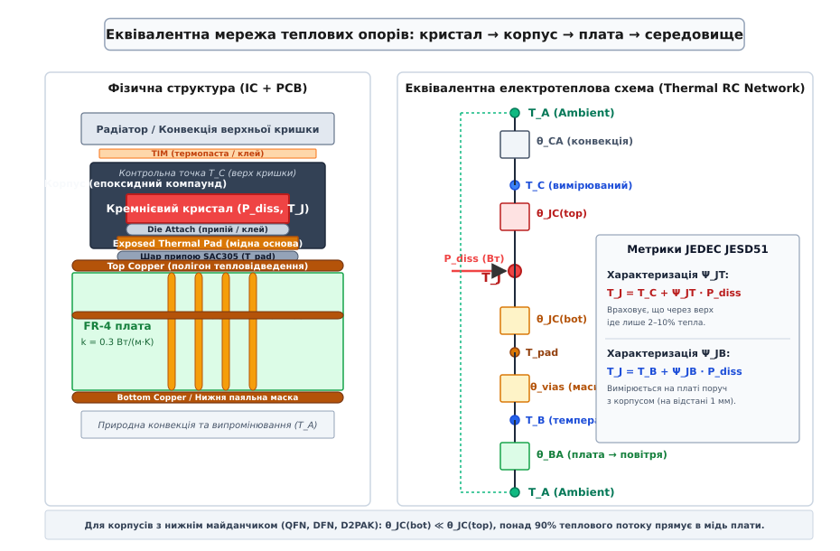
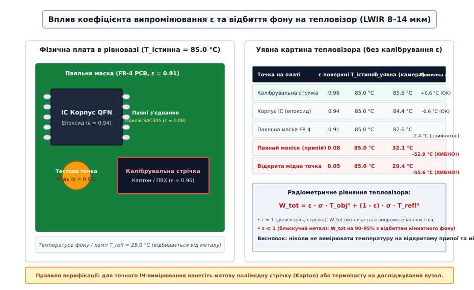

# Вимірювання температури живої плати

<preknowlist>
- [Джоулеве тепло](root:ph-electromagnetism/joule-heating) — виділення теплової потужності P = I²·R на омічних опорах і переходах напівпровідників.
- [Тепловий опір](root:ph-thermodynamics/thermal-resistance) — градієнт температури ΔT = P · R_th та еквівалентні теплові моделі.
- [Теплопровідність](root:ph-thermodynamics/thermal-conductivity) — дифузія тепла в мідних шарах і склотекстоліті FR-4 за законом Фур'є.
- [Спектр випромінювання чорного тіла](root:ph-thermodynamics/planck-law-and-blackbody-spectrum) — закон Планка, випромінювання нагрітих поверхонь та закон Стефана–Больцмана.
- [Ширина доріжки, струм і нагрів](root:hw-pcb/shyryna-dorizhky-strum-i-nahriv) — допустимий нагрів силових провідників і позитивний тепловий зворотний зв'язок.
- [Теплові перехідні отвори](root:hw-pcb/thermal-vias) — матриці тепловідведення під силові компоненти у внутрішні полігони.
- [Перше вмикання нової плати](root:hw-pcb/pershe-vmykannia-novoi-platy) — контроль струму споживання, локалізація коротких замикань і тепловий контроль вузлів.
</preknowlist>

Коли на змонтований прототип друкованої плати вперше подається повна робоча напруга та струм номінального навантаження — наприклад, 12 В на вхід багатофазного синхронного понижувального перетворювача живлення ядра FPGA з вихідним струмом 35 А або на міст керування безколекторним тяговим двигуном, — теоретичні розрахунки в EDA-симуляторах миттєво стикаються з фізичною реальністю теплопереносу. Неідеальний контактний меніск припою під відкритим металевим майданчиком (Exposed Pad) силового транзистора, локальне заниження площі теплового полігону або на 10 мОм вищий за очікуваний опір відкритого каналу польового ключа спричиняють виділення 3–5 Вт теплової потужності на крихітній площі у кілька квадратних міліметрів. Якщо розсіювання тепла не збалансоване, температура всередині кремнієвого кристала за лічені секунди долає критичну позначку 150 °C, перетворюючи напівпровідник на пробитий діод і руйнуючи прилеглі шари склотекстоліту FR-4.

Спроба оцінити реальний нагрів поверхонь простим дотиком щупа мультиметра або спрямуванням портативного тепловізора без метрологічного калібрування створює смертельно небезпечну ілюзію безпеки: прилад показує комфортні 55–65 °C на блискучій поверхні паяних контактів, тоді як кристал всередині корпусу перебуває в режимі теплового розгону (thermal runaway). Забезпечення багаторічної безвідмовної роботи електронного виробу вимагає комплексного вимірювання температурних полів працюючої плати, точного розмежування контактних та оптичних методів контролю, урахування фізики інфрачервоного випромінювання поверхонь і переходу від виміряних температур корпусу до реальної температури кремнієвого переходу за стандартами JEDEC.

## Фізичні механізми тепловиділення та динамічний баланс розсіювання

Електрична енергія, що споживається електронною схемою від джерела живлення, за винятком корисної механічної, електромагнітної чи оптичної роботи, повністю перетворюється на теплову енергію. На робочій друкованій платі співіснують кілька фізично відмінних джерел генерації тепла:

1. **Статичні омічні втрати провідності:** струм `I`, протікаючи крізь опір відкритого каналу польового транзистора `R_DS(on)`, опір обмотки дроселя постійному струму `DCR` або мідну доріжку плати `R_trace`, безперервно генерує теплову потужність за законом Джоуля–Ленца:

```
P_cond = I_rms² · R                                     [статичні джоулеві втрати провідності]
```

Оскільки опір міді та каналу кремнієвих транзисторів зростає з нагріванням (температурний коефіцієнт опору `α_Cu ≈ +0.393 %/°C`, а `R_DS(on)` подвоюється при нагріванні від 25 °C до 125 °C), омічні втрати мають виражений позитивний тепловий зворотний зв'язок.

2. **Динамічні втрати перемикання:** у процесі комутації силових ключів (MOSFET, GaN, IGBT) напруга на виводах та струм крізь ключ одночасно мають ненульові значення протягом часу наростання `t_r` та спаду `t_f`. Кожен акт перемикання розсіює фіксовану порцію енергії `E_sw`, що призводить до лінійної залежності теплової потужності від робочої частоти перетворювача `f_sw`:

```
P_sw = (E_on + E_off) · f_sw                            [динамічні втрати перемикання]
     = 0.5 · V_in · I_out · (t_r + t_f) · f_sw          [наближений розрахунок через фронти]
```

3. **Втрати на лінійне падіння напруги (LDO та біполярні регулятори):** у лінійних стабілізаторах уся різниця між вхідною та вихідною напругою розсіюється у вигляді тепла на регулювальному транзисторі:

```
P_ldo = (V_in - V_out) · I_load + V_in · I_quiescent    [потужність теплових втрат у LDO]
```

При падінні напруги з 12 В до 3.3 В за струму 0.8 А лінійний стабілізатор перетворює на тепло майже 7 Вт потужності, вимагаючи спеціальних конструктивних заходів відведення тепла.

4. **Втрати в магнітних сердечниках і діелектриках:** змінний магнітний потік в індуктивностях та трансформаторах генерує вихрові струми Фуко й спричиняє втрати на гістерезис перемагнічування фериту `P_core`, які експоненційно зростають із частотою та розмахом індукції.

У стаціонарному стані температура кожного вузла плати стабілізується на рівні, де швидкість генерації тепла точно врівноважується сумою трьох механізмів теплопереносу в навколишнє середовище:

* **Теплопровідність (кондукція):** передача тепла крізь твердотільну структуру плати за законом Фур'є `q = -k · ∇T`. Мідні шари плати мають надзвичайно високу теплопровідність (`k_Cu ≈ 385–400 Вт/(м·К)`), тоді як базовий діелектрик FR-4 є тепловим ізолятором (`k_FR4 ≈ 0.25–0.35 Вт/(м·К)`). Тепловий потік поширюється переважно мідними полігонами живлення та заземлення.
* **Конвекція повітря:** відведення тепла рухомим потоком повітря від нагрітої поверхні за законом Ньютона–Ріхмана `q_conv = h_c · (T_surf - T_amb)`. Для природної конвекції без вентилятора коефіцієнт тепловіддачі становить лише `h_c ≈ 5–15 Вт/(м²·К)`, тоді як примусовий обдув вентилятором зі швидкістю 2–5 м/с підвищує тепловіддачу до `h_c ≈ 30–80 Вт/(м²·К)`.
* **Теплове випромінювання (радіація):** випромінювання електромагнітних хвиль в інфрачервоному діапазоні з поверхні плати згідно із законом Стефана–Больцмана `q_rad = ε · σ · (T_surf⁴ - T_amb⁴)`.

### Анізотропія теплопровідності FR-4 та розрахунок масивів теплових перехідних отворів

Композитний діелектрик FR-4 складається з переплетених склониток (склотканини E-glass з теплопровідністю `k ≈ 1.0–1.2 Вт/(м·К)`) та епоксидної сполучної смоли (`k ≈ 0.20–0.25 Вт/(м·К)`). Оскільки склотканина вкладається плоскими полотнами паралельно поверхні мідних шарів, структура плати має виражену просторову анізотропію теплопровідності:

* Теплопровідність у площині шарів `k_xy ≈ 0.8–1.1 Вт/(м·К)` (покращується наявністю суцільних мідних шарів живлення та заземлення до ефективних `k_eff,xy ≈ 15–40 Вт/(м·К)`).
* Теплопровідність перпендикулярно до площини плати (крізь товщу склотекстоліту) `k_z ≈ 0.25–0.35 Вт/(м·К)`.

Через надзвичайно низьку поперечну теплопровідність `k_z` чистий діелектрик FR-4 завтовшки `h = 1.6 мм` під контактним майданчиком силового компонента площею `5 × 5 мм` (`A = 25 мм²`) створює колосальний власний тепловий опір:

```
R_th,FR4 = h / (k_z · A)                                [тепловий опір діелектрика плати]
         = 0.0016 м / ( 0.30 Вт/(м·К) · 25 · 10⁻⁶ м² )  [підстановка геометричних параметрів]
         ≈ 213 °C/Вт                                    [тепловий бар'єр чистого текстоліту]
```

При розсіюванні всього 2 Вт потужності такий бар'єр викликав би перегрів кристала більш ніж на 400 °C, що неминуче призвело б до вигорання плати. Для пробиття цього теплового ізолятора під нижнім тепловідвідним майданчиком компонента формують масив теплових перехідних отворів (Thermal Vias), що сполучають верхній полігон із внутрішніми та нижніми шарами суцільної міді.

Тепловий опір циліндричної мідної гільзи одного отвору зовнішнім діаметром `d` із товщиною гальванічної мідної стінки `t_cu` (за стандартом IPC-6012 Class 2 номінальна товщина стінки становить `t_cu ≈ 25 мкм = 0.025 мм`) визначається формулою:

```
A_cu = π · (d · t_cu - t_cu²)                           [площа поперечного перерізу міді гільзи]
R_th,via = h / (k_Cu · A_cu)                            [тепловий опір одного отвору]
R_th,array = R_th,via / N_vias                          [тепловий опір паралельного масиву N отворів]
```

Для масиву з `N = 16` отворів діаметром `d = 0.3 мм` із товщиною міді 25 мкм на платі завтовшки 1.6 мм площа перерізу однієї гільзи становить `A_cu ≈ 0.0216 мм²`, а тепловий опір одного отвору — `R_th,via ≈ 190 °C/Вт`. Паралельне з'єднання 16 отворів знижує сумарний тепловий опір переходу крізь товщу плати до:

```
R_th,array = 190 / 16 ≈ 11.9 °C/Вт                     [зниження теплового опору у 18 разів!]
```

Заповнення отворів припоєм під час хвильового паяння або використання заводського заповнення мідною термопастою з глухим закриттям мідною кришкою (via-in-pad plated over, VIPPO) знижує цей опір ще на 15–25% та запобігає витіканню припою з-під SMD-виводів під час оплавлення в печі.


*Еквівалентна електротеплова мережа заміщення: розгалуження теплового потоку від кремнієвого кристала крізь верхню кришку корпусу та нижній тепловий полігон плати у навколишнє середовище за стандартом JEDEC JESD51.*

## Безконтактна інфрачервона радіометрія та фізика випромінювання поверхонь

Сучасна тепловізійна техніка (інфрачервоні камери на базі неохолоджуваних матриць мікроболометрів з оксиду ванадію VOx або аморфного кремнію a-Si, що працюють у довгохвильовому діапазоні LWIR 7.5–14 мкм) є найпотужнішим засобом візуалізації теплового поля плати. Вона дозволяє одночасно бачити сотні компонентів, виявляти аномальні зони нагріву та знаходити дефекти трасування без фізичного втручання в схему.

Однак тепловізор не вимірює температуру безпосередньо — він вимірює лише густину потоку інфрачервоного випромінювання, що потрапляє в об'єктив. Фізична картина ускладнюється тим, що реальна друкована плата є складною мозаїкою з десятків матеріалів із кардинально різними оптичними властивостями.

### Коефіцієнт випромінювання `ε` та закон Кірхгофа

Коефіцієнт теплового випромінювання (Emissivity) `ε` визначає здатність поверхні випромінювати теплову енергію порівняно з абсолютно чорним тілом при тій самій температурі:

```
ε = W_real(λ, T) / W_blackbody(λ, T)                    [коефіцієнт випромінювання, 0 ≤ ε ≤ 1]
```

За законом випромінювання Кірхгофа, для будь-якого непрозорого тіла в стані термодинамічної рівноваги коефіцієнт випромінювання строго дорівнює коефіцієнту поглинання: `ε = α`. Оскільки для непрозорого тіла сума поглинання `α` та відбиття `ρ` дорівнює одиниці (`α + ρ = 1`), відбивальна здатність поверхні виражається фундаментальним співвідношенням:

```
ρ = 1 - ε                                               [відбивальна здатність непрозорого тіла]
```

Це рівняння пояснює головну проблему тепловізійної діагностики електроніки:

* Поверхні з високим `ε ≈ 0.90–0.95` (діелектрики, епоксидні корпуси мікросхем, паяльна маска) випромінюють 90–95% власного тепла і відбивають лише 5–10% зовнішнього фону.
* Поверхні з низьким `ε ≈ 0.04–0.15` (полірована мідь, луджені доріжки, паяні кульки BGA та меніски з безсвинцевого припою SAC305) випромінюють лише 4–15% власного тепла, але працюють як інфрачервоне дзеркало, відбиваючи 85–96% навколишнього інфрачервоного фону.

| Матеріал на друкованій платі | Стан поверхні | Коефіцієнт випромінювання `ε` (LWIR 8–14 мкм) | Фізична поведінка в тепловізорі |
|---|---|---|---|
| **Чорний епоксидний компаунд** | Корпуси SOIC, QFN, BGA, D2PAK | **0.90 – 0.95** | Майже ідеальне власне випромінювання, пряме вимірювання |
| **Зелена паяльна маска** | Глянцева поверхня над FR-4 | **0.88 – 0.92** | Висока точність, похибка без корекції не перевищує 2–4 °C |
| **Матова чорна паяльна маска** | Матовий шар над полігонами | **0.92 – 0.95** | Ідеальна основа для радіометрії |
| **Склотекстоліт FR-4** | Відкрита ділянка без міді та маски | **0.89 – 0.91** | Добре власне випромінювання |
| **Поліїмідна стрічка (Kapton)** | Гладка плівка (товщина 25–50 мкм) | **0.94 – 0.96** | Еталонний калібрувальний маркер для точних вимірів |
| **Безсвинцевий припій SAC305** | Блискучий паяний меніск після печі | **0.05 – 0.12** | Дзеркальне відбиття фону, пряме вимірювання заборонене |
| **Свинцевий припій Sn63Pb37** | Свіже паяне з'єднання | **0.08 – 0.15** | Сильне відбиття, помилка вимірювання сягає 40–60 °C |
| **Відкрита мідь (Bare Copper)** | Очищений полігон тепловідведення | **0.03 – 0.07** | Інфрачервоне дзеркало (`ρ > 0.93`) |
| **Золоте покриття (ENIG)** | Блискуча фінішна іммерсія | **0.02 – 0.05** | Повне відбиття фонових джерел |
| **Алюмінієвий радіатор** | Анодований чорний / синій матовий | **0.82 – 0.88** | Добре випромінювання завдяки шару оксиду Al₂O₃ |
| **Алюмінієвий радіатор** | Чистий полірований метал | **0.04 – 0.08** | Дзеркальне відбиття фону |

### Радіометричне рівняння та компенсація відбитого фону `T_refl`

Повна густина потоку випромінювання `W_meas`, яку фіксує піксель мікроболометричної матриці, складається з трьох складових: власного випромінювання досліджуваного об'єкта, відбитого випромінювання навколишнього фону та власного випромінювання шару повітря (на коротких дистанціях до 1 метра поглинанням повітря нехтують):

```
W_meas = ε · σ · (T_obj)⁴ + (1 - ε) · σ · (T_refl)⁴     [радіометричне рівняння тепловізора]
```

Якщо інженер спрямовує тепловізор на паяну ніжку транзистора (`ε = 0.08`), нагріту струмом до реальних 90 °C (363.15 K), а температура настільної лампи та стелі лабораторного приміщення становить 25 °C (298.15 K), тепловізор без налаштування розраховує уявну температуру:

```
W_meas = 0.08 · σ · (363.15)⁴ + 0.92 · σ · (298.15)⁴   [підстановка фізичних параметрів]
       = σ · ( 1.39 · 10⁹ + 7.26 · 10⁹ )               [внесок фону перевищує сигнал у 5.2 раза!]
       = σ · ( 8.65 · 10⁹ )                            [сумарний потік на болометрі]

T_apparent = ( 8.65 · 10⁹ )^(1/4) = 305.2 K ≈ 32.0 °C  [уявний показ невідкаліброваної камери]
```

Результат вимірювання занижено на катастрофічні **58 °C**! Силовий транзистор працює в критичному передпробійному режимі, але на екрані приладу світиться абсолютно безпечна зелено-блакитна пляма.


*Зіставлення фізичної плати та картини невідкаліброваного тепловізора: катастрофічна похибка вимірювання на блискучих менісках припою та відкритій міді через дзеркальне відбиття кімнатного фону.*

### Методики лабораторного калібрування радіометричних вимірів

Для отримання достовірних тепловізійних карт поверхні плати застосовують три обов'язкові інженерні методики:

1. **Метод калібрувальної наклейки (Target Taping):** на досліджувані компоненти, паяні з'єднання та відкриті полігони наклеюють невеликі шматочки (2×2 мм) високотемпературної матової поліімідної стрічки (Kapton) або електроізоляційної ПВХ-стрічки завтовшки 25–50 мкм. Стрічка має стабільний, незалежний від температури коефіцієнт `ε = 0.95–0.96`. Мала товщина плівки забезпечує нікчемний власний тепловий опір (менше 0.05 °C/Вт), завдяки чому зовнішня поверхня плівки миттєво набуває температури досліджуваного металу.
2. **Метод матового термопокриття (Conformal Coating & Graphite Spray):** для комплексного аналізу всієї плати на прототип наносять тонкий шар змивного графітового аерозолю або матового термостійкого лаку з точно визначеною випромінювальною здатністю (`ε = 0.96 ± 0.01`). Це вирівнює оптичні властивості всієї поверхні плати, повністю усуваючи паразитні бліки та дзеркальні відображення металу.
3. **Метод вимірювання відбитої температури фону `T_refl` (Reflected Apparent Temperature, тест зі зім'ятою фольгою):** перед початком сесії перед досліджуваною платою розміщують шматок зім'ятої та розправленої алюмінієвої фольги (`ε ≈ 0.03`). У налаштуваннях тепловізора встановлюють `ε = 1.00` та вимірюють усереднену температуру поверхні фольги. Отримане значення вводиться в меню камери як параметр `T_refl` для автоматичного віднімання фонового випромінювання.
4. **Застосування германієвих макролінз (Macro Lenses):** стандартний об'єктив тепловізора з просторовою роздільною здатністю IFOV близько 1.5–2.5 мрад на відстані мінімального фокусування 15–20 см здатний розрізнити точку діаметром не менше 0.5–1.0 мм. Для детального обстеження окремих ніжок мікросхем із кроком 0.5 мм, пасивних SMD-елементів типорозмірів 0402 та 0201 застосовують макролінзи з оптичного германію з просторовою роздільною здатністю від 25 до 50 мкм на піксель.

## Контактні методи: термопари, термоопори та паразитна термодинаміка щупів

Контактні вимірювання температури залишаються абсолютним еталоном для тривалих кліматичних тестів, верифікації теплових моделей та випробувань усередині герметичних корпусів, де використання оптичних камер фізично неможливе. Проте сам факт механічного контакту датчика з мініатюрним електронним компонентом грубо спотворює досліджуване температурне поле, якщо не враховувати термодинаміку самого вимірювального інструменту.

### Паразитний ефект тепловідводу (Thermal Sinking / Fin Effect)

Кожен контактний датчик має скінченну масу, теплоємність і теплопровідність підвідних провідників. Коли металевий спай термопари прикладається до мініатюрного корпусу (наприклад, стабілізатора напруги в корпусі SOT-23 масою всього 15 мг або транзистора DFN 2×2 мм), провідники термопари перетворюються на металевий мікрорадіатор (охолоджувальне ребро, Fin Effect).

Тепловий потік стікає з крихітної кришки мікросхеми крізь мідні та нікелеві жили дроту у навколишнє повітря. Кількісна оцінка заниження температури `ΔT_sink` виражається через відношення теплового опору корпусу до теплового опору провідників датчика:

```
ΔT_sink = (T_real - T_amb) · [ R_th(case) / (R_th(case) + R_th(wires)) ]
```

Якщо інженер використовує стандартну «лабораторну» термопару калібру AWG 24 (діаметр жили 0.511 мм), тепловий опір двох провідників завдовжки 10 см становить менше 120 °C/Вт, що порівняно з тепловим опором самого корпусу компонента. В результаті спай термопари примусово охолоджує корпус, і виміряна температура виявляється заниженою на **15–25 °C**.

Для виключення ефекту тепловідводу на друкованих платах діють суворі правила:
* Використовувати виключно ультратонкі термопари калібру **AWG 36 (діаметр жили 0.127 мм)** або **AWG 40 (діаметр жили 0.080 мм)**. Площа поперечного перерізу провідника AWG 40 у 40 разів менша за AWG 24, що пропорційно збільшує його тепловий опір і знижує паразитний відбір тепла до часток градуса.
* Провідники термопари на довжині не менше 15–20 мм від спаю повинні бути притиснуті до ізотермічної зони плати (термічне розв'язання підвідних жил).

### Механічний контакт і теплові клеї

Повітряний мікрозазор між спаєм датчика та корпусом мікросхеми товщиною всього 20 мкм створює додатковий тепловий опір понад 30–50 °C/Вт через низьку теплопровідність повітря (`k_air ≈ 0.026 Вт/(м·К)`). Звичайне притискання термопари скотчем без термоінтерфейсу дає випадкову похибку від 5 до 15 °C.

Правильний монтаж термодатчиків виконується такими способами:
1. **Теплопровідний епоксидний компаунд:** двокомпонентний епоксидний клей із наповнювачем із мікропорошку оксиду алюмінію Al₂O₃ або нітриду бору BN (`k ≈ 1.5–2.5 Вт/(м·К)`). Забезпечує надійну механічну фіксацію при вібраціях та температурних циклах від -40 °C до +150 °C.
2. **Цианоакрилат із термопастою (метод швидкої фіксації):** на точку вимірювання наноситься мікрокрапля високоефективної термопасти (`k > 5 Вт/(м·К)`), у неї занурюється спай термопари, а по периметру контакт фіксується краплею цианоакрилатного клею («суперклею») з активатором твердіння.
3. **Ультратонкий високотемпературний скотч Kapton:** використовується для попереднього позиціонування з обов'язковим попереднім нанесенням термопасти під спай.

### Платинові RTD та напівпровідникові NTC-термістори

Окрім термоелектричних перетворювачів (термопар), для прецизійного вимірювання застосовують резистивні сенсори:

* **Платинові термометри опору (RTD Pt100 / Pt1000):** забезпечують найвищу стабільність та повторюваність (похибка менше ±0.05 °C). Для усунення впливу опору вимірювальних проводів застосовують виключно **4-провідну схему підключення Кельвіна** (дві жили живлять сенсор стабільним струмом 100–500 мкА, а дві окремі жили вимірюють падіння напруги високоомним диференціальним підсилювачем).
* **Терморезистори з від'ємним ТКО (NTC):** мініатюрні чип-термістори у типорозмірах 0402 та 0201 мають високу чутливість (зміна опору на 3–5% на кожен градус). Їхня температурна залежність описується рівнянням Стейнхарта–Харта:

```
1 / T = A + B · ln(R) + C · (ln(R))³                    [рівняння Стейнхарта–Харта для NTC]
```

### Внутрішні напівпровідникові сенсори: пряме вимірювання падіння на p-n переході та метод двох струмів

Найбільш прямим і точним способом контактного вимірювання температури всередині кремнієвого кристала є використання вбудованих напівпровідникових термодіодів або підкладкових біполярних транзисторів (Thermal Diode / Substrate PNP), які інтегруються безпосередньо в структуру мікропроцесорів, FPGA та інтелектуальних силових ключів (Smart Power Stages).

Фізичний принцип базується на температурній залежності прямого падіння напруги `V_f` на p-n переході при фіксованому прямому струмі зміщення. За рівнянням Шоклі для ідеального діода:

```
I_f = I_s · ( e^( (q · V_f) / (η · k_B · T) ) - 1 )      [рівняння вольт-амперної характеристики діода]
```

де `q = 1.602 · 10⁻¹⁹ Кл` — елементарний заряд, `k_B = 1.3806 · 10⁻²³ Дж/К` — стала Больцмана, `η` — коефіцієнт ідеальності переходу (для кремнію `η ≈ 1.002–1.010`), а `I_s` — тепловий струм насичення, який сам експоненційно залежить від температури. При фіксованому струмі зміщення пряме падіння напруги зменшується практично лінійно зі швидкістю близько `-1.8 ... -2.2 мВ/°C`.

Проте пряме одноточкове вимірювання напруги `V_f` має суттєвий недолік: через технологічний розкид струму насичення `I_s` та паразитний опір металізації виводів похибка калібрування між різними екземплярами чипів може досягати ±5–10 °C.

Для усунення цієї невизначеності сучасні вимірювальні мікросхеми (наприклад, апаратні термоконтролери TMP451, MAX6642, EMC1412) реалізують **метод диференціального збудження двома струмами** (метод `ΔV_be`). Через інтегрований транзистор поперемінно пропускають два калібровані струми `I_1` та `I_2` із фіксованим співвідношенням (зазвичай `N = I_2 / I_1 = 10` або `16` при `I_1 = 10 мкА`, `I_2 = 100 мкА`):

```
V_be1 = (η · k_B · T / q) · ln(I_1 / I_s)               [напруга при меншому струмі]
V_be2 = (η · k_B · T / q) · ln(I_2 / I_s)               [напруга при більшому струмі]
ΔV_be = V_be2 - V_be1 = (η · k_B · T / q) · ln(I_2 / I_1) [диференціальний сигнал]
T_K = (q · ΔV_be) / (η · k_B · ln(N))                   [абсолютна температура переходу в Кельвінах]
```

Оскільки невідомий струм насичення `I_s` повністю скорочується під знаком логарифма, розрахована температура `T_K` строго лінійно залежить лише від різниці напруг `ΔV_be` та фізичних фундаментальних констант. Метод забезпечує абсолютну похибку менше ±0.5 °C безпосередньо в центрі тепловиділення кристала, дозволяючи зчитувати телеметрію через шини I2C/SMBus або PMBus під час повного навантаження плати.

## Теплові метрики JEDEC (JESD51) та визначення внутрішньої температури кристала `T_J`

Головним критерієм надійності будь-якого напівпровідникового приладу є максимальна температура його p-n переходу або каналу польового транзистора `T_J` (Junction Temperature). Для більшості кремнієвих мікросхем промислового виконання гранична температура становить `T_J(max) = 125 °C` або `150 °C` (для автомобільних компонентів стандарту AEC-Q100 Grade 0 — до `175 °C`). Перевищення цього порогу веде до лавиноподібного зростання струмів витоку, деградації підзатворного діелектрика та електродифузії металізації кристала.

### Чому табличний параметр `θ_JA` з документації не працює

У технічних описах (datasheet) виробники напівпровідників завжди наводять тепловий опір «перехід–середовище» `θ_JA` (або `R_θJA`, в одиницях °C/Вт). Інженери-початківці часто намагаються оцінити нагрів кристала за спрощеною формулою `T_J = T_amb + P_diss · θ_JA`.

Це груба помилка, проти якої прямо застерігає стандарт **JEDEC JESD51-2A**. Параметр `θ_JA` вимірюється на стандартизованій тестовій 4-шаровій платі фіксованого розміру (76.2 × 114.3 мм, стандарти JESD51-7 High-K або JESD51-3 Low-K) у закритому боксі об'ємом 1 кубічний фут без зовнішніх джерел тепла. На реальній платі:
* площа мідних полігонів тепловідведення відрізняється в рази;
* поруч розташовані інші гарячі компоненти (дроселі, трансформатори, сусідні фази перетворювача);
* плата встановлена в тісний герметичний корпус або обдувається вентилятором.

Табличний `θ_JA` є суто порівняльною метрикою для оцінки якості корпусу між різними виробниками, але не може застосовуватися для прогнозування абсолютної температури на робочій платі.

### Параметри теплової характеризації `Ψ_JT` та `Ψ_JB`

Для точного інженерного розрахунку на реальній працюючій платі стандарт JEDEC запровадив параметри теплової характеризації (Thermal Characterization Parameters) — **`Ψ_JT` (Psi-JT)** та **`Ψ_JB` (Psi-JB)**:

```
T_J = T_C + Ψ_JT · P_diss                               [розрахунок через верх корпусу Top Case]
T_J = T_B + Ψ_JB · P_diss                               [розрахунок через площадку плати Board]
```

Різниця між класичним тепловим опором `θ` та параметром характеризації `Ψ` полягає в наступному:
* Тепловий опір `θ_JC = (T_J - T_C) / P_total` передбачає, що **весь 100% теплового потоку** примусово прямує виключно крізь верхню кришку корпусу (ідеальний радіатор зверху та повна теплоізоляція знизу).
* Параметр характеризації `Ψ_JT = (T_J - T_C) / P_total` вимірюється у вільному стані плати й враховує реальне розділення теплових потоків: понад 90–95% тепла йде крізь нижній металевий майданчик у плату, і лише 2–5% просочується крізь пластиковий верх.

Тому значення `Ψ_JT` для корпусів типу QFN, DFN чи PowerPAK становить усього **0.5–2.0 °C/Вт**, тоді як `θ_JC` для того самого корпусу може дорівнювати 25–40 °C/Вт. Знаючи `Ψ_JT` з документації компонента, інженер вимірює контактним або відкаліброваним оптичним методом температуру верхньої точки кришки `T_C`, множить реальну потужність втрат `P_diss` на `Ψ_JT` і отримує істинну внутрішню температуру кремнієвого кристала з точністю до 1–2 °C.

## Локалізація гарячих точок та динамічний тепловий імпеданс `Z_th(t)`

Тепловий стан працюючої плати не є статичним. Під час стрибкоподібних змін навантаження, пуску двигунів або коротких імпульсів струму температура кристала змінюється значно швидше за прогрів масивного склотекстоліту плати.

### Еквівалентні RC-моделі Фостера та Кауера

Для моделювання перехідних теплових процесів у часовій області тепловий шлях представляють у вигляді еквівалентної електричної схеми заміщення, де тепловий потік відповідає електричному струму, різниця температур — різниці потенціалів (напрузі), тепловий опір `R_th` — резистору, а питома теплоємність матеріалу `C_th = m · c_p` (у Дж/К) — конденсатору.

Застосовують два типи сходових RC-мереж:
1. **Мережа Кауера (Cauer Network):** фізично достовірна модель, де кожен RC-вузол строго відповідає реальному геометричному шару конструкції (шар 1: кремній, шар 2: підкладка кристала, шар 3: паяний шов, шар 4: мідний полігон плати, шар 5: склотекстоліт FR-4). Кожен вузол має фізичну ємність на загальну «землю» (навколишнє середовище).
2. **Мережа Фостера (Foster Network):** математична апроксимація у вигляді послідовно з'єднаних паралельних RC-ланок, коефіцієнти яких отримують шляхом підгонки експоненційної кривої відгуку на одиничний стрибок потужності.

Динамічний тепловий імпеданс `Z_th(t)` описується сумою експоненційних складових із різними постійними часу `τ_i = R_i · C_i`:

```
Z_th(t) = sum( R_i · (1 - e^(-t / τ_i)) ),  i = 1..N    [перехідний тепловий імпеданс]
```

Для типового силового MOSFET у корпусі PowerPAK 5×6 мм:
* Постійна часу самого кристала `τ_die ≈ 0.5–2.0 мс` (швидкий нагрів при короткому замиканні).
* Постійна часу мідного майданчика корпусу `τ_pkg ≈ 20–80 мс`.
* Постійна часу мідного полігону та теплових отворів плати `τ_pcb ≈ 2–10 с`.
* Постійна часу всієї змонтованої плати в корпусі `τ_system ≈ 60–300 с`.

Це означає, що при імпульсному навантаженні тривалістю 10 мс тепло не встигає вийти за межі кремнієвого кристала та металевої підкладки. Вимірювання температури плати в цей момент покаже кімнатну температуру, тоді як кристал може миттєво розплавитися від локального перегріву.

### Діагностика характерних дефектів силових вузлів плати

Тепловізійне обстеження робочої плати під навантаженням дозволяє швидко виявляти типові приховані дефекти проєктування та монтажу:

* **Аномальний нагрів одного силового MOSFET у багатофазному перетворювачі:** свідчить про перекіс струмів між фазами через різницю активних опорів `DCR` дроселів або асиметрію драйверів затворів.
* **Різкий нагрів польового транзистора при підвищенні частоти ШІМ:** ознака затягнутих фронтів перемикання через завеликий опір затворного резистора `R_gate` або недостатній вихідний струм драйвера затвора, що призводить до роботи транзистора в лінійному режимі під час комутації.
* **Концентрація тепла біля виводів живлення BGA/FPGA:** вказує на недостатній переріз доріжок живлення, брак перехідних отворів між шарами або паразитний опір перехідних отворів через дефекти металізації гальванічної лінії.
* **Перегрів імпульсного дроселя при зростанні струму:** свідчить про магнітне насичення феритового сердечника (насичення призводить до падіння індуктивності, різкого стрибка пікового струму та лавиноподібного зростання омічних втрат у мідній обмотці).

### Гомологічна температура припою та довговічність за моделлю Коффіна–Менсона

Критичним наслідком локальних температурних перепадів на платі є прискорене руйнування паяних з'єднань. У матеріалознавстві поведінка металів оцінюється за **гомологічною температурою** `T_h` — відношенням поточної абсолютної температури до температури плавлення матеріалу за шкалою Кельвіна:

```
T_h = T_operating_K / T_melting_K                       [гомологічна температура матеріалу]
```

Для більшості конструкційних металів (сталь, мідь, алюміній) кімнатна температура відповідає `T_h < 0.2–0.3`, тому вони працюють виключно в пружній зоні. Але для безсвинцевого припою SAC305 із температурою плавлення `T_melt = 217 °C = 490.15 K`:
* кімнатна температура 25 °C (298.15 K) відповідає `T_h = 298.15 / 490.15 = 0.61`;
* робоча температура 85 °C (358.15 K) відповідає `T_h = 358.15 / 490.15 = 0.73`;
* локальний перегрів до 115 °C (388.15 K) дає `T_h = 388.15 / 490.15 = 0.79`.

В металургії за умов `T_h > 0.5` у металі безперервно протікають високотемпературні процеси дифузійної повзучості (Creep), рекристалізації кристалічних зерен і ріст крихких інтерметалідних інтерфейсних сполук (`Cu₆Sn₅`, `Cu₃Sn` та `Ni₃Sn₄`). Кожен цикл увімкнення та вимкнення пристрою генерує циклічну пластичну деформацію зсуву в кутових виводах мікросхем BGA та QFN через різницю коефіцієнтів лінійного розширення між кремнієм (`CTE_Si ≈ 2.6 ppm/K`) та платою (`CTE_FR4 ≈ 15 ppm/K`).

Кількість теплових циклів до втомного руйнування пайки `N_f` описується модифікованим рівнянням Коффіна–Менсона (Coffin–Manson Model за стандартами IPC-9701 та JEDEC JESD22-A104):

```
N_f = A_0 · (ΔT)^(-m) · (f_cycle)^n · e^( E_a / (k_B · T_max) )  [модель термовтоми паяних з'єднань]
```

де `ΔT = T_max - T_min` — амплітуда температурного циклу, `m ≈ 2.5–3.0` — емпіричний показник втоми для безсвинцевих сплавів Sn-Ag-Cu, `f_cycle` — частота теплозміни, а `E_a ≈ 0.5–0.7 еВ` — енергія активації дифузійних процесів.

Ступенева залежність із показником `m ≈ 2.7` означає, що **збільшення амплітуди температурних коливань плати всього у 2 рази** (наприклад, перепад від 25 до 85 °C замість від 25 до 55 °C) **скорочує термін служби паяних з'єднань у 6.5 разів** (`2^2.7 ≈ 6.5`):

```
N_f(ΔT = 60 °C) / N_f(ΔT = 30 °C) = (60 / 30)^(-2.7) = 2^(-2.7) ≈ 0.154  [скорочення ресурсу на 85%]
```

Тому вимірювання локальних температурних полів та градієнтів `∇T` на живій платі є не просто перевіркою працездатності мікросхем у даний момент, а головним інструментом гарантування багаторічного ресурсу виробу (MTBF).

## Програмні засоби верифікації та автоматизованого моніторингу

Для автоматизації теплових випробувань, розрахунку градієнтів плати та оцінки внутрішньої температури кристалів використовують програмні модулі обробки телеметрії. Повний код низькорівневого модуля збору даних, підтримки поліномів NIST для термопар, радіометричної корекції та розрахунку просторових градієнтів наведено у практичній вставці [⚙️ Модуль збору багатоточкових температурних профілів та розрахунку теплових градієнтів плати](root:hw-pcb/vymiriuvannia-temperatury-zhyvoi-platy/proj-thermal-map-logger.md).

Нижче наведено приклад інтеграції алгоритму оцінки безпечної робочої зони компонента (Safe Operating Area, SOA) за виміряною температурою корпусу та поточною потужністю втрат мовами C99 та C++20.

:::tabs
@tab C99
```c
/**
 * @file thermal_eval.c
 * @brief Перевірка теплових меж напівпровідникового компонента за JESD51.
 * Стандарт: C99.
 */

#include <stdio.h>
#include <stdbool.h>

typedef struct {
    float t_case_measured_c;  /* Виміряна контактним/оптичним способом температура кришки */
    float power_dissipated_w; /* Миттєва електрична потужність втрат у компоненті */
    float psi_jt;             /* Параметр теплової характеризації Psi-JT з datasheet (°C/Вт) */
    float t_junction_max_c;   /* Гранично допустима температура кристала T_J(max) */
    float safety_margin_c;    /* Необхідний інженерний запас надійності (зазвичай 15–20 °C) */
} thermal_eval_input_t;

typedef struct {
    float t_junction_est_c;   /* Оцінена внутрішня температура кристала T_J */
    float headroom_c;         /* Запас до граничної температури */
    bool is_safe;             /* Прапорець безпечної роботи */
} thermal_eval_result_t;

/**
 * @brief Розрахунок температури переходу T_J та перевірка теплового запасу.
 */
thermal_eval_result_t evaluate_junction_safety(const thermal_eval_input_t *in) {
    thermal_eval_result_t res;
    
    /* Розрахунок T_J за формулою стандарту JEDEC JESD51-2A */
    res.t_junction_est_c = in->t_case_measured_c + (in->psi_jt * in->power_dissipated_w);
    
    /* Розрахунок теплового запасу */
    res.headroom_c = in->t_junction_max_c - res.t_junction_est_c;
    
    /* Критерій безпеки: запас повинен перевищувати вимогу надійності */
    res.is_safe = (res.headroom_c >= in->safety_margin_c);
    
    return res;
}
```
@tab C++20
```cpp
/**
 * @file thermal_eval.hpp
 * @brief Ідіоматична перевірка теплових меж напівпровідника за JESD51 на C++20.
 */

#pragma once

#include <iostream>
#include <expected>
#include <string_view>
#include <format>

namespace pcb_thermal {

struct ThermalParameters {
    float t_case_measured_c{25.0f};
    float power_dissipated_w{0.0f};
    float psi_jt{1.5f};             ///< JEDEC Psi-JT (°C/Вт)
    float t_junction_max_c{150.0f}; ///< T_J(max) з datasheet
    float safety_margin_c{20.0f};   ///< Інженерний запас надійності
};

struct ThermalAssessment {
    float junction_temp_c{0.0f};
    float headroom_c{0.0f};
    bool is_compliant{false};
};

enum class ThermalViolation {
    CriticalOvertemp,
    InsufficientMargin
};

[[nodiscard]] constexpr std::expected<ThermalAssessment, ThermalViolation>
evaluate_component_thermal_state(const ThermalParameters& params) noexcept {
    const float t_j = params.t_case_measured_c + (params.psi_jt * params.power_dissipated_w);
    const float margin = params.t_junction_max_c - t_j;

    if (margin < 0.0f) {
        return std::unexpected(ThermalViolation::CriticalOvertemp);
    }
    if (margin < params.safety_margin_c) {
        return std::unexpected(ThermalViolation::InsufficientMargin);
    }

    return ThermalAssessment{
        .junction_temp_c = t_j,
        .headroom_c = margin,
        .is_compliant = true
    };
}

} // namespace pcb_thermal
```
:::

Вимірювання температури працюючої друкованої плати поєднує розуміння термодинаміки кристала, оптики інфрачервоного діапазону та метрології контактних датчиків. Лише комплексний підхід — корекція випромінювальної здатності поверхонь, застосування ультратонких мікротермопар із низьким тепловим стоком, аналіз просторових градієнтів `∇T` та перерахунок вимірів у температуру кристала за стандартами JEDEC — гарантує високу надійність плати за будь-яких умов експлуатації.
