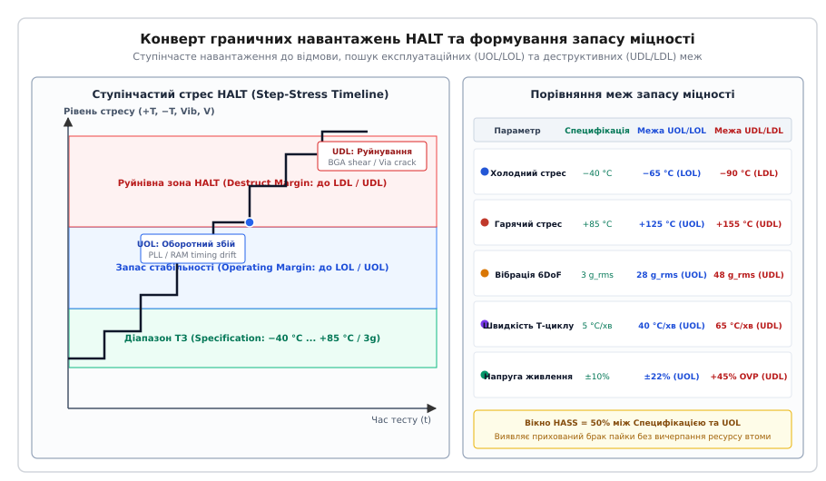
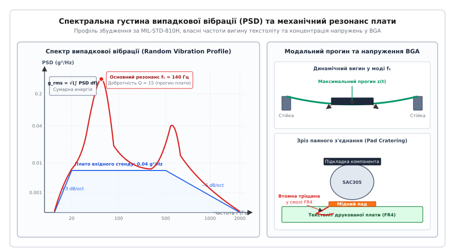

# Випробування, які ламають прототип

<preknowlist>
- [Евтектичні та безсвинцеві сплави](root:hw-pcb/eutectic-alloys) — мікроструктура SAC305, втомна повзучість та утворення інтерметалідів;
- [Структура шарів друкованої плати](root:hw-pcb/pcb-stackup) — термомеханічні властивості FR4, анізотропія CTE та температура склування Tg;
- [Прискорені випробування: термоцикл, тряска, вологість](root:hw-pcb/pryskoreni-vyprobuvannia) — теоретичні моделі прискорення (Арреніус, Коффін-Менсон) та базовий скринінг HASS;
- [Механічні напруження друкованих плат: динамічний удар, прогин текстоліту, зріз BGA та розтріскування MLCC](root:hw-pcb/pcb-shock-and-vibration) — деформації текстоліту, механіка розтріскування кераміки та зрізу пайки;
- [Шлях ESD від роз'єму до землі](root:hw-pcb/shliakh-esd-vid-roziemu-do-zemli) — лавинний пробій TVS, захист вхідних каскадів та імпульсні перенапруги.
</preknowlist>

Коли свіжозібраний дослідний зразок ревізії A бездоганно працює на лабораторному столі за температури +22 °C, це не дає жодної гарантії його виживання в реальній експлуатації. Пристрій, розрахований за технічним завданням на діапазон від −40 °C до +85 °C, може без збоїв пройти стандартний стогодинний термотест у кліматичній камері, а потім масово відмовляти у споживачів через два місяці після запуску в польових умовах. Причиною стає не випадковий брак компонентів, а прихована вразливість топології: кутовий контактний майданчик BGA-мікросхеми працює на самій межі механічного зрізу через локальний прогин текстоліту, або вхідний TVS-діод деградує від коротких комутаційних викидів, оскільки інженер заклав його без запасу за енергією розсіювання.

Стандартні випробування типу «витримав або провалив» (pass/fail) лише підтверджують відповідність номінальним цифрам специфікації, але залишають команду розробників у повній невідомості щодо того, скільки відсотків запасу міцності відділяє виріб від катастрофічної аварії. Єдиний спосіб дізнатися справжній запас надійності апаратури до старту масового виробництва — це свідомо, систематично й покроково ламати дослідні зразки екстремальними навантаженнями.

---

## Філософія руйнівного тестування: чому pass/fail вводить в оману

Традиційна кваліфікація виробу перевіряє поведінку схеми у фіксованому вікні технічних умов: якщо специфікація вимагає стійкості до синусоїдальної вібрації з амплітудою 3 g та роботи за температури від −40 °C до +85 °C, прототип поміщають у термокамеру на вібростенді, витримують заданий час і вимикають установку. Якщо прилад зберіг працездатність, ставиться галочка «тест пройдено».

Такий підхід приховує фундаментальну інженерну загрозу, пов'язану з виробничим розкидом параметрів. У будь-якій партії електронних компонентів та друкованих плат фізичні характеристики вузлів мають статистичний розподіл Гауса:

1. Товщина діелектрика препрегу FR4 варіюється в межах ±10%, що змінює жорсткість плати та її власні резонансні частоти.
2. Температура склування смоли `T_g` коливається залежно від партії хімії та режиму пресування шарів на фабриці.
3. Склад інтерметалідного шару між міддю та безсвинцевим припоєм SAC305 (сплав 96.5% олова, 3.0% срібла, 0.5% міді) має різну товщину крихкої фази `Cu6Sn5` через мікроколивання профілю оплавлення в печі.
4. Напруга пробою напівпровідникових переходів та затримки поширення сигналу в кремнії плавають від партії до партії на 15–25%.

Якщо реальна верхня температурна межа працездатності прототипу становить +87 °C при номінальній вимозі технічного завдання +85 °C, перший дослідний зразок формально проходить кваліфікацію. Проте в серії з тисячі штук через статистичне накладання технологічних допусків 15% виробів вийдуть із ладу вже за температури +82 °C. Виріб виявиться непридатним для промислової експлуатації, а вартість відкликання серії та екстреного перепроектування на стадії виробництва перевищить бюджет розробки в десятки разів.

Руйнівне граничне тестування змінює парадигму: замість питання «чи працює пристрій за умов технічного завдання?» інженер ставить запитання «за якого саме рівня навантаження конструкція розпадеться на частини, яка фізична ланка зруйнується першою і що необхідно змінити у трасуванні плати або геометрії корпусу, щоб відсунути цю межу ще на 40% далі?».

---

## Методологія HALT: покроковий стрес та межі надійності

Методологія високоприскорених випробувань на довговічність (HALT, англ. *Highly Accelerated Life Testing*) базується на принципі ступінчастого навантаження (step-stress). Дослідний зразок піддають послідовному нарощуванню окремих факторів впливу з обов'язковою безперервною функціональною перевіркою параметрів у реальному часі.


*Конверт граничних навантажень HALT, виявлення оборотних та руйнівних меж і формування вікна скринінгу HASS.*

Під час проведення випробувань HALT фіксують чотири критичні реперні точки на кожній осі навантаження:

* **Нижня експлуатаційна межа (LOL — Lower Operating Limit)**: мінімальний рівень стресу (наприклад, температура −65 °C), за якого пристрій перестає виконувати свої функції (виникають збої тактування, зависає інтерфейс зв'язку), але після повернення у нормальний робочий діапазон працездатність відновлюється сама без втручання оператора (*оборотна функціональна відмова*).
* **Верхня експлуатаційна межа (UOL — Upper Operating Limit)**: максимальний рівень стресу (наприклад, температура +125 °C або рівень вібрації 28 g_rms), за якого відбуваються зворотні збої логіки чи вихід аналогових параметрів за допуски.
* **Нижня деструктивна межа (LDL — Lower Destruct Limit)**: рівень навантаження (наприклад, −90 °C), за якого у матеріалах виникають незворотні фізичні пошкодження (розрив кремнієвого кристала, відшарування компаунду, розтріскування кераміки), через що пристрій не повертається до життя навіть після повної нормалізації умов (*необоротна відмова*).
* **Верхня деструктивна межа (UDL — Upper Destruct Limit)**: критичний поріг (наприклад, +155 °C або вібрація 48 g_rms), що викликає фізичний зріз контактних майданчиків BGA, розрив гільз металізованих отворів або катастрофічний електричний пробій.

Різниця між граничною вимогою технічного завдання та деструктивною межею утворює **запас міцності конструкції (Design Margin)**:

```
Design_Margin_High = UDL - Spec_Upper    [запас за верхньою межею]
Design_Margin_Low  = Spec_Lower - LDL    [запас за нижньою межею]
```

Процедура HALT складається з п'яти послідовних фаз, кожна з яких ізолює та підсилює специфічні механізми втоми й деградації матеріалів:

1. **Ступінчастий холодний стрес**: температуру знижують кроками по 10 °C від кімнатної (+20 °C) до −100 °C. На кожному кроці роблять витримку тривалістю 10–15 хвилин, достатню для повного вирівнювання теплового градієнта в товщі плати, виконуючи безперервні стрес-тести обчислювального ядра, шин пам'яті та ліній зв'язку.
2. **Ступінчастий гарячий стрес**: температуру піднімають кроками по 10 °C від +20 °C до +160 °C з аналогічною витримкою та контролем струмів споживання, температур кристалів і стабільності опорних напруг.
3. **Швидкі термоцикли (Rapid Thermal Cycling)**: зразок піддають багаторазовій зміні температури між знайденими межами LOL та UOL зі швидкістю нагріву й охолодження не менше 60 °C/хв за допомогою надпотужних нагрівачів та впорскування рідкого азоту (`LN_2`).
4. **Псевдовипадкова вібрація у шести ступенях вільності (6DoF Random Vibration)**: зразок закріплюють на вібростенді з пневматичними молотками, які збуджують некорельовані коливання одночасно по трьох лінійних осях (X, Y, Z) та трьох кутових напрямках (Roll, Pitch, Yaw) у діапазоні частот від 2 Гц до 10 000 Гц, поступово піднімаючи середньоквадратичне прискорення від 2 g_rms до 50–60 g_rms.
5. **Комбінований багатоосьовий стрес**: одночасна дія швидких термоциклів, граничної вібрації 6DoF, коливань живлячої напруги (margining на ±20%) та циклічного вимикання/вмикання живлення на піках температурних градієнтів.

Кожна відмова, зафіксована під час HALT, підлягає обов'язковому фізичному розтину та металургійному аналізу для виявлення корінної причини (Root Cause Analysis). Після локалізації дефекту в топологію або схемотехніку вносять виправлення, виготовляють модифікований зразок і повторюють тест доти, доки межа руйнування не вийде за межі фізичних можливостей застосованих компонентів.

---

## Інструментування та підготовка лабораторних зразків до випробувань

Неможливо достовірно зафіксувати межу руйнування, якщо вимірювальна оснастка вносить власні похибки або спотворює фізику процесу. Підготовка прототипу до тестування HALT вимагає суворого дотримання метрологічних правил:

1. **Монтаж реперних термопар**: температуру камери не можна ототожнювати з температурою компонентів. На зразок встановлюють від 8 до 16 мініатюрних каліброваних термопар (хромель-алюмель типу K або мідь-константан типу T) з діаметром провідників не більше 0.1 мм (AWG 38). Термопари фіксують краплею теплопровідного епоксидного клею безпосередньо на кремнієві кристали мікросхем під радіаторами, силові дроселі, ключі MOSFET, діоди TVS та вільні ділянки діелектрика FR4 у центрі й на кутах плати.
2. **Вибір і розміщення акселерометрів**: для контролю вібраційного профілю застосовують мініатюрні триосьові п'єзоелектричні акселерометри масою не більше 0.3–0.5 грама. Використання важких датчиків неприпустиме, оскільки додаткова маса спотворює власні частоти вигину текстоліту (явище mass loading). Датчики наклеюють на ціаноакрилатний клей біля найбільш масивних BGA-корпусів.
3. **Організація випробувальних джгутів**: кабелі живлення та інтерфейсів зв'язку виконують із гнучких термостійких проводів із фторопластовою ізоляцією (PTFE / ETFE), розрахованих на діапазон від −100 °C до +200 °C. На виході з кліматичної камери кабельний джгут формує демпфуючу компенсаційну петлю і жорстко кріпиться до нерухомої стінки, щоб вібрація стенду не створювала виламуючих механічних зусиль на тестових роз'ємах зразка.

---

## Термоциклювання та екстремальний термоудар: фізика руйнування матеріалів

Найчастішою причиною відмов електронних модулів у процесі багаторічної експлуатації є циклічні коливання температури навколишнього середовища та внутрішній нагрів від споживаної потужності. Проте звичайне повільне термоциклювання у пічці (зі швидкістю 1–2 °C/хв) моделює лише релаксацію напружень, тоді як високошвидкісний термоудар (Thermal Shock, де швидкість зміни перевищує 60 °C/хв) викликає жорсткі динамічні деформації через різницю коефіцієнтів теплового розширення (CTE, англ. *Coefficient of Thermal Expansion*).

### Невідповідність CTE та зсувні напруження

Друкована плата є композитною гетерогенною структурою, зібраною з матеріалів із радикально відмінними фізичними та механічними властивостями:

| Матеріал | CTE в площині XY (ppm/°C) | CTE по осі Z (ppm/°C) | Модуль пружності E (ГПа) |
|---|---|---|---|
| Мідь (Cu) електролітична | 16.5–17.0 | 16.5–17.0 | 110–120 |
| Текстоліт FR4 (нижче `T_g`) | 13.0–16.0 | 50.0–70.0 | 18–24 |
| Текстоліт FR4 (вище `T_g`) | 15.0–18.0 | 250.0–350.0 | 8–12 |
| Кремній (Si кристал) | 2.6–3.0 | 2.6–3.0 | 130–160 |
| Кераміка оксиду алюмінію (`Al2O3`) | 6.5–7.5 | 6.5–7.5 | 300–350 |
| Кераміка конденсаторів MLCC (`BaTiO3`) | 9.0–11.5 | 9.0–11.5 | 100–140 |
| Безсвинцевий припій SAC305 | 21.0–23.0 | 21.0–23.0 | 40–50 |
| Епоксидний компаунд корпусу (EMC) | 8.0–14.0 | 30.0–60.0 | 15–25 |

Коли температура вузла стрибкоподібно змінюється на величину `ΔT`, кожен елемент конструкції намагається змінити свої лінійні розміри на величину `ΔL = L_0 · α · ΔT`, де `α` — відповідний коефіцієнт теплового розширення, а `L_0` — характерний лінійний розмір компонента.

Розглянемо мікросхему в корпусі BGA з розміром кремнієвого кристала 15 × 15 мм, змонтовану на плату з FR4. При перепаді температури від +125 °C до −40 °C (`ΔT = −165 °C`):

```
ΔL_Si  = 15 мм · 2.8 ppm/°C  · (-165 °C) = -0.0069 мм = -6.9 мкм
ΔL_FR4 = 15 мм · 15.0 ppm/°C · (-165 °C) = -0.0371 мм = -37.1 мкм
```

Різниця в деформації між кремнієм і текстолітом становить:

```
δ(ΔL) = |ΔL_FR4 - ΔL_Si| = 30.2 мкм
```

Ці 30 мікрометрів відносного зміщення припадають на паяні кульки, розташовані по кутах мікросхеми (найвіддаленіші від нейтральної точки DNP — *Distance to Neutral Point*). При висоті паяного з'єднання `h = 200 мкм` зсувна деформація `γ` у крайній кульці становить:

```
γ = δ(ΔL) / h = 30.2 / 200 = 0.151 = 15.1%
```

Зсувна деформація понад 10–15% за один термоудар переводить безсвинцевий припій SAC305 у зону глибокої пластичної деформації. Оскільки гомологічна температура припою SAC305 (температура плавлення 217 °C = 490 K) навіть за кімнатної температури (+22 °C = 295 K) перевищує `0.6 · T_melt`, у матеріалі безперервно протікають процеси повзучості (creep) та рекристалізації.

```
T_homologous = T_ambient_K / T_solidus_K
= (22 + 273.15) / (217 + 273.15)
= 295.15 / 490.15
= 0.602    [при T_h > 0.5 матеріал зазнає активної повзучості]
```

### Моделі втомного ресурсу пайки: Коффін-Менсон та Норріс-Ландзберг

Для кількісного розрахунку кількості циклів до руйнування паяного з'єднання `N_f` під дією термоциклювання застосовують узагальнену модель Норріса-Ландзберга (*Norris-Landzberg equation*), яка модифікує класичний закон Коффіна-Менсона температурним та частотним множниками:

```
N_f = A · (Δγ)^(-n) · f^m · exp( E_a / (k_B · T_max) )
```

де `Δγ` — розмах циклічної пластичної зсувної деформації в пайці, `f` — циклічна частота термоциклів (циклів за добу або за годину), `m ≈ 0.33` — емпіричний показник частоти, `n ≈ 1.9–2.1` — показник втомної деформації, `E_a ≈ 0.122 еВ` — енергія активації втомної повзучості для безсвинцевих сплавів Sn-Ag-Cu, `k_B` — стала Больцмана (`8.617 · 10⁻⁵ еВ/K`), а `T_max` — максимальна абсолютна температура циклу в кельвінах.

Коефіцієнт прискорення лабораторного випробування порівняно з польовими умовами дорівнює:

```
AF = N_use / N_stress
= (ΔT_stress / ΔT_use)^n · (f_stress / f_use)^m · exp( (E_a / k_B) · (1/T_max_use - 1/T_max_stress) )
```

При термоударі зі швидкістю `dT/dt > 60 °C/хв` час витримки на екстремумах скорочується, через що дифузійна релаксація напружень не встигає відбутися. Замість в'язкої пластичної течії всередині припою концентруються пікові пружно-пластичні напруження, які викликають прискорене розтріскування за набагато меншу кількість циклів, ніж передбачає стандартна низькошвидкісна модель.

### Мікроструктурна еволюція та деградація інтерметалідів

У процесі термоциклювання мікроструктура безсвинцевого припою зазнає незворотного старіння:

1. **Коалесценція інтерметалідних виділень `Ag3Sn`**: у вихідному стані після швидкого охолодження в печі срібло утворює дрібнодисперсну евтектичну сітку інтерметаліду `Ag3Sn` у матриці олова (β-Sn), яка зміцнює припій. Під дією підвищених температур частинки `Ag3Sn` укрупнюються (спікаються), мікротвердість матриці падає, а вільні дислокації отримують можливість легко ковзати.
2. **Ріст подвійного інтерметалідного шару на межі з міддю**: між припоєм та мідним падом формуються дві різні фази:
   * З боку припою — шар `Cu6Sn5` (фаза ета-η), що росте у вигляді нерівномірних кристалічних «гребінців» або «куполів».
   * Безпосередньо біля мідної фольги — шар `Cu3Sn` (фаза епсилон-ε).
3. **Утворення порожнин Кіркендалла (Kirkendall Voids)**: коефіцієнт дифузії атомів міді крізь інтерметалід значно перевищує зустрічний коефіцієнт дифузії олова. Атоми міді мігрують у напрямку припою швидше, ніж олово заповнює звільнені вузли кристалічної решітки. На межі розділу `Cu / Cu3Sn` утворюються субмікронні вакуумні порожнечі Кіркендалла. При термомеханічних зсувах ці порожнечі зливаються в безперервну мікротріщину, що веде до раптового відриву кульки від контактного майданчика при мінімальному навантаженні.

### Руйнування гільз перехідних отворів (Barrel Cracking)

Другим критичним механізмом руйнування при термоударі є розрив металізації наскрізних перехідних отворів (PTH — *Plated Through-Hole*).

У площині XY скловолокно стримує теплове розширення епоксидної смоли (`CTE_XY ≈ 14 ppm/°C`). Проте по осі Z (по товщині друкованої плати) армуюче скловолокно розташоване шарами і не перешкоджає розширенню полімеру. Нижче температури склування (`T_g ≈ 140–170 °C`) розширення становить 50–70 ppm/°C, а при перевищенні `T_g` смола переходить із високопружного склоподібного стану у високоеластичний каучукоподібний, і її `CTE_Z` підскакує до 250–350 ppm/°C.

Мідна гільза отвору, що проходить крізь усю товщину текстоліту, має стабільний `CTE ≈ 17 ppm/°C`. При швидкому нагріванні плати до +140 °C товщина діелектрика збільшується значно швидше, ніж довжина мідної трубки. Текстоліт розтягує мідний циліндр уздовж його осі, створюючи колосальні осьові розтягуючі напруження:

```
σ_z = E_Cu · (α_FR4_Z - α_Cu) · ΔT
```

Якщо гальванічна мідь у перехідному отворі має низьку пластичність (відносне подовження до розриву менше 12%) або нерівномірну товщину стінки (менше 18–20 мкм у центрі отвору через погане перемішування електроліту при осадженні), в середині гільзи виникає циркулярна втомна тріщина — так званий розрив ствола (*barrel crack*). За кімнатної температури краї тріщини торкаються один одного, і омметр показує нормальний опір лінії (менше 0.05 Ом), але під час нагрівання до +70 °C плата розширюється, контакт розмикається, і пристрій раптово перезавантажується. Знайти таку «плаваючу» відмову без руйнівних тестів практично неможливо.

---

## Вплив вологості, конденсату та ріст волокон CAF

Під час швидких переходів між негативними та позитивними температурами у вологій атмосфері поверхня плати перетинає точку роси (Dew Point). На компонентах випадає мікроплівка рідкої води.

Якщо на плату під час випадання конденсату подано напругу живлення (випробування THB — *Temperature-Humidity-Bias*), активуються два критичні електрохімічні процеси:

1. **Електрохімічна міграція та ріст дендритів (ECM)**: під дією електричного поля між сусідніми провідниками (наприклад, виводами QFP з кроком 0.5 мм) на аноді відбувається електролітичне розчинення міді чи олова (`Cu → Cu²⁺ + 2e⁻`). Іони металу мігрують крізь водну плівку до катода, де відновлюються у металеву фазу, формуючи тонкі деревоподібні кристали — дендрити. За кілька хвилин дендрит замикає сусідні доріжки, викликаючи короткочасне коротке замикання, яке випаровується струмом спалаху і виникає знову.
2. **Анодне проростання мідних ниток (CAF — Conductive Anodic Filament)**: у товщі склотекстоліту між сусідніми металізованими отворами вздовж мікрозазорів на межі «скляна нитка — епоксидна смола» під дією високої напруги (понад 48–100 В) виникає гідролітичне розщеплення солей міді. Усередині діелектрика від анодного отвору до катодного проростає невидима зовні струмопровідна нитка брошантиту `Cu4(OH)6SO4`, що викликає раптовий внутрішній пробій плати.

---

## Вібраційні та резонансні випробування

Механічні навантаження, що діють на електроніку під час транспортування, роботи двигунів внутрішнього згоряння чи польоту безпілотного апарата, є випадковими стохастичними процесами. Для їх симуляції застосовують широкосмугову випадкову вібрацію (Random Vibration), яка одночасно збуджує широкий спектр частот від 10 Гц до 2000 Гц.


*Профіль збудження випадкової вібрації, передаточна функція плати з резонансними піками та механізм втомного відриву BGA pad cratering.*

### Спектральна густина потужності (PSD) та середньоквадратичне прискорення

Спектр випадкової вібрації стандартизується за стандартом MIL-STD-810H (Method 514.8) у вигляді спектральної густини потужності (PSD — *Power Spectral Density*), що вимірюється в `g²/Hz`.

Сумарна вібраційна енергія, прикладена до виробу, характеризується середньоквадратичним прискоренням `g_rms` (*Root Mean Square*). Воно дорівнює квадратному кореню з інтеграла кривої PSD за всім діапазоном частот:

```
g_rms = √( ∫[f_min .. f_max] PSD(f) df )
```

Для класичного трисекційного профілю MIL-STD-810H (підйом +3 дБ/октаву від 20 до 80 Гц, горизонтальне плато `PSD_0 = 0.04 g²/Hz` від 80 до 350 Гц, спад −6 дБ/октаву від 350 до 2000 Гц) розрахунок площі під кривою виконують по ділянках:

```
Area_plateau = PSD_0 · (f_2 - f_1)
= 0.04 · (350 - 80)
= 0.04 · 270
= 10.8 g²    [інтеграл горизонтальної ділянки]
```

Для похилих ліній зі схилом `S` дБ/октаву (`S = 10 · log10(PSD_2 / PSD_1) / log2(f_2 / f_1)`):

```
m = S / (10 · log10(2)) = S / 3.0103    [показник степеня частоти]
Area_slope = (PSD_2 · f_2 - PSD_1 · f_1) / (m + 1)   [якщо m ≠ -1]
```

Сумарне значення `g_rms` для типового профілю важкого транспорту становить від 4.5 до 7.8 g_rms, а під час випробувань HALT рівень піднімають до 30–50 g_rms.

### Рівняння Майлза для резонансного відгуку

Коли на вхід плати подається широкосмуговий випадковий шум із густиною `PSD(f)`, плата фільтрує його через власну механічну передавальну функцію. Для розрахунку прискорення відгуку `G_rms_resp` у центрі плати на резонансній частоті `f_n` застосовують фундаментальне рівняння Джона Майлза (*John W. Miles*):

```
G_rms_resp = √( (π / 2) · f_n · Q · PSD(f_n) )
```

де `Q` — добротність механічної системи (`Q = 1 / (2 · ζ)`, де `ζ` — коефіцієнт критичного демпфування, типово `ζ = 0.02–0.05` для FR4, що дає `Q ≈ 10–25`), а `PSD(f_n)` — значення спектральної густини на резонансній частоті.

Якщо на плату діє вібрація з `PSD(140 Гц) = 0.04 g²/Hz`, а власна резонансна частота плати становить `f_n = 140 Гц` при добротності `Q = 15`:

```
G_rms_resp = √( (3.14159 / 2) · 140 · 15 · 0.04 )
= √( 1.5708 · 140 · 0.6 )
= √( 131.95 )
= 11.49 g_rms    [динамічне прискорення в центрі плати]
```

Трисигмове пікове прискорення (`3 · σ`), що реалізується з імовірністю 99.7% у стохастичному процесі, сягає `3 · 11.49 g_rms ≈ 34.5 g`. Таке прискорення багаторазово перевантажує паяні з'єднання компонентів.

### Механічний резонанс друкованої плати та формула Стейнберга

Друкована плата, закріплена в корпусі по периметру або на нарізних стійках, є коливальною пружною системою (пластиною). Її перша власна резонансна частота вигину `f_n` описується формулою Дейва Стейнберга (*Dave Steinberg*):

```
f_n = (C / (2 · π)) · √( D / (μ · a⁴) )
```

де `C` — коефіцієнт граничних умов закріплення (для прямокутної плати, затисненої по 4 кутах `C ≈ 3.55`), `μ` — поверхнева густина маси плати з компонентами (кг/м²), `a` — довжина більшого боку плати (м), а `D` — циліндрична жорсткість плати:

```
D = (E · h³) / (12 · (1 - ν²))
```

де `E` — модуль пружності FR4 (`≈ 20 ГПа`), `h` — товщина друкованої плати (м), `ν` — коефіцієнт Пуассона (`≈ 0.14`).

Динамічний вигин текстоліту породжує на поверхні плати циклічну механічну деформацію розтягу-стиску `ε`. Згідно з критерієм Стейнберга, максимальний допустимий динамічний прогин у центрі плати `Z_max` для запобігання втомному руйнуванню BGA-компонентів за `10⁷` циклів вібрації становить:

```
Z_max = (0.00022 · B) / (c · L · √t)    [в дюймах або метричному еквіваленті]
```

де `B` — довжина боку плати, паралельного до компонента, `L` — розмір корпусу BGA, `t` — товщина плати, `c` — емпіричний коефіцієнт типу корпусу (`c = 1.0` для стандартного BGA, `c = 2.25` для LCCC).

### Втомний відрив BGA та Pad Cratering

Коли плата прогинається під дією вібрації, твердий кремнієвий кристал та підкладка BGA не можуть повторити кривину текстоліту. У кутових контактних майданчиках виникають максимальні згинальні та відривні моменти.

Залежно від міцності металургійних меж руйнування розвивається за одним із трьох сценаріїв:

1. **Втомна тріщина в об'ємі припою**: циклічні зсуви викликають мікротріщини в припої SAC305 біля інтерметаліду.
2. **Крихкий злам інтерметалідного шару (IMC fracture)**: якщо припій містив домішки або перегрівся при пайці, тріщина йде безпосередньо по шару `Cu6Sn5` або `Ni3Sn4`.
3. **Кратероподібний відрив контактного майданчика (Pad Cratering)**: міцність пайки та адгезії міді до склотекстоліту перевищує міцність самої епоксидної смоли FR4. Розтягуюче напруження під кутовим падом викликає зародження когезійної тріщини всередині смоли безпосередньо під мідною фольгою. Тріщина поширюється у товщу діелектрика під кутом 45°, утворюючи характерне поглиблення (кратер). Мідний майданчик виривається з м'ясом текстоліту разом із паяною кулькою.

---

## Механічний удар та випробування на падіння (Drop Test)

Випробування на падіння (Drop Test) за стандартами IEC 60068-2-31 та MIL-STD-810H (Method 516.8, Procedure IV — *Transit Drop*) імітують випадкове падіння ручного приладу або блоку керування на бетонну чи сталеву поверхню з висоти від 1.0 до 1.8 метра.

### Динаміка ударного імпульсу

При зіткненні виробу з твердою недеформованою поверхнею кінетична енергія руху за частки мілісекунди перетворюється на пружну деформацію корпусу та плати. Форма імпульсу уповільнення наближається до півсинусоїди:

```
a(t) = A_peak · sin(π · t / τ)    при 0 ≤ t ≤ τ
```

де `A_peak` — пікове ударне прискорення (від 500 g до 1500 g), а `τ` — тривалість ударного імпульсу (від 0.5 мс до 2.0 мс).

Швидкість наростання деформації (strain rate `dε/dt`) при такому ударі перевищує `1–10 с⁻¹`, що на 4–5 порядків швидше, ніж при квазістатичних випробуваннях. За таких високих швидкостей деформації безсвинцевий припій SAC305 втрачає свою пластичність і поводиться як абсолютно крихке скло: пластична релаксація напружень не встигає відбутися, і руйнування відбувається миттєвим крихким сколом уздовж інтерметалідного інтерфейсу.

### Тензометричний моніторинг за IPC/JEDEC-9704

Для об'єктивного вимірювання деформацій під час ударних випробувань безпосередньо на друковану плату біля кутів BGA-мікросхем наклеюють триелементні тензорезистивні розетки (Strain Gauge Rosettes).

За виміряними значеннями деформацій трьох датчиків розетки `ε_a`, `ε_b`, `ε_c` (розташованих під кутами 0°, 45° та 90°) у реальному часі розраховують головні нормальні деформації `ε_1` та `ε_2`, а також еквівалентну швидкість деформації:

```
ε_1,2 = (ε_a + ε_c) / 2 ± (1 / √2) · √( (ε_a - ε_b)² + (ε_b - ε_c)² )
```

Згідно зі стандартом IPC/JEDEC-9702, гранично допустима деформація для безсвинцевих паяних вузлів BGA не повинна перевищувати `500–700 мкм/м` (мікрострейн) при швидкості наростання `dε/dt > 10 000 мкм/(м·с)`. Якщо датчик фіксує пік деформації понад `1200 мкм/м`, це є гарантією зародження тріщини pad cratering за один-два удари.

### Слабкі місця конструкції при ударі

Під час аналізу прототипів після серії з 26 падінь (на всі 6 граней, 8 кутів та 12 ребер корпусу) виявляються специфічні вразливості, які неможливо передбачити в симуляторах:

* **Інерційний злам важких дискретних компонентів**: електролітичні конденсатори діаметром понад 10 мм, тороїдальні дроселі та силові трансформатори, закріплені на платі лише власними тонкими виводами, під дією перевантаження 1000 g розвивають інерційну силу `F = m · a`. Для дроселя масою 25 грамів:
  ```
  F = 0.025 кг · (1000 · 9.81 м/с²) = 245.25 Н ≈ 25 кгс
  ```
  Зусилля 25 кгс миттєво зрізає мідні контактні майданчики на платі або переламує дротяні виводи біля основи компонента. Без додаткової фіксації силіконовим герметиком RTV чи поліуретановим компаундом важкі компоненти не виживають.
* **Розтріскування керамічних конденсаторів MLCC**: кераміка титанату барію (`BaTiO3`) має високу міцність на стиск, але вкрай низьку міцність на розтяг (менше 80–100 МПа). Динамічна хвиля вигину плати, що розбігається від стійок кріплення при ударі, створює розтягуючі напруження у нижніх кутах SMD-конденсаторів типорозмірів 0805, 1206 та 1210. Тріщина зароджується біля торцевого металізованого контакту і йде під кутом 45° крізь внутрішні електроди, викликаючи коротке замикання шини живлення на землю.
* **Мікровибивання контактів та брязкіт роз'ємів**: пружні ламелі міжплатних та кабельних роз'ємів мають власну резонансну частоту коливань у діапазоні 2–8 кГц. Ударний імпульс викликає короткочасне розмикання контактів тривалістю від 50 нс до 5 мкс (contact bounce). Якщо цифрова лінія скидання (Reset) чи переривання не зафільтрована апаратним RC-ланцюжком, мікроконтролер сприймає розмикання як сигнал перезавантаження.
* **Фретинг-корозія (Fretting Corrosion)**: мікрозміщення штирів роз'ємів відносно гнізд під дією вібрації та ударів руйнує захисне золоте покриття товщиною 0.1–0.2 мкм, оголюючи підшар нікелю, який миттєво окислюється киснем повітря. Опір контакту стрибає від 0.01 Ом до сотень Ом.

---

## Електричний стрес живлення: перенапруга, переполюсовка та Latch-up

Помилки підключення живлення та викиди в розподільчих мережах є найбільш руйнівними електричними факторами для прототипів. Інженерний стрес-тест живлення покликаний знайти граничну напругу стійкості кожного каскаду.

### Ступінчаста перенапруга (Overvoltage Stress)

Напругу на первинному вході живлення піднімають кроками по 1 В вище номінальної, контролюючи струм споживання та температуру захисних елементів:

1. **Лавинний пробій TVS-діода**: при перевищенні напруги пробою `V_BR` супресор відкривається і починає шунтувати струм на землю. Якщо вхідна напруга продовжує зростати, струм через TVS перевищує його максимальний імпульсний струм `I_PP`. Кристал діода перегрівається і спікається в глухе коротке замикання (типовий безпечний режим відмови якісного TVS).
2. **Пробій затворного оксиду MOSFET**: затворний діелектрик діоксиду кремнію (`SiO2`) товщиною 10–20 нм має напруженість пробою близько `10⁷ В/см`. Для більшості польових транзисторів абсолютний максимум `V_GS` становить ±20 В. Імпульс амплітудою 25 В викликає незворотний тунельний пробій діелектрика затвора, випалюючи драйвер керування.
3. **Електролітичний пробій та вибух танталових конденсаторів**: танталові конденсатори з твердим електролітом (`MnO2`) мають діелектричний шар пентоксиду танталу (`Ta2O5`) надзвичайно малої товщини. Перенапруга всього на 20–30% вище номінальної викликає локальний мікропробій діелектрика. У точці пробою виділяється тепло, діоксид марганцю виділяє вільний кисень, ініціюючи бурхливу екзотермічну реакцію горіння металевого танталу з вибухом корпусу та пропалюванням сусідніх шарів плати.

### Зворотна полярність (Reverse Polarity Stress)

Подача негативної напруги на лінію живлення імітує помилку монтажника або неправильне підключення акумулятора.

Якщо на вході відсутній активний захист на базі P-канального або N-канального польового транзистора, струм починає текти через внутрішні паразитні діоди підкладки (body diodes) усіх мікросхем схеми. Оскільки ці діоди не розраховані на прямий струм понад кілька десятків міліампер, струм у кілька ампер викликає миттєве випаровування внутрішніх зварних дротиків розварки кристала (bond wires) та термічне руйнування кремнієвої підкладки.

### Тиристорне замикання (CMOS Latch-up)

Усі мікросхеми, виготовлені за технологією КМОН (CMOS), містять у своїй структурі паразитарні біполярні транзистори p-n-p та n-p-n, що утворюють еквівалентну схему чотиришарового тиристора (p-n-p-n):

```
       +VDD
        │
       [R_well]
        │
     ┌──┴──┐
     │ PNP │
     └──┬──┘
        ├───┐
     ┌──┴──┐│
     │ NPN ││
     └──┬──┘│
        ├───┘
        │
       [R_substrate]
        │
       -GND
```

Якщо на будь-який вхід або вихід мікросхеми потрапляє імпульс напруги, що перевищує шину живлення `V_DD + 0.5 В` або падає нижче землі `GND - 0.5 В`, паразитарний транзистор відкривається. Виникає позитивний зворотний зв'язок: колекторний струм одного транзистора відкриває базу другого. Тиристор відкривається в режим насичення з нульовим опором між шинами `V_DD` та `GND`.

Струм короткого замикання, що сягає кількох ампер, обмежений лише внутрішнім опором джерела живлення. Мікросхема розігрівається за секунди до температури понад +250 °C і згоряє з розгерметизацією корпусу. Для запобігання Latch-up при стрес-тестах обов'язково застосовують захисні послідовні резистори на входах, діоди Шотткі на шини живлення та перевіряють пристрій на відповідність стандарту JESD78 (Latch-up Testing).

---

## Методи розслідування та аналізу першопричин відмов (RCFA)

Коли прототип зруйновано під час тесту HALT чи вібрації, починається фаза розслідування відмови (RCFA — *Root Cause Failure Analysis*). Викидати зламаний зразок або просто міняти згорілу деталь без розуміння точної фізики дефекту категорично заборонено.

### Неруйнівна діагностика: C-SAM та 3D X-ray CT

Першим кроком є дослідження зразка без порушення його механічної цілісності:

1. **Акустична мікроскопія відбиття (C-SAM — Scanning Acoustic Microscopy)**: ультразвуковий перетворювач високої частоти (від 50 до 230 МГц) сканує корпус мікросхеми через шар деіонізованої води. Оскільки ультразвук практично повністю відбивається від межі розділу «тверде тіло — повітря», C-SAM миттєво виявляє найменші внутрішні мікророзшарування (delamination) між кремнієвим кристалом та епоксидним компаундом, розтріскування підкладки BGA та порожнечі всередині шарів друкованої плати.
2. **Мікрофокусна 3D рентгенівська томографія (X-ray CT)**: рентгенівська трубка з розміром плями менше 1 мкм робить серію з тисяч тіньових проекцій при обертанні зразка на 360°, після чого алгоритм зворотної проекції відновлює тривимірну воксельну модель вузла. Томографія дозволяє зазирнути всередину кожної паяної кульки BGA, виявити газові каверни (voids), перемички припою (solder bridging) та тріщини в гільзах перехідних отворів розміром від 2 мкм.

### Руйнівна діагностика: Dye-and-Pry та металографічні шліфи

Якщо неруйнівних методів недостатньо для точної кількісної оцінки дефекту, застосовують деструктивні металургійні методи:

1. **Тест на проникнення барвника та відрив (Dye-and-Pry за IPC-9699)**: вузол із підозрою на відрив BGA занурюють у вакуумну камеру з текучим контрастним барвником (червоним флуоресцентним пенетрантом). Під дією вакууму барвник затягується у всі капілярні втомні тріщини під компонентом. Після полімеризації барвника мікросхему механічно відривають від плати за допомогою спеціального захвату на розривній машині. Під мікроскопом складають карту руйнувань: контактні майданчики, пофарбовані червоним, відірвалися під час вібрації або HALT-тесту, а чисті сріблясті майданчики — були цілими й відірвалися лише під час примусового тесту Dye-and-Pry.
2. **Металографічні шліфи (Cross-sectioning / Microsection)**: фрагмент плати з компонентом вирізають прецизійною алмазною пилкою, заливають в епоксидну смолу холодного твердіння і послідовно шліфують на абразивних кругах із карбіду кремнію з переходом на алмазні суспензії з розміром зерна до 0.05 мкм. Після хімічного травлення (наприклад, розчином соляної та азотної кислот для виявлення структури припою) шліф досліджують під растровим електронним мікроскопом (SEM) з енергодисперсійним рентгенівським мікроаналізом (EDX). Аналіз EDX показує точний фазовий склад та товщину інтерметалідів `Cu6Sn5` та `Cu3Sn` (фаза Кіркендалла, надмірний ріст якої веде до утворення пор та крихкого сколу).

---

## Замкнений контур конструктивного посилення (Hardening)

Отримавши вичерпний звіт про фізичні причини руйнування зразків, інженерна команда вносить цільові корективи у проект перед запуском серійної ревізії:

1. **Застосування компаундів Underfill та Corner Bonding**: під важкі мікросхеми BGA розміром понад 27 × 27 мм вносять капілярний епоксидний клей (Underfill). Після термополімеризації компаунд жорстко зв'язує підкладку мікросхеми з платою, перерозподіляючи зсувні напруження з крихких паяних кульок на всю площу корпусу. Це підвищує стійкість до ударів та термоударів у 5–10 разів. Для менш критичних вузлів застосовують кутову фіксацію (Corner Staking).
2. **Перехід на конденсатори з м'якими виводами (Soft / Flex Termination)**: у колах живлення, розташованих ближче 10 мм від кріпильних отворів плати чи важких роз'ємів, звичайні MLCC замінюють на компоненти з проміжним шаром провідного полімеру або еластичної смоли між міддю та нікелевим бар'єром (наприклад, серії Murata GCJ, TDK Soft Termination). Такий конденсатор витримує вигин плати до 5 мм без утворення тріщин (проти 1 мм для стандартного MLCC).
3. **Механічні розвантажувальні прорізи (Stress-relief Slots)**: у текстоліті між масивним роз'ємом чи точкою фіксації стійки та чутливими BGA/QFN компонентами фрезерують наскрізні пази. Проріз розриває суцільне поле напружень і скеровує хвилю пружної деформації в обхід критичних мікросхем.
4. **Зміщення власних резонансних частот корпусу та плати**: якщо перша мода вигину плати `f_n` опинилася в зоні 120–150 Гц (типовий пік вібрації двигуна), додають проміжну стійку кріплення в центрі плати або локальні ребра жорсткості на кришці корпусу. Це зміщує власну частоту в безпечну зону `f_n > 250–300 Гц`, де амплітуда вібраційного спектра в рази нижча, а динамічний прогин падає пропорційно `1 / f_n²`.
5. **Впровадження інтелектуального захисту живлення**: пасивні запобіжники та прості стабілітрони замінюють на активні OVP-контролери з електронними запобіжниками (eFuse, наприклад серій TPS25982, MAX17608) та ідеальними діодами на базі зовнішніх N-канальних MOSFET. Вони відсікають перенапругу та переполюсовку за час менше 100 наносекунд без термічного вигорання компонентів.

---

## Інженерні приклади руйнувань у польових розробках

Розглянемо три показові випадки виявлення прихованих дефектів конструкції на етапі руйнівного тестування прототипів:

### Кейс 1: Відрив BGA інерційного датчика польотного контролера

* **Симптом**: прототип автопілота безпілотного апарата зависав під час стендового тесту на випадкову вібрацію за рівня 18 g_rms.
* **Аналіз RCFA**: рентгенівська томографія виявила розрив кутових контактів мікромеханічного гіроскопа в корпусі LGA-16. Спектральний аналіз показав, що власна частота вигину текстоліту становила 420 Гц, що збігалося з другою гармонікою обертання безколекторних двигунів. Плата резонувала з амплітудою прогину понад 1.2 мм.
* **Рішення**: введено додаткову точку кріплення плати біля датчика IMU, що змістило резонанс на 780 Гц, а під мікросхему введено силіконовий демпфуючий підвіс. Наступний зразок успішно витримав вібрацію 45 g_rms.

### Кейс 2: Обрив перехідних отворів силового інвертора 48 В

* **Симптом**: блок керування електродвигуном вимикався після 45 швидких термоциклів від −50 °C до +135 °C.
* **Аналіз RCFA**: металографічний шліф показав циркулярні втомні тріщини (barrel cracking) у перехідних отворах під драйвером затворів. Плата була виготовлена зі стандартного FR4 з `T_g = 130 °C`. При нагріванні вище 130 °C коефіцієнт `CTE_Z` підскакував до 280 ppm/°C, що розривало мідь гільз завтовшки всього 15 мкм.
* **Рішення**: стек шарів переведено на високотемпературний діелектрик Isola 370HR з `T_g = 180 °C` та `CTE_Z = 35 ppm/°C`, а в специфікацію фабрики внесено вимогу гарантованої товщини міді в отворах `≥ 25 мкм`. Модифікований зразок витримав понад 600 термоциклів без деградації опору перехідних отворів.

### Кейс 3: Лавинний вибух танталових конденсаторів у промисловому хабі

* **Симптом**: під час перевірки напруги живлення при стрибку з 24 В до 32 В на шині живлення спалахнув танталовий конденсатор типорозміру D.
* **Аналіз RCFA**: встановлено, що конденсатор мав номінальну напругу 35 В. При номіналі 32 В запас становив менше 10%. Швидке наростання фронту напруги викликало кидок зарядного струму `I = C · (dV/dt)`, що призвело до локального теплового пробою діелектрика `Ta2O5` з виділенням кисню та спалахом діоксиду марганцю.
* **Рішення**: танталові конденсатори замінено на полімерні алюмінієві конденсатори з робочою напругою 50 В (коефіцієнт зниження навантаження derating 50%) та введено вхідний OVP-захист на eFuse із часом реакції 80 нс.

---

## Розрахунок запасу міцності та спектрального навантаження

Для автоматизованої обробки результатів ступінчастого стресу HALT та розрахунку середньоквадратичного прискорення за даними акселерометрів застосовують програмний розрахунковий модуль. Нижче наведено приклад обчислення `g_rms` трапецеїдального профілю вібрації та розрахунку коефіцієнтів запасу міцності (Design Margins) за даними покрокового тестування:

:::tabs
```c
#include <stdio.h>
#include <math.h>
#include <stdbool.h>

#define MAX_PSD_POINTS 16

typedef struct {
    double freq_hz;
    double psd_g2_hz;
} PsdBreakpoint;

typedef struct {
    double spec_low;
    double spec_high;
    double measured_lol;
    double measured_uol;
    double measured_ldl;
    double measured_udl;
} StressLimits;

typedef struct {
    double op_margin_low;
    double op_margin_high;
    double destruct_margin_low;
    double destruct_margin_high;
    bool is_qualified;
} MarginReport;

double calculate_g_rms(const PsdBreakpoint *pts, size_t count) {
    if (count < 2) return 0.0;
    double total_area = 0.0;

    for (size_t i = 0; i < count - 1; ++i) {
        double f1 = pts[i].freq_hz;
        double f2 = pts[i + 1].freq_hz;
        double p1 = pts[i].psd_g2_hz;
        double p2 = pts[i + 1].psd_g2_hz;

        if (f1 <= 0.0 || f2 <= f1) continue;

        if (fabs(p1 - p2) < 1e-9) {
            total_area += p1 * (f2 - f1);
        } else {
            double slope_db_oct = 10.0 * log10(p2 / p1) / (log2(f2 / f1));
            double m = slope_db_oct / (10.0 * log10(2.0));

            if (fabs(m + 1.0) < 1e-6) {
                total_area += p1 * f1 * log(f2 / f1);
            } else {
                total_area += (p2 * f2 - p1 * f1) / (m + 1.0);
            }
        }
    }
    return (total_area > 0.0) ? sqrt(total_area) : 0.0;
}

MarginReport evaluate_stress_margins(const StressLimits *limits, double min_op_margin_pct, double min_des_margin_pct) {
    MarginReport report;
    double spec_span = limits->spec_high - limits->spec_low;

    report.op_margin_low = (limits->spec_low - limits->measured_lol) / spec_span * 100.0;
    report.op_margin_high = (limits->measured_uol - limits->spec_high) / spec_span * 100.0;
    report.destruct_margin_low = (limits->spec_low - limits->measured_ldl) / spec_span * 100.0;
    report.destruct_margin_high = (limits->measured_udl - limits->spec_high) / spec_span * 100.0;

    report.is_qualified = (report.op_margin_low >= min_op_margin_pct) &&
                          (report.op_margin_high >= min_op_margin_pct) &&
                          (report.destruct_margin_low >= min_des_margin_pct) &&
                          (report.destruct_margin_high >= min_des_margin_pct);
    return report;
}
```
```cpp
#include <iostream>
#include <vector>
#include <span>
#include <cmath>
#include <optional>
#include <expected>
#include <string_view>

struct PsdBreakpoint {
    double freq_hz{0.0};
    double psd_g2_hz{0.0};
};

struct StressLimits {
    double spec_low{0.0};
    double spec_high{0.0};
    double measured_lol{0.0};
    double measured_uol{0.0};
    double measured_ldl{0.0};
    double measured_udl{0.0};
};

struct MarginReport {
    double op_margin_low_pct{0.0};
    double op_margin_high_pct{0.0};
    double destruct_margin_low_pct{0.0};
    double destruct_margin_high_pct{0.0};
    bool is_qualified{false};
};

enum class AnalysisError {
    InsufficientData,
    InvalidFrequencyRange,
    InvalidSpecification
};

[[nodiscard]] std::expected<double, AnalysisError> calculate_g_rms(std::span<const PsdBreakpoint> pts) noexcept {
    if (pts.size() < 2) {
        return std::unexpected(AnalysisError::InsufficientData);
    }

    double total_area = 0.0;
    for (size_t i = 0; i < pts.size() - 1; ++i) {
        const auto& [f1, p1] = pts[i];
        const auto& [f2, p2] = pts[i + 1];

        if (f1 <= 0.0 || f2 <= f1 || p1 < 0.0 || p2 < 0.0) {
            return std::unexpected(AnalysisError::InvalidFrequencyRange);
        }

        if (std::abs(p1 - p2) < 1e-9) {
            total_area += p1 * (f2 - f1);
        } else {
            const double slope_db_oct = 10.0 * std::log10(p2 / p1) / (std::log2(f2 / f1));
            const double m = slope_db_oct / (10.0 * std::log10(2.0));

            if (std::abs(m + 1.0) < 1e-6) {
                total_area += p1 * f1 * std::log(f2 / f1);
            } else {
                total_area += (p2 * f2 - p1 * f1) / (m + 1.0);
            }
        }
    }
    return (total_area > 0.0) ? std::sqrt(total_area) : 0.0;
}

[[nodiscard]] std::expected<MarginReport, AnalysisError> evaluate_stress_margins(
    const StressLimits& limits, 
    double min_op_margin_pct, 
    double min_des_margin_pct) noexcept 
{
    const double spec_span = limits.spec_high - limits.spec_low;
    if (spec_span <= 0.0) {
        return std::unexpected(AnalysisError::InvalidSpecification);
    }

    MarginReport report;
    report.op_margin_low_pct = (limits.spec_low - limits.measured_lol) / spec_span * 100.0;
    report.op_margin_high_pct = (limits.measured_uol - limits.spec_high) / spec_span * 100.0;
    report.destruct_margin_low_pct = (limits.spec_low - limits.measured_ldl) / spec_span * 100.0;
    report.destruct_margin_high_pct = (limits.measured_udl - limits.spec_high) / spec_span * 100.0;

    report.is_qualified = (report.op_margin_low_pct >= min_op_margin_pct) &&
                          (report.op_margin_high_pct >= min_op_margin_pct) &&
                          (report.destruct_margin_low_pct >= min_des_margin_pct) &&
                          (report.destruct_margin_high_pct >= min_des_margin_pct);

    return report;
}
```
:::

Для автоматизації багатогодинних послідовностей навантаження, збору високошвидкісної телеметрії та безпечного зняття навантаження при аварійних подіях створено окремий програмний модуль: [диспетчер сценаріїв стрес-тестування HALT з моніторингом телеметрії відмов](root:hw-pcb/vyprobuvannia-iaki-lamaiut-prototyp/proj-halt-test-scheduler.md).

---

## Підсумки: ціна руйнування прототипу проти ціни польової катастрофи

Розбити в лабораторії п'ять або десять прототипів вартістю в кілька сотень доларів кожен — це найвигідніша інвестиція в життєвий цикл апаратного продукту. 

Кожна паяна кулька, що зрізалася на вібростенді за 40 g_rms, кожен TVS-діод, що згорів від ступінчастої перенапруги 36 В, і кожен металізований отвір, що луснув від термоудару зі швидкістю 60 °C/хв, відкривають реальну фізичну межу поточної ревізії виробу. Внесення компаунду underfill, заміна керамічних конденсаторів на версії з м'якими термінаціями, оптимізація розміщення точок кріплення плати та впровадження активного захисту живлення дозволяють розширити конверт надійності далеко за межі технічного завдання. 

Лише коли деструктивні межі прототипу відсунуті на безпечну відстань від номінальних умов, схемотехніку й топологію можна вважати готовими до передачі у масове виробництво.
