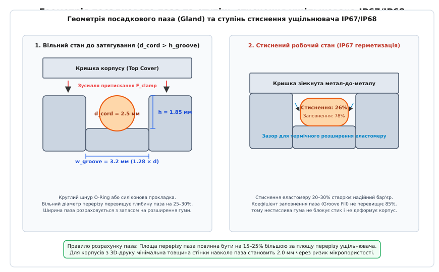
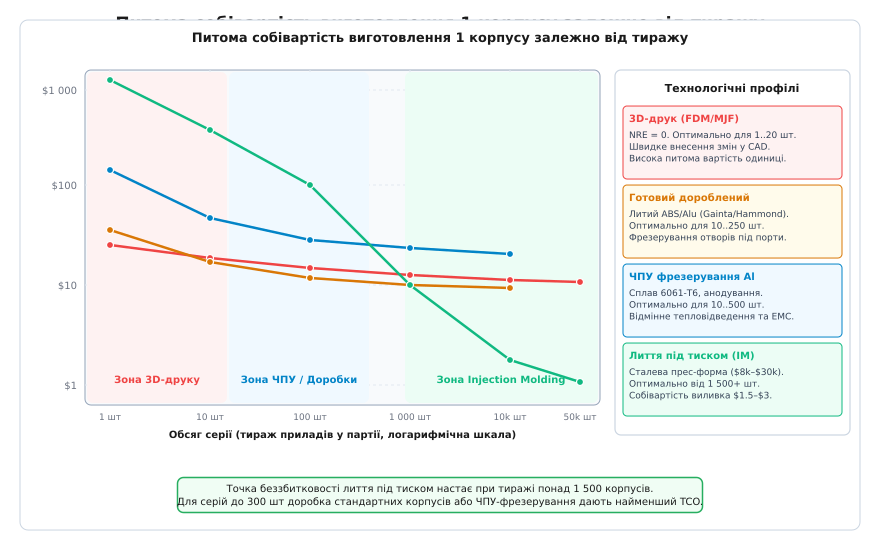

# З чого зробити корпус: друк, фрезерування, готова коробка

<preknowlist>
- [Клас захисту IP](root:hw-pcb/klas-zakhystu) — стандарти герметичності IEC 60529, динамічний напір води та проникнення пилу.
- [Контур плати, кріплення й зони заборони](root:hw-pcb/kontur-platy-kriplennia-i-zony-zaborony) — механічні зазори, стійки, Keepout та допуски.
- [Обмін між механікою й САПР плати](root:hw-pcb/obmin-mizh-mekhanikoiu-i-sapr-platy) — формати STEP, DXF, IDF та перевірка колізій компонентів.
- [Захисне покриття плати](root:hw-pcb/zakhysne-pokryttia-platy) — конформні лаки, компаунди та захист від конденсату.
</preknowlist>

Друкована плата, випробувана на лабораторному столі, перетворюється на працездатний комерційний або індустріальний прилад лише тоді, коли вона отримує фізичну оболонку. Корпус визначає захист чутливої схемотехніки від механічних ударів, вібрацій, проникнення вологи й пилу, слугує первинним радіатором для розсіювання тепла від силових транзисторів і процесорів, екранує електромагнітні завади та формує ергономіку інтерфейсу користувача. Проте помилка у виборі методу виготовлення корпусу на ранньому етапі проекту здатна зруйнувати економіку виробу: спроба надрукувати серію з 500 штук на FDM-принтері перетворюється на сотні годин машинного часу та брак через короблення шарів; замовлення 5-координатного фрезерування з суцільної алюмінієвої плити для дрібної серії роздуває собівартість до сотень доларів за одиницю; а передчасне виготовлення сталевої прес-форми вартістю 25 000 USD до стабілізації топології плати призводить до списання оснастки після першої ж зміни висоти електролітичного конденсатора.

Вибір технологічного процесу створення корпусу є балансом між початковими витратами на підготовку виробництва (NRE — Non-Recurring Engineering), питомою собівартістю одиниці у партії, механічною міцністю, теплопровідністю та допустимими геометричними допусками. Нижче наведено детальний фізико-механічний та економічний аналіз чотирьох головних шляхів створення корпусу: адитивного 3D-друку, субтрактивної обробки на ЧПУ-верстатах, доопрацювання готових стандартних корпусів та серійного лиття термопластів під тиском. Для автоматизованого розрахунку точки беззбитковості та вибору оптимальної технології залежно від тиражу призначено інженерний інструмент, наведений у практичній вставці [Калькулятор собівартості корпусу та вибору технології виготовлення](root:hw-pcb/z-choho-zrobyty-korpus/proj-enclosure-cost-analyzer.md).

---

## 1. Адитивні технології: 3D-друк для прототипів і дрібних партій

3D-друк повністю усуває бар'єр початкових витрат на оснастку: цифрова CAD-модель перетворюється на готовий виріб за лічені години. Проте пошаровий синтез накладає суворі фізичні обмеження на ізотропію міцності, температурну стійкість, герметичність та якість посадкових поверхонь під кріплення.

```
[Порівняння конструкційних термопластів і фотополімерів для корпусів]
Матеріал    HDT (0.45 МПа)  Усадка (%)  Ударна в'язкість  Стійкість до UV  Особливість застосування
PLA             55 °C       0.2..0.4%       15 кДж/м²         Низька      Лише макетування габаритів
PETG            70 °C       0.2..0.5%       25 кДж/м²        Середня      Лабораторні корпуси
ABS             95 °C       0.4..0.8%       35 кДж/м²         Низька      Термостійкі бокси, потрібна камера
ASA             98 °C       0.4..0.7%       30 кДж/м²        Відмінна     Вуличні прилади, стійкість до сонця
PA12 (MJF/SLS) 135 °C       1.0..1.5%       45 кДж/м²         Висока      Серійні міцні корпуси з застібками
Tough Resin     50 °C       0.3..0.6%       20 кДж/м²         Низька      Високоточні деталі, оптичні трубки
```

### Пошарове наплавлення (FDM / FFF)

У технології FDM розплавлена термопластична нитка видавлюється через сопло діаметром 0.4–0.6 мм і вкладається шарами завтовшки 0.12–0.28 мм. Головна проблема FDM-деталей — виражена анізотропія механічних властивостей. Міцність на розрив уздовж осі Z (між шарами) становить лише 40–60% від міцності в площині друку XY. Якщо стінка корпусу зазнає згинального навантаження або тиску від внутрішнього роз'єму під час підключення кабелю, лінія зламу майже завжди проходить по межі спаювання шарів.

Температурна деформація під навантаженням (HDT — Heat Deflection Temperature) визначає експлуатаційну межу пластику. Популярний для початкового 3D-друку полілактид (PLA) має температуру склування всього Tg ≈ 55–60 °C. Якщо прилад встановлено в автомобілі під лобовим склом або в закритому шафі поруч із джерелом живлення, корпус із PLA деформується під дією власної ваги або натягу монтажних гвинтів. Для робочих електронних блоків мінімальним базовим пластиком є PETG (гліколь-модифікований поліетилентерефталат, HDT ≈ 70 °C), а для промислових і автомобільних умов — ABS або ASA (HDT ≈ 95–100 °C).

Акрилонітрил-стирол-акрилат (ASA) є прямим аналогом ABS, де полібутадієновий каучук замінено на акрилатний еластомер. Завдяки цьому ASA не деградує і не жовтіє під дією сонячного ультрафіолетового випромінювання (UV), що робить його еталоном для вуличних корпусів систем моніторингу, метеостанцій та антенних модулів.

Термічна усадка та внутрішні напруження під час кристалізації ABS і ASA досягають 0.4–0.8%. Без термоізольованої робочої камери з температурою повітря +50...+70 °C перепад температур між екструдером (+245 °C) і навколишнім середовищем призводить до підриву кутів деталі від столу (Warping) та розшарування стінок уздовж осі Z. У слайсері для компенсації лінійної усадки масштаб моделі збільшують на коефіцієнт K = 1.005...1.008.

### Фотополімерний друк (SLA / MSLA / DLP)

Стереолітографія забезпечує пошарове фотополімеризування рідкої епоксидної або акрилатної смоли ультрафіолетовим випромінюванням (довжина хвилі 405 нм). Роздільна здатність досягає 25–50 мкм по осі XY і 25–50 мкм по осі Z. На відміну від FDM, SLA-деталі мають квазіізотропну структуру: міжшарові хімічні ковалентні зв'язки практично не поступаються міцності основного масиву полімеру.

SLA ідеально підходить для створення корпусів зі складною мікрогеометрією: тонкостінних світловодів для SMD-світлодіодів, кнопок із тактильними виступами, фіксаторів оптичних сенсорів та мініатюрних роз'ємів. Проте стандартні фотополімерні смоли (Standard Resin) мають високу крихкість (ударна в'язкість за Ізодом менше 15 Дж/м) і продовжують деградувати під дією природного ультрафіолету: через 3–6 місяців експлуатації на відкритому повітрі деталь покривається мікротріщинами і розсипається від легкого удару. Інженерні смоли типу Tough або High-Temp компенсують цей дефект введенням уретанових олігомерів, однак вимагають обов'язкової фінішної термостабілізації у спеціальній камері ультрафіолетового дозапікання.

### Лазерне спікання (SLS) та Multi Jet Fusion (MJF)

Промисловий 3D-друк за технологіями SLS та MJF базується на спіканні поліамідного порошку (PA12 / Nylon). Порошкова постіль слугує природною підтримкою для навісних елементів, що дозволяє проектувати геометричні форми будь-якої складності без генерації допоміжних підтримок: внутрішні змійовики повітроводів, тонкі пружні застібки-защіпки (Snap-fits) та інтегровані кабель-канали.

Поліамід PA12 володіє високою в'язкістю, довговічністю та робочим температурним діапазоном від -40 до +125 °C. Вироби, отримані методом MJF, демонструють повністю ізотропні характеристики міцності й можуть безпосередньо використовуватись у серійних виробах тиражем до 500–1000 одиниць.

Головним підводним каменем деталей з PA12 є мікропористість поверхні. Необроблені SLS/MJF-корпуси вбирають до 1.5% вологи за масою та пропускають повітря і воду під тиском понад 5–10 кПа, що робить їх непридатними для сертифікації за класами IP67 без додаткової постобробки. Для усунення пористості застосовують хімічне парове згладжування (Vapor Smoothing) у парах розчинника або просочування спеціальними поліуретановими гідрофобними лаками.

### Встановлення нарізних вставок (Heat-Set Inserts) проти саморізів

Пряме вкручування металевого кріпильного гвинта у термопласт за допомогою саморіза (Plastite screws з кутом профілю різьби 30°) допускає не більше 2–3 циклів розбирання приладу: пластикова нарізка зрізається або кришиться. Для створення надійних різьбових з'єднань M2–M4 у 3D-друкованих корпусах безальтернативним стандартом є латунні термозапресовувані вставки (Heat-set brass inserts) з діагональною або ромбічною насічкою.

```
[Геометрія бонки під термозапресовувану втулку]
       |<- D_hole ->|
  +----+            +----+  ---
  |                      |   |
  |    +------------+    |   | H_boss >= L_insert + 0.5 мм
  |    |  Латунна   |    |   |
  |    |  вставка   |    |   |
  |    +------------+    |  ---
  |                      |
  +----------------------+
  |<------ D_boss ------>|  (D_boss = 2.0..2.5 * D_insert)
```

Встановлення виконується за допомогою паяльника зі спеціальним конічним жалом, нагрітим до температури склування/плавлення матеріалу (+220...+260 °C для PETG/ABS). Розплавлений пластик затікає у канавки та ромбічні пази вставки, створюючи монолітне механічне замкове з'єднання. 

Для розрахунку геометрії посадкової бонки (Boss Design) діють строгі правила:
1. **Зовнішній діаметр бонки:** D_boss >= 2.0...2.5 * D_insert. За меншої товщини стінки розплавлений пластик роздуває бонку радіальним тиском, утворюючи поздовжні тріщини.
2. **Діаметр отвору:** D_hole обирається на 0.1–0.15 мм меншим за зовнішній діаметр тіла вставки (без урахування насічки).
3. **Глибина отвору:** H_hole >= L_insert + 0.5 мм. Додатковий простір на дні запобігає видавлюванню розплавленого пластику всередину внутрішньої метричної різьби.
4. **Західна фаска:** на вході отвору обов'язково формується фаска 0.3...0.5 мм х 45° для первинного центрування втулки строго перпендикулярно до осі бонки.

---

## 2. Субтрактивна обробка: ЧПУ-фрезерування металевих корпусів

Коли до корпусу висуваються безкомпромісні вимоги щодо механічної жорсткості, стійкості до вібраційних та ударних навантажень (стандарти MIL-STD-810H, класи IK08–IK10), прямого відведення теплової потужності понад 10–50 Вт або повного електромагнітного екранування (EMI Shielding), єдиним рішенням стає фрезерування з суцільної плити або екструдованого блоку алюмінієвого сплаву.

### Алюмінієві сплави 6061-T6 проти 7075-T6

```
[Характеристики конструкційних алюмінієвих сплавів]
Параметр                            6061-T6                 7075-T6
Основні легуючі елементи            Mg (1.0%), Si (0.6%)    Zn (5.6%), Mg (2.5%), Cu (1.6%)
Межа текучості (Yield Strength)     276 МПа                 503 МПа
Межа міцності (Tensile Strength)    310 МПа                 572 МПа
Теплопровідність                    167 Вт/(м·К)            130 Вт/(м·К)
Оброблюваність різанням (Machinability) Відмінна            Дуже добра
Якість анодного оксидування         Висока, однорідна       Потребує контролю, сіруватий відтінок
Зварюваність (TIG/MIG)              Відмінна                Погана (схильність до тріщин)
Відносна вартість сировини          1.0×                    1.6..1.9×
```

Сплав **6061-T6** є світовим стандартом для корпусів електронної апаратури. Він поєднує високу межу текучості (276 МПа), чудову теплопровідність (167 Вт/(м·К)), мінімальне налипання стружки на фрезу та здатність формувати ідеальний декоративний оксидний шар під час кольорового анодування.

Сплав **7075-T6** (високоміцний авіаційний алюміній) обирають у випадках, коли корпус одночасно є тримальним силовим елементом конструкції: рамою безпілотного літального апарата, корпусом бортового комп'ютера ракетного комплексу або шасі роботизованої платформи. Через наявність міді (1.6%) сплав 7075 має нижчу корозійну стійкість у вологому середовищі та гірше сприймає класичне декоративне сірчанокислотне анодування (утворюється тьмяний, неоднорідний сіро-оливковий відтінок).

### Правила DFM (Design for Machining) для зниження вартості ЧПУ

Фрезерування здійснюється обертовим циліндричним інструментом (кінцевою фрезою). Спроба перенести геометрію пластикового корпусу на метал без урахування кінематики верстата збільшує вартість обробки у 3–5 разів.

```
[Геометрія внутрішнього кута при фрезеруванні]
  Прямий кут (НЕМОЖЛИВО):         Скруглення радіусом фрези R:     Кутове розвантаження Dogbone:
  +----------------+              +----------------+               +----------------+
  |                |              |                |               |       ___      |
  |                |              |              / |               |      /   \     |
  |                |              |            ( R |               |     |     |    |
  |                |              |              \ |               |      \___/     |
  +----------------+              +----------------+               +----------------+
  (Залишається R фрези)          (Плата має зазор або фаску)       (Прямокутний кут заходить вільно)
```

Головні правила проектування фрезерованих корпусів:
1. **Внутрішні вертикальні радіуси кутів:** фреза фізично не здатна утворити внутрішній прямий кут 90°. Внутрішній радіус R повинен бути щонайменше на 0.5 мм більшим за радіус фрези (наприклад, R = 3.5 мм для стандартної фрези діаметром 6.0 мм). Це дозволяє верстату плавно проходити кут по дузі без різкого гальмування та виникнення вібрацій (Chatter).
2. **Співвідношення глибини кишені до діаметра інструмента:** глибина вибірки металу L не повинна перевищувати чотирьох діаметрів фрези (L / D <= 4). При співвідношенні L/D > 4 зростає відхилення фрези під дією сили різання, погіршується шорсткість поверхні, падає точність і оператор змушений знижувати подачу у 5–10 разів.
3. **Мінімальна товщина стінок і дна:** для алюмінію 6061-T6 мінімальна товщина стінки становить 1.0–1.5 мм. Тонші стінки починають резонувати та деформуватися під дією сил різання, утворюючи хвилястість або прорив матеріалу.
4. **Кутові розвантаження («Dogbone» / «T-Bone»):** якщо прямокутна друкована плата повинна щільно сідати у фрезероване гніздо без додаткового зазору, у кутах кишені фрезеруються локальні виходи фрези за межі контуру (Dogbone relief).

### Фінішна обробка та анодування: Type II проти Type III

Свіжооброблена алюмінієва поверхня має сліди проходів фрези і швидко покривається оксидною плівкою, чутливою до плям від рук і корозії.

Етапи фінішної обробки металевого корпусу:
1. **Дробоструминне очищення (Bead Blasting):** деталь обробляється струменем скляних або керамічних мікрокульок (фракція 100–200 мкм) під тиском 4–6 бар. Це створює рівномірну матову сатинову текстуру, маскуючи сліди інструмента.
2. **Анодне оксидування Type II (Sulfuric Anodizing за MIL-A-8625):** електрохімічне вирощування пористого шару Al2O3 завтовшки 10–25 мкм із подальшим наповненням органічними барвниками (чорний, синій, червоний) та гідротермічним закриттям пор. Забезпечує корозійну стійкість і декоративний вигляд.
3. **Тверде анодування Type III (Hardcoat):** проводиться при температурі електроліту 0...+5 °C і підвищеній густині струму. Товщина шару досягає 25–50 мкм, а мікротвердість — до 60–65 HRC (порівнянно із загартованою сталлю).

> [!WARNING]
> Оксид алюмінію Al2O3 є досконалим діелектриком із напругою пробою понад 500–1000 В. Повністю анодований корпус блокує передачу електричного струму між кришкою, основою та екраном друкованої плати, повністю руйнуючи контур заземлення та захист від електромагнітних завад (EMI).

Для відновлення електропровідності в місцях контакту плати з корпусом та по лінії прилягання кришки застосовують:
- **Маскування різьбових отворів і фланців:** встановлення гумових заглушок перед анодуванням.
- **Хімічне оксидування / пасивацію (Alodine / SurTec 650 / MIL-DTL-5541):** нанесення електропровідного конверсійного хроматного покриття (перехідний електричний опір менше 0.1 Ом), яке захищає алюміній від корозії без створення діелектричного бар'єра.

### Інтеграція корпусу як радіатора (Thermal Management)

Металевий корпус здатний розсіювати тепло від гарячих компонентів безпосередньо у довкілля. Для цього на внутрішній поверхні корпусу проектуються контактні теплові виступи (Thermal Pedestals / Bosses), які через еластичні теплопровідні прокладки (Thermal Gap Pads з коефіцієнтом k = 3.0...6.0 Вт/(м·К)) торкаються кришок процесорів, транзисторів перетворювачів живлення та підсилювачів потужності.

Тепловий опір теплопровідного стовпчика розраховується за формулою:

```
[Тепловий опір теплопровідного виступу корпусу]
R_th_boss = L / (k_al * A)

де:
L    — висота виступу, м;
k_al — теплопровідність алюмінію (167 Вт/(м·К) для 6061-T6);
A    — площа поперечного перерізу виступу, м².
```

Для ефективного скидання тепла у повітря зовнішня поверхня корпусу фрезерується у вигляді масиву вертикальних або поздовжніх ребер охолодження. Крок між ребрами при природній конвекції повинен становити не менше 6–10 мм: надто густе розташування ребер призводить до змикання пограничних шарів нагрітого повітря, що зупиняє вільну циркуляцію (ефект термосифона) і різко знижує ефективність охолодження.

---

## 3. Стандартні готові корпуси: баланс вартості та швидкості

Коли розробка власного корпусу з нуля економічно недоцільна через малий тираж або обмежені терміни, найефективнішим інженерним шляхом є адаптація готового серійного корпусу від спеціалізованих світових виробників: Gainta Industries, Hammond Manufacturing, Fibox, Bopla, Rose Enclosures.

```
[Типові конструкційні серії готових корпусів]
Серія / Виробник    Матеріал              Клас захисту  Типове застосування
Hammond 1455        Екструдований алюміній IP54          Лабораторні прилади, слоти під плату 1.6 мм
Hammond 1590 / G1xx Литий алюміній під тиском IP65..IP67 Екрановані радіоблоки, педалі ефектів
Gainta G2xx / G3xx  Полікарбонат / ABS    IP65..IP68    Промислова автоматика, сенсори, NEMA 4X
Hammond 1554 / 1555 Ударостійкий ABS/PC   IP66..IP67    Вуличні контролери з прозорими кришками
```

### Конструктивні типи стандартних корпусів

1. **Корпуси з екструдованого алюмінієвого профілю (наприклад, Hammond 1455):**
   Складаються з відрізка суцільнотягненої алюмінієвої труби складного перерізу з вбудованими внутрішніми пазами (Card Guides) шириною 1.8–2.0 мм, у які плата стандартної товщини 1.6 мм засувається без жодних кріпильних гвинтів. Торці корпусу закриваються плоскими алюмінієвими або пластиковими панелями.

2. **Литі під тиском алюмінієві коробки (Die-cast Aluminum, Hammond 1590, Gainta G100-серія):**
   Мають високу міцність, товщину стінок 2.0–3.5 мм, кути нахилу стінок 1°...2° (технологічний ухил лиття) і лабіринтне з'єднання кришки типу «паз-гребінь» (Tongue and Groove). Забезпечують бездоганне екранування радіочастотних трактів (до 80–100 дБ на частотах до 1 ГГц) та високу ударну міцність.

3. **Пластикові промислові бокси з еластомерним ущільнювачем (NEMA / IP67):**
   Виготовляються з ударостійкого полікарбонату (PC) або негорючого ABS-пластику (клас горючості UL94-V0). Кришка фіксується нержавіючими гвинтами, які вкручуються у латунні нарізні втулки, інтегровані в тіло бонки ще на етапі заводського лиття.

### Технологія доопрацювання (Post-Machining)

Використання готового корпусу зводиться до фрезерування індивідуальних отворів на передній і задній панелях під інтерфейсні роз'єми (Type-C, RJ45, DB9, SMA), індикатори, кнопки та кабельні вводи.

Оскільки обробці піддаються лише окремі плоскі грані або знімні тонкі торцеві кришки, час роботи ЧПУ-верстата скорочується з 40–60 хвилин (для цільнофрезерованого корпусу) до 1.5–3 хвилин на виріб. Для закріплення корпусу на столі верстата виготовляється найпростіший полімерний ложемент (Soft Jaw), що зводить вартість підготовки виробництва (CAM NRE) до 50–100 USD.

Маркування портів, нанесення логотипів та позначень пінів виконується методом планшетного ультрафіолетового друку (UV Flatbed Printing) полімерними чорнилами або за допомогою волоконного лазерного гравіювання (Fiber Laser Engraving), яке на анодованому алюмінії створює довговічний контрастний білий напис завдяки мікротермічному знебарвленню барвника.

---

## 4. Серійне лиття термопластів під тиском (Injection Molding)

Коли тираж виробу перевищує 1 000–3 000 одиниць, адитивні та субтрактивні методи стають економічно неконкурентоспроможними через високу питому частку машинного часу. Лиття пластмас під тиском дозволяє отримувати складні тонкостінні оболонки з циклом відливання однієї деталі всього 15–45 секунд за собівартості витраченого пластику від 0.50 до 3.00 USD. Проте платою за низьку питому ціну є екстремально висока вартість проектування та виготовлення прес-форми (8 000–40 000+ USD).

### Економіка прес-форм: Soft Tooling проти Hard Tooling

```
[Класифікація ливарних прес-форм]
Тип форми           Матеріал матриці/пуансона   Ресурс (циклів)     Орієнтовна вартість  Сфера застосування
Прототипна (Soft)   Алюміній 7075-T6            5 000..25 000       $3 000..$8 000       Пілотні партії, швидкий вихід
Серійна (Medium)    Сталь P20 (загартована)     100 000..300 000    $10 000..$20 000     Основне серійне виробництво
Масова (Hard)       Сталь H13 / S136 (нерж.)    500 000..1 500 000+ $25 000..$60 000+    Мільйонні тиражі, абразивні пластики
```

Алюмінієві прес-форми (Soft Tooling) виготовляються на високошвидкісних ЧПУ-верстатах за 2–3 тижні. Вони чудово підходять для валідації ринку та випуску пілотних серій до 10 000 виробів. Сталеві прес-форми (Hard Tooling) вимагають електроерозійної обробки (EDM), шліфування та термообробки у вакуумних печах, однак здатні витримувати тиск упорскування розплаву до 100–150 МПа протягом сотень тисяч циклів без зміни розмірів.

### Правила DFM (Design for Injection Molding)

Недотримання правил ливарної технології призводить до фатальних дефектів: утяжин (Sink Marks), жолоблення через нерівномірну усадку (Warpage), недоливів (Short Shots) або заклинювання деталі у формі.

```
[Правила проектування стінок, ребер і бонок для лиття під тиском]

  1. Рівномірна стінка (t):       2. Ребро жорсткості (Rib):       3. Бонка під гвинт (Boss):
  ========================        ======   =================        ===   +---+   ===
                                            |   |                          |   |
                                            |   | h <= 3*t                 | d | D_boss = 2*d
                                           /  t_rib \                      |   |
  ========================        =======+---------+========        =======+---+======
  Плавні переходи R >= 0.5*t      t_rib = 0.5..0.6 * t             t_boss = 0.6 * t
                                  (Запобігає утяжинам)             (З'єднується з стінкою ребрами)
```

Фундаментальні правила проектування литих корпусів:
1. **Технологічні ухили (Draft Angles):** усі вертикальні грані, паралельні напрямку розмикання прес-форми, повинні мати ухил 1°...2° на сторону. Для поверхонь із текстурою (шагрень за шкалою VDI 3400 або Mold-Tech) ухил збільшують на +1° на кожні 25 мкм глибини текстури. Відсутність ухилу призводить до стирання та утворення подряпин під час виштовхування деталі.
2. **Постійна товщина стінок (Nominal Wall Thickness):** номінальна товщина обирається в межах 1.8–3.0 мм і підтримується строго рівномірною по всій деталі. Переходи між різними товщинами виконуються плавними скосами довжиною щонайменше втричі більшою за різницю товщин.
3. **Ребра жорсткості (Ribs):** для підвищення жорсткості корпусу замість збільшення загальної товщини стінки застосовують ребра. Товщина ребра біля основи t_rib повинна складати 0.5...0.6 від товщини основної стінки t, а висота — не більше 3 * t. Якщо ребро зробити товстішим (t_rib > 0.7 * t), у місці масивного скупчення пластику при охолодженні утворюється вакуумна порожнеча, яка втягує зовнішню поверхню, формуючи видиму канавку-утяжину (Sink Mark).
4. **Бокові піднутрення (Side Actions / Lifters):** будь-який отвір під роз'єм або застібка на боковій стінці, перпендикулярній до напрямку руху форми, вимагає введення в конструкцію форми рухомих гідравлічних або механічних повзунів (Sliders). Кожен повзун здорожчує прес-форму на 1 500–3 500 USD.

---

## 5. Фізика герметизації: розрахунок посадкового паза IP67/IP68

Забезпечення захисту від пилу та води за стандартами IEC 60529 базується на правильній пружній деформації еластомерної прокладки (O-Ring або фасонного силіконового шнура).


*Геометрія посадкового паза (Gland) та ступінь стиснення ущільнювача IP67/IP68: зліва — вільний стан шнура до затягування; справа — робочий стан зі змиканням металевих фланців і зазорами для термічного розширення еластомеру*

### Розрахунок ступеня стиснення та заповнення паза

Гумові та силіконові еластомери практично нестисливі за об'ємом (коефіцієнт Пуассона nu ≈ 0.499...0.500): при стисканні по висоті матеріал розширюється в бокові сторони.

Ключові параметри розрахунку паза:
1. **Ступінь стиснення за висотою (Squeeze):**
   ```
   [Ступінь деформації ущільнювача]
   S = ((d_cord - h_groove) / d_cord) * 100%
   
   Оптимальний діапазон для статичного ущільнення IP67/IP68:
   S_opt = 20% .. 30%
   ```
   Стиснення менше 15% не компенсує мікронерівності та короблення поверхонь корпусу між кріпильними гвинтами. Стиснення понад 35% викликає надмірну релаксацію механічних напружень (Compression Set), що призводить до розтріскування еластомеру при термоциклі.

2. **Коефіцієнт заповнення паза (Groove Fill):**
   ```
   [Коефіцієнт заповнення паза еластомером]
   Fill = (A_cord / A_groove) * 100% = ((pi * d_cord^2 / 4) / (w_groove * h_groove)) * 100%
   
   Критичне обмеження:
   Fill_max <= 80% .. 85%
   ```
   Якщо площа поперечного перерізу шнура перевищить 85% площі паза, при нагріванні приладу (коефіцієнт теплового розширення силікону в 10–15 разів вищий за алюміній) розширена гума заповнить увесь вільний об'єм паза, упреться у стінки і створить гідростатичний тиск, здатний вигнути кришку та зрізати різьбу монтажних гвинтів.

3. **Крок кріпильних гвинтів і жорсткість фланця:**
   Відстань між сусідніми гвинтами вздовж ущільнювального контуру L_screw не повинна перевищувати 30–50 мм для пластикових корпусів і 50–80 мм для литих/фрезерованих алюмінієвих. При більшому кроці кришка між гвинтами вигинається назовні під дією пружної реакції гуми, утворюючи мікрозазор, через який проникає вода під динамічним напором.

---

## 6. Економічна матриця вибору та модель сукупної вартості (TCO)

Для прийняття остаточного інженерного рішення щодо технології виготовлення корпусу оцінюють сукупну вартість володіння (TCO — Total Cost of Ownership) як функцію від розміру партії N.


*Порівняння питомої собівартості виготовлення 1 корпусу залежно від тиражу: перетин кривих визначає точки зміни технологічного процесу від 3D-друку до лиття під тиском*

Математична модель повної собівартості партії з N корпусів:

```
[Модель розрахунку сукупної собівартості партії]
C_total(N) = C_NRE + C_setup + N * (C_raw + C_machine + C_post + C_labor)

Питома вартість одного корпусу:
C_unit(N)  = C_total(N) / N
```

де:
* C_NRE — початкові витрати на проектування та оснастку (CAM-програмування, виготовлення прес-форми або ложементів);
* C_setup — вартість переналагодження обладнання перед запуском партії;
* C_raw — вартість витраченої сировини (філамент, полімерна смола, алюмінієва плита, стандартний бокс);
* C_machine — амортизаційна вартість часу роботи верстата чи 3D-принтера (T_cycle * Rate_hour);
* C_post — вартість фінішних операцій (видалення підтримок, анодування, гравіювання, запресовування вставок);
* C_labor — трудовитрати оператора на збирання й контроль геометрії.

```
[Зведена матриця технологічного вибору корпусу]
Критерій вибору          3D-друк (FDM / MJF)     ЧПУ-фрезерування (6061)  Готовий корпус (Gainta)  Лиття під тиском (IM)
Оптимальний тираж        1 .. 20 шт.             10 .. 500 шт.            20 .. 500 шт.            1 500 .. 100 000+ шт.
Початкові витрати (NRE)  $0                      $100 .. $300 (CAM)       $50 .. $150              $8 000 .. $35 000 (форма)
Питома ціна деталі       $15 .. $45              $30 .. $120              $12 .. $35               $1.20 .. $4.00
Швидкість запуску        1 .. 2 дні              3 .. 7 днів              2 .. 5 днів              4 .. 8 тижнів
Механічна міцність       Низька / Середня        Екстремальна             Висока                   Висока
Тепловідведення          Мізерне (< 0.2 Вт/(м·К)) Ідеальне (167 Вт/(м·К))  Добре (литий Alu)        Низьке (пластик)
Електромагнітне екранування Немає (потрібен спрей) Відмінне (Faraday cage)  Відмінне (Alu версії)   Потребує металізації
Стійкість до вібрацій    Середня (втома шарів)   Висока (моноліт)         Висока                   Висока
Герметичність (IP67)     Складна (пористість)    Висока (точний паз)      Гарантована заводська    Висока (стабільний паз)
```

### Практичний алгоритм ухвалення рішення

1. **Етап НДДКР і прототипування (1–5 шт):** швидкий друк на FDM або SLA для фізичної перевірки взаємного розташування роз'ємів, колізій із радіаторами та ергономіки монтажу плати.
2. **Пілотна партія для сертифікації та клієнтських тестів (10–50 шт):** друк методом MJF (PA12) для пластикових виробів або ЧПУ-доопрацювання стандартних литих корпусів Gainta/Hammond для індустріальних та вуличних блоків.
3. **Дрібносерійне виробництво (50–500 шт):** ЧПУ-фрезерування з анодованого алюмінію для преміальних, високонавантажених або силових приладів; доопрацьовані корпуси з лазерним маркуванням — для стандартної автоматики.
4. **Масштабування у велику серію (понад 1 500 шт):** замовлення сталевої прес-форми після повної заморозки ревізії друкованої плати та фіналізації сертифікаційних випробувань.

---

## 7. Програмний розрахунок собівартості технологій та аналіз беззбитковості

Для точного інженерного порівняння витрат реалізовано консольну утиліту, яка приймає параметри габаритів корпусу, масу, теплову потужність, вимоги до IP-захисту та обсяг партії.

Повний вихідний код програми обома мовами стандарту C99 та C++20 із детальним розбором алгоритмів калькуляції подано у вставці [Калькулятор собівартості корпусу та вибору технології виготовлення](root:hw-pcb/z-choho-zrobyty-korpus/proj-enclosure-cost-analyzer.md).
