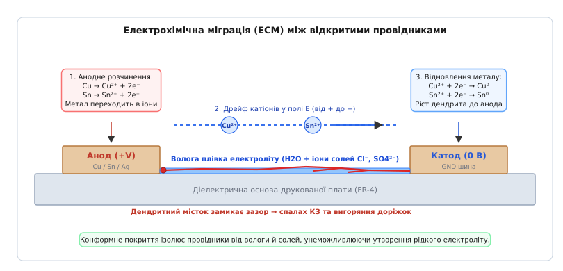
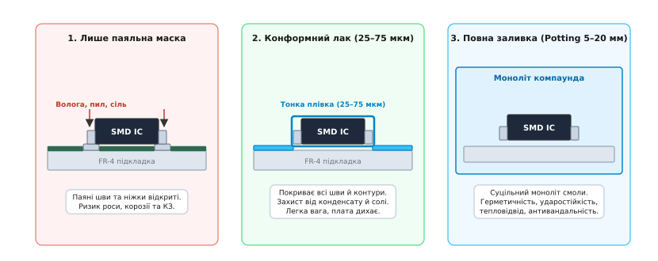
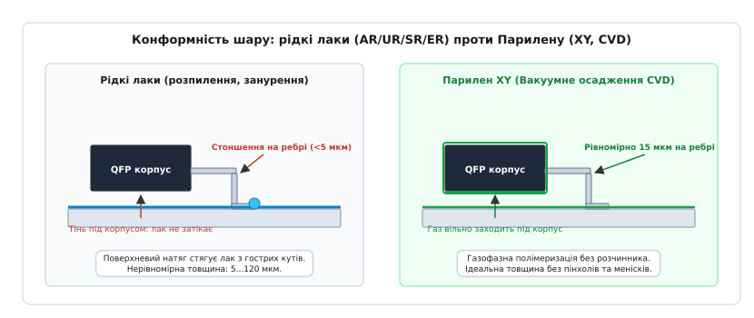
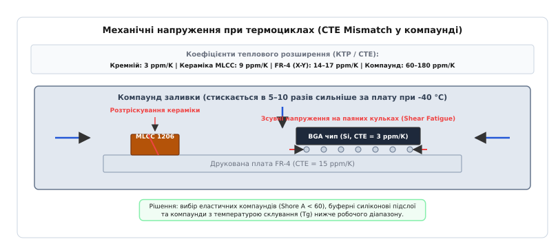
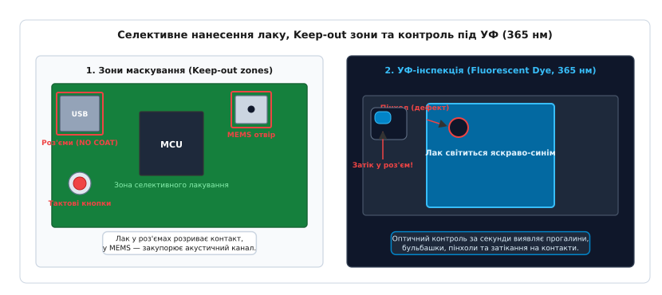

# Захисне покриття плати: лак, залив, ущільнення

<preknowlist>
- [Шарування плати (PCB stackup)](root:hw-pcb/pcb-stackup) — структура шарів, склотекстоліт FR-4, паяльна маска та мідні полігони.
- [Зазори на платі: creepage та clearance](root:hw-pcb/creepage-clearance) — поверхневий трекінг, струми витоку та пробій діелектрика по забрудненій поверхні.
- [Паяння оплавленням (Reflow soldering)](root:hw-pcb/reflow-soldering) — формування паяних менісків, флюсові залишки та змочування виводів.
- [Теплові перехідні отвори (Thermal vias)](root:hw-pcb/thermal-vias) — відведення тепла крізь плату та тепловий опір конструкції.
- [Клас захисту IP](root:hw-pcb/klas-zakhystu) — рівні герметизації корпусів проти пилу та води (IP67/IP68).
</preknowlist>

Компактний промисловий контролер або блок керування кроковим двигуном успішно проходить усі лабораторні тести на стенді в чистому сухому приміщенні. Але через три місяці роботи у відкритому польовому шафі, теплиці чи моторному відсіку автомобіля прилад раптово вимикається. Під час діагностики з'ясовується, що між сусідніми ніжками контролера з кроком 0.5 мм (де діє напруга 3.3 В) або між силовою шиною +24 В та землею виникло коротке замикання. Під мікроскопом видно тонкі розгалужені металеві нитки, що виросли крізь паяльну маску від одного виводу до іншого, а навколо паяних швів блищить вологий наліт із зеленими й білими плямами розчинених солей.

Ця аварія сталася тому, що стандартна заводська паяльна маска (*Solder Mask*) захищає лише пласкі ділянки мідних доріжок. Усі відкриті металеві поверхні — паяні меніски чіп-компонентів, торці ніжок QFP та QFN корпусів, контрольні точки та перехідні отвори — залишаються повністю відкритими для навколишнього повітря, пилу, конденсату та агресивних хімічних газів.

---

### Механізм електрохімічної міграції та захисні бар'єри

Коли вологість повітря перевищує 60–70%, а температура корпусу приладу падає нижче точки роси (*Dew Point*), на холодній поверхні друкованої плати конденсується мікроскопічна водна плівка товщиною в кілька десятків молекулярних шарів. Пил, залишки технологічного флюсу після пайки та солі з повітря (хлориди, сульфати) миттєво розчиняються у воді, перетворюючи її на рідкий електроліт з іонною провідністю.

Якщо між двома сусідніми провідниками прикладено постійну різницю потенціалів (наприклад, 3.3 В, 5 В або 24 В), в електролітичній плівці запускається процес **електрохімічної міграції (англ. *Electrochemical Migration, ECM*)**:

1. **Анодне окиснення (розчинення металу):** На позитивному полюсі (аноді) атоми міді, олова, свинцю або срібла втрачають електрони й переходять у водний розчин у вигляді позитивних іонів:
```text
Cu → Cu²⁺ + 2e⁻       [анодне окиснення міді]
Sn → Sn²⁺ + 2e⁻       [анодне окиснення олова]
```
2. **Дрейф катіонів у полі:** Під дією градієнта електричного поля `E = U / d` (де `d` — зазор між провідниками) гідратовані катіони `Cu²⁺` та `Sn²⁺` починають спрямований рух крізь рідку плівку до негативного полюса (катода).
3. **Катодний ріст дендритів:** Досягнувши катода, катіони приймають електрони й відновлюються назад до нейтрального металевого стану:
```text
Cu²⁺ + 2e⁻ → Cu⁰      [відновлення металу на катоді]
Sn²⁺ + 2e⁻ → Sn⁰      [відкладення нейтрального олова]
```
Осадження металу відбувається не рівномірним дзеркальним шаром, а у формі мікроскопічних кристалічних голок та розгалужених деревоподібних структур — **дендритів** (від грец. *dendron* — дерево). Дендрит росте назустріч електричному полю зі швидкістю від кількох мікрометрів за секунду до десятків мікрометрів за хвилину. Щойно вершина дендрита торкається анода, виникає металевий місток із нульовим опором. По містку спалахує струм короткого замикання, електроліт миттєво закипає, а навколишній текстоліт обвуглюється у струмопровідний вугільний шлак.


*Стадії електрохімічної міграції (ECM) на відкритій платі: від утворення електролітичної плівки роси та анодного розчинення металу до спрямованого дрейфу катіонів і проростання струмопровідних дендритних містків від катода до анода.*

Для запобігання цьому руйнуванню електронні модулі захищають на трьох принципово різних інженерних рівнях:

- **Конформне покриття (*Conformal Coating*):** Тонка безперервна захисна полімерна плівка товщиною від 25 до 75 мкм (до 200 мкм для силіконів), що повторює контури всіх компонентів, запечатує відкриті паяні шви та ізолює провідники від рідкої води, солей і пилу.
- **Об'ємне компаундування / Заливка (*Potting & Encapsulation*):** Повне заповнення корпусу рідкою полімерною смолою (поліуретан, епоксид, силікон) товщиною від 2 до 50 мм, що утворює суцільний монолітний блок із максимальною стійкістю до ударів, вібрацій, високого тиску та несанкціонованого доступу.
- **Корпусне ущільнення (*Enclosure Sealing*):** Герметизація зовнішнього корпусу за допомогою еластомірних прокладок, кілець O-Ring та гермовводів за стандартами [класу захисту IP](root:hw-pcb/klas-zakhystu).


*Три інженерні підходи до захисту електроніки: лише паяльна маска (відкриті ніжки та пайки), конформний тонкий лак (25–75 мкм, що облягає форму компонентів) та повна об'ємна заливка компаундом (Potting) у суцільний моноліт.*

---

### Класифікація конформних покриттів за IPC-CC-830

Вимоги до матеріалів конформних лаків визначені міжнародним стандартом **IPC-CC-830C** (*Qualification and Performance of Electrical Insulating Compound for Printed Wiring Assemblies*) та військовою специфікацією **MIL-I-46058C**. Стандарт класифікує покриття за типом хімічної полімерної основи на п'ять категорій:

```text
AR (Acrylic Resin)        — Акрилові смоли (термопластичні)
UR (Polyurethane Resin)   — Поліуретанові смоли (зшиті)
SR (Silicone Resin)       — Силіконові смоли (еластомери)
ER (Epoxy Resin)          — Епоксидні смоли (термореактивні)
XY (Parylene)             — Парилен (вакуумне осадження)
```

Детальні таблиці діелектричної міцності, температур склування, коефіцієнтів теплового розширення та хімічної стійкості наведено в [довіднику характеристик матеріалів](root:hw-pcb/zakhysne-pokryttia-platy/api-coating-specs.md).

#### 1. Акрилові лаки (Тип AR — Acrylic Resin)

Акрилові лаки — це розчини термопластичних акрилових полімерів в органічних розчинниках (толуол, ксилол, етилацетат). 

- **Механізм отвердіння:** Виключно фізичне висихання шляхом випаровування розчинника. Полімерні макромолекули не утворюють між собою хімічних поперечних зв'язків.
- **Властивості:** Швидке висихання на відлип (10–15 хвилин при кімнатній температурі), прозорість, низька ціна та стабільні діелектричні характеристики в діапазоні температур від -40 до +125 °C.
- **Ремонтопридатність:** Найвища серед усіх покриттів. Оскільки зшивки немає, суха плівка миттєво розчиняється простими розчинниками (ацетон, бутилацетат). Компоненти можна випаювати паяльником прямо крізь шар лаку: під жалом припою акрил безслідно випаровується без виділення агресивних шлаків.
- **Обмеження:** Повна відсутність стійкості до рідких хімікатів. Потрапляння бензину, мастил, ацетону або авіаційного гасу змиває покриття за кілька секунд.

#### 2. Поліуретанові лаки (Тип UR — Polyurethane Resin)

Поліуретани утворюються в результаті реакції поліприєднання між поліізоціанатами (-NCO) та гідроксилвмісними поліолами (-OH).

- **Механізм отвердіння:** Хімічна зшивка. Однокомпонентні склади (1K) полімеризуються за рахунок реакції з вологою навколишнього повітря (час повної полімеризації 24–72 години при вологості >40%). Двокомпонентні склади (2K) змішуються перед нанесенням і полімеризуються за рахунок внутрішнього каталізатора.
- **Властивості:** Формують щільну пружну просторову сітку. Мають виняткову стійкість до пального, мастил, гідравлічних рідин, соляного туману та стирання піском. Зберігають ударну в'язкість при глибокому охолодженні до -65 °C.
- **Обмеження:** Вкрай важкий ремонт. Для видалення потрібні агресивні токсичні стрипери на базі дихлорметану (метиленхлориду) або тривале термічне випалювання, що супроводжується виділенням токсичних парів ізоціанатів.

#### 3. Силіконові лаки (Тип SR — Silicone Resin)

Силікони побудовані на основі неорганічного силоксанового ланцюга `-Si-O-Si-` з бічними органічними метильними або фенільними групами.

- **Механізм отвердіння:** RTV (*Room Temperature Vulcanizing*) вологове отвердіння або термічна платинова полімеризація без виділення побічних летких речовин.
- **Властивості:** Екстремальний температурний діапазон від -65 до +200 °C (короткочасно до +250 °C). Мають дуже низький модуль Юнга (еластичні, м'які), тому не створюють механічних напружень на ніжки чіпів під час різких температурних стрибків. Мають високу гідрофобність (кут змочування водою `θ > 100°`).
- **Обмеження:** Висока проникність для водяної пари та газів (паропроникність силікону в 3–5 разів вища за поліуретан). Силіконові низькомолекулярні олії здатні мігрувати вздовж поверхні плати (*силіконова повзучість*), потрапляючи на контакти реле, кнопок і роз'ємів, де під дією мікродуг утворюють непровідний ізоляційний нагар із діоксиду кремнію `SiO₂`.

#### 4. Епоксидні лаки (Тип ER — Epoxy Resin)

Двокомпонентні термореактивні системи на основі епоксидної діанової смоли та амінного чи ангідридного отверджувача.

- **Властивості:** Найвища механічна міцність, твердість (стійкість до подряпин) і неперевершена адгезія до склотекстоліту FR-4. Не розчиняються більшістю органічних розчинників і кислот.
- **Обмеження:** Висока жорсткість (модуль Юнга `E = 2 – 4 ГПа`). При термоциклах різниця теплового розширення між епоксидом і припоєм викликає втомне зрізання паяних з'єднань. Ремонт практично неможливий: спроба зняти епоксидний шар механічно або розчинником призводить до зриву доріжок з плати.

#### 5. Парилен (Тип XY — Parylene, Poly-para-xylylene)

Парилен кардинально відрізняється від усіх рідких лаків способом нанесення. Це вакуумне хімічне газофазне осадження (**CVD — Chemical Vapor Deposition**) за процесом Горхема (*Gorham Process*):

1. **Сублімація димеру:** Твердий порошкоподібний димер ді-пара-ксилілену нагрівається у вакуумі при температурі близько +150 °C і переходить у газоподібний стан.
2. **Піроліз (термічний крекінг):** Газ проходить крізь високотемпературну трубку піролізу (+650 °C), де міцний зв'язок димеру розривається з утворенням реакційноздатних мономерів дирадикального пара-ксилілену:
```text
(C₈H₈)₂ (димер) ──[+650 °C]──► 2 ·CH₂-C₆H₄-CH₂· (мономерний газ)
```
3. **Осадження та полімеризація:** Газоподібний мономер потрапляє в робочу вакуумну камеру з платами за кімнатної температури (+25 °C). Мономер адсорбується на всіх відкритих поверхнях і миттєво зшивається в довгі лінійні ланцюги полі-пара-ксилілену.


*Конформність шару: рідкі лаки стягуються з гострих граней виводів під дією поверхневого натягу (стоншення до 5 мкм) і утворюють товсті меніски в кутах. Парилен при газофазному осадженні наростає молекула за молекулою з однаковою товщиною (15 мкм) на пласких ділянках, гострих ребрах та під BGA-чіпами.*

Рідкі лаки через поверхневий натяг завжди стягуються з гострих кутів виводів, залишаючи на ребрах шар товщиною лише 2–5 мкм (зона потенційного пробою), тоді як біля основи утворюється товстий меніск до 150 мкм. Парилен позбавлений рідкої фази, тому його шар має однакову товщину (наприклад, рівно `15 ± 1 мкм`) на гострих кінчиках пайки, вертикальних стінках і навіть всередині вузьких щілин під безвивідними чіпами QFN та BGA.

---

### Фізико-хімічні та діелектричні характеристики

#### Вологозахист та паропроникність (WVTR)

Жоден полімерний конформний лак **не є абсолютним бар'єром для водяної пари**. Молекули води мають дуже малий кінетичний діаметр (близько `0.28 нм`) і за рахунок дифузії повільно проходять крізь міжмолекулярні проміжки полімерної сітки. Швидкість цього процесу визначається швидкістю проникнення водяної пари (**WVTR — Water Vapor Transmission Rate**, вимірюється в `г/(м²·доба)`):

```text
WVTR силікону (SR):      80 – 150 г/(м²·доба)   [висока паропроникність]
WVTR акрилу (AR):        30 – 50 г/(м²·доба)    [середня]
WVTR поліуретану (UR):   20 – 40 г/(м²·доба)    [середня]
WVTR епоксиду (ER):      10 – 25 г/(м²·доба)    [помірна]
WVTR Парилену C (XY-C):  0.2 – 0.5 г/(м²·доба)  [екстремально низька]
```

Виникає фундаментальне питання: якщо силікон і поліуретан пропускають пару, чому вони надійно захищають плату? 

Тому що корозія та електрохімічна міграція відбуваються **виключно в рідкій фазі води**, де є вільні іони електроліту. Конформне покриття має високу молекулярну адгезію до паяльної маски та міді, усуваючи вільний об'єм для конденсації рідких крапель. Навіть коли водяна пара дифундує крізь силікон, висока гідрофобність поверхні не дозволяє молекулам води сконденсуватися в електропровідну рідку плівку.

#### Стійкість до соляного туману (Salt Fog Testing)

Випробування на стійкість до соляного туману за стандартами **ASTM B117**, **IEC 60068-2-11** та **MIL-STD-810H Method 509.7** моделюють роботу приладу на морському узбережжі або на днищі автомобіля під дією дорожніх протиожеледних реагентів. Плату поміщають у камеру з розпиленим 5% розчином кухонної солі `NaCl` при температурі +35 °C на 48–168 годин.

Іони хлору `Cl⁻` мають високу проникну здатність і хімічно руйнують оксидні захисні плівки на міді та припої:
```text
Cu₂O + 4Cl⁻ + 2H⁺ → 2[CuCl₂]⁻ + H₂O   [розчинення пасивної плівки міді хлоридами]
```
Якщо в захисному лаку є хоча б один мікроскопічний отвір (пінхол) або тріщина, хлоридний розчин затікає під плівку за рахунок капілярного ефекту, викликаючи вибухоподібну підплівкову корозію та відшарування лаку. Поліуретан, епоксид і Парилен С показують найвищу стійкість у цьому тесті, тоді як одношаровий акрил може деградувати через 48–96 годин.

#### Вплив на діелектричні параметри та високочастотні лінії

Будь-який лак має діелектричну проникність вищу за повітря (`ε_r = 2.5 – 4.0` проти `ε_air = 1.0`). Нанесення шару лаку товщиною `t` поверх відкритих провідників збільшує погонну ємність ліній передачі та змінює їхні хвильові параметри:

1. **Зниження хвильового імпедансу `Z₀`:** Нанесення шару поліуретану товщиною 50 мкм (`ε_r = 3.6`) поверх мікросмужкової лінії 50 Ом на платі товщиною 1.0 мм знижує її імпеданс до `47.5 – 48.0 Ом`. Для цифрових шин I2C/SPI або силових кіл це непомітно, але для радіочастотних трактів 2.4 ГГц (Wi-Fi, Bluetooth) або 5.8 ГГц викликає додаткове відбиття сигналу та ріст коефіцієнта стоячої хвилі (КСХ).
2. **Діелектричні втрати:** Поліуретанові та епоксидні лаки мають високий тангенс кута втрат (`tan δ = 0.01 – 0.04`), що спричиняє додаткове згасання високочастотного сигналу. Для НВЧ-ділянок використовують або прецизійний тонкий Парилен HT (`ε_r = 2.17`, `tan δ = 0.0002`), або маскують радіочастотні мікросмужки, залишаючи їх під металевими екранами без лаку.

---

### Об'ємна заливка та компаундування (Potting & Encapsulation)

Коли прилад працює в умовах повного занурення у воду (глибоководні датчики, гідроакустика, автомобільні блоки під капотом), постійної сильної вібрації або повинен відповідати стандартам вибухобезпеки **ATEX** (де полімерний моноліт унеможливлює контакт електричної іскри з вибухонебезпечною газовою сумішшю), тонкого лаку недостатньо. Застосовують **повну заливку компаундом (*Potting*)**.

Двокомпонентні заливальні смоли ділять на три базові групи:
- **Поліуретанові компаунди:** Мають твердість від Shore A 30 (м'які, желеподібні) до Shore A 85 (пружні, як тверда гума). Ідеально гасять ударні навантаження та вібрації.
- **Епоксидні компаунди:** Тверді моноліти (Shore D 80–92). Забезпечують максимальний захист від механічного злому, проникнення води та дії розчинників.
- **Силіконові компаунди:** Термостійкі еластомери, що працюють до +200 °C.

#### Тепловідведення крізь масив компаунда

Нерухоме повітря всередині закритого герметичного корпусу є чудовим теплоізолятором: його теплопровідність становить лише `k_air ≈ 0.026 Вт/(м·К)`. Потужні силові транзистори (MOSFET, IGBT) та мікросхеми живлення всередині закритого сухого корпусу швидко перегріваються.

Чиста полімерна смола має теплопровідність `k ≈ 0.18 – 0.25 Вт/(м·К)`, що вже майже в 10 разів краще за повітря. Проте для силових блоків живлення, інверторів і драйверів двигунів до складу компаунда вводять високотеплопровідні неорганічні мікронаповнювачі: порошки плавленого оксиду алюмінію `Al₂O₃`, нітриду алюмінію `AlN` або нітриду бору `BN`.

```text
Повітря всередині корпусу:              0.026 Вт/(м·К)
Чиста ненаповнена епоксидна смола:      0.20 – 0.25 Вт/(м·К)
Компаунд з мікронаповнювачем Al₂O₃:     0.80 – 1.30 Вт/(м·К)
Високотеплопровідний компаунд з AlN:    2.00 – 2.50 Вт/(м·К)
```

Заливка теплопровідним компаундом усуває повітряні зазори й передає тепло від гарячих компонентів безпосередньо на металеві стінки корпусу. Тепловий опір шару заливки площею `A` і товщиною `t` розраховується за формулою:
```text
R_th = t / (k · A)    [тепловий опір теплопровідного шару, К/Вт]
```

#### Проблема різниці КТР (CTE Mismatch) та руйнування компонентів

Головна небезпека твердої монолітної заливки — **механічні напруження при зміні температури**. Кожен матеріал друкованого вузла має свій коефіцієнт теплового лінійного розширення (**КТР / CTE**, вимірюється в `ppm/K` або `10⁻⁶ К⁻¹`):

```text
Кремнієвий кристал мікросхеми (Si):    3 – 4 ppm/K
Керамічний конденсатор MLCC (BaTiO₃):  8 – 10 ppm/K
Склотекстоліт FR-4 (в осях X-Y):        14 – 17 ppm/K
Безсвинцевий припій SAC305:            20 – 22 ppm/K
Мідні доріжки (Cu):                    16 – 17 ppm/K
Епоксидний/PU компаунд (нижче T_g):    40 – 80 ppm/K
Епоксидний/PU компаунд (вище T_g):     120 – 250 ppm/K
```

Коли залитий модуль охолоджується від температури полімеризації (+80 °C) до мінімальної робочої температури (-40 °C), зміна температури становить `ΔT = 120 °C`. Компаунд стискається у 5–10 разів сильніше, ніж плата й компоненти.


*Механічні напруження в моноліті компаунда під час охолодження до -40 °C. Компаунд стискається сильніше за плату, створюючи зсувні напруження на паяних кульках BGA-чіпів та розтягувальні сили, що призводять до розтріскування крихких керамічних конденсаторів MLCC.*

Механічне напруження `σ`, що виникає в замкненому об'ємі через різницю КТР, прямо пропорційне модулю Юнга полімеру `E`:
```text
σ = E · |α_potting - α_component| · ΔT / (1 - ν)   [пружне напруження в матеріалі, МПа]
```
де `ν ≈ 0.35 – 0.40` — коефіцієнт Пуассона полімеру.

Якщо застосовано жорсткий епоксидний компаунд з високим модулем Юнга (`E = 3000 МПа`), напруження на паяних швах та корпусах компонентів досягає `50 – 100 МПа`. Це призводить до катастрофічних відмов:
1. **Зрізання кульок BGA:** Крайові паяні кульки BGA-корпусів зазнають циклічного зсуву та відриваються від контактних площадок (*Solder Joint Fatigue*).
2. **Розтріскування кераміки MLCC:** Керамічні багатошарові конденсатори типорозмірів 0805, 1206 і більше тріскаються поперек корпусу. Конденсатор або втрачає ємність, або переходить у стан низькоомного замикання з подальшим вигорянням.
3. **Вигин друкованої плати:** Одностороння заливка призводить до скручування (*Warpage*) плати через нерівномірну усадку.

**Інженерні методи усунення напружень:**
- Використання еластичних поліуретанових або силіконових компаундів з низьким модулем Юнга (`E < 10 – 50 МПа`, твердість Shore A < 60).
- Вибір полімеру з температурою склування `T_g` нижче мінімальної робочої температури (наприклад, `T_g < -45 °C`), завдяки чому матеріал залишається у високоеластичному (каучукоподібному) стані в усьому діапазоні експлуатації.
- Нанесення на тензочутливі чіпи та BGA попереднього тонкого демпфуючого шару силіконового гелю або акрилу (*Stress Buffering Layer*) перед заливкою загального епоксидного масиву.

#### Захист від реверс-інжинірингу (Anti-tamper Potting)

Для захисту комерційної інтелектуальної власності та криптографічних ключів у платіжних терміналах (стандарт PCI PTS) застосовують непрозорі чорні епоксидні компаунди спеціального складу. До смоли додають тверді абразивні наповнювачі з оксиду алюмінію та подрібненого кварцового скла, а щільність зшивки підбирають так, щоб адгезія смоли до кремнієвих кристалів та корпусів мікросхем перевищувала міцність самих компонентів.

Спроба механічного зрізання чи розпилювання такого компаунда призводить до миттєвого сточування фрези об кварцовий наповнювач і здирання кремнієвих кристалів та дротяних розварок разом зі шматками смоли. Спроба хімічного розчинення гарячою азотною кислотою або розчинниками знищує пластикові корпуси мікросхем і кристали швидше, ніж руйнується зшита епоксидна матриця.

---

### Технологічні процеси нанесення та контроль якості

#### Способи нанесення конформних покриттів

1. **Ручне нанесення пензлем або ручним аерозолем:** Застосовується виключно для одиничних прототипів, лабораторій та ремонтних робіт. Не дозволяє контролювати товщину шару (товщина коливається від 10 до 200 мкм) і створює високий ризик утворення патьоків та бульбашок.
2. **Занурення (Dipping):** Плата на технологічному тримачі повільно занурюється у ванну з рідким лаком зі швидкістю 10–20 см/хв і витягується зі швидкістю 2–5 см/хв. Забезпечує бездоганне покриття обох сторін плати, але вимагає тотального маскування всіх роз'ємів і кнопок. На нижньому краї плати утворюється потовщення шару через стікання рідини (*Wedge Effect*).
3. **Селективне автоматизоване розпилення (Selective Robotic Spraying):** Промисловий стандарт для серійного виробництва. Роботизована головка з форсункою (плівковий аплікатор *Film Coater* або прецизійний голчастий дозатор) рухається за заздалегідь запрограмованою траєкторією над платою. Форсунка формує плоский струмінь лаку з чіткими межами, наносячи покриття лише на дозволені ділянки з точністю до `±0.5 мм` і зазором `1.5 – 2.0 мм` від роз'ємів без потреби у трудомісткому ручному маскуванні.
4. **Вакуумне газофазне осадження Парилену:** Плати партіями завантажуються у вакуумну камеру установки CVD.


*Топологія маскування та оптичний контроль: критичні зони (роз'єми, MEMS-отвори датчиків, тактові кнопки) позначаються як Keep-out і захищаються від лаку. Справа — візуальний контроль під УФ-лампою (365 нм), де флуоресцентний барвник лаку миттєво виявляє пінхоли та затікання.*

#### Зони маскування (Keep-out Zones)

Потрапляння захисного лаку на певні типи компонентів призводить до повної втрати працездатності виробу. **Категорично заборонено покривати лаком:**

- **Електричні роз'єми, гнізда та штирьові колодки:** Лак є високоефективним діелектриком; потрапляння навіть кількох мікрометрів плівки на пружні контакти розриває електричне коло.
- **Отвори MEMS-датчиків тиску, барометрів та мікрофонів:** Рідкий лак за рахунок капілярного всмоктування затікає в акустичний чи вентиляційний мікроотвір, застигає на чутливій кремнієвій мембрані та назавжди виводить датчик з ладу.
- **Тактові кнопки, мікроперемикачі, джампери:** Лак затікає всередину корпусу кнопки і склеює рухомі металеві мембрани.
- **Підстроєчні резистори та тримери:** Блокується механізм регулювання та порушується контакт повзунка.
- **Тестові контрольні точки (Test Points):** Якщо плата проходить тестування на ложі голок (*Bed of Nails / ICT Test*), шар лаку ізолює майданчик від вимірювального щупа.
- **Контактні майданчики під монтаж тепловідводів та радіаторів:** Низька теплопровідність тонкого лаку збільшує тепловий опір між чіпом і радіатором.

Для захисту цих зон застосовують термостійкий поліімідний скотч (*Kapton Tape*), рідкі латексні маски, що знімаються після сушіння плівкою (*Peelable Solder Mask*), або багаторазові силіконові ковпачки.

#### Технологія отвердіння та комбінована УФ-полімеризація (Dual Cure)

Традиційне сушіння лаків на розчинниках вимагає тривалого часу (від 2 до 24 годин) і супроводжується шкідливими викидами летких органічних сполук (VOC). У сучасному масовому виробництві домінує комбіноване **УФ-отвердіння з подвійним механізмом (UV Dual Cure)**:

1. **Первинне УФ-отвердіння:** Плата після нанесення акрилат-поліуретанового лаку опромінюється в УФ-тунелі ультрафіолетовими лампами або LED-випромінювачами діапазону UVA (довжина хвилі `365 – 395 нм`, доза енергії `1500 – 3000 мДж/см²`). Фотоініціатори в складі лаку генерують вільні радикали, і на відкритих ділянках лак полімеризується у тверду плівку за `5 – 15 секунд`.
2. **Вторинне вологове отвердіння в тіньових зонах:** Під масивними корпусами мікросхем, дроселями та ніжками роз'ємів утворюються оптичні «тіні», куди прямі УФ-промені не потрапляють. Для цих ділянок лак містить вторинну хімічну систему з ізоціанатними групами, які протягом 24–72 годин повільно зв'язуються з вологою навколишнього повітря, гарантуючи 100% полімеризацію всього об'єму матеріалу.

#### Контроль якості та типові дефекти за IPC-A-610

Контроль якості покриття регламентується стандартом **IPC-A-610** (*Acceptability of Electronic Assemblies*, Розділ 10):

- **УФ-люмінесцентна інспекція:** До складу більшості сучасних лаків додають флуоресцентні оптичні відбілювачі (трейсери). При освітленні плати чорним світлом лампи Вуда (УФ-хвиля 365 нм) лак світиться яскравим блакитно-зеленим кольором. Це дозволяє оператору або системі автоматичної оптичної інспекції (AOI) за частки секунди виявити ділянки без лаку, пінхоли та небажане затікання на контакти роз'ємів.
- **Вимірювання товщини:** Для мокрої плівки використовують гребінчастий калібр (*Wet Film Gauge*). Товщину сухої плівки вимірюють неруйнівними вихрострумовими датчиками над мідними полігонами, ультразвуковими товщиномірами або оптичним мікроскопом на шліфі зрізу зразка-свідка.

**Типові дефекти нанесення лаку:**
1. **Деветінг / Стягування в краплі (*Dewetting*):** Виникає, коли поверхнева енергія рідкого лаку вища за поверхневу енергію забрудненої плати. Якщо на платі залишилися сліди силіконового мастила, жир від пальців монтажника або залишки безодмивного флюсу, лак не змочує поверхню і збирається в окремі плями, оголюючи мідь. Лікування: обов'язкове знежирення та ультразвукове відмивання плат перед лакуванням.
2. **Бульбашки та пінхоли (*Bubbles and Pinholes*):** Виникають через передчасне поміщення плати в гарячу сушильну піч без витримки фази вільного випаровування розчинника (*Flash-off*). Розчинник закипає під утвореною верхньою плівкою і прориває її кратерами.
3. **Апельсинова кірка (*Orange Peel*):** Хвиляста нерівномірна текстура поверхні через занадто високу в'язкість лаку або занизький тиск повітря розпилювача.
4. **Капілярне затікання (*Capillary Wicking*):** Проникнення лаку з низькою в'язкістю під BGA-корпуси або всередину корпусів роз'ємів під дією сил капілярного всмоктування.

---

### Розрахунок параметрів покриття та заливки: калькулятор на C та C++

Для швидкого інженерного розрахунку товщини, теплового опору заливки, маси компаунда та механічних напружень від невідповідності КТР розроблено консольний калькулятор.

Програма виконує:
1. Розрахунок теплового опору шару захисного матеріалу:
```text
R_th = t / (k · A)
```
2. Розрахунок термомеханічного напруження `σ` від різниці КТР при зміні температури `ΔT`:
```text
σ = E · |α_potting - α_component| · ΔT / (1 - ν)
```
3. Розрахунок необхідного об'єму та маси компаунда для заливки корпусу з урахуванням об'єму плати та компонентів:
```text
V_net = V_enclosure - V_pcb - Σ V_components
M = V_net · ρ
```

:::tabs
:::code zakhysne-pokryttia-platy-d/c/potting_calc.c
:::code zakhysne-pokryttia-platy-d/cpp/potting_calc.cpp
:::

---

### Підсумок інженерного вибору

1. **Для масової споживчої та промислової електроніки з можливістю ремонту** стандартом є **акриловий лак (AR)**: швидке сушіння, мінімальна собівартість та просте випаювання компонентів паяльником прямо крізь покриття.
2. **Для автомобільної електроніки, авіації та морського флоту** (де є ризик контакту з пальним, оливою, соляним туманом та робочими температурами до +125 °C) безальтернативним є **зшитий поліуретан (UR)**, нанесений селективним роботом-розпилювачем.
3. **Для високотемпературних вузлів (+150...+200 °C) та вібронавантажених блоків** застосовують **силіконові еластомери (SR)**, контролюючи відсутність силіконової повзучості на роз'єми та контакти реле.
4. **Для медичних імплантів, прецизійних вимірювальних систем, космосу та плат високої щільності (High-Density BGA)** найкращим рішенням є **вакуумний Парилен (XY-C / XY-HT)**, що гарантує 100% однорідність шару товщиною 10–25 мкм без пінхолів та менісків.
5. **Для повної герметизації (IP68, ATEX, вибухозахист, вуличні датчики)** застосовують **об'ємне компаундування (Potting)**: еластичні теплопровідні поліуретани для вібростійкості або наповнені епоксиди для жорсткої фіксації та захисту від реверс-інжинірингу з обов'язковим розрахунком термонапружень за КТР.
