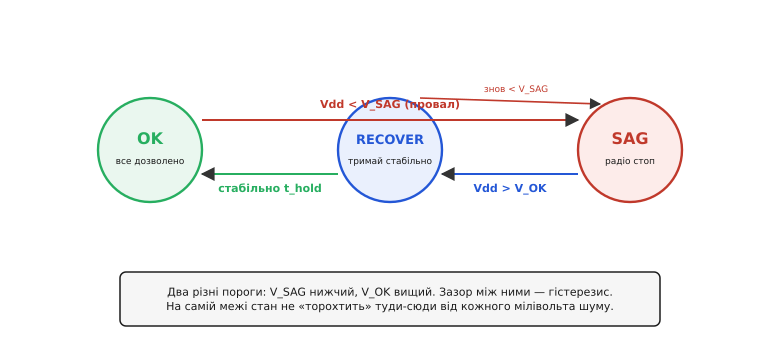
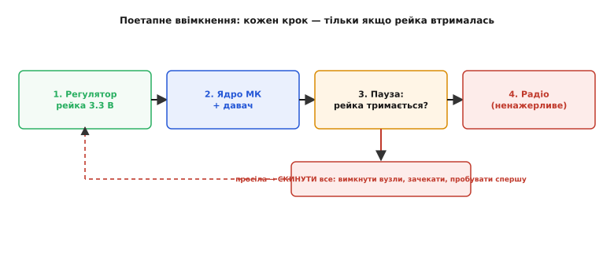

# ⚙️ Сторож живлення модуля у прошивці

Модуль уже має регулятор, розв'язку й захист вводу — усе «залізо» на місці. Але залізо тримає рейку лише доти, доки джерело дозволяє. Літієва комірка сідає, USB просідає під сусіднім навантаженням, антена в момент передачі смикає такий струм, що навіть добрий регулятор на мить відпускає вихід. І тоді вирішує вже не схема, а **прошивка**: чи помітить вона, що рейка провалюється, чи встигне відкласти ненажерливу дію, чи не ввімкне наступний вузол у вже просілу шину. Ця вставка — про той шматок коду, що сидить усередині модуля й **сторожить власне живлення зсередини**: міряє свою ж рейку, вирішує, коли безпечно передавати радіо, і вмикає підпорядковані вузли по черзі так, щоб вони самі себе не поклали.

### Задача

Модуль — давач із мікроконтролером і радіо — живиться від однієї літієвої комірки через регулятор. Прошивка мусить робити три речі, і кожна з них наївно ламається:

1. **Знати власну напругу.** Здавалося б, просто: заміряй рейку своїм же АЦП. Але АЦП міряє **відносно опорної**, а якщо опора — це сама рейка (як заведено «за замовчуванням»), то, коли рейка сідає, опора сідає з нею, і показ **не змінюється взагалі**. Модуль просідає — а його власний АЦП бадьоро доповідає «3.3 В, усе гаразд». Це не крайовий випадок, це типова початкова помилка.
2. **Не бити по рейці, коли їй і так зле.** Радіопередача — найненажерливіша дія модуля; саме вона просаджує рейку найглибше. Передавати в мить, коли напруга вже на межі brownout, — значить власноруч заганяти чіп у скидання просто посеред пакета. Треба вміти **відкласти** важку дію, поки напруга не відновиться.
3. **Увімкнути вузли в правильному порядку — і не зламатися на цьому.** Кожен підпорядкований вузол (давач, радіо) при ввімкненні заряджає свої конденсатори — тобто в першу мить бере кидок струму. Увімкнеш два ненажерливі вузли разом у слабке джерело — сумарний кидок просадить рейку нижче brownout, і весь модуль скинеться просто в процесі власного запуску. Класична **гонка при вмиканні**.

Три задачі, три різні пастки. Об'єднує їх те, що всі три невидимі на «щасливому шляху»: на столі з лабораторним блоком живлення все працює, а в полі на сідлій комірці модуль починає загадково перезавантажуватись. Напишімо сторожа, який ці три біди приборкує.

> 🔧 **Навіщо це.** Дев'ять із десяти польових «зависань» модуля — це не зіпсоване залізо, а провал рейки, якого прошивка **не помітила або спровокувала сама**. Сторож живлення коштує пару сотень байтів коду й один вивід АЦП, а рятує від найгіршого класу багів — тих, що не відтворюються на лабораторному столі.

### Ідея

Розкладімо на три незалежні прийоми, кожен закриває одну пастку.

**Перший: міряй рейку проти сталої опори, а не проти самої рейки.** У кожного сучасного мікроконтролера всередині є маленьке стале опорне джерело — [внутрішнє опорне на запаленому переході (band-gap)](root:hw-analog/voltage-reference-sources), десь коло 1.2 В, що майже не залежить від живлення. Фокус у тому, **що з чим порівнювати**. Якщо опорою АЦП служить рейка, то виміряти внутрішнє band-gap-джерело проти неї — це і є спосіб дізнатися саму рейку: чим нижча рейка, тим *ближчим до повної шкали* виглядає стала 1.2-вольтова опора. Тобто ми міряємо відомі 1.2 В і з отриманого коду **вираховуємо назад**, якою була рейка. Так АЦП перестає «пливти» разом із живленням: точка відліку тепер фізично не залежить від того, що коїться з рейкою.

**Другий: розводь стани двома порогами, а не одним.** Спокуса — порівняти напругу з одним числом: `Vdd < 3.15 → погано`. Але напруга на межі завжди тремтить від шуму й кидків, тож рівно на порозі показ стрибає туди-сюди щокроку, і рішення «можна/не можна» **торохтить** — модуль то дозволяє передачу, то забороняє, десятки разів на секунду. Ліки — **гістерезис**: два різні пороги. Нижній `V_SAG` каже «впало, зупиняйся», а вищий `V_OK` — «піднялося досить, можна знову». Між ними — мертва зона, де стан **не змінюється**. Це той самий принцип, що й у [тригера Шмітта](root:hw-analog/schmitt-trigger) в залізі: щоб перемкнутися назад, сигнал має не просто повернутись до порога, а перейти його з добрим запасом.

**Третій: тримай явний стан і вмикай вузли по кроках із перевіркою.** Три вищеописані рішення природно збираються в **скінченний автомат** (англ. *finite-state machine*) з трьома станами — `OK`, `SAG`, `RECOVER`, — де переходи керуються порогами з гістерезисом. А ввімкнення підпорядкованих вузлів робимо не «усі разом», а **по одному**, і після кожного ключа живлення чекаємо й **перевіряємо, що рейка втрималась**. Просіла — не пхаємо наступний вузол, а скидаємо всю послідовність і починаємо спочатку, давши джерелу віддихатись.


*Три стани. **OK** — рейка здорова, важкі дії дозволені. Провал нижче `V_SAG` кидає в **SAG** — радіо стоп, витрати мінімізуємо. Коли напруга підніметься вище `V_OK`, переходимо в **RECOVER** — «начебто відновилось, але почекаймо»; якщо протрималось стабільно час `t_hold`, повертаємось у **OK**. Просіло знову, поки чекали, — назад у SAG. Два різні пороги (`V_SAG` нижчий, `V_OK` вищий) лишають зазор-гістерезис, тож на межі стан не тремтить.*

Чому окремий стан `RECOVER`, а не одразу `SAG → OK`? Бо напруга, що *ледь* перескочила верхній поріг, ще ненадійна: комірка могла на мить підвестись між кидками струму й одразу знову просісти. `RECOVER` — це карантин: ми вже бачимо добру напругу, але не даємо зеленого світла ненажерливим діям, поки вона не **потримається** стабільно. Це різниця між «напруга торкнулась порога» і «напруга справді повернулась».

### Робочий код

Зберемо сторожа цілком. Почнімо з вимірювання власної рейки — того самого фокуса з внутрішньою опорою. Код у стилі STM32, але ідея переноситься на будь-який МК, де є заводсько відкалібрувана внутрішня опора.

:::tabs
:::code proj-supply-monitor/c/robochyi-kod.c
:::code proj-supply-monitor/py/robochyi-kod.py
:::

Тепер серце вимірювання. На STM32 внутрішнє опорне (VREFINT) заводом заміряне за відомої напруги живлення й записане в комірку `VREFINT_CAL`. Ідея: **рейку не міряємо прямо** — міряємо канал VREFINT (сталі ~1.2 В) тим самим АЦП, чия опора — рейка, і з відношення «заводський код / поточний код» дістаємо поточну рейку. Що нижча рейка, то *більший* код видасть стала опора — і формула це відіграє назад.

:::tabs
:::code proj-supply-monitor/c/robochyi-kod-2.c
:::code proj-supply-monitor/py/robochyi-kod-2.py
:::

Зверни увагу на напрям: коли рейка сідає з 3.3 до 3.0 В, опора АЦП падає, тож стала внутрішня 1.2-вольтова опора займає *більшу частку* шкали — `vref_raw` **зростає**, і `VREFINT_CAL / vref_raw` дає менше число, тобто нижчу рейку. Усе в мілівольтах і цілих — жодної рухомої коми, дружньо до дрібних МК.

> 🔧 **Навіщо це.** Оце ділення `VDDA_cal × VREFINT_CAL / vref_raw` — весь фокус самовимірювання рейки. Помилка новачка — годувати АЦП дільник від рейки й гадати, що бачиш напругу; насправді при рейці-опорі такий [ратіометричний вимір](root:hw-sensing/ratiometric-measurement) скорочує рейку й **сліпий до власного просідання**. Мірятимеш проти сталого band-gap — прозрієш.

Тепер сам скінченний автомат. Він короткий: три стани, лічильник відновлення й один прапорець «чи можна зараз важкі дії».

:::tabs
:::code proj-supply-monitor/c/robochyi-kod-3.c
:::code proj-supply-monitor/py/robochyi-kod-3.py
:::

Ключове рішення тут — асиметрія порогів. У `PWR_OK` ми дивимось лише на **нижній** поріг `V_SAG`, а виходимо з `PWR_SAG` тільки через **верхній** `V_OK`. Через це, щойно напруга впала й ми в `SAG`, повернути нас у роботу може не легкий доторк до `V_SAG` знизу, а лише впевнений підйом аж до `V_OK` — плюс іще карантин `RECOVER`. Дребезг на межі фізично неможливий: між «вимкнув» і «увімкнув» лежать 100 мВ мертвої зони і сотня мілісекунд витримки.

Тепер — застосування до найважчої дії, радіопередачі. Радіо не питає напругу саме; воно питає сторожа. Якщо зле — **відкладаємо** пакет, а не втрачаємо: складаємо у чергу й вертаємось, коли напруга дозволить.

:::tabs
:::code proj-supply-monitor/c/robochyi-kod-4.c
:::code proj-supply-monitor/py/robochyi-kod-4.py
:::

Лишилось третє — **поетапне ввімкнення** підпорядкованих вузлів через ключі живлення. Кожен вузол висить на своєму [ключі живлення (load switch)](root:hw-power/load-switch) — польовому ключі, яким прошивка вмикає й вимикає гілку. Вмикаємо по одному, після кожного даємо конденсаторам вузла зарядитись і **перевіряємо, що рейка не просіла** від кидка. Просіла — гасимо все й починаємо спочатку.


*Вузли вмикають по черзі, від найпотрібнішого до найненажерливішого, і після кожного ключа перевіряють, що рейка втрималась. Якщо на будь-якому кроці напруга просіла нижче порога — не пхаємо наступний вузол у слабку шину, а **скидаємо всю послідовність**: гасимо гілки, чекаємо й пробуємо спочатку. Так гонка при вмиканні (сумарний кидок кількох вузлів) не кладе модуль просто в мить запуску.*

:::tabs
:::code proj-supply-monitor/c/robochyi-kod-5.c
:::code proj-supply-monitor/py/robochyi-kod-5.py
:::

Порядок у масиві `stages` — не косметика: спершу маленький давач, а найненажерливіше радіо **останнім**, коли решта вже стабільна. Якби радіо стартувало першим, його кидок наклався б на порожні конденсатори всіх інших вузлів — і сумарний inrush з більшою ймовірністю просадив би рейку. І головне — перевірка `pwr_heavy_ok()` **після кожного** ключа: вона й ловить гонку. Без неї код бадьоро ввімкнув би всі гілки поспіль, а те, що рейка вже впала на другому кроці, помітив би хіба вбудований brownout-скиданням усього чіпа.

### Порахуймо пороги

Голі числа `V_SAG` і `V_OK` не з голови — вони мусять сісти між справжнім порогом brownout чіпа й номіналом рейки, лишивши місце і для запасу, і для гістерезису. Прикиньмо для нашого модуля.

**Дано:** чіп скидається (brownout) на 3.05 В за даташитом; номінал рейки 3.30 В; типовий шум-пульсація на рейці під навантаженням — близько ±20 мВ.

```
Порог brownout чіпа:        V_bor  = 3050 мВ   (тут чіп уже скидається)
Запас над brownout:         + 150 мВ           (не діяти впритул до краю)
→ нижній поріг:             V_SAG  = 3200 мВ

Гістерезис (мертва зона):   треба > розмаху шуму: 2 × 20 = 40 мВ
Беремо з добрим запасом:    100 мВ
→ верхній поріг:            V_OK   = V_SAG + 100 = 3300 мВ
```

Перевіримо логіку по колу. Рейка здорова на 3.30 В — стан `OK`, радіо працює. Комірка сідає, під кидком передачі рейка провалюється до 3.18 В — це нижче `V_SAG` = 3.20 В, стан стрибає в `SAG`, радіо замовкає, споживання падає, і рейка починає відпускатись угору. Вона підводиться назад — але поки вона між 3.20 і 3.30 В, ми **лишаємось у SAG** (мертва зона!), не поспішаючи. Аж коли перейде 3.30 В (`V_OK`) і протримається там `RECOVER_HOLD` кроків — вертаємось у `OK`. Розмах шуму ±20 мВ уже не здатен нас перекинути: щоб вибити зі стану, треба пройти всі 100 мВ гістерезису, а не 20.

Ось чому гістерезис мусить бути **ширший за шум**: якби ми взяли `V_OK` = 3.21 В (лише 10 мВ над `V_SAG`), то пульсація ±20 мВ на самій межі гнала б стан `SAG↔RECOVER` десятки разів на секунду — і радіо кліпало б увімкненням-вимкненням замість спокійно чекати. Сто мілівольт зазору цю дрож гасять із запасом.

### Складність і пастки

**Ратіометричний АЦП не бачить власного просідання.** Головна й найпідступніша. Якщо опора АЦП — сама рейка (типове «за замовчуванням»), то замір дільника **від тієї ж рейки** дає сталий код незалежно від напруги: чисельник і знаменник просідають разом, відношення не змінюється. Модуль сідає в brownout, а його АЦП спокійно доповідає номінал. Ліки — мірятися проти **сталої** внутрішньої band-gap-опори (як у коді вище), а не проти рейки. Це не тонкість, а різниця між робочим сторожем і сліпим.

**Дребезг порога.** Один поріг на межі — джерело дрож: напруга тремтить від шуму рівно навколо нього, і рішення «можна/не можна» перемикається щокроку. Завжди два пороги з мертвою зоною **ширшою за розмах шуму** (порахуйте розмах пульсації й візьміть гістерезис із запасом). Плюс карантин `RECOVER`, щоб не вертатись у роботу від першого-ліпшого дотику до верхнього порога.

**Гонки при вмиканні.** Ввімкнути кілька ненажерливих вузлів разом — значить скласти їхні кидки в один сумарний inrush, що просадить рейку нижче brownout просто в мить запуску, і модуль циклічно перезавантажуватиметься, так і не піднявшись. Вмикайте **по одному**, найненажерливіше — останнім, і **звіряйте рейку після кожного** ключа; просіла — гасіть усе й повторюйте, а не пхайте наступний вузол у слабку шину.

**Опитувати треба досить часто — але не в ISR тримати важку логіку.** Провал рейки під радіопакетом триває мілісекунди; якщо міряти рейку раз на пів секунди, ви його проґавите й «упіймаєте» хіба скиданням чіпа. Тримайте крок сторожа коротким (одиниці мілісекунд). Але саме `pwr_monitor_step` у перериванні лишайте худим: замір АЦП і перемикання стану — так; черги, радіо, журнали — у головному циклі за прапорцем.

**Чекати відновлення — не заклинити на очікуванні.** Відкладати важку дію правильно, але сліпо крутитись «поки рейка не підніметься» — заявка на зависання, якщо комірка просто сіла назовсім. Обмежуйте очікування: не піднялось за розумний час — переходьте в свідомий режим глибокого сну чи аварійного сигналу, а не в нескінченний цикл, що сам же й доїдає рештки заряду.

**Затримки живлення — не `delay_ms` наосліп.** `settle_ms` між ключами має покривати реальний час заряду конденсаторів вузла й реакції регулятора, інакше замір «рейка тримається» відбудеться раніше, ніж кидок устиг проявитись, і ви ввімкнете наступний вузол передчасно. Беріть паузу з запасом над постійною часу гілки, а на серійному виробі — краще дочекайтесь ознаки готовності вузла (сигнал *power-good* ключа живлення), ніж угадуйте час.

**Калібрувальну константу бери свою.** `VREFINT_CAL` та її адреса, напруга `VDDA_CAL_MV`, за якої її знято, і сам номінал band-gap різняться між родинами чіпів — не переписуйте наосліп із чужого прикладу. Візьміть число й адресу з даташита **свого** МК, інакше показ рейки матиме сталий зсув, і всі пороги попливуть.

> 🔧 **Навіщо це.** Сторож живлення — це три прості прийоми, кожен проти своєї пастки: **міряй проти сталої опори** (щоб узагалі бачити просідання), **розводь два пороги гістерезисом** (щоб не торохтіти на межі), **вмикай вузли по кроках із перевіркою** (щоб не програти гонку при старті). Разом вони перетворюють модуль зі «сліпого» — того, що дізнається про провал рейки лише з власного скидання, — на «зрячий», що бачить біду наперед, тихо перечікує її й повертається до роботи, коли джерело знову дозволить.
