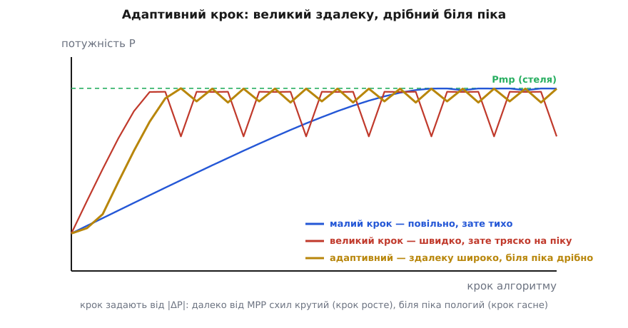
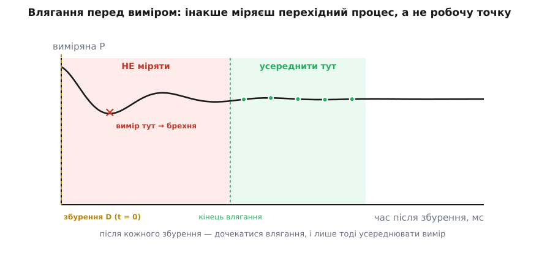
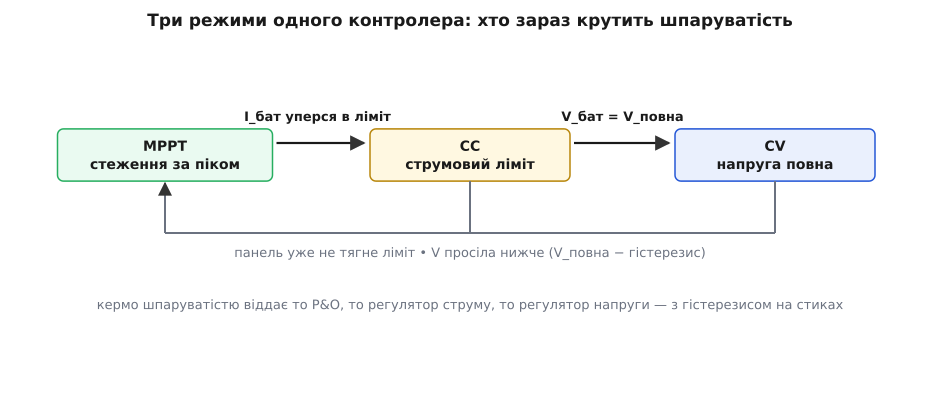

# ⚙️ Робочий трекер P&O: від сирого АЦП до шпаруватості

Ідею Perturb & Observe можна вмістити на серветці: зміряй потужність, крутни шпаруватість, зміряй знову; стало більше — той самий напрям, стало менше — розвернись. Десять рядків коду. От тільки якщо залити ці десять рядків у реальний контролер сонячного заряду, він поводитиметься огидно: смикатиме шпаруватість від шуму, міритиме перехідні процеси замість робочої точки, дрейфуватиме геть за хмари й весело переливатиме батарею через край, бо про батарею в тих десяти рядках немає ні слова.

Уся різниця між іграшкою й робочим трекером — у тому, що іграшка викидає. Розберімо повний прошивковий трекер P&O шар за шаром — вимір, рішення, час, запобіжники, передача керма — так, щоб у кінці лишився код, який справді можна залити в мікроконтролер сонячного вузла. А тоді пройдімося пастками, кожна з яких уже когось підводила на робочій платі.

### Задача: чого бракує серветці

Випишімо чесно, що саме десятирядкова версія мовчки припускає — і чому кожне з цих припущень на залізі не справджується.

- **«Зміряй потужність»** — а вимір сирий і шумний. Струм та напруга на вході перетворювача завжди в брижах ШІМ; один відлік [АЦП](root:hw-analog/adc) — це не робоча точка, а випадкова мить на пульсації. Годуй алгоритм сирим АЦП — і шум сам клацатиме напрям.
- **«Крутни й одразу міряй»** — а перетворювач після збурення не стрибає в нову точку миттєво: він гойдається кілька десятків мікросекунд чи навіть мілісекунд. Зміряєш зарано — оціниш перехідний процес.
- **`p = v * i`** — а на дешевому мікроконтролері без блока з рухомою комою множення float коштує десятки тактів. На гарячому шляху, що крутиться кілогерцами, це марнотратство.
- **Крок сталий** — а сталий крок programує в контролер вроджену ваду: великий швидкий, але тряский на піку; малий тихий, але повільний за хмари. Робочий трекер робить крок **адаптивним**.
- **Немає меж** — шпаруватість може вилізти в нуль чи в насичення; на старті стрибок повної потужності б'є по конденсаторах і батареї. Потрібні **кламп** і **м'який старт**.
- **Немає батареї** — а MPPT керує лише доти, доки батарея здатна проковтнути все, що дає панель. Повна батарея чи струмовий ліміт — і кермо треба **віддати** регулюванню [заряду](root:hw-power/cc-cv-bms).

Отже, задача не «написати P&O», а обстроїти його всім тим, без чого він на залізі не живе. Почнімо з фундаменту — арифметики.

### Одиниці: цілі числа замість рухомої коми

Перше рішення робочого трекера — **не чіпати float узагалі**. Домовмося тримати напругу в мілівольтах, струм у міліамперах, потужність у мікроватах. Уся хитрість в одному спостереженні: добуток мВ×мА одразу дає **мікровати**, і ці мікровати влазять у 32-бітне ціле з добрячим запасом.

```
16 В × 5 А  =  16000 мВ × 5000 мА  =  8·10⁷ мкВт
стеля int32  ≈  2.1·10⁹            → запас понад 25×
навіть 30 В × 8 А = 2.4·10⁸ мкВт   → усе одно вільно
```

> 🔧 **Навіщо це.** Ціла арифметика тут не аскеза, а швидкодія й передбачуваність. Множення `int32 × int32` — це один такт на будь-якому ядрі; float на МК без FPU — це виклик бібліотечної процедури й десятки тактів із непередбачуваним часом, а нам потрібен рівний період такту. Хто хоче дробів (коефіцієнти фільтра, підсилення) — тримає їх [фіксованою комою](root:hw-arch/fixed-point): дріб як ціле, зсунуте на кілька бітів, замість рухомої коми. Тому весь трекер нижче — цілочисловий від АЦП до шпаруватості.

:::code proj-po-tracker/c/odynytsi-tsili-chysla.c

### Шар виміру: усереднення плюс легкий фільтр

Один відлік недовірливий одразу з двох причин: брижі ШІМ і випадковий шум АЦП. Обидві лікуються усередненням, тільки різного роду. Спершу **передискретизація** — узяти кілька сирих відліків поспіль і усереднити ([ковзне середнє](root:com-signal/moving-average) в найпростішій формі): якщо вікно накриває кілька періодів пульсації, брижі значною мірою скорочуються самі. Далі — легкий **експоненційний фільтр** ([EMA](root:com-signal/ema)) поверх усередненого, щоб згладити повільний шум, не тримаючи довгого буфера.

Тонкість, на якій спотикаються: наївний цілий EMA `y += (x − y) >> k` **втрачає молодші біти** — коли різниця `x − y` менша за `2ᵏ`, зсув дає нуль, і фільтр застрягає, не доходячи до входу (мертва зона). Правильний цілий EMA тримає стан у **збільшеному масштабі** (×2ᵏ) і зсуває лише на виході — тоді молодші біти накопичуються, а не гинуть.

Струм міряють на [шунті](root:hw-components/shunt-resistor) — малому точному резисторі, спад напруги на якому пропорційний струмові; докладніше про відбір напруги й струму на вході перетворювача — у [вимірюванні перетворювача](root:hw-power/converter-measure).

:::code proj-po-tracker/c/shar-vymiru-userednennia.c

Тепер зберемо один вимір у пакет — напруга, струм і одразу потужність у мікроватах:

:::code proj-po-tracker/c/shar-vymiru-userednennia-2.c

### Ядро P&O з адаптивним кроком

Тепер серце. Логіка сходження та сама: впала потужність — розвернути напрям. Але додаємо два робочі елементи, яких у серветковій версії немає, — **зону нечутливості** й **адаптивний крок**.

Зона нечутливості (deadband) на ΔP — це відповідь на шум пульсацій. На піку сусідні виміри відрізняються на копійки, і половина цих копійок — просто шум. Якщо розвертати напрям на будь-яку від'ємну ΔP, контролер клацатиме туди-сюди від самого шуму, навіть стоячи рівно на MPP. Тому напрям розвертаємо, лише коли потужність **відчутно** впала — на більше за поріг шуму; дрібні коливання в межах поро́га вважаємо за «нічого не змінилось».

Адаптивний крок — відповідь на дилему «швидко проти тихо». Ідея тонка й гарна: **мірою відстані до піка служить сам модуль приросту |ΔP|**. Далеко від MPP схил потужності крутий, тож той самий крок шпаруватості дає велике |ΔP| — і ми сміливо крокуємо широко. Біля піка схил пологий, |ΔP| гасне само собою — і крок стає дрібним без жодного окремого «детектора близькості». Крок просто **пропорційний |ΔP|**, затиснутий між мінімумом і максимумом.


*Малий фіксований крок повзе до стелі поволі, зате майже не гойдається; великий доганяє Pmp за кілька кроків, але на піку пиляє широкою пилкою, гублячи потужність; адаптивний бере краще з обох — здалеку крокує широко, а біля піка сам мілішає. Розмір кроку не задають наперед, його диктує |ΔP|: крутий схил — великий крок, пологий — дрібний.*

:::code proj-po-tracker/c/iadro-p-o-z-adaptyvnym.c

### Час: влягання, вбудоване в такт

Ось де серветкова версія найтихіше бреше. Між рядком «крутни D» і рядком «зміряй знову» на залізі минає **перехідний процес**: індуктор і конденсатори перетворювача перекочують заряд у нову рівновагу кілька десятків мікросекунд, а з великою ємністю чи млявою петлею — і мілісекунди. Зміряєш посеред цього гойдання — і оціниш не нову робочу точку, а брижі; рішення вийде випадкове, і трекер танцюватиме навмання.

Лік один: після кожного збурення **дочекатися влягання** й лише тоді міряти. Але «дочекатися» треба зробити правильно — не блокувальним `delay()`, що заморозить увесь контролер, а фазовим тактом. Розіб'ємо роботу на дві фази й крутімо їх від рівного мілісекундного таймера: у фазі **влягання** просто мовчки чекаємо SETTLE_MS, нічого не міряючи; у фазі **виміру** протягом MEAS_MS збираємо усереднену потужність — і аж тоді даємо рішення. Крок стеження навмисно повільніший за динаміку перетворювача.


*Збурили шпаруватість — і потужність не стрибнула в нову точку, а загойдалася. Червона зона — влягання: міряти тут означає читати перехідний процес, а не робочу точку (звідси випадкові рішення). Аж коли гойдання вляглося, відкривається зелене вікно, де кілька усереднень дають чесне значення. Правило залізне: спершу влягання, потім вимір.*

:::code proj-po-tracker/c/chas-vliahannia-vbudovane.c

Сам крок фазового циклу впишемо у верхній такт трохи нижче — спершу доберімо два запобіжники, без яких трекер небезпечний уже на першій секунді.

### М'який старт і кламп шпаруватості

Кламп ми вже маємо — `clamp_duty()` не дасть шпаруватості вилізти в нуль чи в насичення на **кожному** записі. Лишається старт. Якщо на ввімкненні одразу задати робочу шпаруватість, перетворювач шарпне повну потужність у розряджені конденсатори й батарею — кидок струму, просідання, а то й спрацювання захисту. Тому шпаруватість піднімають **плавно** від безпечного низу — [м'який старт](root:hw-power/soft-start-circuits): маленькими приростами за такт, доки не дійде до скромної відправної точки, з якої P&O уже сам поведе стеження.

:::code proj-po-tracker/c/miakyi-start-i-klamp.c

### Наглядач: коли віддати кермо заряду

І головне, чого немає в жодній серветці: трекер **не завжди трекер**. Поки батарея голодна, MPPT має рацію — бери від панелі максимум. Та щойно струм заряду вперся в паспортний ліміт або напруга дійшла до порога «повна», гнатися за максимумом потужності вже **шкідливо**: зайву потужність нема куди подіти, крім як переливати батарею. Тут кермо шпаруватістю перехоплює регулювання [заряду](root:hw-power/cc-cv-bms): спершу тримати сталий струм (CC), тоді сталу напругу (CV).

Виходить один контролер із трьома режимами, що передають кермо один одному. Наглядач лише перемикає, **хто зараз крутить D** — P&O, регулятор струму чи регулятор напруги, — а на стиках ставить **гістерезис**, щоб режими не деренчали туди-сюди на самій межі.


*Поки батарея бере все — працює MPPT. Струм уперся в ліміт — кермо переходить до регулятора струму (CC). Напруга дійшла до «повної» — до регулятора напруги (CV). Назад у MPPT повертаються, лише коли умова відпустила з запасом (гістерезис), інакше на межі режими деренчали б. Дуга внизу — повернення до стеження, коли панель уже не тягне ліміт або напруга просіла.*

:::code proj-po-tracker/c/nahliadach-koly-viddaty.c

Самі регулятори CC/CV тут навмисно найпростіші — повільний інтегральний нудж шпаруватості до цілі із зоною нечутливості. Знак реакції (побільшити D підніме чи опустить вихід) залежить від топології перетворювача, тож винесений у сталу. Серйозна плата поставить сюди повноцінну петлю [зі зворотним зв'язком](root:hw-power/control-loop-compensation) з належним підсиленням і захистом від насичення інтегратора; для демонстрації передачі керма досить нуджа.

:::code proj-po-tracker/c/nahliadach-koly-viddaty-2.c

### Верхній такт: усе разом

Тепер зшиваємо шари в одну функцію, яку таймер кличе рівно раз на мілісекунду. Порядок такий: спершу відпрацювати м'який старт; далі наглядач вибирає режим; якщо кермо не в MPPT — його крутить регулятор заряду; якщо в MPPT — обертається фазовий цикл із вбудованим вляганням.

:::code proj-po-tracker/c/verkhnii-takt-use-razom.c

Ось і повний трекер: сирий АЦП угорі, шпаруватість унизу, а поміж них — усереднення, фільтр, цілочислова потужність, адаптивний крок із зоною нечутливості, вбудоване влягання, м'який старт, кламп і наглядач із гістерезисом. Тепер — пастки, бо кожен із цих шматочків має свій спосіб зіпсувати життя.

### Складність і пастки

**Вимір під час перехідного процесу.** Найпоширеніша й найтихіша помилка — зміряти зарано. Її вже закрито фазою PH_SETTLE, але варто розуміти механізм: після збурення D потужність не стрибає, а гойдається; вимір посеред гойдання — це вимір випадкової миті пульсації, і рішення виходить випадкове. Симптом на стенді — трекер «нервує»: смикає шпаруватість навіть за рівного сонця. Лік — збільшувати SETTLE_MS, доки нервозність не зникне; правильне влягання завжди повільніше за динаміку самого перетворювача. Не спокушайтеся зробити такт швидшим «щоб краще стежити»: швидший за влягання такт не стежить краще, він стежить за шумом.

**Шум пульсацій, що клацає напрям.** Навіть по вляганні лишаються брижі ШІМ, і на пласкому піку сусідні виміри плавають у їхніх межах. Без запобіжника кожна випадкова від'ємна ΔP розвертає напрям — трекер деренчить на місці, недобираючи потужності. Три заслони працюють разом: **усереднення** цілого вікна (кілька періодів пульсації скорочуються), **EMA-фільтр** згладжує залишок, а **зона нечутливості** DP_DEADBAND не дає реагувати на ΔP, менші за шум. Поріг ставлять трохи вищим за спостережений розмах шуму ΔP на піку — завузький пропускає деренчання, зашироких робить трекер млявим до справжніх змін. Ще сильніший хід — **синхронний відбір**: замикати вибірку АЦП на ту саму фазу періоду ШІМ, тоді пульсація постійно ловиться в тій самій точці й почасти скорочується сама.

**Дрейф за швидкої зміни освітлення.** Найпідступніша пастка й вроджена вада самого P&O. Уявіть: рівно поки триває наш пробний крок, набігає просвіток і світло **швидко зростає**. Потужність піднялася — але не тому, що ми крутнули ручку правильно, а тому що просто стало більше сонця. Алгоритм цього не розрізняє, зараховує крок як «вдалий» і крокує далі в цьому напрямі — і може піти **геть від MPP**, поки світло змінюється. Це задокументований збій, і зветься він саме дрейфом (*drift*); за швидко наростної засвітки він тим гірший, чим більший крок, — тобто адаптивний крок, який ми додали задля швидкості, дрейф навіть **підсилює**.

Класичний лік — «drift-free» P&O — додає до рішення знак **приросту струму** ΔI. Логіка така: коли робоча точка рухається вздовж **однієї** кривої, напруга й струм міняються злагоджено; а коли підскочило світло, струм стрибає майже **незалежно** від того, куди ми крутнули напругу. Тож якщо одночасно ΔP > 0 **і** ΔI помітно додатний — це підозра, що потужність зросла через світло, а не через наш крок, і напрям цим кроком підтверджувати не можна.

```c
// Захист від дрейфу: додатковий свідок — знак ΔI. Викликати всередині
// рішення, маючи і ΔP, і ΔI за той самий інтервал.
static bool drift_suspected(int32_t dp, int32_t di_ma) {
    // P зросла І струм різко скочив угору → скоріш за все, це СВІТЛО, не крок.
    return (dp > 0) && (di_ma > DI_LIGHT_JUMP_MA);
}
// Тоді у po_decide(): якщо drift_suspected(...) — НЕ вважати крок вдалим,
// напрям лишити як був (не підтверджувати рухом світла).
```

**Адаптивний крок, що втратив стійкість.** Коефіцієнт STEP_GAIN_SH — це підсилення зворотного зв'язку, і задерши його, дістанете класичну нестійкість: завеликі кроки перестрибують пік із запасом, наступне велике |ΔP| штовхає ще дужче, і трекер розгойдується замість збігатися. Тому крок **обов'язково** затиснутий зверху (STEP_MAX), а коефіцієнт підбирають на стенді від малого вгору, доки стеження лишається спокійним. Це той самий компроміс, що й у будь-якій петлі: більше підсилення — швидше, але ближче до дзвону.

**Переповнення й одиниці.** Цілочислова арифметика швидка, але мовчазна: перевищив int32 — і потужність тихо стане від'ємною, а трекер піде в протилежний бік. Тому варто раз прикинути найгірший добуток `vmv × ima` для своєї панелі (ми це зробили: 8·10⁷ мкВт при 16 В·5 А, із запасом понад 25×) і тримати проміжні акумулятори (наприклад `meas_acc_p` за вікно) теж у 32 бітах із перевіреним запасом, а при потребі — у 64.

**Деренчання на стику режимів.** Без гістерезису наглядач на самій межі «повна / не повна» перемикав би MODE_CV ↔ MODE_MPPT щотакту: у CV напруга просідає під навантаженням регулятора, умова відпускає, вертаємось у MPPT, напруга знову лізе вгору — і так деренчати. V_FULL_HYST_MV та I_LIMIT_HYST_MA дають цим переходам «люфт»: увійшли в режим за одним порогом, вийшли за помітно іншим. Для геть спокійного стику додають ще й **мінімальний час перебування** в режимі — не перемикатися частіше, ніж, скажімо, раз на сотню мілісекунд, — щоб швидкоплинна хмара не смикала режими.

Підсумок усього проєкту — одне речення, яке варто тримати в голові, беручись за MPPT-прошивку. **Робочим трекер роблять не десять рядків самого P&O, а все, чим їх обстроюють: чесний вимір (усереднення, фільтр, зона нечутливості), чесний час (влягання перед виміром), чесні межі (кламп, м'який старт) і чесне знання, коли замовкнути й віддати кермо заряду.** Серветкова версія показує ідею; усе інше в цьому файлі — різниця між ідеєю та приладом, що збирає енергію цілий день і не переливає батарею на заході.
