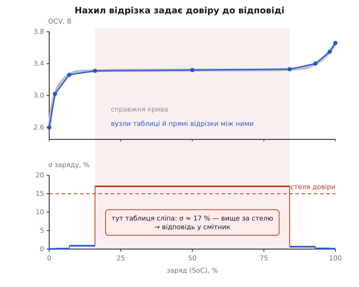
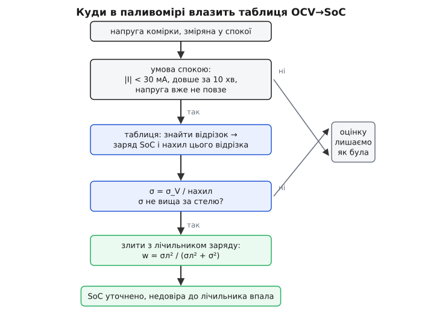

# ⚙️ Таблиця OCV→SoC у прошивці: інтерполяція з вагою за нахилом

Кожен паливомір рано чи пізно впирається в одну функцію: даєш їй напругу спокою — вона повертає відсотки заряду. Ось ця функція, дописана до кінця: як укласти криву в таблицю на кілька десятків байтів, як дістати з неї заряд цілими числами без рухомої коми — і, найголовніше, як змусити ту саму таблицю в тій самій відповіді сказати, наскільки їй зараз можна вірити. Бо на пласкій ділянці чесна відповідь — не «50 %», а «не знаю», і функція, що вміє лише перше, тихо труїть увесь паливомір.

### Задача: що на вході й що конче має бути на виході

Вхід один — напруга однієї комірки, зміряна тоді, коли крізь неї не тече струм. Вихід наївно хочеться зробити теж один — число відсотків. Саме тут і закладають ваду.

Уявіть дві відповіді того самого коду: «52 %» на крутій ділянці кривої й «52 %» на пласкому плато. Перша означає «52 плюс-мінус пів відсотка», друга — «десь між 35 і 70, я вгадую». Число однакове, вартість різниться на два порядки. А той, хто цю відповідь споживає, — [лічильник заряду](root:hw-power/state-of-charge), що інтегрує струм і поволі дрейфує, — не має способу їх розрізнити й однаково довіряє обом. Тому вихід функції мусить бути **парою**: заряд і його похибка. Похибку доведеться порахувати — і виявиться, що вона дістається майже задарма.

Решта умов — від заліза, і кожна теж формує рішення. **Без рухомої коми**: на дрібному мікроконтролері без блока з рухомою комою кожне множення float коштує десятки тактів. **Десятки байтів, не кілобайти**: таблиця живе у флеші поруч із рештою прошивки, ще й не одна, а по одній на кожну температуру. **Час виконання відомий наперед**: функція крутиться в тому самому такті, що й усе інше, тож «іноді довго» не годиться.

І одразу спокуса, яку треба відсікти: а може, обійтися без таблиці й просто розтягнути напругу на шкалу?

**Приклад (чому пряма не годиться).** Візьмімо Li-ion комірку з робочим вікном 3.00–4.20 В і зміряймо на ній 3.66 В.

```
наївно:   SoC = (V − 3.00) / (4.20 − 3.00) · 100 %
          (0.66 / 1.20) · 100 % = 55 %

таблиця тієї самої комірки:              26 %
розбіжність:                             29 пунктів заряду
```

Двадцять дев'ять пунктів — це не похибка, це вигадка. Крива не пряма, і жодне масштабування прямої її не наблизить. Отже, таблиця.

### Одиниці: щоб усе влізло в цілі числа

Перше рішення — зафіксувати одиниці, бо від них залежить, чи вціліє точність у цілочисловій арифметиці. Напругу тримаємо в **десятих мілівольта** (0.1 мВ, тобто 100 мкВ), заряд — у **проміле** (1000 ‰ = 100.0 %).

```
одиниця напруги 0.1 мВ:  4.2 В = 42000,  стеля uint16 = 65535 (6.5 В)
одиниця заряду  1 ‰:     100 % = 1000,   теж вільно влазить у uint16

найпласкіше плато LFP ≈ 0.3 мВ на 1 % заряду = 3 одиниці на 1 %
   квантування таблиці   1 одиниця  → 0.33 % заряду
   шум вольтметра       50 одиниць  → 17 %   заряду
   → точність обмежує вольтметр, а не одиниця таблиці: запас є
```

Дроби, без яких таки не обійтися (ваги, коефіцієнти), тримаємо [фіксованою комою](root:hw-arch/fixed-point) — цілим числом, зсунутим на кілька бітів, замість рухомої коми.

### Форма таблиці: вузли по кривій, а не сітка по напрузі

Крива задана як «напруга за заданого заряду», а питати ми будемо навпаки — «заряд за заданої напруги». Розкласти ці пари в пам'яті можна двома розумними способами, і вибір між ними — не про смак.

**Рівномірна сітка по напрузі.** Ділимо робоче вікно на однакові кроки й у кожній комірці зберігаємо заряд. Спокусливо: індекс рахується прямо з напруги, жодного пошуку. Але порахуймо: 3.0–4.2 В із кроком 1 мВ — це 1200 комірок на одну температуру. І весь цей обсяг витрачено криво: на крутих краях, де сусідні комірки відрізняються на соті частки відсотка, точність надлишкова, а на плато, де один мілівольт коштує кілька відсотків заряду, вона недостатня. Найдорожча в пам'яті таблиця виходить найгрубішою саме там, де важко.

**Вузли по самій кривій.** Зберігаємо пари «напруга — заряд» і ставимо їх густо там, де крива гнеться, і рідко там, де вона рівна. Тоді розмір таблиці визначає не діапазон, а кількість **згинів** у хімії: для похилої Li-ion вистачає десятка пар, для LFP із її різкими зламами скраю — півтора десятка. Це та сама [таблиця замін](root:sf-algorithms/lookup-table), де обчислення підмінюють читанням із пам'яті, тільки з нерівномірною сіткою й дорахунком між вузлами. Ціна — треба знайти, у який відрізок упала напруга; за десяток-два вузлів це кілька порівнянь.

Вибір очевидний. Дві умови на таку таблицю залізні: **напруга строго зростає** від вузла до вузла, і **заряд строго зростає** теж. Перша потрібна, щоб зворотне питання мало рівно одну відповідь і щоб різниця сусідніх вузлів ніколи не була нулем — інакше ділення на нуль просто в польоті. Друга — щоб вузол не повторював заряд попереднього: такий відрізок оголосив би цілу смугу напруг одним значенням заряду, ще й із нульовою похибкою, тобто збрехав би найгіршим із можливих способів — упевнено.

:::code proj-ocv-lookup/c/forma-tablytsi-vuzly-po.c

Дев'ять вузлів по чотири байти — тридцять шість байтів на цілу криву.

### Пошук відрізка: підказка попереду двійкового пошуку

Напруга строго зростає вздовж таблиці, тож шукати відрізок можна [двійковим пошуком](root:sf-algorithms/binary-search): щоразу відкидаємо половину, і на 32 вузлах це п'ять порівнянь. Але є дешевший хід. Заряд батареї повзе поволі — між двома вимірами він майже напевно лишився в тому самому відрізку або перейшов у сусідній. Тож спершу перевіряємо три кандидати навколо минулої відповіді, і майже завжди відповідь знаходиться з першої спроби; двійковий пошук лишається як запасний шлях на випадок стрибка.

:::code proj-ocv-lookup/c/poshuk-vidrizka-pidkazka.c

Верхня середина тут не примха, а умова збіжності. Ми шукаємо не точний збіг, а «найбільший вузол, що не перевищує v», і тримаємо відповідь у `lo`. Якби середина бралася вниз, `lo = mid` за `lo == hi − 1` не зрушило б межі — і цикл крутився б вічно. Верхня середина завжди більша за `lo`, тож кожен оберт звужує проміжок.

### Нахил: та сама відповідь мусить нести й свою похибку

Тепер те, заради чого все й затівалося. Ми зайшли у відрізок і зараз ділитимемо, щоб пройти між його кінцями. Але ділити доведеться на **нахил** цього відрізка — а нахил і є мірою того, чого варта відповідь.

Зв'язок прямий. Вольтметр приносить напругу з похибкою δV. Крива перекладає напругу в заряд, тож ця похибка теж перекладається — через похідну оберненої функції, тобто ділиться на нахил:

```
k = ΔV / ΔSoC        нахил відрізка (мВ на 1 % заряду)
σ_SoC = σ_V / k      похибка заряду — це похибка напруги, поділена на нахил
```

Крутий відрізок ділить похибку на велике число й тим її гасить; пологий ділить на мале й тим її роздуває. Порахуймо на живих цифрах, узявши вольтметр із похибкою близько 5 мВ (для АЦП мікроконтролера з опорним джерелом це реалістично):

```
Li-ion, пологий центр:  k ≈ 5 мВ/%    → σ = 5 / 5   = 1.0 %
Li-ion, крутий низ:     k ≈ 70 мВ/%   → σ = 5 / 70  = 0.07 %
LFP, схил біля краю:    k ≈ 5.6 мВ/%  → σ = 5 / 5.6 = 0.9 %
LFP, середина плато:    k ≈ 0.29 мВ/% → σ = 5 / 0.29 = 17 %   ← сміття
```

Сімнадцять відсотків — це відповідь, яку не можна нікуди подіти: підмішавши її до чесного лічильника, ми зіпсуємо чесний лічильник. Отже, крім самого числа, функція має віддавати σ, а той, хто її кличе, — на σ дивитися.


*Одна й та сама таблиця, два погляди. Угорі — вузли й прямі відрізки між ними: їх багато там, де крива гнеться, і мало на рівному. Унизу — те, що ці відрізки насправді коштують: похибка заряду σ = σ_V/нахил. На крутих ділянках вона мізерна, на плато злітає до сімнадцяти відсотків і пробиває стелю довіри — саме там таблиця сліпа, і єдина правильна поведінка коду — змовчати.*

> 🔧 **Навіщо це.** Нахил — це не додаткова обчислювальна робота, а той самий дріб `ΔV/ΔSoC`, яким ми й так інтерполюємо всередині відрізка. Тобто похибка відповіді дістається тим самим діленням, що й сама відповідь: одна зайва операція на весь виклик. Дешевше за це самооцінку не зробити ніде — і саме тому немає жодного виправдання повертати голе число відсотків.

### Повна функція пошуку

Тепер зшиваємо: межі, відрізок, лінійна інтерполяція всередині нього й похибка з нахилу того самого відрізка.

```
всередині відрізка:  SoC = SoCᵢ + (V − Vᵢ) · (SoCᵢ₊₁ − SoCᵢ) / (Vᵢ₊₁ − Vᵢ)
```

Дві зауваги до цілочислової реалізації. Перша: ділення в C відкидає дробову частину, тож систематично занижує відповідь; додавання половини дільника перед діленням робить із відкидання **округлення до найближчого**. Друга: перевірмо чисельник на переповнення — найширший відрізок дає (V − Vᵢ) ≤ 4200 одиниць, найдовший за зарядом дає ΔSoC ≤ 200 ‰, тобто добуток не перевищить 8.4·10⁵ і влазить у 32 біти з величезним запасом.

:::code proj-ocv-lookup/c/povna-funktsiia-poshuku.c

На наведеній таблиці Li-ion ця функція точно відтворює вузли (у вузлі відповідь дорівнює вузловому заряду), монотонна на всьому діапазоні й дає σ від 0.1 % на краях до 1.0 % у пологій середині. На таблиці LFP та сама функція на плато чесно виставляє `usable = false`.

### Куди це вставляти: спокій, вага, корекція

Функція готова, але сама по собі вона нікому не потрібна — потрібне те, що вона виправляє. Паливомір веде заряд лічбою струму: інтегрує ампери за часом і тим гладко стежить за зарядом, поволі накопичуючи похибку інтегрування. Наша таблиця дає рідкісний, але **абсолютний** дороговказ. Лишається зшити одне з одним так, щоб рідкісне не побило гладке.


*Уся конструкція — це два запобіжники перед однією дією. Спершу питаємо, чи комірка справді у спокої; потім — чи не сліпа таблиця в цій точці. Лише якщо обидві відповіді «так», рахуємо вагу за похибками й підтягуємо лічильник. Обидва «ні» ведуть в одне місце: нічого не робимо, оцінка лишається як була. Мовчання — теж робоча поведінка.*

**Перший запобіжник — спокій.** Напруга під струмом про заряд не свідчить, а щойно струм прибрали, вона ще довго повзе до рівноваги. Тому питаємо не «чи вимкнено навантаження», а строгіше: струм малий, минуло досить часу — і напруга **вже нікуди не повзе**. Остання умова найцінніша, бо вона міряє те, що нас цікавить, замість покладатися на здогад про потрібну паузу.

:::code proj-ocv-lookup/c/kudy-tse-vstavliaty-spokii.c

**Другий запобіжник і вага.** Тепер у нас дві оцінки того самого заряду, кожна зі своєю похибкою: гладка від лічильника й свіжа від таблиці. Правильна суміш двох незалежних оцінок зважує їх **обернено до дисперсій** — хто певніший, той і важить більше:

```
w = σл² / (σл² + σ²)             вага таблиці (σл — похибка лічильника)
SoC ← SoC + w · (SoC_табл − SoC)  підтягуємо на частку w
σл² ← (1 − w) · σл²              після виправлення лічильник став певнішим
```

Це скалярний випадок того, що робить [фільтр Калмана](root:com-signal/kalman-filter): дві оцінки, дві дисперсії, вага з їхнього співвідношення. Формула сама поводиться правильно на обох краях. Таблиця сліпа (σ велика) — вага мала, лічильник майже не зрушить. Лічильник щойно виправлений (σл мала) — вага теж мала, і випадковий вимір не зіб'є свіжий якір. А похибка лічильника між виправленнями росте сама, бо він інтегрує, тож із часом вага таблиці зростає без жодного окремого правила.

:::code proj-ocv-lookup/c/kudy-tse-vstavliaty-spokii-2.c

Ділення замість зсуву в `corr` — навмисне: зсув від'ємного числа вправо округлює вниз, а не до нуля, і на межі це дає зайве проміле в один бік. На події, що трапляється раз на години, економити такти нема на чому.

**Приклад (як це виглядає в числах).** Лічильник давно не виправлявся, комірка відпочила, напруга потрапила на крутий відрізок:

```
лічильник: 60.0 %, σл = 2.5 %      таблиця: 52.0 %, σ = 1.0 %
w = 625 / (625 + 100) = 0.862
SoC ← 60.0 + 0.862 · (52.0 − 60.0) = 53.1 %
σл ← √(0.138 · 625) = 0.93 %       — тепер лічильник певний майже як таблиця

та сама пара, але напруга сіла на плато (σ = 10 %):
w = 625 / (625 + 10000) = 0.059
SoC ← 60.0 + 0.059 · (−8.0) = 59.5 %   — сумнівний вимір ледве штовхнув
```

### Генератор таблиці: із виміряної кривої у масив на кілька десятків байтів

Лишилося питання, звідки взявся масив вузлів. Ставити їх на око не варто: код знаходить згини точніше, ще й одразу каже, чого коштує кожен непоставлений вузол. Вхід — сира крива з лабораторії: комірку розряджають малими порціями, після кожної дають вилежатися й записують напругу. Вихід — компактний масив.

Ключове рішення — **у чому міряти похибку апроксимації**. Спокуса міряти її у вольтах, і це помилка: п'ять мілівольтів розбіжності на крутому краю не варті нічого, а на плато коштують сімнадцяти відсотків заряду. Тому допуск ставимо у **відсотках заряду** — тобто в тих одиницях, які насправді потрібні. Тоді жодного окремого правила «згущувати вузли на згинах» писати не треба: воно виходить саме.

Сам відбір — жадібний. Починаємо з двох кінців, щоразу знаходимо точку, де поточна ламана бреше найдужче, і робимо її вузлом; повторюємо, доки найбільша брехня не влізе в допуск.

:::code proj-ocv-lookup/py/ocvgen.py

Дільник `(s1 − s0)` у `report` ніколи не нуль, бо вузлами стають лише виміряні точки з різним зарядом, а `(v1 − v0)` не нуль завдяки `enforce_monotone`. Одиниці тут складаються навдивовижу зручно: різниця напруг у десятих мілівольта, поділена на різницю зарядів у проміле, дає рівно мілівольти на відсоток.

Прогін на щільній кривій Li-ion (101 точка через 1 % заряду) показує, чим платиться точність:

```
допуск 0.1 %  → 19 вузлів (76 байт)
допуск 0.2 %  → 17 вузлів (68 байт)
допуск 0.5 %  → 10 вузлів (40 байт)
допуск 1.0 %  →  8 вузлів (32 байти)
допуск 2.0 %  →  5 вузлів (20 байт)
```

Пів відсотка похибки апроксимації коштують сорок байтів — і ці пів відсотка вже помітно менші за той відсоток, що приносить сам вольтметр, тобто далі згущувати вузли безглуздо. Три таблиці на три температури — сто двадцять байтів флешу на весь паливомір.

### Складність і пастки

**Що це коштує.** Пошук — від одного порівняння (підказка влучила) до п'яти (двійковий пошук на 32 вузлах). Далі два ділення 32-бітних цілих: одне на заряд, одне на похибку. Ніякої рухомої коми, ніяких циклів зі змінною кількістю обертів — час виконання відомий наперед і не залежить від того, куди сіла напруга. Пам'ять — чотири байти на вузол. Злиття з лічильником коштує ще кількох ділень і трапляється раз на години, тож 64-бітні проміжки там нікого не турбують.

**Немонотонність у виміряних даних.** Найпідліша пастка, бо вона вбиває не одразу. У кривій, знятій із шумом, легко трапляється ділянка, де напруга «стоїть» або навіть трохи падає з ростом заряду. Один нульовий `dv` — і в польоті стається ділення на нуль; однакові сусідні напруги — і двійковий пошук поверне не той відрізок. Ловити це треба в генераторі (`enforce_monotone` вище), а у прошивці варто на старті раз пробігти таблицю й перевірити зростання: кілька мікросекунд — недорога плата за спокійний сон.

**Похибка апроксимації не у вольтах.** Таблиця, що всюди тримається за п'ять мілівольтів від справжньої кривої, чудова на Li-ion і нікчемна на LFP — на плато ці п'ять мілівольтів означають сімнадцять відсотків заряду. Допуск завжди задають у заряді; інакше генератор оптимізує не те.

**Екстраполяція за межі.** Напруга нижча чи вища за крайні вузли трапляється частіше, ніж здається: холодна комірка, залишкова релаксація, просто розряд за паспортну межу. Продовжувати останній відрізок за таблицю — вигадувати дані. Ми повертаємо крайній вузол із `usable = false`, і втрати від цього немає: краї заряду й так закриті надійнішими якорями — завершенням заряду (струм упав до порога, отже, комірка повна) і відсічкою розряду.

**Пакет — це не комірка.** Таблиця знята з **однієї** комірки, а напруга пакета — це сума комірок, що майже ніколи не сидять на однаковому заряді. Ділити напругу пакета на кількість комірок і йти з нею в таблицю можна лише тоді, коли комірки зійшлися; варто їм розійтися — і середнє показує стан, у якому не перебуває жодна з них. Треба брати напруги окремих комірок від [монітора комірок](root:hw-power/cell-monitor-ic) і дивитися на крайні: найповніша комірка обмежує заряд, найпорожніша — розряд.

**Один і той самий вимір, злитий двічі.** Формула ваги припускає, що кожна нова відповідь несе **нову** інформацію. Якщо кликати `soc_apply_ocv()` щосекунди, поки комірка лежить у спокої, той самий, по суті, вимір буде зарахований сотні разів, і дисперсія лічильника впаде до фальшивого нуля — паливомір повірить у себе значно більше, ніж заслуговує. Зливати треба **раз на подію спокою**: спрацювало — підняти прапорець і не повторювати, доки комірка знову не попрацює під струмом.

**Стрибок показника.** Навіть математично бездоганне виправлення на сім пунктів виглядає для людини як несправність: щойно було 60 %, і раптом 53 %. Правильна оцінка й правильний показ — різні речі. Обчислену корекцію варто складати в окремий залишок і виводити його на екран поступово, обмеженою швидкістю; внутрішній стан при цьому виправляється миттєво, бо решта системи потребує правильного числа, а не гарного.

**Гістерезис, зашитий у похибку.** Одна таблиця — це середина смужки, у якій справжня напруга спокою залежить від того, з якого боку прийшли до цього заряду. Заводити дві таблиці незручно, але й не обов'язково: половину ширини смужки можна просто додати до похибки вольтметра, бо в модель вона входить точно так само — як невизначеність напруги. Тоді на пласких хіміях, де смужка ширша, вага таблиці впаде сама, без окремого правила.

**Стеля довіри — не математика, а страховка.** Формула ваги коректна й за σ = 17 %: вона просто майже нічого не зрушить. Жорстка стеля `SIGMA_MAX_PM` потрібна для іншого — на дуже пологих ділянках оцінка σ перестає описувати дійсність, бо там уже верховодять ті похибки, яких у моделі немає: недовиляглася релаксація, гістерезис, температура не та, крива поїхала [зі старінням](root:hw-power/battery-aging). Модель, яка їх не бачить, недооцінює власну похибку — тож на пласкому місці ми не сперечаємося з нею, а просто мовчимо.

**Температура — це третій вимір.** Одна таблиця на всі температури дає систематичний зсув, про який модель похибки не знає, а тому виходить самовпевненою. Правильно — тримати кілька таблиць, брати дві сусідні за поточною температурою, шукати в обох і змішувати відповіді за температурою, а розбіжність між ними додавати до σ. Так невизначеність від інтерполяції між кривими не зникає з обліку, а чесно потрапляє у вагу — рівно так само, як [невизначеність будь-якого виміру](root:hw-sensing/measurement-uncertainty) має супроводжувати результат, а не губитися дорогою.

**Ємність — окрема історія.** Таблиця дає **відносне** заповнення й лишається чинною, поки крива не поїхала. А от скільки ампер-годин ці відсотки означають, вона не знає: паспортна ємність із роками меншає, і масштаб для лічильника має надходити з оцінки [здоров'я батареї](root:hw-power/state-of-health). Плутати ці дві речі — класичний спосіб дістати паливомір, що бадьоро показує 40 % на комірці, якій лишилося півгодини роботи.
