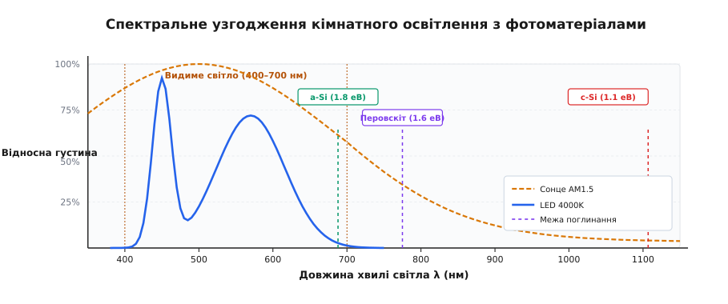
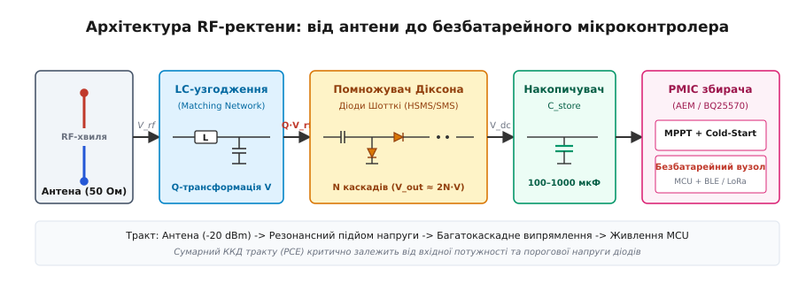
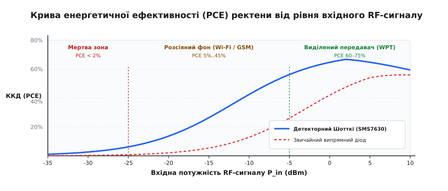
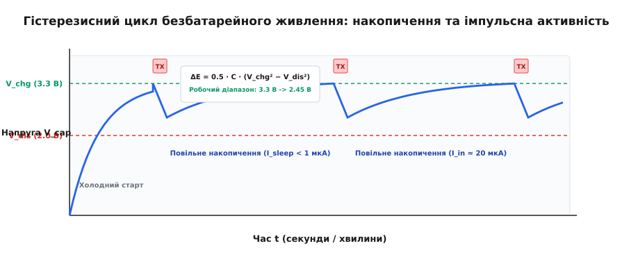

# RF-збирачі й кімнатне світло

<preknowlist>
- [Бюджет енергії](root:hw-power/energy-budget) — закон збереження заряду у вузлі: середня споживана потужність не може перевищувати середню генеровану.
- [Діод Шотткі](root:hw-power/schottky-diode) — бар'єр метал-напівпровідник, низька порогова напруга відкривання та відсутність накопичення неосновних носіїв.
- [ВАХ панелі й точка максимальної потужності](root:hw-power/panel-iv-mpp) — залежність струму фотоелемента від освітленості та напруги навантаження.
- [Помпа заряду Діксона](root:hw-power/dickson-charge-pump) — багатокаскадне помноження напруги за допомогою діодно-конденсаторних ланок.
- [UVLO та супервізори напруги](root:hw-power/uvlo) — порогове блокування схеми при просіданні напруги нижче допустимого рівня.
</preknowlist>

Автономний бездротовий давач мікроклімату, встановлений у глибині офісної будівлі чи на заводському складі, зазвичай живиться від дискової літієвої батарейки типу CR2032 ємністю 220 мАг (близько 660 мВт·год). Коли на об'єкті розгорнуто п'ять тисяч таких вузлів, їхня регулярна заміна перетворюється на безперервний логістичний кошмар і постійну статтю витрат на сервісні бригади. Водночас саме навколишнє середовище всередині приміщень насичене розсіяною фоновою мікроенергією наднизької густини: штучним освітленням від LED-світильників чи люмінесцентних ламп (100–500 люкс, що дає 10–100 мкВт на квадратний сантиметр) та електромагнітним випромінюванням радіоефіру від точок доступу Wi-Fi, базових станцій стільникового зв'язку та ISM-передавачів (0.01–1 мкВт/см², або від −30 до 0 дБм).

Збирання фонової мікроенергії (англ. *Micro Energy Harvesting*) докорінно змінює архітектуру живлення: замість постійного розряду первинного хімічного джерела вузол поглинає мікроскопічні порції енергії з довкілля, поступово накопичує заряд у конденсаторі та періодично вмикається для вимірювання й радіопередачі. Але фізика перетворення енергії таких низьких рівнів радикально відрізняється від потужної вуличної енергетики.

---

## Чому кімнатне світло — це не просто «маленьке сонце»

Головна пастка під час проєктування кімнатних фотоелементів криється в плутанині між фотометричними одиницями людського зору та радіометричними одиницями оптичної потужності. Люкс (лат. *lux* — «світло») — це одиниця освітленості, зважена за спектральною чутливістю людського ока (крива фотопічного зору `V(λ)` за стандартом CIE), яка досягає максимуму на довжині хвилі 555 нм (зелений колір) і спадає майже до нуля за межами вузького діапазону 400–700 нм.

Сонячне випромінювання на відкритому повітрі (стандартний спектр AM1.5G) має сумарну інтегральну потужність близько 1000 Вт/м² (100 мВт/см² або приблизно 100 000 люкс). Це широкий неперервний спектр випромінювання нагрітого тіла (температура поверхні Сонця близько 5800 К), у якому понад 52% енергії припадає на інфрачервоне випромінювання з довжиною хвилі понад 750 нм.

Усередині приміщення картина цілком інша. Типовий офісний робочий стіл освітлений на рівні 300–500 люкс, виробничий коридор або склад — на рівні 50–150 люкс, а затінений куток біля підлоги отримує лише 20–30 люкс.

**Співвідношення оптичної густини потужності:**
```
Пряме вуличне сонце:  ≈ 100 000 люкс  →  100 000 мкВт/см² (100 мВт/см²)
Офісний LED (4000K):  ≈ 500 люкс      →  150 мкВт/см²     (0.15 мВт/см²)
Складський коридор:   ≈ 100 люкс      →  30 мкВт/см²      (0.03 мВт/см²)
```

Густина оптичного потоку в приміщенні менша за вуличну у 700–3000 разів. Ба більше, штучні джерела світла мають принципово інший спектральний склад:
- **Білий світлодіод (LED):** Складається з кристала нітриду галію (InGaN), що випромінює вузький синій пік на довжині хвилі 450 нм, та жовтого люмінофора на основі ітрій-алюмінієвого гранату (YAG:Ce), який перевипромінює широку смугу 520–650 нм. В інфрачервоній області (`λ > 750 нм`) випромінювання повністю дорівнює нулю.
- **Люмінесцентна лампа:** Електричний розряд у парах ртуті створює дискретні ультрафіолетові лінії, які трансформуються трикомпонентним люмінофором у набір вузьких ліній випромінювання (синя 436 нм, зелена 546 нм, червона 611 нм).


*Спектральне узгодження: сонце містить величезний інфрачервоний хвіст, тоді як кімнатний LED зосереджений у смузі 400–700 нм. Матеріали з широкою зоною (a-Si, перовскіт) ефективно поглинають видиме світло, не втрачаючи напруги.*

Звичайний монокристалічний кремній (c-Si) із шириною забороненої зони `Eg = 1.12 еВ` розрахований на поглинання фотонів аж до червоної межі `λ_max ≈ 1107 нм`. Під сонячним світлом він ефективний, але під світлодіодною лампою виникає подвійна фізична проблема:

1. **Термалізація гарячих носіїв:** Коли кремній поглинає синій фотон із довжиною хвилі 450 нм (енергія фотона `E = h·c/λ ≈ 2.76 еВ`), на створення електронно-діркової пари витрачається лише 1.12 еВ. Решта 1.64 еВ (майже 60% енергії кожного поглиненого фотона) миттєво розсіюється у теплові коливання кристалічної ґратки.
2. **Логарифмічне падіння напруги `Voc`:** Напруга холостого ходу діодного переходу визначається рівнянням Вольфа:

```
Voc = (n · k · T / q) · ln(I_ph / I_0 + 1)
```

При падінні фотоструму `I_ph` у тисячу разів напруга кремнієвого елемента просідає з вуличних 0.62 В до кімнатних 0.32–0.38 В. При такій мізерній напрузі для заряду 3-вольтового конденсатора доводиться з'єднувати послідовно 9–10 кремнієвих комірок. Це призводить до високих омічних втрат на струмопровідних шинах, збільшення темнових витоків та неефективного використання площі датчика.

---

## Вплив колірної температури та спектра світильників

Для точного розрахунку надходження енергії інженер повинен знати не просто кількість люксів, а корельовану колірну температуру (CCT, англ. *Correlated Color Temperature*) світильників:

- **Теплий білий світлодіод (Warm White, 2700–3000 K):** Має потужний пік люмінофора у червоній області (600–650 нм) і слабкий синій пік. Оптична густина потужності на один люкс становить приблизно `0.32–0.36 мкВт/(см² · люкс)`.
- **Нейтральний білий світлодіод (Neutral White, 4000–4500 K):** Збалансований спектр, типовий для офісних приміщень. Коефіцієнт перерахунку становить `0.30–0.33 мкВт/(см² · люкс)`.
- **Холодний білий світлодіод (Cool White, 6000–6500 K):** Домінує інтенсивний синій пік 450 нм. Густина випромінювання становить `0.28–0.30 мкВт/(см² · люкс)`.

При однаковому показі люксметра (наприклад, рівно 300 люкс) фотоелемент на основі аморфного кремнію або перовскіту генерує **на 20–30% більше струму під холодним LED (6500 K)**, ніж під теплим (2700 K). Причина проста: фотони синього діапазону несуть більшу енергію, а коефіцієнт квантового поглинання широкозонних матеріалів у синій смузі є максимальним.

---

## Фотовольтаїчні матеріали кімнатного діапазону

Щоб узгодити край оптичного поглинання з видимим спектром штучного освітлення (400–700 нм), для кімнатних мікрозбирачів використовують напівпровідники зі збільшеною оптичною шириною забороненої зони (`Eg ≈ 1.6–1.9 еВ`):

1. **Аморфний гідрогенізований кремній (a-Si:H)** (грец. *amorphos* — «безформний», без регулярної кристалічної ґратки): Завдяки розупорядкованій сітці атомів квантові правила збереження квазіімпульсу послаблюються, роблячи a-Si сильним прямозонним поглиначем із `Eg ≈ 1.75–1.85 еВ`. Червона межа поглинання лежить біля 680 нм. Навіть при слабкому світлі 200 люкс одна комірка видає `Voc ≈ 0.75–0.85 В`, тому батарея лише з чотирьох послідовних смужок на скляній підкладці формує стабільні 3.0–3.3 В на холостому ході.
2. **Галогенідні перовскіти** (кристалічна структура типу ABX₃ на честь графа Л. Перовського): Унікальні напівпровідники, в яких ширину зони можна плавно регулювати від 1.55 до 2.2 еВ заміщенням йоду на бром у складі `CH3NH3Pb(I_{1-x}Br_x)3`. Кімнатний ККД перовскітів під LED-лампами сягає 30–35%, забезпечуючи до 50–90 мкВт/см² при 500 люкс.
3. **Сенсибілізовані барвником елементи (DSSC, комірки Гретцеля)** та **органічні фотоелементи (OPV)**: Спектральна смуга синтезується хімічним шляхом для селективного вловлювання діапазону 450–650 нм без поглинання інфрачервоного шуму.

Детальне фізико-хімічне порівняння, аналіз деградаційних процесів і стабільності цих матеріалів наведено у вставці [Матеріали для кімнатного світла](root:hw-power/rf-zbyrachi-i-kimnatne-svitlo/comp-indoor-pv-materials.md).

> 🔧 **Навіщо це.** Якщо розмістити тонкоплівковий a-Si елемент розміром 3×3 см (площа 9 см²) на корпусі датчика руху в коридорі з освітленістю 200 люкс, він стабільно генерує приблизно 120–150 мкВт потужності. Цього вистачає для роботи мікроконтролера в режимі сну (споживання менше 0.8 мкВт) та відправки одного радіопакета BLE кожні 3–5 секунд.

---

## Збирання розсіяної радіочастотної енергії (Ambient RF)

Світло зникає, коли вимикають освітлення в офісі або коли датчик зачиняють у темній розподільчій шафі чи вентиляційному коробі. Радіочастотний електромагнітний фон, навпаки, присутній цілодобово і проникає крізь пластик, дерево та гіпсокартон.

Розсіяна радіочастотна енергія (англ. *Ambient RF Energy*) створюється активними джерелами зв'язку:
- **Wi-Fi 2.4 ГГц та 5 ГГц:** Стандартна потужність точки доступу становить +20 дБм (100 мВт) або +23 дБм (200 мВт EIRP);
- **Стільниковий зв'язок GSM-900, LTE-1800, 4G/5G:** Потужність користувацьких телефонів досягає +23 дБм (200 мВт), а секторних антен базових станцій — від +43 до +46 дБм (20–40 Вт);
- **Діапазони Sub-GHz ISM (868 МГц у Європі, 915 МГц у США):** Сигнали систем автоматизації будівель, лічильників та охоронних систем.

Потужність у радіотехніці записують у логарифмічній шкалі децибел-міліватів (дБм) (лат. *decimus* — «десятий» + *bell* на честь Олександра Белла + *milli* — «тисячна»):

```
P[дБм] = 10 · lg(P[мВт] / 1 мВт)
```

**Шкала потужностей радіосигналів:**
```
+30 дБм  =  1000 мВт  =  1 Вт       (вихід потужного передавача)
+20 дБм  =  100 мВт                 (стандартний Wi-Fi роутер)
  0 дБм  =  1 мВт     =  1000 мкВт  (виділене живлення на короткій відстані)
−10 дБм  =  0.1 мВт   =  100 мкВт   (зона прямої близькості до роутера, 0.5 м)
−20 дБм  =  0.01 мВт  =  10 мкВт    (типова кімнатна точка, 1.5–2.5 м)
−30 дБм  =  0.001 мВт =  1 мкВт     (далекий куток приміщення, 5–8 м)
−40 дБм  =  0.1 мкВт  =  100 нВт    (фоновий міський шум ефіру)
```

Ослаблення електромагнітної хвилі у вільному просторі підпорядковується рівнянню передачі Фрііса: зі збільшенням відстані `R` густина потоку енергії спадає пропорційно `1/R²`. До цього додаються багатопроменеві інтерференційні завмирання (завмирання Релея та Райса) через відбиття хвиль від металевих конструкцій, залізобетонних стін і переміщення людей.

Історію розвитку ректен — від гігантських мікрохвильових передавачів 1960-х років до мініатюрних чипів RFID та збирачів Інтернету речей — викладено у статті [Історія ректени та бездротового живлення](root:hw-power/rf-zbyrachi-i-kimnatne-svitlo/hist-rectenna-and-wireless-power.md).

---

## Анатомія ректени та фізика високочастотного випрямлення

Приймач радіочастотної енергії складається з антени, узгоджувального контуру, високочастотного випрямляча на діодах Шотткі та накопичувального конденсатора. Такий комплексний пристрій називають ректеною (англ. *rectenna*, скорочення від *rectifying antenna* — «випрямна антена»).


*Тракт ректени: слабкий радіосигнал піднімається за амплітудою в LC-контурі, випрямляється і множиться в ланцюгу Діксона, накопичується в конденсаторі та подається на PMIC.*

Головний бар'єр прямого випрямлення слабких радіохвиль полягає у мізерній амплітуді високочастотної напруги на клемах антени. Якщо 50-омна антена приймає потужність `P = −20 дБм` (10 мкВт), амплітуда напруги холостого ходу становить:

```
V_peak = √(2 · P · R_ant)
= √(2 · 10 · 10⁻⁶ · 50)    [підстановка потужності 10 мкВт та опору 50 Ом]
= √(1 · 10⁻³)              [добуток величин під коренем]
≈ 0.0316 В = 31.6 мВ       [пікова амплітуда напруги на антені]
```

Амплітуда 31.6 мілівольта неспроможна відкрити жоден напівпровідниковий перехід. Поріг відкривання звичайного кремнієвого діода становить `0.65–0.70 В`, а стандартного випрямного діода Шотткі — `0.30–0.40 В`. Без спеціальних заходів уся прийнята потужність відбивається від закритого діода назад в антену.

Для подолання порогового бар'єра застосовують три обов'язкові рішення:

### 1. Резонансна трансформація напруги в LC-контурі
Між 50-омним виходом антени та високоомним входом випрямляча вмикають реактивне узгоджувальне коло (англ. *Matching Network* на індуктивностях і конденсаторах). Контур виконує роль пасивного автотрансформатора напруги: завдяки навантаженій добротності `Q` амплітуда напруги на діоді зростає у `Q` разів:

```
V_diode = Q · V_peak
```

При добротності `Q ≈ 5–7` амплітуда піднімається з 31.6 мВ до 160–220 мВ, виводячи діод у зону нелінійного підпорогового детектування.

### 2. Детекторні діоди Шотткі з нульовим зміщенням
Звичайні діоди Шотткі для силових перетворювачів мають бар'єрну ємність переходу `Cj > 2–10 пФ`. На частоті 2.4 ГГц реактивний ємнісний опір `X_c = 1 / (2·π·f·Cj)` становить лише 30–60 Ом, що коротко замикає високочастотний струм на землю повз діодний бар'єр.

У ректенах використовують **детекторні діоди Шотткі з нульовим зміщенням** (англ. *Zero-Bias Detector Diodes*, наприклад Skyworks SMS7630 або Avago/Broadcom HSMS-2850). Їхні параметри оптимізовані саме під мікропотужні ВЧ-сигнали:
- Бар'єрна висота металізації зменшена до `V_bi ≈ 100–150 мВ`;
- Ємність переходу становить лише `Cj ≈ 0.14–0.18 пФ`;
- Послідовний опір кремнієвої підкладки становить `Rs ≈ 12–20 Ом`.

### 3. Багатокаскадне множення напруги (Помпа Діксона)
Щоб підняти напругу 150–200 мВ до рівня запуску мікросхем (0.4–1.8 В), використовують `N`-каскадний помножувач Діксона.

Вихідна напруга холостого ходу помножувача:

```
V_out = 2 · N · (V_diode_in − V_d)
```

де `V_d` — динамічне падіння напруги на діоді при мікроамперних струмах.


*Крива ККД ректени: при рівнях нижче −25 дБм ККД стрімко спадає через порогову напругу діодів, у зоні фонового збирання (−20...−5 дБм) становить 10–45%, а при спрямованому живленні (>0 дБм) сягає 70%.*

ККД перетворення потужності (PCE, англ. *Power Conversion Efficiency*, `PCE = P_dc / P_rf`) ділиться на три зони:
- **Мертва зона (`P_in < −25 дБм`):** Напруга нижча за поріг детектування. `PCE < 2%`, вихідний струм лежить на рівні часток наноампера.
- **Зона розсіяного збирання (`−25...−5 дБм`):** Робоча область кімнатного ефіру. `PCE ≈ 10–45%`. Збирач генерує від 1 до 20 мкВт постійної потужності.
- **Зона виділеного бездротового живлення (WPT, `P_in > 0 дБм`):** `PCE` сягає 60–75%.

### 4. Нелінійний динамічний імпеданс випрямляча
Вхідний комплексний імпеданс діодного помножувача (лат. *impedire* — «ставати на заваді», «перешкоджати») `Z_in = R_in(P_in, f) − j / (ω · C_in(P_in, f))` не є константою: він нелінійно залежить від амплітуди вхідного сигналу.

Коли вхідна потужність зростає від −30 дБм до 0 дБм, діоди переходять із підпорогового режиму у відкритий стан. При цьому активний вхідний опір `R_in` спадає з кількох кілоомів (близько 3–5 кОм при слабкому сигналі) до десятків омів (50–100 Ом при потужному сигналі), а реактивна ємність `C_in` збільшується через інжекцію надлишкових носіїв заряду.

Вузькосмуговий LC-контур, ідеально розрахований на одну фіксовану потужність (наприклад, на −20 дБм із коефіцієнтом відбиття `S11 < −20 дБ`), при переміщенні датчика ближче до передавача розстроюється: `S11` деградує до −3 дБ, через що половина всієї прийнятої потужності відбивається назад. Для стабільного збирання у змінному середовищі застосовують широкосмугові багатосекційні фільтри Чебишева або комбіновані двочастотні контури (наприклад, на одночасне узгодження 900 МГц та 2.4 ГГц).

Повний аналітичний вивід рівнянь Фрііса, розрахунок нелінійної провідності Шотткі та оптимізації каскадів наведено у вставці [Розрахунок RF-тракту](root:hw-power/rf-zbyrachi-i-kimnatne-svitlo/math-rf-rectenna-link.md).

---

## Конструкція та топологія антен для збирання енергії

Ефективність збирання радіоенергії критично залежить від топології приймальної антени на друкованій платі (PCB):

1. **Друкований чвертьхвильовий монополь або Inverted-F антена (IFA):** Найпростіша компактна антена для діапазону 2.4 ГГц. Займає площу близько 15×25 мм на текстоліті. Має майже кругову діаграму спрямованості у горизонтальній площині, що є ідеальним для вловлювання розсіяних хвиль із довільних напрямків.
2. **Широкосмугова меандрова або фрактальна антена:** Дозволяє одночасно приймати сигнали кількох діапазонів (наприклад, GSM-900, LTE-1800 та Wi-Fi 2.4 ГГц) в єдиній плоскій структурі.
3. **Діелектричні втрати підкладки:** Звичайний склотекстоліт FR-4 має тангенс кута діелектричних втрат `tg δ ≈ 0.02` на частоті 2.4 ГГц, що призводить до втрати 15–25% слабкої прийнятої енергії безпосередньо в товщі діелектрика. У прецизійних RF-збирачах застосовують високочастотні ламінати з низькими втратами (наприклад, Rogers RO4350B або Isola I-Tera з `tg δ ≈ 0.0035`), що підвищує сумарний ККД тракту на 1.5–2 дБ.

---

## Спеціалізовані мікросхеми керування живленням (PMIC)

Мікропотужні джерела (кімнатні фотоелементи та ректени) неможливо підключати безпосередньо до стандартних стабілізаторів напруги. Звичайний мікропотужний LDO-стабілізатор споживає струм власного спокою (англ. *quiescent current*, `I_q`) порядку 1–10 мкА, що повністю знищує весь баланс генерації.

Для збирачів мікроенергії розроблено спеціальний клас мікросхем — **Energy Harvesting PMIC** (наприклад, e-peas AEM30940, Texas Instruments BQ25570, Analog Devices ADP5091). Їхня архітектура містить чотири ключові вузли:

1. **Надновий власний струм спокою:** Струм витоку внутрішніх кіл у режимі очікування знижено до `I_q ≈ 300–500 нА`.
2. **Аналоговий холодний старт (Cold-Start):** Коли накопичувач повністю розряджений до 0 В, мікроконтролер та цифрові схеми знеструмлені. Вбудований низьковольтний генератор Мейснера на зв'язаних індуктивностях (або автогенератор на тунельних польових транзисторах) самостійно запускається від вхідної напруги лише `330–380 мВ` і початково заряджає конденсатор до 1.8 В.
3. **Стеження за максимальною потужністю (FOCV MPPT):** Мікросхема періодично (кожні 16 або 64 с) відмикає вхід на 256 мс, вимірює напругу холостого ходу `Voc` на аналоговій комірці вибірки-зберігання (Sample-and-Hold) і налаштовує вхідний імпульсний бустер на утримання точки максимальної потужності (`0.75–0.80 · Voc` для сонячних комірок, `0.50 · Voc` для ректен).
4. **Гістерезисний супервізор напруги (Power Good / UVLO):** Буферний накопичувач заряджається до верхнього порогу `V_chg` (наприклад, 3.3 В). Щойно поріг досягнуто, PMIC формує логічний сигнал Power Good і вмикає внутрішній ключ подачі живлення на мікроконтролер. Коли напруга внаслідок радіопередачі падає до нижнього порогу `V_dis` (наприклад, 2.2 В), ключ вимикається, запобігаючи неконтрольованому збою пам'яті MCU.


*Гістерезисний цикл: вузол спить десятки секунд, поки конденсатор повільно заряджається від наноамперних струмів, потім вмикається на 10 мс для передачі пакета й знову повертається в сон.*

Фізику вибору буферних ємностей та захист від струмів саморозряду докладно розглянуто в темі [Накопичувач збирача й холодний старт](root:hw-power/nakopychuvach-zbyracha-i-kholodnyi-start).

---

## Інженерна модель енергетичного балансу

Для забезпечення вічної роботи без батареї (енергетично-нейтральний режим, англ. *Energy-Neutral Operation*) середня вироблена потужність повинна перевищувати сумарну потужність споживання у стані сну, вимірювання та радіопередачі:

```
P_harv_avg · η_pmic ≥ P_sleep + P_leak + (E_pulse / T_period)
```

Корисна енергія, доступна в конденсаторі ємністю `C` між порогами `V_chg` та `V_dis`:

```
ΔE_cap = 0.5 · C · (V_chg² − V_dis²)
```

Якщо під час активного циклу мікроконтролер разом із радіомодулем споживають струм `I_act = 16 мА` впродовж `t_act = 10 мс` при середній напрузі 2.85 В:

```
E_pulse = 2.85 В · 16 мА · 10 мс = 456 мкДж
```

Для покриття цього імпульсу при допустимому просіданні напруги від `V_chg = 3.3 В` до `V_dis = 2.4 В`:

```
Δ(V²) = 3.3² − 2.4²
= 10.89 − 5.76             [різниця квадратів напруг]
= 5.13 В²

C_min = (2 · E_pulse) / Δ(V²)
= (2 · 456 · 10⁻⁶) / 5.13  [підстановка енергії та перепаду напруги]
= 9.12 · 10⁻⁴ / 5.13
≈ 1.78 · 10⁻⁴ Ф = 178 мкФ
```

З урахуванням 25% запасу на старіння та витік обирають стандартний керамічний конденсатор ємністю **330 мкФ** або **470 мкФ** (X5R/X7R з низьким струмом витоку).

Нижче наведено завершену інженерну програму для розрахунку динаміки заряду накопичувача, часу відновлення та допустимого темпу відправки радіопакетів для оптичного a-Si збирача та RF-ректени.

:::tabs
:::code rf-zbyrachi-i-kimnatne-svitlo-d/c/main.c
:::code rf-zbyrachi-i-kimnatne-svitlo-d/cpp/main.cpp
:::

---

## Стратегії переривчастого обчислення (Intermittent Computing)

У безбатарейних приладах енергія не гарантована: світло можуть вимкнути, а джерело радіохвиль — перенести. Програмне забезпечення такого вузла будують за принципами переривчастого функціонування (англ. *Intermittent Computing*):

1. **Атомарність операцій:** Прошивка розбивається на неподільні кванти роботи: швидке зчитування давача через I2C/SPI (1–2 мс) → формування пакета в оперативній пам'яті → активація передавача (1–3 мс).
2. **Динамічна адаптація періоду (Adaptive Duty Cycling):** Вузол оцінює швидкість зростання напруги `dV_cap / dt` під час заряду. Якщо світла багато і конденсатор заряджається за 2 секунди, давач відправляє дані що дві секунди. Якщо настали сутінки і час заряду зріс до 40 секунд, вузол автоматично знижує частоту передачі, запобігаючи аварійному вимкненню.
3. **Енергонезалежні контрольні точки (NVM Checkpointing):** Перед вимкненням живлення за сигналом передвісника UVLO поточний стан виконання та накопичені лічильники зберігаються в енергонезалежну сегнетоелектричну оперативну пам'ять (FRAM) або Flash за кілька мікросекунд. При наступному старті мікроконтролер продовжує алгоритм із точки зупинки без тривалого повного рестарту та повторної ініціалізації радіотракту.

---

## Енергетичний бюджет бездротових протоколів передачі

Вибір бездротового стандарту зв'язку для мікрозбирача визначається не швидкістю передачі даних у мегабітах за секунду, а мінімальною енергією, необхідною для доставки одного корисного повідомлення (мікроджоулі на пакет):

| Протокол зв'язку | Частота / Модуляція | Тривалість активного вікна | Струм передавача | Енергія одного пакета | Мінімальне джерело |
|---|---|---|---|---|---|
| **EnOcean (ERP1 / 868 МГц)** | 868.3 МГц, FSK, 125 кбіт/с | 0.8–1.2 мс (субтелеграма) | 12–15 мА (при +3 дБм) | 25–35 мкДж | RF-ректена або a-Si 2×2 см |
| **BLE 5.0 Advertising (Non-conn)** | 2.4 ГГц, GFSK, 1 Мбіт/с | 1.5–2.5 мс (3 канали) | 10–16 мА (при 0 дБм) | 45–70 мкДж | a-Si 3×3 см або RF-ректена |
| **Zigbee Green Power** | 2.4 ГГц, DSSS O-QPSK | 3.0–5.0 мс (1–2 канали) | 18–25 мА (при +3 дБм) | 120–180 мкДж | a-Si 4×4 см під 200 люкс |
| **LoRaWAN (EU868, SF7 / 125 кГц)** | 868 МГц, Chirp Spread Spectrum | 35–45 мс (12 байтів payload) | 25–35 мА (при +14 дБм) | 2500–3500 мкДж (2.5–3.5 мДж) | a-Si 6×6 см або гібрид |
| **LoRaWAN (EU868, SF12 / 125 кГц)** | 868 МГц, Chirp Spread Spectrum | 800–1200 мс (макс. дальність) | 30–40 мА (при +14 дБм) | 70 000–100 000 мкДж (70–100 мДж) | Суперконденсатор 0.1–0.47 Ф |

Для фонового збирання розсіяного ефіру (де середня потужність становить лічені мікровати) практично застосовні лише надкороткі односпрямовані протоколи без квитування (EnOcean або нез'єднувані маяки BLE Non-Connectable Advertising). Протокол LoRaWAN вимагає у сотні разів більшої ємності буфера (іоністора) і тривалого накопичення енергії впродовж кількох годин.

---

## Крайові випадки та пастки безбатарейної експлуатації

Розробка безбатарейних вузлів має низку підступних інженерних пасток, які не проявляються на лабораторному столі, але виводять систему з ладу на реальному об'єкті:

1. **Проблема «темних вихідних» (Dark Weekend):** В офісних будівлях у п'ятницю ввечері повністю вимикають освітлення до ранку понеділка (60–65 годин темряви). Якщо вузол оснащений лише керамічним конденсатором на 470 мкФ, він засне через кілька секунд після вимкнення ламп. Якщо прилад повинен фіксувати аварії (наприклад, протікання води чи відкривання дверей) цілодобово, замість простого конденсатора встановлюють комбінований літій-титанатний накопичувач (LTO, ємністю 1–5 мАг) або гібридний RF+PV збирач.
2. **Температурний розгін струмів витоку суперконденсаторів:** Струм саморозряду електролітичних і суперконденсаторів приблизно подвоюється на кожні 10 °C зростання температури. Якщо при 20 °C витік становить `I_leak = 0.5 мкА`, то влітку у нагрітій сонцем розподільчій шафі при 50 °C витік зросте до `4.0 мкА`. Якщо вхідний струм від збирача становить лише 3.0 мкА, конденсатор **ніколи не зможе досягти порогу запуску `V_chg`**, і вузол назавжди зависне в знеструмленому стані.
3. **Просторові нулі інтерференції в радіоефірі:** У залізобетонних будівлях відбиті від підлоги та стелі радіохвилі Wi-Fi утворюють стійкі стоячі хвилі. Зсув антени збирача лише на 6 см (чверть довжини хвилі на 2.4 ГГц) може перемістити її з максимуму сигналу (−18 дБм) у глибокий просторовий нуль (−42 дБм), де випрямлення повністю припиняється. Тому у відповідальних промислових збирачах застосовують просторове рознесення (дві ортогональні антени на різних кутах плати).

---

## Зіставлення технологій: кімнатне світло проти RF-збирання

Під час вибору типу збирача для конкретного приладу інженер зважає на компроміс між доступною густиною потужності, габаритами приймача, спрямованістю та надійністю джерела:

| Критерій | Кімнатний фотоелемент (a-Si / Perovskite) | Розсіяний ефір (Ambient RF, Wi-Fi / LTE) | Виділений передавач (Dedicated WPT, 915 МГц / 2.4 ГГц) |
|---|---|---|---|
| **Типова густина потужності** | 10–100 мкВт/см² (при 200–500 люкс) | 0.01–1 мкВт/см² (на відстані 2–5 м) | 100–1000 мкВт/см² (у зоні променя) |
| **Вихідна напруга джерела** | 1.5–3.5 В (серія 3–4 комірок) | 20–150 мВ (на антені 50 Ом) | 0.5–2.0 В (після помножувача) |
| **Необхідність перетворювача** | Простий LDO або мікропотужний Buck | Високочастотний помножувач + PMIC | Помножувач + стандартний PMIC |
| **Залежність від середовища** | Зникає в темряві, чутливий до пилу | Працює крізь перешкоди, але падає як `1/R²` | Вимагає прямої спрямованості або зони покриття |
| **Габарити перетворювача** | Плоска пластинка 2×2 см .. 5×5 см | Антена λ/2 (6 см на 2.4 ГГц, 16 см на 900 МГц) | Спрямована патч-антена |
| **Типовий темп оновлення даних** | 1 раз на 1–10 секунд | 1 раз на 1–15 хвилин | 1–10 разів на секунду |

Кімнатні фотоелементи забезпечують на три порядки більшу потужність за тієї самої площі, що робить їх основним вибором для датчиків присутності, температури, відкривання дверей та електронних цінників.

Збирачі радіочастотного ефіру незамінні там, де прилад замурований у бетонні конструкції, розташований усередині герметичних металевих шаф із технологічними отворами або працює у повній темряві вентиляційних шахт. Найсучасніший підхід полягає у створенні **гібридних мікрозбирачів**: на одній підкладці поєднують друковану антену ректени та тонкоплівковий елемент a-Si, що гарантує безперебійне живлення вузла незалежно від графіка освітлення в будівлі.
