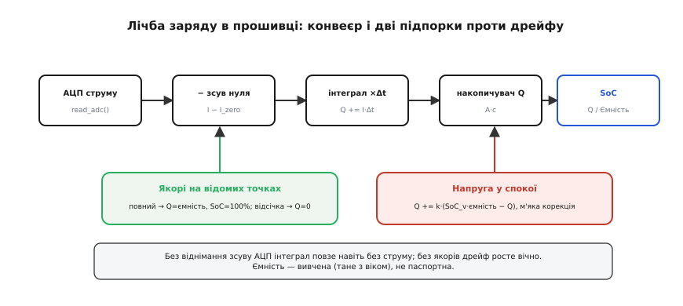

# ⚙️ Лічба заряду (coulomb counting) у прошивці

Як реалізувати кулонометрію — лічбу заряду інтегруванням струму — у коді мікроконтролера, і чим на практиці гасити її неминучий дрейф.

### Задача

Маємо АЦП, що міряє струм батареї (через шунт), і хочемо в прошивці вести **паливомір** — рахувати SoC як інтеграл струму: `SoC = SoC(старт) − (∫I·dt)/Ємність`. Наївна реалізація «просто інтегруй струм» **бреше** з трьох причин: вона потребує відомої точки старту, нескінченно накопичує помилку від зсуву АЦП, а ще ділить на ємність, яка з віком тане. Завдання — написати лічбу так, щоб ці три біди приборкати.

### Ідея

Серце — періодичне накопичення заряду: кожні Δt беремо струм, множимо на крок і додаємо до накопичувача Q. Поверх цього — **три підпорки**, що рятують від дрейфу.

*Основний конвеєр: АЦП струму → відняти зсув нуля → проінтегрувати (×Δt) → накопичувач Q → SoC = SoC0 − Q/Ємність. Дві підпорки знизу: **якорі** (повний заряд → SoC=100%, Q=0; відсічка → SoC=0%) скидають накопичений дрейф, а **напруга у спокої** м'яко підправляє Q (поєднання). Окремо — віднімання зсуву АЦП і ділення на вивчену ємність.*

Перша підпорка — **якорі** на відомих точках (повний заряд і відсічка): там SoC точно відомий, тож скидаємо накопичений дрейф. Друга — **напругова корекція** у спокої: коли комірка відпочила, її напруга надійна, і ми м'яко тягнемо Q до напругової оцінки. Третя — **калібрування зсуву** АЦП: віднімаємо «нульове» показання, інакше навіть без струму інтеграл повзе.

### Робочий код

Усе тримаємо в кулонах (А·с), струм — зі знаком (плюс заряджає, мінус розряджає). Серце — один рядок інтегрування, що повторюється раз на крок; решта — три підпорки.

:::tabs
:::code proj-coulomb-counting/cpp/main.cpp
:::code proj-coulomb-counting/py/main.py
:::

### Складність і пастки на МК

- **Зсув — головний ворог.** Сталий зсув АЦП інтегрується в помилку, що росте без кінця: навіть міліампери уявного струму за годину дають відчутний дрейф. Тому `I_zero` калібрують (читають при гарантовано нульовому струмі) і віднімають **щоразу**.
- **Одиниці й переповнення.** Інтегруючи струм×час, тримайте накопичувач у **сталих** одиницях (ампер-секунди чи кулони), акуратно масштабуйте у фіксованій комі й стежте за переповненням цілого на довгих пробігах.
- **Частота опитування.** Опитуйте струм досить **часто**, щоб упіймати [пікові кидки струму](root:hw-power/battery-sag); рідкісні заміри проґавлять сплеск і недорахують заряд. Де можливо — усереднюйте апаратно.
- **Знак.** Струм **двонапрямний**: заряд додає, розряд віднімає. Помилка зі знаком псує все — звіряйте полярність шунта.
- **Ємність не стала.** Діліть на **вивчену** ємність (вона [тане з віком](root:hw-power/battery-aging)), а не на паспортну, інакше «100%» старої батареї бреше; оновлюйте її на повних циклах.
- **Якорі обов'язкові.** Без скидання на повному/порожньому дрейф накопичується вічно. Кожен повний заряд — нагода перекалібрувати лічбу заряду.
- **Сон МК.** У сні струм усе одно тече (саморозряд, спокій схеми). Або продовжуйте лічбу через періодичні пробудження, або довірте облік окремому **апаратному** кулонометру, що рахує й під час сну, — інакше прокинетесь із заниженим Q.
- **Точність Δt.** Джитер циклу додає помилку в інтеграл: беріть **стабільний** таймер, а не «приблизно раз на 100 мс» у головному циклі.
