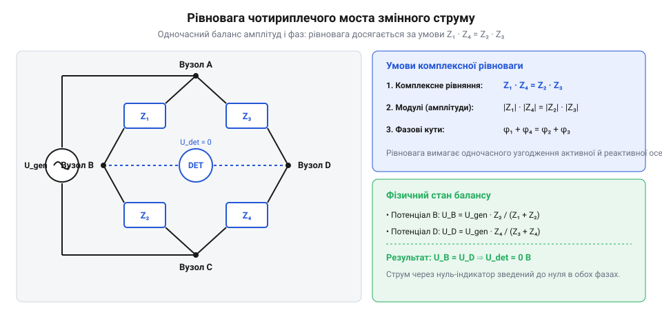
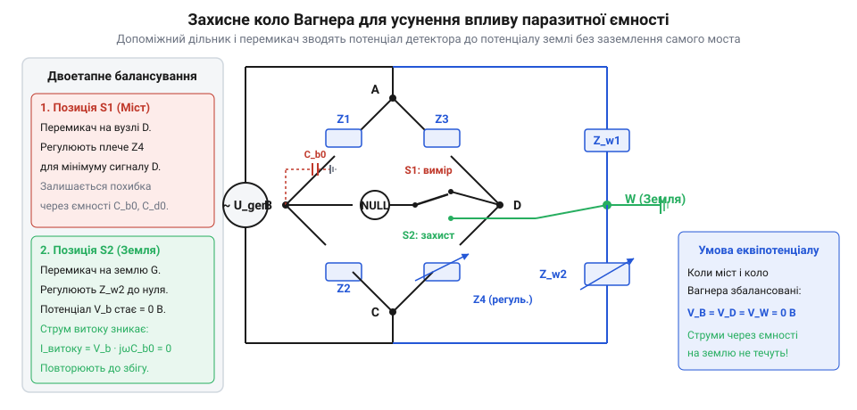

# AC-міст імпедансів

<preknowlist>
- [Міст Кельвіна](root:hw-sensing/kelvin-bridge) — Чотирипровідне підключення та компенсація опору виводів у мостових схемах
- [Імпедансна спектроскопія](root:hw-sensing/impedance-spectroscopy) — Поняття комплексного імпедансу, активного й реактивного опору на змінному струмі
</preknowlist>

## Межа моста постійного струму і природа змінного сигналу

Класичний міст постійного струму розрахований на одну фізичну величину — омічний опір провідника, де струм і напруга збігаються за фазою. Щойно у вимірювальне коло потрапляє котушка індуктивності, конденсатор, електрохімічна комірка чи довгий коаксіальний кабель, відгук середовища набуває реактивного характеру. На змінному струмі електричний опір перетворюється на комплексний імпеданс (@@en|impedance@@, від латинського *impedire* — перешкоджати), який одночасно описує амплітудне обмеження струму та його часовий зсув відносно прикладеної напруги.

Якщо підключити джерело змінної синусоїдальної напруги до резистивного моста, у плече якого встановлено невідомий реактивний елемент, звичайний вольтметр у вимірювальній діагоналі ніколи не зафіксує нульової напруги. Навіть коли активні опори підібрані так, що миттєві амплітуди напруг у вершинах діагоналі збігаються в певні моменти періоду, між цими точками зберігається фазовий зсув (@@en|phase shift@@). Реактивний струм, зсунутий на 90° відносно напруги живлення, формує незгасаючу квадратурну напругу розбалансу. Підкручування лише активних резисторів лише зміщує мінімум залишкового сигналу, але не зводить його до справжнього нуля.

> 🔧 **Навіщо це.**
> Розуміння двовимірної природи імпедансу рятує від грубих помилок у сенсориці: наприклад, ємнісний давач наближення чи п'єзоперетворювач не можна протестувати постійним струмом. Вимірювання на змінному струмі дозволяє одночасно дізнатися корисну ємність і паразитно втрачений струм витоку в діелектрику.

Для повного згасання струму у вимірювальній діагоналі необхідно, щоб потенціали обох вимірювальних вершин збігалися в кожен момент часу — як за абсолютною величиною, так і за початковою фазою коливань. Це вимагає керування щонайменше двома незалежними параметрами схеми.

**Векторна діаграма залишкової напруги при нескомпенсованій фазі.**

Розглянемо фізичний механізм виникнення залишкової напруги на комплексній площині векторів напруг. Нехай чотириплечий міст живиться синусоїдальною напругою з амплітудою `U_in = 10 В` та частотою `f = 1 кГц` (кутова частота `ω = 2 · π · 1000 ≈ 6283.185 рад/с`).

Опорна гілка моста утворена двома суто резистивними плечима `R₃ = 1000 Ом` та `R₄ = 1000 Ом`. Потенціал середньої вершини опорного дільника `V_D` є суто синфазним із напругою живлення:

    V_D = U_in · [ R₄ / (R₃ + R₄) ]
        = 10 · [ 1000 / (1000 + 1000) ]
        = 5.0 + j · 0.0 В                 [ділення напруги опорної резистивної гілки]

Досліджувана гілка містить регулювальний активний резистор `R₁ = 1000 Ом` та невідомий двополюсник у плечі 2, що складається з послідовно з'єднаних резистора `R_x = 1000 Ом` і конденсатора `C_x = 159.155 нФ`.

Реактивний ємнісний опір досліджуваного конденсатора дорівнює:

    X_C = 1 / (ω · C_x)
        = 1 / (6283.185 · 159.155 · 10⁻⁹)
        = 1000.0 Ом                      [ємнісний опір на частоті 1 кГц]

Комплексний імпеданс другого плеча набуває вигляду `Z₂ = 1000 - j · 1000 Ом`. Загальний імпеданс досліджуваної вітки становить:

    Z_12 = R₁ + Z₂
         = 1000 + (1000 - j · 1000)
         = 2000 - j · 1000 Ом            [послідовне додавання імпедансів вітки]

Розрахуємо струм у вимірюваній вітці:

    I_12 = U_in / Z_12
         = 10 / (2000 - j · 1000)
         = 10 · (2000 + j · 1000) / (2000² + 1000²)
         = (20000 + j · 10000) / 5000000
         = 0.004 + j · 0.002 А           [комплексний струм у вітці R1-Z2]

Знайдемо комплексний потенціал вимірювальної вершини `V_B`:

    V_B = I_12 · Z₂
        = (0.004 + j · 0.002) · (1000 - j · 1000)
        = (4 - j · 4 + j · 2 + 2)
        = 6.0 - j · 2.0 В                [вузловий потенціал вершини B]

Визначимо комплексну напругу на клемах нуль-індикатора `U_det = V_B - V_D`:

    U_det = (6.0 - j · 2.0) - (5.0 + j · 0.0)
          = 1.0 - j · 2.0 В              [вектор різниці потенціалів діагоналі]

Вектор напруги розбалансу чітко розпадається на дві ортогональні проєкції:
1. Синфазна складова `U_I = Re(U_det) = 1.0 В` — зумовлена різницею коефіцієнтів ділення активних опорів.
2. Квадратурна складова `U_Q = Im(U_det) = -2.0 В` — зумовлена нескомпенсованим фазовим зсувом реактивного струму конденсатора.

Модуль залишкової напруги, яку фіксує широкосмуговий вольтметр, становить:

    |U_det| = √[ 1.0² + (-2.0)² ]
            = √[ 1.0 + 4.0 ]
            = √5.0 ≈ 2.236 В             [модуль сумарної напруги розбалансу]

Кут зсуву фази вектора розбалансу відносно синфазної осі:

    φ_det = arctan( -2.0 / 1.0 )
          ≈ -63.43°                      [фазовий кут розбалансу]

Якщо оператор спробує зменшити сигнал розбалансу виключно зміною активного опору `R₁`, змінюючи його номінал, потенціал `V_B` на комплексній площині описуватиме коло або дугу, радіус якої визначається співвідношенням реактивного та активного опорів плеча `Z₂`. При значенні `R₁ = 1414.2 Ом` досягається локальний мінімум модуля напруги, проте він ніколи не перетинає точку `V_D = 5.0 + j · 0.0 В`. Залишкова напруга завжди матиме ненульовий квадратурний компонент `|U_Q| > 0`, доки в одне із суміжних або протилежних плечей не буде введено компенсуючий реактивний елемент із регульованою фазою.

## Комплексна умова балансу чотириплечого моста

Чотириплечий міст змінного струму складається з чотирьох гілок з комплексними імпедансами Z₁, Z₂, Z₃, Z₄, з'єднаних у замкнене кільце. До однієї діагоналі підключають генератор гармонічного сигналу, а до другої — чутливий нуль-індикатор (@@en|null detector@@).


*Чотириплечий міст змінного струму: протилежні плечі Z1 і Z4 зрівноважують Z2 і Z3 за амплітудою та фазою.*

Рівновага моста настає тоді, коли різниця потенціалів між вимірювальними вершинами дорівнює нулю. Це еквівалентно рівності коефіцієнтів ділення напруги в лівій та правій гілках моста:

```
Z₁ / Z₂ = Z₃ / Z₄
```

Перемноживши навхрест, отримуємо фундаментальне рівняння балансу змінного моста:

```
Z₁ · Z₄ = Z₂ · Z₃
```

Оскільки кожен імпеданс є комплексним числом `Z = |Z| · e^(jφ)`, де `|Z|` — модуль повного опору, а `φ` — його фазовий кут, рівняння розпадається на дві незалежні дійсні умови:

```
|Z₁| · |Z₄| = |Z₂| · |Z₃|
φ₁ + φ₄ = φ₂ + φ₃
```

Перша умова вимагає рівності добутків модулів імпедансів протилежних плечей. Друга вимагає рівності сум фазових кутів протилежних плечей.

Якщо подати імпеданси в алгебричній формі через активний опір `R` та реактанс `X` як `Z = R + j · X`, то рівняння балансу набуває вигляду:

```
(R₁ + j · X₁) · (R₄ + j · X₄) = (R₂ + j · X₂) · (R₃ + j · X₃)
(R₁·R₄ - X₁·X₄) + j · (R₁·X₄ + X₁·R₄) = (R₂·R₃ - X₂·X₃) + j · (R₂·X₃ + X₂·R₃)
```

Прирівнюючи окремо дійсну та уявну частини, маємо систему двох дійсних рівнянь:

```
R₁·R₄ - X₁·X₄ = R₂·R₃ - X₂·X₃      [баланс дійсної складової]
R₁·X₄ + X₁·R₄ = R₂·X₃ + X₂·R₃      [баланс уявної складової]
```

Звідси випливає фундаментальне топологічне правило для вибору типу компонентів у плечах: якщо в суміжних плечах стоять чисто резистивні елементи з нульовим фазовим зсувом, протилежні плечі повинні мати реактанси однакового знака (обидва індуктивні або обидва ємнісні). Якщо ж реактивні компоненти стоять у протилежних плечах, суміжні плечі мають вносити протилежні за знаком фазові зсуви.

**Числовий приклад розрахунку балансу.**
Розглянемо практичний приклад моста Максвелла для вимірювання параметрів котушки індуктивності `Z₄ = R_x + j · ω · L_x`. У протилежному плечі `Z₁` встановлено паралельне з'єднання зразкового резистора `R₁ = 10 кОм` та зразкового конденсатора `C₁ = 100 нФ`. Суміжні плечі містять точні омічні резистори `R₂ = 1 кОм` та `R₃ = 2 кОм`. Частота тестового сигналу становить `f = 1 кГц` (`ω = 2 · π · 1000 ≈ 6283.18 рад/с`).

Підставимо параметри в розділені формули рівноваги:

```
L_x = R₂ · R₃ · C₁
    = 1000 · 2000 · (100 · 10⁻⁹)
    = 0.2 Гн = 200 мГн

R_x = (R₂ · R₃) / R₁
    = (1000 · 2000) / 10000
    = 200 Ом
```

Розрахуємо добротність котушки на тестовій частоті:

```
Q = (ω · L_x) / R_x
  = (6283.18 · 0.2) / 200
  = 6.28
```

Зверніть увагу: обидва розрахункові рівняння для `L_x` і `R_x` не містять частоти `ω`. Якщо частота генератора зазнає невеликих коливань або містить помірні гармонічні спотворення, точка рівноваги моста лишається незмінною.

**Виродження умов рівноваги та від'ємний опір.**
Особливий граничний випадок виникає тоді, коли досліджуваний об'єкт містить активні напівпровідникові структури або електрохімічні межі з від'ємним диференційним опором (наприклад, тунельний діод, дуговий розряд чи мембрану клітини у збудженому стані). Якщо активний опір одного з плечей стає від'ємним (`R₁ < 0`), дійсна частина рівняння балансу набуває вигляду:

```
- |R₁| · R₄ - X₁ · X₄ = R₂ · R₃ - X₂ · X₃
```

У цій ситуації загальний активний опір замкненого мостового контуру може стати нульовим або від'ємним (`R_total ≤ 0`). Замість досягнення статичної рівноваги схема перетворюється на автогенератор синусоїдальних чи релаксаційних коливань. Напруга на нуль-індикаторі не зникає, а переходить у режим спонтанної генерації на власній резонансній частоті контуру `LC`. Умови квазістатичного моста тут повністю вироджуються, і вимірювання стає можливим лише після послідовного додавання пасивного баластного опору, який гарантує додатний баланс потужності в колі.

## Збіжність балансування та ортогональність регулювань

Головна практична трудність ручного моста змінного струму полягає в ефекті взаємного впливу регулювань (@@en|sliding balance@@). На відміну від моста постійного струму, де єдиний реохорд однозначно прямує до точки нуля, на змінному струмі оператор підлаштовує два незалежні органи керування — наприклад, змінний резистор і змінний конденсатор. Якщо обрана топологія моста не забезпечує математичного розділення невідомих параметрів, зміна резистора зміщує фазу й одночасно змінює амплітуду.

У результаті спроба мінімізувати напругу на нуль-індикаторі перетворюється на тривалий ітераційний процес: мінімізувавши сигнал першим регулятором, перемикаються на другий, після чого перший знову виявляється не в балансі. Якщо кут між векторами регулювання в комплексній площині малий, процес збігається вкрай повільно — кожне підлаштування дає лише крихітний приріст чутливості.

Щоб зрозуміти математичну природу цього явища, розглянемо комплексну напругу розбалансу детектора `U_det(p₁, p₂)` як функцію двох регульованих параметрів `p₁` та `p₂` (де `p₁` може бути опором підлаштовного резистора, а `p₂` — ємністю еталонного конденсатора). При зміні кожного з параметрів годограф напруги детектора на комплексній площині описує відповідні напрямні вектори збіжності:

    v₁ = ∂U_det / ∂p₁
    v₂ = ∂U_det / ∂p₂

Коли оператор знаходить мінімум модуля напруги `|U_det|` за допомогою першого органу керування `p₁`, геометрично це відповідає проектуванню поточної точки напруги по перпендикуляру на траєкторію вектора `v₁`. Наступне підлаштування другого органу `p₂` проектує отриману точку по перпендикуляру на траєкторію вектора `v₂`.

Кут перетину `γ` між лініями регулювання на комплексній площині визначається через скалярний добуток комплексних векторів швидкості:

    cos(γ) = Re(v₁ · v₂*) / (|v₁| · |v₂|)

Тут `v₂*` позначає комплексно-спряжений вектор, а `Re(...)` виділяє дійсну частину добутку. Сам кут збіжності обчислюється як:

    γ = arccos[ Re(v₁ · v₂*) / (|v₁| · |v₂|) ]

Коефіцієнт зменшення похибки `k_err` за один повний цикл послідовного підлаштування двох ручок прямо залежить від косинуса цього кута:

    k_err = |cos(γ)|

Якщо лінії регулювання ортогональні, тобто векторний кут перетину `γ = 90°` (`cos(γ) = 0`), то `k_err = 0`. У цьому ідеальному випадку мінімізація за першим параметром `p₁` приводить напругу детектора на пряму, яка проходить строго через початок координат. Потім один єдиний рух другої ручки `p₂` миттєво зводить напругу в абсолютний нуль без жодних повторних наближень.

Якщо ж кут `γ` стає малим (наприклад, `γ = 5°`), маємо `cos(5°) ≈ 0.996`. Кожен крок ітерації зменшує амплітуду сигналу лише на частки відсотка. Траєкторія напруги рухається до нуля по дуже похилій зигзагоподібній спіралі. Оператор змушений робити сотні почергових перемикань між двома ручками, причому на практиці через шуми детектора баланс здається «розмазаним» задовго до досягнення справжнього нуля.

Розглянемо для прикладу міст змінного струму, де зміна `R₁` змінює фазу струму живлення. Якщо вихідна напруга детектора в околі балансу має вигляд `U_det = (α₁ + j · β₁) · ΔR₁ + (α₂ + j · β₂) · ΔC₂`, вектори чутливості дорівнюють:

    v₁ = α₁ + j · β₁
    v₂ = α₂ + j · β₂

Скалярний добуток у комплексній формі:

    Re(v₁ · v₂*) = α₁ · α₂ + β₁ · β₂

Умова строгої ортогональності регулювань полягає у зануленні цього скалярного добутку:

    α₁ · α₂ + β₁ · β₂ = 0

Коли ця умова виконується, оператор ізольовано регулює активну й реактивну складові імпедансу, а час зведення моста скорочується від десятків хвилин до двох послідовних рухів.

> 🔧 **Навіщо це.**
> Розрахунок кута `γ` дозволяє ще на етапі вибору схеми моста оцінити, чи буде вимірювання швидким і стабільним. Для високодобротних котушок або конденсаторів з малими втратами невідповідна мостова схема дає кут `γ < 1°`, через що зрівноважити міст у лабораторії практично неможливо.

Щоб уникнути ковзного балансу, мостові схеми синтезують за принципом ортогональності регулювань (@@en|orthogonal balance@@). В ідеальній ортогональній схемі перший підлаштовний елемент входить лише в рівняння дійсної частини, а другий — лише в рівняння уявної частини:

    R_x = f₁(R_a, R_b, R_c)
    X_x = f₂(C_a, R_b, R_c)

Коли рівняння розділені, баланс за активним опором встановлюється за один рух першої ручки, після чого баланс за реактивністю завершується одним рухом другої ручки без повторних ітерацій.

## Класичні мостові схеми для індуктивностей і ємностей

Еволюція мостових вимірювань породила спеціалізовані конфігурації під різні типи реактивних компонентів і різні діапазони добротності (докладніше див. [історичний нарис](root:hw-sensing/ac-impedance-bridge/hist-maxwell-wien-bridges.md)).

Для вимірювання котушок індуктивності з низькою та середньою добротністю (`Q < 10`) стандартом став міст Максвелла-Віна (@@en|Maxwell-Wien bridge@@). Замість нестабільної та громіздкої еталонної змінної котушки індуктивності в ньому застосовано паралельне з'єднання еталонного конденсатора `C₁` та резистора `R₁` у плечі, протилежному до досліджуваного дроселя `Z₄ = R_x + j · ω · L_x`:

    R_x = (R₂ · R₃) / R₁
    L_x = R₂ · R₃ · C₁

Обидва рівняння повністю незалежні одне від одного і, що найважливіше, не містять кругової частоти `ω`. Міст є частотно-незалежним: баланс зберігається навіть при незначних коливаннях частоти генератора чи наявності помірних вищих гармонік у сигналі збудження.

**Співвідношення між добротністю Q та вимірювальною чутливістю моста.**

Добротність послідовної моделі котушки `Q = ω · L_x / R_x` безпосередньо визначає як чутливість нуль-індикатора, так і збіжність балансу моста Максвелла. Підставивши вирази мостової рівноваги, отримаємо:

    Q = ω · (R₂ · R₃ · C₁) / [ (R₂ · R₃) / R₁ ]
      = ω · C₁ · R₁

Чутливість мостової схеми до відносної зміни індуктивності `S_L = |ΔU_det / U_gen| / (ΔL_x / L_x)` в околі стану рівноваги залежить від фазового кута комплексного імпедансу котушки `θ = arctan(Q)`:

    S_L = Q / [ 2 · √(1 + Q²) ]

Ця формула розкриває два протилежні граничні режими роботи:
1. При малій добротності (`Q << 1`, сильні втрати в осерді або високий опір обмотки) чутливість детектора до реактивної складової падає лінійно: `S_L ≈ Q / 2`. Мала зміна індуктивності губиться на тлі великого синфазного струму активних втрат, через що індикатор розбалансу фіксує лише незначний квадратурний сигнал.
2. При високій добротності (`Q > 10`) значення `S_L` наближається до теоретичної межі `0.5`, проте чутливість налаштування активного опору катастрофічно деградує. Оскільки `R₁ = Q / (ω · C₁)`, для високодобротної котушки необхідний підлаштовний опір `R₁` сягає десятків мегаом. Провідність цього плеча дорівнює `G₁ = 1 / R₁`, а її диференційна чутливість до зміни опору спадає обернено пропорційно квадрату добротності:

    |dG₁ / dR₁| = 1 / R₁² = (ω · C₁)² / Q²

У результаті для котушок із `Q > 50` поворот ручки магазину опорів `R₁` навіть на значну величину викликає нескінченно малу зміну напруги детектора. Кут між векторами балансування стає практично нульовим, а балансування вироджується в нескінченний ковзний процес.

> 🔧 **Навіщо це.**
> Розрахунок чутливості показує чітку робочу зону моста Максвелла: `1 ≤ Q ≤ 10`. Для високодобротних котушок (`Q > 10`) використовують міст Хея з послідовним RC-плечем, де опір пропорційний `1/Q`, а чутливість регулювання залишається високою.

Для прецизійного вимірювання малих ємностей і параметрів діелектричних втрат використовують міст Шеринга (@@en|Schering bridge@@). У цій схемі послідовно з досліджуваним зразком діелектрика ввімкнено високоякісний еталонний повітряний або газонаповнений конденсатор без втрат. Тангенс кута діелектричних втрат (@@en|dissipation factor@@, `tan δ = ω · R_x · C_x`) обчислюється безпосередньо через значення паралельного підлаштовного конденсатора `C₄` у резистивному плечі:

    C_x = C₂ · (R₄ / R₃)
    tan δ = ω · R₄ · C₄

Така конфігурація дозволяє проводити вимірювання під високою робочою напругою (до сотень кіловольт), оскільки висока напруга падає на ємнісних плечах, тоді як органи підлаштування залишаються під безпечним низьким потенціалом відносно землі.

## Паразитні ємності та витоки на землю

На постійному струмі ізоляція між проводами та металевим корпусом приладу має гігаомні опори, тому струмами витоку у звичайних вимірюваннях часто нехтують. Але як тільки через міст тече змінний струм із частотою `f = ω / (2 · π)`, будь-яка провідна поверхня, з'єднувальний кабель чи навіть рука оператора біля ручки налаштування перетворюються на конденсатори зв'язку із землею. Адмітанс паразитної ємності `C_p` зростає пропорційно частоті:

    Y_p = j · ω · C_p

Кожен із чотирьох вимірювальних вузлів моста має свою паразитну провідність на спільну шину заземлення або металеве шасі приладу (`Y_A0`, `Y_B0`, `Y_C0`, `Y_D0`). Оскільки ці ємності не симетричні, через них у землю стікають неконтрольовані струми. Ці струми оминають основні вимірювальні плечі й утворюють додаткове падіння напруги, спотворюючи баланс як за амплітудою, так і за фазою. Якщо заземлити один із вимірювальних вузлів моста напряму, ми просто закоротимо паразитну ємність цього вузла, але зашунтуємо одне з робочих плечей.

**Ефект паразитної ємності руки оператора (Hand Capacity Effect).**

Особливо підступною проблемою ручних мостів змінного струму є паразитна ємність тіла людини (@@en|hand capacity effect@@). Тіло оператора через підлогу приміщення, взуття та навколишні предмети має власну ємність на землю порядка `100..200 пФ`. Коли оператор підносить руку до ручки підлаштовного резистора чи конденсатора, між долонею та внутрішнім струмовідним монтажем виникає динамічна паразитна ємність `C_hand ≈ 5..30 пФ`.

Якщо вісь або ручка регулятора гальванічно сполучена з вимірювальними вершинами `B` чи `D`, при наближенні руки через міст починає протікати додатковий високочастотний струм витоку:

    I_hand = (V_node - V_earth) · j · ω · C_hand

Це породжує класичний інженерний парадокс «відведеної руки»:
1. Оператор торкається ручки й ретельно налаштовує міст за нуль-індикатором, несвідомо компенсуючи струм `I_hand` органами підлаштування основного моста.
2. Як тільки оператор прибирає руку від приладу, ємність `C_hand` миттєво зникає.
3. Баланс схеми руйнується, і стрілка або звуковий тон нуль-індикатора знову фіксують значний сигнал розбалансу.

Для боротьби з цим ефектом застосовують комбінацію механічних та схемотехнічних заходів:
- Використання подовжених діелектричних осей із текстоліту або ебоніту, що фізично віддаляють ручки керування від високочутливих вузлів на `10..15 см`.
- Коаксіальне екранування декад опорів, де зовнішній металевий кожух з'єднується з точкою віртуального заземлення.
- Застосування захисного кола Вагнера, яке принципово усуває різницю потенціалів `V_node - V_earth = 0`, завдяки чому струм `I_hand` занулюється навіть при безпосередньому торканні металевих осей.

Розв'язанням цієї дилеми стало штучне створення віртуального нуля — захисне заземлення Вагнера (@@de|Wagner-Erdung@@).


*Підключення допоміжного дільника Вагнера формує віртуальну нульову точку, що занулює паразитичні струми через нуль-індикатор.*

Схема Вагнера додає до основного моста паралельний допоміжний дільник напруги (`Z_W1`, `Z_W2`), середня точка якого з'єднана безпосередньо із заземленням. Балансування виконується у два кроки через перемикач нуль-індикатора `S`:

1. Спершу нуль-індикатор підключають між вершинами основного моста і зводять його сигнал до мінімуму.
2. Потім перемикач `S` перекидає індикатор між однією з вимірювальних вершин і землею, а дільником Вагнера зводять напругу до нуля.
3. Процес повторюють кілька разів до повного збігу.

> 🔧 **Навіщо це.**
> Завдяки колу Вагнера обидві вимірювальні вершини набувають потенціалу землі без фізичного гальванічного з'єднання із заземленням. Струм через паразитні ємності детектора повністю зникає, оскільки різниця потенціалів між його клемами та землею дорівнює нулю.

Математичне обґрунтування та розрахунок вузлових потенціалів заземлення Вагнера докладно розібрано у вставці [math-wagner-grounding](root:hw-sensing/ac-impedance-bridge/math-wagner-grounding.md).

## Мости з трансформаторними плечима відношень

Класичні чотириплечі мости на дискретних резисторах і конденсаторах стикаються з фундаментальним бар'єром: номінали компонентів дрейфують від температури, старіють і мають власні паразитні індуктивності та ємності монтажу. Досягти точності вище за `0.01 %` у такій конфігурації стає складною інженерною задачею.

Радикальним кроком уперед стала заміна двох пасивних плечей відношення індуктивно зв'язаними обмотками на спільному магнітному осерді з високою проникністю — міст Блюмлейна або трансформаторний міст відношень (@@en|transformer ratio arm bridge@@).

В ідеальному трансформаторі відношення напруг на вторинних обмотках визначається суворо відношенням кількості витків:

```
U_1 / U_2 = N_1 / N_2
```

Оскільки коефіцієнт магнітного зв'язку між обмотками наближається до одиниці (`k ≈ 1`), відношення напруг лишається стабільним у часі, не залежить від температури та зберігає незмінність навіть при значному навантаженні плечей струмом.

> 🔧 **Навіщо це.**
> Трансформаторні плечі мають вкрай низький власний вихідний імпеданс (опори обмоток становлять частки ома). Тому паразитні ємності кабелів та екранів, що підключаються паралельно плечам відношення, шунтують мізерний імпеданс обмотки й практично не спотворюють коефіцієнт трансформації напруг.

Трансформаторні мости відношень дозволяють вимірювати екстремально малі ємності (аж до `10⁻¹⁵ Ф` — фемтофарад) і великі опори на частотах до кількох сотень кілогерців, будучи метрологічним стандартом у лабораторіях первинних еталонів.

**Порівняння біфілярної та коаксіальної намотки трансформаторних плечей.**

Метрологічна точність трансформатора відношень залежить від двох паразитних факторів: індуктивності розсіювання магнітного поля `L_leak` та міжоpermissionsмотувальної ємності `C_w`. Якщо магнітний потік обмоток не збігається ідеально, різниця спадів напруги на реактивних опорах розсіювання спотворює номінальний коефіцієнт передачі `N₁ / N₂`.

Для досягнення граничної симетрії в діапазоні низьких і високих частот застосовують два принципово різні способи укладання провідників на тороїдальне осердя з супермалою чи аморфного заліза:

1. **Біфілярна намотка (скручена пара).**
Два ізольовані мідні дроти скручують разом із рівномірним кроком перед укладанням на тороїд. Обидва провідники розташовані в абсолютно однакових геометричних умовах щодо осердя, що забезпечує коефіцієнт магнітного зв'язку `k > 0.99999` та нівелює різницю індуктивностей розсіювання до часток наногенрі.
*Обмеження:* Через тісний контакт провідників виникає значна розподілена міжоpermissionsмотувальна ємність (від `50` до `200 пФ`), крізь яку на частотах понад `10 кГц` починають протікати ємнісні струми витоку безпосередньо між плечима, руйнуючи істинний коефіцієнт ділення напруги.

2. **Коаксіальна екранована намотка (технологія Колвера-Каткоскі).**
Обмотки виконують відрізками мініатюрного гнучкого коаксіального кабелю. Внутрішня центральна жила слугує вимірювальною сигнальною обмоткою, а зовнішнє мідне обплетення відіграє подвійну роль: струмонесучої зворотної обмотки та суцільного електростатичного екрана.
*Перевага:* Усі паразитні ємності сигнальної жили замикаються суто на власний екран і відводяться у віртуальну землю детектора або низькопотенційні шини живлення. Міжоpermissionsмотувальна ємність між сусідніми плечима практично обнуляється (`C_w < 0.01 пФ`).

```
Властивість              Біфілярна намотка         Коаксіальна намотка
─────────────────────────────────────────────────────────────────────────────
Робочий діапазон частот  50 Гц .. 10 кГц           1 кГц .. 10 МГц
Коефіцієнт зв'язку (k)   0.99999                   0.99995
Міжоpermissionsмотувальна ємність  Висока (50..200 пФ)       Наднизька (< 0.01 пФ)
Індуктивність розсіювання Мінімальна (< 5 нГн)      Помірна (10..50 нГн)
Складність виготовлення  Середня                   Висока (роздільне екранування)
```

> 🔧 **Навіщо це.**
> Вибір між біфілярною та коаксіальною структурою визначається компромісом частоти й точності: для прецизійних вимірювачів опору та ємності на промислових частотах біфіляр дає найменшу магнітну асиметрію, тоді як для високочастотної імпедансної спектроскопії (понад `100 кГц`) коаксіальна намотка є єдиним способом позбутися міжоpermissionsмотувальних ємнісних витоків.

## Сучасне квазіурівноваження та автобалансовані цифрові мости

Ручне крутіння підлаштовних декад резисторів і конденсаторів відійшло в історію вимірювальної техніки. Сучасні вимірювачі імітансу (LCR-метри та аналізатори імпедансу) використовують топологію автобалансованого моста (@@en|auto-balancing bridge@@).

Замість чотирьох пасивних плечей автобалансований міст містить генератор тестового сигналу `U_gen`, вимірюваний об'єкт `Z_x` та перетворювач «струм-напруга» (трансімпедансний підсилювач) у ролі балансуючого елемента.

```
       Z_x                 R_ref
U_in ───████───┬────────────████──── U_out
               │     ┌───┐
               └─────┤-  │
                     │   ├───┐
               ┌─────┤+  │   │
               │     └───┘   │
              GND            └─── U_out = - U_in · (R_ref / Z_x)
```

Інвертувальний вхід операційного підсилювача підтримується зворотним зв'язком на потенціалі віртуальної землі (`0 В`). Струм `I_x`, що протікає крізь вимірюваний імпеданс `Z_x`, повністю компенсується струмом `I_bal` через зразковий резистор `R_ref`:

```
I_x + I_bal = 0
U_in / Z_x + U_out / R_ref = 0
```

Звідси невідомий комплексний імпеданс обчислюється напряму з відношення комплексних напруг:

```
Z_x = - R_ref · (U_in / U_out)
```

Напруги `U_in` та `U_out` оцифровуються швидкісними АЦП, після чого цифровий сигнальний процесор (DSP) виконує векторну синхронну демодуляцію (квадратурне перемноження на опорні сигнали `sin(ω·t)` та `cos(ω·t)`). Це миттєво розділяє сигнал на дійсну `Re(Z)` та уявну `Im(Z)` частини без тривалого ітераційного підбору параметрів.

**Захист вузла віртуального нуля трансімпедансного підсилювача.**

Вхід трансімпедансного підсилювача (низькопотенційний струмовий вивід `L_CUR`) є найбільш вразливим місцем усієї схеми автобалансованого моста. У нормальному лінійному режимі зворотний зв'язок надійно утримує цей вузол на потенціалі віртуальної землі з відхиленням менше кількох мікровольтів. Проте в момент підключення або відключення вимірюваного зразка, при розряді залишкової енергії досліджуваних високовольтних конденсаторів чи при раптовій зміні діапазону вимірювання струм через `Z_x` різко зростає.

Якщо миттєвий струм перевантаження перевищує вихідну здатність операційного підсилювача `I_out,max` або швидкість наростання його вихідної напруги (@@en|slew rate@@), вихід підсилювача входить у глибоке насичення біля шини живлення. Негативний зворотний зв'язок миттєво розривається, потенціал віртуальної землі колапсує, і повна амплітуда тестової напруги генератора або розрядний імпульс конденсатора потрапляє безпосередньо на чутливий інвертувальний вхід операційного підсилювача, руйнуючи вхідний каскад на польових транзисторах.

Для апаратного захисту віртуального нуля застосовують комбінацію струмообмежувального резистора та зустрічно-паралельних обмежувальних діодів на землю:

```
        Вхід L_CUR              R_prot             Вхід ОП (-)
   ───────────────────────┬──────████──────┬───────────────────
                          │                │
                         ───              ───
                        ▲   ▼ Діоди      ▲   ▼ Захисні діоди
                       ─── ─── витоку   ─── ─── (BAV199 / 2N4117)
                          │                │
                         GND              GND
```

Головний інженерний виклик полягає в тому, що типові кремнієві або діоди Шотткі мають зворотний струм витоку від одиниць наноамперів до мікроамперів. Цей паразитний струм додається до вимірюваного струму `I_x`, створюючи неприпустиму фазову похибку при вимірюванні високоомних діелектриків із малими втратами.

Для усунення витоків використовують спеціальні схемотехнічні прийоми:
1. Застосування наднизьковитічних діодних пар (наприклад, `BAV199` зі струмом витоку менше `5 пА` при кімнатній температурі) або з'єднаних діодом переходів польових транзисторів (JFET типу `2N4117` зі струмом витоку менше `1 пА`).
2. Введення активного бутстрепінгу (@@en|bootstrapping@@): обмежувальні діоди підключають не до фізичної землі, а до виходу буферного підсилювача з коефіцієнтом підсилення `+1`, який відслідковує потенціал вузла. У лінійному режимі напруга на діодах підтримується строго нульовою, що фізично занулює струм витоку крізь p-n переходи навіть при підвищеній температурі.
3. Розділення захисного резистора `R_prot` і вимірювальних кіл: спад напруги на струмообмежувальному резисторі виключається з вимірювання завдяки використанню окремого потенційного виводу `L_POT` (чотирипарне кельвінівське підключення [root:hw-sensing/kelvin-bridge]).

> 🔧 **Навіщо це.**
> Надійний захист віртуального нуля рятує дорогий прецизійний вхідний підсилювач від вигорання при тестуванні заряджених конденсаторів чи випадкових коротких замиканнях щупів напруги на вихід генератора, зберігаючи при цьому пікоамперну чутливість моста.

Схемотехнічну реалізацію сучасного автобалансованого моста з контуром квадратурного регулювання наведено у вставці [proj-auto-balancing-bridge](root:hw-sensing/ac-impedance-bridge/proj-auto-balancing-bridge.md), а історичний шлях від перших схем Максвелла до сучасних цифрових систем — у вставці [hist-maxwell-wien-bridges](root:hw-sensing/ac-impedance-bridge/hist-maxwell-wien-bridges.md).
