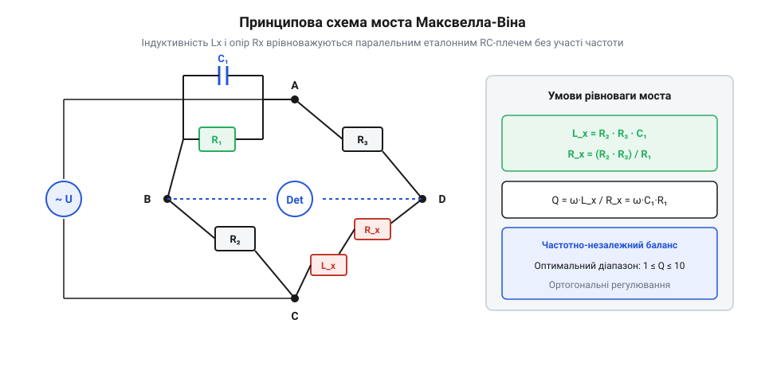

# AC-міст імпедансів

<preknowlist>
- [Міст Кельвіна](root:hw-sensing/kelvin-bridge) — Ранні мостові схеми постійного струму
</preknowlist>

## Криза перших телеграфних вимірювань

У другій половині XIX століття прокладання трансатлантичних підводних телеграфних кабелів зіткнулося з несподіваним фізичним бар'єром. Сигнали, які миттєво проходили крізь короткі наземні лінії, у довгих підводних магістралях розмивалися й перетворювалися на нерозбірливий гул. Для інженерів стало очевидним, що кабель — це не просто омічний дріт, а складна розподілена система з власною ємністю та індуктивністю.

Класичний міст Вітстона, який надійно вимірював постійний опір [root:hw-sensing/kelvin-bridge], виявився безсилим перед динамічними процесами. Механічні дзеркальні гальванометри показували лише постійний струм або короткий балістичний імпульс під час замикання ключа. Спроби побудувати міст змінного струму вперлися в непереборну технологічну перешкоду: вимірювання індуктивності вимагало наявності зразкової еталонної котушки зі змінним та точно каліброваним значенням (варіометра).

Створити стабільний еталон індуктивності було майже неможливо:
- Взаємне розташування витків змінювалося від вібрацій та температури;
- Власна паразитна ємність обмотки змінювала ефективну індуктивність на різних частотах;
- Магнітні поля розсіювання наводили завади на сусідні плечі вимірювальної схеми.

Водночас конденсатори зі слюдяним діелектриком та дротяні безіндукційні резистори вже тоді виготовлялися з високою точністю й стабільністю в часі. Виникла гостра потреба винайти спосіб міряти «незручну» індуктивність через «зручні» ємності та активні опори.

## Прорив Джеймса Клерка Максвелла

У 1873 році шотландський фізик Джеймс Клерк Максвелл (@@en|James Clerk Maxwell@@) у своїй фундаментальній праці «Трактат про електрику й магнетизм» (@@en|A Treatise on Electricity and Magnetism@@) запропонував революційну мостову конфігурацію, яка розв'язала цю кризу.


*Міст Максвелла-Віна врівноважує невідому індуктивність за допомогою паралельного з'єднання зразкового конденсатора й резистора в протилежному плечі.*

Максвелл помітив, що якщо в одне плече моста помістити котушку з невідомою індуктивністю `L_x` та активним опором `R_x`, а в протилежне по діагоналі плече — паралельне з'єднання зразкового конденсатора `C_s` та регульованого резистора `R_s`, то фазові зсуви цих елементів взаємно компенсуються.

Умова рівноваги моста Максвелла записується через добуток комплексних імпедансів:

    Z_x · Z_s = R₂ · R₃
    (R_x + j · ω · L_x) · [ R_s / (1 + j · ω · C_s · R_s) ] = R₂ · R₃

Перемноживши та розділивши дійсну й уявну частини, Максвелл отримав дві роздільні умови балансу:

    L_x = R₂ · R₃ · C_s
    R_x = R₂ · R₃ / R_s

> 🔧 **Навіщо це.**
> Головний тріумф схеми полягав у тому, що частота `ω` повністю скоротилася з обох рівнянь. Інженерам більше не потрібно було підтримувати строго стабільну частоту змінного струму генератора, а невідому індуктивність `L_x` визначали виключно через стабільну ємність `C_s` та два постійні опори `R₂`, `R₃`.

Проте практичне застосування моста Максвелла виявило суттєве фізичне обмеження, пов'язане з добротністю (лат. @@la|qualitas@@) вимірюваної котушки `Q`. Добротність послідовного індуктивного кола визначається відношенням реактивного опору до активних втрат:

    Q = ω · L_x / R_x

Підставивши знайдені умови мостової рівноваги для `L_x` та `R_x`, отримаємо прямий зв'язок між добротністю та параметрами паралельного еталонного плеча:

    Q = ω · (R₂ · R₃ · C_s) / (R₂ · R₃ / R_s)
      = ω · C_s · R_s

З цієї залежності випливає фундаментальна проблема діапазону вимірювань:
1. Для котушок низької та середньої добротності (в діапазоні `1 < Q < 10`) схема Максвелла працює бездоганно: значення опору `R_s` перебуває в межах десятків чи сотень кілоом, що легко реалізується магазинними прецизійними декадами опорів.
2. Для високодобротних котушок (`Q > 10` або `Q > 50`) потрібне значення резистора `R_s` пропорційно зростає до гігантських величин — десятків і сотень мегаом:

    R_s = Q / (ω · C_s)

На таких надвисоких номіналах власна паразитна міжелектродна ємність підлаштовного резистора починає шунтувати його провідність, через що фазовий зсув плеча перестає відповідати розрахунковому. Вектори регулювання на комплексній площині зближуються під дуже гострим кутом, міст втрачає гостроту балансу, а процедура зведення до нуля перетворюється на виснажливий ковзний баланс із втратою точності.

Саме нездатність моста Максвелла ефективно працювати при `Q > 10` стимулювала подальший винахід моста Хея (@@en|Hay bridge@@), де паралельне з'єднання `C_s` та `R_s` замінили на послідовне.

Пізніше, наприкінці 1890-х років, німецький фізик Макс Він (@@de|Max Wien@@) розвинув ідеї Максвелла, пристосувавши змінний струм і телефонні слухавки як нуль-індикатори звукової частоти. Це відкрило епоху класичних мостів змінного струму, які залишалися основним інструментом вимірювальних лабораторій протягом наступного півстоліття.

## Модифікації Макса Віна та Девіда Оуена

На межі XIX та XX століть бурхливий розвиток електротехніки та телефонії поставив перед вимірювальною технікою два нові виклики: точне визначення частоти звукових коливань і вимірювання параметрів котушок зі сталевими осердями, де активні втрати були надзвичайно високими, а добротність низькою (`Q < 1`).

У 1891 році німецький фізик Макс Він (@@de|Max Wien@@) запропонував мостову схему з частотно-залежним балансом. В одному плечі конденсатор і резистор з'єднувалися послідовно (`R_1`, `C_1`), а в суміжному — паралельно (`R_2`, `C_2`). При рівності компонентів `R_1 = R_2 = R` та `C_1 = C_2 = C` міст досягає рівноваги строго на одній резонансній частоті:

```
f_0 = 1 / (2 · π · R · C)
```

> 🔧 **Навіщо це.**
> Міст Віна став першим прецизійним лабораторним частотоміром змінного струму. Пізніше та сама топологія лягла в основу класичних RC-генераторів синусоїдального сигналу з мостом Віна у колі додатного зворотного зв'язку.

У 1914 році британський фізик Девід Оуен (@@en|David Owen@@) розробив спеціалізований міст для вимірювання індуктивностей з дуже великими власними втратами (дроселів фільтрів живлення та трансформаторів). На відміну від моста Максвелла, де орган налаштування `R_1` входив у знаменник і вимагав гігаомних опорів при малій добротності, міст Оуена використовував два постійні конденсатори (`C_1`, `C_3`) і регульовані резистори.

Рівняння балансу моста Оуена мають вигляд:

```
L_x = R_2 · R_3 · C_1
R_x = (C_1 / C_3) · R_2
```

Обидві умови виявилися суворо ортогональними: зміна `R_3` змінює лише розрахункову індуктивність `L_x`, а зміна `R_2` — активний опір втрат `R_x`. Балансування досягалося буквально за два рухи ручок регулювання.

## Високовольтний міст Гаральда Шеринга

У 1920 році німецький інженер і фізик Гаральд Шеринг (@@de|Harald Schering@@) у Берлінському фізико-технічному інституті (PTR) створив міст, який став фундаментальним стандартом діагностики високовольтної ізоляції.

Із переходом енергосистем на напруги понад `100 кВ` руйнування ізоляції силових кабелів і трансформаторів стало головною причиною масштабних аварій. Стан діелектрика визначається тангенсом кута діелектричних втрат (`tan δ`): зволоження та поява мікротріщин збільшують струм витоку, розігрівають ізоляцію і призводять до теплового пробою. Але вимірювати ці втрати необхідно безпосередньо під високою робочою напругою.

Шеринг геніально розділив міст на високовольтну та низьковольтну частини:
1. У високовольтних верхніх плечах розташовувалися досліджуваний кабель `C_x` та еталонний високовольтний конденсатор `C_s` із тиском газу (елегазу або азоту), що не мав власних втрат.
2. У нижніх плечах стояли низьковольтні резистори `R_3`, `R_4` та магазин змінних ємностей `C_4`.

```
tan δ = ω · R_4 · C_4
C_x = C_s · (R_4 / R_3)
```

> 🔧 **Навіщо це.**
> Завдяки тому, що нижні вершини моста заземлювалися, потенціал вимірювальних органів керування та нуль-індикатора не перевищував кількох вольтів відносно землі. Оператор міг абсолютно безпечно вручну зводити міст, підключений до лінії з напругою в сотні кіловольт.

Схема Шеринга лягла в основу міжнародних стандартів метрології діелектриків і донині використовується в діагностичних високовольтних установках по всьому світу.
