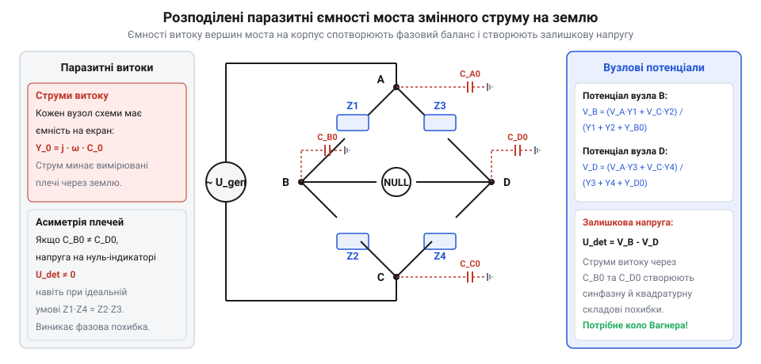

# AC-міст імпедансів

<preknowlist>
- [Міст Кельвіна](root:hw-sensing/kelvin-bridge) — Чотирипровідна схема вимірювання та вплив паразитних шляхів струму
</preknowlist>

## Фізична модель витоків на землю

У будь-якому реальному чотириплечому мості змінного струму вимірювальні вершини `A`, `B`, `C`, `D` мають паразитні місткості зв'язку з екраном, корпусом приладу та землею (`C_A0`, `C_B0`, `C_C0`, `C_D0`). На змінному струмі з кутовою частотою `ω` кожна така ємність утворює комплексну провідність (адмітанс):

    Y_k0 = j · ω · C_k0,   де k ∈ {A, B, C, D}


*Паразитні ємності вимірювальних вузлів і детектора на землю утворюють трикутники адмітансів, що шунтують основні плечі моста.*

Якщо генератор підключено до вершин `A` і `C`, а нуль-індикатор — між `B` і `D`, паразитні адмітанси утворюють дві замкнені зірки витоку:
1. Зірка джерела живлення: струми від вузлів `A` і `C` стікають у землю через `Y_A0` та `Y_C0`.
2. Зірка детектора: вузли `B` і `D` зв'язані із землею через `Y_B0` та `Y_D0`.

Оскільки корпус детектора та з'єднувальні коаксіальні кабелі мають значну площу поверхні, ємності `C_B0` та `C_D0` зазвичай становлять `10..100 пФ`. За частоти `100 кГц` це відповідає паразитним реактивним опорам порядку `15..150 кОм`, що можна порівняти з імпедансами вимірюваних плечей `Z₁..Z₄`.

**Перетворення трикутника паразитних адмітансів у зірку.**

Для аналітичного спрощення аналізу мостової схеми кожне робоче плече разом із паразитними ємностями суміжних вузлів розглядають як замкнений трикутник провідностей між вершинами моста та опорною землею `0`.

Розглянемо трикутник адмітансів, утворений основним плечем `Y₁ = 1 / Z₁` та паразитними провідностями вершин `Y_A0` і `Y_B0` на землю. Згідно з комплексним перетворенням трикутника у трипроменеву зірку з центральним віртуальним вузлом `N`, еквівалентні адмітанси променів дорівнюють:

    ΣY_Δ = Y₁ + Y_A0 + Y_B0

    Y_A_star = (Y₁ · Y_A0) / ΣY_Δ
    Y_B_star = (Y₁ · Y_B0) / ΣY_Δ
    Y_0_star = (Y_A0 · Y_B0) / ΣY_Δ

У термінах еквівалентних імпедансів променів зірки отримаємо:

    Z_A_star = Y_B0 / (Y₁ · Y_A0 + Y_A0 · Y_B0 + Y_B0 · Y₁)
    Z_B_star = Y_A0 / (Y₁ · Y_A0 + Y_A0 · Y_B0 + Y_B0 · Y₁)
    Z_0_star = Y₁   / (Y₁ · Y_A0 + Y_A0 · Y_B0 + Y_B0 · Y₁)

Фізичний зміст цього перетворення полягає в тому, що паразитна ємність монтажу не просто створює паралельний шлях витоку, а фундаментально трансформує еквівалентний імпеданс робочого плеча:

    Z_1_eff = Z₁ / [ 1 + Z₁ · (Y_A0 + Y_B0) ]

Оскільки паразитні ємності різних вершин різняться (`C_A0 ≠ C_B0 ≠ C_D0`), ефективні імпеданси плечей моста зазнають неоднакового комплексного зміщення. У результаті навіть за відсутності витоків між самими плечима, зв'язок через спільну землю вносить незворотну фазову та амплітудну похибку, яка робить неможливим зведення моста без спеціального вирівнювання потенціалів.

> 🔧 **Навіщо це.**
> Формули перетворення трикутника паразитних ємностей у зірку дозволяють точно оцінити похибку вимірювання комплексного імпедансу на високих частотах і розрахувати необхідні номінали екрануючих та компенсуючих кіл.

## Аналітичний розрахунок зсуву рівноваги

Застосуємо метод вузлових потенціалів до вимірювальних вершин `B` і `D`. Приймемо потенціал заземленого екрана `V_0 = 0 В`. Позначимо потенціали вершин живлення як `V_A` та `V_C`.

Для вузла `B` перший закон Кірхгофа у комплексному вигляді має вигляд:

    (V_B - V_A) / Z₁ + (V_B - V_C) / Z₂ + V_B · Y_B0 + I_det = 0

У стані рівноваги струм детектора `I_det = 0`. Звідси потенціал вузла `B`:

    V_B = [ V_A · Y₁ + V_C · Y₂ ] / [ Y₁ + Y₂ + Y_B0 ]

Аналогічно для вузла `D`:

    V_D = [ V_A · Y₃ + V_C · Y₄ ] / [ Y₃ + Y₄ + Y_D0 ]

Напруга на нуль-індикаторі `U_det = V_B - V_D`. Умова істинної рівноваги основного моста без витоків вимагає:

    Y₁ / Y₂ = Y₃ / Y₄   або   Z₁ · Z₄ = Z₂ · Z₃

Підставимо умову внутрішнього балансу моста у вираз для `U_det`:

    U_det = V_B - V_D
          = [ (V_A · Y₁ + V_C · Y₂) · (Y₃ + Y₄ + Y_D0) - (V_A · Y₃ + V_C · Y₄) · (Y₁ + Y₂ + Y_B0) ] / ΣY
          = [ (V_A · Y₁ + V_C · Y₂) · Y_D0 - (V_A · Y₃ + V_C · Y₄) · Y_B0 ] / ΣY   [баланс основних плечей]

> 🔧 **Навіщо це.**
> Отримане рівняння наочно демонструє причину похибки: навіть коли співвідношення плечей моста ідеальне (`Z₁ · Z₄ = Z₂ · Z₃`), напруга на детекторі `U_det ≠ 0`, якщо `Y_B0 ≠ Y_D0` або потенціали вузлів `V_B` та `V_D` не дорівнюють нулю відносно землі.

**Числовий розрахунок паразитної напруги та фазової похибки для монтажних ємностей 50 пФ.**

Розглянемо симетричний резистивний міст змінного струму з номіналами плечей `R₁ = R₂ = R₃ = R₄ = 10 кОм` (`Y₁ = Y₂ = Y₃ = Y₄ = 100 мкСм`), який живиться напругою `V_A = 10 В`, `V_C = 0 В` на частоті `f = 100 кГц` (кутова частота `ω = 2 · π · 10⁵ ≈ 6.283 · 10⁵ рад/с`).

Припустимо, що паразитна ємність вершини `B` на заземлений екран становить `C_B0 = 50 пФ`, а через конструктивну асиметрію монтажу ємність вершини `D` становить `C_D0 = 40 пФ`.

Обчислимо комплексні паразитні провідності:

    Y_B0 = j · ω · C_B0 = j · (6.283 · 10⁵) · (50 · 10⁻¹²) = j · 31.415 мкСм
    Y_D0 = j · ω · C_D0 = j · (6.283 · 10⁵) · (40 · 10⁻¹²) = j · 25.132 мкСм

Розрахуємо точні комплексні потенціали вершин детектора:

    V_B = (10 · 100 · 10⁻⁶) / (200 · 10⁻⁶ + j · 31.415 · 10⁻⁶)
        = 1000 / (200 + j · 31.415)
        = 1000 · (200 - j · 31.415) / (200² + 31.415²)
        = (200000 - j · 31415) / 40987
        ≈ 4.879 - j · 0.766 В

    V_D = 1000 / (200 + j · 25.132)
        = 1000 · (200 - j · 25.132) / (200² + 25.132²)
        = (200000 - j · 25132) / 40632
        ≈ 4.922 - j · 0.618 В

Напруга хибного розбалансу на клемах нуль-індикатора дорівнює:

    U_det = V_B - V_D
          = (4.879 - 4.922) + j · (-0.766 - (-0.618))
          = -0.043 - j · 0.148 В = -43 - j · 148 мВ

Модуль залишкової паразитної напруги та фазовий зсув похибки:

    |U_det| = √[ (-43)² + (-148)² ] = √[ 1849 + 21904 ] = √23753 ≈ 154.1 мВ
    φ_err   = arctan( -148 / -43 ) - 180° ≈ -106.2°

У результаті на вході індикатора з'являється квадратурна паразитна напруга амплітудою понад 154 мВ (що становить 1.54% від напруги живлення всієї схеми). Спроба оператора звести цей залишковий сигнал зміною основних плечей призведе до грубої систематичної помилки вимірювання активного опору або тангенса кута втрат.

Прирівняти напругу розбалансу до нуля можна двома способами:
1. Забезпечити абсолютну симетрію `Y_B0 = Y_D0`, що технічно нездійсненно через випадковий розподіл просторових ємностей.
2. Зробити потенціали `V_B = 0` та `V_D = 0` відносно землі за допомогою захисного дільника Вагнера, усунувши різницю потенціалів на паразитних адмітансах `Y_B0` та `Y_D0`.

## Математичне обґрунтування дільника Вагнера

Захисний дільник Вагнера утворює паралельну вимірювальну гілку між вершинами живлення `A` і `C` з імпедансами `Z_W1` та `Z_W2`. Центральний вузол цього дільника `W` гальванічно з'єднаний із землею (`V_W = V_earth = 0 В`).

Потенціал точки заземлення `W` визначається коефіцієнтом ділення:

```
V_W = [ V_A · Y_W1 + V_C · Y_W2 ] / [ Y_W1 + Y_W2 ] = 0
```

Коли коло Вагнера збалансоване відносно основного живлення, відношення адмітансів допоміжного дільника дорівнює відношенню адмітансів основних плечей моста:

```
Y_W1 / Y_W2 = Y_1 / Y_2 = Y_3 / Y_4
```

Оскільки вершини `B`, `D` і `W` мають однаковий коефіцієнт поділу прикладеної напруги `(V_A - V_C)`, їхні потенціали стають тотожно рівними:

```
V_B = V_D = V_W = 0 В
```

Розрахуємо струми витоку `I_leak,B` та `I_leak,D`, що протікають через паразитні провідності на заземлений екран:

```
I_leak,B = (V_B - V_earth) · Y_B0 = (0 - 0) · Y_B0 = 0
I_leak,D = (V_D - V_earth) · Y_D0 = (0 - 0) · Y_D0 = 0
```

> 🔧 **Навіщо це.**
> Хоча фізичні паразитні ємності `C_B0` і `C_D0` нікуди не зникають із конструкції, напруга на них стає строго рівною нулю. За законом Ома струм через нульову різницю потенціалів не тече, що повністю усуває спотворення вимірювальних струмів в основних плечах `Z_1..Z_4`.

Паразитні ємності дільника Вагнера на землю при цьому просто підключаються паралельно його плечам і легко компенсуються його власним регулюванням, не впливаючи на точність основного моста.

## Двоетапний алгоритм зведення та його збіжність

Зведення моста з колом Вагнера виконується за ітераційним двоетапним алгоритмом за допомогою комутатора детектора `S`:

    Крок 1: S у положенні B-D (основний міст)  ──>  мінімізація U_BD підлаштуванням Z₁, Z₄
    Крок 2: S у положенні B-W (коло Вагнера)   ──>  мінімізація U_BW підлаштуванням Z_W1, Z_W2
    Повторення кроків 1 і 2 до повного занулення обох напруг.

Доведемо збіжність цього ітераційного процесу. Нехай на ітерації `k` неврівноваженість потенціалу вершини `B` становить `ε_k = V_B^(k) - V_earth`. 

Залишкова напруга основного моста виражається через матрицю чутливості:

    U_BD^(k) = K_bridge · ΔZ + α · ε_k

де `α = (Y_B0 - Y_D0) / ΣY` — коефіцієнт перехресного зв'язку через асиметрію витоків. Оскільки в реальних екранованих установках `|α| << 1` (зазвичай `|α| < 0.05`), на кожному кроці регулювання дільника Вагнера похибка `ε` зменшується за геометричною прогресією:

    |ε_(k+1)| ≤ |α| · |ε_k|

**Оцінка впливу власних паразитних ємностей дільника Вагнера на збіжність.**

Сам допоміжний дільник Вагнера, утворений плечима `Z_W1` та `Z_W2`, також має розподілені паразитні ємності монтажу `C_W1_0` та `C_W2_0` на заземлений екран, а також взаємну ємність зв'язку `C_m` із провідниками основного моста.

Розглянемо еквівалентні комплексні провідності плечей Вагнера з урахуванням ємностей витоку:

    Y_W1_eff = Y_W1 + j · ω · C_W1_0
    Y_W2_eff = Y_W2 + j · ω · C_W2_0

Потенціал проміжного вузла `W` визначається формулою дільника напруги:

    V_W = [ V_A · Y_W1_eff + V_C · Y_W2_eff ] / [ Y_W1_eff + Y_W2_eff + Y_W0 ]

де `Y_W0 = j · ω · C_W0` — паразитна провідність самого вузла `W` на землю. Оскільки в робочому стані вузол `W` заземлений або з'єднаний через детектор із віртуальною землею, провідність `Y_W0` шунтується нульовим потенціалом і струм крізь неї не впливає на баланс.

Власні ємності `C_W1_0` та `C_W2_0` призводять лише до того, що підлаштовні значення компонентів дільника `Z_W2` дещо відрізняються від теоретичного співвідношення плечей моста. Проте вони не створюють принципової перешкоди для точного вирівнювання потенціалів `V_W = 0 В`.

Взаємний ємнісний зв'язок між дільником Вагнера та плечима основного моста описується коефіцієнтом перехресної взаємоіндукції та місткості `β_W = C_m / C_bridge`. Ітераційний множник похибки на кожному кроці набуває вигляду:

    |ε_(k+1)| ≤ |α · β_W| · |ε_k| = μ_conv · |ε_k|

При використанні екранованих перемикачів і коаксіальних з'єднань значення `β_W < 0.02`, що дає сукупний коефіцієнт збіжності:

    μ_conv = |α · β_W| ≤ 0.05 · 0.02 = 0.001 (або 10⁻³)

Це означає, що за кожен цикл перемикання залишковий потенціал паразитної синфазної напруги пригнічується на три порядки (на 60 дБ). Навіть за наявності помітних паразитних ємностей у самому дільнику Вагнера, алгоритм досягає метрологічної точності всього за 2–3 цикли підлаштування.

> 🔧 **Навіщо це.**
> Завдяки тому, що коефіцієнт зв'язку `μ_conv < 0.001`, процес збігається вкрай швидко: уже після 2–3 перемикань залишкова похибка від паразитних витоків падає нижче `0.001 %`, гарантуючи точне метрологічне визначення вимірюваного імпедансу без необхідності прецизійного калібрування компонентів самого кола Вагнера.
