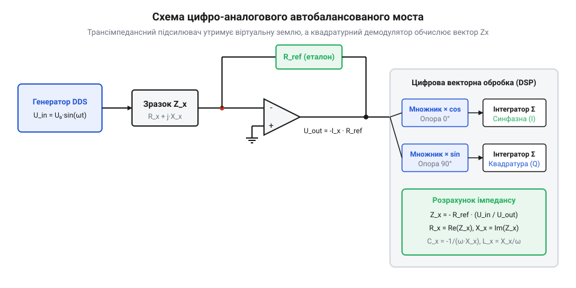

# AC-міст імпедансів

<preknowlist>
- [Імпедансна спектроскопія](root:hw-sensing/impedance-spectroscopy) — Робота з дійсною та уявною частинами імпедансу
</preknowlist>

## Архітектура аналогового тракту

Автобалансований міст замінює громіздкі ручні пасивні плечі активним аналоговим контуром з операційним трансімпедансним підсилювачем (перетворювачем струму в напругу). Схема складається з трьох ключових вузлів: генератора синусоїдального збудження, досліджуваного двополюсника та підсилювача віртуальної землі.


*Принципова архітектура автобалансованого моста: трансімпедансний каскад утримує віртуальну землю на клемі L_CUR, а вихідний сигнал надходить на квадратурний демодулятор.*

Генератор тестового сигналу на базі прямого цифрового синтезу (@@en|Direct Digital Synthesis@@, DDS) або прецизійного ЦАП формує стабільну синусоїдальну напругу із регульованою частотою:

```
u_in(t) = U₀ · sin(ω · t)
```

Ця напруга подається на високопотенційний вивід досліджуваного зразка `H_POT` / `H_CUR`. Струм `i_x(t)`, що протікає крізь невідомий комплексний імпеданс `Z_x`, надходить безпосередньо на інвертувальний вхід операційного підсилювача `L_CUR`.

Завдяки глибокому негативному зворотному зв'язку через опорний резистор `R_ref`, інвертувальний вхід операційного підсилювача підтримується строго на нульовому потенціалі віртуальної землі:

```
v_inv(t) ≈ 0 В
```

Оскільки вузол `L_CUR` має потенціал землі, увесь вхідний струм досліджуваного зразка без втрат стікає в ланцюг зворотного зв'язку через резистор `R_ref`:

```
i_x(t) + i_bal(t) = 0
u_in(t) / Z_x + u_out(t) / R_ref = 0
```

Вихідна напруга операційного підсилювача прямо пропорційна вимірюваному комплексному струму:

```
u_out(t) = - i_x(t) · R_ref = - u_in(t) · [ R_ref / Z_x ]
```

> 🔧 **Навіщо це.**
> Підтримання віртуального нуля усуває вплив паразитних ємностей з'єднувального кабелю детектора на землю. Оскільки різниця напруг між центральною жилою кабелю `L_CUR` та заземленим екраном дорівнює нулю, струм витоку крізь ємність кабелю фізично занулюється.

Для забезпечення широкого динамічного діапазону вимірювань (від одиниць міліомів до десятків мегаомів) еталонний резистор `R_ref` виконують у вигляді комутованого банку прецизійних резисторів (наприклад, `100 Ом`, `1 кОм`, `10 кОм`, `100 кОм`, `1 МОм`), що перемикаються герконовими реле або швидкодіючими мультиплексорами з низьким рівнем інжекції заряду.

### Чотирипровідна схема комутації Кельвіна (BNC-інтерфейс)

При вимірюванні низьких імпедансів паразитна опірність і індуктивність з'єднувальних проводів і перехідних контактів вносять неприпустиму похибку. Для повного виключення впливу кабелів на клемах приладу застосовують чотирипровідне підключення з чотирма коаксіальними BNC-роз'ємами, яке базується на принципі [моста Кельвіна](root:hw-sensing/kelvin-bridge):

1. **H_CUR (High Current):** струмовий вивід джерела збудження. По ньому тече повний вимірювальний струм від генератора до компонента. Падіння напруги на опорі дротів `R_lead` тут не впливає на вимірювання, оскільки напруга знімається окремим потенційним каналом.
2. **H_POT (High Potential):** високопотенційний вимірювальний вхід напруги. Підключається безпосередньо до виводу зразка та подає напругу на високоелектрометричний буферний підсилювач. Оскільки вхідний опір буфера досягає гігаомів, струм через лінію `H_POT` практично відсутній (`I ≈ 0`), а отже, падіння напруги на опорі контакту щупа дорівнює нулю.
3. **L_POT (Low Potential):** низькопотенційний вимірювальний вхід. Фіксує точний потенціал на другій клемі зразка і використовується для диференціального розрахунку напруги безпосередньо на виводах деталі.
4. **L_CUR (Low Current):** струмовий вивід прийому. Відводить вимірювальний струм на інвертувальний вхід трансімпедансного підсилювача, підтримуваний на рівні віртуальної землі.

У такій конфігурації екрани всіх чотирьох коаксіальних кабелів з'єднуються разом на загальну сигнальну землю корпусу вимірювача. Зворотні струми екранів компенсують магнітні поля центральних провідників, що усуває взаємну індуктивну наводку між струмовими та потенційними петлями на високих частотах вимірювання.

## Синхронна квадратурна демодуляція

Для розділення комплексного імпедансу на активну `R_x` та реактивну `X_x` складові вихідна напруга `u_out(t)` і вхідна напруга `u_in(t)` оцифровуються двоканальним синхронним АЦП. Потім цифровий сигнальний процесор здійснює синхронну квадратурну демодуляцію (@@en|IQ demodulation@@).

Суть методу полягає в перемноженні оцифрованого масиву вибірок сигналу на дві цифрові опорні гармонічні функції — синфазну `cos(ω·t)` (фазовий кут 0°) та квадратурну `sin(ω·t)` (фазовий кут 90°), з наступним інтегруванням (усередненням) результату в часовому вікні, строго кратному цілому числу періодів сигналу `T = 2·π/ω`:

    I = (2 / T) · ∫₀ᵀ u_out(t) · cos(ω · t) dt   [виділення синфазної складової]
    Q = (2 / T) · ∫₀ᵀ u_out(t) · sin(ω · t) dt   [виділення квадратурної складової]

Завдяки фундаментальній ортогональності тригонометричних функцій цифрове інтегрування повністю пригнічує постійну складову (дрейф зміщення ОП), шум квантування та всі вищі гармоніки тестового сигналу:

    ∫₀ᵀ sin(n · ω · t) · cos(m · ω · t) dt = 0    (для будь-яких цілих n, m)

У результаті демодуляції напруги та струму формуються комплексні вектори напруги `U_in = U_in,I + j · U_in,Q` та струму `I_x = I_x,I + j · I_x,Q`. Невідомий комплексний імпеданс розраховується з комплексного співвідношення:

    Z_x = U_in / I_x = R_x + j · X_x

Модуль повного імпедансу та фазовий кут визначаються як:

    |Z_x| = √[ R_x² + X_x² ]
    φ_x   = arctan( X_x / R_x )

Залежно від знака реактансу `X_x` розраховуються параметри еквівалентної схеми заміщення:
1. Якщо `X_x < 0` (ємнісний характер): послідовна ємність `C_s = - 1 / (ω · X_x)`, тангенс кута втрат `D = R_x / |X_x|`.
2. Якщо `X_x > 0` (індуктивний характер): послідовна індуктивність `L_s = X_x / ω`, добротність `Q = X_x / R_x`.

> 🔧 **Навіщо це.**
> Квадратурна цифрова демодуляція замінює ручний підбір моста миттєвим векторним обчисленням за частки мілісекунди, забезпечуючи виняткову стійкість до промислових завад частоти 50 Гц та шумів аналогового тракту.

:::tabs
```c
:::code proj-auto-balancing-bridge/c/src/iq_demodulator.h
:::code proj-auto-balancing-bridge/c/src/iq_demodulator.c
:::code proj-auto-balancing-bridge/c/src/main.c
```
```cpp
:::code proj-auto-balancing-bridge/cpp/include/lcr_meter.hpp
:::code proj-auto-balancing-bridge/cpp/src/lcr_meter.cpp
:::code proj-auto-balancing-bridge/cpp/src/main.cpp
```
:::

## Обчислення комплексного імпедансу

Отримані після квадратурної демодуляції проекції напруги та струму формують комплексні вектори в алгебраїчній формі: `V = V_I + j · V_Q` та `I = I_I + j · I_Q`. Комплексний імпеданс досліджуваного двополюсника Z є відношенням комплексної напруги до комплексного струму.

Щоб розділити дійсну (активний опір R) та уявну (реактивний опір X) складові, комплексний дріб множать на спряжене значення знаменника:

```
Z = V / I
  = (V_I + j · V_Q) / (I_I + j · I_Q)
  = (V_I + j · V_Q) · (I_I - j · I_Q) / ((I_I + j · I_Q) · (I_I - j · I_Q))   [множення на спряжене]
  = ((V_I · I_I + V_Q · I_Q) + j · (V_Q · I_I - V_I · I_Q)) / (I_I² + I_Q²)     [розкриття дужок]
```

Звідси дійсна та уявна частини імпедансу обчислюються безпосередньо через накопичені IQ-суми:

```
R = (V_I · I_I + V_Q · I_Q) / (I_I² + I_Q²)
X = (V_Q · I_I - V_I · I_Q) / (I_I² + I_Q²)
```

> 🔧 **Навіщо це.** Векторне ділення усуває залежність від початкової фази генератора збудження: синхронна квадратурна фільтрація автоматично проектує різницю фаз між напругою та струмом на дійсну й уявну осі, виділяючи чисті втрати та реактивність компонента.

Знаючи знак та амплітуду реактивного опору X на відомій кутовій частоті `ω = 2 · π · f`, компонент ідентифікують як ємнісний або індуктивний:

1. **Ємнісний характер** (`X < 0`): струм випереджає напругу. Еквівалентна послідовна ємність C_s обчислюється як:
```
C_s = -1 / (ω · X)
```
2. **Індуктивний характер** (`X > 0`): напруга випереджає струм. Еквівалентна послідовна індуктивність L_s становить:
```
L_s = X / ω
```

Втрати енергії в реактивному елементі кількісно оцінюють через добротність Q (@@en|quality factor@@) та тангенс кута втрат D (@@en|dissipation factor@@):

```
Q = |X| / R
D = 1 / Q = R / |X|
```

### Послідовна та паралельна схеми заміщення

Будь-який реальний пасивний компонент на фіксованій частоті вимірювання можна представити двома еквівалентними топологіями:
1. **Послідовна модель (Series, s):** послідовне з'єднання ідеального реактивного елемента `X_s` та еквівалентного опору втрат `R_s` (ESR): `Z = R_s + j · X_s`.
2. **Паралельна модель (Parallel, p):** паралельне з'єднання ідеального реактивного елемента `X_p` та опору витоку `R_p`: `Y = 1 / Z = G_p + j · B_p = 1 / R_p + j · B_p`.

Комплексна провідність Y (адмітанс) отримується інвертуванням імпедансу Z:

```
Y = 1 / Z
  = 1 / (R_s + j · X_s)
  = (R_s - j · X_s) / (R_s² + X_s²)                                 [множення на спряжене]
  = R_s / (R_s² + X_s²) - j · X_s / (R_s² + X_s²)                   [розділення дійсної та уявної частин]
```

Оскільки активна провідність `G_p = 1 / R_p`, а реактивна провідність `B_p = -1 / X_p`, дістаємо прямі співвідношення переходу через добротність `Q = |X_s| / R_s` та тангенс втрат `D = 1 / Q`:

```
R_p = (R_s² + X_s²) / R_s = R_s · (1 + (X_s / R_s)²) = R_s · (1 + Q²) = R_s · (1 + 1 / D²)
X_p = (R_s² + X_s²) / X_s = X_s · (1 + (R_s / X_s)²) = X_s · (1 + 1 / Q²) = X_s · (1 + D²)
```

Для ємнісних компонентів (`X_s = -1 / (ω · C_s)`, `X_p = -1 / (ω · C_p)`) формули зв'язку ємностей набувають вигляду:

```
C_p = C_s / (1 + D²)
C_s = C_p · (1 + D²)
```

Для індуктивних компонентів (`X_s = ω · L_s`, `X_p = ω · L_p`):

```
L_p = L_s · (1 + 1 / Q²) = L_s · (1 + D²)
L_s = L_p / (1 + D²)
```

### Фізичний вибір моделі у вимірювальній практиці

Вибір між послідовним і паралельним поданням залежить від домінуючого фізичного механізму втрат у компоненті та діапазону його повного модуля імпедансу `|Z|`:

- **Послідовна модель (Cs / Ls):** застосовується для низькоомних компонентів (`|Z| < 100 Ом`), де основними втратами є опір виводів, дротів обмотки та електродів. Типові приклади — електролітичні та полімерні конденсатори великої ємності (де нормується саме ESR), силові дроселі та струмовимірювальні резистори. Для малих втрат (`D < 0.01`, тобто `D² ≪ 1`) числові значення `C_s` та `C_p` практично збігаються (`C_s ≈ C_p`), проте опір `R_s` відображає істинний тепловий нагрів на змінному струмі.
- **Паралельна модель (Cp / Lp):** застосовується для високоомних компонентів (`|Z| > 10 кОм`), де вирішальними є діелектричні втрати в ізоляції або опір поверхневого витоку. Типові приклади — пікофарадні керамічні та плівкові конденсатори, високочастотні котушки індуктивності та феритові трансформатори. Якщо діелектрик має значні втрати (`D > 0.1`), різниця між `C_s` та `C_p` стає суттєвою (`C_s > C_p`), і саме паралельний опір `R_p` характеризує якість ізоляції (що вищий `R_p`, то менший струм витоку).

У реалізованому програмному коді на C алгоритм синхронного накопичення та обчислення послідовних параметрів зосереджено у функціях модуля `iq_demodulator`:

:::code proj-auto-balancing-bridge/c/src/iq_demodulator.h
:::code proj-auto-balancing-bridge/c/src/iq_demodulator.c
:::code proj-auto-balancing-bridge/c/src/main.c

## Калібрування та компенсація паразитних параметрів

Будь-які фізичні вимірювальні щупи, дроти підключення та друковані доріжки вносять власні паразитні опори, індуктивності та ємності. На низьких імпедансах (менше 10 Ом) послідовний опір кабелів і контактів спотворює вимірювання активного опору. На високих імпедансах (понад 100 кОм) або високих частотах паралельна ємність кабелю (зазвичай 50–100 пФ/м) шунтує досліджуваний зразок.

Для повного усунення систематичних похибок вимірювального тракту застосовують векторне двоточкове калібрування холостого ходу (Open) та короткого замикання (Short).

Паразитна модель вимірювального стенда описується послідовним паразитним імпедансом дротів `Z_short = R_lead + j · ω · L_lead` та паралельною паразитною провідністю ізоляції й кабелю `Y_open = G_stray + j · ω · C_stray`.

1. **Калібрування холостого ходу (Open)**: щупи розімкнені (`Z_DUT = ∞`). Прилад вимірює адмітанс відкритого кола `Y_open = 1 / Z_open_raw`.
2. **Калібрування короткого замикання (Short)**: кінці щупів замкнені безпосередньо в точці контакту зразка (`Z_DUT = 0`). Прилад вимірює послідовний імпеданс `Z_short = Z_short_raw`.

Після визначення калібрувальних коефіцієнтів `Z_short` та `Y_open` істинний комплексний імпеданс компонента `Z_DUT` обчислюють за формулою векторної декомпенсації:

```
          Z_raw - Z_short
Z_DUT = -------------------------------
         1 - (Z_raw - Z_short) · Y_open
```

> 🔧 **Навіщо це.** Векторна компенсація Open/Short дозволяє проводити прецизійні вимірювання як суб-омних індуктивностей (компенсуючи опір дротів 0.1–0.5 Ом), так і пікофарадних ємностей (віднімаючи 20–50 пФ монтажної ємності) без необхідності складного ручного підстроювання апаратних контурів.

У проєкті на C++ логіку векторного перетворення, підтримку послідовної й паралельної схем заміщення та процедуру корекції інкапсульовано в класі `LCRMeter`:

:::code proj-auto-balancing-bridge/cpp/include/lcr_meter.hpp
:::code proj-auto-balancing-bridge/cpp/src/lcr_meter.cpp
:::code proj-auto-balancing-bridge/cpp/src/main.cpp
