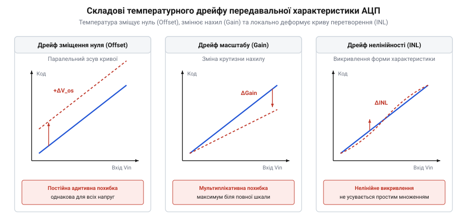
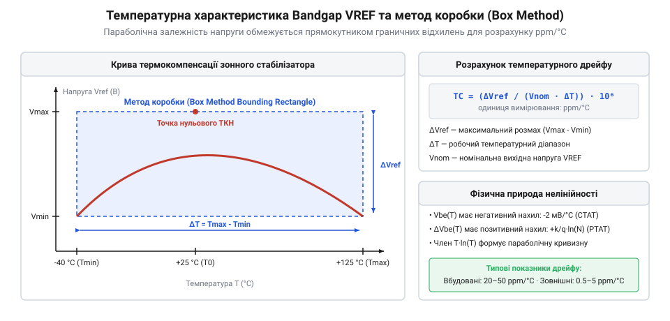
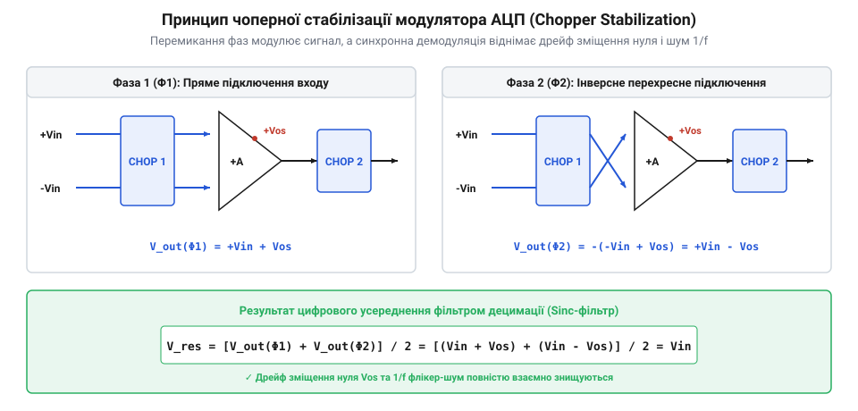

# Температурний дрейф АЦП

<preknowlist>
- [Похибки АЦП](root:hw-sensing/adc-errors) — поняття зміщення нуля, похибки підсилення, інтегральної та диференціальної нелінійності
- [Опорна напруга](root:hw-sensing/voltage-reference) — призначення джерела опорної напруги та залежність вихідного коду від VREF
- [SAR АЦП зсередини](root:hw-sensing/sar-adc-internals) — будова ємнісного ЦАП на базі матриці перемиканих конденсаторів
</preknowlist>

## Фізична картина температурної нестабільності та динамічний дрейф

Прецизійний вимірювальний тракт, налаштований та відкалібрований у лабораторних умовах за кімнатної температури (+25 °C), неминуче втрачає заявлену розрядність при зміні умов довкілля або внаслідок власного саморозігріву компонентів. Будь-який аналого-цифровий перетворювач базується на напівпровідниковій структурі, фізичні параметри якої мають виражену експоненційну або степеневу залежність від абсолютної температури `T`. 

Зміна температури кремнієвого кристала змінює концентрацію власних носіїв заряду `n_i`, контактну різницю потенціалів p-n переходів, рухливість електронів і дірок, а також питомий опір дифобластей та металізації. У результаті статична передавальна характеристика АЦП, яка зафіксована під час заводського тестування, зазнає деформації вздовж осі температури.

Крім фундаментальних напівпровідникових ефектів, значну частку температурної похибки формує термомеханічне напруження корпусу мікросхеми (@@en|package stress@@). Коефіцієнт теплового лінійного розширення (КТР) кремнієвого кристала становить близько `2.6 · 10⁻⁶` 1/°C (2.6 ppm/°C), тоді як епоксидний компаунд корпусу та мідний свинцевий каркас мають КТР від 12 до 17 ppm/°C. Під час циклічного нагрівання чи охолодження виникає сильний зсувний механічний тиск на поверхню кристала. Завдяки п'єзорезистивному та п'єзоелектричному ефектам цей тиск асиметрично змінює питомий опір дифузійних резисторів та ємність діелектричних оксидних шарів, зміщуючи баланс зважених елементів внутрішніх ЦАП.

Більше того, регулярне термічне циклування спричиняє незворотну мікропластичну деформацію та релаксацію механічних напружень, що викликає довготривалий гістерезисний дрейф (@@en|thermal hysteresis@@) та прискорене старіння компонентів (@@en|aging drift@@). Навіть після повернення приладу до початкових +25 °C вихідний код АЦП та напруга внутрішнього стабілізатора не повертаються точно до вихідного значення, накопичуючи залишкове зміщення до кількох десятків ppm за кожні 1000 годин експлуатації.


_Вплив температури на передавальну характеристику АЦП: паралельний зсув через дрейф зміщення, зміна нахилу через дрейф масштабу та локальні деформації кодових переходів через дрейф нелінійності._

Ця термодинамічна нестабільність розділяється на три фундаментальні складові:
1. Дрейф напруги зміщення нуля (@@en|offset drift@@) — паралельне зміщення всієї передавальної функції вгору або вниз без зміни її нахилу.
2. Дрейф коефіцієнта підсилення або масштабу (@@en|gain drift@@) — зміна кута нахилу характеристики, що пропорційно збільшує абсолютну похибку зі зростанням амплітуди вхідного сигналу.
3. Дрейф диференціальної та інтегральної нелінійності (@@en|INL/DNL drift@@) — спотворення форми лінійної характеристики, викликане температурним розузгодженням окремих бітових ваг ЦАП або ступенів модуляторів.

Статичні похибки зміщення та масштабу ([Похибки АЦП](root:hw-sensing/adc-errors)) можна усунути одноразовим цифровим множенням і відніманням на етапі калібрування системи. Натомість температурний дрейф є динамічним процесом: він неперервно генерує низькочастотну похибку, спектр якої потрапляє в смугу корисного сигналу постійного струму і не може бути відфільтрований звичайними лінійними фільтрами.

> 🔧 **Навіщо це.**
> Розрахунок температурного дрейфу визначає, чи збереже 24-розрядний АЦП свою реальну роздільну здатність в умовах вуличного датчика (від -40 °C до +85 °C), чи його ефективна точність деградує до рівня звичайного 12-розрядного перетворювача.

## Температурний дрейф зміщення нуля

Дрейф зміщення нуля визначає зміну вихідного цифрового коду АЦП за нульової різниці потенціалів на його аналогових входах при зміні температури на один градус Цельсія. Цей параметр вимірюється в мікровольтах на градус (мкВ/°C) або нановольтах на градус (нВ/°C).

Фізично дрейф нуля зумовлений трьома основними явищами:
1. Термоелектричний ефект Зеєбека (@@en|Seebeck effect@@) на паразитних термопарах монтажу. Спаї різних металів (виводи мікросхеми з ковару чи міді, олов'яно-свинцевий або безсвинцевий припій, мідні доріжки плати) утворюють локальні термопари з коефіцієнтом термо-ЕРС від 1 до 40 мкВ/°C. Наявність теплового градієнта всього у 0.1 °C між двома диференціальними вхідними ніжками перетворювача генерує паразитну напругу зміщення у кілька мікровольтів, що для 24-бітного АЦП з опорною напругою 2.5 В еквівалентно сотням одиниць молодшого розряду (@@en|LSB@@).

2. Температурний розбаланс вхідних диференціальних пар транзисторів вхідного каскаду чи інтегратора. Напруга база-емітер біполярних транзисторів `V_be` має температурний коефіцієнт близько -2 мВ/°C:

```
dV_be / dT = (V_be - V_g0) / T - (γ - α) · (k / q)    [температурний коефіцієнт напруги емітерного переходу]
```

де `V_g0` — екстрапольована ширина забороненої зони кремнію при 0 K, `k` — стала Больцмана, `q` — заряд електрона. Навіть мікроскопічна геометрична або легувальна асиметрія диференціальної пари транзисторів призводить до того, що їхні температурні коефіцієнти відрізняються на частки відсотка, створюючи результуючий диференціальний дрейф від 0.5 до 5 мкВ/°C у стандартних кремнієвих підсилювачах.

3. Температурна залежність вхідних струмів витоку та захисних кіл. Струм витоку закритих p-n переходів вхідних ESD-діодів та затворів польових транзисторів подвоюється приблизно кожні 10 °C підвищення температури:

```
I_leak(T) = I_0 · 2^((T - T_0) / 10)    [експоненційне зростання струму витоку p-n переходу]
```

У нормальних умовах (+25 °C) вхідний струм витоку CMOS-входів становить мізерні одиниці пікоампер (1–10 пА). Проте за підвищення робочої температури кристала до промислових +85 °C або автомобільних +125 °C струм витоку зростає в сотні й тисячі разів, досягаючи 10–50 нА. Вхідні антистатичні структури (ESD-захист) містять захисні діоди та діоди Зенера, зворотний струм яких при нагріванні зростає ще швидше через термогенерацію носіїв у збідненій області:

```
I_gen(T) ∝ n_i(T) ∝ T^(1.5) · exp(-E_g / (2 · k · T))    [термогенераційний струм збідненої області ESD-структур]
```

Протікаючи через еквівалентний імпеданс джерела сигналу або зовнішні захисні та фільтруючі резистори плати (наприклад, `R_src = 100` кОм), нагрітий струм витоку у 30 нА створює додаткове спадання напруги:

```
ΔV_leak = I_leak · R_src
        = 30 · 10⁻⁹ А · 100 · 10³ Ом
        = 3 · 10⁻³ В = 3 мВ    [зміщення вхідного потенціалу від струму витоку]
```

Це падіння напруги в 3 мВ повністю затьмарює корисні мікровольтові сигнали датчика і перетворюється на нездоланне статичне зміщення нуля, якщо не вжити заходів із застосування буферів з компенсацією вхідного струму або охоронних кілець (@@en|guard rings@@) на платі.

> 🔧 **Навіщо це.**
> При вимірюванні мікровольтових сигналів від термопар або мостових тензодавачів дрейф зміщення нуля АЦП є головним джерелом температурної похибки, оскільки він діє адитивно і не залежить від вимірюваного значення.

## Дрейф коефіцієнта передачі та температурна нелінійність

Дрейф коефіцієнта передачі або масштабу (@@en|gain drift@@) визначає зміну чутливості перетворювача з ростом температури. Якщо зміщення нуля зсуває всю шкалу паралельно, то похибка підсилення проявляється як поворот передавальної характеристики навколо початкової точки. Вона вимірюється в мільйонних частках на градус Цельсія (ppm/°C, де 1 ppm = 0.0001 %) або у відсотках від повної шкали (@@en|% of Full Scale@@).

Внутрішні механізми дрейфу масштабу залежать від архітектури АЦП:
1. У SAR АЦП на базі бінарно зважених ємнісних ЦАП ([SAR АЦП зсередини](root:hw-sensing/sar-adc-internals)) передавальний коефіцієнт визначається відношенням сумарної ємності матриці `C_total` до ємності вибірки `C_sample`. Хоча температурний коефіцієнт ємності (ТКЄ) інтегрованих оксидних конденсаторів становить близько +20...50 ppm/°C, завдяки близькості розміщення на одному кристалі їхній взаємний температурний коефіцієнт узгодження (@@en|matching TC@@) становить менше 0.5–1 ppm/°C. Однак механічні напруження кристала при нагріванні через різницю коефіцієнтів теплового розширення кремнію та епоксидного компаунда корпусу створюють асиметричний п'єзоелектричний та п'єзорезистивний дрейф вагових коефіцієнтів.
2. У Delta-Sigma АЦП дрейф коефіцієнта підсилення визначається стабільністю інтегруючих конденсаторів і внутрішніх резисторів тактування у першому ступені модулятора, а також точністю тривалості імпульсів зворотного зв'язку.

Критичним фактором є динамічний саморозігрів внутрішнього буфера опорної напруги (@@en|VREF buffer@@). Під час роботи на високих частотах дискретизації (наприклад, сотні кілогерців чи мегагерци) перезаряджання ємнісної матриці ЦАП у кожному такті перетворення вимагає від буфера VREF віддачі струму піковими імпульсами. Середня споживана потужність буфера зростає пропорційно частоті тактування `f_sample`:

```
P_disp = I_avg · V_ref ∝ f_sample · C_array · V_ref²    [потужність розсіювання буфера VREF]
```

Ця потужність викликає локальний перегрів активних транзисторів вихідного каскаду буфера на 5–15 °C відносно решти кристала. Оскільки тепловий опір кристала створює просторовий градієнт, виникає динамічна теплова деформація масштабного коефіцієнта, яка залежить від частоти дискретизації та шпаруватості перетворень.

Окрім масштабу, критичним є дрейф нелінійності. Якщо температурні коефіцієнти конденсаторів старших розрядів (@@en|MSB@@) відрізняються від суми ємностей молодших розрядів (@@en|LSB array@@), виникає дрейф диференціальної (DNL) та інтегральної (INL) нелінійності. На граничних температурах це призводить до появи пропущених кодів (@@en|missing codes@@) або немонотонності характеристики, які неможливо скомпенсувати простим множенням у мікроконтролері.

> 🔧 **Навіщо це.**
> Дрейф масштабу визначає максимальну похибку під час вимірювання сигналів, близьких до повної шкали (наприклад, напруги акумулятора чи струму сонячної панелі при піковому навантаженні).

## Температурний дрейф джерела опорної напруги

У будь-якому АЦП цифровий код `N` є результатом відношення вимірюваної напруги `V_in` до напруги опорного джерела `V_ref`:

```
N = (V_in / V_ref) · 2^B
```

де `B` — розрядність перетворювача. З цього виразу безпосередньо випливає, що будь-яка відносна зміна `V_ref` на 1 % призводить до абсолютно еквівалентної зміни вихідного коду на 1 %, але з протилежним знаком. У переважній більшості прецизійних вимірювальних систем саме температурний дрейф опорної напруги ([Опорна напруга](root:hw-sensing/voltage-reference)) робить домінуючий внесок (понад 70–90 %) у сумарний температурний дрейф масштабу.

Вбудовані джерела опорної напруги будують на базі зонних стабілізаторів (@@en|bandgap reference@@). Вони підсумовують напругу з негативним температурним коефіцієнтом (напруга `V_be` p-n переходу, приблизно -2 мВ/°C) та напругу з позитивним температурним коефіцієнтом (різниця напруг база-емітер двох транзисторів `ΔV_be = (k·T/q)·ln(n)`, що пропорційна абсолютній температурі PTAT).

Оскільки температурна залежність `V_be` має нелінійні члени вищих порядків (зокрема член `T·ln(T)`), результуюча опорна напруга є стабільною лише в точці компенсації, а поза нею утворює параболічну дугу викривлення.


_Температурна залежність напруги зонного джерела VREF: типова параболічна крива компенсації та прямокутник граничних відхилень «методу коробки» для обчислення паспортного дрейфу в ppm/°C._

У специфікаціях дрейф `V_ref` зазвичай оцінюють «методом коробки» (@@en|box method@@), де максимальне розходження напруги в заданому температурному діапазоні нормується на весь діапазон:

```
TC_Vref = ((V_max - V_min) / (V_nom · (T_max - T_min))) · 10⁶    [розрахунок дрейфу методом коробки, ppm/°C]
```

Для стандартних вбудованих зонних стабілізаторів мікроконтролерів цей показник становить 20–50 ppm/°C, що за перепаду температури у 50 °C дає похибку до 0.25 % (еквівалентно втраті точності до 8–9 розрядів). Високопрецизійні зовнішні джерела на базі підхованих стабілітронів (@@en|buried Zener@@) або зонних джерел із термокомпенсацією кривизни вищих порядків досягають стабільності 0.5–2 ppm/°C.

Окрім циклічного температурного дрейфу, опорні джерела схильні до незворотного довготривалого дрейфу старіння (@@en|long-term drift / aging@@). Він виникає через міграцію домішок у напівпровідниковій структурі та повільну релаксацію механічних напружень кремнієвого кристала після пайки мікросхеми в друковану плату. Дрейф старіння має логарифмічний характер спадання в часі:

```
ΔV_aging(t) = ΔV_1000 · √(t / 1000)    [логарифмічна модель довготривалого дрейфу старіння]
```

де `ΔV_1000` — паспортний дрейф за перші 1000 годин роботи при +25 °C (типово 10–50 ppm). Постійні циклічні зміни температури значно прискорюють цей процес (закон Арреніуса), створюючи гістерезисний зсув вихідної опорної напруги. У висококласних вимірювальних приладах для відокремлення чистого температурного дрейфу від дрейфу старіння застосовують процедуру високотемпературного тренування (@@en|burn-in@@) зі штучним витримуванням плати при +125 °C протягом 168 годин перед фінальним калібруванням.

Детальний аналіз та зіставлення внесків дрейфу VREF та зміщення АЦП наведено у математичному виведенні ([Математичний розрахунок бюджету температурних похибок](root:hw-sensing/adc-temperature-drift/math-drift-error-budget.md)).

> 🔧 **Навіщо це.**
> Вибір джерела опорної напруги з малим дрейфом (наприклад, 1 ppm/°C замість 50 ppm/°C) є найпростішим і найефективнішим апаратним способом підвищити реальну точність вимірювань у польових умовах без ускладнення алгоритмів обробки.

## Апаратні методи придушення дрейфу: автонуль та чоперна модуляція

Для усунення температурного дрейфу зміщення нуля та низькочастотного флікер-шуму (1/f) на схемотехнічному рівні інтегральних мікросхем застосовують динамічні методи комутації: автонульову установку (@@en|auto-zeroing@@) та чоперну стабілізацію ([Чоперна стабілізація та автонуль](root:hw-analog/auto-zero-opamp)).

Автонульова установка працює у дві часові фази:
1. Фаза вибірки нуля: входи підсилювача чи компаратора замикаються накоротко, а напруга власного зміщення `V_os` запам'ятовується на внутрішньому інтегрованому конденсаторі автонуля.
2. Фаза вимірювання: вхідний сигнал підключається послідовно з конденсатором автонуля у протифазі, завдяки чому напруга зміщення віднімається від сигналу ще до його оцифрування.

Чоперна стабілізація базується на періодичній зміні полярності вхідного сигналу за допомогою матриці транзисторних ключів.


_Чоперний модулятор перемикає полярність вимірюваного сигналу на тактовій частоті f_chop, після чого демодулятор відновлює сигнал і переносить низькочастотний дрейф на частоту комутації, де його зрізає цифровий sinc-фільтр._

У першій фазі (Φ1) вхідний сигнал проходить на модулятор без змін: `V_out(Φ1) = +V_in + V_os`. У другій фазі (Φ2) полярність на вході перемикається на протилежну, а на виході підсилювача інвертується демодулятором:

```
V_out(Φ2) = -(-V_in + V_os)
          = +V_in - V_os    [інверсія вхідного сигналу та вихідна демодуляція]
```

Цифровий децимуючий фільтр (наприклад, sinc³ або sinc⁴) усереднює результати обох фаз:

```
V_res = (V_out(Φ1) + V_out(Φ2)) / 2
      = ((V_in + V_os) + (V_in - V_os)) / 2
      = V_in                [повна анігіляція зміщення нуля]
```

Головним фізичним обмеженням ідеальної чоперної компенсації є паразитне інжектування заряду (@@en|charge injection@@) та ємнісне просочування імпульсів керування через ємності затвор-витік MOSFET-ключів (`C_gs`, `C_gd`). У момент перемикання фаз комутаційні транзистори скидають порцію заряду `Δq = C_ox · W · L · (V_gate - V_in - V_th)` у вхідне коло. 

Цей заряд створює імпульси струму, які протікають через вхідний опір джерела сигналу і перетворюються на залишкову постійну напругу зміщення:

```
V_os_residual = Δq · f_chop · R_src    [залишкове зміщення від інжекції заряду чопера]
```

Оскільки порогова напруга `V_th` транзисторів і ємності мають власний температурний коефіцієнт, виникає вторинний залишковий температурний дрейф. Сучасні чоперні перетворювачі нейтралізують цей ефект застосуванням комплементарних ключів (CMOS) з протифазним гасінням заряду та затримкою комутації, що дозволяє утримувати залишковий дрейф на рівні нижче 5–10 нВ/°C.

> 🔧 **Навіщо це.**
> Чоперні АЦП дозволяють будувати медичні термометри, ваги та вольтметри з розрядністю 24–32 біти, показання яких не плавають десятиліттями за будь-якої температури навколишнього середовища.

## Системне самокалібрування та цифрова термокомпенсація

Коли архітектура АЦП не підтримує внутрішню апаратну комутацію (наприклад, у швидкодіючих SAR перетворювачах мікроконтролерів), температурну стабільність забезпечують на рівні прошивки.

Головний системний метод — періодичне фонове самокалібрування нуля та масштабу (@@en|background self-calibration@@). Вхідний аналоговий мультиплексор періодично в автоматичному режимі перемикає вхід перетворювача на внутрішню аналогову землю (AGND) для вимірювання миттєвого зміщення `N_zero(T)`, а потім — на джерело еталонної напруги для вимірювання коефіцієнта передачі `N_fscale(T)`. Робоче значення вихідного коду коригується в реальному часі:

```
N_corrected = ((N_raw - N_zero(T)) · N_nominal) / (N_fscale(T) - N_zero(T))
```

Якщо внутрішні комутації під час безперервного вимірювання заборонені, застосовують табличну або поліноміальну термокомпенсацію. Вбудований у кристал температурний давач вимірює поточну температуру кристала `T_chip`. Під час заводського випробування приладу в термокамері знімають калібрувальну криву та записують у незалежну пам'ять (EEPROM) коефіцієнти коригуючого полінома другого чи третього порядку:

```
V_actual = V_meas + a_0 + a_1 · (T - T_0) + a_2 · (T - T_0)²
```

Для високодинамічних систем, де температура кристала швидко коливається внаслідок стрибків обчислювального навантаження або зміни напруги живлення, пряма поліноміальна підстановка страждає від шуму вимірювання самого термодавача. У таких випадках застосовують лінійний фільтр Калмана (@@en|Kalman filter@@). Стан системи моделюється вектором, що включає дійсну температуру кристала, швидкість її зміни та миттєвий вектор дрейфу зміщення `x_k = [T, dT/dt, V_os]ᵀ`:

```
x̂_k|k = x̂_k|k-1 + K_k · (z_k - H · x̂_k|k-1)    [корекція оцінки дрейфу за матрицею коефіцієнтів Калмана]
```

Фільтр Калмана оптимально відокремлює повільний тепловий тренд від високочастотного шуму оцифрування датчика, дозволяючи в реальному часі прогнозувати динамічний дрейф АЦП без внесення додаткового шуму в тракт корисного сигналу.

Повний алгоритм фонової термокомпенсації та обробки даних термодавача з відкритим сирцевим кодом розібрано у практичному проєкті ([Алгоритм періодичного фонового самокалібрування](root:hw-sensing/adc-temperature-drift/proj-auto-zero-calibration.md)).

> 🔧 **Навіщо це.**
> Цифрова термокомпенсація та фільтрація Калмана дозволяють використовувати недорогі вбудовані АЦП мікроконтролерів для прецизійних завдань, що раніше вимагали дорогих зовнішніх мікросхем.

## Розрахунок бюджету температурних похибок і тепловий дизайн плати

Проєктування прецизійного вимірювального приладу починається зі складання температурного бюджету похибок (@@en|error budget@@). Усі компоненти тракту підсумовують свій внесок у робочому діапазоні температур `ΔT = T_max - T_min`:
1. Внесок дрейфу зміщення нуля: `E_offset = TCV_os · ΔT` (мкВ).
2. Внесок дрейфу масштабу АЦП: `E_gain = TC_gain · ΔT · V_in_max` (мкВ).
3. Внесок дрейфу [джерела опорної напруги](root:hw-sensing/voltage-reference): `E_vref = TC_vref · ΔT · V_in_max` (мкВ).
4. Внесок розбіжності ТКС резисторів вхідного дільника масштабування.

Повний розрахунок похибок за найгіршим випадком та статистичним методом RSS для 24-розрядного тракту наведено у вставці [Математичний розрахунок повного бюджету похибок](root:hw-sensing/adc-temperature-drift/math-drift-error-budget.md). Для активної програмної компенсації залишкового дрейфу застосовують [Алгоритм періодичного фонового самокалібрування нуля та коефіцієнта передачі](root:hw-sensing/adc-temperature-drift/proj-auto-zero-calibration.md).

Навіть ідеально підібрані мікросхеми втратять точність без правильного трасування друкованої плати. Тепловий дизайн прецизійних вимірювальних систем вимагає суворого дотримання трьох обов'язкових правил:
1. Симетричне розміщення диференціальних ліній та спаїв. Вхідні сигнальні доріжки повинні мати однакову довжину, ширину і проходити через абсолютно симетричні перехідні отвори та контактні майданчики, щоб термо-ЕРС спаїв взаємно компенсувалися.
2. Теплова ізоляція від гарячих компонентів. АЦП і джерело опорної напруги розташовують якомога далі від лінійних стабілізаторів, силових транзисторів і процесорів, розділяючи плату фрезерованими ізоляційними прорізами (@@en|thermal relief slots@@).
3. Суцільний тепловирівнювальний шар міді. Внутрішні шари земляного полігону з високою теплопровідністю згладжують локальні теплові градієнти, гарантуючи однакову температуру на обох входах мікросхеми.

### Динамічний тепловий дрейф і вплив швидкості зміни температури (dT/dt)

У реальних умовах експлуатації температура навколишнього середовища змінюється динамічно. При швидких коливаннях виникає динамічна теплова похибка, пропорційна швидкості зміни температури `dT/dt`. Причиною цього є суттєва різниця теплоємностей та теплових опорів між кремнієвим кристалом, компаундом корпусу (@@en|mold compound@@), вивідною рамкою (@@en|leadframe@@) та мідними полігонами друкованої плати.

Коли прилад потрапляє під дію теплового удару (@@en|thermal shock@@), тепловий потік поширюється крізь корпус нерівномірно. Навіть у симетричному диференціальному каскаді між вхідними транзисторами або перемикачами виникає миттєвий просторовий градієнт `ΔT_die(t)`:

```
ΔT_die(t) = R_th · C_th · (dT / dt)
```

Цей градієнт порушує узгодження напруг база-емітер або затвор-витік і породжує динамічний сплеск зміщення нуля `V_os_dyn`:

```
V_os_dyn(t) = S_therm · ΔT_die(t)
```

де `S_therm` — коефіцієнт термочутливості топології до просторового перекосу температурного поля.

Другий критичний ефект швидкої зміни температури — термомеханічна релаксація та п'єзоелектричний ефект у кристалі. Через різницю коефіцієнтів теплового лінійного розширення (КТЛР) кремнію (`≈ 2.6 · 10⁻⁶ K⁻¹`) та епоксидного компаунда (`≈ 15 · 10⁻⁶ K⁻¹`) тепловий стрибок генерує механічні напруження зсуву. Епоксидна смола зазнає повільної в'язкопружної деформації, через що механічне напруження на кристалі релаксує зі сталою часу від кількох секунд до десятків хвилин. Як наслідок, виникає виражений динамічний тепловий гістерезис: статичні табличні калібрувальні коефіцієнти перестають відповідати поточному стану АЦП під час перехідного процесу.

Для захисту прецизійного вимірювального тракту від впливу `dT/dt` застосовують такі заходи:
- Встановлення металевих захисних екранів (@@en|thermal shielding cans@@) над чутливими вузлами або заливання вимірювальної частини силіконовим компаундом високої теплової інерції;
- Трасування суцільних масивних полігонів міді навколо мікросхеми для створення низькочастотного теплового фільтра з великою сталою часу `τ_th = R_th · C_th`;
- Програмне блокування або корекція вимірювань: алгоритм зчитує вбудований давач температури, обчислює похідну `dT/dt` і відкладає фіксацію високоточних результатів або калібрування доти, доки швидкість зміни температури не впаде нижче допустимого порогу (наприклад, `< 0.1 °C/хв`).

> 🔧 **Навіщо це.**
> Грамотний тепловий дизайн друкованої плати усуває паразитні градієнти в мілікельвіни та динамічні сплески від теплових ударів, які інакше звели б нанівець усі переваги прецизійного 24-розрядного АЦП.
