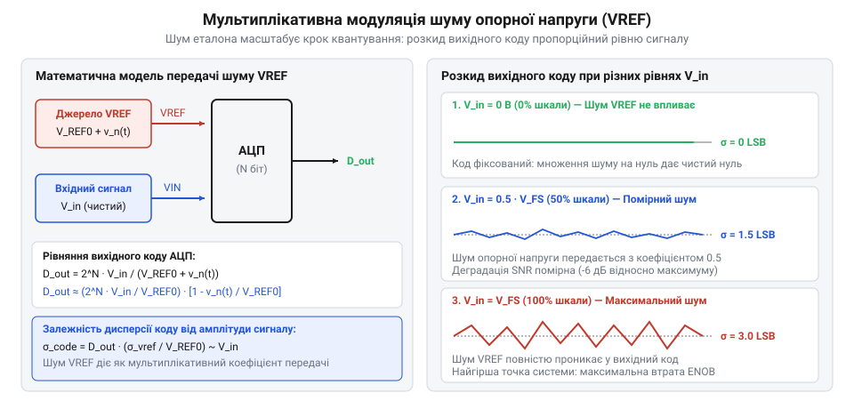
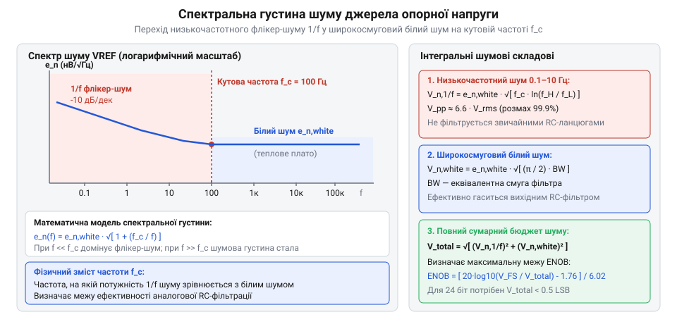
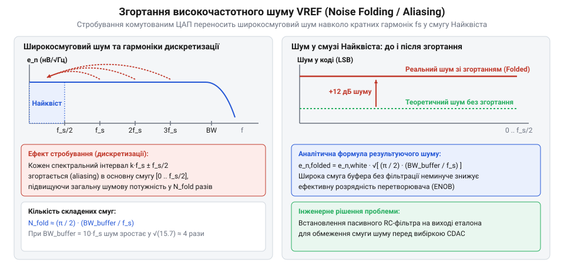
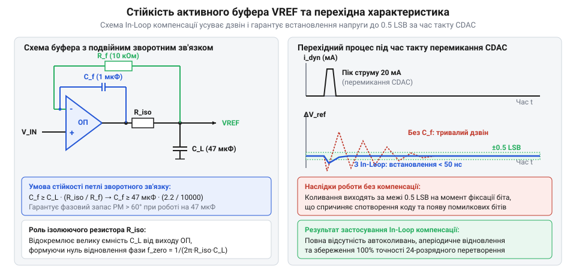
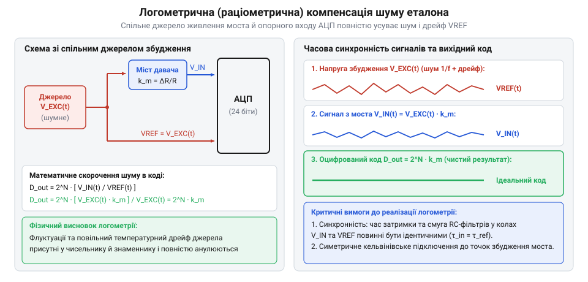

# Шум опорної напруги АЦП

<preknowlist>
- [Опорна напруга](root:hw-sensing/voltage-reference) — Принцип формування стабільного потенціалу та типи джерел опорної напруги (Bandgap, Buried Zener).
- [Похибки АЦП](root:hw-sensing/adc-errors) — Поняття похибки коефіцієнта передачі (gain error), квантування, відношення сигнал/шум (SNR) та ENOB.
- [SAR АЦП зсередини](root:hw-sensing/sar-adc-internals) — Робота матриці перерозподілу заряду (CDAC) та імпульсний динамічний струм вибірки.
</preknowlist>

## Проблема нестабільності еталона та мультиплікативна модуляція коду

Уявіть ситуацію: на вхід високорозрядного АЦП подано абсолютно стабільну постійну напругу від прецизійного калібратора або акумулятора. Здавалося б, серія зчитувань має повертати один і той самий фіксований цифровий код. Проте на практиці молодші розряди результату постійно хаотично тремтять і розмиваються у випадковий шумовий шлейф. Перша підозра інженера зазвичай падає на теплові шуми вхідного підсилювача або наведення від цифрових ліній. Але якщо закоротити вхід перетворювача на землю (подати нульовий сигнал `V_in = 0 В`), вихідний цифровий код миттєво стає ідеально чистим і нерухомим. Щойно напругу збільшують до максимуму шкали, шумова «хмара» спалахує з новою силою.

Причина цього парадоксу криється у фізиці аналого-цифрового перетворення: АЦП не вимірює напругу безпосередньо у вольтах. Будь-який перетворювач обчислює відношення вхідної напруги `V_in` до прикладеної опорної напруги `V_ref` [Похибки АЦП](root:hw-sensing/adc-errors):

```
D_out = 2ᴺ · (V_in / V_ref)                      [вихідний цифровий код АЦП]
```

Якщо джерело опорної напруги містить випадковий шум `v_n,ref(t)`, миттєве значення еталона змінюється в часі: `V_ref(t) = V_ref,0 + v_n,ref(t)`. Оскільки `v_n,ref ≪ V_ref,0`, розкладемо передавальну функцію перетворення в ряд Тейлора:

```
D_out(t) = 2ᴺ · V_in / (V_ref,0 + v_n,ref(t))
         ≈ 2ᴺ · (V_in / V_ref,0) · (1 - v_n,ref(t) / V_ref,0)
         = D_ideal - D_ideal · (v_n,ref(t) / V_ref,0)    [модуляція вихідного коду]
```


*Мультиплікативна дія шуму VREF на сітку квантування: нульовий шум при Vin=0 та максимальне тремтіння коду біля повної шкали перетворення.*

З виведеного співвідношення чітко видно:
1. Еквівалентний шум у цифровому коді `d_noise = -D_ideal · (v_n,ref / V_ref,0)` діє як мультиплікативна масштабна похибка (@@en|gain error noise@@).
2. При `V_in = 0` вихідний код `D_ideal = 0`, і шумова складова повністю анулюється.
3. При наближенні вхідного сигналу до повної шкали (`V_in → V_ref`, `D_ideal → 2ᴺ`), шум коду сягає свого абсолютного максимуму `d_noise,max = 2ᴺ · (v_n,ref / V_ref,0)`.

Ця мультиплікативна залежність створює фундаментальний інженерний компроміс між амплітудою вхідного сигналу та коефіцієнтом передачі шуму опорного джерела. З одного боку, класичне правило проектування аналогових трактів вимагає максимального використання шкали перетворювача (подання сигналу з розмахом близько повної шкали `V_in ≈ V_ref`), щоб мінімізувати вплив фіксованого адитивного шуму квантування та вхідних каскадів АЦП. Проте з іншого боку, чутливість вихідного коду до випадкових флуктуацій еталона описується частинною похідною:

```
∂D_out / ∂V_ref = -2ᴺ · V_in / V_ref² = -D_out / V_ref    [чутливість до шуму еталона]
```

Коли амплітуда сигналу мала (`V_in ≪ V_ref`), коефіцієнт передачі шуму `k_tr = V_in / V_ref` наближається до нуля: шум опорного джерела практично повністю пригнічується і не впливає на вихідний код. Але щойно розмах сигналу підсилюють до максимуму шкали, коефіцієнт передачі сягає одиниці (`k_tr = 1.0`), переводячи весь широкосмуговий шум та низькочастотний флікер-шум джерела VREF безпосередньо у вимірювальний результат.

У системах із підвищеним рівнем шуму опорного джерела (наприклад, при використанні вбудованих небуферизованих bandgap-еталонів мікроконтролерів) виникає характерний оптимум вибору коефіцієнта підсилення вхідного тракту (PGA). Якщо підсилити слабкий сигнал давача занадто сильно, шум VREF перекриє похибку квантування і деградує ENOB; якщо ж підсилення недостатнє, сигнал потоне у власному шумі квантування перетворювача.

> 🔧 **Навіщо це.**
> Розуміння мультиплікативної природи шуму еталона рятує від марної діагностики: шум опорної напруги неможливо виявити при тестуванні нульового рівня входу. Він маскується під шум самого сигналу і зростає пропорційно амплітуді вимірюваної напруги.

Детальний аналітичний розрахунок втрати динамічного діапазону залежно від амплітуди викладено у вставці [Бюджет шуму VREF та деградація ENOB](root:hw-sensing/adc-vref-noise/math-vref-noise-budget-and-enob.md).

## Спектральний розподіл та фізична природа шумів еталона

Шум джерела опорної напруги не є однорідним: він формується сукупністю принципово різних фізичних процесів усередині напівпровідникового кристала, внутрішніх резисторів та вихідних буферних каскадів [Опорна напруга](root:hw-sensing/voltage-reference). 

За спектральним розподілом шум `v_n,ref` поділяють на дві головні складові:
1. **Низькочастотний флікер-шум (1/f шум):** породжений випадковим захопленням та вивільненням носіїв заряду на пастках діелектричної межі `Si-SiO₂` та дефектах p-n переходів. Його спектральна густина обернено пропорційна частоті `e_n,1/f(f) = e_n,1Hz / √f`.
2. **Широкосмуговий білий шум (@@en|white thermal noise@@):** тепловий шум Джонсона-Найквіста внутрішніх резистивних дільників зворотного зв'язку та дробовий шум струмів зміщення вихідного підсилювача. Має постійну спектральну густину `e_nw` в усьому робочому діапазоні частот.

```
e_n,total(f) = √(e_nw² + e_n,1Hz² / f)            [повна спектральна густина шуму VREF]
```

Частота, на якій флікер-шум зрівнюється за рівнем із широкосмуговим білим шумом, називається кутовою частотою (@@en|1/f corner frequency@@, `f_c`):

```
f_c = e_n,1Hz² / e_nw²                           [кутова частота флікер-шуму]
```


*Спектральна густина шуму еталона: домінування флікер-шуму 1/f на низьких частотах та перехід до білого шуму вище кутової частоти fc.*

Критичним інженерним викликом є технологічний та виробничий розкид кутової частоти `f_c` у кремнієвих структурах. Густина поверхневих оксидних пасток `N_ot` на межі `Si-SiO₂` не є суворо детермінованою константою: вона варіюється від пластини до пластини та між різними виробничими партіями у межах від 2x до 5x. Оскільки `f_c ∝ N_ot`, кутова частота для одного й того самого найменування зонного стабілізатора (Bandgap) у паспортних даних може вказуватися як 100 Гц типово, але в гіршому випадку сягати 800–1200 Гц.

Крім технологічного розкиду, положення `f_c` демонструє сильну температурну залежність. Час релаксації поверхневих рекомбінаційних пасток `τ_trap` змінюється за законом Арреніуса:

```
τ_trap(T) = τ₀ · exp( E_act / (k · T) )          [температурна стала рекомбінації]
```

При нагріванні мікросхеми до робочих температур промислового діапазону (+85...+125 °C) швидкість термоемісії носіїв заряду з пасток різко зростає. Це зміщує весь низькочастотний спектр флікер-шуму в область вищих частот, розширюючи зону домінування 1/f шуму вдвічі-втричі порівняно з кімнатною температурою.

Для практичних розрахунків спектр шуму розбивають на дві окремі смуги:
1. **Низькочастотна смуга 0.1–10 Гц:** тут домінує 1/f шум, який вказується в документації як розмах від піку до піку (@@en|peak-to-peak@@, `V_pp`). Цей шум неможливо усунути звичайними аналоговими RC-фільтрами, оскільки необхідна ємність конденсаторів сягала б сотень мікрофарад із неприпустимим струмом витоку.
2. **Широкосмугова смуга від 10 Гц до частоти Найквіста АЦП:** визначається білим шумом `e_nw`. Цю складову ефективно пригнічують зовнішніми фільтрами низьких частот та активними буферами.

При розрахунку смуги зрізу зовнішнього низькочастотного фільтра інженер зобов'язаний орієнтуватися на найгірше (максимальне) значення `f_c,max` з урахуванням граничної робочої температури, аби гарантувати, що фільтр зріже не лише білий шум, а й високочастотний хвіст флікер-шуму.

> 🔧 **Навіщо це.**
> Розрахунок аналогового фільтра VREF за типовою кутовою частотою з паспорта (наприклад, 100 Гц) загрожує відмовою приладів у серійному виробництві: екземпляри мікросхем із розкидом `f_c = 1 кГц` пропустять невідфільтрований флікер-шум у робочу смугу вимірювань, погіршуючи ENOB готового виробу на 1–2 біти.

Інженерне порівняння фізики шуму в різних технологіях еталонів (Bandgap, XFET, Buried Zener) наведено у вставці [Порівняння зонних та підповерхневих еталонів](root:hw-sensing/adc-vref-noise/comp-bandgap-and-buried-zener-references.md).

## Стробування та згортання високочастотного шуму (Noise Folding)

Інтуїтивне уявлення про те, що АЦП сприймає лише низькочастотний шум опорного джерела в межах смуги самого корисного сигналу, є однією з найнебезпечніших інженерних оман. У реальних перетворювачах з комутованими ємностями (в архітектурах SAR та дельта-сигма модуляторів) підключення опорної напруги до внутрішньої матриці конденсаторів ЦАП (CDAC) відбувається у вигляді періодичних короткочасних імпульсів вибірки [SAR АЦП зсередини](root:hw-sensing/sar-adc-internals).

Коли ключ вибірки замикається на частки наносекунди, конденсатор миттєво фіксує сумарну напругу еталона разом з усіма високочастотними шумовими коливаннями, що існують на виводі VREF у цей момент. З погляду цифрової обробки сигналів процес дискретизації є множенням неперервного шумового процесу на послідовність дельта-імпульсів із частотою дискретизації `f_s`.


*Накладання (folding) високочастотних шумових смуг буфера VREF в основну смугу Найквіста при стробуванні комутованими конденсаторами вибірки.*

Спектральний механізм згортання базується на математичному аналізі стробування неперервного випадкового сигналу. Коли комутатор вибірки з'єднує матрицю конденсаторів із лінією VREF на короткий час відстеження `t_track ≪ T_s` (де `T_s = 1 / f_s` — період дискретизації), процес еквівалентний згортці неперервного енергетичного спектра шуму `S_vref(f)` зі спектром періодичної послідовності прямокутних імпульсів.

Оскільки тривалість імпульсу комутації надзвичайно мала (`t_track` становить одиниці або десятки наносекунд), нулі частотної огинаючої `sinc(π · f · t_track)` розташовані на частотах у сотні мегагерців — далеко за межами робочої смуги буферного підсилювача `BW_buf`. Це означає, що всі гармоніки тактової частоти `k · f_s` стробують високочастотний шум майже без частотного спаду огинаючої.

У результаті дискретизації весь широкосмуговий білий шум буферного підсилювача та еталона, що сягає смуги зрізу буфера `BW_buf` (яка зазвичай становить 10–100 МГц для швидкого заряду ємностей), розбивається на `M` незалежних спектральних інтервалів шириною `f_s / 2` (смуга Найквіста `f_N`):

```
M = BW_buf / (f_s / 2) = 2 · BW_buf / f_s         [кількість зон Найквіста]
```

Оскільки шум у різних зонах Найквіста є некорельованим, їхні спектральні потужності сумуються в основній смузі `[0 .. f_s / 2]`:

```
S_folded(f) = ∑[k = -M .. M] |H_buf(f - k · f_s)|² · e_nw²
            ≈ (2 · BW_buf / f_s) · e_nw²          [згорнута спектральна густина потужності]
e_n,folded = e_nw · √( 2 · BW_buf / f_s )         [еквівалентна спектральна густина напруги]
```

> 🔧 **Навіщо це.**
> Якщо операційний підсилювач буфера VREF має смугу пропускання 50 МГц, а частота вибірки АЦП становить 1 Мвиб/с (смуга Найквіста 500 кГц), коефіцієнт згортання дорівнює `K_fold = 100`. Це означає, що спектральна густина шуму напруги у вихідному коді зросте в `√100 = 10` разів! Без належної фільтрації високочастотний шум буфера повністю знищить роздільну здатність перетворювача.

Щоб запобігти катастрофічному згортанню шуму, між буфером та входом VREF АЦП встановлюють низькоомний RC-фільтр, узгоджений із динамікою перезаряду матриці ЦАП [Час встановлення вхідного сигналу АЦП](root:hw-sensing/adc-input-settling-time). Смуга пропускання такого фільтра `f_filt = 1 / (2 · π · R_filt · C_filt)` обмежує ефективну смугу інтегрування шуму, знижуючи коефіцієнт згортання до безпечного мінімуму `K_fold = 2 · f_filt / f_s`.

## Деградація динамічного діапазону та ефективної розрядності (ENOB)

Повний шум вимірювальної системи є геометричною сумою двох некорельованих джерел: власного адитивного шуму мікросхеми перетворювача `v_n,adc` (включаючи шум квантування та шум компаратора) і трансльованого мультиплікативного шуму опорного тракту `v_n,ref` [Похибки АЦП](root:hw-sensing/adc-errors).

Для синусоїдного сигналу повної шкали сумарне відношення сигнал/шум (SNR) системи описується аналітичною залежністю:

```
SNR_total = 20 · lg( V_ref / (2 · √2 · √(v_n,adc² + (1/8) · v_n,ref²)) )   [сумарний SNR]
```

Зниження показника SNR безпосередньо зумовлює втрату ефективної розрядності (@@en|Effective Number of Bits@@, ENOB):

```
ENOB = (SNR_total - 1.76 дБ) / 6.02 дБ            [реальна розрядність тракту]
```

Втрата ефективних розрядів `ΔENOB = ENOB_ideal - ENOB_actual` визначається співвідношенням шуму еталона до власного шуму АЦП:

```
ΔENOB = log₂( √(1 + (1/8) · (v_n,ref / v_n,adc)²) )   [формула втрати бітів]
```

Практичні правила для проектування прецизійних трактів:
1. **16-розрядні системи (`LSB ≈ 76 мкВ` при 5 В):** власний шум АЦП становить близько 15–20 мкВ RMS. Використання еталона з шумом `v_n,ref ≤ 10 мкВ RMS` призводить до втрати менше 0.2 біта ENOB.
2. **24-розрядні системи (`LSB ≈ 0.3 мкВ` при 5 В):** власний шум перетворювача сягає 1–2 мкВ RMS. Підключення стандартного зонного джерела з шумом 25–50 мкВ миттєво погіршує ENOB з 21–22 бітів до мізерних 14 бітів, знецінюючи вартість мікросхеми [Порівняння зонних та підповерхневих еталонів](root:hw-sensing/adc-vref-noise/comp-bandgap-and-buried-zener-references.md).
3. **32-розрядні системи (`LSB ≈ 1.16 нВ` при 5 В):** реалізація субмікровольтової роздільної здатності можлива виключно за умови використання підповерхневих стабілітронів (Buried Zener) у поєднанні з активними багатополюсними фільтрами низьких частот та цифровим усередненням вибірок.

Повний числовий розрахунок бюджету шумів та пік-до-пік роздільної здатності наведено у вставці [Бюджет шуму VREF та деградація ENOB](root:hw-sensing/adc-vref-noise/math-vref-noise-budget-and-enob.md).

## Пасивна та активна фільтрація опорної напруги

Зниження спектральної густини білого шуму опорного тракту вимагає застосування спеціалізованих схем аналогової фільтрації на виході джерела еталона [Опорна напруга](root:hw-sensing/voltage-reference).

Найпростішим рішенням є пасивний RC-фільтр низьких частот першого порядку. Частота зрізу такого фільтра `f_cut` обирається якомога нижчою для придушення широкосмугового шуму:

```
f_cut = 1 / (2 · π · R_filt · C_filt)            [частота зрізу пасивного RC-фільтра]
```

Проте при виборі компонентів пасивного фільтра виникає критичний компроміс:
1. **Опір резистора `R_filt`:** не можна обирати великим (типово не більше 10–100 Ом), оскільки постійний або динамічний струм споживання виводу VREF створить падіння напруги `ΔV = I_vref · R_filt`, що призведе до катастрофічної похибки коефіцієнта підсилення тракту [Похибки АЦП](root:hw-sensing/adc-errors).
2. **Тип діелектрика конденсатора `C_filt`:** використання дешевої кераміки класу Y5V або Z5U неприпустиме через п'єзоелектричний мікрофонний ефект, високий струм витоку та падіння ємності до 70% під постійною напругою зміщення.
   - Для прецизійних кіл застосовують конденсатори з діелектриком **C0G/NP0** (стабільні, нульовий п'єзоефект, але обмежена ємність до 10–100 нФ).
   - Для великих ємностей (1–47 мкФ) використовують високоякісну кераміку **X7R/X8R** на підвищену робочу напругу (щонайменше вдвічі-втричі вищу за номінал VREF для усунення ефекту деградації ємності) або прецизійні **плівкові поліпропіленові конденсатори** з ультранизькою діелектричною абсорбцією.

> 🔧 **Навіщо це.**
> Діелектрична абсорбція (ефект «пам'яті заряду») у неякісних конденсаторах призводить до повільного повзучого дрейфу напруги після різких змін живлення або температури, що зводить нанівець калібрування 24-розрядного приладу.

### Фізичний механізм та розрахунок діелектричної абсорбції (Dielectric Absorption)

Діелектрична абсорбція (@@en|dielectric absorption@@, або @@en|soakage@@) — це явище неповної релаксації електричного заряду в діелектрику конденсатора після його розряджання або зміни прикладеного потенціалу. Під дією постійного електричного поля дипольні молекули діелектрика поляризуються. У сегнетоелектричних кераміках на основі титанату барію (класи X7R, X5R, Y5V) частина диполів має великі постійні часу переорієнтації (від мілісекунд до десятків хвилин).

Еквівалентна електрична схема реального конденсатора містить основну ідеальну ємність `C_0`, паралельно до якої підключено кілька послідовних RC-ланок релаксації `R_da1 – C_da1`, `R_da2 – C_da2` з наростаючими постійними часу `τ_i = R_dai · C_dai`. Коли напруга на конденсаторі швидко змінюється (наприклад, під час подачі живлення або перемикання опорних рівнів), внутрішні ємності `C_dai` заряджаються через високі внутрішні опори `R_dai`. Після закінчення перехідного процесу ці повільні ємності продовжують повільно обмінюватися зарядом з основною ємністю, викликаючи повзучий дрейф вихідної напруги.

Кількісно діелектрична абсорбція вимірюється у відсотках залишкової відновленої напруги `V_rem` після короткочасного розряджання попередньо зарядженого конденсатора:

```
DA = (V_rem / V_charge) · 100%                   [коефіцієнт діелектричної абсорбції]
```

Порівняння різних типів діелектриків за рівнем абсорбції:
- **C0G/NP0 (параелектрична кераміка):** `DA < 0.01%` (ідеальний вибір для прецизійних кіл, але обмежений ємністю до 100 нФ).
- **Поліпропілен (плівкові PP):** `DA ≈ 0.01–0.02%` (найкращий вибір для прецизійних інтеграторів та фільтрів VREF).
- **X7R / X8R (сегнетоелектрична кераміка):** `DA ≈ 0.6–2.5%` (припустимий для великих ємностей буфера, але створює дрейф при ввімкненні).
- **Танталові та електролітичні конденсатори:** `DA ≈ 3–8%` (непридатні для фільтрації VREF без додаткової буферизації).
- **Y5V / Z5U:** `DA ≈ 5–12%` (категорично заборонені в метрологічних вимірюваннях).

**Розрахунок похибки від діелектричної абсорбції для 24-розрядного АЦП:**
- Нехай еталонна напруга становить `V_REF = 5.0 В`.
- Вага молодшого розряду для `N = 24` біт [Похибки АЦП](root:hw-sensing/adc-errors):
```
1 LSB
= V_REF / 2²⁴                                    [вага кванта 24-бітного АЦП]
= 5.0 В / 16777216                               [числовий розрахунок]
= 2.98 · 10⁻⁷ В                                  [розрахункове значення]
= 0.298 мкВ                                      [квант LSB]
```
- Якщо у вихідному фільтрі використано дешевий конденсатор X7R із `DA = 1.0%`, після ввімкнення приладу внутрішня залишкова напруга становить:
```
V_rem
= V_REF · (DA / 100%)                            [залишкова напруга релаксації]
= 5.0 В · 0.01                                   [підстановка параметрів]
= 50 мВ                                          [похибка пам'яті заряду]
```
- Величина похибки у квантах LSB:
```
Похибка_LSB
= V_rem / (1 LSB)                                [переведення у LSB]
= 50 · 10⁻³ В / (0.298 · 10⁻⁶ В)                 [числовий дріб]
= 167772 LSB                                     [еквівалентний зсув]
```
Цей залишковий заряд вивільняється експоненційно з постійними часу в десятки секунд і хвилин, що створює монотонний повільний дрейф базової лінії, який неможливо відрізнити від температурного дрейфу давача [Температурний дрейф АЦП](root:hw-sensing/adc-temperature-drift).

### Падіння ємності під постійною напругою зміщення (DC Bias Effect)

Ще однією критичною вадою багатошарових керамічних конденсаторів (MLCC) класу X7R/X5R є залежність дійсної ємності від прикладеної постійної напруги зміщення (@@en|DC bias effect@@). Під дією сильного електричного поля всередині тонких керамічних шарів дипольні домени титанату барію насичуються, що призводить до різкого зменшення діелектричної проникності `ε_r`.

Конденсатор номіналом `47 мкФ / 6.3 В` типорозміру 0805 під робочою напругою `VREF = 5.0 В` (80% від номінальної) втрачає до `75%` своєї початкової ємності, залишаючи реальні `11.7 мкФ`. В результаті:
1. Частота зрізу фільтра `f_cut` зміщується вгору у 4 рази, пропускаючи значно більшу смугу білого шуму.
2. Фазовий запас буферного підсилювача спотворюється, оскільки розрахунок стійкості спирався на номінальні `47 мкФ` [Активний буфер опорної напруги](root:hw-sensing/adc-vref-noise/proj-active-vref-buffer-filter.md).

**Інженерне правило вибору ємностей для VREF:**
1. Обирати робочу напругу керамічного конденсатора `V_rated ≥ 2.5–3 · V_REF` (наприклад, конденсатор на `25 В` або `50 В` для лінії `5.0 В`). У такому режимі спад ємності не перевищує 10–15%.
2. Обирати більший типорозмір корпусу (1206 або 1210 замість 0603/0805), оскільки товстіший шар діелектрика зазнає меншої напруженості поля при тій самій напрузі.

Коли потрібна водночас ультранизька частота зрізу (одиниці герців), повна відсутність ефекту пам'яті заряду та нульовий статичний вихідний опір, застосовують активні буфери на базі ультранизькошумних операційних підсилювачів із біполярним або JFET входом та коефіцієнтом придушення пульсацій живлення `PSRR > 100 дБ`.

## Динаміка комутації CDAC та стабілізація буфера (In-Loop Compensation)

Головна схемотехнічна складність буферизації VREF полягає у суперечливих вимогах до вихідного каскаду. З одного боку, для придушення шуму потрібна вузька смуга пропускання. З іншого боку, вхід VREF сучасного SAR АЦП споживає струм не рівномірно, а у вигляді коротких наносекундних струмових імпульсів амплітудою в десятки міліамперів під час кожного такту перемикання матриці зважених конденсаторів CDAC [SAR АЦП зсередини](root:hw-sensing/sar-adc-internals).

Якщо буфер не встигне відновити потенціал на виводі VREF до закінчення такту порозрядного зрівноваження з точністю краще `0.5 LSB`, перетворювач запише спотворений бітовий код [Час встановлення вхідного сигналу АЦП](root:hw-sensing/adc-input-settling-time).

Для поглинання комутаційних струмових сплесків безпосередньо до виводу VREF підключають локальний накопичувальний конденсатор великої ємності `C_L = 10–47 мкФ`. Але підключення такої ємності безпосередньо до виходу стандартного операційного підсилювача утворює додатковий полюс у петлі зворотного зв'язку з розімкненим вихідним опором ОП `R_out`:

```
f_pole = 1 / (2 · π · R_out · C_L)               [полюс ємнісного навантаження]
```

Цей полюс різко зменшує фазовий запас підсилювача, призводячи до тривалого дзвіна (@@en|ringing@@) або навіть паразитної високочастотної генерації.


*Принципова схема буфера з внутрішньопетельною компенсацією (in-loop compensation): подвійний зворотний зв'язок забезпечує стійкість на ємність 47 мкФ та швидке згасання перехідного процесу.*

Для розв'язання цієї проблеми застосовують топологію компенсації всередині петлі (@@en|in-loop compensation@@):
1. Між фізичним виходом підсилювача та навантажувальним конденсатором встановлюють ізолюючий резистор `R_iso` (1–5 Ом).
2. За постійним струмом зворотний зв'язок знімається безпосередньо з виводу VREF АЦП через резистор `R_f` (10–50 кОм), що гарантує нульову статичну похибку від вихідного струму навантаження.
3. За високою частотою петля замикається компенсаційним конденсатором `C_f` (0.1–1 мкФ) безпосередньо з виходу ОП на його інвертуючий вхід, обходячи затримку фази навантажувальної ємності:

```
C_f ≥ C_L · (R_iso / R_f)                        [умова стійкості петлі]
```

### Аналітичний розрахунок стійкості та вплив внутрішнього опору R_out

Для точного проектування буфера розглянемо частотну поведінку петлевого підсилення `A(s) · β(s)`. Будь-який реальний операційний підсилювач має ненульовий розімкнений вихідний опір `R_out`, величина якого суттєво залежить від архітектури вихідного каскаду:
- Прецизійні швидкодійні ОП з двотактним вихідним емітерним повторювачем мають низький вихідний опір `R_out = 5–15 Ом`.
- Прецизійні біполярні підсилювачі загального застосування мають середній опір `R_out = 40–80 Ом`.
- Мікропотужні ОП з вихідним каскадом @@en|Rail-to-Rail@@ на польових транзисторах мають високий розімкнений опір `R_out = 100–500 Ом` (через конфігурацію зі спільним витоком).

Підключення навантажувального ланцюга `R_iso`, `C_L`, `R_f`, `C_f` формує в петлі зворотного зв'язку два домінантні полюси та один коригувальний нуль. Повний навантажувальний полюс петлі визначається сумою вихідного опору підсилювача та ізолюючого резистора:

```
f_p_load = 1 / (2 · π · (R_out + R_iso) · C_L)   [навантажувальний полюс системи]
```

Ізолюючий резистор `R_iso` утворює в передавальній функції коригувальний нуль:

```
f_z_comp = 1 / (2 · π · R_iso · C_L)             [нуль фазової компенсації]
```

Водночас локальний зворотний зв'язок `R_f – C_f` утворює високочастотний полюс:

```
f_p_fb = 1 / (2 · π · R_f · C_f)                 [полюс локального контуру]
```

Для забезпечення стійкості та фазового запасу `PM ≥ 60°` на частоті одиничного підсилення `f_0dB` необхідно виконати умови узгодження частот:
1. Частота нуля компенсації повинна збігатися з частотою полюса зворотного зв'язку `f_z_comp = f_p_fb`, що й дає класичну формулу балансу ємностей `C_f · R_f = C_L · R_iso`.
2. Частота одиничного зрізу петлі ОП `f_0dB` повинна лежати вище частоти нуля `f_z_comp`, щоб фазовий набіг устиг відновитися до безпечного значення до точки перетину `0 дБ`.

**Приклад розрахунку для швидкодійного буфера (R_out = 8 Ом):**
- Нехай `C_L = 47 мкФ`, `R_iso = 2.2 Ом`, `R_f = 10 кОм`.
- Полюс навантаження:
```
f_p_load
= 1 / (2 · π · (8 Ом + 2.2 Ом) · 47 · 10⁻⁶ Ф)    [формула полюса]
= 1 / (2 · π · 10.2 · 4.7 · 10⁻⁵)                [підстановка опорів]
= 332 Гц                                         [розрахунковий полюс]
```
- Нуль компенсації:
```
f_z_comp
= 1 / (2 · π · 2.2 Ом · 47 · 10⁻⁶ Ф)             [формула нуля]
= 1.54 кГц                                       [відновлення фази]
```
- Необхідна ємність локальної петлі:
```
C_f_min
= C_L · (R_iso / R_f)                            [умова рівності постійних часу]
= 47 · 10⁻⁶ Ф · (2.2 Ом / 10000 Ом)              [підстановка параметрів]
= 1.034 · 10⁻⁸ Ф                                 [розрахункова межа]
= 10.3 нФ                                        [мінімальна ємність]
```
Для забезпечення підвищеного запасу фази обирають стандартний номінал `C_f = 100 нФ – 1 мкФ`, що повністю гарантує аперіодичний характер перехідного процесу (коефіцієнт демпфування `ζ ≥ 0.707`).

**Порівняння з мікропотужним ОП високого опору (R_out = 150 Ом):**
Якщо використати підсилювач із `R_out = 150 Ом` без зміни `R_iso`, навантажувальний полюс опускається до критично низької частоти:
```
f_p_load = 1 / (2 · π · (150 + 2.2) · 47 · 10⁻⁶) = 22.3 Гц
```
При цьому відстань між полюсом `22.3 Гц` та нулем `1.54 кГц` розширюється майже до двох декад. Фазовий зсув у цьому діапазоні встигає впасти практично до `-180°`, що викликає глибокий провал фази. Якщо частота одиничного підсилення мікропотужного ОП потрапляє в цю зону, буфер втрачає стійкість і переходить у незгасаючу автогенерацію.

Щоб стабілізувати підсилювач із високим `R_out`, доводиться збільшувати `R_iso` до `15–30 Ом`. Проте збільшення `R_iso` пропорційно погіршує динамічний вихідний імпеданс буфера: під час комутації ємностей CDAC напруга VREF зазнає глибшого провалу `ΔV = I_peak · R_iso`, а постійна часу відновлення `τ = R_iso · C_L` зростає, що обмежує максимальну частоту дискретизації АЦП.

> 🔧 **Навіщо це.**
> Знання внутрішнього опору ОП `R_out` рятує від раптового збудження схеми на макеті. Якщо для буферизації VREF помилково обрати прецизійний, але повільний мікропотужний ОП із великим `R_out`, схема або згенерує синусоїду мегагерцового діапазону, або відновлюватиме опорний потенціал занадто довго, спричиняючи масивні нелінійні спотворення та втрату до 4–6 бітів ENOB. Для швидкісних систем обов'язково обирають ОП з малим `R_out` та високим струмом короткого замикання.

Повний практичний розрахунок номіналів компонентів та моделювання перехідного процесу реалізовано в інженерному проєкті [Активний буфер опорної напруги](root:hw-sensing/adc-vref-noise/proj-active-vref-buffer-filter.md).

## Топологія друкованої плати та кельвінівське підключення еталона

Навіть ідеальне джерело опорної напруги з ультранизьким власним шумом втрачає свої метрологічні характеристики при помилках трасування друкованої плати. Вивід VREF АЦП є високочутливою точкою схеми, де будь-яке паразитне падіння напруги безпосередньо додається до опорного рівня [Температурний дрейф АЦП](root:hw-sensing/adc-temperature-drift).

Головні паразити друкованого монтажу — це активний опір мідної доріжки `R_trace` та її паразитна індуктивність `L_trace` (близько 1 нГн на кожен міліметр довжини). Коли матриця перетворювача споживає імпульсний струм `i_dyn(t)` з фронтом наростання одиниці наносекунд (`di/dt > 10⁶ А/с`), на паразитній індуктивності доріжки виникає імпульсна наведена ЕРС:

```
V_drop(t) = i_dyn(t) · R_trace + L_trace · (di_dyn / dt)   [динамічне падіння напруги]
```

При струмовому сплеску 10 мА та індуктивності доріжки лише 5 нГн динамічний викид напруги сягає `ΔV = 5 · 10⁻⁹ · (10 · 10⁻³ / 2 · 10⁻⁹) = 25 мВ`, що у тисячі разів перевищує LSB прецизійного перетворювача!

Для усунення цієї проблеми застосовують строгі інженерні правила трасування:
1. **Локальний розв'язувальний конденсатор:** керамічний конденсатор ємністю 10–47 мкФ встановлюють безпосередньо біля виводу VREF АЦП на тій самій стороні плати без використання перехідних отворів (via).
2. **Диференціальне кельвінівське підключення (@@en|Kelvin connection@@):** виводи `VREF(+)` та `VREF(-)` (або `REFGND`) підключають безпосередньо до точок виходу буфера парою паралельних доріжок однакової довжини.
3. **Розділення зворотних струмів заземлення:** вивід опорної землі `REFGND` не повинен розділяти зворотний шлях із цифровими струмами мікроконтролера або силовими контурами живлення. Земляний вивід накопичувального конденсатора з'єднують із земляним полігоном АЦП у єдиній «зірковій» точці безпосередньо біля мікросхеми перетворювача.

> 🔧 **Навіщо це.**
> Чотирипровідне кельвінівське зняття опорної напруги гарантує, що струми повернення інших вузлів схеми не створять паразитного зміщення на земляній ніжці еталона, зберігаючи 24-бітну чистоту шкали перетворення.

### Охоронні кільця (Guard Rings) проти поверхневих витоків

Високоомні кола фільтрації VREF надзвичайно чутливі до поверхневих струмів витоку через забруднення плати залишками флюсу, вологу та недосконалість діелектрика FR-4. При вологості повітря понад 70% поверхневий опір ізоляції може деградувати з `10¹² Ом` до `10⁸ Ом`. Якщо поруч із доріжкою VREF проходить цифрова лінія `+5 В` або шина живлення `+15 В`, виникає струм витоку:

```
I_leak = (V_rail - VREF) / R_ins                 [струм поверхневого витоку]
```

Для вузла з фільтруючим резистором `R_filt = 10 кОм` витік струму лише `100 нА` створює падіння напруги `ΔV = 1 мВ`, що для 24-бітного перетворювача еквівалентно похибці понад `3300 LSB` [Похибки АЦП](root:hw-sensing/adc-errors).

Для повного усунення витоку навколо виводу та провідників VREF формують непаяне мідне охоронне кільце (@@en|guard ring@@). Охоронне кільце підключають до низькоомного виходу буфера, на якому підтримується той самий потенціал `V_guard = VREF`. Оскільки різниця потенціалів між захисним кільцем та виводом VREF дорівнює нулю (`ΔV = 0 В`), струм витоку через поверхню плати фізично зникає.

### Обмеження логометричного придушення при фазовому неузгодженні

Логометричний метод вимірювання базується на повному скороченні шуму джерела живлення у відношенні `V_in(t) / V_ref(t)`. Проте це скорочення діє бездоганно лише за умови повної синфазності сигналів.

Якщо вхідний канал давача має фільтр захисту від накладання спектрів із постійною часу `τ_in = R_in · C_in`, а опорний канал АЦП — власний фільтр із `τ_ref = R_ref · C_ref`, будь-яке технологічне розходження номіналів `Δτ = |τ_in - τ_ref|` утворює частотно-залежний фазовий зсув `Δφ = 2 · π · f · Δτ`.

При наявності пульсацій або шуму на частоті `f` залишковий незкомпенсований шум у вихідному коді становить:

```
V_noise,res = V_noise · (2 · π · f · Δτ)         [залишковий шум логометрії]
```

Наприклад, при пульсаціях імпульсного живлення `100 кГц` та неузгодженості постійних часу фільтрів `Δτ = 100 нс` ефективність придушення шуму погіршується на `24 дБ`, пропускаючи високочастотні перешкоди безпосередньо у вихідний цифровий масив. Тому для прецизійних логометричних схем вимагається суворе симетричне узгодження частот зрізу фільтрів обох каналів.

## Логометрична компенсація шуму та нестабільності еталона

Найелегантнішим та найбільш надійним схемотехнічним методом повної нейтралізації шумів і дрейфу опорного джерела є логометричний (раціометричний) принцип побудови вимірювального тракту [Раціометричні вимірювання](root:hw-sensing/ratiometric-measurement).

Цей метод базується на синхронному живленні первинного резистивного давача (вимірювального моста Уітстона, тензодавача або терморезистора RTD) та опорного входу АЦП від одного й того самого фізичного джерела напруги `V_exc`.


*Схема логометричного тракту: шум збудження Vexc модулює сигнал давача і шкалу АЦП одночасно, повністю скорочуючись у вихідному коді.*

Аналітичний механізм компенсації є бездоганним з математичного погляду. Вихідна напруга мостового давача `V_bridge` прямо пропорційна напрузі збудження `V_exc` та вимірюваній зміні опору `ΔR / R`:

```
V_in(t) = V_bridge(t)
        = V_exc(t) · (ΔR / (4 · R))              [вихідний сигнал мостового давача]
```

Підставляючи цей вираз у рівняння перетворення АЦП, де опорною напругою виступає те саме джерело `V_ref(t) = V_exc(t)`:

```
Code(t) = 2ᴺ · (V_in(t) / V_ref(t))
        = 2ᴺ · ( (V_exc(t) · (ΔR / (4 · R))) / V_exc(t) )
        = 2ᴺ · (ΔR / (4 · R))                    [повне математичне скорочення еталона]
```

> 🔧 **Навіщо це.**
> У логометричній системі джерело опорної напруги може мати значний флікер-шум 1/f, температурний дрейф 50 ppm/°C і навіть пульсації живлення — вихідний цифровий код залишиться абсолютно нерухомим і точним, оскільки напруга живлення давача і шкала АЦП коливаються абсолютно синхронно і взаємно скорочуються.

Логометричний підхід є стандартом де-факто в електронних вагах, прецизійних вимірювачах тиску на тензомостах та термометрах опору (Pt100/Pt1000). Він дозволяє створювати 24-розрядні вимірювальні прилади найвищого класу точності навіть без використання наддорогих підповерхневих стабілітронів.
