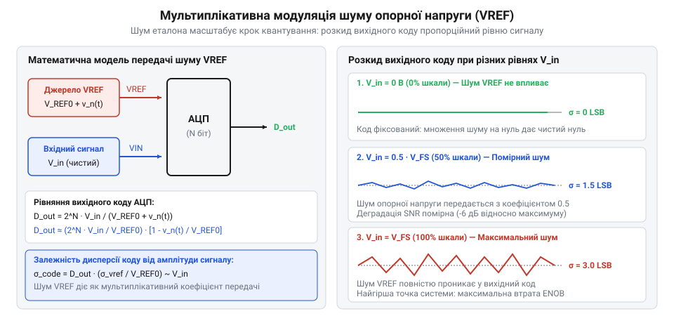
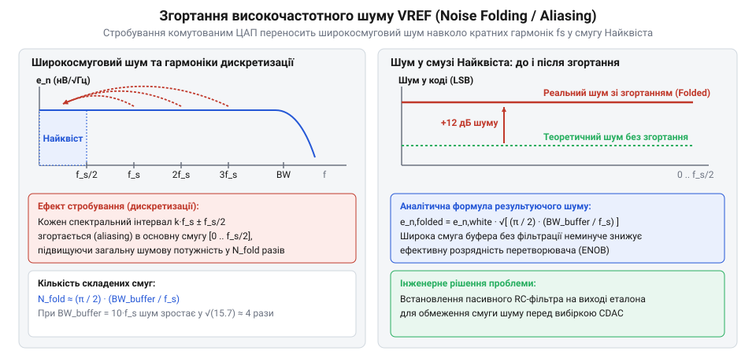
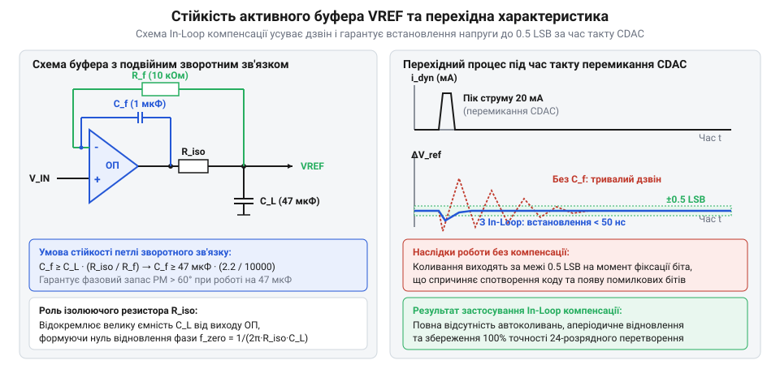

# Шум опорної напруги АЦП

## Фізична природа та мультиплікативна дія шуму еталона

Під час тестування високорозрядного АЦП початківець часто стикається з несподіваним явищем: при заземленому вході (`V_in = 0 В`) вихідний цифровий код є абсолютно стабільним і чистим, але щойно на вхід подають постійну напругу з рівнем повної шкали, молодші розряди результату починають хаотично тремтіти.

Причина полягає у тому, що будь-який АЦП вимірює не абсолютну напругу, а співвідношення вхідного сигналу `V_in` до прикладеної опорної напруги `V_ref` [Похибки АЦП](root:hw-sensing/adc-errors):

```
D_out = 2ᴺ · (V_in / V_ref)                      [вихідний цифровий код АЦП]
```

Якщо джерело опорної напруги генерує власний шум `v_n,ref(t)`, миттєвий потенціал еталона стає нестабільним: `V_ref(t) = V_ref,0 + v_n,ref(t)`. Зміна знаменника дробу викликає пропорційну модуляцію вихідного двійкового коду:

```
D_out(t)
≈ 2ᴺ · (V_in / V_ref,0) · (1 - v_n,ref(t) / V_ref,0)
= D_ideal - D_ideal · (v_n,ref(t) / V_ref,0)     [мультиплікативна дія шуму]
```


*Мультиплікативна дія шуму VREF на сітку квантування: нульовий шум при Vin=0 та максимальне тремтіння коду біля повної шкали перетворення.*

З цієї залежності випливають ключові закономірності:
1. Шум еталона проявляється як мультиплікативна похибка коефіцієнта передачі (@@en|gain error noise@@).
2. При нульовому сигналі (`V_in = 0`) вихідний код `D_ideal = 0`, і вплив шуму VREF повністю зникає.
3. Біля верхньої межі шкали (`V_in → V_ref`) амплітуда шуму коду сягає свого абсолютного максимуму:

```
d_noise,max = 2ᴺ · (v_n,ref / V_ref,0)           [максимальний шумовий розмах коду]
```

> 🔧 **Навіщо це.**
> Шум опорного джерела неможливо виявити тестуванням нульового входу або закорочуванням каналу. Він виникає лише під час подачі робочого сигналу і маскується під шуми самого вимірюваного давача.

## Спектральний склад та згортання шуму в АЦП

Шум джерела опорної напруги складається з двох фундаментальних компонентів:
1. **Низькочастотний флікер-шум (1/f шум):** спричинений випадковим захопленням носіїв заряду пастками в кремнії. Його спектральна густина спадає зі зростанням частоти.
2. **Широкосмуговий білий шум:** тепловий шум внутрішніх резисторів та дробовий шум транзисторів, що має рівномірну спектральну густину в усій смузі частот [Опорна напруга](root:hw-sensing/voltage-reference).

Найнебезпечнішим явищем у швидкісних SAR та дельта-сигма АЦП є високочастотне згортання шуму (@@en|noise folding@@, або @@en|aliasing@@). Вхідний каскад перетворювача періодично підключає внутрішню ємнісну матрицю CDAC до лінії VREF наносекундними імпульсами вибірки з частотою `f_s` [SAR АЦП зсередини](root:hw-sensing/sar-adc-internals).


*Накладання (folding) високочастотних шумових смуг буфера VREF в основну смугу Найквіста при стробуванні комутованими конденсаторами вибірки.*

У результаті стробування весь широкосмуговий шум вихідного буфера в межах його повної смуги `BW_buf` розбивається на `M = 2 · BW_buf / f_s` незалежних зон Найквіста і дзеркально накладається в робочу низькочастотну смугу. Еквівалентна густина шуму напруги зростає у `√(2 · BW_buf / f_s)` разів:

```
e_n,folded = e_nw · √( 2 · BW_buf / f_s )         [еквівалентний шум після згортання]
```

Це явище різко зменшує співвідношення сигнал/шум (SNR) та знижує реальну ефективну розрядність (ENOB) перетворювача на 2–4 біти [Похибки АЦП](root:hw-sensing/adc-errors).

> 🔧 **Навіщо це.**
> Широкосмуговий підсилювач буфера без вихідного фільтра діє як генератор шуму: при смузі 50 МГц та частоті дискретизації 1 Мвиб/с шум у смузі сигналу зростає рівно вдесятеро.

## Схемотехнічні методи придушення шуму та збереження стійкості

Для нейтралізації шумів еталона та забезпечення стабільності застосовують трирівневу систему захисту:

1. **Пасивний RC-фільтр низьких частот:** встановлюється між виходом опорного джерела та неінвертуючим входом буферного ОП. Частоту зрізу обирають на рівні 1–5 Гц для зрізання білого шуму. Для запобігання похибкам від вхідного струму зміщення ОП використовують підсилювачі з польовим входом (JFET/CMOS).

2. **Активний буфер із подвійним зворотним зв'язком (@@en|in-loop compensation@@):** для поглинання комутаційних струмів CDAC безпосередньо біля виводу VREF встановлюють накопичувальний керамічний конденсатор ємністю `C_L = 10–47 мкФ`. Пряме підключення такої ємності до виходу ОП утворює паразитний полюс із вихідним опором `R_out`, що руйнує фазовий запас і спричиняє генерацію.

Топологія in-loop compensation розв'язує конфлікт: ізолюючий резистор `R_iso` та компенсаційний конденсатор `C_f` замикають швидкий локальний зворотний зв'язок на високих частотах, а резистор `R_f` повертає контроль потенціалу постійного струму безпосередньо з клеми навантаження:

```
C_f ≥ C_L · (R_iso / R_f)                        [критерій абсолютної стійкості]
```


*Принципова схема буфера з внутрішньопетельною компенсацією (in-loop compensation): подвійний зворотний зв'язок забезпечує стійкість на ємність 47 мкФ та швидке згасання перехідного процесу.*

3. **Логометричний принцип вимірювання (@@en|ratiometric sensing@@):** у мостових схемах (тензодавачі, терморезистори RTD) опорний вхід АЦП і вимірювальний міст живляться від одного спільного джерела напруги `V_exc`. Завдяки цьому шум та температурний дрейф еталона однаково масштабують сигнал і сітку квантування, повністю взаємно скорочуючись у цифровому коді.

> 🔧 **Навіщо це.**
> Логометрична схема дозволяє досягти 24-бітної роздільної здатності навіть при використанні зашумленого та нестабільного джерела живлення, оскільки похибка еталона ділиться сама на себе.
