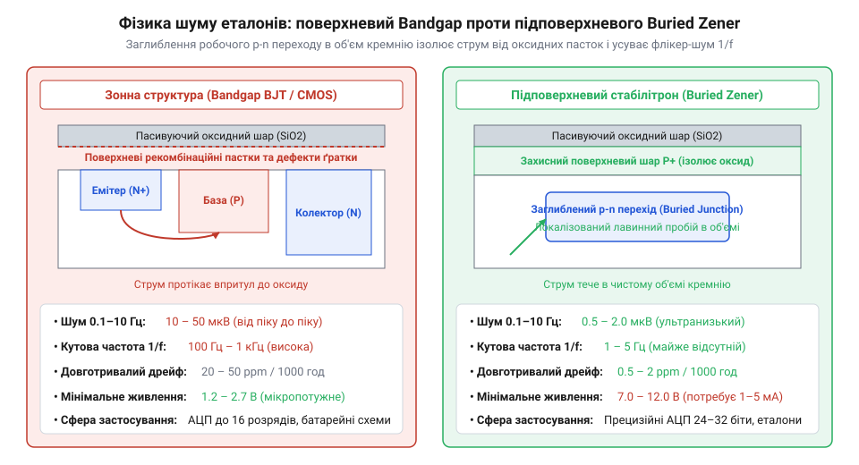
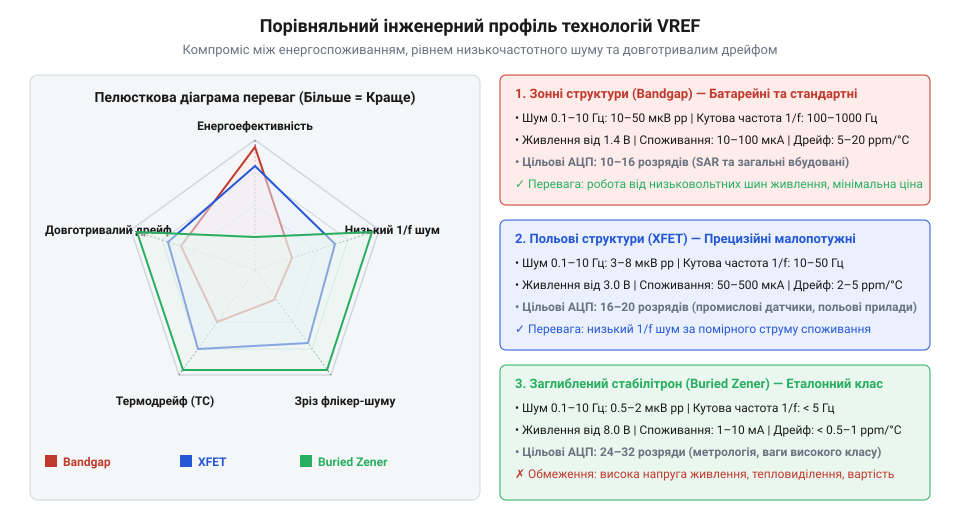

# Шум опорної напруги АЦП

<preknowlist>
- [Опорна напруга](root:hw-sensing/voltage-reference) — Загальні принципи стабілізації напруги.
- [Похибки АЦП](root:hw-sensing/adc-errors) — Вплив шуму та дрейфу еталона на повну похибку вимірювання.
</preknowlist>

## Постановка проблеми та метрики порівняння джерел еталонної напруги

У вимірювальних трактах аналого-цифровий перетворювач визначає значення сигналу не в абсолютних вольтах, а виключно як частку від прикладеної опорної напруги `V_ref` [Похибки АЦП](root:hw-sensing/adc-errors). Якщо опорна напруга нестабільна, коливається від температури або містить власний шум, ці флуктуації безпосередньо спотворюють результат вимірювання.

Наївна спроба отримати опорну напругу за допомогою звичайного резистивного дільника від шини живлення або простого стабілітрона перетворює вимірювальний прилад на генератор випадкових чисел. Пульсації імпульсного перетворювача, перешкоди від цифрових мікросхем і тепловий шум резисторів модулюють повну шкалу АЦП. Для отримання стабільного еталона застосовують спеціалізовані інтегральні джерела опорної напруги [Опорна напруга](root:hw-sensing/voltage-reference).

> 🔧 **Навіщо це.**
> Чітке розуміння метрик опорного джерела запобігає встановленню надмірно дорогих лабораторних еталонів у бюджетні 12-бітні вироби та одночасно рятує 24-бітні прецизійні системи від деградації до рівня побутового вольтметра через невдалий вибір мікросхеми VREF.

Для інженерного порівняння та вибору класу джерела еталонної напруги використовують п'ять ключових метрологічних показників:

1. **Початкова абсолютна точність (@@en|initial accuracy@@, % або мВ):** максимальне відхилення вихідної напруги за кімнатної температури (25 °C) від номінального значення.
2. **Температурний коефіцієнт напруги (@@en|temperature coefficient@@, TC, ppm/°C):** швидкість дрейфу напруги при зміні температури середовища [Температурний дрейф АЦП](root:hw-sensing/adc-temperature-drift).
3. **Низькочастотний флікер-шум у смузі 0.1–10 Гц (мкВ від піку до піку, @@en|peak-to-peak noise@@):** повільні випадкові флуктуації (1/f шум), які неможливо відфільтрувати стандартними конденсаторами без критичного сповільнення системи.
4. **Спектральна густина широкосмугового білого шуму (нВ/√Гц):** тепловий шум вихідних каскадів на частотах від сотень герц до одиниць мегагерців.
5. **Довготривалий часовий дрейф (@@en|long-term stability@@, ppm/1000 год або ppm/√кгод):** незворотне зміщення еталона в часі внаслідок механічних напружень у кристалі та дифузії домішок.

Окрім шуму напруги, критичним параметром інтегрального еталона є струмовий шум вихідного каскаду `i_n` та динамічний вихідний імпеданс `Z_out(f)`. Внутрішні вихідні транзистори джерела створюють струмові флуктуації, які при протіканні через опір внутрішніх зв'язків та зовнішні ланцюги фільтрації породжують додатковий шум напруги:

```
v_n,total = √(e_n² + (i_n · |Z_out|)² + 4 · k · T · Re(Z_out))   [шум з урахуванням вихідного опору]
```

Особливу роль у формуванні низькочастотного флікер-шуму відіграє фізична площа емітерного p-n переходу біполярних транзисторів `A_e`. Густина пасток рекомбінації на одиницю площі є сталою технологічною величиною, тому амплітуда флікер-шуму обернено пропорційна кореню з площі переходу:

```
e_n,1/f ∝ 1 / √(A_e)                            [масштабування 1/f шуму від площі емітера]
f_c ∝ 1 / A_e                                   [зміщення кутової частоти]
```

Збільшення площі емітера у 10–100 разів у прецизійних зонних мікросхемах дозволяє знизити кутову частоту `f_c` з типових 1 кГц до 50–100 Гц, проте це призводить до суттєвого зростання паразитної ємності кристала та вартості виробництва.

Для досягнення екстремальної температурної стабільності нижче 0.05–0.2 ppm/°C у підповерхневих стабілітронах застосовують активний підігрів кристала (термостатування). Всередині кремнієвого кристала розміщують нагрівальний транзистор і температурний давач, об'єднані в аналогову петлю регулювання. Термостат підтримує фіксовану внутрішню температуру кристала (зазвичай +85 °C або +90 °C), що значно перевищує максимальну робочу температуру навколишнього середовища. Завдяки цьому робоча точка p-n переходу залишається абсолютно нерухомою, а залишковий температурний дрейф та механічні напруження упаковки мікросхеми практично зникають.

## Зонні джерела опорної напруги (Bandgap References)

Зонні джерела опорної напруги (від англ. @@en|bandgap@@ — ширина забороненої зони) є найпоширенішим класом інтегральних еталонів. Фізичний принцип зонної структури базується на компенсації двох протилежних температурних залежностей у кремнії:

1. Напруга емітер-база біполярного транзистора `V_be` має негативний температурний коефіцієнт близько -2 мВ/°C (компонента CTAT — @@en|Complementary to Absolute Temperature@@).
2. Різниця напруг емітер-база двох біполярних транзисторів `ΔV_be = (k · T / q) · ln(N)`, що працюють за різної густини струмів емітера, має строго позитивний температурний коефіцієнт (компонента PTAT — @@en|Proportional to Absolute Temperature@@).

Сумуючи напругу `V_be` зі зваженою та підсиленою напругою `ΔV_be`, отримують результуючий потенціал `V_bg ≈ 1.25 В`, що відповідає ширині забороненої зони кремнію, екстрапольованій до абсолютного нуля температур:

```
V_out = V_be + K · ΔV_be
      = V_be + K · (k · T / q) · ln(N)    [термокомпенсована сума]
```


*Порівняльний розріз зонного транзистора та підповерхневого стабілітрона: струм у кремнієвому об'ємі усуває 1/f флікер-шум оксидних пасток.*

Головне обмеження зонних еталонів полягає в їхньому шумовому спектрі. У класичних кремнієвих структурах робочий струм біполярних транзисторів протікає безпосередньо біля поверхні кристала на межі з пасивуючим діелектриком `SiO₂`. Поверхневі рекомбінаційні пастки та дефекти кристалічної ґратки періодично захоплюють і вивільняють носії заряду, породжуючи значний флікер-шум (1/f) з амплітудою 10–50 мкВ у смузі 0.1–10 Гц та кутовою частотою `f_c` від 100 Гц до 1 кГц.

Крім власного шуму, зонні еталони у пластикових корпусах (SOIC, MSOP, SOT-23) зазнають вираженого впливу термомеханічного напруження під час монтажу на друковану плату (@@en|solder reflow stress@@). Епоксидний компаунд корпусу, мідна рамка виводів і кремнієвий кристал мають суттєво різні коефіцієнти теплового розширення (CTE). Під час проходження через термопрофіль пайки при температурах 240–260 °C пластик розширюється, а після охолодження стискається, створюючи на кристалі залишкові механічні напруження стиску та згину в сотні мегапаскалів.

Через п'єзорезистивний ефект у монокристалічному кремнії механічне напруження безпосередньо змінює ширину забороненої зони та спричиняє асиметрію опору внутрішніх резисторів дільника. У результаті точне заводське лазерне підганяння порушується: початкова вихідна напруга зміщується на величину від 0.05% до 0.3% (500–3000 ppm). Більше того, релаксація внутрішніх механічних напружень у пластиковому корпусі триває сотні годин після пайки, проявляючись як довготривалий дрейф еталона (до 50–100 ppm за перші 1000 годин роботи).

Для зменшення впливу механічного напруження у високоточних вимірювальних приладах застосовують такі конструктивні заходи:
1. Використання мікросхем у керамічних безвивідних корпусах (LCC) або герметичних металевих корпусах (TO-99), де кристал ізольований від заливки епоксидним компаундом.
2. Фрезерування компенсаційних прорізів (термо- та механічних ізоляційних щілин) у друкованій платі навколо корпусу VREF, що захищає еталон від деформацій плати при монтажі в корпус приладу.
3. Розміщення зонного еталона на значній відстані від гвинтів кріплення плати, важких трансформаторів та силових роз'ємів.

> 🔧 **Навіщо це.**
> Зонні джерела незамінні в портативних і батарейних пристроях: вони здатні стабільно працювати від напруги живлення від 1.4–2.0 В зі споживанням струму менше 10–50 мкА. Для систем із розрядністю АЦП до 14–16 біт їхній власний шум залишається нижчим за крок квантування, а похибка від пайки усувається одноразовим системним калібруванням зібраної плати.

## Підповерхневі стабілітрони (Buried Zener References)

Для вимірювальних систем екстремальної точності (24–32 біти) флікер-шум звичайних зонних стабілізаторів стає непереборною перешкодою. Розв'язком цієї проблеми стала технологія заглибленого (підповерхневого) стабілітрона (@@en|Buried Zener@@ або @@en|Subsurface Zener@@).

У звичайних планарних стабілітронах лавинний пробій виникає на поверхні кремнію, де висока напруженість поля вибиває електрони в оксидний шар `SiO₂`, породжуючи нестабільність і катастрофічний флікер-шум. У підповерхневій структурі поверхню захищають глибоким дифузійним шаром `P+` з високою провідністю, а область локального p-n переходу формують глибоко під ним — у товщі монокристалічного кремнію.

Внаслідок такої геометрії:
1. Лавинний пробій відбувається на глибині кількох мікрометрів від поверхні в ідеально чистій кремнієвій ґратці без домішкових дефектів та пасток рекомбінації.
2. Низькочастотний флікер-шум 1/f падає до рекордних 0.5–1.5 мкВ (від піку до піку у смузі 0.1–10 Гц), а кутова частота `f_c` опускається нижче 1–5 Гц.
3. Довготривалий часовий дрейф зменшується до 0.5–2 ppm за 1000 годин роботи.

> 🔧 **Навіщо це.**
> Заглиблені стабілітрони є золотим стандартом метрологічних лабораторних мультиметрів, систем калібрування та багатоканальних 24/32-бітних дельта-сигма АЦП. Вони забезпечують температурний дрейф нижче 0.5 ppm/°C [Температурний дрейф АЦП](root:hw-sensing/adc-temperature-drift).

Ціною таких характеристик є вимоги до живлення: для виходу на стабільну ділянку лавинного пробою напруга на переході має становити 5.5–7.0 В, тому мікросхемі Buried Zener потрібна напруга живлення не менше 8–12 В і струм 1–10 мА.

Для метрологічних систем найвищого класу точності застосовують термостатовані підповерхневі стабілітрони (@@en|ovenized Zener references@@). Внутрішній простір інтегральної мікросхеми містить аналогову систему термостабілізації:
1. Нагрівальний біполярний транзистор великої площі.
2. Температурний давач (узгоджена транзисторна пара).
3. Високопідсилювальний інтегральний регулятор температури кристала.

Система підтримує фіксовану температуру кремнієвого кристала на рівні `+85 °C` або `+90 °C` з точністю до десятих часток градуса Цельсія за будь-яких коливань навколишнього середовища від 0 до +70 °C. Завдяки роботі у фіксованій термодинамічній точці температурний дрейф опорної напруги знижується до безпрецедентних значень:

```
TC_oven < 0.05 ppm/°C                            [дрейф термостатованого еталона]
ΔV_drift_long < 0.5 ppm / √кгод                   [довготривала стабільність]
```

Однак термостатовані структури мають суттєві конструктивні обмеження:
- **Час виходу на робочий режим (@@en|warm-up time@@):** після увімкнення живлення мікросхемі потрібно від 15 секунд до 3 хвилин для повного прогріву та термодинамічної рівноваги кристала.
- **Енергоспоживання:** потужність нагрівача становить від 100 до 300 мВт під час роботи й до 600 мВт у момент пуску за низьких температур середовища, що виключає їхнє використання у батарейних автономних вузлах.
- **Вимоги до теплоізоляції:** корпус мікросхеми часто виконують у масивному металевому виконанні TO-99 або в спеціальних герметичних керамічних корпусах для мінімізації витоку тепла через друковану плату.

## Джерела на польових транзисторах з розщепленням зон (XFET)

Технологія eXtra implantation FET (XFET) була розроблена як місток між мікропотужними, але зашумленими Bandgap-еталонами та надстабільними, але енергоємними Buried Zener.

Схема XFET базується на парі узгоджених перехідних польових транзисторів із p-n затвором (JFET). Один із транзисторів піддають додатковому іонному легуванню каналу, що змінює його порогову напругу відкривання `V_p`. Різниця порогових напруг двох JFET утворює стабільну різницю потенціалів `ΔV_p`, яка має передбачуваний температурний коефіцієнт:

```
V_out = ΔV_p + K · (k · T / q) · ln(M)   [термостабільна напруга XFET]
```

Оскільки струм у каналі польового JFET протікає в об'ємі напівпровідника, а не на поверхні, джерела XFET позбавлені поверхневих пасток і генерують у 3–5 разів менший флікер-шум (3–8 мкВ pp), ніж традиційні зонні еталони, зберігаючи здатність працювати від низької напруги живлення від 3.0 В зі струмом менше 100–500 мкА.

Фундаментальною перевагою польової структури з перехідним p-n каналом є виняткова стійкість до іонізуючого випромінювання (@@en|Total Ionizing Dose@@, TID) та нейтронного опромінення. У класичних біполярних джерелах Bandgap гамма-кванти та важкі частинки створюють накопичений позитивний заряд у товстому шарі оксидної пасивації `SiO₂`, що призводить до деградації коефіцієнта підсилення струму біполярних транзисторів (ефект ELDRS — @@en|Enhanced Low Dose Rate Sensitivity@@) та незворотного зсуву опорної напруги на десятки мілівольтів. На противагу цьому, струмопровідний об'ємний канал польового JFET у структурі XFET повністю відокремлений від діелектричних оксидних шарів p-n переходом, тому еталони на базі XFET демонструють зсув вихідної напруги менше 0.05% навіть після поглинання дози випромінювання понад 100 крад (Si).

Щодо електростатичного розряду (ESD) та електричних перевантажень, структури XFET мають специфічні фізичні особливості:
1. **Стійкість до тиристорного защіпання (@@en|latch-up immunity@@):** завдяки повній діелектричній або глибокій дифузійній ізоляції p-n переходів польових транзисторів у кристалі XFET відсутні паразитичні чотиришарові p-n-p-n структури, типові для стандартних комплементарних CMOS-схем. Це повністю виключає катастрофічне замикання живлення при комутаційних сплесках струму на виводах.
2. **Захист входів і виходів від ESD:** оскільки тонкі затвори JFET чутливі до пікових імпульсів зворотної напруги пробою, на кристалі інтегрують спеціалізовані зустрічно-паралельні захисні діоди та обмежувальні затискачі (clamps), які забезпечують стійкість до електростатичного розряду до 2–4 кВ за моделлю людського тіла (HBM).


*Пелюсткова діаграма та огляд класів еталонів: зіставлення 1/f шуму, кутової частоти, довготривалого дрейфу та енергоспоживання.*

У таблиці зведено ключові інженерні відмінності розглянутих архітектур:

| Архітектура еталона | Шум 0.1–10 Гц (pp) | Кутова частота 1/f | Термодрейф (TC) | Мін. живлення | Струм споживання | Цільовий клас систем |
| :--- | :--- | :--- | :--- | :--- | :--- | :--- |
| **Bandgap (BJT/CMOS)** | 10 – 50 мкВ | 100 – 1000 Гц | 5 – 25 ppm/°C | 1.4 – 2.7 В | 10 – 100 мкА | SAR/ΣΔ до 16 біт, батарейні пристрої |
| **XFET (JFET)** | 3 – 8 мкВ | 10 – 50 Гц | 2 – 5 ppm/°C | 3.0 – 5.0 В | 50 – 500 мкА | Промислові вимірювання 16–20 біт |
| **Buried Zener** | 0.5 – 2 мкВ | < 5 Гц | 0.05 – 1 ppm/°C | 8.0 – 15.0 В | 1 – 10 мА | Метрологія, прецизійні АЦП 24–32 біти |

## Критерії інженерного вибору та матриця застосування

Вибір типу джерела опорної напруги є пошуком компромісу між метрологічною точністю, енергетичним бюджетом пристрою та його собівартістю. Щоб уникнути типових інженерних помилок, орієнтуються на цільову роздільну здатність системи та умови її експлуатації [Похибки АЦП](root:hw-sensing/adc-errors).

> 🔧 **Навіщо це.**
> Помилка вибору еталона коштує дорого: встановлення мікросхеми Buried Zener у батарейний бездротовий датчик розрядить елемент живлення за лічені години, а використання дешевого Bandgap у 24-розрядному АЦП знецінить дорогий аналоговий тракт через маскування слабкого сигналу власним флікер-шумом.

Інженерне правило відповідності технології еталона розрядності тракту:

1. **Системи малої та середньої точності (10–14 бітів):**
   - *Рекомендований клас:* інтегровані в мікроконтролер або прості зовнішні зонні еталони (Bandgap).
   - *Чому саме так:* крок квантування LSB для шкали 2.5–3.3 В становить сотні мікровольтів (наприклад, для 12 бітів `LSB = 3.3 В / 4096 ≈ 805 мкВ`). Власний шум Bandgap (20–40 мкВ) становить менше 0.05 LSB і абсолютно непомітний у вихідному коді.

2. **Промислові вимірювальні тракти (16–18 бітів):**
   - *Рекомендований клас:* прецизійні зонні джерела з низьким рівнем шуму або польові структури XFET [Опорна напруга](root:hw-sensing/voltage-reference).
   - *Чому саме так:* для 16-розрядного АЦП зі шкалою 5 В крок квантування становить `LSB ≈ 76 мкВ`. Шум еталона має бути меншим за 10–15 мкВ pp, аби втрата ефективної розрядності (ENOB) не перевищувала 0.2–0.5 біта.

3. **Прецизійні та метрологічні системи (20–32 біти):**
   - *Рекомендований клас:* підповерхневі стабілітрони (Buried Zener) або висококласні XFET із додатковою чоперною стабілізацією [Температурний дрейф АЦП](root:hw-sensing/adc-temperature-drift).
   - *Чому саме так:* у 24-розрядному АЦП `LSB ≈ 0.3 мкВ`. Будь-який стандартний зонний стабілізатор із шумом 25 мкВ втопить у шумі молодші 6–8 бітів перетворення. Лише підповерхневі структури з шумом 0.5–1.5 мкВ дозволяють реалізувати потенціал надпрецизійних сигма-дельта перетворювачів.

Критичним фактором довготривалої стабільності прецизійних еталонів є вибір типу корпусу мікросхеми. У стандартних пластикових корпусах (SOIC, MSOP, SOT-23) епоксидний компаунд поглинає вологу з навколишнього повітря. Зміна відносної вологості середовища призводить до набухання пластику та виникнення механічних напружень у кремнієвому кристалі через п'єзорезистивний ефект (@@en|die stress@@):

```
ΔV_ref / V_ref = Π · σ_mech                      [п'єзорезистивне зміщення напруги]
```

де `Π` — п'єзорезистивний коефіцієнт кремнію, а `σ_mech` — механічне напруження стиснення від корпусу.

Для систем метрологічного класу з роздільною здатністю понад 20 бітів використовують герметичні керамічні безвивідні корпуси (LCC) або металоскляні корпуси (TO-99). Вони повністю непроникні для молекул води й мають температурний коефіцієнт розширення, узгоджений із кремнієвим кристалом. Це зменшує довготривалий дрейф у 5–10 разів (до менше ніж 0.5 ppm/1000 год) порівняно з пластиковими аналогами.

При проектуванні живлення та топології друкованої плати необхідно враховувати динамічні властивості вхідного каскаду АЦП: швидкісне перемикання матриці ємнісного ЦАП (CDAC) у SAR-перетворювачах споживає імпульсний струм від виводу VREF [SAR АЦП зсередини](root:hw-sensing/sar-adc-internals), що вимагає застосування вихідних буферних підсилювачів або низькоімпедансних накопичувальних конденсаторів безпосередньо біля виводів мікросхеми.
