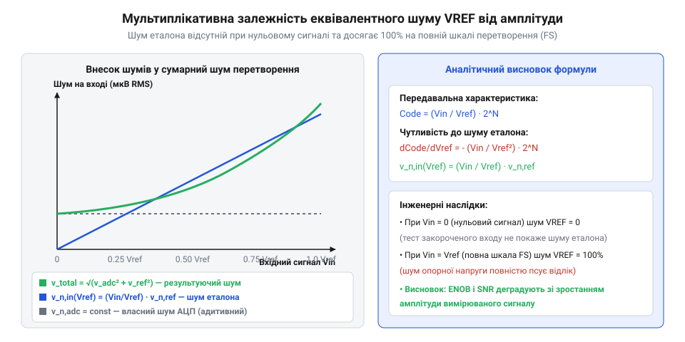
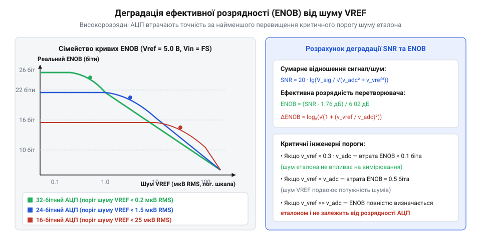

# Шум опорної напруги АЦП

<preknowlist>
- [Похибки АЦП](root:hw-sensing/adc-errors) — Формули розрахунку SNR, ENOB та шуму квантування.
- [Опорна напруга](root:hw-sensing/voltage-reference) — Поняття спектральної густини шуму та низькочастотної смуги 0.1–10 Гц.
</preknowlist>

## Постановка задачі та мультиплікативна модель проникнення шуму

У класичному аналізі шумів аналогових трактів більшість джерел завад розглядаються як адитивні: шум підсилювача додається до корисного сигналу на вході незалежно від його поточної амплітуди. Проте шум джерела опорної напруги `V_ref` підпорядковується принципово іншому — мультиплікативному закону.

Ідеальна характеристика перетворення аналого-цифрового перетворювача розрядністю `N` пов'язує вхідну напругу `V_in` та вихідний числовий код `Code` формулою [Похибки АЦП](root:hw-sensing/adc-errors):

```
Code = (V_in / V_ref) · 2^N          [ідеальна передавальна функція]
```

Якщо вхідний сигнал `V_in` є абсолютно чистим і незмінним, але опорна напруга містить флуктуації `dV_ref`, чутливість вихідного коду до шуму еталона визначається взяттям повного диференціала:

```
dCode = ∂Code/∂V_ref · dV_ref
      = - (V_in / V_ref²) · 2^N · dV_ref   [диференціал функції шкали]
```

Для перерахунку флуктуацій коду `dCode` в еквівалентний шум, приведений до аналогового входу АЦП (@@en|input-referred noise@@), розділимо `dCode` на крутизну перетворення `S = 2^N / V_ref`:

```
v_n,in(V_ref) = |dCode| / S
              = ((V_in / V_ref²) · 2^N · v_n,ref) / (2^N / V_ref)
              = (V_in / V_ref) · v_n,ref            [еквівалентний вхідний шум]
```


*Еквівалентний вхідний шум еталона лінійно зростає від нуля при нульовому сигналі до 100% v_n,ref на повній шкалі перетворення.*

З отриманого виразу випливає фундаментальний висновок: шум еталона діє як амплітудна модуляція сигналу:
1. За нульового вхідного сигналу (`V_in = 0 В`) шум опорної напруги взагалі не проявляється на виході АЦП (`v_n,in = 0 В`).
2. При наближенні вхідного сигналу до повної шкали (`V_in = V_ref`) шум еталона повністю транслюється у вихідний код у масштабі 1:1 (`v_n,in = v_n,ref`).

> 🔧 **Навіщо це.**
> Випробування АЦП із закороченим на землю входом (тест на шум зміщення нуля) ніколи не виявить зашумленості джерела `V_ref`. Реальне оцінювання шуму опорного тракту обов'язково проводять за подачі сигналу, близького до повної шкали (@@en|Full Scale, FS@@).

Розглянемо випадок диференційного вхідного сигналу `V_in,diff = V_in+ - V_in-` при симетричному (біполярному) підключенні перетворювача з опорною напругою `±V_ref`. Вихідний код перетворювача зі знаковим представленням визначається виразом:

```
Code_diff = (V_in,diff / (2 · V_ref)) · 2^N      [диференційна передавальна характеристика]
```

Беручи повний диференціал за опорною напругою:

```
dCode_diff = - (V_in,diff / (2 · V_ref²)) · 2^N · dV_ref   [шумова чутливість диференційного коду]
v_n,in,diff = |dCode_diff| / S_diff
            = ( |V_in,diff| / (2 · V_ref) ) · v_n,ref     [еквівалентний диференційний шум]
```

У диференційному режимі властивості зберігаються симетрично:
- Коли диференційний сигнал дорівнює нулю (`V_in,diff = 0 В`, тобто `V_in+ = V_in- = V_cm`), шум опорної напруги діє однаково на обидва плечі матриці конденсаторів і повністю віднімається, забезпечуючи нульовий шум квантування біля середньої точки шкали.
- При максимальному диференційному відхиленні `V_in,diff = ±2 · V_ref` (повна біполярна шкала) еквівалентний шум досягає повного значення `v_n,ref`.

## Спектральне інтегрування шуму джерела опорної напруги

Джерело опорної напруги генерує два типи випадкових флуктуацій: низькочастотний флікер-шум (1/f шум напівпровідникових переходів) та високочастотний білий тепловий шум [Опорна напруга](root:hw-sensing/voltage-reference).

Спектральна густина напруги шуму `e_n(f)` (вимірюється в нВ/√Гц) описується формулою:

```
e_n(f) = e_w · √(1 + f_c / f)        [сумарна спектральна густина]
```

де `e_w` — асимптотична густина білого шуму на високих частотах, а `f_c` — кутова частота флікер-шуму (@@en|1/f corner frequency@@), на якій густина флікер-шуму зрівнюється з білим шумом.

Для визначення сумарної середньоквадратичної напруги шуму (RMS) виконується інтегрування квадрата спектральної густини у смузі частот від нижньої межі вимірювання `f_low` (зазвичай 0.1 Гц) до верхньої межі `f_high`:

```
V_n,ref² = ∫[f_low .. f_high] e_n²(f) df
         = ∫[f_low .. f_high] (e_w² · (1 + f_c / f)) df
         = e_w² · ∫[f_low .. f_high] (f_c / f) df + e_w² · ∫[f_low .. f_high] 1 df
         = e_w² · f_c · ln(f_high / f_low) + e_w² · (f_high - f_low)
```

При обмеженні смуги за допомогою реального аналогового фільтра низьких частот спад амплітудно-частотної характеристики `|H(f)|` не є нескінченно крутим, як в ідеального смугового фільтра. Шумові складові вище частоти зрізу `f_3dB` частково проникають у тракт. Для точного розрахунку потужності білого шуму на виході лінійного фільтра вводиться еквівалентна шумова смуга пропускання (@@en|Equivalent Noise Bandwidth@@, `ENBW`):

```
ENBW = (1 / |H(0)|²) · ∫[0 .. ∞] |H(f)|² df    [визначення еквівалентної шумової смуги]
```

Для простого однополюсного RC-фільтра першого порядку передавальна функція має вигляд `H(f) = 1 / (1 + j · f / f_3dB)`. Інтегрування квадрата модуля передавальної функції дає:

```
ENBW_1st = ∫[0 .. ∞] (1 / (1 + (f / f_3dB)²)) df
         = f_3dB · arctan(∞)
         = (π / 2) · f_3dB
         ≈ 1.57 · f_3dB                       [коефіцієнт форми шуму 1-го порядку]
```

Через пологий спад АЧХ (-20 дБ/декаду) простий однополюсний RC-ланцюг пропускає на 57% більше шумової потужності, ніж ідеальний прямокутний фільтр із тією самою частотою зрізу `f_3dB`. При використанні фільтрів вищих порядків еквівалентна шумова смуга стрімко наближається до `f_3dB`:

```
ENBW_2nd = (π / (2 · √2)) · f_3dB ≈ 1.11 · (π / 2) ... ≈ 1.22 · f_3dB   [фільтр Баттерворта 2-го порядку]
ENBW_3rd ≈ 1.16 · f_3dB                                              [фільтр 3-го порядку]
ENBW_4th ≈ 1.13 · f_3dB                                              [фільтр 4-го порядку]
ENBW_5th ≈ 1.11 · f_3dB                                              [фільтр 5-го порядку]
```

Розбиваючи інтеграл на дві характерні області — низькочастотну смугу 1/f шуму (від 0.1 Гц до `f_c`) та область білого шуму, обмежену еквівалентною шумовою смугою фільтра `ENBW`:

```
V_1f = e_w · √(f_c · ln(f_c / 0.1))         [інтегральний флікер-шум 0.1 Гц – f_c]
V_white = e_w · √(ENBW - f_c)               [інтегральний широкосмуговий шум з урахуванням ENBW]
V_n,ref = √(V_1f² + V_white²)               [сумарний RMS шум еталона]
```

Для еквівалентного переходу від середньоквадратичного значення RMS до амплітуди шуму від піку до піку (@@en|peak-to-peak@@) за гауссового розподілу ймовірностей із достовірністю 99.9% застосовують коефіцієнт розмаху `6.6 · σ`:

```
V_pp = 6.6 · V_n,ref                        [піковий розмах шуму 99.9%]
```

## Врахування стробування та згортання шуму (Noise Folding)

У сучасних перетворювачах із комутованими конденсаторами (SAR АЦП та вхідні каскади дельта-сигма модуляторів) підключення опорної напруги до матриці CDAC відбувається дискретно у часі [SAR АЦП зсередини](root:hw-sensing/sar-adc-internals).

Якщо буферний підсилювач опорної напруги або саме джерело VREF мають широку смугу пропускання `BW_buf` (наприклад, 10–50 МГц для швидкого перезаряду ємностей), а частота дискретизації перетворювача становить `f_s` (смуга Найквіста `f_N = f_s / 2`), виникає ефект стробування високочастотного шуму (@@en|noise folding@@ або @@en|noise aliasing@@).

Весь широкосмуговий шум буфера за межами першої зони Найквіста розбивається на спектральні інтервали шириною `f_s / 2` і накладається (згортається) в основну смугу перетворення:

```
K_fold = BW_buf / (f_s / 2) = 2 · BW_buf / f_s    [коефіцієнт згортання]
e_n,folded² = K_fold · e_w²                       [густина потужності згорнутого шуму]
```

> 🔧 **Навіщо це.**
> Без встановлення низькочастотного фільтра між широкосмуговим буфером та входом VREF АЦП ефективна спектральна густина білого шуму збільшується у `√K_fold` разів (типово у 5–15 разів). Це повністю руйнує шумовий бюджет високорозрядного АЦП.

Для аналізу динаміки вибірки розглянемо часове вікно апертури `t_acq`, протягом якого комутатор з'єднує матрицю конденсаторів вибірки `C_sample` з накопичувальною ємністю фільтра `C_filt`. Постійна часу відновлення напруги `τ_settle` визначається вихідним імпедансом фільтра:

```
τ_settle = (R_out_eff + R_switch) · C_sample     [постійна часу перезаряду]
```

Щоб динамічна похибка встановлення не перевищувала частки кроку квантування `ε = 0.5 LSB = 1 / (2^(N+1))`, часовий інтервал вибірки повинен задовольняти строгу логарифмічну нерівність:

```
t_acq ≥ τ_settle · ln(2^(N+1))
      = τ_settle · (N + 1) · ln(2)               [необхідний час встановлення вибірки]
```

Наприклад, для 16-розрядного перетворювача `(16 + 1) · ln(2) ≈ 11.78 · τ_settle`, а для 24-розрядного — щонайменше `17.33 · τ_settle`. Якщо інженер надмірно звужує смугу фільтра VREF для боротьби зі згортанням шуму, стала часу `τ_settle` зростає, напруга на CDAC не встигає встановитися за відведений час `t_acq`, і динамічна похибка встановлення перевищує шум квантування, викликаючи значні нелінійні спотворення.

## Аналітичне виведення сумарного SNR та втрати ENOB

Узагальнена модель шуму перетворювача враховує два незалежні стохастичні процеси: власний адитивний шум АЦП `v_n,adc` (що включає шум квантування та тепловий шум внутрішнього компаратора) і модульований шум джерела опорної напруги `(V_sig_rms / V_ref) · v_n,ref` [Похибки АЦП](root:hw-sensing/adc-errors).

Оскільки ці шумові процеси є некорельованими, їхні дисперсії додаються:

```
v_n,total² = v_n,adc² + (V_sig_rms / V_ref)² · v_n,ref²   [сума дисперсій]
```

Для синусоїдного сигналу повної шкали середньоквадратична амплітуда становить `V_sig_rms = V_ref / (2 · √2)`. Підставляючи `V_sig_rms` у формулу відношення сигнал/шум (SNR):

```
SNR_total = 20 · lg( V_sig_rms / √(v_n,adc² + (1/8) · v_n,ref²) )    [сумарний SNR системи]
```

Ефективна розрядність перетворювача (ENOB) визначається через отриманий SNR:

```
ENOB = (SNR_total - 1.76 дБ) / 6.02 дБ            [визначення ENOB]
```


*Залежність ефективної розрядності ENOB від інтегрального шуму еталона: критичні пороги, за яких шум VREF обмежує точність перетворення.*

Втрата ефективної розрядності `ΔENOB` внаслідок зашумленості еталона описується точним аналітичним виразом:

```
ΔENOB = ENOB_ideal - ENOB_actual
      = log₂( √(1 + (V_sig_rms / V_ref)² · (v_n,ref / v_n,adc)²) )
```

З аналізу кривих деградації випливають граничні критерії:
1. Якщо `v_n,ref < 0.3 · v_n,adc`, то `ΔENOB < 0.05` біта — вплив шуму VREF є незначним.
2. Якщо `v_n,ref = v_n,adc`, то `ΔENOB = 0.5` біта — система втрачає рівно пів біта роздільної здатності.
3. Якщо `v_n,ref > 3 · v_n,adc`, ефективна розрядність системи повністю деградує до рівня шуму еталона і не залежить від номінальної розрядності мікросхеми АЦП.

Для подолання шумового бар'єра часто застосовують наддискретизацію (@@en|oversampling@@) з подальшим цифровим усередненням і децимацією (@@en|averaging and decimation@@). Якщо частоту вибірки підвищити в `OSR` разів (коефіцієнт наддискретизації `OSR = f_s / (2 · f_B)`), спектральна густина широкосмугового білого шуму еталона рівномірно розмазується по розширеній смузі Найквіста. Після цифрової фільтрації низьких частот потужність білого шуму зменшується пропорційно коефіцієнту `OSR`:

```
v_white,osr = v_white / √OSR                      [придушення білого шуму наддискретизацією]
SNR_gain = 10 · lg(OSR) дБ                         [приріст SNR для білого шуму]
ΔENOB_gain = 0.5 · log₂(OSR) бітів                 [приріст розрядності: 1 біт на кожні 4x OSR]
```

Проте наддискретизація має строге фізичне обмеження: вона ефективна виключно для білого шуму з рівномірною спектральною густиною. Низькочастотний флікер-шум 1/f зосереджений безпосередньо в інформаційній смузі постійного струму (0.1–10 Гц), тому просте усереднення `N` відліків не придушує 1/f складову VREF. У результаті крива ефективної розрядності виходить на фіксоване асимптотичне плато (@@en|1/f noise floor@@), і подальше збільшення коефіцієнта наддискретизації не додає жодної частки біта ENOB.

## Числовий наскрізний розрахунок повного бюджету шумів

Для закріплення математичної моделі розглянемо практичний розрахунок бюджету шумів для трьох типових систем перетворення: 16-розрядного SAR АЦП та 24- і 32-розрядних сигма-дельта (ΣΔ) перетворювачів.

Нехай усі три системи працюють із повною шкалою за опорної напруги `V_ref = 5.0 В`, а вхідний вимірюваний сигнал подано на рівні максимальної шкали `V_in = V_ref = 5.0 В`, де шум еталона чинить максимальний деструктивний вплив. Порівняємо поведінку систем при використанні трьох різних класів опорних джерел [Опорна напруга](root:hw-sensing/voltage-reference):

1. **Економічний Bandgap:** `v_n,ref = 50 мкВ RMS` (типове недороге інтегральне джерело).
2. **Прецизійний XFET:** `v_n,ref = 10 мкВ RMS` (малошумний промисловий еталон).
3. **Підповерхневий Buried Zener:** `v_n,ref = 1.5 мкВ RMS` (лабораторний ультрапрецизійний стабілітрон).

> 🔧 **Навіщо це.**
> Числовий аналіз бюджету шумів дає змогу заздалегідь оцінити, чи зможе апаратний тракт реалізувати паспортні біти перетворювача, чи молодші розряди перетворяться на суцільний шум ще до початку цифрової обробки сигналу.

Спочатку визначимо ціну молодшого розряду (LSB) для кожної розрядності `N`:

```
LSB₁₆ = 5.0 / 2¹⁶ = 5.0 / 65536 ≈ 76.29 мкВ      [16-розрядна шкала]
LSB₂₄ = 5.0 / 2²⁴ = 5.0 / 16777216 ≈ 0.298 мкВ   [24-розрядна шкала]
LSB₃₂ = 5.0 / 2³² = 5.0 / 4294967296 ≈ 1.16 нВ   [32-розрядна шкала]
```

Для оцінки розкиду вихідного коду (розмаху шуму) в часовій області використовують піковий шум (@@en|peak-to-peak noise@@). Для гаусового розподілу ймовірність виходу за межі `±3.3 · σ` становить менше 0.1 %, тому коефіцієнт пік-фактора приймають рівним `6.6`:

```
V_pp = 6.6 · v_n,ref                             [перерахунок RMS шуму в розмах пік-пік]
```

Обчислимо піковий розмах шуму для кожного джерела:
- Для Bandgap: `V_pp = 6.6 · 50 мкВ = 330 мкВ`
- Для XFET: `V_pp = 6.6 · 10 мкВ = 66 мкВ`
- Для Buried Zener: `V_pp = 6.6 · 1.5 мкВ = 9.9 мкВ`

Метрологічна роздільна здатність без шуму (@@en|Noise-Free Resolution@@, NFR) визначає кількість бітів, які гарантовано не зазнають випадкового мерехтіння:

```
NFR = log₂(V_ref / V_pp)
    = log₂(5.0 / V_pp)                           [ефективні безшумні біти]
```

Зведемо розрахункові втрати ефективної розрядності `ENOB` та гарантовані біти `NFR` у таблицю:

| Розрядність АЦП | Джерело VREF | Шум V_pp | LSB АЦП | Шум у LSB | Реальний ENOB | Безшумна розрядність (NFR) |
| :--- | :--- | :--- | :--- | :--- | :--- | :--- |
| **16 бітів** | Bandgap (50 мкВ) | 330 мкВ | 76.29 мкВ | 4.33 LSB | 13.8 біта | 13.9 біта |
| **16 бітів** | XFET (10 мкВ) | 66 мкВ | 76.29 мкВ | 0.86 LSB | 15.6 біта | 16.2 біта |
| **16 бітів** | Buried Zener (1.5 мкВ) | 9.9 мкВ | 76.29 мкВ | 0.13 LSB | 15.9 біта | 16.0 бітів (ліміт АЦП) |
| **24 біти** | Bandgap (50 мкВ) | 330 мкВ | 0.298 мкВ | 1107 LSB | 13.8 біта | 13.9 біта (втрата 10 бітів!) |
| **24 біти** | XFET (10 мкВ) | 66 мкВ | 0.298 мкВ | 221 LSB | 16.2 біта | 16.2 біта |
| **24 біти** | Buried Zener (1.5 мкВ) | 9.9 мкВ | 0.298 мкВ | 33.2 LSB | 18.9 біта | 18.9 біта |
| **32 біти** | Buried Zener (1.5 мкВ) | 9.9 мкВ | 1.16 нВ | 8534 LSB | 18.9 біта | 18.9 біта (потрібна фільтрація) |

З аналізу таблиці випливають фундаментальні висновки проектування:
1. Застосування дешевого Bandgap-еталона у 24-розрядному АЦП повністю нівелює переваги перетворювача: шум опорної напруги заповнює 1107 кроків квантування, знижуючи роздільну здатність системи до рівня скромного 14-бітного тракту [Похибки АЦП](root:hw-sensing/adc-errors).
2. Для 16-розрядних систем еталон класу XFET є практично оптимальним, оскільки розмах шуму 66 мкВ не перевищує 1 LSB і не викликає помітного падіння ENOB.
3. У 24- та 32-розрядних трактах навіть найкращий Buried Zener стабілізатор потребує додаткової активної низькочастотної фільтрації та обмеження смуги пропускання буфера, аби знизити інтегральний шум до часток мікровольта.
