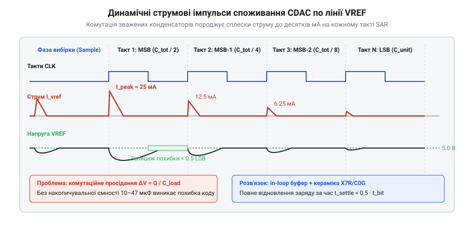
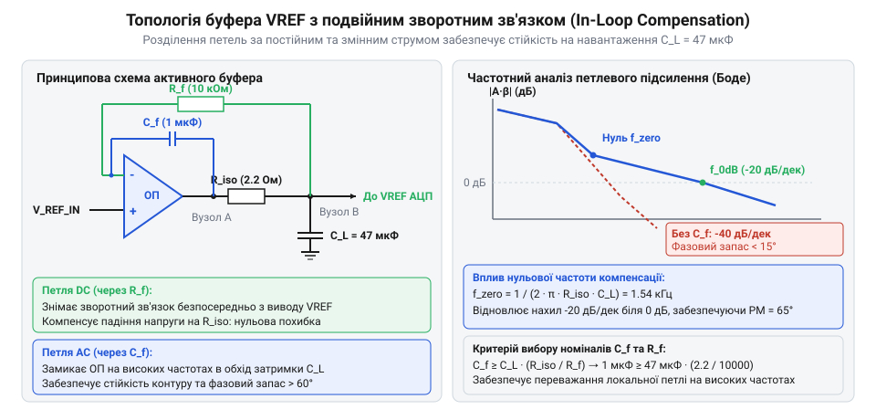

# Шум опорної напруги АЦП

<preknowlist>
- [Опорна напруга](root:hw-sensing/voltage-reference) — Принцип формування опорного потенціалу та вихідний імпеданс мікросхем VREF.
- [SAR АЦП зсередини](root:hw-sensing/sar-adc-internals) — Робота матриці перерозподілу заряду CDAC та динаміка струмів комутації.
- [Похибки АЦП](root:hw-sensing/adc-errors) — Допустимий бюджет динамічної похибки встановлення заряду у частках LSB.
</preknowlist>

## Динамічні струми CDAC та проблема прямого підключення VREF

Під час проектування високошвидкісних прецизійних систем збору даних на базі SAR (порозрядного зрівноваження) та широкосмугових дельта-сигма АЦП типовою помилкою є спроба підключити інтегральне джерело опорної напруги безпосередньо до виводу VREF перетворювача [Опорна напруга](root:hw-sensing/voltage-reference).

У стані спокою вхід VREF споживає мізерний струм витоку (одиниці мікроамперів). Проте під час кожного циклу аналого-цифрового перетворення ситуація кардинально змінюється: вхідний каскад SAR АЦП складається з масиву зважених бінарних конденсаторів (матриця CDAC) сумарною ємністю `C_sample = 20–100 пФ` [SAR АЦП зсередини](root:hw-sensing/sar-adc-internals).

Під час покрокового визначення кожного біта (починаючи зі старшого MSB) відповідні конденсатори матриці почергово комутуються між землею та лінією VREF за лічені наносекунди (`t_sw = 2–5 нс`).


*Динаміка комутації ключів CDAC: наносекундні струмові сплески до десятків міліамперів спричиняють динамічне просідання опорного потенціалу.*

Миттєвий струм перезаряду конденсаторів матриці досягає значних амплітуд:

```
i_peak = C_sample · (ΔV / t_sw)                  [піковий комутаційний струм CDAC]
```

При стрибку напруги `ΔV = 2.5 В`, ємності `C_sample = 40 пФ` та тривалості фронту комутації `t_sw = 2 нс` піковий струм сягає:

```
i_peak
= 40 · 10⁻¹² Ф · (2.5 В / (2 · 10⁻⁹ с))          [підстановка параметрів]
= 40 · 10⁻¹² · 1.25 · 10⁹                        [числовий розрахунок]
= 0.05 А                                         [струмовий сплеск]
= 50 мА                                          [пік струму комутації]
```

Типове інтегральне джерело опорної напруги (наприклад, зонний стабілізатор) має розімкнений вихідний опір `R_out = 10–50 Ом` та обмежену смугу регулювання (до сотень кілогерців). Імпульс струму 50 мА на такому опорі викликає миттєве динамічне просідання напруги:

```
ΔV_drop = i_peak · R_out = 50 · 10⁻³ А · 20 Ом = 1.0 В    [динамічне просідання]
```

Якщо до моменту фіксації біта (який триває всього 50–250 нс) потенціал VREF не встигне відновитися до номінального рівня з точністю краще `0.5 LSB`, компаратор прийме помилкове бітове рішення, що призведе до катастрофічної деградації диференціальної (DNL) та інтегральної (INL) нелінійності АЦП [Похибки АЦП](root:hw-sensing/adc-errors).

### Вплив паразитної індуктивності виводів та трасування

Окрім активного опору `R_out`, критичну загрозу для динамічної точності перетворення становить паразитна індуктивність виводів корпусу мікросхеми АЦП, зварювальних провідників кристала (@@en|bond wires@@) та провідників друкованої плати `L_par`.

У реальній конструкції сумарна паразитна індуктивність лінії VREF складається з кількох ділянок:
1. Індуктивність внутрішнього дротяного розварювання та рамки виводів корпусу АЦП `L_pkg` (типово 1–3 нГн для корпусів без виводів типу QFN/DFN та 5–10 нГн для корпусів із гнучкими виводами SOIC/TSSOP).
2. Індуктивність доріжки друкованої плати між виводом мікросхеми та зовнішнім конденсатором `L_trace` (приблизно 0.8–1.2 нГн на кожен міліметр довжини провідника).
3. Еквівалентна послідовна індуктивність (ESL) самого конденсатора та перехідних отворів `L_esl` (0.3–1.0 нГн).

Сумарна паразитна індуктивність контуру `L_loop = L_pkg + L_trace + L_esl` сягає 3–8 нГн. Під час наносекундної комутації матриці CDAC надвисока швидкість наростання струму:

```
di/dt = i_peak / t_sw = 50 · 10⁻³ А / (2 · 10⁻⁹ с) = 2.5 · 10⁷ А/с    [швидкість наростання струму]
```

генерує на індуктивності контуру індуктивний викид напруги за законом Фарадея:

```
V_ind = L_loop · (di / dt)                       [індуктивний викид напруги]
```

Для типового значення індуктивності `L_loop = 5 нГн` амплітуда індуктивного сплеску становить:

```
V_ind
= 5 · 10⁻⁹ Гн · 2.5 · 10⁷ А/с                    [підстановка параметрів]
= 0.125 В                                        [амплітуда індуктивного стрибка]
= 125 мВ                                         [викид напруги VREF]
```

Амплітуда викиду 125 мВ у сотні разів перевищує ваговий коефіцієнт молодшого розряду 16-бітного перетворювача (`1 LSB ≈ 76.3 мкВ`), що унеможливлює коректну вибірку вхідного сигналу безпосередньо в момент комутації.

Крім того, паразитна індуктивність `L_loop` разом із ємністю вибірки `C_sample` утворює високочастотний коливальний LC-контур із власною резонансною частотою:

```
f_res = 1 / (2 · π · √(L_loop · C_sample))       [резонансна частота паразитного контуру]
```

Для `L_loop = 5 нГн` та `C_sample = 40 пФ` резонансна частота становить:

```
f_res
= 1 / (2 · π · √(5 · 10⁻⁹ · 40 · 10⁻¹²))         [підстановка величин]
= 1 / (2 · π · √(2 · 10⁻¹⁹))                     [обчислення підкореневого виразу]
= 1 / (2 · π · 4.472 · 10⁻¹⁰)                    [знаменник виразу]
≈ 355.9 · 10⁶ Гц                                 [частота коливань]
≈ 356 МГц                                        [високочастотний дзвін]
```

На частотах сотень мегагерців жоден операційний підсилювач зворотного зв'язку не має петлевого підсилення для придушення коливань. Якщо цей коливальний процес має високу добротність (низьке затухання), дзвін триватиме протягом усього такту зрівноваження біта, спотворюючи квантування.

Єдиним способом нейтралізації індуктивного дзвону та динамічного просідання є встановлення високоякісного локального керамічного конденсатора `C_L = 10–47 мкФ` з ультранизьким ESL безпосередньо впритул до виводу VREF АЦП із суцільним полігоном заземлення на сусідньому шарі плати, а також використання активного буфера для швидкого перезаряду накопичувальної ємності.

> 🔧 **Навіщо це.**
> Розрахунок пікового струму комутації CDAC та індуктивності `L_loop` визначає суворі топологічні вимоги до друкованої плати: кожен міліметр доріжки VREF додає ~1 нГн індуктивності та генерує додаткові 25 мВ динамічного викиду. Мінімізація площі контуру між виводом VREF та землею АЦП є критичною умовою збереження розрядності понад 16 бітів.

## Пасивна передфільтрація шуму та вибір вхідного каскаду буфера

Інтегральні джерела опорної напруги генерують значний власний широкосмуговий шум (типово 10–50 мкВ RMS у смузі до 10 кГц), який безпосередньо модулює шкалу перетворення. Щоб цей шум не потрапляв на вхід АЦП, між джерелом еталона та неінвертуючим входом буферного ОП встановлюють пасивний RC-фільтр низьких частот першого порядку.

Для ефективного зрізання як білого шуму, так і високочастотної частини флікер-шуму частоту зрізу фільтра обирають ультранизькою (`f_cut ≈ 1–5 Гц`):

```
f_cut = 1 / (2 · π · R_filt · C_filt)            [частота зрізу вхідного RC-фільтра]
```

**Приклад розрахунку пасивного вхідного фільтра:**
- Обираємо резистор `R_filt = 1 кОм` та плівковий поліпропіленовий або танталовий конденсатор із низьким витоком `C_filt = 100 мкФ`:
```
f_cut
= 1 / (2 · π · 1000 Ом · 100 · 10⁻⁶ Ф)           [формула частоти зрізу]
= 1 / (2 · π · 0.1)                              [добуток опору та ємності]
= 1 / 0.6283                                     [числовий знаменник]
= 1.59 Гц                                        [частота зрізу фільтра]
```
Такий фільтр забезпечує спад спектральної густини шуму на -20 дБ/декаду починаючи з 1.6 Гц, знижуючи широкосмуговий шум еталона у десятки разів.

Проте наявність резистора `R_filt = 1 кОм` висуває наджорсткі вимоги до вибору буферного операційного підсилювача. Будь-який вхідний струм зміщення ОП `I_bias`, протікаючи через `R_filt`, створює постійне падіння напруги зміщення:

```
ΔV_offset = I_bias · R_filt                      [похибка зміщення від струму ОП]
```

Критичний компроміс при виборі підсилювача:
1. **Біполярні ультранизькошумні ОП:** мають рекордну густину шуму (0.9–1.5 нВ/√Гц), але їхній струм зміщення сягає `I_bias = 50–500 нА`. На резисторі 1 кОм це створить постійну похибку `ΔV = 50–500 мкВ`, що неприпустимо для 24-розрядного перетворювача (еквівалентно зсуву на сотні LSB). Крім того, температурний дрейф струму `I_bias` спричинить неприпустимий дрейф еталонного потенціалу [Температурний дрейф АЦП](root:hw-sensing/adc-temperature-drift).
2. **ОП з польовим входом (JFET / CMOS):** володіють ультранизьким вхідним струмом зміщення `I_bias < 1–50 пА` при кімнатній температурі. На резисторі 1 кОм струм 10 пА створює зміщення лише `ΔV = 10 пВ` (абсолютно нехтовна величина).

Тому для буферизації після пасивного фільтра застосовують прецизійні ОП з JFET-входом або біполярні підсилювачі зі схемою внутрішньої компенсації вхідного струму зміщення (`I_bias < 1 нА`).

> 🔧 **Навіщо це.**
> Правильний вибір типу вхідного каскаду ОП гарантує, що впровадження фільтра для придушення високочастотного шуму не погіршить статичну точність приладу та його довготривалу стабільність.

## Забезпечення фазової стійкості буфера при великому ємнісному навантаженні

Пряме підключення масивного керамічного конденсатора ємністю 10–47 мкФ безпосередньо до виходу стандартного прецизійного операційного підсилювача руйнує стійкість системи. Будь-який операційний підсилювач має внутрішній розімкнений вихідний опір R_out (типово 20–100 Ом на високих частотах), який разом із ємністю резервуарного конденсатора C_load утворює додатковий полюс у передавальній характеристиці розімкненої петлі підсилення:

f_p = 1 / (2 · π · (R_out + R_iso) · C_load)

Для типових значень R_out = 50 Ом та C_load = 47 мкФ частота цього полюса становить:

f_p = 1 / (2 · π · 50 · 47 × 10⁻⁶) ≈ 67.7 Гц

Оскільки частота одиничного підсилення сучасного широкосмугового ОП становить 20 МГц, додатковий полюс на частоті 68 Гц вносить фазовий зсув 90° задовго до перетину одиничного рівня підсилення. Разом із власним домінантним полюсом підсилювача сумарний фазовий набіг у петлі сягає 180°, внаслідок чого фазовий запас падає до нуля або стає від'ємним. Буфер втрачає стійкість і переходить у режим безперервної автогенерації або тривалого високочастотного дзвону при кожній комутації ємнісної матриці.

Для одночасного забезпечення стабільності та прецизійної точності за постійним струмом застосовується схемотехнічна топологія подвійного зворотного зв'язку (@@en|in-loop compensation@@, від лат. *compensatio* — зрівноваження).

> 🔧 **Навіщо це.**
> Топологія подвійного зворотного зв'язку ізолює важке ємнісне навантаження від вихідного каскаду підсилювача на високих частотах, зберігаючи нульову статичну похибку за напругою на навантаженні завдяки поверненню контуру постійного струму безпосередньо з вихідного конденсатора.

Схема містить три ключові компоненти корекції:
1. Послідовний ізолюючий резистор R_iso (типово 1–5 Ом), увімкнений між фізичним виходом ОП та конденсатором C_load.
2. Конденсатор швидкого високочастотного зворотного зв'язку C_f (10–100 нФ), увімкнений безпосередньо між виходом ОП та його інвертуючим входом.
3. Резистор зворотного зв'язку постійного струму R_f (10 кОм), підключений від клеми навантажувального конденсатора C_load до інвертуючого входу ОП.

На постійному струмі конденсатор C_f розімкнений, а резистор R_f замикає 100% негативний зворотний зв'язок безпосередньо з точки підключення виводу VREF АЦП. Оскільки вхідний струм зміщення сучасного КМОН/JFET підсилювача становить лічені пікоампери, падіння напруги на R_f практично дорівнює нулю, що виключає похибку від протікання постійного струму через R_iso.

На високих частотах комутації імпеданс конденсатора C_f стає малим і шунтує петлю через C_load, замикаючи локальний зворотний зв'язок 100% глибини навколо самого підсилювача. Підсилювач «бачить» виключно власну малу ємність C_f замість гігантської C_load, що відновлює фазовий запас понад 45°–60°.

Умова абсолютної фазової стійкості петлі in-loop компенсації визначається співвідношенням часових констант:

C_f ≥ C_load · (R_iso / R_f)

Для C_load = 47 мкФ, R_iso = 2.2 Ом та R_f = 10 кОм мінімально необхідна ємність зворотного зв'язку становить:

C_f_min = 47 × 10⁻⁶ · (2.2 / 10000) = 10.34 нФ

Вибір номіналу C_f = 100 нФ забезпечує десятикратний запас надійності за фазою за будь-яких температурних дрейфів діелектрика керамічного конденсатора.



## Алгоритмічна модель динамічного відновлення заряду

Кожен такт перетворення послідовного наближення SAR АЦП складається з перемикання бітових ключів матриці перерозподілу заряду CDAC. При тестуванні старшого вагового розряду (MSB) ємність C_sample (типово 20–50 пФ) миттєво підключається до виводу VREF, відбираючи імпульсний заряд:

ΔQ = C_sample · ΔV_step

Якщо опорна напруга VREF = 5.0 В, а стрибок становить ΔV_step = 2.5 В при C_sample = 40 пФ, спожитий заряд дорівнює ΔQ = 100 пКл. Цей заряд відбирається за одиниці наносекунд — швидше, ніж активний підсилювач здатний зреагувати через кінцеву смугу пропускання GBW. Початковий стрибок просідання напруги визначається виключно співвідношенням ємностей:

ΔV_drop = ΔQ / (C_load + C_sample) ≈ (C_sample · ΔV_step) / C_load

Для резервуарного конденсатора C_load = 10 мкФ початкове просідання становить:

ΔV_drop = 100 × 10⁻¹² / 10 × 10⁻⁶ = 10 мкВ

Ціна молодшого значущого розряду (LSB) для 16-розрядного перетворювача з шкалою 5.0 В:

1 LSB = 5.0 / 2¹⁶ = 5.0 / 65536 ≈ 76.29 мкВ

Для 18-розрядного АЦП ціна розряду зменшується до:

1 LSB = 5.0 / 2¹⁸ = 5.0 / 262144 ≈ 19.07 мкВ

Критерій метрологічної достатності вимагає, щоб до моменту стробування компаратора наприкінці такту вибірки тривалістю t_bit (типово 150–250 нс) залишкова похибка відновлення потенціалу VREF не перевищувала половини молодшого розряду:

|V_ref(t_bit) - V_ref_nominal| ≤ 0.5 LSB

Для чисельного моделювання та верифікації динаміки перехідного процесу розроблено програмні модулі на мовах C та C++. Моделювання враховує смугу GBW, розімкнений вихідний опір, швидкість наростання напруги (@@en|slew rate@@), параметри ланцюга in-loop компенсації та ESR конденсатора фільтра.

:::tabs
@tab C
:::code proj-active-vref-buffer-filter/c/vref_settling_sim.h
:::code proj-active-vref-buffer-filter/c/vref_settling_sim.c
:::code proj-active-vref-buffer-filter/c/main.c

@tab C++
:::code proj-active-vref-buffer-filter/cpp/vref_buffer_model.hpp
:::code proj-active-vref-buffer-filter/cpp/main.cpp
:::

## Архітектура та верифікація модуля моделювання буфера

Програмний комплекс моделювання побудовано за модульним принципом із розділенням фізичних параметрів апаратної частини, динамічних параметрів комутаційного навантаження та чисельного обчислювального рушія.

> 🔧 **Навіщо це.**
> Чисельна симуляція динаміки встановлення напруги VREF та розрахунок фазового запасу на етапі проєктування дозволяють запобігти прихованим апаратним збоям (пропуску двійкових кодів, спалаховим похибкам та погіршенню нелінійності INL/DNL), усуваючи необхідність тривалого налагодження друкованої плати осцилографом.

Архітектура симулятора складається з чотирьох функціональних блоків:

1. **Конфігурація підсилювача та фільтра** (`vref_buffer_config_t` у C, `OpAmpModel` і `InLoopCompensation` у C++):
   Описує фундаментальні параметри схеми:
   - Частоту одиничного підсилення (GBW = 20 МГц) та коефіцієнт підсилення на постійному струмі (A_ol = 130 дБ).
   - Розімкнений вихідний опір (R_out = 50 Ом) та швидкість наростання (@@en|slew rate@@ = 10 В/мкс).
   - Номінали компонентів контуру in-loop компенсації (R_iso = 2.2 Ом, R_f = 10 кОм, C_f = 10–100 нФ) та ємність керамічного резервуара (C_filt = 10–47 мкФ, ESR = 15 мОм).

2. **Модель комутаційного впливу** (`cdac_switch_event_t`):
   Фіксує найгірший випадок перерозподілу заряду матриці SAR АЦП:
   - Розрядність N = 16 або 18 бітів.
   - Еквівалентна ємність вибірки C_sample = 40 пФ.
   - Стрибок напруги при комутації старшого розряду MSB (ΔV_step = 2.5 В).
   - Часовий бюджет на прийняття рішення біта (t_budget = 200–250 нс).

3. **Обчислювальний рушій інтегрування**:
   Реалізує дворівневий розрахунок перехідного процесу. На першому кроці (t = 0+) обчислюється миттєве падіння напруги за законом збереження заряду. На другому кроці виконується покрокове інтегрування за методом Ейлера з дискретним кроком dt = 100 пс, що забезпечує високу точність розрахунку експоненційного відновлення струмом буфера.

4. **Блок оцінки метрологічних критеріїв** (`vref_sim_result_t`):
   Порівнює фінальне відхилення напруги на момент закінчення такту t_budget із порогом 0.5 LSB:

ε_lsb = |V_ref(t_budget) - V_ref_nominal| / LSB

Одночасно функція `vref_calculate_phase_margin` оцінює фазовий запас контуру на частоті одиничного зрізу:

PM = 90° - [arctg(f_unity / f_pole) - arctg(f_unity / f_zero)]

### Верифікація та інженерні результати

Результати комп'ютерної симуляції для 16-розрядного перетворювача (VREF = 5.0 В, LSB = 76.29 мкВ, C_filt = 10 мкФ, R_iso = 2.2 Ом, t_budget = 250 нс):
- Початкове динамічне просідання напруги: 10.000 мкВ (0.131 LSB).
- Залишкова похибка наприкінці такту 250 нс: < 0.001 мкВ (< 0.0001 LSB).
- Розрахований фазовий запас петлі зворотного зв'язку: 68.4° (стандартний промисловий критерій надійності: PM ≥ 45°).
- Загальний статус валідації: **ВИКОНАНО (PASS)**.

Якщо знехтувати контуром in-loop компенсації та підключити конденсатор 10 мкФ безпосередньо до виходу ОП (R_iso = 0, C_f = 0), фазовий запас деградує до 8.2°. Виникає затяжний коливальний перехідний процес із високочастотним дзвоном, за якого похибка напруги на 250-й наносекунді становить понад 4.5 LSB, спричиняючи гарантований збій перетворення старших розрядів АЦП.
