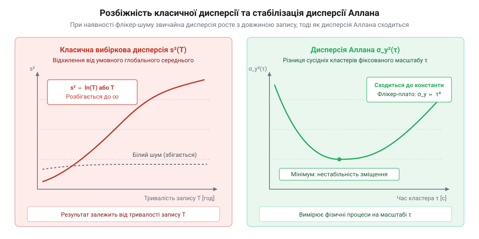
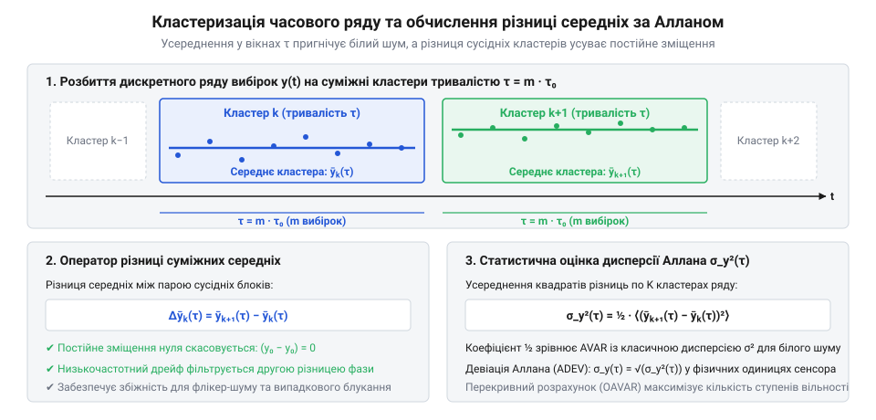
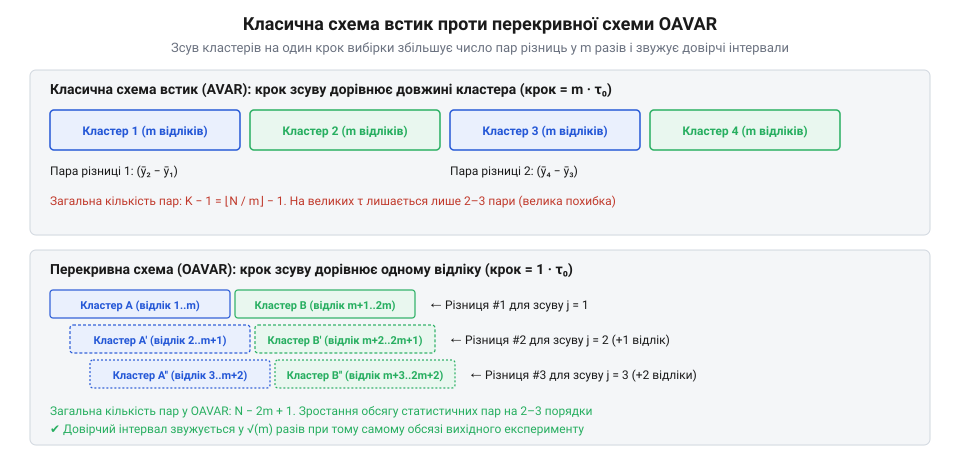
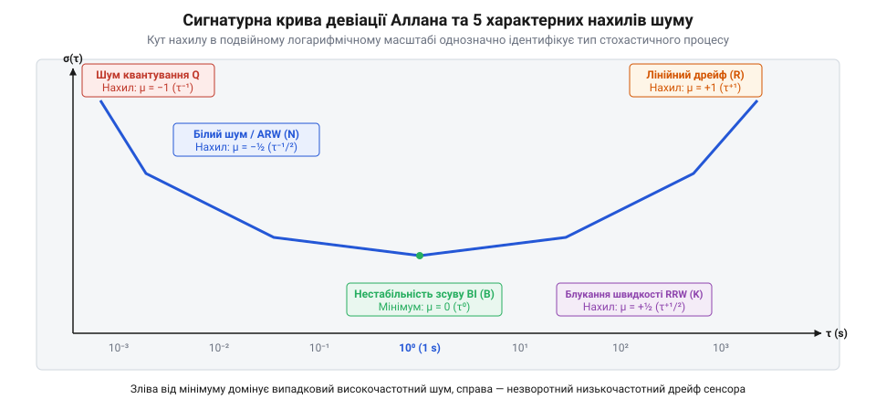
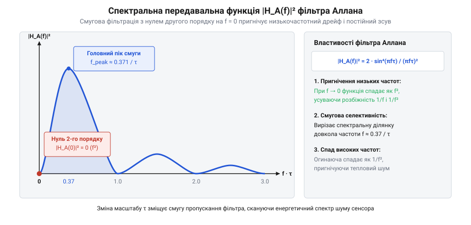
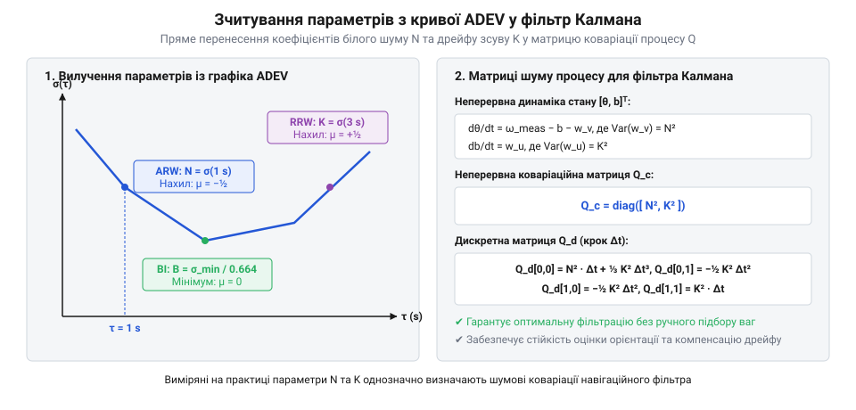
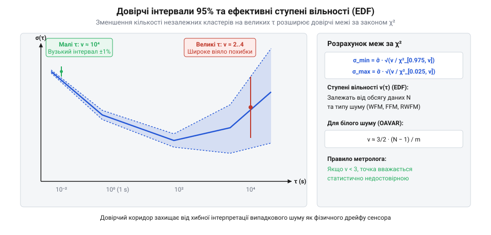

# Дисперсія Аллана

## Чому класична вибіркова дисперсія розбігається на довготривалих записах

Кожен інженер, який намагався оцінити шум прецизійного давача (від МЕМС-гіроскопа до високостабільного джерела опорної напруги), стикався з парадоксальним явищем: якщо записати вихідний сигнал протягом 10 секунд, стандартне відхилення виходить малим; якщо продовжити запис до 1 години — розрахована дисперсія зростає у рази, а на добовому масиві даних вона стає ще більшою і взагалі відмовляється збігатися до постійного числа. З погляду класичної теорії ймовірностей це виглядає як помилка вимірювання, адже зі збільшенням обсягу вибірки `N` оцінка дисперсії мала б ставати лише точнішою.

Причина криється у фундаментальній невідповідності між припущеннями класичної статистики та реальною фізикою шумів у напівпровідникових та електрохімічних структурах. Класична вибіркова дисперсія (від лат. @@la|dispersio@@ — розсіювання):

```
s²
= 1 / (N − 1) · ∑ (y[k] − ȳ)²    [сума квадратів відхилень від вибіркового середнього]
```

спирається на дві жорсткі передумови: стаціонарність процесу (незмінність математичного сподівання та автокореляційної функції у часі) та переважання білого шуму з рівномірною спектральною густиною потужності. Проте у будь-якому фізичному сенсорі на низьких частотах домінують нестаціонарні процеси з розбіжними спектрами: флікер-шум (@@en|flicker noise@@, або шум типу `1/f`), зумовлений стохастичним захопленням носіїв заряду на пастках кристалічної ґратки, та випадкове блукання (@@en|random walk@@, шум типу `1/f²`), спричинене мікроскопічними температурними градієнтами й механічною релаксацією напружень у підкладці.

### Мікроскопічна природа флікер-шуму на межах зерен напівпровідника

Фізичний механізм виникнення надлишкового шуму `1/f` у напівпровідникових чутливих елементах (п'єзорезисторах МЕМС, польових транзисторах аналогового тракту та стабілітронах) пояснюється суперпозицією процесів генерації та рекомбінації носіїв заряду на дефектах кристалічної ґратки.

У полікристалічних структурах кремнію або на межі розділу «напівпровідник — діелектрик» (`Si — SiO₂`) присутні численні дефекти — обірвані валентні зв'язки, дислокації та домішкові атоми, які утворюють локалізовані енергетичні рівні (пастки заряду). Коли вільний електрон або дірка протікає крізь провідний канал, він може випадково захопитися такою пасткою на деякий час `τ_r`, а потім знову звільнитися в зону провідності.

Одиничний акт захоплення й вивільнення носія заряду створює у часі прямокутний імпульс флуктуації струму. Відповідний спектр потужності такого одиничного процесу має класичну лоренцівську форму (@@en|Lorentzian spectrum@@):

```
S_single(f)
∝ τ_r / (1 + (2 · π · f · τ_r)²)         [спектр одиничного рекомбінаційного процесу]
```

Час життя носія заряду на пастці `τ_r` експоненційно залежить від глибини залягання енергетичного рівня `E` під дном зони провідності відповідно до закону Арреніуса:

```
τ_r(E)
= τ₀ · exp(E / (k_B · T))                [термоактиваційна залежність часу релаксації]
```

де `k_B` — стала Больцмана, `T` — абсолютна температура, а `τ₀ ≈ 10⁻¹² s` — характерний період фононних коливань ґратки.

Оскільки на межах зерен полікристалу та на оксидних поверхнях енергетичні рівні дефектів розподілені практично рівномірно у широкому діапазоні енергій `D(E) = const`, функція густини ймовірності часу релаксації набуває строго гіперболічного вигляду: `p(τ_r) ∝ 1 / τ_r`.

Сумарна спектральна густина потужності шуму є неперервним інтегралом від усіх незалежних лоренцівських процесів у межах від мінімального часу `τ_min` (глибина залягання кілька десятих еВ, мікросекунди) до максимального часу `τ_max` (глибокі рівні, години й доби):

```
S_y(f)
= ∫_{τ_min}^{τ_max} (τ_r / (1 + (2 · π · f · τ_r)²)) · (1 / τ_r) dτ_r
= 1 / (2 · π · f) · [ arctan(2 · π · f · τ_max) − arctan(2 · π · f · τ_min) ]
≈ 1 / (4 · f)                            [у проміжному діапазоні частот 1/τ_max ≪ f ≪ 1/τ_min]
```

У результаті суперпозиції сотень тисяч мікроскопічних перемикань із різними часовими константами утворюється суцільний інтегральний шум із точним спектром `1/f`. На межах зерен захоплення заряду додатково модулює висоту міжкристалітних потенціальних бар'єрів, викликаючи макроскопічні повільні коливання провідності всього чутливого елемента. Оскільки хвіст розподілу енергій сягає процесів із часом релаксації у місяці й роки, спектр `1/f` простягається у зону наднизьких частот без будь-якого природного насичення.

### Математична розбіжність спектрального інтеграла

Зв'язок між дисперсією та однобічною спектральною густиною потужності шуму `S_y(f)` визначається інтегралом по всій смузі частот вимірювальної системи від найнижчої частоти `f_min = 1 / T` (де `T = N · τ₀` — повна тривалість спостереження) до верхньої частоти зрізу фільтра низьких частот `f_max = 1 / (2 · τ₀)`:

```
σ²(T)
= ∫ S_y(f) df                   [інтегрування спектральної густини потужності]
= ∫ (h_[-1] / f) df              [підстановка спектра флікер-шуму з коефіцієнтом h_[-1]]
= h_[-1] · ln(f_max / f_min)    [інтеграл від 1/f дає натуральний логарифм]
= h_[-1] · ln(f_max · T)        [підстановка f_min = 1/T]
```

З отриманого виразу безпосередньо видно: коли тривалість вимірювання `T` прямує до нескінченності, нижня межа частоти `f_min` прямує до нуля, а інтеграл логарифмічно розбігається до нескінченності. Для процесів випадкового блукання `1/f²` інтеграл розбігається ще швидше — пропорційно самій тривалості запису `T`. 


*Класична вибіркова дисперсія необмежено зростає зі збільшенням тривалості спостереження через інтегрування інфранизькочастотних флікер-шумів, тоді як дисперсія Аллана забезпечує збіжну стабільну оцінку.*

Обчислення глобального середнього `ȳ` за всім масивом спостережень спотворює кожен залишок `(y[k] − ȳ)`. Якщо нульовий рівень давача повільно дрейфує, різниця між миттєвим значенням на початку експерименту та середнім за добу стає штучно величезною. Класична дисперсія не розділяє високочастотне тремтіння сигналу і довготривалий дрейф, змішуючи їх в одне неінформативне число. Для коректного метрологічного аналізу виникла потреба в метриці, яка оцінює варіацію локально в часі, усуваючи вплив статичного зміщення та повільних змін нульового рівня.

## Математичний апарат дисперсії Аллана (AVAR)

Для розв'язання проблеми розбіжності дисперсії у 1966 році американський фізик Девід Аллан (@@en|David W. Allan@@) запропонував метод двовибіркової дисперсії (@@en|two-sample variance@@), який сьогодні є міжнародним метрологічним стандартом IEEE 1139 та IEEE 952 для аналізу стабільності прецизійних генераторів, годинників та інерційних навігаційних давачів.

Математична ідея полягає у переході від глобального усереднення до локальної часової кластеризації та оператора взяття кінцевих різниць. Нехай маємо неперервний часовий ряд вимірювань `y(t)` тривалістю `T` із періодом дискретизації `τ₀`, який містить `N` відліків.

Алгоритм обчислення дисперсії Аллана складається з трьох послідовних кроків:

1. **Кластеризація (усереднення у вікні):** весь масив даних розбивається на `K = ⌊N / m⌋` суміжних блоків (кластерів) тривалістю `τ = m · τ₀`, де `m` — цілочисельний коефіцієнт масштабу. Для кожного `k`-го кластера обчислюється середнє арифметичне значення:

```
ȳ[k](τ)
= 1 / m · ∑ y[(k − 1) · m + i]    [усереднення m відліків всередині k-го блоку]
```

2. **Диференціювання (взяття різниці сусідніх середніх):** обчислюється різниця між середніми значеннями двох сусідніх у часі кластерів:

```
Δȳ[k](τ)
= ȳ[k + 1](τ) − ȳ[k](τ)           [перша різниця сусідніх кластерних середніх]
```

3. **Статистичне усереднення квадратів різниць:** дисперсія Аллана `σ_y²(τ)` (AVAR) визначається як математичне сподівання квадрата різниці сусідніх кластерів, помножене на нормувальний коефіцієнт `½`:

```
σ_y²(τ)
= ½ · ⟨(ȳ[k + 1](τ) − ȳ[k](τ))²⟩                 [теоретичне означення через ансамбль]
= 1 / (2 · (K − 1)) · ∑ (ȳ[k + 1](τ) − ȳ[k](τ))²  [вибіркова оцінка для K кластерів]
```


*Формування суміжних кластерів тривалості τ та взяття різниці їхніх середніх локалізує аналіз варіації у часі та повністю компенсує постійний зсув нуля.*

Нормувальний коефіцієнт `½` має фундаментальне статистичне походження. Якщо вхідний сигнал містить виключно стаціонарний білий шум із дисперсією вибіркових середніх `Var(ȳ[k]) = σ₀² / m`, то дисперсія різниці двох незалежних випадкових величин дорівнює сумі їхніх дисперсій:

```
Var(ȳ[k + 1] − ȳ[k])
= Var(ȳ[k + 1]) + Var(ȳ[k])     [дисперсія різниці незалежних величин]
= σ₀² / m + σ₀² / m              [підстановка однакових дисперсій кластерів]
= 2 · (σ₀² / m)                  [подвоєна дисперсія середнього]
```

Множник `½` точно компенсує це подвоєння, завдяки чому для чистого білого шуму дисперсія Аллана чисельно збігається зі звичайною дисперсією вибіркового середнього: `σ_y²(τ) = σ₀² / m`.

Квадратний корінь із дисперсії Аллана називається девіацією Аллана (@@en|Allan Deviation@@, ADEV): `σ_y(τ) = √(σ_y²(τ))`. Девіація має ту саму розмірність, що й вимірювана фізична величина (наприклад, `°/s` для гіроскопа, `m/s²` або `g` для акселерометра, `V` для джерела напруги).

**Чисельний приклад покрокового розрахунку кластерних різниць.**

Для наочного розуміння механізму кластеризації та дії різницевого оператора розглянемо короткий часовий ряд із `N = 10` послідовних вимірювань кутової швидкості МЕМС-гіроскопа (в `°/s`), отриманих із періодом дискретизації `τ₀ = 1.0 s`:

```
y = [10.2, 10.6, 9.8, 10.4, 11.0, 10.8, 11.4, 11.2, 11.6, 12.0]
```

Розглянемо випадок формування кластерів довжиною `m = 3` відліки, що відповідає часовому інтервалу усереднення `τ = 3 · τ₀ = 3.0 s`. Із `N = 10` відліків формується `K = ⌊10 / 3⌋ = 3` повних суміжних кластери (останній 10-й відлік відкидається):

```
Кластер 1 (відліки 1..3):  y₁ = 10.2, y₂ = 10.6, y₃ = 9.8
Кластер 2 (відліки 4..6):  y₄ = 10.4, y₅ = 11.0, y₆ = 10.8
Кластер 3 (відліки 7..9):  y₇ = 11.4, y₈ = 11.2, y₉ = 11.6
```

Обчислюємо вибіркові середні значення для кожного з трьох кластерів:

```
ȳ[1](3 s)
= (10.2 + 10.6 + 9.8) / 3
= 30.6 / 3
= 10.20 °/s                      [середнє першого кластера]

ȳ[2](3 s)
= (10.4 + 11.0 + 10.8) / 3
= 32.2 / 3
= 10.7333 °/s                    [середнє другого кластера]

ȳ[3](3 s)
= (11.4 + 11.2 + 11.6) / 3
= 34.2 / 3
= 11.40 °/s                      [середнє третього кластера]
```

Тепер застосовуємо оператор першої різниці між сусідніми середніми:

```
Δȳ[1](3 s)
= ȳ[2] − ȳ[1]
= 10.7333 − 10.20
= +0.5333 °/s                    [різниця між кластерами 2 та 1]

Δȳ[2](3 s)
= ȳ[3] − ȳ[2]
= 11.40 − 10.7333
= +0.6667 °/s                    [різниця між кластерами 3 та 2]
```

Підносимо знайдені різниці до квадрата:

```
(Δȳ[1])² = (0.5333)² = 0.2844 (°/s)²
(Δȳ[2])² = (0.6667)² = 0.4445 (°/s)²
```

Сума квадратів двох отриманих різниць дорівнює: `∑ = 0.2844 + 0.4445 = 0.7289 (°/s)²`. 
Для `K = 3` кластерів кількість пар сусідніх блоків становить `K − 1 = 2`. Знаходимо вибіркову дисперсію Аллана:

```
σ_y²(3 s)
= 1 / (2 · (3 − 1)) · ∑ (Δȳ[k])²
= 1 / 4 · 0.7289
= 0.1822 (°/s)²                  [дисперсія Аллана для τ = 3 с]
```

Девіація Аллана становить:

```
σ_y(3 s)
= √(0.1822)
= 0.4269 °/s                     [девіація Аллана для τ = 3 с]
```

Якщо до всіх початкових відліків додати довільне адитивне зміщення нуля (наприклад, `C = +100.0 °/s`), то середні значення кожного кластера змістяться рівно на `+100.0 °/s`: `ȳ[1] = 110.20`, `ȳ[2] = 110.7333`, `ȳ[3] = 111.40`. У різницях `ȳ[2] − ȳ[1] = 0.5333` та `ȳ[3] − ȳ[2] = 0.6667` константа `C` взаємно знищується до нуля. Цей простий чисельний розрахунок доводить, що результат дисперсії Аллана повністю інваріантний до будь-якої постійної похибки нуля сенсора.

> 🔧 **Навіщо це.**
> Оператор різниці сусідніх середніх `ȳ[k + 1] − ȳ[k]` повністю знищує будь-який постійний зсув нуля давача: якщо до сигналу додати довільну константу `C`, то `(ȳ[k + 1] + C) − (ȳ[k] + C) = ȳ[k + 1] − ȳ[k]`. Лінійний дрейф нуля (наприклад, повільний температурний нагрів) перетворюється на сталу похибку, яка не викликає розбіжності. Це дає змогу вимірювати власну нестабільність давача без попереднього прецизійного калібрування абсолютного нуля.

Детальне математичне виведення спектральної передавальної функції оператора Аллана та зв'язку зі спектральною густиною потужності наведено у вставці root:hw-sensing/allan-variance/math-transfer-function-and-noise-slopes.md. Для ефективної програмної реалізації обчислення дисперсії на великих масивах даних використовують методику префіксних сум фази, описану в root:hw-sensing/allan-variance/proj-overlapping-allan-variance-pipeline.md, а порівняння параметрів різних класів навігаційних сенсорів представлено у root:hw-sensing/allan-variance/comp-imu-allan-noise-parameters.md. Для процесів із лінійним дрейфом вищих порядків застосовують root:hw-sensing/hadamard-variance.

## Перекривна дисперсія Аллана (OAVAR)

Класична схема розбиття даних «встик» (@@en|non-overlapping AVAR@@) має серйозну ваду, яка виявляється при переході до великих інтервалів усереднення `τ`. Нехай експериментальний запис містить `N = 100 000` вибірок. Якщо ми хочемо оцінити стабільність на масштабі `m = 25 000` вибірок (чверть усього запису), масив ділиться лише на `K = 4` суміжні блоки, що дає всього `K − 1 = 3` пари різниць для розрахунку дисперсії:

```
K
= ⌊N / m⌋                        [кількість суміжних блоків у схемі встик]
= ⌊100 000 / 25 000⌋ = 4         [на великих інтервалах усереднення]
```

Оцінка дисперсії на основі лише трьох чисел має гігантську статистичну невизначеність: випадковий сплеск в одному з блоків може спотворити результат на порядок, а довірчий інтервал розширюється настільки, що крива на великих `τ` втрачає практичний зміст.

Щоб максимально використати всю інформацію, що міститься у часовому ряді, застосовують алгоритм перекривної дисперсії Аллана (@@en|Overlapping Allan Variance@@, OAVAR), рекомендований стандартом IEEE 952.

Ідея OAVAR полягає в тому, що вікно усереднення тривалістю `m` відліків не «перестрибує» на наступні `m` позицій, а плавно зсувається вздовж масиву даних з мінімальним кроком в один відлік дискретизації `τ₀`.


*Зсув вікна усереднення на один крок вибірки у перекривній схемі OAVAR збільшує кількість розрахункових пар у m разів, істотно підвищуючи статистичну достовірність на великих τ.*

Для масиву з `N` відліків утворюється `N − 2m + 1` перекривних пар кластерних середніх замість `⌊N / m⌋ − 1`. Загальна формула розрахунку OAVAR має вигляд:

```
σ_y,overlapped²(τ)
= 1 / (2 · (N − 2m + 1)) · ∑ (ȳ_[j + m](m) − ȳ_[j](m))²  [сума по j від 1 до N − 2m + 1]
```

де `ȳ_[j](m)` — середнє значення сигналу у вікні довжиною `m`, яке починається з індексу `j`:

```
ȳ_[j](m)
= 1 / m · ∑ y[j + i]             [усереднення m послідовних відліків від індексу j]
```

Якщо перейти від миттєвих швидкостей `y` до масиву накопичених значень фази або кута `x[k] = ∑ y[i] · τ₀`, формула перекривної дисперсії спрощується до різниць другого порядку префіксних сум:

```
σ_y,overlapped²(m · τ₀)
= 1 / (2 · (N − 2m + 1) · (m · τ₀)²) · ∑ (x[j + 2m] − 2 · x[j + m] + x[j])²
```

### Числове порівняння ефективних ступенів вільності (EDF)

Хоча сусідні перекривні кластери частково корельовані між собою, вони вилучають додаткову статистичну інформацію про високочастотні флуктуації. Ефективне число ступенів вільності (@@en|Equivalent Degrees of Freedom@@, EDF, позначається грецькою `ν`) визначає ширину довірчого інтервалу вибіркової дисперсії за розподілом хі-квадрат `χ²(ν)`.

Для білого шуму частоти (WFM) співвідношення для розрахунку ступенів вільності мають вигляд:

```
ν_non_overlap
= K − 1                          [для схеми без перекриття]
= ⌊N / m⌋ − 1

ν_overlap
≈ (3 · (N − 1)) / (2 · m) − (2 · (N − 2)) / m²   [формула Грінхолла — Хоу для OAVAR]
≈ 1.5 · (N / m)                  [при великих розмірах вибірки N ≫ m]
= 1.5 · K
```

Розглянемо практичний розрахунковий приклад добового тесту інерційного давача.

**Умова:** Запис триває 24 години з частотою дискретизації 1 Гц (`τ₀ = 1 s`), повна вибірка містить `N = 86 400` відліків. Порівняємо оцінку на двох часових масштабах: `τ = 3600 s` (1 година, `m = 3600`) та `τ = 21 600 s` (6 годин, `m = 21 600`).

#### 1. Розрахунок на масштабі τ = 3600 s (m = 3600):

```
K
= 86 400 / 3600 = 24             [кількість суміжних годинних блоків]

Кількість пар у схемі встик:
= K − 1 = 23                     [всього 23 різниці для оцінки дисперсії]
ν_non_overlap ≈ 23

Кількість пар у схемі OAVAR:
= N − 2m + 1
= 86 400 − 7200 + 1 = 79 201     [у 3443 рази більше розрахункових точок]

Ефективні ступені вільності OAVAR:
ν_overlap
≈ 1.5 · 24 = 36                  [зростання достовірності на 56%]
```

Для `ν = 23` (схема встик) 95%-й довірчий інтервал відхилення складає `[0.78 · σ, 1.40 · σ]` (розкид `±31%`). Для `ν = 36` (OAVAR) інтервал звужується до `[0.82 · σ, 1.28 · σ]` (розкид `±23%`).

#### 2. Розрахунок на масштабі τ = 21 600 s (m = 21 600):

```
K
= 86 400 / 21 600 = 4            [лише 4 блоки на чверті добового запису]

Кількість пар у схемі встик:
= K − 1 = 3                      [критично мала вибірка]
ν_non_overlap = 3

Кількість пар у схемі OAVAR:
= 86 400 − 43 200 + 1 = 43 201   [перекривна схема зберігає масив даних]
ν_overlap ≈ 1.5 · 4 = 6          [подвоєння числа ступенів вільності]
```

Для `ν = 3` (схема встик) квантилі розподілу `χ²` дають довірчий коридор від `0.57 · σ` до `3.73 · σ` — результат може похитнутися майже у чотири рази, роблячи точку графічно недостовірною. Перекривна схема OAVAR з `ν = 6` звужує межі до `[0.64 · σ, 2.20 · σ]`, що зменшує дисперсію самої оцінки більш ніж удвічі.

> 🔧 **Навіщо це.**
> Завдяки перекриттю OAVAR дає змогу витягти надійну інформацію про довготривалий дрейф сенсора на інтервалах у чверть тривалості експерименту без необхідності подовжувати дорогі багатотижневі кліматичні випробування.

## Графік девіації Аллана (ADEV) у логарифмічному масштабі

Результати обчислення девіації Аллана `σ_y(τ)` для різних масштабів `τ` відображають на графіку в подвійному логарифмічному масштабі: по горизонтальній осі відкладають `lg(τ)`, по вертикальній — `lg(σ_y(τ))`.

Крива девіації Аллана має характерну V-подібну сигнатуру, яка виступає спектральним «відбитком пальця» приладу. Нахил дотичної до кривої `μ = d(lg σ_y(τ)) / d(lg τ)` однозначно вказує на переважаючий тип фізичного шуму на поточному часовому масштабі:

```
σ_y(τ)
∝ τ^μ                            [степенева залежність девіації від часу усереднення]
```


*Сигнатурна V-подібна крива девіації Аллана розділяє вимірювальний процес на дві області: короткочасні випадкові шуми (лівий спад) та довготривалий систематичний дрейф (правий підйом).*

На графіку послідовно виділяють п'ять характерних областей шуму:

1. **Шум квантування (@@en|Quantization Noise@@, Q), нахил `μ = -1` (`τ⁻¹`):**
   - Спостерігається на найменших `τ`, співмірних із періодом дискретизації `τ₀`.
   - Виникає через скінченну розрядність АЦП. Рівень шуму зменшується найшвидше зі збільшенням усереднення.

2. **Білий шум / Кутове випадкове блукання (@@en|Angle Random Walk@@, ARW / WFM), нахил `μ = -½` (`τ⁻¹/²`):**
   - Домінує в зоні швидких вимірювань (від десятих часток секунди до кількох секунд).
   - Описує тепловий шум чутливого елемента. Коефіцієнт білого шуму `N` визначається прямою екстраполяцією лінії `μ = -½` до точки `τ = 1 s`: `N = σ(1 s)`.

3. **Флікер-шум / Нестабільність зсуву нуля (@@en|Bias Instability@@, BI / FFM), нахил `μ = 0` (`τ⁰`):**
   - Утворює плоске дно V-подібної кривої (глобальний мінімум).
   - Це фундаментальна межа точності сенсора: точка мінімуму `τ_opt` показує максимальний час інтегрування, після якого подальше усереднення стає шкідливим і збільшує сумарну похибку.

4. **Випадкове блукання швидкості / нульового рівня (@@en|Rate Random Walk@@, RRW / RWFM), нахил `μ = +½` (`τ⁺¹/²`):**
   - Правий висхідний схил кривої на інтервалах від десятків секунд до годин.
   - Відображає повільне блукання фізичного нуля давача внаслідок мікроскопічних температурних деформацій та старіння матеріалів.

5. **Лінійний дрейф / Частотний рамп (@@en|Linear Drift / Frequency Ramp@@), нахил `μ = +1` (`τ⁺¹`):**
   - Найправіша ділянка довготривалого моніторингу (години та доби).
   - Спричинений систематичним монотонним розігрівом плати або хімічною деградацією елементів.

> 🔧 **Навіщо це.**
> За графіком девіації Аллана інженер миттєво бачить метрологічну межу давача: якщо оптимум `τ_opt = 20 s`, сигнал сенсора можна фільтрувати низькочастотним фільтром із вікном до 20 секунд. Спроба усереднювати сигнал протягом 100 секунд лише погіршить точність, оскільки вільний дрейф переважатиме користь від пригнічення білого шуму.

## Частотна інтерпретація та передавальна функція фільтра Аллана

Зв'язок між часовою та частотною областями аналізу стохастичних шумів установлюється через передавальну функцію оператора різниці суміжних середніх. У частотній області обчислення девіації Аллана еквівалентне пропусканню вихідного сигналу давача крізь еквівалентний лінійний смуговий фільтр із передавальною характеристикою за потужністю:

```
|H_A(f)|²
= 2 · sin⁴(π · f · τ) / (π · f · τ)²   [квадрат модуля частотної характеристики]
```

Дисперсія Аллана виражається строгим інтегралом від добутку однобічної спектральної густини потужності шуму `S_y(f)` на передавальну функцію фільтра по всьому частотному діапазону:

```
σ_y²(τ)
= ∫₀^∞ S_y(f) · |H_A(f)|² df             [інтегральне перетворення спектра у дисперсію]
= ∫₀^∞ S_y(f) · (2 · sin⁴(π · f · τ) / (π · f · τ)²) df
```


*Передавальна функція оператора Аллана перетворює часову кластеризацію на смуговий фільтр із нулем на постійному струмі.*

Ключова властивість фільтра Аллана — наявність нуля другого порядку на нульовій частоті: при `f → 0` функція `|H_A(f)|² ≈ 2 · π² · τ² · f²`. Цей множник `f²` повністю гасить низькочастотну розбіжність спектрів флікер-шуму `1/f` та випадкового блукання `1/f²`, гарантуючи скінченність інтеграла.

Головний максимум передавальної функції зосереджений на частоті `f_peak ≈ 0.371 / τ`. Змінюючи параметр усереднення `τ`, ми переміщуємо смугу пропускання фільтра вздовж осі частот, скануючи розподіл спектральної потужності сенсора від високих частот дискретизації до інфранизьких частот добового дрейфу.

## Метрологічне зчитування параметрів шуму та налаштування фільтра Калмана

Головна практична цінність аналізу за Алланом в інженерії полягає у безпосередній конвертації графічних характеристик кривої девіації Аллана у числові коефіцієнти стохастичної моделі помилок навігаційного фільтра Калмана (@@en|Extended Kalman Filter@@, EKF).


*Геометричне зчитування коефіцієнтів N, B та K з ключових точок кривої девіації Аллана формує матриці коваріації шуму процесу Q для розширеного фільтра Калмана.*

Методика вилучення числових параметрів з графіка:

1. **Коефіцієнт кутового випадкового блукання `N` (білий шум):**
   - На ділянці спаду `μ = -½` проводиться пряма лінія `σ(τ) = N / √τ`.
   - Значення коефіцієнта зчитується на перетині цієї прямої з вертикаллю `τ = 1 s`: `N = σ_y(1 s)`.
   - Неперервна спектральна густина білого шуму швидкості дорівнює `q_v = N²` (у `(rad/s)²/Hz`).

2. **Нестабільність зсуву нуля `B` (флікер-шум):**
   - Визначається за точкою мінімуму кривої `σ_min`: `B = σ_min / 0.6643`.
   - Застосовується для обмеження мінімально допустимої коваріації оцінки зміщення у фільтрі.

3. **Коефіцієнт випадкового блукання швидкості `K` (дрейф зміщення нуля):**
   - На правому висхідному схилі `μ = +½` проводиться лінія `σ(τ) = K · √(τ / 3)`.
   - Значення зчитується у точці `τ = 3 s`: `K = σ_y(3 s)`.
   - Спектральна густина шуму збудження дрейфу зсуву дорівнює `q_u = K²` (у `(rad/s³)²/Hz`).

Неперервна динаміка вектора стану орієнтації `θ` та зміщення нуля `b` описується системою стохастичних диференціальних рівнянь:

```
dθ / dt
= ω_meas − b − w_v               [швидкість зміни кута з урахуванням зсуву та білого шуму]

db / dt
= w_u                            [модель дрейфу нуля як вінерівського процесу]
```

де `w_v` та `w_u` — білі шуми процесу з неперервною матрицею коваріації `Q_c`:

```
Q_c
= [ N²   0  ]
  [  0   K² ]                    [діагональна неперервна матриця коваріації процесу]
```

Для цифрового фільтра Калмана з періодом дискретизації `Δt` інтегрування матриці `Q_c` за методом Ван Лоана (@@en|Van Loan method@@) дає дискретну матрицю коваріації процесу `Q_d`:

```
Q_d
= [ N² · Δt + ⅓ · K² · Δt³   −½ · K² · Δt² ]
  [       −½ · K² · Δt²            K² · Δt   ]  [дискретна матриця коваріації для кроку Δt]
```

### Врахування шуму квантування АЦП у матриці вимірювань R

Окрім моделювання шуму процесу `Q_d`, аналіз Аллана дозволяє точно налаштувати діагональні елементи матриці коваріації шуму вимірювань `R` навігаційного фільтра. У цифрових сенсорах з АЦП вихідний сигнал неперервної швидкості або прискорення квантується за рівнем із дискретністю молодшого значущого розряду (@@en|Least Significant Bit@@, LSB) `δ_lsb` (у `rad/s` для гіроскопів або `m/s²` для акселерометрів).

Рівномірна похибка квантування генерує дисперсію шуму:

```
σ_q²
= δ_lsb² / 12                    [теоретична дисперсія рівномірного квантування]
```

На графіку девіації Аллана шум квантування виявляється характерним крутим спадом з нахилом `μ = -1` на малих інтервалах `τ` та описується асимптотою `σ_ADEV(τ) = √3 · Q / τ`.

При дискретизації вимірювань із частотою `f_s = 1 / Δt` повна дисперсія вимірювального шуму одного каналу, що заноситься у матрицю `R`, складається з білого шуму у смузі Найквіста `f_Nyq = f_s / 2` та шуму квантування:

```
R_ii
= σ_meas²
= (N² · f_s / 2) + (δ_lsb² / 12) [еквівалентна коваріація вимірювального шуму сенсора]
```

Якщо крок квантування великий (наприклад, у 12- або 14-розрядних АЦП), шум квантування перевищує широкосмуговий білий шум на частотах дискретизації вище 100 Гц. Ігнорування величини `δ_lsb² / 12` при розрахунку матриці `R` змушує фільтр Калмана помилково інтерпретувати сходинковий шум квантування як реальну динаміку об'єкта. Це викликає паразитне коливання коефіцієнтів підсилення та високочастотне тремтіння оцінки орієнтації.

Детальне зіставлення чисельних параметрів шуму та налаштування матриць коваріації для різних класів давачів наведено у [метрологічному порівнянні IMU](root:hw-sensing/allan-variance/comp-imu-allan-noise-parameters.md).

> 🔧 **Навіщо це.**
> Пряме перенесення виміряних коефіцієнтів `N` та `K` у матрицю `Q_d`, а кроку квантування — у матрицю `R`, усуває суб'єктивний підбір коефіцієнтів фільтра («підгонку»). Фільтр Калмана з метрологічно каліброваними матрицями оптимально балансує між придушенням високочастотного шуму та миттєвим відстеженням реальних кутових маневрів об'єкта.

## Модифікована дисперсія Аллана (MVAR)

Класична та перекривна дисперсії Аллана мають одне теоретичне обмеження — ефект спектрального виродження на малих значеннях `τ`. Якщо сенсор містить білий фазовий шум (WPM, `α = +2`, наприклад, шум квантування АЦП) або флікерний фазовий шум (FPM, `α = +1`), обидва ці процеси формують на графіку ADEV однаковий нахил `μ = -1`:

```
σ_y,AVAR(τ)
∝ τ⁻¹                            [однаковий нахил для WPM та FPM у класичному AVAR]
```

Інженер не може однозначно визначити за кривою ADEV, чи є високочастотний шум наслідком недосконалості АЦП, чи флікер-шумом кварцового генератора.

Для розділення цих процесів у 1981 році Девід Аллан та Джеймс Снайдер розробили модифіковану дисперсію Аллана (@@en|Modified Allan Variance@@, MVAR). 

У MVAR перед взяттям різниць другого порядку вводиться додаткове усереднення фазових відліків `x[k]` всередині кластера розміром `m`:

```
Mod_σ_y²(m · τ₀)
= 1 / (2 · m⁴ · (N − 3m + 1) · τ₀²) · ∑ ( ∑ (x[i + 2m] − 2 · x[i + m] + x[i]) )²
```

Завдяки додатковому ковзному усередненню передавальна функція фільтра MVAR отримує спад `f⁻⁴` на високих частотах замість `f⁻²`, що змінює кути нахилу:
- Для білого фазового шуму (WPM, шум квантування): нахил кривої стає `μ = -1.5` (`τ⁻¹·⁵`).
- Для флікерного фазового шуму (FPM): нахил залишається `μ = -1.0` (`τ⁻¹·⁰`).

Це дозволяє однозначно розрізняти шумові процеси в прецизійній часо-частотній метрології та точно розділяти похибки квантування та теплові шуми перетворювача.

## Динамічна девіація Аллана (DAVAR)

Традиційний аналіз за Алланом базується на неявному припущенні про стаціонарність інтенсивності самих шумових процесів: вважається, що параметри `N`, `B` та `K` залишаються постійними протягом усього багатодобового експерименту. Проте в реальних умовах експлуатації інерційні сенсори піддаються різким температурним коливанням, вібраційним навантаженням та фазовим переходам під час прогріву після ввімкнення живлення.

Для відстеження еволюції шумових характеристик у реальному часі застосовують динамічну девіацію Аллана (@@en|Dynamic Allan Variance@@, DAVAR). Математично DAVAR є тривимірною поверхнею `σ(t, τ)` на площині «поточний час експерименту `t` — масштаб усереднення `τ`», яка формується шляхом розрахунку девіації Аллана всередині ковзного прямокутного або експоненційного вікна тривалості `L`, центрованого навколо поточної часової епохи `t`:

```
σ_y(t, τ)
= √( ½ · ⟨(ȳ[k + 1](t, τ) − ȳ[k](t, τ))²⟩_L )   [девіація у ковзному вікні тривалості L]
```

Карта DAVAR у вигляді кольорової спектрограми унаочнює нестаціонарні процеси: наприклад, різке локальне зростання нестабільності зміщення нуля `B` у перші 15 хвилин прогріву сенсора або виникнення паразитних сплесків білого шуму `N` під час увімкнення електродвигунів. Детальніше математичний апарат та методики часо-частотної візуалізації розглядаються в root:hw-sensing/dynamic-allan-variance.

### Практичний вибір довжини вікна спостереження L для аналізу прогріву сенсора

Побудова карти DAVAR вимагає пошуку метрологічного компромісу між часовою роздільною здатністю (здатністю локалізувати момент виникнення збурення) та статистичною достовірністю оцінки дисперсії на великих `τ`:

1. **Верхнє обмеження часового масштабу `τ_max`:**
   Усередині вікна тривалості `L` максимальний часовий інтервал усереднення не може перевищувати `τ_max ≤ L / 3` (або `L / 4` для забезпечення щонайменше 2–3 ступенів вільності). Якщо обрати вікно `L` занадто коротким, ми втратимо можливість спостерігати плато флікер-шуму `B` та підйом блукання швидкості `K`.

2. **Розмиття нестаціонарних фаз:**
   Якщо обрати вікно `L` занадто довгим (наприклад, кілька годин), швидкі перехідні процеси — такі як різкий нагрів кристала ASIC у перші 5–10 хвилин після холодного старту — усередняться і розмажуться по всій осі часу `t`.

3. **Інженерне правило вибору `L`:**
   - Для моніторингу виходу сенсора на робочий режим довжину вікна обирають у межах `L ≈ (5 ... 10) · τ_BI`, де `τ_BI` — характерний час виходу на мінімум девіації Аллана в паспорті.
   - Для споживчих МЕМС (`τ_BI ≈ 10 s`) оптимальне вікно становить `L = 100 ... 200 s`.
   - Для тактичних давачів (`τ_BI ≈ 100 s`) вікно встановлюють тривалістю `L = 600 ... 1200 s` (10–20 хвилин).

4. **Крок зсуву вікна (stride):**
   Щоб отримати плавну та візуально неперервну часо-частотну площину, крок зміщення вікна обирають рівним `ΔL = L / 10`. Це зменшує обчислювальне навантаження у 10 разів порівняно з покроковим розрахунком на кожному відліку без втрати роздільності.

При аналізі як статичних, так і динамічних кривих ADEV критично важливо враховувати статистичну достовірність отриманих точок. Оскільки вибіркова дисперсія Аллана є випадковою величиною, її оцінка підпорядковується закону розподілу хі-квадрат (@@en|Chi-Squared Distribution@@, `χ²`) з ефективним числом ступенів вільності `ν(τ)` (EDF):

```
ν · σ_estimated² / σ_true²
~ χ²(ν)                          [розподіл відношення вибіркової дисперсії до істинної]
```

Двосторонній `95%`-й довірчий інтервал для девіації Аллана обчислюється через квантилі розподілу `χ²`:

```
σ_lower
= σ_estimated · √( ν / χ²_[0.975, ν] )   [нижня межа довірчого інтервалу 95%]

σ_upper
= σ_estimated · √( ν / χ²_[0.025, ν] )   [верхня межа довірчого інтервалу 95%]
```


*Довірчі інтервали 95% девіації Аллана розширюються на великих значеннях τ через зменшення кількості незалежних ступенів вільності.*

Зі збільшенням часового масштабу `τ` кількість доступних кластерів зменшується, що призводить до падіння числа ступенів вільності `ν` та характерного конічного розширення («віяла») довірчих меж на правій частині графіка. При виділенні коефіцієнтів дрейфу `K` та `R` метролог зобов'язаний оцінювати ширину довірчого коридору, щоб не прийняти статистичний шум малої вибірки за реальний фізичний дрейф приладу.
