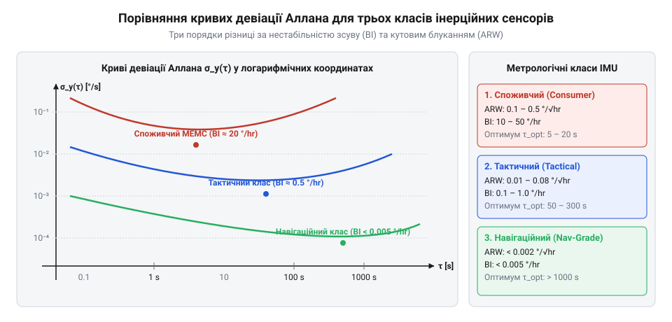

# Дисперсія Аллана

## Класифікація та градації інерційних сенсорів

Вибір інерційного вимірювального модуля (@@en|Inertial Measurement Unit@@, IMU) завжди є компромісом між габаритами, енергоспоживанням, вартістю та швидкістю накопичення координатної похибки у режимі автономного числення координат (@@en|dead reckoning@@). Крива девіації Аллана виступає універсальним метрологічним «паспортом», що дозволяє миттєво визначити клас сенсора за рівнем шуму та часом досягнення мінімуму дрейфу.

У сучасній навігаційній техніці виділяють три основні градації інерційних сенсорів:

1. **Споживчий клас (@@en|Consumer Grade@@):**
   - **Технологія:** кремнієві МЕМС-структури з ємнісним або п'єзорезистивним зчитуванням на основі камертонів чи вібруючих кілець, інтегровані в єдиний кремнієвий чип разом з ASIC.
   - **Метрологічні характеристики:** нестабільність зсуву нуля (@@en|Bias Instability@@, BI) становить від `10` до `100 °/h`, кутове випадкове блукання (@@en|Angle Random Walk@@, ARW) — від `0.1` до `1.0 °/√h`.
   - **Сфера застосування:** смартфони, ігрові маніпулятори, цивільні квадрокоптери, стабілізатори камер. Автономна навігація без зовнішньої корекції (GNSS/одометрія) можлива лише протягом кількох секунд.

2. **Тактичний клас (@@en|Tactical Grade@@):**
   - **Технологія:** прецизійні МЕМС-давачі з термокомпенсацією та вакуумованими сенсорними елементами або компактні волоконно-оптичні гіроскопи (@@en|Fiber Optic Gyroscope@@, FOG).
   - **Метрологічні характеристики:** нестабільність зсуву нуля BI становить від `0.1` до `1.0 °/h`, кутове випадкове блукання ARW — від `0.01` до `0.05 °/√h`.
   - **Сфера застосування:** безпілотні літальні апарати, промислова робототехніка, короткочасна навігація в умовах придушення сигналів GNSS (до кількох хвилин).

3. **Навігаційний та стратегічний клас (@@en|Navigation & Strategic Grade@@):**
   - **Технологія:** кільцеві лазерні гіроскопи (@@en|Ring Laser Gyroscope@@, RLG) на ефекті Саньяка та великогабаритні замкнені волоконно-оптичні гіроскопи з поляризаційно-зберігаючим волокном (FOG).
   - **Метрологічні характеристики:** нестабільність зсуву нуля BI менше `0.001 ... 0.01 °/h`, кутове випадкове блукання ARW менше `0.001 °/√h`.
   - **Сфера застосування:** магістральна авіація, підводні човни, космічні апарати, гірокомпасування (визначення істинного географічного півночі за обертанням Землі без використання магнітного поля).


*Порівняння кривих девіації Аллана демонструє розрив у 3–4 порядки за рівнем білого шуму та нестабільністю зміщення між різними класами інерційних сенсорів.*

### Зведене метрологічне порівняння типових архітектур інерційних сенсорів

Щоб оцінити практичний вплив стохастичних шумів на автономність системи орієнтації, зіставимо типові чисельні характеристики п'яти представницьких категорій гіроскопів — від масових однокристальних рішень до прецизійних оптичних систем:

| Категорія та технологічна база | Кутове випадкове блукання, ARW (`°/√h`) | Нестабільність зсуву нуля, BI (`°/h`) | Випадкове блукання кутової швидкості, RRW (`°/h/√h`) | Характерний час виходу на дно ADEV `τ_BI` (с) | Накопичена помилка орієнтації за 60 с без корекції |
| :--- | :--- | :--- | :--- | :--- | :--- |
| **1. Бюджетний мобільний МЕМС** (смартфони, носимі пристрої) | `0.6 ... 1.2` | `30 ... 80` | `2.0 ... 5.0` | `5 ... 20` | `≈ 0.8° ... 1.5°` |
| **2. Промисловий робототехнічний МЕМС** (БПЛА, AGV, лідари) | `0.15 ... 0.35` | `8 ... 15` | `0.5 ... 1.2` | `20 ... 60` | `≈ 0.15° ... 0.3°` |
| **3. Прецизійний тактичний МЕМС** (високодинамічні платформи) | `0.02 ... 0.06` | `0.5 ... 1.5` | `0.05 ... 0.15` | `100 ... 400` | `≈ 0.01° ... 0.03°` |
| **4. Волоконно-оптичний гіроскоп (FOG)** (тактична навігація) | `0.005 ... 0.015` | `0.05 ... 0.2` | `0.002 ... 0.008` | `500 ... 2000` | `≈ 0.001° ... 0.003°` |
| **5. Кільцевий лазерний гіроскоп (RLG)** (авіація, субмарини) | `0.0005 ... 0.002` | `0.001 ... 0.005` | `< 0.0005` | `> 5000` | `≈ 0.0001°` (гірокомпас) |

У наведеній таблиці кожна метрика безпосередньо диктує поведінку вимірювача в часі:
- Значення **ARW** визначає кутову дисперсію на коротких інтервалах спостереження: інтегрування білого шуму швидкості генерує блукання кута `σ_θ(t) = ARW · √t`.
- Параметр **BI** визначає фундаментальне обмеження точності оцінки постійного зсуву під час калібрування: скільки б ми не усереднювали сигнал у стані спокою, похибка оцінки нульового положення не може бути меншою за мінімум девіації Аллана `σ(τ_BI)`.
- Показник **RRW** характеризує швидкість незворотної деградації сенсора внаслідок накопичення низькочастотних блукань за великих часів інтегрування (`τ > τ_BI`). Сенсори споживчого класу починають деградувати вже через 10–20 секунд інтегрування, тоді як оптичні гіроскопи навігаційного класу утримують стабільність протягом тисяч секунд.

## Метрологічні параметри даташитів

Паспортні специфікації (даташити) виробників IMU часто подають шумові параметри у різних одиницях вимірювання, що ускладнює їх пряме зіставлення. Графік девіації Аллана стандартизує ці показники відповідно до стандартів IEEE 952 (для гіроскопів) та IEEE 1293 (для акселерометрів).

Головні метрологічні коефіцієнти, які визначаються за графіком девіації Аллана:

1. **Кутове випадкове блукання (@@en|Angle Random Walk@@, ARW) / Випадкове блукання швидкості (@@en|Velocity Random Walk@@, VRW):**
   - Фізична природа: широкосмуговий білий шум кутової швидкості або прискорення з постійною спектральною густиною `S(f) = N²`.
   - При інтегруванні кутової швидкості для отримання кута орієнтації `θ(t) = ∫ ω(t) dt` білий шум інтегрується у випадкове блукання кута з лінійним зростанням дисперсії `σ_θ²(t) = N² · t`.
   - Зв'язок із кривою девіації Аллана: на похилій ділянці з нахилом `μ = -½` девіація описується виразом `σ(τ) = N / √τ`. Значення коефіцієнта `N` зчитується безпосередньо в точці `τ = 1 s`:

```
N
= σ(1 s) · √(1 s)                [зчитування коефіцієнта кутового блукання]
= PSD_white / √2                 [зв'язок з однобічною спектральною густиною]
```

   - Одиниці вимірювання: `°/√h` або `°/s/√Hz` (коефіцієнт перерахунку: `1 °/s/√Hz = 60 °/√h`). Для акселерометрів параметр називається VRW і вимірюється в `m/s/√h` або `μg/√Hz`.

2. **Нестабільність зсуву нуля (@@en|Bias Instability@@, BI):**
   - Фізична природа: низькочастотний флікер-шум `1/f` у первинному перетворювачі та аналогових підсилювачах.
   - Зв'язок із кривою: відповідає пологій ділянці мінімуму кривої девіації Аллана (нахил `μ = 0`). Мінімальне значення девіації `σ_min` пов'язане з паспортним коефіцієнтом нестабільності зсуву `B` співвідношенням:

```
B
= σ_min / √(2 · ln(2) / π)       [теоретичний перерахунок мінімуму ADEV у BI]
≈ σ_min / 0.6643                 [чисельний коефіцієнт для флікер-шуму]
```

   - Точка мінімуму `τ_opt` показує оптимальний час усереднення сигналу: доки `τ < τ_opt`, усереднення вибірок зменшує шум; при `τ > τ_opt` похибка починає зростати через довготривалий дрейф.

3. **Випадкове блукання швидкості зміни зміщення (@@en|Rate Random Walk@@, RRW):**
   - Фізична природа: блукання нульового рівня сенсора (шум `1/f²` у спектрі кутової швидкості), спричинене мікрорухами напружень та температурними градієнтами.
   - Зв'язок із кривою: ділянка правого підйому кривої з нахилом `μ = +½`, де `σ(τ) = K · √(τ / 3)`. Коефіцієнт `K` вимірюється в `°/h/√h` або `°/s^(3/2)`.

4. **Шум квантування (@@en|Quantization Noise@@, Q):**
   - Фізична природа: похибка округлення АЦП та цифрових фільтрів.
   - Зв'язок із кривою: крутий спад на малих значеннях `τ` із нахилом `μ = -1`, де `σ(τ) = Q · √3 / τ`.

> 🔧 **Навіщо це.**
> Зчитування коефіцієнтів `N` (білий шум) та `K` (випадкове блукання зсуву) з графіка девіації Аллана є обов'язковим етапом перед синтезом фільтра Калмана: саме ці константи визначають діагональні елементи неперервної матриці спектральної густини шуму процесу `Q_c`. Якщо задати `N` занадто малим, фільтр буде передовіряти показам сенсора і накопичувати похибку дрейфу; якщо задати завищеним — реакція системи стане надмірно повільною.

## Зіставлення паспортних параметрів із кривою девіації Аллана

Виробники інерційних давачів у технічних паспортах (@@en|datasheet@@) рідко вказують параметри дисперсії Аллана у системних одиницях СІ. Натомість використовують традиційні інженерні розмірності, прив'язані до астрономічних годин і позасистемних частотних смуг. Для коректного моделювання системи необхідно перевести ці дані у значення девіації на часі усереднення `τ = 1 s` та в точці глобального мінімуму `σ_min`.

### Переведення параметрів кутового випадкового блукання (ARW) та блукання швидкості (VRW)

Кутове випадкове блукання гіроскопа `N` у специфікаціях подають у градусах на корінь із години (`°/√hr`), кутових хвилинах (`arcmin/√hr`) або через спектральну густину шуму `°/s/√Hz`:

```
N [°/s/√Hz]
= N_spec [°/√hr] / 60            [оскільки 1 год = 3600 с, а √3600 = 60]

N [rad/s/√Hz]
= N [°/s/√Hz] · (π / 180)        [переведення градусів у радіани]
= N_spec [°/√hr] · π / 10800     [прямий множник переведення у СІ]
```

Значення девіації Аллана на одиничному часі усереднення `τ = 1 s` чисельно збігається зі спектральною густиною білого шуму у смузі 1 Гц: `σ_y(1 s) = N [°/s]`.

### Переведення мікрогравіметрових величин акселерометрів у метричні одиниці СІ

У паспортних специфікаціях акселерометрів замість стандартних метричних одиниць прискорення (`m/s²`) традиційно застосовують похідні від стандартного гравітаційного прискорення Землі `g_0 = 9.80665 m/s²`: міліграми (`mg = 10⁻³ g_0`) та мікрограми (`μg = 10⁻⁶ g_0 = 9.80665 · 10⁻⁶ m/s²`). Таке градуювання історично закріпилося в гравіметрії та авіаційній метрології для зручності оцінки нахилу платформи відносно вектора сили тяжіння, однак пряме підставлення цих чисел у матриці фільтра Калмана без переведення у СІ призводить до помилок на декілька порядків.

1. **Випадкове блукання швидкості (VRW) зі спектральної густини шуму:**
Якщо щільність шуму задано в `μg/√Hz`, перерахунок у метричну густину білого шуму прискорення СІ здійснюється множенням на значення гравітаційної сталої:

```
S_a [m/s² / √Hz]
= VRW_spec [μg/√Hz] · 10⁻⁶ · 9.80665
≈ VRW_spec [μg/√Hz] · 9.80665 · 10⁻⁶
```

Якщо ж характеристику VRW задано через швидкісне блукання в часі `m/s/√hr`, перехід до секундного виміру вимагає ділення на `√3600 = 60`:

```
VRW [m/s² / √Hz]
= VRW_spec [m/s/√hr] / 60        [переведення з годин у секунди]
```

2. **Нестабільність зміщення нуля акселерометра (BI) у мікрограмах:**
Паспортне значення нестабільності зсуву акселерометра `BI_spec`, виражене в `μg`, переводиться в системні одиниці лінійного прискорення `m/s²` та зіставляється з мінімумом девіації Аллана `σ_min,acc`:

```
B_acc [m/s²]
= BI_spec [μg] · 9.80665 · 10⁻⁶

σ_min,acc [m/s²]
= B_acc · √(2 · ln(2) / π)
≈ 0.6643 · B_acc
```

### Переведення нестабільності зміщення нуля (BI) гіроскопа

Нестабільність нульового рівня (@@en|Bias Instability@@, BI) подають у градусах за годину (`°/hr`):

```
B [°/s]
= B_spec [°/hr] / 3600           [переведення годин у секунди]

B [rad/s]
= B [°/s] · (π / 180)            [переведення у радіани за секунду]
```

Мінімум кривої девіації Аллана `σ_min` на плато флікер-шуму пов'язаний із теоретичним параметром `B` через фіксований числовий коефіцієнт:

```
σ_min
= B · √(2 · ln(2) / π)           [теоретичний зв'язок для флікер-шуму 1/f]
≈ 0.6643 · B                     [числове наближення множника]

B
= σ_min / 0.6643                 [зчитування параметра з графіка]
≈ 1.5054 · σ_min
```

### Розрахунковий приклад калібрування тактичного гіроскопа та акселерометра

**Умова:** За паспортом інерційний модуль має такі параметри:
- Гіроскоп: `ARW = 0.06 °/√hr`, `BI = 0.5 °/hr`, час виходу на мінімум `τ_opt = 100 s`.
- Акселерометр: густина білого шуму `VRW = 50 μg/√Hz`, нестабільність зсуву `BI_acc = 15 μg`.

```
N_gyro [°/s]
= 0.06 / 60
= 0.001 °/s                      [точка на графіку девіації при τ = 1 s]

B_gyro [°/s]
= 0.5 / 3600
≈ 0.0001389 °/s                  [параметр флікер-шуму гіроскопа]

σ_min,gyro
= 0.6643 · 0.0001389
≈ 9.23 · 10⁻⁵ °/s                [мінімальне значення ADEV гіроскопа при τ = 100 s]

VRW_acc [m/s² / √Hz]
= 50 · 9.80665 · 10⁻⁶
≈ 0.0004903 m/s² / √Hz           [девіація Аллана акселерометра при τ = 1 s]

B_acc [m/s²]
= 15 · 9.80665 · 10⁻⁶
≈ 0.0001471 m/s²                 [параметр флікер-шуму акселерометра]

σ_min,acc
= 0.6643 · 0.0001471
≈ 9.77 · 10⁻⁵ m/s²               [мінімальне значення ADEV акселерометра]
```

> 🔧 **Навіщо це.**
> Зіставлення паспорта з виміряною кривою дає змогу виявити невідповідність сенсора заявленим характеристикам ще до інтеграції в навігаційний комплекс: якщо експериментальний мінімум кривої лежить вище за `0.6643 · B_spec`, плата має паразитний тепловий градієнт або шуми джерела живлення.

## Математична модель стохастичних шумів IMU у просторі станів

Для побудови розширеного фільтра Калмана (@@en|Extended Kalman Filter@@, EKF) неперервний процес стохастичної похибки навігаційного сенсора формалізують у вигляді системи лінійних стохастичних диференціальних рівнянь (простір станів).

Вектор похибок однієї осі кутової швидкості містить дві складові: похибку орієнтації `δθ` та нестаціонарний дрейф зміщення нуля `b`.

### Модель першого порядку Гаусса — Маркова (GM-1)

Реальний дрейф нуля МЕМС-давача не є нескінченно зростаючим процесом: він обмежений фізичними рамками напруги живлення та має скінченний час автокореляції `T_c`. Таку динаміку описують процесом Гаусса — Маркова першого порядку (від нім. @@de|Gauss@@ та рос. @@ru|Марков@@, GM-1):

```
d(δθ) / dt
= −b − w_v                       [швидкість зміни кута під дією зміщення та білого шуму]

db / dt
= −(1 / T_c) · b + w_u           [експоненційне повернення до нуля та білий шум збудження]
```

де `w_v` та `w_u` — незалежні некорельовані білі гауссівські шуми із нульовим середнім та спектральними густинами `q_v` і `q_u`.

Автокореляційна функція процесу Гаусса — Маркова експоненційно згасає:

```
R_b(Δt)
= σ_gm² · exp(−|Δt| / T_c)       [автокореляція з дисперсією σ_gm² та часом T_c]
```

Спектральна густина білого шуму збудження `w_u`, необхідна для підтримання дисперсії `σ_gm²`, визначається співвідношенням:

```
q_u
= 2 · σ_gm² / T_c                [зв'язок інтенсивності шуму з параметрами процесу]
```

Якщо час кореляції `T_c → ∞`, процес перетворюється на класичне випадкове блукання (@@en|random walk@@): `db / dt = w_u`, а `q_u = K²`, де `K` — коефіцієнт блукання швидкості (RRW).

### Модель Гаусса — Маркова другого порядку (GM-2) та порівняння з GM-1

Класична одновимірна модель GM-1 має принципове теоретичне обмеження: її автокореляційна функція `R_b(Δt)` має злам (кутову точку) при `Δt = 0`. Недиференційованість в нулі означає фізично неможливу нескінченну швидкість зміни похідної зміщення нуля (нескінченне «прискорення» дрейфу), що в реальних МЕМС-структурах стримується тепловою інерцією підкладки та демпфуванням резонатора.

Для точнішого моделювання високодинамічних тактичних сенсорів застосовують процес Гаусса — Маркова другого порядку (GM-2), який описується стохастичним диференціальним рівнянням другого порядку зі швидкістю дрейфу `ḃ = db/dt`:

```
d²b / dt² + 2 · β · (db / dt) + ω_0² · b
= w_gm2                          [рівняння стохастичного резонатора другого порядку]
```

де `β` — коефіцієнт демпфування процесу, `ω_0` — власна резонансна частота стохастичних флуктуацій.

У просторі станів модель GM-2 формує систему з двох змінних стану для опису дрейфу:

```
d[ b ] / dt
  [ ḃ ]
= [  0       1     ] · [ b ] + [   0   ] · w_gm2
  [ −ω_0²   −2·β  ]   [ ḃ ]   [ 2·β·σ ]
```

Автокореляційна функція моделі GM-2 є гладкою (двічі диференційованою) в нулі, де її похідна рівна нулю `dR_b(0)/dt = 0`:

```
R_b,gm2(Δt)
= σ_gm² · exp(−β · |Δt|) · (cos(ω_d · Δt) + (β / ω_d) · sin(ω_d · |Δt|))
```

де `ω_d = √(ω_0² − β²)` — частота затухаючих автокореляційних коливань.

| Критерій порівняння | Випадкове блукання (RW) | Модель GM-1 | Модель GM-2 |
| :--- | :--- | :--- | :--- |
| **Кількість змінних стану на вісь** | `1` (`b`) | `1` (`b`) | `2` (`b`, `ḃ`) |
| **Фізична адекватність автокореляції** | Нестаціонарна (дисперсія `∝ t`) | Стаціонарна, але негладка в нулі | Повністю гладка, фізично неперервна |
| **Обчислювальні витрати в EKF** | Мінімальні (базовий стандарт) | Низькі (1 додатковий стан на вісь) | Середні (+3 стани для 3 осей IMU) |
| **Сфера оптимального застосування** | Короткочасна робота (`t < τ_BI`) | Споживчі та промислові МЕМС | Прецизійні тактичні МЕМС/FOG при маневрах |

### Дискретизація моделі та формування матриці шуму процесу Q

Неперервна матриця системи `F` та неперервна матриця коваріації шуму `Q_c` для моделі GM-1 мають вигляд:

```
F
= [  0   −1       ]
  [  0   −1 / T_c ]              [неперервна матриця динаміки стану]

Q_c
= [ q_v   0   ]
  [  0   q_u  ]                  [діагональна матриця спектральних густин білих шумів]
```

Для цифрового фільтра з періодом оновлення `Δt` перехідна матриця стану `Φ` обчислюється через матричну експоненту:

```
Φ
= exp(F · Δt)
≈ [ 1   −Δt               ]
  [ 0    1 − Δt / T_c     ]      [лінійне наближення першого порядку при Δt ≪ T_c]
```

Дискретна матриця коваріації шуму процесу `Q_d` визначається інтегралом:

```
Q_d
= ∫₀^{Δt} Φ(τ) · Q_c · Φᵀ(τ) dτ  [інтегральне відображення шуму на крок Δt]
```

Для моделі випадкового блукання (`T_c → ∞`, `q_v = N²`, `q_u = K²`) інтегрування дає точний аналітичний вираз:

```
Q_d
= [ N² · Δt + ⅓ · K² · Δt³   −½ · K² · Δt² ]
  [       −½ · K² · Δt²            K² · Δt   ]  [дискретна матриця коваріації шуму процесу]
```

Для моделі Гаусса — Маркова діагональний елемент дрейфу нульового рівня набуває вигляду:

```
Q_d[2, 2]
= σ_gm² · (1 − exp(−2 · Δt / T_c))
≈ 2 · σ_gm² · (Δt / T_c) = q_u · Δt    [при малій тривалості кроку дискретизації]
```

> 🔧 **Навіщо це.**
> Матриця `Q_d` безпосередньо керує зростанням апріорної невизначеності стану між приходами коригувальних вимірювань (наприклад, супутникових або магнітометричних). Коректні значення `N` та `K`, узяті з дисперсії Аллана, запобігають як розбіжності фільтра Калмана (при заниженому `Q`), так і надмірній чутливості до шумів вимірювань (при завищеному `Q`).

## Перенесення параметрів Аллана у неперервні та дискретні матриці шуму процесу

Для тривимірного навігаційного комплексу вектор стану помилок навігації включає кутові похибки `δθ = [δθ_x, δθ_y, δθ_z]ᵀ`, похибки швидкості `δv = [δv_x, δv_y, δv_z]ᵀ`, похибки зміщення гіроскопів `b_g = [b_gx, b_gy, b_gz]ᵀ` та похибки зміщення акселерометрів `b_a = [b_ax, b_ay, b_az]ᵀ`.

### Формування неперервної матриці шуму процесу Qc

Шумові параметри, отримані з кривих девіації Аллана окремо для кожної з трьох осей гіроскопів (`N_g, K_g`) та акселерометрів (`N_a, K_a`), формують діагональні блоки неперервної матриці спектральної густини потужності шуму `Q_c`:

```
Q_c
= diag( q_gv, q_gv, q_gv,  q_gu, q_gu, q_gu,  q_av, q_av, q_av,  q_au, q_au, q_au )
```

де значення спектральних густин білого шуму швидкості/кута та шуму збудження дрейфу нуля дорівнюють:

```
q_gv = N_gyro²                   [(rad/s)² / Hz, білий шум гіроскопа]
q_gu = K_gyro²                   [(rad/s³)² / Hz, дрейф гіроскопа RRW]
q_av = N_acc²                    [(m/s²)² / Hz, білий шум акселерометра]
q_au = K_acc²                    [(m/s³)² / Hz, дрейф акселерометра]
```

### Дискретизація коваріаційної матриці Qd методом Ван Лоана

Для довільного часового кроку навігаційного фільтра `Δt` точне інтегрування неперервного білого шуму виконується через алгоритм Ван Лоана (@@en|Van Loan method@@). Для окремого каналу «кут — зміщення» матриця динаміки та блокова матриця шуму інтегруються до вигляду:

```
Q_d,gyro
= [ N_g² · Δt + ⅓ · K_g² · Δt³   −½ · K_g² · Δt² ]
  [       −½ · K_g² · Δt²              K_g² · Δt   ]  [дискретна матриця для кроку Δt]
```

Присутність недіагональних від'ємних елементів `−½ · K_g² · Δt²` відображає фізичну крос-кореляцію: накопичення додатного дрейфу нуля призводить до від'ємного накопичення помилки кута в системі координат інтегратора.

### Врахування шуму квантування в матриці коваріації шуму вимірювань R

Якщо сенсорний потік IMU надходить у фільтр Калмана безпосередньо як вектор спостережень `z_k` на високій частоті дискретизації `f_s = 1 / Δt`, фундаментальну роль у формуванні матриці коваріації шуму вимірювань `R` відіграє шум квантування АЦП.

За ціни молодшого розряду (@@en|Least Significant Bit@@, LSB) цифрового інтерфейсу `δ_lsb` (у `rad/s` для гіроскопа або `m/s²` для акселерометра) дисперсія рівномірного шуму квантування становить:

```
σ_q²
= δ_lsb² / 12                    [теоретична дисперсія рівномірного квантування]
```

На кривій девіації Аллана шум квантування проявляється ділянкою зі спадом `-1` на малих `τ` та визначається коефіцієнтом `Q`: `σ_ADEV(τ) = √3 · Q / τ`.

Сумарна дисперсія вимірювального шуму одного каналу `σ_meas²`, яка заноситься на головну діагональ матриці `R`, об'єднує інтегрований білий шум у смузі Найквіста `f_s / 2` та апаратний шум квантування:

```
R_gyro,ii
= σ_meas,gyro²
= (N_gyro² · f_s / 2) + (δ_gyro_lsb² / 12)  [коваріація вимірювального шуму гіроскопа]

R_acc,ii
= σ_meas,acc²
= (N_acc² · f_s / 2) + (δ_acc_lsb² / 12)    [коваріація вимірювального шуму акселерометра]
```

**Алгоритм узгодження R:**
1. За кроком дискретизації `Δt` розраховують смугу `f_Nyq = 1 / (2 · Δt)`.
2. За паспортом або графіком дисперсії Аллана зчитують спектральну щільність `N` та крок квантування `δ_lsb`.
3. Якщо внесок квантування `δ_lsb² / 12` перевищує білий шум `N² / (2 · Δt)`, матрицю `R` коригують у бік збільшення, запобігаючи помилковому підвищенню коефіцієнта підсилення Калмана `K_k` та розгойдуванню оцінки стану високочастотною «сходинковою» дискретністю.

> 🔧 **Навіщо це.**
> Ігнорування недіагональних елементів матриці `Q_d` і встановлення простої діагональної матриці є грубою інженерною помилкою, яка призводить до перекосу фільтра Калмана і зростання кутової похибки на 15–30% під час автономного руху без супутникової корекції.

## Інженерні пастки метрологічного аналізу IMU

Оцінка стохастичних шумів за методикою Аллана спирається на припущення про ізольованість сенсора від зовнішніх детермінованих збурень. На практиці недотримання умов експерименту призводить до спотворення кривої ADEV та хибного визначення коефіцієнтів.

### Пастка 1: Температурні перехідні процеси та градієнти

Якщо запис сигналу проводиться у нетермостатованому приміщенні (де температура коливається внаслідок роботи кондиціонера чи добового циклу), температурний дрейф зміщення нуля накладається на випадковий шум.

На графіку ADEV це проявляється як штучне виникнення крутого правого схилу з нахилом `μ = +1` (лінійний рамп) вже на малих часах `τ = 20..50 s`. У результаті плато нестабільності зміщення `σ_min` зміщується вгору, і метролог помилково вважає, що давач має високий флікер-шум `B`, хоча насправді має місце нескомпенсований температурний коефіцієнт.

*Правило:* Перед побудовою кривої Аллана сенсор витримують увімкненим щонайменше 1–2 години для завершення теплової релаксації, а випробування проводять у термокамері з градієнтом менше `0.1 °C / hr`.

### Пастка 2: Вібраційні збурення та акустичний шум

Акустичні коливання та вібрації від вентиляторів охолодження чи промислового обладнання генерують гармонічні складові у сигналі сенсора.

На подвійному логарифмічному графіку гармонічне збурення з частотою `f_vib` створює характерний локальний куполоподібний сплеск («горб») на часі усереднення `τ ≈ 1 / (2 · f_vib)`. Спроба провести дотичну `μ = 0` по верхівці такого купола призводить до завищення нестабільності нуля у рази.

*Правило:* Плату встановлюють на масивну гранітну плиту на віброізолювальних пневмоопорах, а наявність гармонік перевіряють за спектром PSD перед розрахунком AVAR.

### Пастка 3: Механічна релаксація та старіння пайки

У щойно виготовлених друкованих платах механічні напруження в компаунді мікросхеми та припої релаксують протягом перших кількох діб після паяння. Цей процес створює логарифмічний монотонний тренд вихідного сигналу, який маскується під шум випадкового блукання `1/f²`.

*Правило:* Проведення метрологічної паспортизації та зняття кривих Аллана виконують лише після технологічного тренування (@@en|burn-in@@) зразків протягом 48 годин за підвищеної температури.
