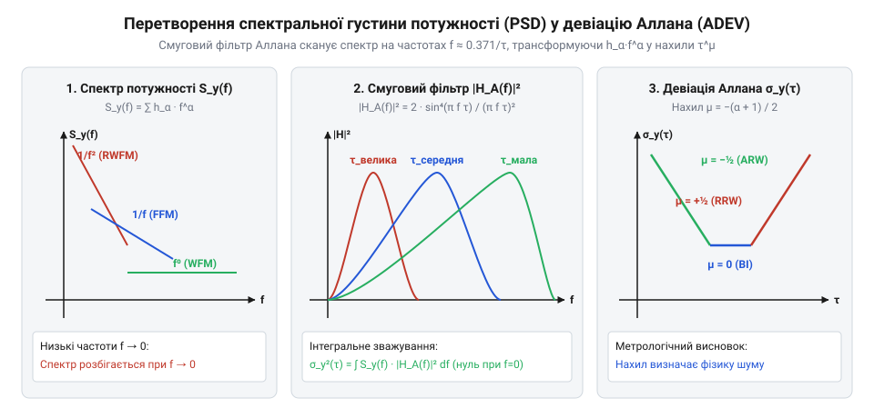
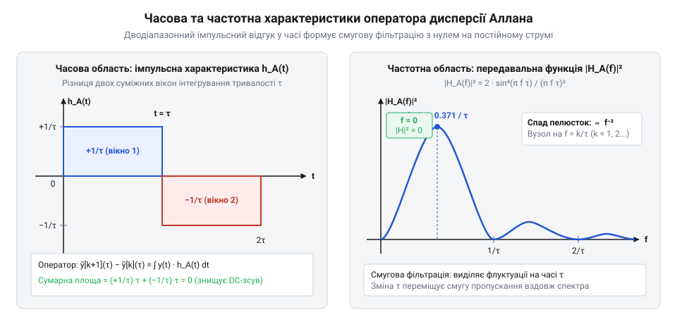

# Дисперсія Аллана

## Спектральне представлення стохастичних шумів

У радіотехніці, прецизійній хронометрії та інерційній навігації для опису стохастичних процесів використовують степеневу модель спектральної густини потужності (@@en|Power-Law Spectral Density Model@@), розроблену Барнсом, Алланом та комітетом IEEE. 

Згідно з цією моделлю, однобічна спектральна густина потужності випадкових флуктуацій вихідної величини сенсора `S_y(f)` (де `f > 0` — частота Фур'є) апроксимується сумою п'яти канонічних степеневих складових:

```
S_y(f)
= ∑ h_α · f^α                    [степеневий розклад спектральної густини потужності]
= h_[2] · f² + h_[1] · f¹ + h_[0] · f⁰ + h_[-1] · f⁻¹ + h_[-2] · f⁻²  [п'ять базових процесів]
```

Кожен степеневий показник `α ∈ {-2, -1, 0, 1, 2}` відповідає чітко визначеному фізичному механізму деградації сигналу:

1. `α = 2` — **Шум квантування / Білий шум фази (@@en|White Phase Modulation@@, WPM):** високі частоти дискретизації, похибки АЦП.
2. `α = 1` — **Флікер-шум фази (@@en|Flicker Phase Modulation@@, FPM):** поверхневі ефекти в резонаторах та транзисторах.
3. `α = 0` — **Білий шум частоти / швидкості (@@en|White Frequency Modulation@@, WFM):** тепловий шум Джонсона-Найквіста, фотонний дробовий шум, броунівський рух.
4. `α = -1` — **Флікер-шум частоти (@@en|Flicker Frequency Modulation@@, FFM):** флуктуації провідності каналу та пастки носіїв на межах діелектриків.
5. `α = -2` — **Випадкове блукання частоти (@@en|Random Walk Frequency Modulation@@, RWFM):** стохастичний дрейф параметрів навколишнього середовища, термомеханічна релаксація напружень.

Головна математична проблема полягає у визначенні повної потужності (дисперсії) сигналу через спектральну густину:

```
σ²
= ∫ S_y(f) df                    [інтегрування спектральної густини від 0 до нескінченності]
```

Для складових із `α ≤ -1` цей інтеграл розбігається на нижній межі `f → 0` (так звана інфранизькочастотна або інфрачервона розбіжність). Класична дисперсія не існує як кінцева величина, оскільки низькочастотний інтеграл від `1/f` або `1/f²` прямує до нескінченності при необмеженому збільшенні інтервалу вимірювання.

**Експериментальне вимірювання PSD за допомогою FFT-аналізаторів.**

На практиці пряме оцінювання однобічної спектральної густини потужності `S_y(f)` здійснюють цифровими методами на основі швидкого перетворення Фур'є (FFT). Стандартним інженерним підходом є модифікований метод усереднених періодограм Велча (@@en|Welch's Method@@):

1. Неперервний часовий ряд вимірювань `y[n]` розбивають на `L` перекривних сегментів довжиною `M` відліків із перекриттям у `50%` (зсув на `M / 2` відліків).
2. Для запобігання спектральному протіканню (@@en|spectral leakage@@) кожен сегмент множать на вагове вікно Ганна (@@en|Hann Window@@) або Блекмана-Гарріса `w[n]`.
3. Для кожного зваженого сегмента обчислюють дискретне перетворення Фур'є `Y_l[k] = FFT(w[n] · y_l[n])` для частотних бінів `f_k = k · f_s / M`, де `f_s` — частота дискретизації давача.
4. Однобічна спектральна густина потужності `S_y(f_k)` оцінюється усередненням потужності по всіх `L` сегментах із точним енергетичним нормуванням на суму квадратів вагових коефіцієнтів вікна:

```
S_y(f_k)
= 2 / (f_s · ∑ w²[n]) · (1 / L · ∑ |Y_l[k]|²)     [оцінка однобічної PSD за Велчем]
```

Множник `2` у чисельнику виникає через згортання від'ємних частот у діапазон додатних частот `f > 0` для збереження повної потужності сигналу. Отримана спектральна густина має розмірність `(од)²/Hz` (наприклад, `(°/s)²/Hz` або `(°/h)²/Hz` для гіроскопа та `(m/s²)²/Hz` для акселерометра).

Проте експериментальне вимірювання `S_y(f)` за допомогою FFT стикається з трьома критичними обмеженнями в інфранизькочастотній зоні:

* **Вимога до наддовгих часових записів:** частотна роздільна здатність біна дорівнює `Δf = 1 / T_segment`. Щоб розрізнити поведінку шуму на частоті `10⁻⁵ Hz`, довжина одного сегмента має складати щонайменше `10⁵ s ≈ 27.8 h`, а для усереднення кількох періодограм потрібні безперервні вимірювання протягом тижнів.
* **Спектральне розмиття низьких частот:** навіть за використання вікон із високим придушенням бічних пелюсток сильний низькочастотний дрейф протікає в сусідні біни, спотворюючи оцінку показника степеня `α`.
* **Висока дисперсія некорельованих оцінок:** вибіркова дисперсія періодограми в окремому біні не спадає зі зростанням довжини вибірки без спеціального усереднення по ансамблю.

Саме ці практичні труднощі частотного FFT-аналізу в інфранизькочастотному діапазоні роблять часовий метод дисперсії Аллана набагато зручнішим і стійкішим інструментом для метрологічної атестації низькочастотних шумів сенсорів.


*Зв'язок між спектральною густиною потужності S_y(f) та часовою девіацією Аллана встановлюється через інтегрування з передавальною функцією |H_A(f)|².*

## Оператор кластеризації Аллана в часовій та частотній області

Щоб подолати розбіжність інтеграла на нульовій частоті, вимірювальний сигнал пропускають крізь спеціальний часовий фільтр різниці суміжних кластерних середніх.

Нехай миттєва швидкість (або нормована частота) `y(t)` утворюється шляхом диференціювання сумарної накопиченої фази `x(t)` (кута повороту для гіроскопа або часу для годинника): `y(t) = dx(t) / dt`. Тоді середнє значення сигналу на `k`-му інтервалі тривалістю `τ` дорівнює:

```
ȳ[k](τ)
= 1 / τ · ∫ x'(t) dt             [усереднення швидкості на інтервалі від t_k до t_k + τ]
= (x(t_k + τ) − x(t_k)) / τ      [вираз середнього через різницю накопиченої фази]
```

Різниця між середніми значеннями двох сусідніх кластерів записується як друга кінцева різниця фази:

```
Δȳ[k](τ)
= ȳ[k + 1](τ) − ȳ[k](τ)           [різниця суміжних кластерних середніх]
= (x(t_k + 2τ) − 2 · x(t_k + τ) + x(t_k)) / τ  [оператор другої різниці фази]
```

У неперервному часі дію цього оператора на сигнал `y(t)` можна представити як лінійну згортку з імпульсною характеристикою `h_A(t)`:

```
h_A(t)
= 1 / τ,  якщо 0 ≤ t < τ
= −1 / τ, якщо τ ≤ t < 2τ
= 0,      в усіх інших випадках
```

Знайдемо комплексну частотну характеристику `H_A(f)` фільтра Аллана за допомогою прямого перетворення Фур'є від імпульсної характеристики `h_A(t)`:

```
H_A(f)
= ∫ h_A(t) · e^(−j 2 π f t) dt   [пряме перетворення Фур'є імпульсної характеристики]
= 1 / τ · ∫₀^τ e^(−j 2 π f t) dt − 1 / τ · ∫_τ^{2τ} e^(−j 2 π f t) dt  [розбиття на додатну та від'ємну частини]
= 1 / (j 2 π f τ) · (1 − e^(−j 2 π f τ)) − 1 / (j 2 π f τ) · (e^(−j 2 π f τ) − e^(−j 4 π f τ))  [інтегрування]
= (1 − 2 · e^(−j 2 π f τ) + e^(−j 4 π f τ)) / (j 2 π f τ)  [зведення під спільний знаменник]
= (1 − e^(−j 2 π f τ))² / (j 2 π f τ)                      [виділення повного квадрата різниці]
```

Для обчислення передавальної функції за потужністю знайдемо квадрат модуля `|H_A(f)|²`. Скористаємося формулою Ейлера `1 − e^(−j 2θ) = e^(−j θ) · (e^(j θ) − e^(−j θ)) = 2 j · e^(−j θ) · sin(θ)`:

```
|1 − e^(−j 2 π f τ)|
= 2 · |sin(π f τ)|               [тригонометричне перетворення модуля]
```

Підставляючи отриманий модуль у вираз для `H_A(f)`:

```
|H_A(f)|²
= |(1 − e^(−j 2 π f τ))²|² / (2 π f τ)²  [піднесення модуля чисельника та знаменника до квадрата]
= (2 · sin(π f τ))⁴ / (2 π f τ)²         [підстановка тригонометричного модуля]
= 16 · sin⁴(π f τ) / (4 · π² f² τ²)      [розкриття коефіцієнтів]
= 2 · sin⁴(π f τ) / (π f τ)²              [остаточна передавальна характеристика фільтра Аллана]
```

### Аналітичний розрахунок положення головного максимуму f_max

Передавальна функція `|H_A(f)|²` діє як смуговий фільтр, що виділяє флуктуації в околі своєї центральної частоти. Знайдемо точне аналітичне положення вершини головної пелюстки пропускання.

Введемо безрозмірну змінну `u = π · f · τ`. Тоді функція передачі набуває вигляду `g(u) = 2 · sin⁴(u) / u²`. Знайдемо точку екстремуму, диференціюючи `g(u)` за `u` та прирівнюючи похідну до нуля:

```
dg / du
= 2 · [4 · sin³(u) · cos(u) · u² − sin⁴(u) · 2 · u] / u⁴
= 4 · sin³(u) / u³ · [2 · u · cos(u) − sin(u)] = 0  [умова екстремуму]
```

Для першої додатної пелюстки (`0 < u < π`), де `sin(u) ≠ 0`, прирівнюємо вираз у квадратних дужках до нуля:

```
2 · u · cos(u) − sin(u) = 0
⇒ tan(u) = 2 · u                         [трансцендентне рівняння максимуму]
```

Чисельне розв'язання цього трансцендентного рівняння дає єдиний корінь на інтервалі `(0, π)`:

```
u_max ≈ 1.165561 rad
```

Повертаючись від `u` до фізичної частоти `f`:

```
π · f_max · τ = 1.165561
⇒ f_max
= 1.165561 / (π · τ)
≈ 0.370997 / τ
≈ 0.371 / τ                              [центральна частота смугового фільтра Аллана]
```

Підставивши знайдене значення `u_max` у вираз для передавальної функції, знайдемо коефіцієнт передачі на частоті піка:

```
|H_A(f_max)|²
= 2 · sin⁴(1.165561) / (1.165561)²
≈ 2 · (0.91897)⁴ / 1.35853
≈ 1.0501                                 [максимальне підсилення в смузі пропускання]
```

Перший спектральний нуль фільтра досягається при `u = π`, тобто на частоті `f_zero = 1 / τ`. Таким чином, фільтр Аллана має ефективну ширину смуги пропускання близько `Δf ≈ 1 / τ` із центром біля `0.371 / τ`.

Змінюючи час усереднення `τ` від мінімального періоду `τ₀` до тривалих інтервалів `10⁴ s`, ми скануємо спектр шуму сенсора вузькою смугою, яка плавно зміщується від високих частот до ультранизьких частот без математичної розбіжності.


*Часова характеристика з двох прямокутних імпульсів протилежного знаку формує смуговий фільтр із нулем другого порядку на нульовій частоті.*

> 🔧 **Навіщо це.**
> Дослідимо поведінку передавальної функції `|H_A(f)|²` при прямуванні частоти до нуля (`f → 0`). Розкладаючи `sin(π f τ) ≈ π f τ` у ряд Тейлора:
> `|H_A(f)|² ≈ 2 · (π f τ)⁴ / (π f τ)² = 2 · π² τ² · f²`.
> Наявність множника другого порядку `f²` у нулі повністю компенсує сингулярності спектрів флікер-шуму `1/f` та випадкового блукання `1/f²` у виразі інтеграла `∫ S_y(f) · |H_A(f)|² df`. Завдяки цьому дисперсія Аллана залишається строго збіжною та скінченною величиною навіть для нестаціонарних процесів.

## Інтегральний зв'язок спектральної густини потужності PSD та девіації Аллана

Зв'язок між частотним спектром шуму та його часовою дисперсією встановлюється через строге інтегральне перетворення. Дисперсія Аллана `σ_y²(τ)` є результатом фільтрації однобічної спектральної густини потужності (@@en|Power Spectral Density@@, PSD) `S_y(f)` передавальною функцією оператора Аллана:

```
σ_y²(τ)
= ∫₀^∞ S_y(f) · |H_A(f)|² df             [інтегральне відображення частотної області в часову]
= ∫₀^∞ S_y(f) · (2 · sin⁴(π · f · τ) / (π · f · τ)²) df
```

### Механізм придушення постійної складової (DC notch)

Фундаментальна проблема класичної дисперсії полягала у нескінченному інтегруванні низькочастотних шумів `1/f` та `1/f²` при `f → 0`. У фільтрі Аллана ця розбіжність усувається автоматично.

Розкладемо тригонометричну функцію в околі нуля за допомогою ряду Тейлора: при `f → 0` маємо `sin(π · f · τ) ≈ π · f · τ`. Підставивши це наближення у передавальну функцію:

```
|H_A(f)|²
≈ 2 · (π · f · τ)⁴ / (π · f · τ)²
= 2 · π² · τ² · f²                       [асимптотика передавальної функції при f → 0]
```

Передавальна функція має нуль другого порядку на нульовій частоті (`|H_A(0)|² = 0`), що утворює так звану спектральну режекторну вирізку постійної складової (@@en|DC notch@@). 

### Умова збіжності інтеграла

Підставимо узагальнену степеневу модель шуму `S_y(f) = h_α · f^α` у підінтегральний вираз при `f → 0`:

```
S_y(f) · |H_A(f)|²
≈ (h_α · f^α) · (2 · π² · τ² · f²)
= 2 · π² · τ² · h_α · f^{α + 2}          [поведінка підінтегральної функції біля нуля]
```

Інтеграл `∫₀^{f_0} f^{α + 2} df` збігається на нижній межі тоді й лише тоді, коли показник степеня перевищує `-1`:

```
α + 2 > −1
⇒ α > −3                                 [критерій збіжності дисперсії Аллана]
```

Оскільки класичні фізичні процеси охоплюють діапазон `α ∈ [−2, +2]`:
- `α = −2` (випадкове блукання частоти): `α + 2 = 0 > −1` — інтеграл збіжний.
- `α = −1` (флікер-шум): `α + 2 = 1 > −1` — інтеграл збіжний.
- `α = 0` (білий шум): `α + 2 = 2 > −1` — інтеграл збіжний.

### Вплив частоти зрізу f_h та точні значення інтегралів C_α

На верхній межі інтегрування `f → ∞` передавальна функція фільтра Аллана спадає як `1/f²`:

```
|H_A(f)|²
≤ 2 / (π · f · τ)²                       [верхня огинаюча при високих частотах f >> 1/τ]
```

Для процесів із показниками `α ≤ 0` (білий шум частоти, флікер-шум та блукання) спад передавальної функції забезпечує природну ультрафіолетову збіжність інтеграла на нескінченності. Для них інтегральний коефіцієнт `C_α` не залежить від смуги пропускання вимірювального тракту:

```
C_0 = 1 / 2 = 0.500000                   [білий шум частоти: збіжний без обмеження смуги]
C_{-1} = 2 · ln(2) ≈ 1.386294            [флікер-шум частоти: збіжний без обмеження смуги]
C_{-2} = 2 · π² / 3 ≈ 6.579736           [блукання частоти: збіжний без обмеження смуги]
```

Проте для високочастотних процесів фазової модуляції з `α > 0` (`α = +1` та `α = +2`) добуток `S_y(f) · |H_A(f)|²` не спадає достатньо швидко, що спричиняє ультрафіолетову розбіжність інтеграла на нескінченності. Для усунення цієї розбіжності в реальних вимірювальних трактах обов'язково застосовують апаратний або цифровий фільтр низьких частот із частотою зрізу `f_h` (де `2 · π · f_h · τ >> 1`).

Точні аналітичні вирази для інтегральних коефіцієнтів із врахуванням частоти зрізу `f_h`:

1. **Для білого фазового шуму / шуму квантування (`α = +2`, WPM / Q):**
   ```
   σ_y²(τ)
   = ∫₀^{f_h} h_2 · f² · (2 · sin⁴(π · f · τ) / (π · f · τ)²) df
   = 3 · h_2 · f_h / (4 · π² · τ²)

   C_2(f_h)
   = 3 · f_h / (4 · π²) ≈ 0.07601 · f_h  [пряма пропорційність смузі пропускання f_h]
   ```
   Девіація спадає пропорційно `τ⁻¹`, але її амплітуда безпосередньо залежить від встановленої смуги зрізу `f_h`.

2. **Для флікерного фазового шуму (`α = +1`, FPM):**
   ```
   σ_y²(τ)
   = h_1 / (4 · π² · τ²) · [ 1.038 + 3 · ln(2 · π · f_h · τ) ]

   C_1(f_h, τ)
   = [1.038 + 3 · ln(2 · π · f_h · τ)] / (4 · π²)  [логарифмічна залежність від f_h · τ]
   ```

Це фундаментальний метрологічний факт: при атестації високочастотного шуму сенсора (наприклад, шуму дискретизації АЦП або квантування кута) значення ADEV залежить від ширини смуги аналізатора `f_h`, тоді як внутрішня нестабільність зміщення нуля `B` та кутове блукання `N` є інваріантними характеристиками чутливого елемента давача.

> 🔧 **Навіщо це.**
> Нуль другого порядку `f²` робить дисперсію Аллана стійкою до постійного зміщення датчика та повільних температурних трендів. Якщо дрейф сенсора має вищий порядок (наприклад, квадратичний чи кубічний прискорюваний дрейф, `α ≤ −3`), оператор Аллана втрачає збіжність — у таких випадках використовують дисперсію Адамара root:hw-sensing/hadamard-variance із нулем вищого порядку.

## Аналітичне виведення кутів нахилу кривої девіації Аллана (μ)

Для отримання аналітичної залежності девіації Аллана від часу усереднення `τ` виконаємо заміну змінної у спектральному інтегралі. Нехай безрозмірна змінна `u = π · f · τ`, тоді `f = u / (π · τ)` та `df = du / (π · τ)`:

```
σ_y²(τ)
= ∫₀^∞ h_α · (u / (π · τ))^α · (2 · sin⁴(u) / u²) · (du / (π · τ))
= 2 · h_α / (π · τ)^{α + 1} · ∫₀^∞ u^{α − 2} · sin⁴(u) du
= C_α · h_α · τ^{-(α + 1)}               [де C_α — табличний інтеграл для заданого α]
```

Переходячи від дисперсії до девіації Аллана `σ_y(τ) = √(σ_y²(τ))`:

```
σ_y(τ)
= √(C_α · h_α) · τ^{-(α + 1) / 2}
∝ τ^μ                                    [степеневий закон девіації]
```

де кут нахилу дотичної `μ` у логарифмічних координатах `(lg τ, lg σ_y)` визначається фундаментальним співвідношенням:

```
μ
= −(α + 1) / 2                           [зв'язок показника спектра α та нахилу ADEV μ]
```

### Розрахунок кутів нахилу для 5 канонічних моделей шуму

1. **Шум квантування (Q) та білий фазовий шум (WPM, `α = +2`):**
   ```
   μ
   = −(2 + 1) / 2 = −1.5                 [для модифікованої MVAR]
   μ
   = −1.0                                [для класичного AVAR за наявності фільтра f_h]
   ```
   Девіація спадає пропорційно `τ⁻¹`.

2. **Флікерний фазовий шум (FPM, `α = +1`):**
   ```
   μ
   = −(1 + 1) / 2 = −1.0
   ```
   Девіація спадає пропорційно `τ⁻¹`.

3. **Білий шум частоти / Кутове випадкове блукання (WFM / ARW, `α = 0`):**
   ```
   μ
   = −(0 + 1) / 2 = −0.5 = −½
   ```
   Інтегрування дає точний аналітичний вираз:
   ```
   σ_y²(τ)
   = h_0 / (2 · τ)
   ⇒ σ_y(τ) = √(h_0 / 2) · τ^{-½}        [нахил −½: спад як 1/√τ]
   ```

4. **Флікер-шум частоти / Нестабільність зміщення нуля (FFM / BI, `α = −1`):**
   ```
   μ
   = −(−1 + 1) / 2 = 0
   ```
   Інтеграл дає незалежну від часу константу:
   ```
   σ_y²(τ)
   = 2 · ln(2) · h_{-1}
   ⇒ σ_y(τ) = √(2 · ln(2) · h_{-1}) ≈ 1.1774 · √(h_{-1})  [нахил 0: горизонтальне плато]
   ```

5. **Випадкове блукання частоти / Блукання швидкості (RWFM / RRW, `α = −2`):**
   ```
   μ
   = −(−2 + 1) / 2 = +0.5 = +½
   ```
   Інтегрування дає висхідну залежність:
   ```
   σ_y²(τ)
   = (2 · π² / 3) · h_{-2} · τ
   ⇒ σ_y(τ) = π · √(2 · h_{-2} / 3) · τ^{+½}  [нахил +½: зростання як √τ]
   ```

### Чисельний розрахунок коефіцієнтів C_α та перехід у логарифмічний масштаб

У логарифмічній системі координат `(lg τ, lg σ_y)` степенева залежність `σ_y(τ) = √(C_α · h_α) · τ^μ` трансформується у рівняння прямої лінії:

```
lg(σ_y(τ))
= ½ · lg(C_α · h_α) + μ · lg(τ)
= ½ · lg(C_α) + ½ · lg(h_α) + μ · lg(τ)  [рівняння прямої y = k · x + b]
```

Тут кутовий коефіцієнт нахилу прямих `k = μ = −(α + 1) / 2`, а точка перетину прямої з вертикальною віссю `τ = 1 s` (де `lg(τ) = 0`) чисельно дорівнює:

```
lg(σ_y(1 s))
= ½ · lg(C_α) + ½ · lg(h_α)              [значення девіації при часі усереднення 1 с]
```

Безрозмірні інтегральні коефіцієнти переходу `C_α = (2 / π^{α + 1}) · ∫₀^∞ u^{α − 2} · sin⁴(u) du` мають такі точні та чисельні значення:

* Для **білого шуму частоти (WFM, `α = 0`):**
  ```
  C_0 = 1 / 2 = 0.500000
  √(C_0) = √(0.5) ≈ 0.707107
  ```
* Для **флікер-шуму частоти (FFM, `α = −1`):**
  ```
  C_{-1} = 2 · ln(2) ≈ 1.386294
  √(C_{-1}) = √(2 · ln(2)) ≈ 1.177410
  ```
* Для **випадкового блукання частоти (RWFM, `α = −2`):**
  ```
  C_{-2} = 2 · π² / 3 ≈ 6.579736
  √(C_{-2}) = π · √(2 / 3) ≈ 2.565099
  ```

**Приклад розрахунку спектральних амплітуд для МЕМС-гіроскопа:**

Нехай за експериментальною кривою девіації Аллана вилучено коефіцієнт кутового випадкового блукання `N = 0.12 °/√h` та нестабільність зміщення нуля `B = 0.015 °/h`. Переведемо значення у базові одиниці SI (`°/s` та `s`):

1. **Розрахунок спектральної густини білого шуму `h_0`:**
   ```
   N_sec = 0.12 / 60 = 0.002000 °/√s
   h_0 = 2 · N_sec² = 2 · (0.002)² = 8.000 · 10⁻⁶ (°/s)²/Hz
   σ_y(1 s) = √(0.5 · 8.0 · 10⁻⁶) = 0.002000 °/s
   ```
2. **Розрахунок спектральної густини флікер-шуму `h_{-1}`:**
   ```
   B_sec = 0.015 / 3600 = 4.167 · 10⁻⁶ °/s
   h_{-1} = B_sec² / (2 · ln(2)) = (4.167 · 10⁻⁶)² / 1.386294 = 1.252 · 10⁻¹¹ (°/s)²
   ```

Аналітичний розрахунок показує, що коефіцієнти `C_α` пов'язують амплітуди спектральної густини потужності `h_α` із числовими метрологічними характеристиками сенсора, даючи змогу безпосередньо заповнювати діагональні елементи матриць шуму дискретного фільтра Калмана.

> 🔧 **Навіщо це.**
> Формула `μ = −(α + 1) / 2` дає можливість миттєво діагностувати фізичну природу домінуючого шуму в системі за візуальним нахилом експериментальної кривої ADEV без необхідності обчислення складних спектральних Фур'є-перетворень на нестаціонарних сигналах.

## Частотна межа відсікання та залежність високочастотних шумів від смуги тракту

При інтегруванні спектральної густини потужності шуму фази для процесів із додатними степенями `α ≥ 1` (білий шум фази `α = 2` та шум квантування `α = 3`) виникає ультрафіолетова розбіжність інтеграла на нескінченно великих частотах:

```
σ_y²(τ)
= 2 · ∫₀^∞ S_y(f) · (sin⁴(π f τ) / (π f τ)²) df
```

Для білого шуму фази `S_y(f) = h_2 · f²` підінтегральний вираз при `f → ∞` має вигляд `2 · h_2 · f² · sin⁴(π f τ) / (π f τ)² = (2 · h_2 / (π² τ²)) · sin⁴(π f τ)`. Оскільки функція `sin⁴(π f τ)` не спадає до нуля, її середнє значення дорівнює `3/8`, а інтеграл від постійної складової до нескінченності `∫₀^∞ (3 / (4 π² τ²)) df` лінійно розбігається.

У будь-якій фізичній вимірювальній системі смуга пропускання обмежена апаратним фільтром низьких частот первинного тракту або частотою Найквіста АЦП з верхньою частотою зрізу `f_h` (@@en|high cutoff frequency@@).

### Аналітичний розрахунок інтеграла зі смугою зрізу f_h

Введення прямокутного фільтра відсікання з верхньою межею `f_h` (за умови `2 π f_h τ ≫ 1`) дає кінцевий результат для білого шуму фази (`α = 2`, WPM):

```
σ_y²(τ)
= (2 · h_2 / (π² τ²)) · ∫₀^{f_h} sin⁴(π f τ) df
≈ (2 · h_2 / (π² τ²)) · (⅜ · f_h)
= (3 · h_2 · f_h) / (4 · π² · τ²)
```

Добуваючи квадратний корінь для девіації Аллана (ADEV):

```
σ_y(τ)
= √((3 · h_2 · f_h) / (4 · π²)) · (1 / τ)
= √3 · (√(h_2 · f_h) / (2 π)) · τ⁻¹
```

Аналогічно, для шуму квантування (`α = 3`, Q):

```
σ_y²(τ)
≈ (3 · h_3 · f_h²) / (4 · π² · τ²)

σ_y(τ)
= √3 · (√(h_3) · f_h / (2 π)) · τ⁻¹
```

Звідси випливає фундаментальний метрологічний висновок:
1. Значення девіації Аллана для високочастотних процесів (WPM та Q) не є внутрішньою характеристикою сенсора — воно прямо пропорційне `√f_h` (для WPM) або `f_h` (для Q).
2. Якщо два метрологи вимірюють той самий генератор або давач на приладах із різною смугою пропускання тракту `f_h`, вони отримають різні криві ADEV на малих `τ`.
3. Щоб усунути неоднозначність інтерпретації та залежність від `f_h`, застосовують модифіковану дисперсію Аллана (MVAR), яка завдяки додатковому усередненню фази забезпечує нахил `μ = -1.5` для білого шуму фази незалежно від частоти відсікання `f_h`.

> 🔧 **Навіщо це.**
> Порівнюючи паспортні характеристики ARW або WPM різних сенсорів, необхідно завжди перевіряти тестову смугу фільтра `f_h`: штучне звуження смуги зрізу на стенді занижує рівень шуму на графіку ADEV, маскуючи реальні похибки сенсора.

## Таблиця відповідності коефіцієнтів PSD та параметрів девіації Аллана

Зв'язок між показником степеня спектральної щільності потужності `α` у моделі `S_y(f) = h_α · f^α`, кутовим коефіцієнтом нахилу кривої девіації Аллана `μ` у моделі `σ_y(τ) ∝ τ^μ` та паспортними метрологічними коефіцієнтами зведено у таблицю:

| Назва стохастичного процесу | Позначення | Показник PSD, `α` | Спектральна щільність `S_y(f)` | Нахил ADEV, `μ` | Формула девіації Аллана `σ_y(τ)` | Паспортний параметр давача |
| :--- | :--- | :--- | :--- | :--- | :--- | :--- |
| **Шум квантування** | Q | `+3` (або `+2` у фазі) | `h_3 · f³` | `-1` | `√3 · Q · τ⁻¹` | Крок квантування `δ_lsb` |
| **Білий шум фази** | WPM | `+2` | `h_2 · f²` | `-1` | `(√(3 · h_2 · f_h) / (2 π)) · τ⁻¹` | Фазовий шум високих частот |
| **Флікер-шум фази** | FPM | `+1` | `h_1 · f` | `-1` (зі слабким `ln(τ)`) | `√((1.038 + 3 · ln(2 π f_h τ)) · h_1) / (2 π τ)` | Фазовий флікер |
| **Білий шум частоти / швидкості** | WFM / ARW | `0` | `h_0` | `-½` | `√(h_0 / 2) · τ^(-½) = N · τ^(-½)` | Кутове випадкове блукання (ARW/VRW) |
| **Флікер-шум частоти / зсуву** | FFM / BI | `-1` | `h_{-1} · f⁻¹` | `0` (плато) | `√(2 · ln(2) · h_{-1}) ≈ 0.6643 · B` | Нестабільність зсуву нуля (BI) |
| **Випадкове блукання частоти** | RWFM / RRW | `-2` | `h_{-2} · f⁻²` | `+½` | `√(2 π² · h_{-2} / 3) · τ^(½) = K · √(τ / 3)` | Блукання швидкості зміни зміщення (RRW) |
| **Лінійний дрейф / рамп** | Linear Ramp | `-3` | `h_{-3} · f⁻³` | `+1` | `R · τ / √2` | Температурний дрейф / старіння |

Таблиця наочно демонструє універсальність дисперсії Аллана: кожному фізичному шуму відповідає строго фіксований цілочисельний або напівцілий нахил `μ` на подвійному логарифмічному графіку, що дозволяє однозначно розкласти сумарний сигнал сенсора на незалежні стохастичні складові.
