# Вимір кута

<preknowlist>
- [Потенціометр кута](root:hw-sensing/potentiometer-angle-sensor) — принцип резистивного поділу напруги та контактного зняття потенціалу
- [Холл-енкодери](root:hw-sensing/hall-magnetic-encoders) — виникнення ЕРС Холла в магнітному полі та інтегральні магнітні елементи
- [Квадратура](root:hw-sensing/quadrature) — принцип ортогональних сигналів зі зсувом фази 90 градусів
</preknowlist>

## Фізична потреба вимірювання кута та межі аналогових перетворювачів

У кожній електромеханічній системі — від прецизійного шарніра робота-маніпулятора та поворотного підвісу оптичної головки до тягового інвертора електромобіля — керування рухом неможливе без безперервного знання просторового кута повороту вала `θ` (від грец. @@el|gonia@@ — кут). У контурах векторного керування синхронними двигунами з постійними магнітами (@@en|Field Oriented Control@@, FOC) помилка визначення положення ротора всього на кілька кутових градусів призводить до колапсу електромагнітного моменту, різкого зростання теплових втрат у статорі та виходу силових ключів з ладу.

Історично найпростішим методом вимірювання кута був резистивний контактний поділ напруги на базі [потенціометра кута](root:hw-sensing/potentiometer-angle-sensor). Ковзний контакт (повзунок), механічно зв'язаний із валом, переміщується по кільцевій резистивній доріжці з провідного пластику або кермету, формуючи вихідну напругу, пропорційну куту повороту:

```
V_out(θ)
= V_ref · (θ / θ_max)                  [лінійна залежність вихідної напруги від кута]
```

де `V_ref` — напруга опорного джерела, а `θ_max` — повний робочий діапазон обертання (зазвичай від 270° до 340°).

Проте аналоговий потенціометр має три фундаментальні фізичні обмеження, які роблять його непридатним для динамічних приводів:

1. **Механічний абразивний знос:** прямий фрикційний контакт металевого повзунка об резистивний шар обмежує ресурс на рівні `10⁶ … 10⁷` циклів, після чого з'являються мікротріщини та розриви провідного шару.
2. **Контактний динамічний шум та брязкіт:** під час обертання на швидкостях понад кількасот обертів на хвилину повзунок підстрибує на мікронерівностях поверхні (явище мікровідриву), генеруючи потужні імпульсні завади в сигналі.
3. **Наявність «мертвої зони» (@@en|dead band@@):** потенціометричний елемент не дозволяє здійснювати неперервне багатооборотне обертання на 360°, оскільки має фізичний розрив між виводами початку та кінця резистивної підківки.

### Динаміка пружного контакту та фізика мікровідриву повзунка

При високих кутових швидкостях обертання контактна пара «повзунок–доріжка» перетворюється на коливальну механічну систему. Пружна контактна пластина масою `m_c` притискається до поверхні резистивного шару з попереднім статичним зусиллям `F₀` (зазвичай `0.05 … 0.2 Н`). 

Реальна топографія резистивної доріжки завжди містить технологічну хвилястість та мікронерівності висотою `h₀` із просторовим періодом `λ`. Під час обертання вала з кутовою швидкістю `ω` повзунок ковзає по колу радіуса `R_track` з лінійною швидкістю:

```
v
= ω · R_track                          [лінійна швидкість ковзання повзунка]
```

Проходження мікронерівностей збуджує вертикальні кінематичні коливання повзунка з частотою:

```
f_exc
= v / λ
= (ω · R_track) / λ                    [частота кінематичного збудження контакту]
```

Вертикальне прискорення повзунка описується гармонічною функцією `a(t) = h₀ · (2π · f_exc)² · sin(2π · f_exc · t)`. Результуюча динамічна сила притискання контакту до резистивного шару дорівнює:

```
F_contact(t)
= F₀ − m_c · h₀ · (2π · f_exc)² · sin(2π · f_exc · t)   [миттєва сила притискання]
```

Явище мікровідриву контакту (повне розмикання електричного кола) настає у момент, коли пікова сила інерції зрівнюється зі статичним зусиллям притискання пружини `F₀ − m_c · a_max = 0`. Звідси виводиться критична частота збудження та критична кутова швидкість обертання:

```
f_crit
= (1 / (2π)) · √( F₀ / (m_c · h₀) )     [критична частота відриву повзунка]

ω_crit
= (λ / R_track) · f_crit
= (λ / (2π · R_track)) · √( F₀ / (m_c · h₀) )  [гранична швидкість обертання вала]
```

**Чисельний приклад розрахунку зриву контакту:**

Нехай прецизійний поворотний потенціометр має радіус доріжки `R_track = 15 мм` (`0.015 м`), притискне зусилля `F₀ = 0.1 Н`, ефективну масу контактної щітки `m_c = 0.05 г` (`5 × 10⁻⁵ кг`), висоту шорсткості `h₀ = 2 мкм` (`2 × 10⁻⁶ м`) та просторовий крок нерівностей `λ = 0.5 мм` (`5 × 10⁻⁴ м`).

1. Граничне допустиме вібраційне прискорення повзунка:

```
a_crit
= F₀ / m_c
= 0.1 Н / (5 × 10⁻⁵ кг)
= 2000 м/с²                            [еквівалентно перевантаженню понад 200 g]
```

2. Критична частота вертикальних коливань:

```
f_crit
= (1 / (2 · 3.1416)) · √( 2000 / (2 × 10⁻⁶) )
= 0.15915 · √( 10⁹ )
= 0.15915 · 31622.77
= 5033 Гц
```

3. Гранична кутова швидкість та частота обертання вала:

```
v_crit
= f_crit · λ
= 5033 · 5 × 10⁻⁴ м
= 2.516 м/с

ω_crit
= v_crit / R_track
= 2.516 м/с / 0.015 м
= 167.7 рад/с

n_crit
= (167.7 · 60) / (2 · 3.1416)
= 1601 об/хв
```

При перевищенні швидкості 1600 об/хв повзунок починає періодично відриватися від поверхні. У моменти відриву контактний опір стрибкоподібно зростає від 10 Ом до нескінченності, а вихідна напруга `V_out(t)` падає до нуля або підтягується до напруги шини живлення вхідним ланцюгом АЦП. Для цифрового диференціатора контуру швидкості це виглядає як миттєвий сплеск прискорення `d²θ / dt² → ∞`, що викликає аварійне відключення сервопідсилювача за перевантаженням струму.

Перехід до безконтактних оптичних, магнітних та індуктивних перетворювачів усунув проблему механічного тертя та мікровідривів, проте породив новий інженерний виклик: як перетворити просторову періодичну модуляцію світлового або магнітного поля в точне цифрове число з високою динамічною роздільністю та нульовою затримкою. Порівняльний аналіз сучасних технологій наведено у вставці [інженерний огляд енкодерів](root:hw-sensing/angle-rotation-sensing/comp-magnetic-and-optical-encoders.md).

> 🔧 **Навіщо це.**
> Розрахунок критичної швидкості мікровідриву `ω_crit` пояснює суворі динамічні ліміти контактних датчиків положення та обґрунтовує безальтернативність безконтактних оптичних і магнітних енкодерів для сучасних приводів роботів і верстатів.

## Оптичні інкрементні енкодери та квадратурне декодування

Оптичні енкодери забезпечують найвищу серед усіх фізичних сенсорів кутову роздільність і точність позиціювання. В основі інкрементного (від лат. @@la|incrementum@@ — приріст) оптичного енкодера лежить прозорий скляний або металевий растровий диск, закріплений на обертовому валу. По периферії диска за допомогою фотолітографії нанесено радіальну регулярну сітку з непрозорих хромових штрихів і прозорих проміжків із постійним кутовим кроком:

```
p
= 360° / N_lines                       [кутовий крок растрової сітки для N штрихів]
```

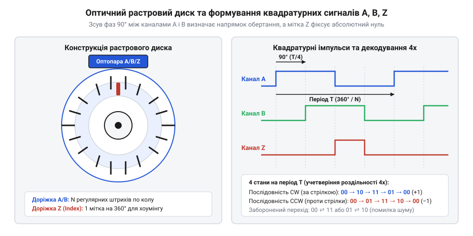
*Формування ортогональних сигналів каналів A і B з фазовим зсувом 90° та нульового індексного імпульсу Z на растровому диску.*

Нерухома оптоелектронна головка містить джерело колімованого випромінювання (інфрачервоний світлодіод або VCSEL-лазер), нерухому індикаторну діафрагму та лінійку інтегральних фотодіодів. Під час обертання диска чергування прозорих і темних секторів періодично перекриває світловий потік, модулюючи фотострум приймачів.

Для однозначного визначення не лише величини переміщення, а й напрямку обертання вала, оптична головка формує два просторово рознесені вихідні сигнали — канал `A` та канал `B`. Геометричне розташування фотодіодних груп розраховане так, щоб електричний сигнал каналу `B` був зсунутий за фазою відносно каналу `A` рівно на чверть просторового періоду, тобто на 90 електричних градусів:

```
s_A(θ) = s₀ + s_m · sin(N_lines · θ)
s_B(θ) = s₀ + s_m · cos(N_lines · θ)   [квадратурний зсув сигналів на 90°]
```

Така фазова комбінація називається [квадратурою](root:hw-sensing/quadrature) (від лат. @@la|quadratura@@ — надання квадратної форми, поділ на чотири).

Після проходження вбудованих компараторів на базі тригера Шмітта аналогові синусоїди перетворюються на цифрові прямокутні імпульси логічних рівнів TTL або RS-422. Аналіз послідовності станів двох каналів розв'язує задачу визначення знака швидкості:

- При обертанні за годинниковою стрілкою (CW): фронт сигналу `A` випереджає фронт сигналу `B` на 90° (послідовність двійкових станів `00 → 10 → 11 → 01 → 00`).
- При обертанні проти годинникової стрілки (CCW): канал `B` випереджає канал `A` (послідовність `00 → 01 → 11 → 10 → 00`).

Окрім інформаційних доріжок `A` та `B`, диск містить внутрішню концентричну доріжку з єдиним прозорим штрихом — індексний канал `Z` (@@en|Index / Reference mark@@). Канал `Z` генерує рівно один вузький імпульс на повний оберт вала (360°), що використовується цифровим контролером для захоплення абсолютного нуля відліку (процедура хоумінгу, @@en|homing@@) та компенсації накопиченої помилки пропуску імпульсів.

### Множення роздільності: режими 1x, 2x та 4x

Цифровий інтерфейсний таймер мікроконтролера або спеціалізована ПЛІС може декодувати квадратурний потік трьома способами залежно від того, які логічні перепади враховуються лічильником:

1. **Режим 1x (декодування за одним фронтом):** лічильник змінює стан лише за наростаючим фронтом каналу `A`. Кількість відліків на оберт дорівнює фізичній кількості штрихів диска: `CPR = PPR = N_lines` (де `PPR` — @@en|Pulses Per Revolution@@, `CPR` — @@en|Counts Per Revolution@@).
2. **Режим 2x (декодування за обома фронтами каналу A):** враховуються як наростаючі, так і спадні фронти сигналу `A`. Роздільність подвоюється: `CPR = 2 · N_lines`.
3. **Режим 4x (повне квадратурне учетверіння):** враховуються всі чотири логічні перепади (наростаючий і спадний фронти як каналу `A`, так і каналу `B`). Роздільність зростає рівно в 4 рази:

```
CPR
= 4 · N_lines                          [кількість лічильних квантів на один оберт]

Δθ_res
= 360° / (4 · N_lines)                 [кутова роздільність одного лічильного кванта]
```

**Чисельний приклад розрахунку кутової роздільності.**

Нехай промисловий оптичний енкодер має растровий диск із `N_lines = 2500` штрихів на оберт. Розрахуємо кутову роздільність системи в градусах, кутових мінутах і секундах при повному квадратурному декодуванні 4x.

1. Загальна кількість лічильних відліків на повний оберт:

```
CPR
= 4 · 2500
= 10 000 відліків / оберт
```

2. Кутовий крок одного дискретного відліку в градусах:

```
Δθ_res
= 360° / 10 000
= 0.036°
```

3. Переведення кутового кванта у кутові мінути (`'`) та кутові секунди (`"`):

```
Δθ_arcmin
= 0.036° · 60
= 2.16'                              [кутових мінут]

Δθ_arcsec
= 2.16' · 60
= 129.6"                             [кутових секунд]
```

### Частотні обмеження вихідних формувачів TTL та ліміти швидкості обертання

При практичній експлуатації інкрементних енкодерів у швидкісних сервоприводах фізична роздільність диска вступає у жорсткий конфлікт із максимальною швидкістю обертання вала. Вихідний каскад оптичної головки (компаратор і транзисторний ключ TTL / Push-Pull) та вхідний тракт мікроконтролера мають кінцеву смугу пропускання `f_max` (зазвичай від 100 кГц до 1 МГц для звичайних TTL-драйверів).

Основна частота проходження штрихів `f_pulse` на кожному з каналів `A` і `B` прямо пропорційна швидкості обертання вала `n` (в обертах на хвилину, @@en|RPM@@) та кількості рисок диска `N_lines`:

```
f_pulse
= (n / 60) · N_lines                   [частота імпульсів одного каналу в герцах]

f_count
= 4 · f_pulse
= (n / 60) · CPR                       [частота квадратурних перепадів у режимі 4x]
```

При квадратурному декодуванні критичним параметром стає мінімальний часовий інтервал між сусідніми логічними фронтами каналів `A` та `B` — тривалість фазового стану `t_sep` (@@en|edge separation time@@):

```
t_sep
= 1 / (4 · f_pulse)
= 15 / (n · N_lines)                   [інтервал між фронтами в секундах]
```

Якщо швидкість обертання або роздільність диска зависока, часовий інтервал `t_sep` стає меншим за сумарний час наростання й спаду сигналу `t_r + t_f` або за тривалість вікна цифрового антибрязкітного фільтра таймера. У такому разі вихідні формувачі TTL не встигають перезаряджати паразитну ємність сполучного кабелю `C_cable`:

```
dV / dt
= I_out / C_cable                      [швидкість наростання напруги на лінії]
```

Через обмежений вихідний струм `I_out` прямокутні імпульси спотворюються у трапецеподібні або трикутні з просіданням амплітуди нижче порогу спрацьовування тригера Шмітта. Це призводить до критичних збоїв: пропуску лічильних імпульсів, хибного визначення напрямку обертання та накопичення катастрофічної позиційної похибки.

**Чисельний приклад розрахунку граничної частоти.**

Нехай високоточний енкодер на `N_lines = 5000` ліній встановлено на шпиндель із частотою обертання `n = 6000 об/хв`. Визначимо вимоги до частотного тракту:

1. Частота імпульсів на каналах `A` і `B`:

```
f_pulse
= (6000 / 60) · 5000
= 100 · 5000
= 500 000 Гц = 500 кГц
```

2. Частота обробки квадратурних подій цифровим таймером:

```
f_count
= 4 · 500 кГц
= 2 000 000 подій / с = 2.0 МГц
```

3. Інтервал між суміжними логічними перепадами:

```
t_sep
= 1 / (2.0 × 10⁶ с⁻¹)
= 500 нс
```

Якщо лінія зв'язку має довжину 30 м із погонною ємністю 100 пФ/м (`C_total = 3000 пФ`), звичайний вихідний TTL-каскад із вихідним опором 1 кОм матиме сталу часу `τ = R · C = 3 мкс`, що у 6 разів перевищує часовий інтервал `t_sep = 500 нс`. Сигнал квадратури буде повністю зруйнований.

Саме тому для високошвидкісних ліній замість однополярного TTL застосовують симетричні диференціальні передавачі стандарту RS-422 (лінії `A / /A`, `B / /B`, `Z / /Z`) із низькоомним термінуванням 120 Ом та вихідним струмом до 20–40 мА. Програмну реалізацію апаратного кінцевого автомата декодування 4x із захистом від шумів представлено у вставці [програмний квадратурний декодер](root:hw-sensing/angle-rotation-sensing/proj-quadrature-decoder-and-tracking-loop.md). Для аналізу похибок зміщення оптичного центра диска відносно осі обертання використовують математичний апарат із вставки [математика ексцентриситету](root:hw-sensing/angle-rotation-sensing/math-quadrature-and-eccentricity-errors.md). Порівняння параметрів різних типів промислових інтерфейсів наведено у вставці [порівняння сенсорів](root:hw-sensing/angle-rotation-sensing/comp-magnetic-and-optical-encoders.md).

> 🔧 **Навіщо це.**
> Розрахунок граничної частоти `f_pulse` та тривалості фазового стану `t_sep` є обов'язковим інженерним етапом проектування приводу: він дозволяє вчасно виявити перевантаження цифрового приймача і перейти з однофазного TTL на диференціальний RS-422 або цифровий абсолютний протокол до настання аварійних збоїв позиціювання.

## Абсолютні оптичні енкодери та код Грея

Інкрементний енкодер втрачає інформацію про поточний кут у момент вимкнення живлення: після повторного ввімкнення системі потрібна процедура калібрування з пошуком нульової мітки. Для багатьох систем — маніпуляторів роботів, поворотних механізмів медичних томографів чи заслінок авіаційної техніки — неконтрольований рух для пошуку бази неприпустимий або небезпечний.

Абсолютний оптичний енкодер ([Абсолютний енкодер](root:hw-sensing/absolute-encoder-gray-code)) формує унікальний цифровий код для кожного кутового положення вала в межах повного оберту або кількох обертів. Замість періодичної растрової сітки його диск містить кілька концентричних доріжок із малюнком прозорих і непрозорих ділянок, а лінійка фотоприймачів паралельно зчитує всі розряди коду.

Якщо нанести на диск звичайний позиційний двійковий код, виникає критична апаратна проблема — @@en|race condition@@ (гонка розрядів). Розглянемо перехід між сусідніми кутовими секторами 3 (`011₂`) та 4 (`100₂`) у 3-бітному енкодері. У цій точці мають одночасно змінити свій стан усі три біти. Через неминучі мікроскопічні похибки оптичного вирівнювання фотоприймачів та неідеальність радіальних меж доріжок фотодіоди ніколи не спрацьовують в один і той самий фізичний момент часу.

В інтервалі перемикання тривалістю в кілька мікросекунд фотодіоди зчитають хибні проміжні комбінації — наприклад, `000₂` (кут 0°) або `111₂` (кут 315°). Якщо мікроконтролер виконає опитування в цей момент, у контурі керування виникне колосальний помилковий стрибок кута, що призведе до ударного навантаження на привод.

Для усунення гонки розрядів використовують рефлексивний двійковий код — @@en|Gray code@@ (код Грея), названий на честь інженера Френка Грея (Frank Gray).

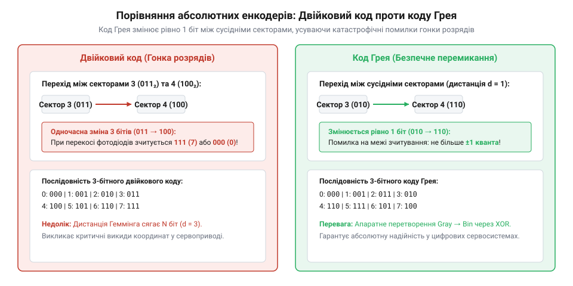
*Розкладка доріжок кодового диска: у звичайному двійковому коді одночасне перемикання кількох бітів спричиняє паразитичні проміжні стани (гонку розрядів), тоді як код Грея гарантує зміну лише одного біта на будь-якому переході між сусідніми кутовими секторами.*

Фундаментальна властивість коду Грея полягає в одиничній кодовій відстані Хеммінга між будь-якими двома сусідніми секторами: при переході змінює значення лише один біт. Ба більше, при переході від останнього сектора `2ⁿ − 1` назад до нульового сектора `0` також перемикається рівно один розряд, що робить код циклічним. Будь-яка часова затримка зчитування призводить лише до того, що енкодер зафіксує або попередній кут, або наступний, але ніколи не згенерує дикого проміжного значення.

Апаратне та програмне перетворення n-бітного двійкового числа `B` у код Грея `G` виконується операцією побітового виключного АБО (`XOR`) із сувом вправо на один розряд:

```
G = B ^ (B >> 1)
```

Зворотне перетворення n-бітного коду Грея `G` у звичайний двійковий код `B` виконується каскадним накопичувальним `XOR`, починаючи від старшого розряду (MSB):

```
B[n-1] = G[n-1]
B[i]   = B[i+1] ^ G[i]    [для всіх i від n-2 вниз до 0]
```

За конструктивним діапазоном абсолютні енкодери поділяють на два класи:
1. Однооборотні (@@en|single-turn@@) — однозначно вимірюють кут у межах від 0° до 360°.
2. Багатооборотні (@@en|multi-turn@@) — окрім положення всередині оберту, фіксують точну кількість зроблених повних обертів (зазвичай 12–16 бітів, тобто до 65536 обертів).

### Енергонезалежний підрахунок обертів на ефекті Віганда

Підрахунок обертів у багатооборотних енкодерах традиційно реалізували через прецизійний механічний редуктор із каскадом додаткових субдисків і оптопар або через електронний лічильник із резервною літієвою батарейкою. Проте редуктор збільшує габарити, масу та момент інерції вала, а батарейка має обмежений термін служби (5–10 років), потребує регламентної заміни та відмовляє при низьких температурах.

Сучасним рішенням є безбатарейні генераторні сенсори на базі дроту Віганда (@@en|Wiegand wire@@), винайденого Джоном Вігандом (John R. Wiegand).

Дріт Віганда виготовляють зі спеціального сплаву Vicalloy (залізо–кобальт–ванадій). У процесі термомеханічної обробки (скручування під натягом із подальшим відпалом) дріт набуває унікальної біаксіальної магнітної структури:
- **Зовнішня оболонка:** магнітно-жорстка, має високу коерцитивну силу та фіксовану магнітну орієнтацію.
- **Внутрішнє осердя:** магнітно-м'яке, легко перемагнічується зовнішнім полем протилежного знака.

Коли постійний магніт на валу обертається поблизу сенсора, напруженість зовнішнього поля досягає критичного порогу перемикання. У цей момент внутрішнє осердя здійснює миттєвий квантовий стрибок намагніченості (ефект Баркгаузена, @@en|Barkhausen jump@@) — лавиноподібне перевертання магнітних доменів за час менше 10 мкс.

Відповідно до закону електромагнітної індукції Фарадея, наведена в зчитувальній мікрокотушці ЕРС визначається швидкістю зміни магнітного потоку:

```
e(t)
= −N_turns · (dΦ / dt)                 [наведена ЕРС у котушці Віганда]
```

Оскільки швидкість лавиноподібної зміни потоку `dΦ / dt` всередині осердя визначається внутрішніми квантово-механічними властивостями сплаву, а не швидкістю руху зовнішнього магніту, амплітуда та форма генерованого імпульсу **абсолютно не залежать від кутової швидкості вала**. Навіть якщо вал обертається надзвичайно повільно (наприклад, 1 оберт на добу):

- Котушка формує короткий потужний імпульс напруги амплітудою `3 … 5 В` тривалістю близько 10 мкс із запасом енергії `10 … 20 нДж`.
- Цього енергетичного імпульсу достатньо для прямого живлення мікропотужного контролера лічильника без зовнішнього живлення: він пробуджується, оновлює значення лічильника повних обертів (+1 або −1 оберт) у сегнетоелектричній енергонезалежній пам'яті (FRAM) і знову вимикається.

Після відновлення основного живлення системи енкодер миттєво передає контролеру як точний поточний кут усередині оберту, так і точне число зроблених обертів без процедури нульового позиціювання. Детальне порівняння конструкцій наведено у [порівнянні кутових сенсорів](root:hw-sensing/angle-rotation-sensing/comp-magnetic-and-optical-encoders.md).

> 🔧 **Навіщо це.**
> Технологія Віганда дозволяє будувати необслуговувані багатооборотні абсолютні енкодери для вітрогенераторів, залізничного транспорту та підводних маніпуляторів, де заміна літієвих батарейок є економічно недоцільною або фізично неможливою.

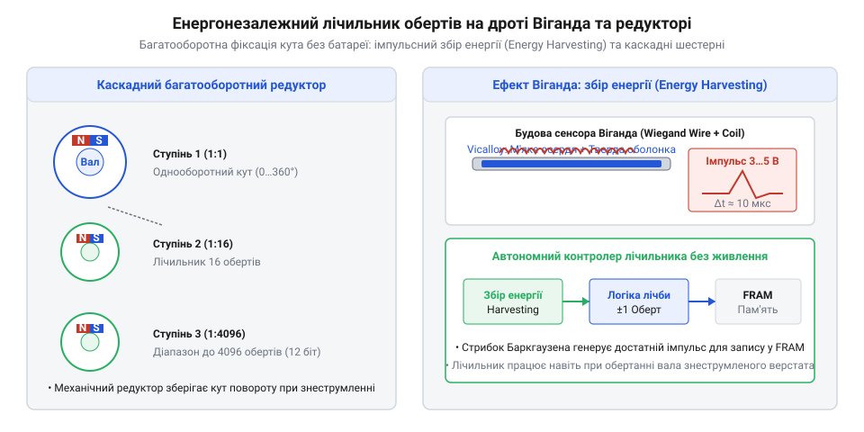
*Схема підрахунку повних обертів: поєднання багатоступеневого редуктора з магнітними тригерами Віганда для безбатарейної енергонезалежної фіксації обертів.*

## Магнітні давачі кута: Hall, AMR, GMR та TMR

Оптичні диски вимагають високої точності механічного юстування і втрачають працездатність при потраплянні пилу, мастильного туману чи водяного конденсату на прозорі доріжки. Магнітні давачі кута повністю позбавлені оптичних каналів і забезпечують надійне безконтактне зчитування положення вала крізь герметичні немагнітні перегородки з алюмінію чи нержавіючої сталі.

Фізична основа магнітних сенсорів — безконтактне вимірювання просторової орієнтації вектора магнітної індукції `B`, утвореного постійним діаметрально намагніченим магнітом на торці вала або багатополюсним магнітним кільцем.

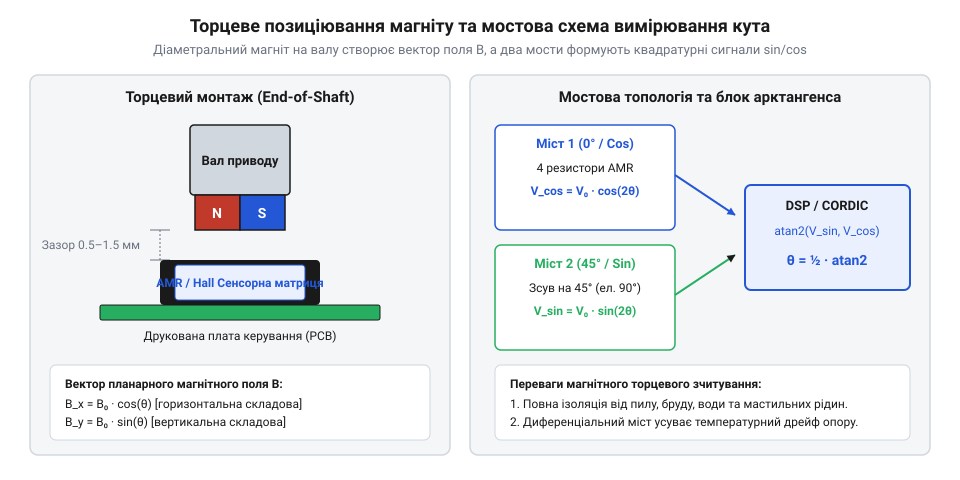
*Торцеве позиціювання постійного магніту відносно інтегрального магніторезистивного моста та векторне визначення кута обертання через чотириквадрантний арктангенс відношення ортогональних сигналів напруги.*

### Фізичні технології та коефіцієнт магнітоопору

У сучасних інтегральних мікросхемах сенсорів кута застосовують чотири фундаментальні магніточутливі технології, кожна з яких відрізняється фізичним механізмом виникнення сигналу та ефективністю перетворення:

1. **Диференціальні елементи Холла** ([Холл-енкодери](root:hw-sensing/hall-magnetic-encoders)) — базуються на силі Лоренца, що відхиляє рухомі носії заряду в кремнієвому чи арсенід-галієвому (GaAs) напівпровіднику під дією перпендикулярного магнітного поля, утворюючи поперечну ЕРС Холла. Диференціальні пари холівських сенсорів вимірюють ортогональні проекції поля, компенсуючи синфазні зовнішні магнітні завади. Однорідні кремнієві структури мають помірну чутливість (близько 10–20 мВ/В/Тл), але відрізняються стабільністю характеристик у часі.
2. **Анізотропний магнітоопір (AMR, @@en|Anisotropic Magnetoresistance@@)** — базується на зміні питомого електричного опору тонких плівок пермалою (сплав Fe₁₉Ni₈₁) залежно від кута `θ` між напрямком електричного струму `I` та внутрішнім вектором спонтанної намагніченості матеріалу. Опір змінюється за квадратичним законом:
```
R(θ) = R₀ + ΔR · cos²(θ)
```
Типовий коефіцієнт магнітоопору пермалоєвих структур становить `ΔR / R₀ ≈ 2–3%`. Два мости Вітстона, просторово повернуті під кутом 45° один відносно одного, генерують квадратурні вихідні напруги подвійної кутової періодичності `cos(2θ)` та `sin(2θ)`. AMR-сенсори мають дуже низький рівень власного шуму і чудову лінійність, проте потребують допоміжних холівських елементів або додаткової котушки зміщення для однозначного розкриття кута в повному діапазоні 0°…360°.
3. **Гігантський магнітоопір (GMR, @@en|Giant Magnetoresistance@@)** — виникає в багатошарових наноструктурах (спінових клапанах), де тонкі шари феромагнетика (CoFe, NiFe) розділені металевим немагнітним прошарком міді (Cu) завтовшки 2–3 нм. Електричний опір структури мінімальний при паралельній орієнтації векторів намагніченості шарів і максимальний при антипаралельній через спін-залежне розсіювання електронів провідності на межах поділу шарів. Завдяки наявності закріпленого (@@en|pinned@@) антиферомагнітною підкладкою (IrMn) опорного шару GMR забезпечує однозначну кутову періодичність 360°. Типовий коефіцієнт магнітоопору GMR сягає `ΔR / R₀ ≈ 10–20%`, що забезпечує значно вихідну напругу, ніж у технології AMR.
4. **Тунельний магнітоопір (TMR, @@en|Tunnel Magnetoresistance@@)** — використовує явище квантовомеханічного спін-поляризованого тунелювання електронів крізь ультратонкий (близько 1 нм) діелектричний бар'єр оксиду магнію (MgO), розташований між двома феромагнітними електродами CoFeB. TMR-сенсори мають колосальний коефіцієнт магнітоопору, який за кімнатної температури сягає `ΔR / R₀ ≈ 100–200%` (в експериментальних зразках — понад 300%). Це забезпечує пряму амплітуду диференціального вихідного сигналу моста до 100–300 мВ/В безпосередньо без попереднього підсилення. Високий коефіцієнт магнітоопору TMR кардинально покращує відношення сигнал/шум (SNR), зменшує струм споживання мікросхеми до часток мікроампера і дає змогу досягати субмікросекундної швидкодії з кутовою похибкою менше ±0.1°.

### Конструктивні схеми та автонульова корекція

При класичному торцевому позиціюванні (@@en|end-of-shaft@@ / on-axis) циліндричний магніт закріплюється безпосередньо на торці обертового вала навпроти кристала мікросхеми з повітряним зазором 0.5–2.0 мм. Постійний магніт створює в площині чутливих мостів обертове планарне поле індукції `B` із проекціями:

```
B_x = B₀ · cos(θ)
B_y = B₀ · sin(θ)
```

Для порожнистих валів та приводів великого діаметра використовують бічну схему (@@en|off-axis@@), де сенсор зчитує тангенціальну й радіальну складові поля від багатополюсного магнітного кільця.

Незважаючи на високу чутливість TMR/AMR мостів, технологічний розкид опорів тонких плівок та температурні градієнти створюють паразитне постійне зміщення нуля (offset). Для його усунення сигнальний тракт мікросхеми містить інструментальний підсилювач із модуляцією-демодуляцією (@@en|chopper-stabilized@@) та автонульовою корекцією.

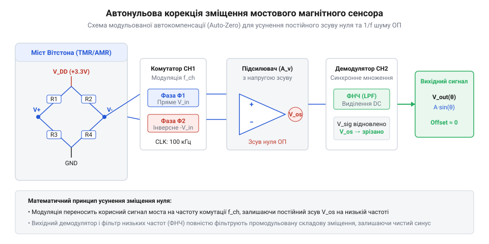
*Інтегральний сигнальний тракт з автонульовою корекцією: комутаційні ключі динамічно інвертують полярність живлення моста, а блок автонуля віднімає низькочастотний дрейф і флікер-шум операційного підсилювача.*

Після нормалізації й автонульової фільтрації квадратурні сигнали набувають виразу:

```
V_cos(θ) = V₀ · cos(θ)
V_sin(θ) = V₀ · sin(θ)
```

### Векторний розрахунок кута через чотириквадрантний арктангенс

Абсолютне кутове положення ротора обчислюється цифровим ядром мікросхеми (DSP або апаратним CORDIC-конвеєром) за функцією чотириквадрантного арктангенса:

```
θ = atan2(V_sin, V_cos)
```

Функція `atan2(y, x)` перевіряє знаки обох координат і однозначно розкриває кут у повному геометричному колі від −180° до +180° (0°…360°), усуваючи неоднозначність ділення на нуль при перетині осей.

Векторний метод визначення кута через відношення двох ортогональних сигналів `V_sin / V_cos` робить вимірювання повністю інваріантним до абсолютного модуля індукції `B₀`. Завдяки цьому кутовий відлік не зазнає похибки при температурному розмагнічуванні неодимового магніту (типовий температурний коефіцієнт NdFeB становить близько −0.12%/°C) чи осьовому люфті вала. Детальний математичний апарат компенсації амплітудного перекосу й еліптичності сигналів викладено у [математичному аналізі похибок](root:hw-sensing/angle-rotation-sensing/math-quadrature-and-eccentricity-errors.md), а порівняння з оптичними та індуктивними аналогами — у [порівняльному огляді кутових енкодерів](root:hw-sensing/angle-rotation-sensing/comp-magnetic-and-optical-encoders.md).

> 🔧 **Навіщо це.**
> Векторне обчислення кута через відношення двох ортогональних сигналів `V_sin / V_cos` робить вимірювання повністю нечутливим до абсолютних змін напруженості магнітного поля при коливаннях повітряного зазору, осьовому битті вала та температурному розмагнічуванні магніту.

## Індуктивні резольвери та RVDT-трансформаториДля найважчих умов експлуатації — авіаційних сервоприводів керування кермами, тягових електродвигунів електромобілів, бурового обладнання та атомних реакторів — ані оптичні, ані магніторезистивні енкодери не мають достатньої надійності через деградацію напівпровідників і крихкість скла при температурах вище +125 °C чи дії іонізуючого випромінювання.

Електромагнітний резольвер (@@en|resolver@@) являє собою безконтактну обертову електричну мікромашину трансформаторного типу. Його конструкція містить сталевий шихтований магнітопровід і мідні обмотки, що витримують нагрівання до +150…+200 °C, вібраційні удари до 500 g та повне занурення в мастило.

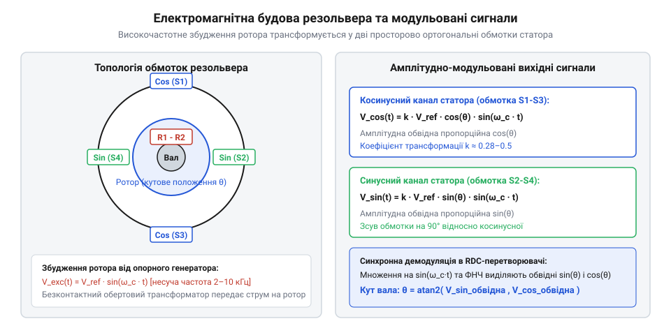
*Електромагнітна будова резольвера: змінна напруга збудження ротора трансформується у дві ортогональні обмотки статора, утворюючи високочастотні амплітудно-модульовані сигнали sin(θ) та cos(θ).*

У класичному безщітковому резольвері передавання струму збудження на обмотку ротора здійснюється без тертя за допомогою коаксіального обертового трансформатора.

На первинну обмотку збудження ротора `R1–R2` від зовнішнього генератора подається синусоїдальна змінна напруга несучої частоти `f_c = 2…10 кГц`:

```
V_exc(t) = V_ref · sin(ω_c · t)
```

На статорі резольвера розташовані дві вторинні обмотки `S1–S3` (косинусна) та `S2–S4` (синусна), зсунуті у просторі одна відносно одної строго на 90 електричних градусів. Взаємна індуктивність між ротором і статорними обмотками змінюється за законом синуса й косинуса від механічного кута положення вала `θ`. У результаті на виходах статора утворюються високочастотні амплітудно-модульовані сигнали:

```
V_cos(t) = k · V_ref · cos(θ) · sin(ω_c · t)
V_sin(t) = k · V_ref · sin(θ) · sin(ω_c · t)
```

де `k` — коефіцієнт трансформації резольвера (зазвичай `k ≈ 0.28…0.5`).

Близьким за принципом дії індуктивним сенсором є кутовий диференційний трансформатор RVDT (@@en|Rotary Variable Differential Transformer@@, кутовий аналог [LVDT](root:hw-sensing/lvdt)). В RVDT первинна обмотка збудження розміщена на нерухомому статорі разом із двома зустрічно увімкненими вторинними обмотками, а обертається лише профільований феромагнітний сердечник у формі ексцентрика. RVDT забезпечує виняткову лінійність, але має обмежений кутовий робочий діапазон (зазвичай ±40°…±60°).

Для перетворення амплітудно-модульованих сигналів резольвера у цифровий код кута використовують спеціалізовані перетворювачі [Перетворювач резольвер-цифра](root:hw-sensing/resolver-to-digital-converter) (RDC), детальний порівняльний аналіз яких наведено у [порівнянні кутових сенсорів](root:hw-sensing/angle-rotation-sensing/comp-magnetic-and-optical-encoders.md).

> 🔧 **Навіщо це.**
> Резольвери є незамінними первинними давачами кута для тягових інверторів електромобілів і гібридів, де екстремальні вібрації трансмісії та високі робочі температури миттєво виводять з ладу оптичні диски.

## Демодуляція сигналів та контури стеження (Tracking Loops)

Пряме обчислення кута через паралельне оцифрування миттєвих напруг `V_cos(t)` та `V_sin(t)` швидкими АЦП і подальше ділення `atan2` страждає від високочастотного шуму квантування, амплітудної нестабільності генератора збудження та фазової затримки аналогових фільтрів низьких частот.

Сучасні спеціалізовані RDC-мікросхеми та цифрові сигнальні процесори (DSP) реалізують замкнений контур фазового автопідстроювання другого порядку — @@en|Type II Tracking Loop@@.

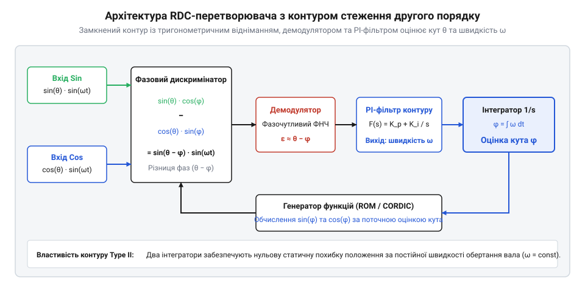
*Архітектура RDC-перетворювача на базі контуру стеження другого порядку: тригонометричний фазовий дискримінатор, синхронний демодулятор, PI-фільтр та інтегратор усувають фазове запізнення й одночасно оцінюють кут і швидкість вала.*

### Математична структура контуру стеження другого порядку

Алгоритм контуру стеження працює за принципом безперервного зведення кутової неузгодженості між реальним положенням ротора `θ` та внутрішньою оцінкою кута `φ` до нуля:

1. **Тригонометричне множення в дискримінаторі.** Внутрішній лічильник мікросхеми містить поточну розрахункову оцінку кута `φ`. Вхідні модульовані сигнали резольвера перемножуються на косинус і синус оцінки кута:
```
V_1(t) = V_sin(t) · cos(φ) = k · V_ref · sin(θ) · cos(φ) · sin(ω_c · t)
V_2(t) = V_cos(t) · sin(φ) = k · V_ref · cos(θ) · sin(φ) · sin(ω_c · t)
```

2. **Формування різницевого сигналу неузгодженості:**
```
ΔV(t)
= V_1(t) − V_2(t)
= k · V_ref · [sin(θ) · cos(φ) − cos(θ) · sin(φ)] · sin(ω_c · t)
= k · V_ref · sin(θ − φ) · sin(ω_c · t)    [за тригонометричною формулою синуса різниці]
```

3. **Синхронна демодуляція.** Сигнал `ΔV(t)` множиться на синфазну опорну несучу `sin(ω_c · t)` і фільтрується від подвоєної частоти несучої. Оскільки для малих кутів розбіжності `sin(θ − φ) ≈ θ − φ`, на виході демодулятора утворюється чистий сигнал кутової похибки `ε = θ − φ`.

4. **Пропорційно-інтегральний фільтр контуру (PI-регулятор).** Похибка `ε` надходить на регулятор із передатною функцією:
```
F(s) = K_p + K_i / s
```
Вихідний сигнал регулятора строго пропорційний кутовій швидкості обертання вала `ω = dφ/dt`.

5. **Інтегратор оцінки кута.** Другий інтегратор `1/s` накопичує розраховану швидкість і формує вихідний цифровий код кута `φ = ∫ ω dt`.

### Смуга пропускання та динамічна похибка при кутовому прискоренні

Завдяки наявності двох послідовних інтеграторів `1/s` у прямому тракті замкненої системи передатна функція розімкненого контуру має вигляд:

```
G_open(s) = (K_p · s + K_i) / s²
```

Передатна функція замкненого контуру другого порядку за вхідним кутом набуває канонічної форми:

```
H(s) = G_open(s) / (1 + G_open(s)) = (2 · ζ · ω_n · s + ω_n²) / (s² + 2 · ζ · ω_n · s + ω_n²)
```

де `ω_n = √K_i` — власна резонансна кутова частота контуру, а `ζ = K_p / (2 · √K_i)` — коефіцієнт демпфування (типово обирається `ζ = 0.707` для оптимального перехідного процесу за Баттервортом).

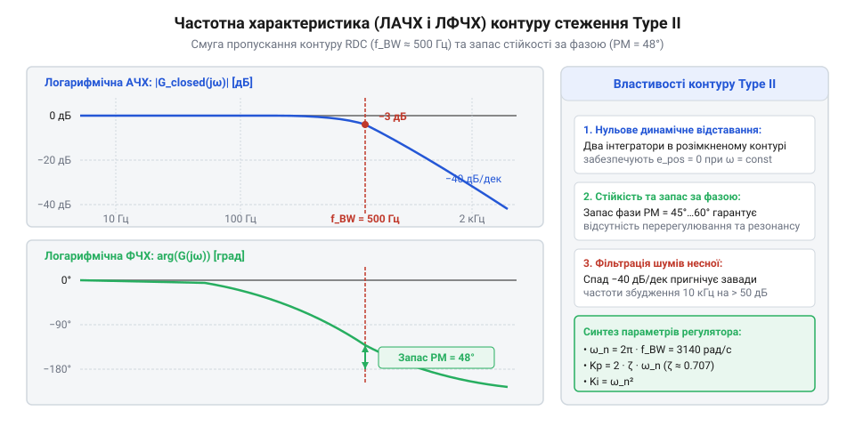
*Частотна характеристика контуру стеження: логарифмічні амплітудна й фазова характеристики демонструють смугу пропускання контуру по рівню −3 дБ та запас стійкості за фазою.*

**Поведінка системи в усталених та динамічних режимах:**

1. **Рух із постійною швидкістю (`θ(t) = ω₀ · t`, `α = 0`):**
При подачі лінійно зростаючого кута похибка стеження `E(s) = (1 − H(s)) · (ω₀ / s²)`. За теоремою про кінцеве значення:
```
ε_vel = lim(s → 0) [ s · E(s) ] = lim(s → 0) [ s · (s² / (s² + 2ζω_n s + ω_n²)) · (ω₀ / s²) ] = 0
```
Контур стеження Type II має строго нульову швидкісну похибку позиціювання — вихідний кут `φ` відстежує реальний кут `θ` без будь-якого фазового запізнення.

2. **Рух із постійним кутовим прискоренням (`θ(t) = ½ · α · t²`, `α = const`):**
При кутовому прискоренні вала вхідний сигнал є параболічним `Θ(s) = α / s³`. Усталена динамічна похибка прискорення дорівнює:
```
ε_acc
= lim(s → 0) [ s · (1 − H(s)) · (α / s³) ]
= lim(s → 0) [ s · (s² / (s² + 2ζω_n s + ω_n²)) · (α / s³) ]
= α / ω_n²
= α / K_i
```

Динамічна кутова похибка при розгоні або гальмуванні приводу обернено пропорційна квадрату частоти контуру `ω_n²` (або інтегральному коефіцієнту `K_i`).

**Інженерний компроміс вибору смуги пропускання `f_BW`:**
- *Широка смуга (`f_BW = 1–2 кГц`, `ω_n ≈ 2π × 1000 рад/с`)*: забезпечує мінімальну помилку запізнення при різкому прискоренні сервоприводу (`ε_acc < 0.05°` при `α = 10 000 рад/с²`), проте пропускає високочастотний шум квантування АЦП і гармоніки несучої;
- *Вузька смуга (`f_BW = 100–200 Гц`)*: глибоко фільтрує вібраційні завади та шуми датчика, проте при високих прискореннях накопичує значну динамічну похибку `ε_acc = α / (2π f_BW)²`, що вимагає введення компенсації за прискоренням (@@en|feedforward@@).

### Апаратний CORDIC для обчислення арктангенса

Для систем без апаратного блоку FPU операція розрахунку арктангенса у фіксованій комі реалізується ітеративним алгоритмом CORDIC (@@en|Coordinate Rotation Digital Computer@@). CORDIC обертає вектор на спадну послідовність табличних кутів `θ_i = atan(2⁻ⁱ)`, зводячи обчислення до простих бітових зсувів і віднімань без операцій ділення чи множення:

```
x[i+1] = x[i] − d_i · (y[i] >> i)
y[i+1] = y[i] + d_i · (x[i] >> i)
z[i+1] = z[i] − d_i · θ_i
```

де `d_i = −sign(y[i])`. За 16–24 ітерації залишкове значення `z[N]` збігається до точного кута `θ = atan2(y, x)` із точністю до молодшого розряду. Програмну реалізацію контуру стеження та CORDIC представлено у [алгоритмах квадратурного декодера та контуру стеження](root:hw-sensing/angle-rotation-sensing/proj-quadrature-decoder-and-tracking-loop.md).

> 🔧 **Навіщо це.**
> Контур стеження Type II не лише відновлює кут із надвисокою стійкістю до синфазних шумів, а й автоматично генерує точне безинерційне значення швидкості обертання ротора без цифрового диференціювання.

## Метрологічний бюджет похибок та еліптичне калібрування

Сумарна похибка вимірювання кута є комбінацією механічних неідеальностей монтажу та електронних асиметрій вимірювальних трактів.

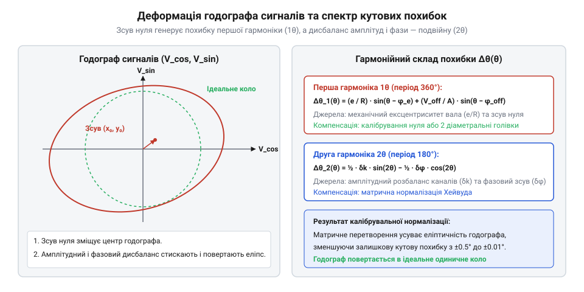
*Вплив сигнальних неідеальностей на траєкторію годографа: зміщення нуля зміщує центр кола, амплітудна асиметрія стискає коло в еліпс уздовж осі, а фазова неортогональність повертає головні півосі еліпса, генеруючи кутові похибки першої (1θ) та другої (2θ) гармонік.*

Гармонійний аналіз розділяє просторовий спектр кутових похибок на специфічні гармоніки:

1. **Постійні зміщення нуля (Offset, `V_off_c`, `V_off_s`)** — викликані напругою зсуву операційних підсилювачів або несиметрією магніторезистивних мостів. Зсувають центр траєкторії годографа `(V_cos, V_sin)` з точки `(0, 0)` у точку `(x₀, y₀)`. Це генерує циклічну похибку **першої гармоніки (1θ)**:
```
Δθ_off(θ) ≈ −(V_off_s / A) · cos(θ) + (V_off_c / A) · sin(θ)
```

2. **Геометричний ексцентриситет вала (`e / R`)** — радіальне биття кодового диска чи магніту викликає механічну похибку, яка також строго лягає на **першу гармоніку (1θ)** з амплітудою `e / R`.

3. **Амплітудний розбаланс (`k_g = A_s / A_c ≠ 1`)** — неоднаковий коефіцієнт підсилення каналів стискає круговий годограф в еліпс уздовж координатних осей, утворюючи похибку **другої гармоніки (2θ)**:
```
Δθ_gain(θ) ≈ ½ · (1 − k_g) · sin(2θ)
```

4. **Фазова неортогональність (`δφ ≠ 0`)** — відхилення просторового або електричного зсуву між сенсорами від 90° повертає головні осі еліпса на 45°, породжуючи похибку **другої гармоніки (2θ)**:
```
Δθ_phase(θ) ≈ ½ · δφ · cos(2θ)
```

### Алгоритм матричної нормалізації Хейвуда в реальному часі

Для корекції всіх чотирьох похибок у реальному часі вектор сирих сигналів `[V_c, V_s]ᵀ` перетворюється на ідеальний ортогональний вектор `[V_c_norm, V_s_norm]ᵀ` за допомогою калібрувальної матриці:

```
[ V_c_norm ]   [ 1              0           ]   [ V_c − V_off_c ]
[          ] = [                            ] · [               ]
[ V_s_norm ]   [ −tan(δφ)    1 / (k_g · cos(δφ)) ]   [ V_s − V_off_s ]
```

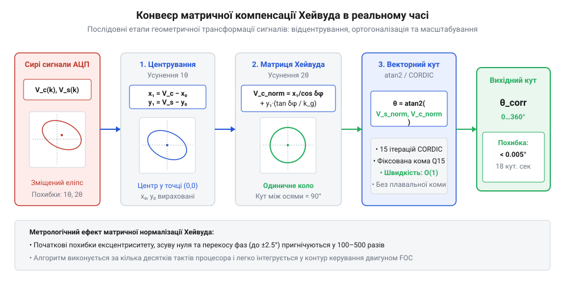
*Конвеєр цифрової обробки сигналів енкодера: послідовне віднімання зміщення нуля, корекція фазового перекосу та амплітудне нормування перед подачею вектора в блок обчислення арктангенса.*

Після матричної компенсації траєкторія годографа трансформується з довільного нахиленого та зміщеного еліпса в ідеальне центроване одиничне коло, а обчислений через `atan2(V_s_norm, V_c_norm)` кут стає вільним від гармонічних спотворень першого та другого порядків.

### Числові межі та залишковий бюджет нелінійності

У типовому промисловому застосуванні первинні неідеальності вузла створюють значні початкові похибки:
- Монтажний ексцентриситет `e = 30 мкм` при радіусі диска `R = 20 мм` вносить кутову похибку першої гармоніки `Δθ ≈ e / R = 1.5 мрад ≈ 0.086°` (5.15 кутових мінут).
- Технологічний розкид підсилення підсилювача `δk = 3%` створює похибку другої гармоніки амплітудою `Δθ ≈ 0.015 рад ≈ 0.86°`.
- Кутовий перекіс магніторезистивного моста або оптопари `δφ = 2°` породжує подвійну гармоніку з амплітудою `1.0°`.

Сумарна первинна нелінійність невідкаліброваного сенсора досягає `Δθ_total ≈ ±1.5°…2.5°`, що є неприпустимим для прецизійного векторного керування FOC.

Застосування алгоритму матричної компенсації Хейвуда дає такі граничні числові результати:
- **Пригнічення гармонік 1θ та 2θ:** Похибки зсуву нуля та ортогональності зменшуються на 40–55 дБ (у 100–500 разів).
- **Залишкова кутова нелінійність:** При 14-бітному оцифруванні АЦП та якісній апроксимації еліпса методом найменших квадратів залишкове відхилення не перевищує `±0.003°…0.005°` (від 10 до 18 кутових секунд).
- **Джерела залишкової похибки після калібрування:**
  1. *Вищі непарні просторові гармоніки (3θ, 5θ)*, спричинені нелінійністю насичення феромагнітних сердечників або дифракційними абераціями штрихів растра (залишковий внесок близько `±0.001°…0.002°`).
  2. *Шум квантування АЦП та тепловий дрейф підсилювача* (вплив дрейфу становить до `0.0005°/°C`, що вимагає динамічного періодичного перерахунку коефіцієнтів матриці при роботі в широкому температурному діапазоні від −40 до +105 °C).

Детальні аналітичні виведення гармонійного розкладу та геометричного вирівнювання еліпса наведено у [математичному виведенні та калібруванні похибок](root:hw-sensing/angle-rotation-sensing/math-quadrature-and-eccentricity-errors.md). Практичні аспекти вибору типів датчиків для промислових приводів викладено у [порівняльному огляді кутових сенсорів](root:hw-sensing/angle-rotation-sensing/comp-magnetic-and-optical-encoders.md), а програмні алгоритми обчислення кута в реальному часі реалізовано у [програмній реалізації квадратурного декодера та контуру стеження](root:hw-sensing/angle-rotation-sensing/proj-quadrature-decoder-and-tracking-loop.md).

> 🔧 **Навіщо це.**
> Застосування матричного калібрування дозволяє використовувати недорогі магнітні та оптичні датчики з широкими монтажними допусками, досягаючи субкутової точності за рахунок швидкої цифрової корекції.

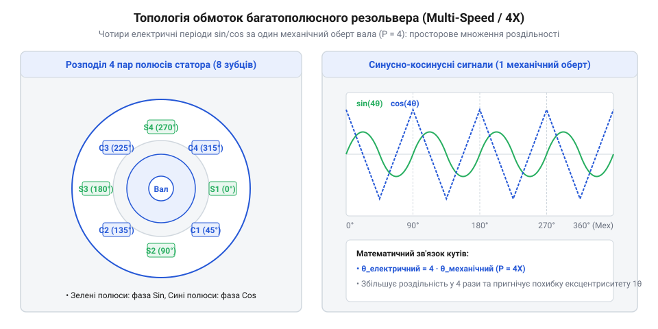
*Конфігурація багатополюсного резольвера: розподіл пар полюсів статора формує кілька електричних циклів синусно-косинусних сигналів за один механічний оберт, підвищуючи точність інтерполяції кута.*
