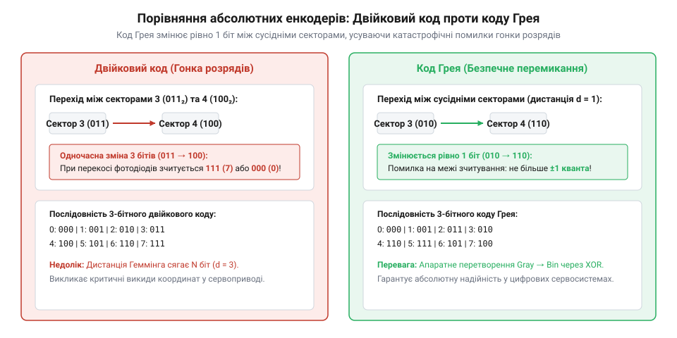
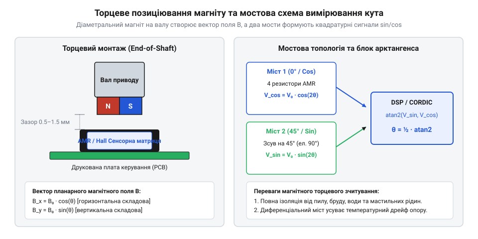
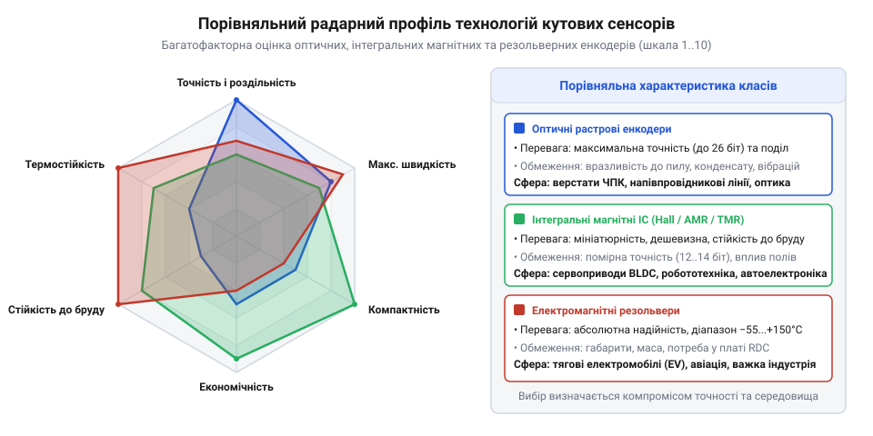

# Вимір кута

## Завдання вимірювання кута та положення вала

Керування будь-яким механічним рухом — від суглоба промислового робота до ротора тягового електродвигуна чи супутникової антени — вимагає неперервного знання двох величин: поточного кутового положення вала θ та швидкості його обертання ω = dθ/dt. Без точного зворотного зв'язку за кутом векторне керування сучасними синхронними двигунами з постійними магнітами стає неможливим: система керування повинна точно знати положення магнітних полюсів ротора відносно обмоток статора, щоб спрямовувати вектор струму під кутом 90° для створення максимального крутного моменту.

Історично найпростішим давачем кута був резистивний потенціометр, де вихідна напруга лінійно залежить від положення рухомого повзунка. Проте механічний контакт неминуче стирається від тертя, чутливий до вібрацій, спричиняє іскріння та шуми ковзання, а в зоні переходу між початком і кінцем резистивного шару має мертву зону. Автоматизовані приводи потребують необмеженого неперервного обертання та високої надійності, тому в сучасній техніці застосовують безконтактні сенсори обертання — енкодери та резольвери.

> 🔧 **Навіщо це.**
> Безконтактне вимірювання кута усуває механічне тертя та зношування сенсора, дозволяючи зчитувати положення вала на швидкостях до 20 000 об/хв протягом десятків років експлуатації в сервоприводах верстатів ЧПК та електромобілях.

## Інкрементні та абсолютні енкодери

Усі давачі кута обертання за принципом формування сигналу поділяють на два фундаментальні класи: інкрементні та абсолютні.

Інкрементний енкодер генерує послідовність електричних імпульсів під час обертання вала. Базовий вузол формує два канали дискретних імпульсів — канал A і канал B, які просторово або фазово зсунуті між собою на 90° електричних градусів (квадратурний сигнал). Знайомство з напрямком обертання досягається за рахунок аналізу випередження фази:
- якщо наростаючий фронт сигналу A випереджає сигнал B, вал обертається за годинниковою стрілкою;
- якщо сигнал B випереджає A, вал обертається проти годинникової стрілки.

Обидва логічні рівні каналів утворюють 4 дискретні стани на один період штриха: `(0,0) → (1,0) → (1,1) → (0,1)`. Рахуючи кожен перепад на обох лініях (режим декодування 4x), цифровий лічильник учетверо збільшує результуючу роздільність енкодера відносно кількості фізичних міток на диску. Для фіксації повних обертів та прив'язки до системи координат використовують додатковий канал Z (індексний імпульс), що з'являється рівно один раз за повний оберт вала.

Головне обмеження інкрементного давача — залежність від енергопостачання та втрата положення при вимкненні живлення. Після перезапуску системи контролер не знає справжнього кута, поки механізм не виконає процедуру калібрування нульової точки (пошук референтної мітки Z).

Абсолютний енкодер позбавлений цього недоліку: він видає унікальний числовий цифровий код для кожного кутового положення вала в межах повного оберту (однообертові енкодери) або з фіксацією кількості зроблених обертів (багатообертові енкодери).


*Принцип усунення помилок позиціонування: у стандартному двійковому коді при переході секторів одночасно змінюються кілька розрядів, викликаючи фальшиві проміжні коди; код Грея змінює рівно один розряд за крок.*

У класичному двійковому коді під час переходу між сусідніми секторами (наприклад, від 0111₂ = 7 до 1000₂ = 8) змінюються всі 4 розряди одночасно. Через мікроскопічну неідеальність оптики чи сенсорів окремі біти перемикаються неодночасно, породжуючи фальшиві проміжні значення (наприклад, 1111₂ = 15), що може спричинити аварійний ривок приводу. Щоб уникнути цього, абсолютні диски розкреслюють у коді Грея (рефлексивний бінарний код), головна властивість якого полягає в тому, що при переході до будь-якого сусіднього сектора змінюється значення **лише одного біта**.

Отримане абсолютне значення позиції передається у цифровий керуючий контролер через високошвидкісні послідовні інтерфейси промислового стандарту — синхронні шини SSI, BiSS-C або EnDat, що гарантує передачу кута з розрядністю від 13 до 26 біт без накопичення помилок лічби.

## Фізичні класи кутових сенсорів

Для перетворення механічного повороту вала в електричний сигнал у сучасній техніці використовують три головні фізичні принципи: оптичний, магнітний та електромагнітний (індуктивний).

### Оптичні енкодери
Оптичний енкодер містить скляний або полімерний диск із нанесеними фотолітографічними непрозорими штрихами (растром), світлодіодний випромінювач та матрицю фотоприймачів. Під час обертання штрихи періодично перекривають світловий потік. Оптичний метод забезпечує найвищу точність серед усіх сенсорів: ширина штриха становить від 20 до 4 мкм, що дозволяє отримувати роздільність понад 24–26 біт (десятки мільйонів відліків на оберт) за допомогою електронної інтерполяції аналогових синусно-косинусних сигналів. Проте оптичні енкодери чутливі до забруднення: потрапляння пилу, крапель мастила або конденсату на диск порушує зчитування, а крихке скло диска вразливе до сильних ударів і вібрацій.

### Магнітні енкодери
Магнітні сенсори зчитують орієнтацію магнітного поля невеликого двополюсного магніту, закріпленого на торці вала. Під магнітом розташовують інтегральну мікросхему з чутливими елементами.


*Формування ортогональних сигналів: обертання вектора намагніченості диполя змінює опір мостів AMR під кутами 0° та 45°, генеруючи напруги синуса й косинуса.*

У магнітних сенсорах використовують:
- **Елементи Холла:** вимірюють нормальну складову магнітної індукції; прості у виробництві, але мають помірну чутливість.
- **Магніторезистори (AMR, GMR, TMR):** змінюють внутрішній електричний опір залежно від орієнтації ліній магнітного поля у площині кристала. Мостові схеми AMR та тунельні переходи TMR формують диференціальні напруги:

```
V_cos = A · cos(2θ)
V_sin = A · sin(2θ)
```

Кут визначається мікроконтролером через операцію арктангенса `θ = ½ · atan2(V_sin, V_cos)`. Магнітні мікросхеми монолітні, не бояться пилу, вологи та мастила, витримують вібрації й удари, проте їхня точність (зазвичай 10–14 біт) обмежена неоднорідністю магнітів і впливом зовнішніх магнітних полів.

### Електромагнітні резольвери
Резольвер — це спеціалізована мініатюрна електрична машина, що працює як обертовий трансформатор. На статорі розміщено дві ортогональні обмотки (синусну й косинусну), зсунуті у просторі на 90°. На ротор через обертовий трансформатор подається змінна напруга високочастотного збудження (5–10 кГц, 7 В). При обертанні ротора коефіцієнт трансформації змінюється за законом синуса й косинуса:

```
V_S1S3(t) = V_exc · sin(ω_exc · t) · sin(θ)
V_S2S4(t) = V_exc · sin(ω_exc · t) · cos(θ)
```

Резольвер не містить жодної напівпровідникової електроніки чи скла всередині корпусу — лише мідний дріт і сталевий магнітопровід. Тому він має виняткову надійність, стійкість до радіації та здатний працювати в діапазоні температур від −55 °C до +150 °C. Для демодуляції сигналів і обчислення кута використовують зовнішню мікросхему резольвер-цифра перетворювача (RDC).

> 🔧 **Навіщо це.**
> Індуктивна конструкція резольвера робить його безальтернативним вибором для тягових електродвигунів електромобілів (EV) та приводів шасі літаків, де відмова датчика через перегрів чи вібрацію призводить до катастрофічних наслідків.

## Критерії інженерного вибору кутового датчика

Вибір типу кутового сенсора визначається компромісом між вимогами до точності, допустимими габаритами, умовами експлуатації та бюджетом проєкту.


*Порівняльний радарний профіль технологій за ключовими критеріями експлуатації (точність, швидкість, компактність, ціна, стійкість до бруду та термостійкість).*

Головні інженерні правила підбору:
1. **Прецизійні верстати ЧПК, роборуки та вимірювальні столи:** Оптичні енкодери високої роздільності (20–26 біт) з цифровими протоколами BiSS-C або EnDat, змонтовані в герметичних захисних корпусах.
2. **Компактні сервоприводи, дрони та поворотні механізми:** Інтегральні магнітні мікросхеми (TMR / AMR) на торці вала. Вони забезпечують пряме підключення до мікроконтролера через шину SPI, мають низьку собівартість і габарити в межах мікросхеми QFN.
3. **Тяговий електропривід, залізниця, важка індустрія та авіація:** Безщіткові резольвери або мікросхеми Холла з диференціальною компенсацією зовнішніх полів завади, з'єднані екранованими витими парами.
