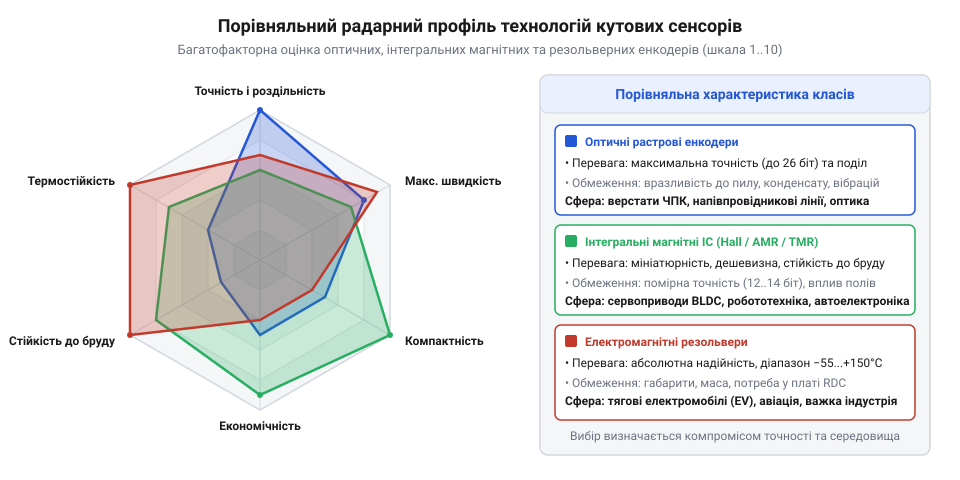
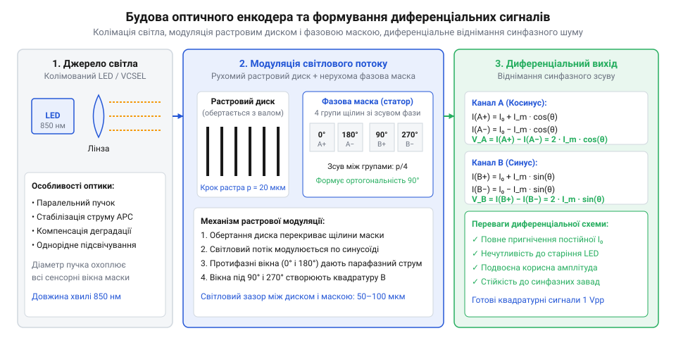
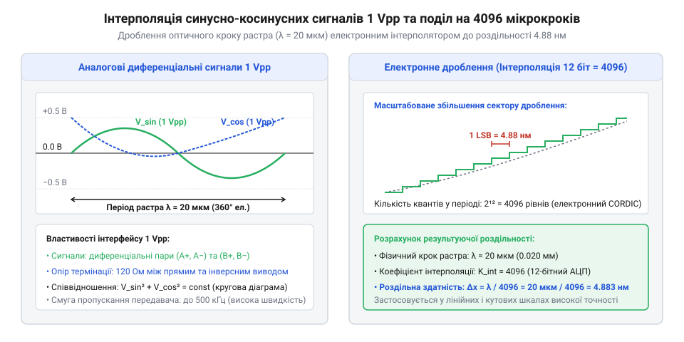
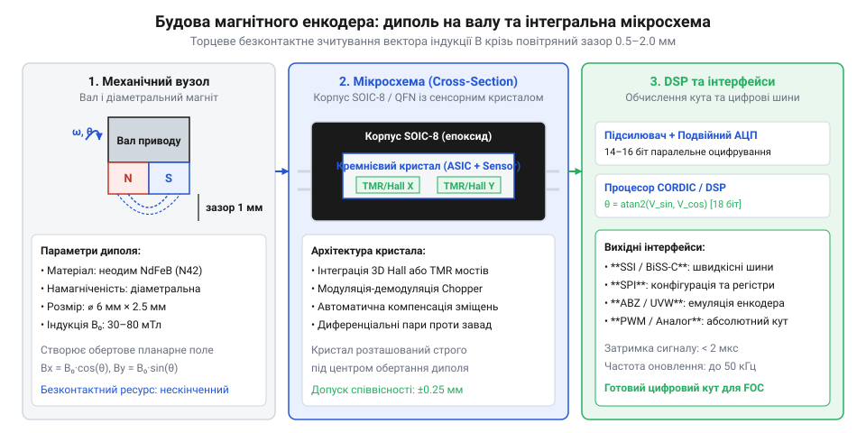
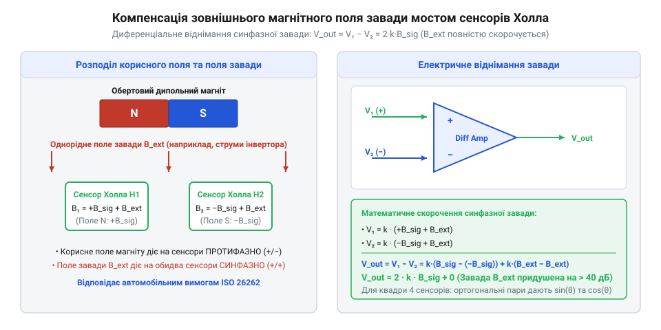
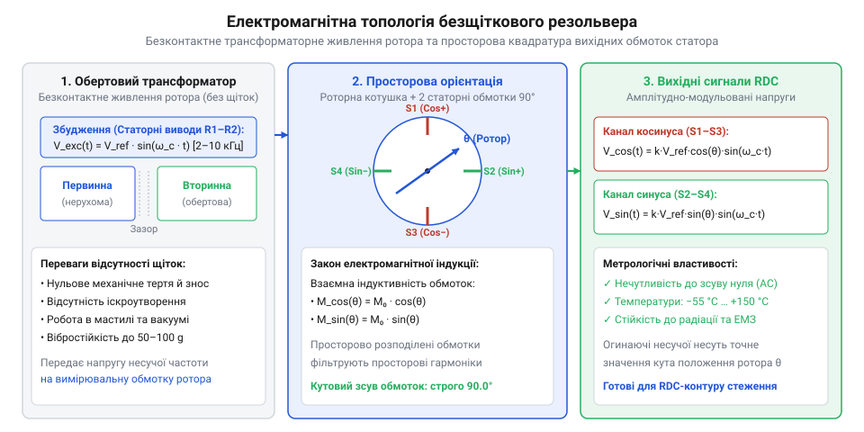
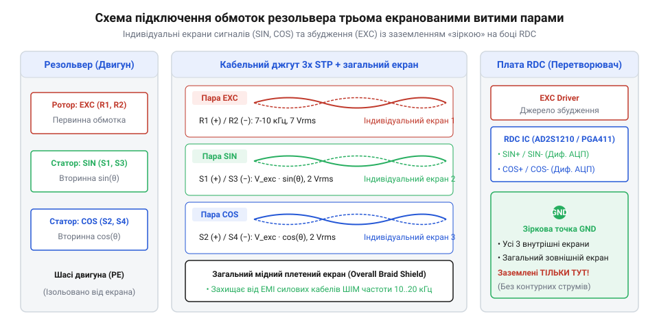
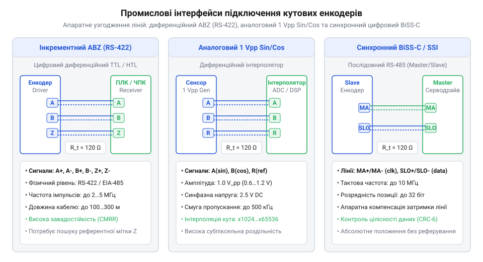

# Вимір кута

<preknowlist>
- [Оптичний енкодер](root:hw-sensing/optical-incremental-encoder) — растровий принцип зчитування штрихів
- [Холл-енкодери](root:hw-sensing/hall-magnetic-encoders) — виникнення ЕРС Холла в магнітному полі та інтегральні магнітні елементи
</preknowlist>

## Критерії вибору кутових сенсорів у системах руху

У сучасному промисловому електроприводі, робототехніці, аерокосмічній техніці та автоелектроніці вибір сенсора кутового положення вала є критичним інженерним компромісом. Жодна фізична технологія не є абсолютно універсальною: гранична оптична роздільність досягається коштом механічної вразливості, тоді як безпрецедентна надійність електромагнітного резольвера вимагає складних аналогових ланцюгів демодуляції та масивнішого корпусу.

Інженерний вибір базується на комплексному зіставленні п'яти ключових критеріїв:

1. **Метрологічна точність і роздільність** — верстати з ЧПК та прецизійні поворотні столи вимагають кутової дискретності на рівні часток кутової секунди (20–26 біт на оберт) для забезпечення мікронної точності позиціювання супорта, тоді як для загальнопромислових насосів, конвеєрних ліній чи вентиляції цілком достатньо 10–12 біт.
2. **Стійкість до агресивного робочого середовища** — наявність струмопровідного абразивного пилу, мастильного туману, охолоджувальних емульсій (МОР), агресивних хімічних парів, конденсату та прямих сонячних променів.
3. **Екстремальні механічні та термічні навантаження** — здатність витримувати циклічні вібраційні прискорення (20–50 g), поодинокі механічні удари (до 100–500 g) і розширений робочий діапазон температур (від −55 °C до +150 °C в авіаційних сервоприводах та тягових інверторах електротранспорту).
4. **Динамічна швидкодія та затримка сигналу** — часова затримка розрахунку кута (@@en|latency@@) є критичною для швидкодіючих векторних контурів керування струмом (FOC) двигунів із частотою обертання понад 20 000 об/хв. Затримка понад 5–10 мкс вносить фазове відставання в контур комутації обмоток, спричиняючи пульсації моменту й падіння ККД.
5. **Габарити, маса та вартість інтеграції** — компактність мініатюрних мікросхемних сенсорів (SOIC-8, QFN) для щільно скомпонованих суглобів роботів-маніпуляторів проти важких корпусних вузлів із власним підшипниковим вузлом і прецизійними муфтами.

Історично перші контактні [Потенціометр кута](root:hw-sensing/potentiometer-angle-sensor) були витіснені безконтактними оптичними [Оптичний енкодер](root:hw-sensing/optical-incremental-encoder), магнітними [Холл-енкодери](root:hw-sensing/hall-magnetic-encoders) та індуктивними перетворювачами.


*Пелюсткова діаграма порівняння параметрів оптичних, магнітних та індуктивних сенсорів: оптичні переважають за роздільністю та точністю, резольвери — за вібро- й термостійкістю, а магнітні сенсори пропонують оптимальний баланс вартості й компактності.*

### Порівняльний аналіз технологій вимірювання кута

Для систематизації інженерного вибору базові технічні та експлуатаційні характеристики трьох провідних класів кутових давачів зведено в порівняльну таблицю:

| Параметр / Критерій | Оптичні растрові енкодери | Магнітні інтегральні сенсори (Hall / AMR / TMR) | Електромагнітні резольвери (RDC) |
| :--- | :--- | :--- | :--- |
| **Фізичний принцип** | Модуляція світлового потоку прецизійним растровим диском | Векторний вимір просторової орієнтації магнітної індукції `B` | Електромагнітна індукція у змінному трансформаторному полі |
| **Гранична роздільність** | Екстремальна: 20–26 біт (до 67 108 864 імп/об) | Середня / висока: 12–18 біт (4096–262 144 відліків/об) | Висока: 12–16 біт (визначається розрядністю RDC) |
| **Абсолютна кутова точність** | Висока: ±1″ … ±10″ (кутові секунди) | Помірна: ±0.1° … ±0.5° (±6′ … ±30′ кутових мінут) | Добра: ±2′ … ±10′ (кутові мінути) |
| **Діапазон робочих температур** | Вузький: −20 °C … +85 °C (лімітовано деградацією LED та оптичного клею) | Широкий: −40 °C … +125 °C (автомобільний клас AEC-Q100 до +150 °C) | Екстремальний: −55 °C … +150 °C (спеціальні версії до +200 °C) |
| **Стійкість до ударів і вібрації** | Низька / помірна: скляні диски руйнуються при ударах > 50–100 g | Дуже висока: монолітний кристал без рухомих елементів (> 500 g) | Абсолютна: масивний суцільнометалевий пакет заліза ротора |
| **Чутливість до пилу, рідин і бруду** | Критична: непрозорі частки перекривають світлові щілини | Повна нечутливість до немагнітного пилу, оливи та вологи | Повна герметичність: працюють у мастилі та вакуумі |
| **Сприйнятливість до зовнішніх магнітних полів** | Повна несприйнятливість (діелектричні та металеві диски) | Чутливі: вимагають диференціальних схем або екранів | Нечутливі до постійних полів завдяки змінній несучій 2–10 кГц |
| **Гранична частота обертання** | 6 000–12 000 об/хв (обмежена швидкодією фотоприймачів) | 30 000–50 000 об/хв | 50 000–100 000 об/хв (застосування в турбодетандерах) |
| **Габарити та компонування** | Великі: потребують закритого корпусу та власних вальниць | Мікросхема (SOIC-8, QFN) + магніт 6×2.5 мм на валу | Корпусний електромеханічний вузол значної маси |
| **Відносна вартість** | Висока (високоточна оптика та механіка) | Низька (масове напівпровідникове виробництво) | Висока (точна намотка котушок + зовнішній RDC) |
| **Основні сфери застосування** | Верстати з ЧПК, робототехнічні руки високої точності | Сервоприводи безпілотників, робосуглоби, автокермо | Тягові електроприводи електромобілів, авіація |

Аналіз показує чіткий поділ галузей використання. Оптичні енкодери незамінні там, де головною вимогою є максимальна роздільність і метрологічна точність (мікроелектроніка, лазерна обробка, координатно-вимірювальні машини). Магнітні сенсори займають позицію лідера в масових комерційних сервоприводах, зчленованих зчленуваннях маніпуляторів і побутовій техніці завдяки неперевершеній щільності монтажу, низькій собівартості та нечутливості до цехового бруду. Електромагнітні резольвери залишаються безальтернативним вибором в автомобільній тязі, авіації та оборонній промисловості, де відмова датчика через перегрів чи ударне перевантаження неприпустима.

> 🔧 **Навіщо це.**
> Чітке розуміння фізичних обмежень технологій захищає розробника від фатальних помилок проєктування — наприклад, застосування тендітних скляних енкодерів у вібронавантажених дронах чи магнітних сенсорів поблизу відкритих сильних електромагнітних гальм без екранування.

## Оптичні енкодери: конструкція, роздільність та вразливості

Оптичні енкодери ([Абсолютний енкодер](root:hw-sensing/absolute-encoder-gray-code)) забезпечують найвищу досяжну точність та кутову роздільність серед усіх відомих типів датчиків кута. Вони є метрологічним еталоном у верстатобудуванні з ЧПК, прецизійному машинобудуванні та координатно-вимірювальних системах.


*Конструктивна будова оптичного енкодера: випромінювач, кодовий растровий диск, зчитувальна голівка з фотодіодною матрицею та схема формування диференціальних квадратурних сигналів.*

### Базова конструкція та матеріали кодових дисків

Конструктивно оптичний енкодер складається з трьох ключових вузлів:

1. **Джерело випромінювання** — колімований світлодіод інфрачервоного діапазону (LED, 850 нм) або вертикально-випромінювальний лазерний діод (VCSEL), що формує просторово однорідний паралельний світловий потік. Спеціальне коло автоматичного регулювання потужності (APC, @@en|Automatic Power Control@@) безперервно стабілізує інтенсивність світла при старінні кристала та температурних коливаннях.
2. **Кодовий растровий диск** — тонкий диск із нанесеними прозорими та непрозорими штрихами:
   - *Скляні диски з вакуумним хромовим напиленням* — забезпечують максимальну точність літографії (крок растра до 2–4 мкм), ідеальні оптичні контрасти та нульову пластичну деформацію, проте вразливі до ударів;
   - *Прецизійно травлені металеві диски (нікелеві та сталеві сплави)* — витримують вібраційні прискорення й механічні удари до 200–500 g, але технологічно обмежені мінімальною шириною штриха (крок 20–50 мкм);
   - *Оптичні полікарбонатні диски* — дешеві у великосерійному виробництві, проте мають високий температурний коефіцієнт лінійного розширення та схильні до помутніння під дією ультрафіолету й хімічних випарів.
3. **Зчитувальна головка з фотоприймачами** — фотодіодна матриця з нерухомою фазовою маскою, що містить чотири групи щілин зі зсувом у чверть періоду `p/4` (0°, 90°, 180°, 270°). Диференціальне віднімання протифазних струмів формує канали `A` та `B` для [Квадратура](root:hw-sensing/quadrature) та опорну мітку нуля `Z`.

### Диференціальне інтерференційне зчитування з дифракційною ґраткою

У класичному тіньовому (растровому) принципі зменшення періоду штрихів `p < 4 мкм` натрапляє на фундаментальну дифракційну межу: світлові хвилі огинають краї щілин, руйнуючи контраст геометричної тіні (ефект Тальбота).

Для подолання цього фізичного бар'єра у надпрецизійних енкодерах (роздільність 24–28 біт) застосовують **інтерференційний принцип зчитування з фазовою дифракційною ґраткою**. Когерентний лазерний промінь від VCSEL-випромінювача падає на відбивну або прохідну фазову ґратку диска з нанорельєфом глибиною `λ/4`. Світловий потік розщеплюється на дифракційні порядки (+1, 0, −1). 

Оптична система голівки спрямовує дифраговані промені +1-го та −1-го порядків на фазову маску статора, де вони інтерферують. У результаті накладання когерентних хвильових фронтів формується система інтерференційних смуг із подвоєною просторовою частотою — оптичний період інтерференційної картини становить:

```
p_eff = p / 2
```

При фізичному кроці ґратки `p = 1.024 мкм` період інтерференційного сигналу дорівнює лише `0.512 мкм`. При кутовому обертанні вала інтерференційна картина плавно зміщується вздовж фотодіодної матриці, генеруючи ідеальні аналогові гармонічні сигнали струму з надзвичайно низьким рівнем вищих оптичних спотворень.


*Аналогова синусоїда 1 Vpp та її поділ інтерполяційним ASIC-процесором: плавний перехід напруги розбивається на 4096 дискретних рівнів для досягнення роздільності 24 біти на оберт.*

### Аналогова інтерполяція 1 Vpp та досягнення 28 біт роздільності

Для отримання дискретності в десятки мільйонів відліків на оберт аналогові сигнали фотоприймачів нормалізуються до стандартизованого диференціального рівня `1 Vpp` (амплітуда від піка до піка 1.0 В на навантаженні 120 Ом). 

Вбудований інтерполяційний ASIC-процесор виконує оцифрування квадратурної пари високошвидкісними паралельними АЦП і здійснює тригонометричний поділ кожного електричного періоду на 4096…65536 підкроків. Поєднання диска з 16 384 штрихами та інтерполяції 4096x дає:

```
N = 16384 × 4096 = 67 108 864 відліків/об   (26 біт)
```

Кутова дискретність такого енкодера становить `0.019″` (кутової секунди), що дає змогу виявляти переміщення обода диска радіусом 50 мм на рівні одиниць нанометрів.

### Експлуатаційні вразливості оптичних систем

Незважаючи на рекордну точність, оптичні енкодери мають три критичні вразливості:

1. **Чутливість до забруднення оптичного тракту** — пилинка розміром 5–10 мкм або найтонша плівка конденсованої оливи перекриває десятки штрихів субмікронного растра, викликаючи миттєвий зрив синхронізації або помилку позиціювання.
2. **Крихкість скла при ударах і вібрації** — ударні хвилі амплітудою понад 50–100 g здатні розколоти прецизійний скляний диск, що обмежує застосування скляної оптики у вантажній техніці та бурових установках.
3. **Термічна деградація напівпровідникових випромінювачів** — за температур понад +85 °C квантовий вихід світлодіода експоненційно знижується, скорочуючи ресурс енкодера до 20 000–30 000 годин.

> 🔧 **Навіщо це.**
> Інтерференційне зчитування з подвоєнням просторової частоти дозволяє вийти за межі дифракції та створити енкодери субмікронної точності для верстатів напівпровідникової літографії та координатно-вимірювальних систем.

## Магнітні інтегральні енкодери: Hall, AMR, GMR та TMR

Магнітні інтегральні енкодери завоювали масовий ринок компактних приводів робототехніки, безпілотних літальних апаратів та автомобільної електроніки завдяки поєднанню надвисокої надійності, низької собівартості та повної нечутливості до цехового бруду.


*Конструкція магнітного енкодера: дипольний магніт на торці вала та інтегральна мікросхема з мостовими сенсорами й блоком цифрової обробки сигналів.*

### Компонування вузла та інтегральна архітектура

Сучасний магнітний енкодер об'єднує в єдиному пластиковому корпусі (SOIC-8, QFN-16) первинну сенсорну матрицю, прецизійні інструментальні підсилювачі з автонулем, багатоканальний АЦП та цифровий сигнальний процесор (DSP).

За кінематичною схемою монтажу магнітні давачі поділяють на дві конфігурації:

1. **Торцевий монтаж (On-Axis / End-of-Shaft)** — невеликий циліндричний магніт (діаметром 4–8 мм) із діаметральною намагніченістю (N-S) закріплюється на торці вала навпроти центра кристала мікросхеми з повітряним зазором 0.5–2.0 мм. Це найпростіша конфігурація для електродвигунів із глухим валом.
2. **Кільцевий бічний монтаж (Off-Axis / Through-Hole)** — для приводів із наскрізним валом (суглоби роботів із внутрішнім кабель-каналом, оптичні турелі) застосовують багатополюсне магнітне кільце з чергуванням полюсів N-S по колу. Сенсор розташовується збоку від обода кільця і зчитує періодичний магнітний растр.

Сенсорні структури виконують на базі чотирьох технологій: елементів [Холл-енкодери](root:hw-sensing/hall-magnetic-encoders), анізотропного (AMR, `ΔR/R₀ ≈ 2–3%`), гігантського (GMR, `ΔR/R₀ ≈ 10–20%`) або тунельного магнітоопору (TMR, `ΔR/R₀ ≈ 100–200%`). Мостові схеми формують ортогональні квадратурні напруги [Квадратура](root:hw-sensing/quadrature), а внутрішній DSP обчислює кут `θ = atan2(V_sin, V_cos)`.

### Диференціальна компенсація однорідних зовнішніх полів (Stray Field Immunity)

Головна вразливість магнітних сенсорів — потужні зовнішні паразитні магнітні поля розсіювання (@@en|stray magnetic fields@@), створювані силовими струмами статора електродвигуна (до кількох сотень амперів), лініями живлення інвертора та електромагнітними гальмами. Однорідне поле завади амплітудою всього 5–10 мТл здатне спотворити кутовий відлік звичайного датчика на 5°…15°.

Для повного пригнічення завади застосовують **диференціальну квадрупольну матрицю з 4 елементів Холла**, розміщених хрестоподібно на кристалі навколо осі обертання: `H₁` (0°), `H₂` (90°), `H₃` (180°), `H₄` (270°).


*Диференціальна топологія 4 елементів Холла: локальне поле диполя створює протифазні напруги на протилежних сенсорах, тоді як зовнішнє однорідне поле наводить синфазний зсув і повністю знищується при відніманні.*

**Математичний механізм диференціального пригнічення:**

Локальне магнітне поле обертового діаметрального диполя наводить у діаметрально протилежних сенсорних парах строго протифазні індукції:
```
B_dipole(H₁) = +B₀ · cos(θ)
B_dipole(H₃) = −B₀ · cos(θ)

B_dipole(H₂) = +B₀ · sin(θ)
B_dipole(H₄) = −B₀ · sin(θ)
```

Зовнішнє однорідне поле завади `B_ext` додається до всіх сенсорів із однаковим знаком і амплітудою:
```
B_total(H₁) = +B₀ · cos(θ) + B_ext_x
B_total(H₃) = −B₀ · cos(θ) + B_ext_x
```

Диференціальний інструментальний підсилювач виконує віднімання сигналів кожної пари:
```
V_cos
= S_H · [ B_total(H₁) − B_total(H₃) ]
= S_H · [ (+B₀ · cos(θ) + B_ext_x) − (−B₀ · cos(θ) + B_ext_x) ]
= 2 · S_H · B₀ · cos(θ)    [синфазна завада B_ext_x строго дорівнює нулю]
```

Аналогічно для синусного каналу:
```
V_sin
= S_H · [ B_total(H₂) − B_total(H₄) ]
= 2 · S_H · B₀ · sin(θ)
```

Диференціальна схема подвоює амплітуду корисного сигналу диполя і забезпечує коефіцієнт пригнічення зовнішніх магнітних полів понад 40–60 дБ. Це відповідає суворим вимогам автомобільного стандарту функціональної безпеки ISO 26262 для рульових електропідсилювачів та тягових інверторів.

> 🔧 **Навіщо це.**
> Квадрупольне диференціальне зчитування усуває необхідність встановлення важких і дорогих пермалоєвих екранів навколо датчика, забезпечуючи стабільну роботу енкодера безпосередньо біля потужних силових обмоток тягового двигуна.

## Електромагнітні резольвери та трансформатори RVDT

Коли умови експлуатації виходять за межі можливостей напівпровідникової електроніки, єдиним технічним рішенням залишаються суто індуктивні електричні машини — резольвери та RVDT-трансформатори.


*Електромагнітна схема резольвера: первинний обертовий трансформатор живлення ротора та дві взаємно ортогональні вторинні обмотки статора.*

Конструктивні особливості резольверів, що забезпечують їм екстремальну живучість:
- **Повна відсутність вбудованої електроніки:** у корпусі резольвера немає жодного напівпровідникового кристала, світлодіода чи друкованої плати. Він складається виключно зі сталевого магнітопроводу з кремнієвої сталі, мідного обмотувального дроту з високотемпературною поліімідною ізоляцією та високоміцного компаунду.
- **Безконтактна трансформаторна передача:** живлення на ротор подається через безконтактний обертовий трансформатор, усуваючи необхідність у струмознімальних кільцях і щітках.
- **Широкий температурний діапазон:** стандартне виконання працює від −55 °C до +150 °C, а спеціальні аерокосмічні та атомні модифікації витримують нагрівання до +200…+250 °C та іонізуючу радіацію до 100 Мрад.
- **Механічна витривалість:** суцільнометалевий корпус витримує вібраційні прискорення до 40–50 g у діапазоні до 2000 Гц і поодинокі удари до 500 g.

Поруч із резольверами кругового типу в системах керування літаками використовують кутові диференційні трансформатори RVDT (кутовий варіант [LVDT](root:hw-sensing/lvdt)). RVDT забезпечує практично безкінечну роздільність і надвисоку лінійність у межах обмеженого сектора (зазвичай ±30°…±60°), що ідеально підходить для педалей пілотів, стулок сопел та клапанів гідросистем.


*Підключення резольвера трьома індивідуально екранованими витими парами з єдиним заземленням на боці RDC для запобігання паразитним земляним петлям і синфазним завадам.*

## Промислові інтерфейси кутових сенсорів та зведена матриця вибору

Вибір фізичного принципу кутового сенсора визначає точність і надійність первинного перетворення, проте передача виміряного положення до цифрового контролера приводу (DSP, ПЛК або мікроконтролера керування рухом) залежить від електричного інтерфейсу та протоколу зв'язку. У промисловій автоматизації, робототехніці та сервоприводах сформувалися чотири основні класи сигнальних інтерфейсів:

### Квадратурні лінії ABZ та комутаційні фази UVW

Найпоширеніший інтерфейс для інкрементних енкодерів базується на диференціальних лініях цифрових логічних рівнів за стандартом RS-422 (EIA-422). Стандартний роз'єм містить три виті пари інформаційних сигналів: `A / /A`, `B / /B` та індексний маркер `Z / /Z`.

Для керування безщітковими синхронними двигунами (BLDC / PMSM) оптичні та магнітні енкодери часто оснащують додатковими трьома комутаційними каналами `U / /U`, `V / /V`, `W / /W`. Ці сигнали імітують виходи дискретних давачів Холла, генеруючи прямокутні імпульси з електричним зсувом 120°:

- Вони розбивають один електричний період двигуна на 6 комутаційних секторів по 60°.
- При першому ввімкненні живлення контролер миттєво зчитує сектор UVW і формує початковий пусковий струм обмоток статора без необхідності попереднього обертання ротора до Z-мітки.
- Після першого захоплення індексного імпульсу `Z` контролер перемикається з грубої комутації UVW на високоточний квадратурний відлік каналів `A` і `B`.


*Електричне узгодження сигнальних ланцюгів енкодерів: диференціальні лінії RS-422 для імпульсного ABZ, аналогові синусно-косинусні пари 1 Vpp та високошвидкісні синхронні шини даних BiSS-C/SSI з термінувальними резисторами 120 Ом.*

### Аналогові диференціальні виходи 1 Vpp (Sin/Cos)

Для подолання частотного бар'єра цифрових квадратурних ліній у прецизійних верстатах ЧПК застосовують аналоговий інтерфейс `1 Vpp` (від англ. @@en|1 Volt peak-to-peak@@):

- Оптична головка видає не прямокутні імпульси після компаратора, а чисті диференціальні синусно-косинусні напруги `(A+ − A−)` та `(B+ − B−)` з розмахом 1.0 В (від піку до піку 0.6…1.2 В) на узгодженому навантаженні 120 Ом.
- Кабель передає сигнали з частотою всього до 200–500 кГц, а глибока інтерполяція (множення роздільності у 1024, 2048 або 4096 разів через вбудований АЦП і CORDIC) виконується безпосередньо всередині приймального сервопідсилювача.

### Синхронні послідовні протоколи (SSI, BiSS-C, EnDat 2.2)

Абсолютні енкодери високої роздільності передають дані багаторозрядними цифровими пакетами через синхронні послідовні шини типу «точка-точка»:

1. **SSI (@@en|Synchronous Serial Interface@@):**
   - Найпростіший промисловий протокол на двох витих парах RS-422: лінія тактування `CLK` від контролера та лінія даних `DATA` від енкодера.
   - Дані передаються у коді Грея зі швидкістю тактування від 100 кГц до 2 МГц.
   - Початок і кінець пакета визначаються за тривалістю паузи на лінії тактування (моностабільний таймаут `t_m = 15…20 мкс`). Протокол односпрямований: контролер не може записати налаштування в енкодер.

2. **BiSS-C (@@en|Bidirectional / Serial / Synchronous@@, режим C):**
   - Відкритий високошвидкісний синхронний протокол зі швидкістю тактування до 10–12 МГц (до 10 Мбіт/с).
   - Забезпечує безперервну передачу положення (ізохронний режим) з мінімальною затримкою < 1 мкс.
   - Кожен кадр даних захищено 6-бітним циклічним надлишковим кодом CRC та містить два службові прапорці: `Error` (критична помилка, несправність світлодіода чи магнітного поля) та `Warn` (попередження про забруднення диска або наближення температурного ліміту), що дозволяє використовувати BiSS-C у системах функціональної безпеки до рівня SIL-3 / PL-e.
   - Підтримує двоспрямований зв'язок: по лінії `CLK` передаються команди конфігурації та читання внутрішньої пам'яті енкодера (EEPROM).

3. **EnDat 2.2 (Heidenhain):**
   - Фірмовий синхронний протокол високої надійності.
   - Окрім абсолютного кута передає телеметрію температури, журнал перевантажень, дані компенсаційних таблиць і заводські параметри двигуна (електронний шильдик).

4. **SPI / I2C:**
   - Застосовуються виключно для внутрішньоплатного з'єднання інтегральних магнітних сенсорів (на відстанях до 10–15 см) із локальним мікроконтролером через чутливість несиметричних TTL/CMOS ліній до електромагнітних завад двигуна.

### Зведена матриця інженерного вибору енкодера

| Критерій оцінки | Оптичний інкрементний | Оптичний абсолютний | Магнітний AMR / TMR | Безщітковий резольвер | RVDT-трансформатор |
| :--- | :--- | :--- | :--- | :--- | :--- |
| **Фізичний принцип** | Модуляція світлового потоку растровим диском | Багатодоріжковий код Грея / оптичний масив | Обертання вектора магнітного поля диполя | Електромагнітна трансформація амплітуди | Зміна диференціальної взаємоіндукції сердечника |
| **Роздільність** | До 24 біт (16 777 216 відліків) | До 26…32 біт (одно-/багатооборотний) | 12…18 біт (інтерполяція арктангенса) | 10…16 біт (залежить від RDC-перетворювача) | Аналогова нескінченна (лімітується АЦП) |
| **Абсолютна точність** | ±1″ … ±10″ (найвища) | ±5″ … ±20″ | ±0.1° … ±0.5° (середня) | ±5′ … ±20′ (вимагає калібрування) | ±0.25% … ±0.5% повної шкали |
| **Діапазон кута** | 0…360° (відносний, вимагає нульової Z-мітки) | 0…360° (абсолютний) + лічильник обертів | 0…360° (абсолютний на оберт) | 0…360° (абсолютний на пару полюсів) | Обмежений: ±30° … ±60° |
| **Робоча температура** | −20 … +85 °C (ліміт: LED та клей) | −20 … +85 °C | −40 … +125 °C (автомобільний клас) | −55 … +150 °C (до +200 °C спецверсії) | −55 … +150 °C |
| **Стійкість до ударів / вібрації** | Низька (крихке скло: 10–20 g) | Низька / середня (20–50 g) | Висока (твердотільний: 50–100 g) | Екстремальна (> 100 g, без електроніки) | Екстремальна (> 100 g) |
| **Стійкість до пилу / мастила** | Дуже чутливий (вимагає герметизації IP65/67) | Дуже чутливий | Нечутливий до пилу та мастила | Абсолютно нечутливий | Абсолютно нечутливий |
| **Чутливість до магнітних полів** | Повна інваріантність | Повна інваріантність | Вимагає екранування від полів двигуна | Стійкий (працює на змінній несній) | Стійкий |
| **Основні інтерфейси** | Квадратурний TTL / RS-422 (ABZ), 1 Vpp | BiSS-C, EnDat 2.2, SSI, RS-485 | SPI, I2C, PWM, емуляція ABZ | Синусно-косинусні обмотки (несна 2–10 кГц) | Диференціальні котушки вторинного ланцюга |
| **Типові галузі** | Верстати ЧПК, поліграфія, текстильні машини | Сервоприводи роботів, поворотні столи, медицина | Автомобільні педалі, вентилятори, побутові приводи | Тягові двигуни електромобілів, авіація, важка техніка | Клапани літаків, гідравлічні розподільники, ПАЕС |

> 🔧 **Навіщо це.**
> Зведена матриця запобігає класичним помилкам проектування: вибору крихкого оптичного диска у важкий дизельний або будівельний привід чи вибору низькоточного магнітного сенсора для шпинделя прецизійного фрезерного обробного центру.
