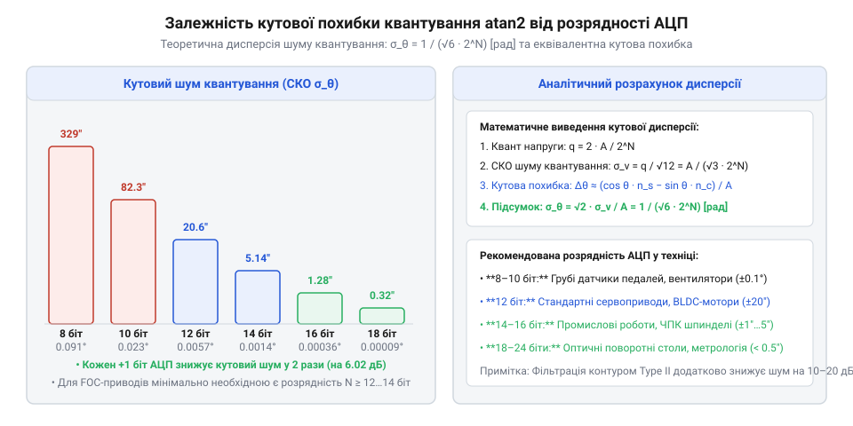
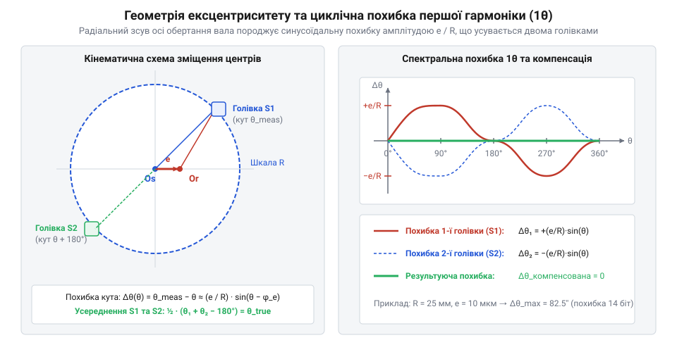
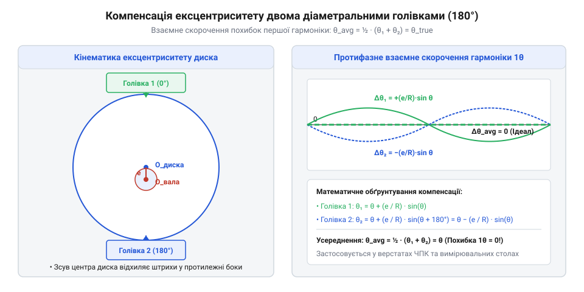
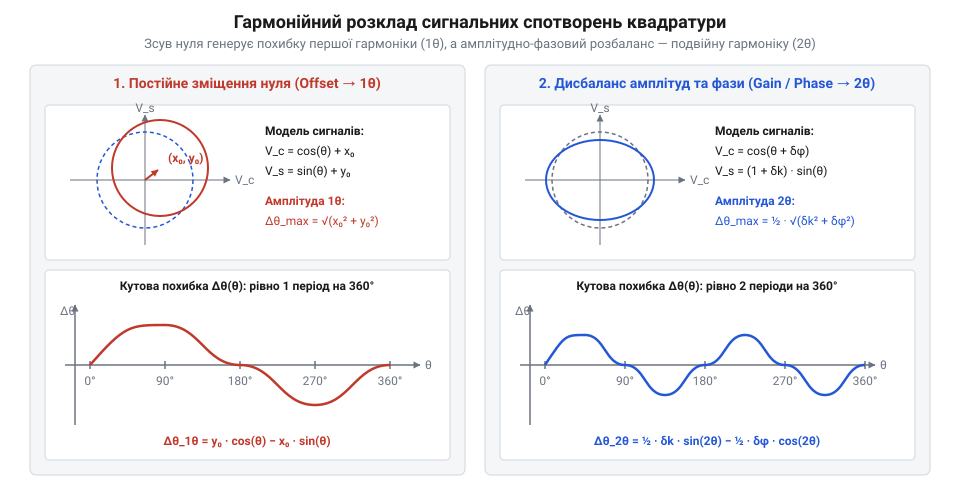
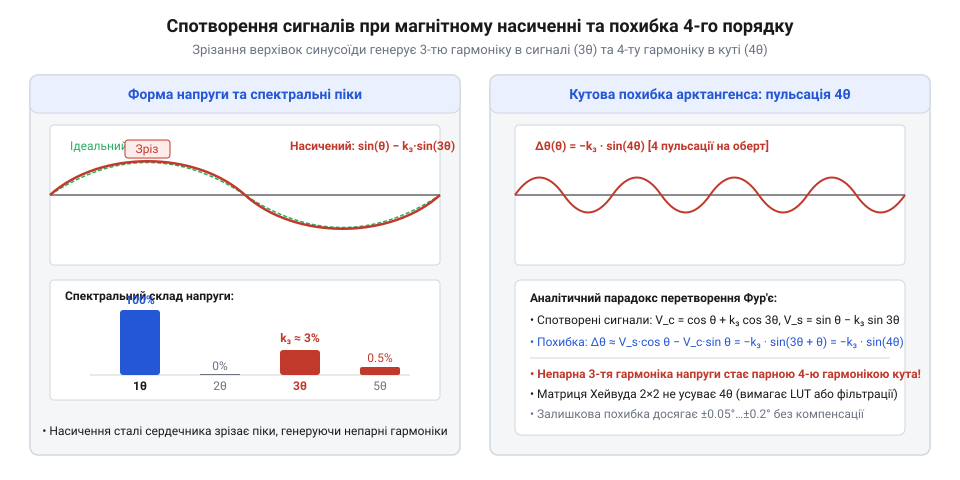
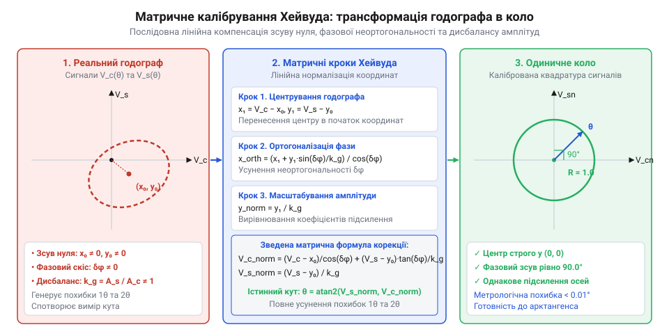
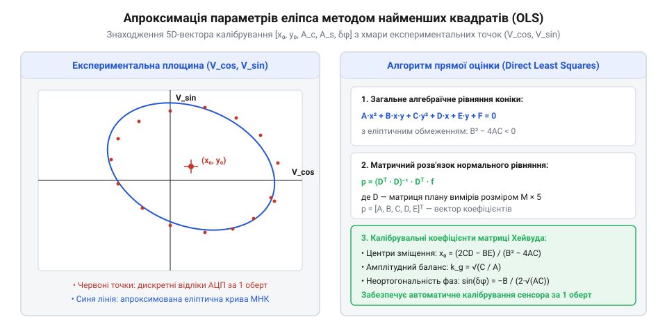

# Вимір кута

<preknowlist>
- [Квадратура](root:hw-sensing/quadrature) — принцип ортогональних сигналів зі зсувом фази 90 градусів
</preknowlist>

## Неідеальності сигналів та обмеження наївного арктангенса

У теоретичних моделях синусно-косинусні канали кутових давачів ([Квадратура](root:hw-sensing/quadrature)) розглядають як пару строго ортогональних гармонічних сигналів з однаковою амплітудою та нульовим постійним зміщенням. За таких ідеальних умов розрахунок кута вала зводиться до простої функції чотириквадрантного арктангенса:

```
θ = atan2(V_sin, V_cos)
```

На практиці будь-який фізичний давач — оптичний [Оптичний енкодер](root:hw-sensing/optical-incremental-encoder), магніторезистивний [Холл-енкодери](root:hw-sensing/hall-magnetic-encoders) чи індуктивний резольвер — зазнає впливу механічних неточностей монтажу, технологічного розкиду параметрів мостових елементів, деградації фотодіодів та температурного дрейфу підсилювачів. Реальні вихідні напруги описуються рівняннями з чотирма видами апаратних похибок:

```
V_cos(t) = (A + δA_c) · cos(θ + δφ) + V_off_c + n_c(t)
V_sin(t) = (A + δA_s) · sin(θ) + V_off_s + n_s(t)
```

де `A` — номінальна амплітуда сигналу;
`δA_c`, `δA_s` — амплітудний розбаланс каналів косинуса та синуса;
`V_off_c`, `V_off_s` — постійні зміщення нуля (@@en|offset@@);
`δφ` — похибка фазової квадратури (відхилення кута між сенсорами від 90°);
`n_c(t)`, `n_s(t)` — випадковий шум електронного тракту.

Якщо подати ці несиметричні та зміщені сигнали безпосередньо у функцію `atan2`, отриманий кут `θ_meas` відхилятиметься від істинного геометричного кута вала `θ` на періодичну похибку `Δθ = θ_meas − θ`.

### Математична модель кутового шуму квантування АЦП

Окрім аналогових спотворень амплітуди й фази, фундаментальне обмеження на точність арктангенса накладає процес аналого-цифрового перетворення. Нехай диференціальні напруги оцифровуються N-розрядним АЦП із повною шкалою `V_FS` та амплітудою сигналу `A ≤ V_FS / 2`.

Крок квантування АЦП становить `q = V_FS / 2ᴺ`. Похибка квантування кожного каналу моделюється некорельованим білим шумом із дисперсією:

```
σ_q² = q² / 12 = V_FS² / (12 · 2²ᴺ)
```


*Залежність кутового шуму квантування від розрядності АЦП: кожен додатковий біт розрядності знижує середньоквадратичну похибку арктангенса вдвічі (на 6 дБ).*

Для визначення чутливості розрахованого кута `θ = atan(V_s / V_c)` знайдемо повний диференціал функції:

```
dθ
= (∂θ / ∂V_s) · dV_s + (∂θ / ∂V_c) · dV_c
= (V_c / (V_c² + V_s²)) · dV_s − (V_s / (V_c² + V_s²)) · dV_c
= (A · cos(θ) / A²) · dV_s − (A · sin(θ) / A²) · dV_c
= (cos(θ) / A) · dV_s − (sin(θ) / A) · dV_c
```

Дисперсія кутового шуму `σ_θ²` визначається сумою дисперсій незалежних шумів квантування `dV_s` та `dV_c`:

```
σ_θ²
= (cos²(θ) / A²) · σ_q² + (sin²(θ) / A²) · σ_q²
= (cos²(θ) + sin²(θ)) · (σ_q² / A²)
= σ_q² / A²
= q² / (12 · A²)
```

Завдяки тригонометричній тотожності `cos²(θ) + sin²(θ) = 1` дисперсія кутового шуму квантування є строго ізотропною — вона абсолютно не залежить від поточного положення вала `θ`.

Середньоквадратичне відхилення (RMS) кутової похибки арктангенса становить:

```
σ_θ = q / (√12 · A) = (V_FS / A) · (1 / (√12 · 2ᴺ))   [радіан]
```

У градусній мірі при повному використанні шкали АЦП (`2A = V_FS`):

```
σ_θ_deg = (180° / π) · (2 / (√12 · 2ᴺ)) ≈ 33.07° / 2ᴺ
```

При 10-розрядному АЦП (`N = 10`) середньоквадратичний шум квантування досягає `σ_θ ≈ 0.032°` (близько 2 кутових мінут), що неприпустимо для прецизійного векторного керування. Застосування 16-розрядного АЦП (`N = 16`) знижує шум до `σ_θ ≈ 0.0005°` (1.8 кутової секунди), усуваючи високочастотне тремтіння в контурі регулювання струму FOC.

У прецизійних сервоприводах із векторним керуванням (FOC) помилка вимірювання кута ротора навіть у 0.1° спричиняє паразитні пульсації електромагнітного моменту на високих гармоніках, породжує підвищений акустичний шум, вібрації механічної передачі та надлишкове нагрівання обмоток двигуна.

> 🔧 **Навіщо це.**
> Математичний аналіз джерел сигнальних неідеальностей та шуму квантування АЦП задає строгі вимоги до розрядності аналогового тракту й дає змогу відокремити детерміновані гармонійні похибки від випадкового шуму для подальшої компенсації.

## Геометрична модель ексцентриситету монтажуНайвагомішим механічним джерелом похибки в кутових сенсорах є геометричний ексцентриситет — радіальне неспівпадання геометричного центру кодового диска (або ротора резольвера) з фізичною віссю обертання вала двигуна.


*Геометрія зміщення осі обертання ротора відносно центру шкали зчитування: радіальний зсув на величину e викликає циклічну синусоїдальну кутову похибку першої гармоніки з амплітудою e / R.*

Нехай `O_s` — геометричний центр кругової шкали зчитування з радіусом доріжки `R`, а `O_r` — реальний центр обертання вала. Вектор ексцентриситету задається відстанню зміщення `e = |O_r − O_s|` та початковим просторовим кутом нахилу `φ_e`.

При обертанні вала на кут `θ` точка шкали навпроти нерухомої зчитувальної головки переміщується на тангенціальну відстань, що відрізняється від номінальної дуги кола. Зв'язок між виміряним кутом `θ_meas` та істинним кутом `θ` визначається з трикутника `O_r O_s P`:

```
tan(θ_meas − φ_e) = (R · sin(θ − φ_e)) / (R · cos(θ − φ_e) + e)
```

Оскільки в реальних конструкціях величина ексцентриситету значно менша за радіус шкали (`e ≪ R`), проведемо лінеаризацію виразу через розклад у ряд Тейлора за малим параметром `e / R`:

```
θ_meas − φ_e
= arctan( (sin(θ − φ_e)) / (cos(θ − φ_e) + e / R) )
= (θ − φ_e) + (e / R) · sin(θ − φ_e) + O((e / R)²)    [розклад Тейлора при e/R ≪ 1]
```

Звідси отримуємо фундаментальне рівняння кутової похибки першої гармоніки:

```
Δθ_ecc(θ) = θ_meas − θ ≈ (e / R) · sin(θ − φ_e)
```

Максимальна амплітуда похибки досягається двічі за повний оберт вала при кутах `θ = φ_e ± 90°` і дорівнює:

```
Δθ_max = e / R    [радіан]
```

**Чисельний приклад розрахунку:**
Припустимо, прецизійний оптичний енкодер має радіус растрової доріжки `R = 25 мм` (`25 × 10⁻³ м`), а радіальне биття вала в підшипниковому вузлі становить `e = 10 мкм` (`10 × 10⁻⁶ м`).

```
Δθ_max
= (10 × 10⁻⁶ м) / (25 × 10⁻³ м)
= 0.0004 рад
= 0.0004 × (180 / π)°
= 0.0229° ≈ 82.5″    [кутові секунди]
```

Похибка у 82.5 кутових секунд перевищує ціну поділки 14-бітного енкодера (79.1″), що робить вищі розряди вимірювання недостовірними без механічного юстування або схемної компенсації.

Найефективнішим апаратним методом повного придушення похибки першої гармоніки є встановлення двох діаметрально протилежних зчитувальних головок під кутом 180°:

```
θ_meas1(θ) = θ + (e / R) · sin(θ − φ_e)
θ_meas2(θ) = θ + π + (e / R) · sin(θ + π − φ_e)
           = θ + π − (e / R) · sin(θ − φ_e)    [оскільки sin(α + π) = −sin(α)]
```

Обчислення середнього арифметичного значення кутів двох головок усуває похибку ексцентриситету:

```
θ_corr = ½ · (θ_meas1 + (θ_meas2 − π)) = θ
```

### Кутовий перекіс осі вала (Tilt / Wobble) та гармоніка 2θ

Окрім радіального зміщення центру обертання, у реальних підшипникових опорах виникає кутовий перекіс осі обертання вала (@@en|tilt / wobble@@) відносно нормалі до площини растрового диска або плати сенсора на малий кут `γ`.

При нахилі площини обертання на кут `γ` кругова шкала радіуса `R` проектується на чутливу площину фотоприймачів у формі еліпса з півосями `a = R` та `b = R · cos(γ)`. 

Зв'язок між виміряним кутом у площині зчитування та істинним просторовим кутом повороту вала визначається проекційним рівнянням:

```
tan(θ_meas)
= (R · cos(γ) · sin(θ)) / (R · cos(θ))
= cos(γ) · tan(θ)
```

Знайдемо кутову похибку нахилу `Δθ_tilt = θ_meas − θ` через тригонометричну різницю тангенсів:

```
tan(θ_meas − θ)
= (tan(θ_meas) − tan(θ)) / (1 + tan(θ_meas) · tan(θ))
= ((cos(γ) − 1) · tan(θ)) / (1 + cos(γ) · tan²(θ))
```

Для малих кутів перекосу `γ ≪ 1` розкладемо `cos(γ) ≈ 1 − ½ · γ²`:

```
tan(θ_meas − θ)
≈ (−½ · γ² · tan(θ)) / (1 + tan²(θ))
= −½ · γ² · sin(θ) · cos(θ)
= −¼ · γ² · sin(2θ)                    [подвійна гармоніка кутової похибки]
```

Оскільки при малих кутах `tan(Δθ) ≈ Δθ`, отримуємо аналітичну залежність похибки перекосу:

```
Δθ_tilt(θ)
= −¼ · γ² · sin(2 · (θ − φ_tilt))      [похибка другої гармоніки 2θ]

Δθ_tilt_max
= ¼ · γ²                               [максимальна амплітуда похибки в радіанах]
```

**Чисельний приклад розрахунку перекосу осі:**

Нехай кутовий перекіс вала серводвигуна через неточність фланцевого кріплення становить `γ = 0.5°` (`0.008727 рад`).

1. Розрахунок максимальної амплітуди похибки в радіанах:

```
Δθ_tilt_max
= ¼ · (0.008727 рад)²
= ¼ · 7.616 × 10⁻⁵
= 1.904 × 10⁻⁵ рад
```

2. Переведення похибки у кутові секунди:

```
Δθ_tilt_arcsec
= 1.904 × 10⁻⁵ · (180 / 3.14159) · 3600
= 1.904 × 10⁻⁵ · 206265″
= 3.93″                                [кутові секунди]
```

Якщо кутовий перекіс досягає `γ = 2°` (`0.0349 рад`), амплітуда зростає пропорційно квадрату кута і досягає `Δθ_tilt_max = 62.9″` (понад одну кутову мінуту).

Фундаментальна відмінність перекосу (tilt) від радіального ексцентриситету полягає у тому, що перекіс генерує похибку другої гармоніки (`2θ`), яка має однаковий знак у діаметрально протилежних точках (`sin(2(θ + π)) = sin(2θ + 2π) = sin(2θ)`). Тому дві зчитувальні головки під 180° **не компенсують** похибку нахилу. Для повного геометричного усунення як ексцентриситету (`1θ`), так і перекосу (`2θ`), застосовують систему з чотирьох оптичних головок, розташованих квадрантно під кутами 0°, 90°, 180° та 270°.

> 🔧 **Навіщо це.**
> Математичне розділення похибок на 1θ (радіальний зсув) та 2θ (кутовий перекіс осі) дозволяє під час випробувань енкодера за спектром кутової похибки точно визначити тип механічного дефекту монтажу та обрати необхідну кількість головок зчитування.


*Апаратна компенсація радіального ексцентриситету: усереднення показань двох діаметрально протилежних голівок (під 180°) взаємно компенсує похибку першої гармоніки 1θ.*

## Гармонійний розклад сигнальних спотворень

Розглянемо аналітичну модель формування квадратурних напруг із повним набором апаратно-схемних похибок. Нормалізуємо номінальну амплітуду до одиниці та введемо безрозмірні параметри збурень:

```
V_c(θ) = cos(θ + δφ) + x₀
V_s(θ) = (1 + δk) · sin(θ) + y₀
```

де `x₀ = V_off_c / A`, `y₀ = V_off_s / A` — відносні постійні зміщення нуля;
`δk = (A_s − A_c) / A_c` — коефіцієнт амплітудного розбалансу;
`δφ` — кутова похибка квадратури (неортогональність).


*Спектральний розподіл кутових похибок: постійні зміщення формують гармоніку 1θ, тоді як амплітудний розбаланс та неортогональність фаз генерують подвійну гармонійну складову 2θ.*

Виміряний кут визначається як `θ_meas = arctan(V_s / V_c)`. Знайдемо кутову похибку `Δθ = θ_meas − θ` через лінеаризацію функції `arctan`:

```
Δθ
= arctan( ((1 + δk) · sin(θ) + y₀) / (cos(θ + δφ) + x₀) ) − θ
```

Застосуємо формулу тангенса різниці двох кутів `tan(θ_meas − θ) = (tan θ_meas − tan θ) / (1 + tan θ_meas · tan θ)`. При малих похибках `tan(Δθ) ≈ Δθ`:

```
Δθ
≈ (V_s · cos(θ) − V_c · sin(θ)) / (V_s · sin(θ) + V_c · cos(θ))
```

Підставимо вирази для `V_s` та `V_c`, розкривши `cos(θ + δφ) ≈ cos(θ) − δφ · sin(θ)`:

```
Чисельник
= [(1 + δk) · sin(θ) + y₀] · cos(θ) − [cos(θ) − δφ · sin(θ) + x₀] · sin(θ)
= sin(θ)·cos(θ) + δk · sin(θ)·cos(θ) + y₀ · cos(θ) − sin(θ)·cos(θ) + δφ · sin²(θ) − x₀ · sin(θ)
= y₀ · cos(θ) − x₀ · sin(θ) + δk · sin(θ)·cos(θ) + δφ · sin²(θ)
```

Знаменник у нульовому наближенні дорівнює `sin²(θ) + cos²(θ) = 1`. Перетворимо добутки та квадрати тригонометричних функцій через подвійні кути:
- `sin(θ) · cos(θ) = ½ · sin(2θ)`
- `sin²(θ) = ½ · (1 − cos(2θ))`

Звідси дістаємо повний гармонійний розклад кутової похибки:

```
Δθ(θ)
= [ y₀ · cos(θ) − x₀ · sin(θ) ]            [перша гармоніка 1θ: похибка зсуву нуля]
+ [ ½ · δk · sin(2θ) − ½ · δφ · cos(2θ) ]  [друга гармоніка 2θ: амплітудна й фазова несиметрія]
+ ½ · δφ                                   [постійний кутовий фазовий зсув]
```

З аналітичного розкладу випливають два фундаментальні закони метрології кутових сенсорів:
1. **Зсув нуля генерує похибку першої гармоніки (`1θ`):** Амплітуда коливання дорівнює `√(x₀² + y₀²)`.
2. **Амплітудний та фазовий дисбаланс генерують похибку другої гармоніки (`2θ`):** Навіть якщо нуль ідеальний, різниця підсилення на 1% (`δk = 0.01`) або перекіс фаз на 1° (`δφ = 0.0175 рад`) породжують подвійну циклічну похибку з амплітудою близько 0.3°…0.5°.

### Вплив вищих непарних гармонік (3θ, 5θ) та магнітного насичення

У реальних електромагнітних резольверах, датчиках кута на змінному магнітоопорі (VR-резольверах) та магніторезистивних мостах форма сигналів відхиляється від ідеальної гармонійної синусоїди. Головною причиною є нелінійність кривої намагнічування феромагнітної сталі сердечника (B-H петля) та зубцеві гармоніки пазів статора.

При наближенні індукції до насичення `B_sat` верхівки синусоїди зрізаються («сплощуються»), що описується розкладом у ряд Фур'є з домінуванням непарних просторових гармонік:

```
V_c(θ) = cos(θ) + k₃ · cos(3θ) + k₅ · cos(5θ)
V_s(θ) = sin(θ) − k₃ · sin(3θ) + k₅ · sin(5θ)
```

де `k₃` — відносний коефіцієнт третьої гармоніки (типово 0.5%…3%), `k₅` — коефіцієнт п'ятої гармоніки (0.1%…0.8%). Знаки перед гармоніками визначаються просторовою симетрією розподілених обмоток резольвера під кутом 90°.


*Форма спотворених синусно-косинусних сигналів при насиченні магнітопроводу та виникнення циклічної похибки 4-го порядку (4θ) після обчислення кута через арктангенс.*

Обчислимо вплив третьої гармоніки на результуючу кутову похибку `Δθ_sat(θ)`. Підставимо спотворені сигнали в лінеаризований вираз різниці:

```
Δθ_sat(θ)
≈ V_s(θ) · cos(θ) − V_c(θ) · sin(θ)
= [ sin(θ) − k₃ · sin(3θ) ] · cos(θ) − [ cos(θ) + k₃ · cos(3θ) ] · sin(θ)
= sin(θ) · cos(θ) − k₃ · sin(3θ) · cos(θ) − cos(θ) · sin(θ) − k₃ · cos(3θ) · sin(θ)
= −k₃ · [ sin(3θ) · cos(θ) + cos(3θ) · sin(θ) ]
```

Застосувавши тригонометричну формулу синуса суми `sin(α + β) = sin α · cos β + cos α · sin β`, отримуємо точний аналітичний вираз:

```
Δθ_sat(θ) = −k₃ · sin(4θ)
```

Аналогічно, для п'ятої гармоніки `k₅` похибка розгортається у вищу складову:

```
Δθ_5(θ) = k₅ · sin(6θ)
```

Цей висновок розкриває важливу закономірність перетворення спектра в кутових датчиках:
- **Непарні гармоніки сигналів породжують парні вищі гармоніки кутової похибки:** Третя гармоніка `3θ` напруги перетворюється на пульсацію кута **четвертого порядку (`4θ`)**, а п'ята гармоніка `5θ` — на пульсацію **шостого порядку (`6θ`)**.
- **Неможливість корекції матрицею 2×2:** Лінійна матрична трансформація Хейвуда усуває лише афінні спотворення еліпса (гармоніки 1θ та 2θ), проте вона нездатна виправити квадратне або ромбічне викривлення годографа, викликане гармоніками 3θ/4θ.
- **Методи компенсації:** Для пригнічення похибок вищих порядків застосовують калібрувальні таблиці поправок (Look-Up Table, LUT) у пам'яті DSP або апаратне скошування пазів ротора резольвера (skewing), що фізично фільтрує вищі просторові гармоніки магнітного потоку.

> 🔧 **Навіщо це.**
> Спектральний аналіз похибки через швидке перетворення Фур'є (FFT) дає змогу миттєво діагностувати фізичну причину спотворення сигналу в приводі: гармоніка 1θ вказує на зміщення нуля чи биття вала, гармоніка 2θ — на неточний коефіцієнт підсилення чи перекіс фаз, а гармоніка 4θ свідчить про перевантаження за струмом збудження та магнітне насичення статора резольвера.

## Еліптичне представлення годографа та матрична нормалізація Хейвуда

Якщо відкласти сигнал косинусного каналу `V_c(θ)` по осі абсцис, а синусного `V_s(θ)` по осі ординат, геометричне місце точок кінця вимірювального вектора (годограф) утворює замкнену криву другого порядку. В ідеальному випадку квадратури це коло одиничного радіуса з центром строго в початку координат: `x² + y² = 1`.

При наявності зміщень нуля `(x₀, y₀)`, різного коефіцієнта підсилення каналів `k_g = A_s / A_c` та фазової неортогональності `δφ` коло деформується у нахилений та зміщений еліпс:

```
A_e · x² + B_e · x · y + C_e · y² + D_e · x + E_e · y + 1 = 0
```


*Геометрична нормалізація траєкторії годографа: послідовний зсув центру, виправлення фазового скосу та вирівнювання коефіцієнтів підсилення переводять деформований еліпс у каліброване одиничне коло.*

### Трьохкроковий матричний алгоритм Хейвуда

Для відновлення істинного кута обертання вала необхідно виконати лінійну математичну трансформацію координат, яка деформований еліпс повертає в ідеальне одиничне коло. Алгоритм Хейвуда (@@en|Heywood Calibration@@) реалізує цю нормалізацію у три послідовні матричні операції:

1. **Центрування (компенсація постійного зміщення нуля `x₀, y₀`):**
```
x₁ = V_c − x₀
y₁ = V_s − y₀
```

2. **Ортогоналізація Грама-Шмідта (компенсація фазового перекосу `δφ`):**
Оскільки спотворений сигнал косинуса має вигляд `x₁ = cos(θ + δφ) = cos(θ)·cos(δφ) − sin(θ)·sin(δφ)`, а синусний `y₁ = k_g · sin(θ)`:
```
sin(θ) = y₁ / k_g
cos(θ) · cos(δφ) = x₁ + sin(θ) · sin(δφ) = x₁ + (y₁ / k_g) · sin(δφ)
```
Звідси виправлена ортогональна косинусна складова дорівнює:
```
x_orth = x₁ / cos(δφ) + y₁ · (tan(δφ) / k_g)
```

3. **Масштабування амплітуд (вирівнювання коефіцієнтів підсилення):**
Нормалізуючи амплітуду синусного каналу до косинусного діленням на `k_g`, отримуємо остаточну калібровану пару:
```
V_c_norm = x_orth = (V_c − x₀) / cos(δφ) + (V_s − y₀) · tan(δφ) / k_g
V_s_norm = (V_s − y₀) / k_g
```

У зведеній матричній формі оператор калібрування Хейвуда `M_h` записується як:

```
[ V_c_norm ]   [ 1 / cos(δφ)    tan(δφ) / k_g ]   [ V_c − x₀ ]
[          ] = [                              ] · [          ]
[ V_s_norm ]   [      0             1 / k_g   ]   [ V_s − y₀ ]
```

Істинний кут обчислюється через нескоригований арктангенс відновлених сигналів: `θ = atan2(V_s_norm, V_c_norm)`.

### Рекурсивне ітеративне автокалібрування в реальному часі

Класичне пакетне калібрування методом найменших квадратів (OLS) вимагає накопичення масиву з сотень чи тисяч точок `(V_c[i], V_s[i])` за повний тестовий оберт вала та обчислення псевдооберненої матриці `(XᵀX)⁻¹Xᵀ`. В мікроконтролерних вбудованих системах керування рухом це створює дві проблеми: дефіцит оперативної пам'яті (RAM) та нездатність відстежувати повільний температурний дрейф параметрів під час тривалої роботи.

Для усунення цих обмежень застосовують потоковий рекурсивний алгоритм стохастичної апроксимації (або рекурсивний МНК з коефіцієнтом забування `λ`), який оновлює 4 калібрувальні коефіцієнти `(x₀, y₀, k_g, δφ)` на кожному новому відліку АЦП зі складністю `O(1)` за часом і пам'яттю:

1. **Поточна оцінка центрів (DC offsets):**
Обчислюється ковзним експоненційним середнім (EMA) із малим коефіцієнтом адаптації `γ_offset` (типово `10⁻⁴ … 10⁻⁵`):
```
x₀(k) = (1 − γ_offset) · x₀(k−1) + γ_offset · V_c(k)
y₀(k) = (1 − γ_offset) · y₀(k−1) + γ_offset · V_s(k)
```

2. **Поточна оцінка фазової неортогональності `δφ`:**
Математичне сподівання добутку центрованих сигналів `x₁(θ) = A_c·cos(θ + δφ)` та `y₁(θ) = A_s·sin(θ)` за повний оберт дає:
```
E[x₁ · y₁]
= E[ A_c·A_s·cos(θ + δφ)·sin(θ) ]
= E[ A_c·A_s·(cos(θ)cos(δφ) − sin(θ)sin(δφ))·sin(θ) ]
= ½ · A_c · A_s · sin(δφ)    [оскільки E[cos(θ)sin(θ)] = 0, E[sin²(θ)] = ½]
```
Звідси похибка фази `δφ` пропорційна середньому перехресному добутку `x₁(k) · y₁(k)`. Рекурсивне оновлення оцінки синуса неортогональності виконується як:
```
s_phi(k) = (1 − γ_phase) · s_phi(k−1) + γ_phase · (2 · x₁(k) · y₁(k) / (R_est²))
```

3. **Поточна оцінка амплітудного дисбалансу `k_g`:**
Порівнянням середніх квадратів центрованих сигналів `E[x₁²] = ½ A_c²` та `E[y₁²] = ½ A_s²`:
```
k_g(k) = √ ( E_sq_y(k) / E_sq_x(k) )
```
де `E_sq_x(k)` та `E_sq_y(k)` оновлюються аналогічними фільтрами низьких частот першого порядку.

Таке безмасивне онлайн-калібрування безперервно підлаштовує параметри матриці Хейвуда безпосередньо під час робочого обертання двигуна, гарантуючи пригнічення гармонік 1θ та 2θ до рівня менше 0.005° незалежно від нагрівання сенсора та механічних вібрацій.

> 🔧 **Навіщо це.**
> Калібрування за методом Хейвуда повністю ліквідує гармоніки 1θ та 2θ в режимі реального часу, підвищуючи реальну точність оптичних і магнітних енкодерів у 5–10 разів без заміни механічних вузлів.


*Хмара сирих експериментальних вимірів (V_cos, V_sin) та апроксимація параметрів еліпса методом найменших квадратів для знаходження калібрувальної матриці Хейвуда.*
